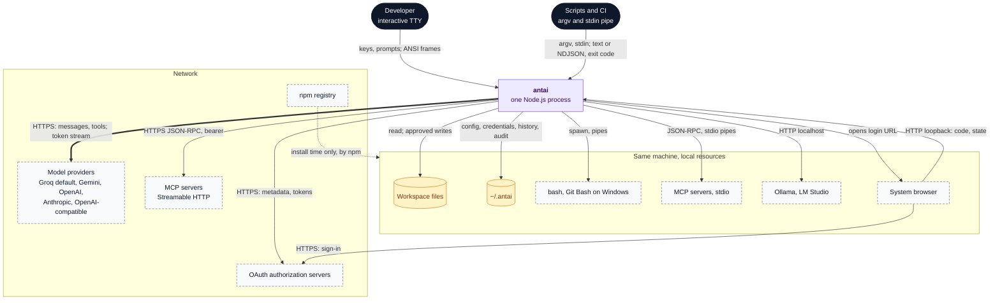
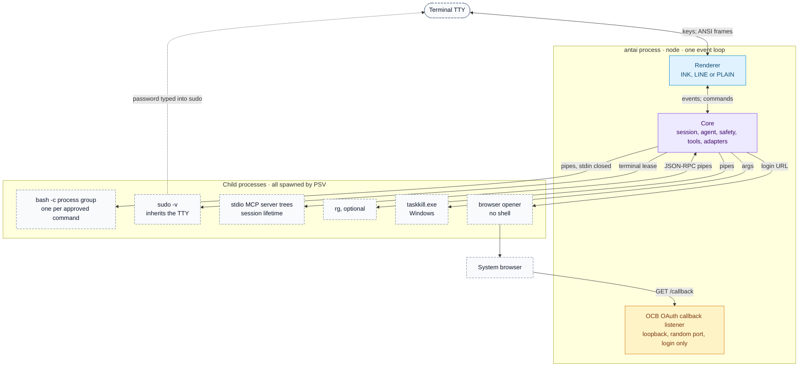
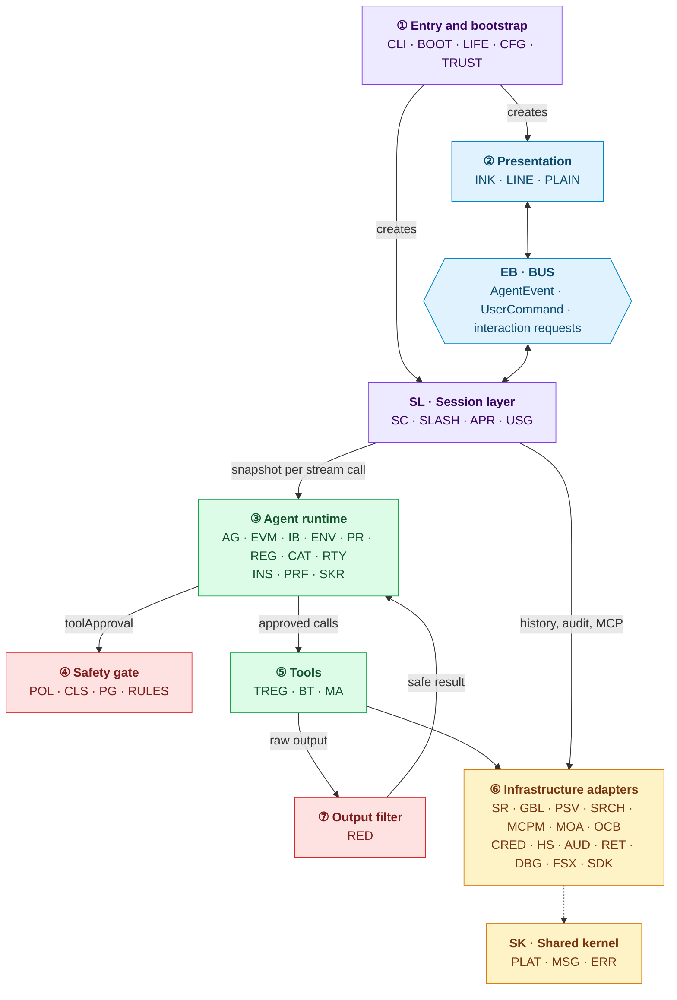
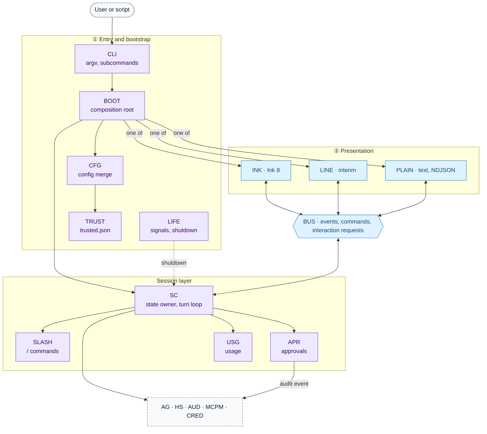
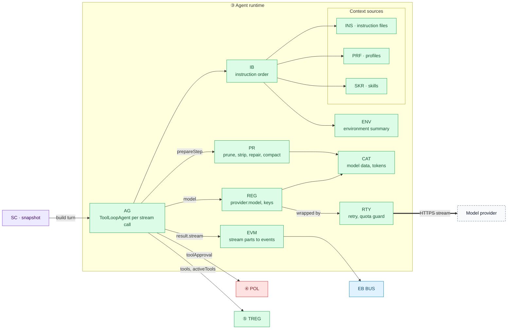
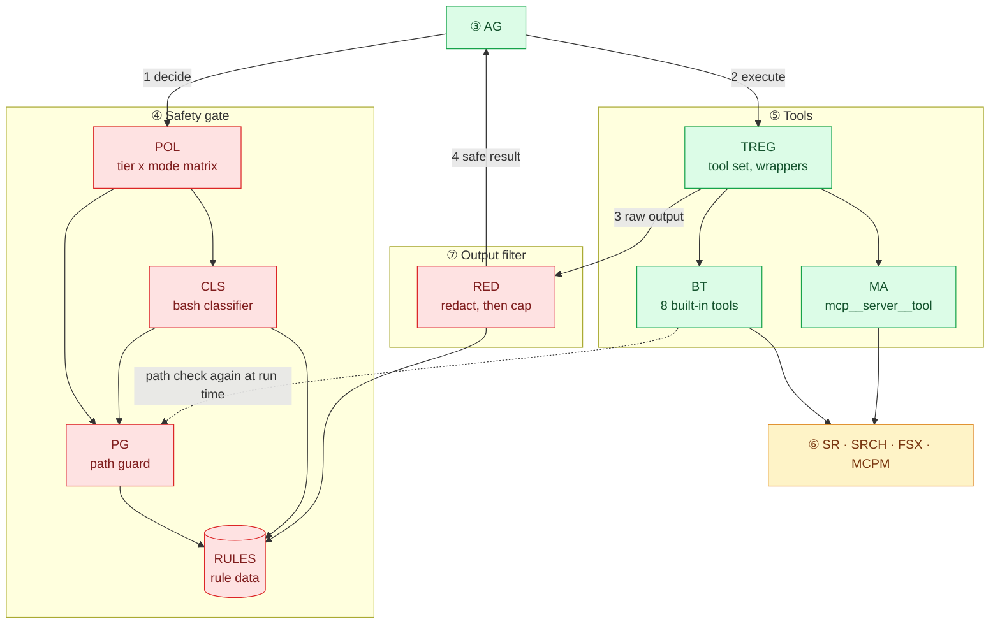
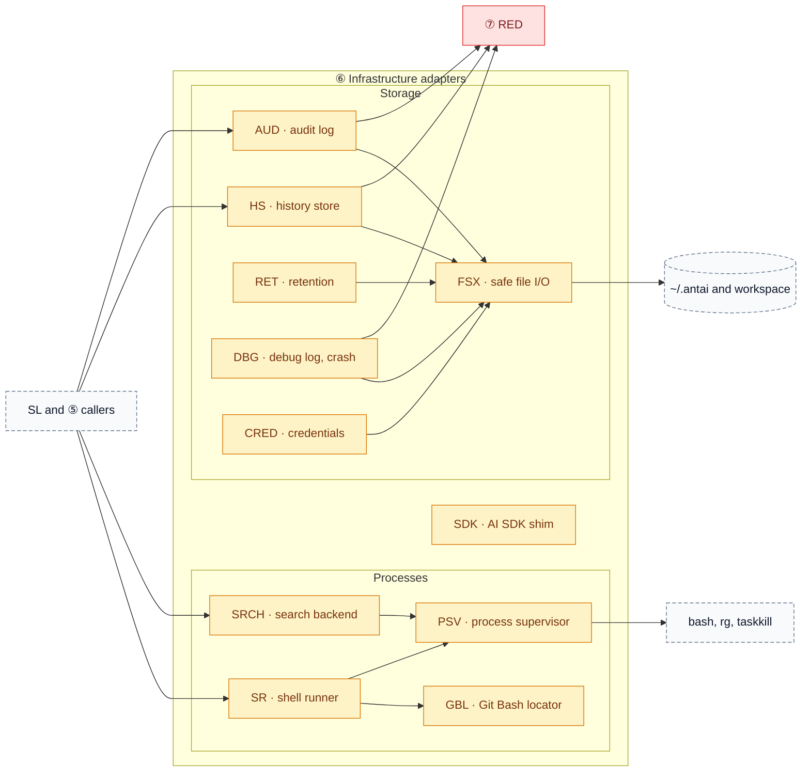
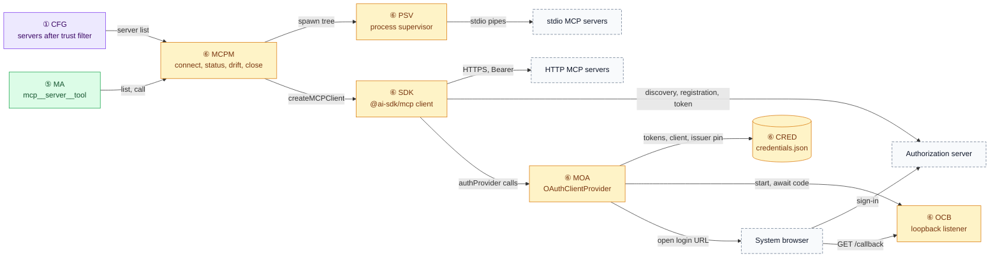
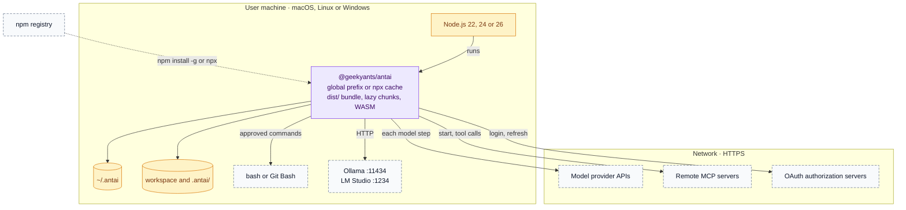
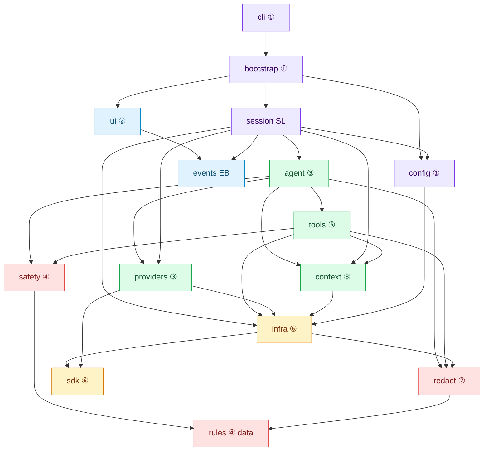

# antai — HLD / Architecture Diagram

| | |
|---|---|
| **Product** | antai (brand) / `antai` (command) |
| **Document** | Deliverable 01, HLD / Architecture Diagram for the v1 MVP |
| **Status** | Draft for review |
| **Version** | 0.1 |
| **Date** | 12 October 2026 |
| **Author** | Daksh Nagpal |
| **Based on** | BRD_1 v0.4, `HLD.png`, deliverables 00, 02, 03, 04, 06, 07, 09, 10, 11, 13, 15 and 16 |
| **How to use** | Reference design, not a fixed rail. Where the technology needs something different or extra, the implementation may change it; the change is then made in every deliverable it touches, so the set keeps agreeing. |

## Contents

1. Purpose and scope
2. Architecture at a glance
3. System context (HLD-1)
4. Containers and processes (HLD-2)
5. Components (HLD-3.0 to HLD-3.5)
6. Deployment (HLD-4)
7. Technology stack
8. Module map and dependency rules (HLD-5)
9. Key runtime scenarios
10. Cross-cutting concepts
11. Quality attributes
12. Architecture rules
13. Components by delivery phase
14. Risks and technical debt
15. Design decisions
16. Open questions
17. Traceability
18. Sources

---

## 1. Purpose and scope

### 1.1 Purpose

This is the high-level design of antai v1. It answers four questions: what antai talks to (section 3), what runs as which operating-system process (section 4), which components exist and how they depend on each other (sections 5 and 8), and how the design meets the non-functional requirements (sections 10 and 11).

It is also the **naming authority** for the design set. Deliverables 02 to 16 take component IDs, component names, layer numbers and module paths from section 5.9 and section 8, so the documents agree with each other. This is a consistency aid, not a rail: a deliverable may add a component when the technology needs it, names it in its own text, and deliverable 01 then adds it to sections 1.3, 5.9 and 8.

### 1.2 Scope

| In this document | Detailed in |
|---|---|
| Context, processes, components, layers, deployment, stack, module map, dependency rules | here |
| Each runtime flow step by step | deliverable 03 (sequence diagrams) |
| Threat model, permission model, trust boundaries in depth | deliverable 02 |
| Record schemas and file rules for everything under `~/.antai` | deliverable 04 |
| TypeScript interfaces, the `AgentEvent` union, NDJSON contract, error codes | deliverable 11 |
| Turn loop internals, startup budget, where retries sit in the loop | deliverable 07 |
| Retry numbers, error classification, model catalogue | deliverable 09 |
| Instruction text, token budgets | deliverable 08 |
| Provider catalogue and capability matrix | deliverable 09 |
| Instructions, profiles, skills and MCP lifecycle | deliverable 10 |
| Terminal screens | deliverable 13 |
| CI, bundling, release | deliverable 16 |

### 1.3 Relation to HLD.png

`HLD.png` is the hand-drawn architecture of antai. This document keeps its boxes, its three groups (Engine, Provider, Tool Pipeline) and its folders, and details each box into components (section 5) and modules (section 8). The first table places each of the 49 components under exactly one HLD.png box. The arrows of HLD.png hold in effect; the second table lists where this design adds to the drawing or runs a path differently, and why. Calls from Session, Config, Context and Model Gateway into Machine Adapters (files, credentials, audit, MCP status), and from Session and Tool Service into shared lookups (skills, profiles, path checks), are left out of the drawing; section 8.2 lists every allowed import.

| HLD.png box | Folder in HLD.png | Components here | Folder(s) here |
|---|---|---|---|
| Screen UI, "what you see" | `ui/` | `INK`, `LINE`, `PLAIN` | `src/ui/` |
| Event Bus, "message pipe" | `events/` | `BUS` | `src/events/` |
| Session, "chat manager" | `session/` | `SC`, `SLASH`, `APR`, `USG` | `src/session/` |
| History, "saves the chat" | `infra/history` | `HS` | `src/infra/history/` |
| Config, "settings + API keys" | `config/` | `CFG`, `TRUST`, `CRED` | `src/config/`; `CRED` in `src/infra/credentials/` |
| Context: rules, skills, `AGENTS.md`, tool titles and descriptions | `context/` | `INS`, `PRF`, `SKR` | `src/context/` |
| Agent Brain, "thinks and loops" (Engine) | `agent/` | `AG`, `EVM`, `IB`, `ENV`, `PR` | `src/agent/` |
| Model Gateway, "Groq, Gemini, …" (Provider) | `providers/` | `REG`, `CAT`, `RTY` | `src/providers/` |
| AI model, "outside antai" (Provider) | — | None: the provider's API, called through Model Gateway (section 6.4); it may also be a local server (Ollama, LM Studio), still outside the antai process | — |
| Safety Guard, "allow · ask · block" (Tool Pipeline) | `safety/` | `POL`, `CLS`, `PG`, `RULES` | `src/safety/`; `RULES` in `src/rules/` |
| Secret Filter, "hides keys in output" (Tool Pipeline) | `redact/` | `RED` | `src/redact/` |
| Tool Service, "files, shell, MCP" (Tool Pipeline) | `tools/` | `TREG`, `BT`, `MA` | `src/tools/` |
| Machine Adapters, "disk, bash, MCP servers" | `infra/` | `SR`, `GBL`, `PSV`, `SRCH`, `MCPM`, `MOA`, `OCB`, `AUD`, `RET`, `DBG`, `FSX` | `src/infra/` |
| Boot Service, "wires every box at start" | `bootstrap/` | `BOOT`, `LIFE` | `src/bootstrap/` |
| Not drawn in HLD.png | — | `CLI`, `SDK`, `PLAT`, `MSG`, `ERR` | `src/cli/`, `src/sdk/`, `src/shared/` |

Where this design differs from HLD.png, and why:

| # | HLD.png | This design | Why |
|---|---|---|---|
| 1 | You type into Screen UI; no entry folder | `CLI` in `src/cli/` parses argv, reads piped stdin, maps outcomes to exit codes, and runs the subcommands (`mcp`, `config`, `login`, `logout`, `init`, and `doctor` and `audit`, beyond the BRD, deliverable 15) that never start a session; interactive sessions and `run` go on to Boot Service | A command-line tool needs flags, stdin and exit codes before any box is wired, and the subcommands should not pay for a session |
| 2 | No rules folder; the safety lists belong to Safety Guard | `RULES` in `src/rules/` is data only, read by the Safety Guard (`CLS`, `PG`), the Secret Filter (`RED`) and search (`SRCH`) (HLD-D28) | One secret-path list then covers every tool and command (D25, FR-SEC-01), and the security reviewer reviews one place (rule 18) |
| 3 | No SDK folder | `SDK` in `src/sdk/` is the only importer of experimental and very new AI SDK APIs (HLD-D10) | An SDK update then touches one folder, and experimental APIs stay wrapped behind antai's own names (NFR-SEC-04) |
| 4 | No shared folder | `PLAT`, `MSG`, `ERR` and the domain types sit in `src/shared/`, which every folder may import and which imports no other folder | Paths, messages and error codes are needed in every box, and a kernel without antai dependencies keeps the folders free of cycles (section 8.2) |
| 5 | Safety Guard says "yes" to Tool Service | `POL` returns a decision to the AI SDK loop in Agent Brain, which then runs the approved call through `TREG` (section 5.5, HLD-D4) | Same effect, since no tool runs without the "yes", while the policy stays a side-effect-free function that table tests can cover |
| 6 | Safety Guard "asks you Yes/No" through Session | An "ask" ends the stream with a `tool-approval-request`; `APR` in Session asks through Event Bus and Screen UI and sends the answer back (section 9.3) | Approval dialogs have one owner (`APR`), and the core never waits on a person (rule 16) |
| 7 | Secret Filter cleans tool output | `RED` also redacts streamed model text, piped stdin, error text, and everything written to history, the audit log and logs (section 10.6) | NFR-SEC-05 keeps secrets off the screen, the JSON output and the disk, not only out of tool results |
| 8 | Tool titles and descriptions sit in Context | Each tool's name, description and schema sit together in `tools/` (`BT`; `MA` passes on MCP descriptions) and reach the model as tool definitions; skill titles and descriptions still come from Context (`SKR`) | Providers take tools as definitions, and a description kept next to its schema cannot drift from it |
| 9 | Context sends the instructions to Agent Brain | `IB` in `src/agent/` assembles them for every stream call from what Context supplies at turn start (instruction files such as `AGENTS.md`, profiles, skills), with antai's base rules text (DLV-SW-08), which HLD.png draws in Context but which sits with `IB` in `src/agent/instruction-builder/`, and `ENV` | Order, per-file caps and a stable prefix for prompt caching are one job, rebuilt for every stream call and never stored; the base rules are antai's own text, versioned with the prompt (deliverable 08, section 14.1) |
| 10 | API keys sit in Config (`config/`) | `CRED` in `src/infra/credentials/` holds provider keys and MCP OAuth tokens in a `0600` file; `CFG` holds settings only | Keys need atomic writes, locks and file permissions, go straight to provider factories (rule 11), and stay out of the `config.json` the user edits by hand |
| 11 | Machine Adapters: disk, bash, MCP servers; History drawn apart | `infra/` also holds the audit log (`AUD`), retention (`RET`), debug log (`DBG`), process supervisor (`PSV`), Git Bash locator (`GBL`), search (`SRCH`), OAuth (`MOA`, `OCB`) and the credential file (`CRED`) | Every file write, child process and listener then sits in one layer, so rules 9 and 10 can be checked as import rules |
| 12 | Boot Service runs once, at start | `LIFE` in `src/bootstrap/lifecycle.ts` also handles signals, crashes and the shutdown order | The module that wired every box knows the order to stop them, so no child process or lock outlives antai (NFR-REL-03) |
| 13 | One Screen UI | Three renderers: `INK` (from P5), `LINE` (P1 to P4, scripted tests, and the fallback when Ink cannot start, HLD-D9) and `PLAIN` (text or NDJSON for `run` and scripts) | Scripts and CI need output with no person present, and sessions and approvals must work before Ink ships in P5 |
| 14 | Agent Brain reaches Event Bus only through Session | `EVM` in `src/agent/` puts stream events (text, reasoning, tool cards) on `BUS` itself; `SC` still owns turns, approvals and storage | Streamed text reaches the screen without an extra hop (NFR-PERF-02) |
| 15 | Only Agent Brain talks to Model Gateway | `SC` also uses `REG`: for `/model` switches and for one title call per session after the first turn (D30; deliverable 03, SD-5b) | The title is one short call with no tools, so it needs no turn agent; it still passes the retry and quota guard (`RTY`) |

### 1.4 Additions beyond BRD v0.4

These go beyond BRD v0.4. The design uses them as stated; the BRD can adopt them later. CR numbers refer to deliverable 00, section 11.

| Item | Addition | Status in this HLD |
|---|---|---|
| AI SDK v7 API names | `toolApproval` set when the agent is built, `isStepCount`, `await agent.stream()`, `result.stream`, nested usage fields, `responseMessages`, `tool-output-denied`, `fingerprintTools` from `ai`; instructions rebuilt for every stream call, never stored | Used (names only, no behaviour change) |
| Reasoning levels | The SDK's extra levels `minimal`, `xhigh`, `max` | Not exposed; `/effort` keeps the five BRD levels |
| Retry | SDK `maxRetries: 0` plus antai's own retry | Used: `RTY` |
| Interim UI | `@ai-sdk/tui` as the interim UI | Replaced by `LINE` (HLD-D9) |
| Tool search | `toolSearch` | Not in v1 (risk R9, technical debt TD5) |
| Windows launchers, HTTP transport | Windows `.cmd` and `.bat` launchers run through `cmd.exe /c`; stateless Streamable HTTP with `redirect: 'error'` | Used |
| Models (CR-02, CR-15) | `groq:openai/gpt-oss-120b` (default), `groq:openai/gpt-oss-20b` (fast), `google:gemini-3.8-flash` | Used |
| Script execution | `bash <file>`, `sh <file>`, `source <file>`, `. <file>` are Dangerous | Used (BRD covers "indirect execution" only in general terms) |
| Keys outside the environment | Stored provider keys never put in `process.env`, so child processes never inherit them | Used; the outcome is now in BRD v0.4 (FR-SH-06) |
| Type-ahead | Discard type-ahead when a dialog opens | Used |
| Approval signing | Per-process `experimental_toolApprovalSecret` | Used |
| MCP drift | Ask for approval again when a tool definition changes | Not used: the tools stay available with a warning (D29), but a changed tool loses Safe until accepted (FR-MCP-06) |
| Symlink swap | `O_NOFOLLOW` on the final path component | Used |
| Annotation hash | Separate hash of MCP tool annotations | Used as a warning (D29); a tool whose definition or annotations changed loses Safe and runs at Normal until the user accepts the change in `/mcp` (now in BRD v0.4, FR-MCP-06) |
| CR-01 | Groq free plan token budget | Used: pre-flight budget check in `RTY` |
| CR-03 | Package `@geekyants/antai`, command `antai` | Used |
| CR-05, CR-07 | Build tool chosen in an ADR; Node 22, 24 and 26; no dependency install scripts | Used |
| CR-06 | Ollama provider chosen in the spike | Used: default `ai-sdk-ollama` (HLD-D24) |
| CR-16 | MCP spec 2026-07-28 and 2025-11-25 | Used |

---

## 2. Architecture at a glance

### 2.1 Key characteristics

- **One local process.** antai is a single Node.js process per terminal session. No server, no daemon, no database, no worker threads in v1. Background work (MCP connects, retention, `.env` scan) runs on the same event loop.
- **UI-independent core.** Everything below the event boundary runs headless. Renderers only draw `AgentEvent`s and send back `UserCommand`s and answers (NFR-MNT-01).
- **One owner of session state.** Mode, model, effort, profile and the session allow-list live in the session controller. The model has no tool that can change them (FR-MODE-03).
- **Red twice.** Every tool call, built-in or MCP, passes the safety gate before it runs and the output filter after it runs (section 12, rule 2).
- **Fresh agent per stream call.** A `ToolLoopAgent` is built for each stream call (each turn and each approval resumption, with the steps the turn has left) from an immutable snapshot, so a mode, model or profile change applies from the next turn without special cases (HLD-D2).
- **Local data only.** Everything antai stores is under `~/.antai/` or, for project settings, the workspace `.antai/` (NFR-PRIV-02).
- **Few outbound destinations.** The configured model provider, the configured MCP servers and their OAuth authorization servers. No telemetry, no update check (NFR-PRIV-01, BRD 1.4).
- **One rule set on three OSes.** Agent commands always run in bash; Windows uses Git Bash (D13, D24).

### 2.2 Constraints (BRD 7.1)

| Constraint | Consequence for the design |
|---|---|
| TypeScript, Node.js 22 or newer, ESM only | `"type": "module"`; `engines.node ">=22"`; all dependencies ESM-compatible |
| Vercel AI SDK v7 (`ai` 7.x), `@ai-sdk/*` on `@ai-sdk/provider` 4.x, `@ai-sdk/openai-compatible`, `@ai-sdk/mcp` | Agent loop, approvals, MCP client and providers come from the SDK; experimental parts sit behind `SDK` |
| Ink 8, React 19.3, JSX needs a build step | Ink lives only in `src/ui/ink/`, loaded lazily; a bundler builds `dist/` |
| Groq default (`groq:openai/gpt-oss-120b`, confirmed in the P0 spike) | `REG` and `CAT` make the default a data change, not a code change |
| Terminal only | No HTTP server except the short-lived OAuth callback listener |
| GitLab at git.geekyants.com | CI and release topology in deliverable 16 |
| No native dependencies (NFR-COMP-04) | No keychain, PTY or SQLite modules at runtime; WASM is allowed |

### 2.3 Assumptions

- The BRD 7.2 assumptions hold: a provider key or local Ollama; Groq's free plan is usable for the default model (confirmed in the P0 spike); Git for Windows for the shell tool on Windows; ripgrep optional.
- The AI SDK names verified against `ai@7.0.137`, `@ai-sdk/mcp@2.0.73` and `ink@8.0.0` stay valid within the pinned versions.
- The additions in section 1.4 apply as stated.
- One human at one terminal per process. Several antai processes may run at once; they share `~/.antai` and coordinate through locks (section 10.4).

---

## 3. System context

### 3.1 HLD-1 System context



### 3.2 External systems and trust

| External system | Interface | Data to and from antai | Trust level |
|---|---|---|---|
| Developer at a TTY | Keyboard, terminal | Prompts, slash commands, approvals, typed keys and passwords (to `sudo` only) | **Trusted principal.** The only source of approvals, mode changes and trust decisions |
| Scripts and CI | argv, stdin, stdout, stderr, exit code | Prompt and flags; piped data; text or NDJSON events | argv is the user's intent. Piped stdin is untrusted data in a marked block (FR-CLI-03) |
| Model providers (Groq, Google, OpenAI, Anthropic, OpenAI-compatible presets and custom endpoints) | HTTPS through the provider package | Instructions, messages, tool schemas, redacted tool results, API key; streamed text, reasoning, tool calls | Endpoint trusted with what the user chose to send. **Model output is untrusted data** |
| Local model servers (Ollama, LM Studio) | HTTP on localhost | As above, no key | As above |
| MCP servers over stdio | Child process, JSON-RPC over pipes | Tool definitions, annotations, arguments, results | **Untrusted.** Run with the user's privileges. Only from global config or a trusted project |
| MCP servers over Streamable HTTP | HTTPS JSON-RPC | As above, plus a bearer token or configured headers | **Untrusted** |
| OAuth authorization servers | HTTPS | Discovery metadata, client registration, authorization code, access and refresh tokens | Validated, not trusted: issuer pin, PKCE, `state`, `iss` (FR-MCP-11) |
| System browser | OS opener out; HTTP callback in | Login URL out; `code`, `state`, `iss` in | Callback is untrusted input until `state` and `iss` check out |
| Workspace files | File system | Reads; writes after approval | **Untrusted content** (prompt injection, NFR-SEC-02) |
| Project settings (`.antai/`, `.mcp.json`) | File system | Config, MCP servers, profiles, skills | Untrusted until the workspace is trusted; tighten-only keys always apply (FR-CFG-04) |
| bash or Git Bash | Process spawn | Approved commands; output | Runs with the user's full privileges; output untrusted |
| `~/.antai` | File system | Config, credentials, trust, history, audit, logs | Trusted, user-owned. Protected path; `credentials.json` is a secret file |
| npm registry | npm CLI, not antai | The package | Install time only; supply-chain controls in deliverable 16 |

### 3.3 What leaves the machine

antai sends data only to the provider the user selected, the MCP servers the user configured, and the authorization servers those servers name (NFR-PRIV-01). Two indirect paths exist and are documented, not prevented: a stdio MCP server started with `npx -y …` downloads its own package, and an approved shell command can reach any host. Deliverable 05 draws these flows.

---

## 4. Containers and processes

### 4.1 HLD-2 Process view



### 4.2 Processes, channels and lifetimes

Every child process is spawned by the process supervisor `PSV`, so one registry knows what to kill on Esc, timeout and exit (NFR-REL-03).

| Process | Started by | When | Channels | Lifetime | Stopped by |
|---|---|---|---|---|---|
| antai (`node dist/cli.js`) | User or script | Launch | TTY, or pipes | The session | `/exit`, Ctrl+C twice, end of `run`, SIGTERM, SIGHUP; `LIFE` runs the shutdown order |
| Command process group: `bash -c "<command>"` and descendants | `SR` through `PSV` | Each approved `shell` call | stdin closed; stdout and stderr pipes; environment filtered (section 10.6) | Until exit or timeout: 120 s default, 30 s for dev-server commands (FR-SH-07) | `PSV` tree kill on timeout, Esc or shutdown |
| `sudo -v` (macOS, Linux, interactive only) | `SR` through `PSV`, inside a terminal lease | Before a command that uses `sudo` | Inherits the TTY while the renderer is suspended | Until the password is entered or refused | The user; antai never reads the password (FR-SH-09) |
| stdio MCP server tree | `MCPM` through `PSV` | In the background at start (project servers only after trust) | JSON-RPC over stdin and stdout; stderr kept in a small buffer and in the debug log | The session | `MCPM` close, then `PSV` tree kill (FR-MCP-10) |
| `rg` | `SRCH` through `PSV` | `search_files`, `find_files`, `list_directory`, when ripgrep is on `PATH` | args; stdout pipe | One call | Exit, abort or timeout |
| OAuth callback listener (inside the antai process) | `MOA` | `antai mcp login <name>`, or Login chosen in `/mcp` | TCP on `127.0.0.1` and `::1`, port 0 (OS-assigned) or `oauth.callbackPort`; path `/callback`; redirect URI `http://localhost:<port>/callback` | Until one valid callback, Esc, or 5 minutes | `MOA` |
| Browser opener (macOS `open`, Linux `xdg-open`, Windows `explorer.exe` or `rundll32 url.dll,FileProtocolHandler`, picked in the P0 spike) | `MOA` through `PSV` | Login | args only, never a shell | Seconds | Exits by itself |
| `taskkill.exe` (Windows) | `PSV` | Killing a tree | args (`/pid <pid> /T /F`), spawned directly, not through Git Bash | Seconds | Exits by itself |

There is no worker thread in v1. The CPU-heavy work (bash parsing, redaction, Markdown, token estimates) is bounded in input size; risk TR10 covers the rest.

### 4.3 Renderer and "human present"

`BOOT` picks one renderer per process. "Human present" decides whether an approval can be asked; without a human, an approval-needing call is denied and the run continues (FR-CLI-02, D19).

| Invocation | stdin TTY | stdout TTY | `--json` | Renderer | Human present |
|---|---|---|---|---|---|
| `antai` | yes | yes | no | `INK` from P5; `LINE` in P1 to P4 | yes |
| `antai` | yes | yes | yes | `PLAIN` (NDJSON) | no |
| `antai` | yes | no | any | `PLAIN` | no |
| `antai` | no | any | any | none: exit code 2, suggests `antai run` (FR-UI-06) | — |
| `antai run "…"` or `-p` | any | any | no or yes | `PLAIN` (text or NDJSON) | no |

---

## 5. Components

### 5.1 Layers

The layers are numbered ① to ⑦ from the entry point down to the output filter. Two layers between ② and ③ have codes instead of numbers (EB, SL), and the shared kernel (SK) sits under everything. Layers are finer than the boxes of `HLD.png`; section 1.3 maps every component to its box. In short: ① is Boot Service, Config (without `CRED`) and `CLI`; ② Screen UI; EB Event Bus; SL Session; ③ Agent Brain (the Engine), Context and Model Gateway (the Provider group); ④, ⑤ and ⑦ the Tool Pipeline (Safety Guard, Tool Service, Secret Filter); ⑥ Machine Adapters, History, `CRED` and `SDK`.

| Layer | Code | Responsibility | Components |
|---|---|---|---|
| ① Entry and bootstrap | ① | Parse the command line, resolve config and trust, wire the process, handle signals and crashes | `CLI`, `BOOT`, `LIFE`, `CFG`, `TRUST` |
| ② Presentation | ② | Draw events and collect input. No business logic | `INK`, `LINE`, `PLAIN` |
| Event boundary | EB | Typed contracts between core and renderers | `BUS` |
| Session layer | SL | Own session state, run turns, approvals, slash commands, usage | `SC`, `SLASH`, `APR`, `USG` |
| ③ Agent runtime | ③ | Build and run the turn agent; providers; context sources | `AG`, `EVM`, `IB`, `ENV`, `PR`, `REG`, `CAT`, `RTY`, `INS`, `PRF`, `SKR` |
| ④ Safety gate | ④ | Decide whether a tool call runs | `POL`, `CLS`, `PG`, `RULES` |
| ⑤ Tools | ⑤ | Built-in and MCP tools, the tool set per turn | `TREG`, `BT`, `MA` |
| ⑥ Infrastructure adapters | ⑥ | Processes, MCP, OAuth, files, credentials, history, audit, logs, SDK shim | `SR`, `GBL`, `PSV`, `SRCH`, `MCPM`, `MOA`, `OCB`, `CRED`, `HS`, `AUD`, `RET`, `DBG`, `FSX`, `SDK` |
| ⑦ Output filter | ⑦ | Redact, then cap, every tool output and every stored or displayed text | `RED` |
| Shared kernel | SK | Pure utilities with no antai dependencies | `PLAT`, `MSG`, `ERR` |

### 5.2 HLD-3.0 Component overview



### 5.3 HLD-3.1 Entry, presentation, event boundary and session



`BOOT` is the composition root: it is the only module that knows every concrete implementation. `LIFE` holds references to `SC`, `PSV`, `MCPM`, `HS` and `AUD` so it can shut them down in order. The trust prompt and the first-run key prompt are interaction requests that `BOOT` sends on `BUS`, so they work the same in `INK` and `LINE` and are refused automatically in `PLAIN`.

### 5.4 HLD-3.2 Agent runtime and context sources



`AG` sets `maxRetries: 0` on the agent (beyond the BRD, section 1.4; P0 confirms the option on `ToolLoopAgent`) and gets resilience from `RTY`, a language-model middleware (`wrapLanguageModel`) that retries only the model call, before any output of that call has been emitted, so a tool never runs twice (FR-ERR-02).

### 5.5 HLD-3.3 Safety gate, tools and output filter



`TREG` wraps every tool's `execute`, built-in and MCP, with the output filter, so no tool can return unfiltered output. File tools re-check their path at execution time (`PG`, with `O_NOFOLLOW` where available), because the approval and the execution are separate moments.

### 5.6 HLD-3.4 Infrastructure adapters and storage



Everything that writes under `~/.antai` goes through `FSX`, and everything persisted passes `RED` first (redaction at write, FR-HIS-07, FR-SEC-03).

### 5.7 HLD-3.5 MCP and OAuth components



`@ai-sdk/mcp` 2.0.73 performs discovery, PKCE, dynamic client registration, refresh and issuer pinning. antai supplies the `OAuthClientProvider` (`MOA`) and the listener (`OCB`), and adds the four checks the SDK lacks: reject a missing `iss` when the server advertises support, refuse when authorization-server metadata is missing, step up on 403 `insufficient_scope` (at most two attempts), and refresh proactively at start.

### 5.8 The event boundary

`BUS` carries three kinds of message. Their exact TypeScript shapes are in deliverable 11.

| Channel | Direction | Examples | Rule |
|---|---|---|---|
| `AgentEvent` | core to renderer | session started, turn start, status (provider, model, mode, effort, profile, workspace, base URL notice), text delta, reasoning delta, tool call started, tool progress, approval decision, tool result, tool denied, usage, retry scheduled (with the time of the next attempt), notice, error, turn end, MCP status | Already redacted. Renderers never see raw tool output |
| `UserCommand` | renderer to core | submit text, interrupt (Esc), exit, answer an interaction request | The only way input reaches the core |
| Interaction request | core asks, renderer answers | approval (one or two dialogs), trust prompt, secret entry (API key), confirmation (home-folder workspace), terminal lease (`sudo -v`) | Each has an ID and a safe default. `PLAIN` answers at once with "no human present", which the core turns into a denial or an error |

The terminal lease is how `SR` gets the real terminal without importing Ink: `INK` implements it with `useApp().suspendTerminal()`, `LINE` pauses its line reader, `PLAIN` refuses it (FR-SH-09: unattended runs use `sudo -n`).

`PLAIN` maps the internal union to the public NDJSON line types: the seven of FR-UI-06 (`text`, `tool-call`, `tool-result`, `approval`, `usage`, `error`, `done`) plus `notice` (beyond the BRD, deliverable 11, IC-P6), with `schemaVersion` on every line (IC-P5).

### 5.9 Component catalogue

Phase = the phase in which the component first ships (BRD 10); later phases that extend it are in brackets. Module paths are relative to the repository root.

| ID | Name | Layer | Responsibility | Module path | Depends on | BRD requirements | Phase |
|---|---|---|---|---|---|---|---|
| `CLI` | CLI entry | ① | Parse argv (FR-CLI-04); dispatch `run`, `mcp list\|add\|remove\|login\|logout`, `config`, `login`, `logout`, `init`, and `doctor`, `audit` (beyond the BRD, deliverable 15); read piped stdin for `run` (100 KB cap, untrusted block, redacted); map the outcome to an exit code; `--help`, `--version` | `src/cli/` | `BOOT`, `CFG`, `CRED`, `MCPM`, `RED`, `MSG`, `ERR` | FR-CLI-01..06, FR-UI-06, NFR-USE-03 | P1 (P3 `init`, P4 `mcp`) |
| `BOOT` | Bootstrap | ① | Composition root: find the workspace root (walk up to `.git`), load config and trust, load credentials, locate Git Bash, choose the renderer, run first-run and trust prompts, start background work (MCP connect, `.env` scan, retention), create the session. Imports Ink lazily | `src/bootstrap/` | `CFG`, `TRUST`, `CRED`, `GBL`, `RED`, `MCPM`, `RET`, `SC`, `INK`, `LINE`, `PLAIN`, `LIFE`, `PLAT` | FR-CLI-01, FR-MOD-04, FR-TOOL-09 (home warning), FR-SH-11, NFR-PERF-01 | P1 |
| `LIFE` | Lifecycle and signal handler | ① | SIGINT, SIGTERM, SIGHUP and uncaught-error handlers; shutdown order: abort turn, kill child trees, close MCP, flush history and audit, release locks, restore terminal; crash report and short message (no stack trace) | `src/bootstrap/lifecycle.ts` | `SC`, `PSV`, `MCPM`, `HS`, `AUD`, `DBG` | FR-ERR-04, FR-MCP-10, FR-UI-05 (Ctrl+C twice), NFR-REL-03 | P1 (P2, P4) |
| `CFG` | Config resolver | ① | Load global and project `config.json` and MCP server files; validate against schemas (fail closed for safety keys); merge per FR-CFG-01; drop trust-gated project keys unless trusted; keep the source of each value for `antai config` | `src/config/` | `TRUST`, `FSX`, `PLAT`, `MSG` | FR-CFG-01..03, 05, FR-MCP-02, FR-MOD-07, 08, FR-PRF-03 | P1 (P4 MCP files) |
| `TRUST` | Workspace trust gate | ① | Extract trust-gated project settings, hash them, look up `~/.antai/trusted.json`, report when a decision is needed (new or changed), store the user's answer. `BOOT` and `/trust` do the asking; `run` never asks | `src/config/trust/` | `FSX`, `PLAT` | FR-CFG-04, FR-PRF-02, FR-MCP-11 (no login before trust) | P2 (P4 MCP entries) |
| `INK` | Ink UI | ② | Interactive renderer: streaming Markdown, tool cards, dialogs with type-ahead guard, status bar, `/` menu, transcript, keys, terminal lease through `suspendTerminal()`. View state only | `src/ui/ink/` | `BUS`, `MSG`, `PLAT` | FR-UI-01..05, 07, 08, FR-SLC-01, FR-SH-03, 04 | P5 |
| `LINE` | Line-mode renderer | ② | Interim interactive renderer for P1 to P4, then the fallback when Ink cannot start: one line in, plain text out, numbered dialogs, second Dangerous dialog with No as default. Drives scripted interactive tests | `src/ui/line/` | `BUS`, `MSG` | FR-SH-03, 04 (P2 checks), deliverable 00, section 9.3 | P1 |
| `PLAIN` | Plain and JSON renderer | ② | Non-interactive output: text, or one JSON object per event; errors to stderr; answers every interaction request with "no human present" | `src/ui/plain/` | `BUS`, `MSG` | FR-UI-06, 07, FR-CLI-02 | P1 |
| `BUS` | Event boundary | EB | `AgentEvent`, `UserCommand` and interaction-request contracts; in-process event bus. No logic | `src/events/` | `SK` types | NFR-MNT-01 | P1 |
| `SC` | Session controller | SL | Sole owner of session state (mode, model, effort, profile, session allow-list); one turn at a time; turn snapshot; `await agent.stream()`; approval round trip with `APR`; Esc through one `AbortController` per turn; history appends; title after the first turn; resume; `/clear` | `src/session/` | `AG`, `PR`, `REG`, `SLASH`, `APR`, `USG`, `HS`, `AUD`, `MCPM`, `CFG`, `BUS` | FR-AGT-01..04, FR-MODE-02, 03, FR-MOD-05, FR-HIS-02, 04, 06, 11, D30 | P1 (P4 history, resume) |
| `SLASH` | Slash-command router | SL | Parse input starting with `/`: built-in commands (BRD 5.11), `/<skill-name>` expansion, unknown command with suggestion, `//` escape, path-like input; feed the `/` menu | `src/session/commands/` | `SC`, `SKR`, `PRF`, `HS`, `MCPM`, `USG`, `CFG` | BRD 5.11, FR-SLC-01, 02, FR-SKL-04 | P1 (P2, P3, P4) |
| `APR` | Approval coordinator | SL | Turn each `tool-approval-request` into one or two dialogs, or a denial without a human; discard type-ahead; write the audit event at once; build the `tool-approval-response`; "Yes, don't ask again this session" | `src/session/approval/` | `POL` (types), `AUD`, `HS`, `BUS` | FR-SH-02..04, 10, FR-UI-04, D27 | P2 |
| `USG` | Usage meter | SL | Usage per model call, turn and session (input, output, reasoning, cache-read tokens); last-step input tokens for the context share; the last rate-limit snapshot from `RTY`; feeds `/usage`, the status bar and `usage` records | `src/session/usage/` | `EVM`, `CAT` | FR-UI-02, BRD 5.11 `/usage` | P1 (P3 `/usage`) |
| `AG` | Turn agent factory | ③ | Build a fresh `ToolLoopAgent` per stream call (each turn and each approval resumption): model, instructions, tools, `activeTools`, `stopWhen: isStepCount(remaining steps)`, counted across approval resumptions, `reasoning`, `prepareStep`, `toolApproval`, `maxRetries: 0`, a per-process approval secret (`experimental_toolApprovalSecret`); run `await agent.stream()` | `src/agent/` | `REG`, `IB`, `PR`, `TREG`, `POL`, `EVM`, `SDK` | FR-AGT-01, 02, 07 | P1 |
| `EVM` | Stream event mapper | ③ | Map v7 `result.stream` parts to `AgentEvent`s; redact streamed text through `RED` before it leaves the core. The only code that switches on SDK part names | `src/agent/stream-mapper/` | `BUS`, `RED`, `ai` (types) | NFR-MNT-01, NFR-SEC-04, 05 | P1 |
| `IB` | Instruction builder | ③ | Assemble instructions in FR-AGT-03 order with per-file caps; stable parts first for provider prompt caching; rebuilt for every stream call, never stored | `src/agent/instruction-builder/` | `INS`, `PRF`, `SKR`, `ENV` | FR-AGT-03, FR-SKL-03 | P1 (P3 files, profile, skills) |
| `ENV` | Environment summary | ③ | Last instruction block: OS, bash path and version, Git Bash path forms, cwd, workspace root, date | `src/agent/environment/` | `PLAT` (Git Bash result from the snapshot) | FR-AGT-03, FR-SH-06, 13 | P1 |
| `PR` | Context pruner and message preparer | ③ | Prepare the model's copy each step: strip provider-specific parts after a provider switch; prune old reasoning and tool output at the threshold (`pruneMessages`), never splitting a call from its result; stop the turn when still over; repair dangling tool calls with "interrupted" results; `/compact` | `src/agent/messages/` | `CAT`, `ai` | FR-AGT-04..06, FR-MOD-05, FR-HIS-02 | P1 (P3 `/compact`) |
| `REG` | Provider registry | ③ | Resolve `provider:model` and aliases; create provider instances lazily with keys passed directly, never through `process.env`; presets and custom OpenAI-compatible endpoints; Ollama; trust-gated `baseURL`; map `/effort` to `reasoning` or `providerOptions`; wrap every model with `RTY` | `src/providers/` | `CAT`, `RTY`, `CRED`, `SDK` | FR-MOD-01..08, D28, CR-06 | P1 |
| `CAT` | Model catalogue and token estimator | ③ | Data file of known models: context window, tool calling, reasoning levels, deprecation and shutdown dates; 32k default; lazy token estimates | `src/providers/catalog/` | — | FR-MOD-02, 05, 06, FR-AGT-05, DLV-PLN-03 | P1 |
| `RTY` | Provider retry and quota guard | ③ | Model middleware: classify errors, retry transient ones before output, never retry daily-quota errors, honour `retry-after`, read rate-limit headers through the provider `fetch`, pre-flight token budget for the Groq free plan | `src/providers/retry/` | `CAT`, `ERR`, `ai` | FR-ERR-01, 02, CR-01 | P1 |
| `INS` | Instruction file loader | ③ | Find `AGENT.md`, `AGENTS.md`, `CLAUDE.md` (case-insensitive, first per folder) in `~/.antai`, the workspace root and each folder down to the cwd; cap; list skipped files | `src/context/instruction-files/` | `FSX`, `PLAT` | FR-INS-01..04 | P3 |
| `PRF` | Profile resolver | ③ | Load and validate `PROFILE.md` files; resolve flag, pin, auto-match; apply trust and mode limits; never loosen mode on switch | `src/context/profiles/` | `FSX`, `PLAT` | FR-PRF-01..05, FR-CFG-05 | P3 |
| `SKR` | Skill registry | ③ | Discover skills in `~/.antai/skills`, `.antai/skills`, `.agents/skills`, `.claude/skills` and built-ins; lenient validation; precedence and untrusted clashes; catalogue lines; bodies for `load_skill` and `/<skill-name>` | `src/context/skills/` | `FSX`, `PLAT` | FR-SKL-01..07, FR-TOOL-08 | P3 |
| `POL` | Approval policy | ④ | Side-effect-free `decide(toolCall, snapshot)` that reads only read-only ports (HLD-D4): run `PG` and `CLS` (or MCP annotation rules and the MCP argument check), apply the tier × mode matrix, the session allow-list and "human present"; return status, tier, dialog count, rule ID and classifier summary | `src/safety/policy/` | `CLS`, `PG`, `RULES` | FR-SH-02, FR-MODE-01..04, FR-MCP-06, 07, FR-CLI-02, D19, D23 | P1 (P2 full matrix) |
| `CLS` | Command classifier | ④ | Hard-floor scan on raw text; bash parse; wrapper stripping; per-segment rules; lift rules; maximum tier; refuse detaching commands; fail closed to Dangerous; tier, rule ID and plain-language summary | `src/safety/classifier/` | `RULES`, `PG` | FR-SH-01, 05, 07, 12, FR-SEC-02 | P2 |
| `PG` | Path guard | ④ | Normalise `C:\` and `/c/` forms; resolve symlinks; allowed roots (workspace; skill folders and `extraReadPaths` read-only); secret paths always denied; protected paths Dangerous; home or drive-root warning; secret-path scan of MCP arguments | `src/safety/path-guard/` | `RULES`, `PLAT` | FR-TOOL-09, 11, FR-SEC-01, FR-SH-13, FR-MCP-07, D25 | P1 (P2 writes) |
| `RULES` | Safety rule sets | ④ | Versioned data only: tier rules and hard floor, nested shells and interpreters, secret paths, protected paths, secret formats and name patterns, dev-server timeouts. One list per concern | `src/rules/` | — | FR-SH-01, 05, 07, 12, FR-SEC-01, 03, FR-TOOL-11, DLV-SW-07 | P1 (P2 full) |
| `TREG` | Tool registry | ⑤ | Build the `ToolSet` per turn: built-ins plus connected MCP tools, minus `tools.disabled` and `mcp.tools.deny`; `activeTools` by mode; wrap every `execute` with the output filter and the side-effect lock | `src/tools/registry/` | `BT`, `MA`, `RED` | FR-MODE-01, FR-TOOL-10, FR-MCP-05, 06 | P1 |
| `BT` | Built-in tools | ⑤ | `read_file`, `write_file`, `edit_file`, `list_directory`, `find_files`, `search_files`, `shell`, `load_skill`: schemas, execution, caps, previews (diffs) for dialogs, model-facing descriptions | `src/tools/builtin/` | `PG`, `SR`, `SRCH`, `SKR`, `FSX` | FR-TOOL-01..08, FR-UI-04 | P1 (P2 write, edit, shell; P3 `load_skill`) |
| `MA` | MCP tool adapter | ⑤ | Expose each server's tools as `mcp__<server>__<tool>` (sanitised, at most 64 characters, hash suffix); carry annotations to `POL`; forward calls with the abort signal | `src/tools/mcp/` | `MCPM` | FR-MCP-05..07 | P4 |
| `SR` | Shell runner | ⑥ | Run one approved command: `bash -c` in the workspace, filtered environment plus `PAGER=cat`, `GIT_PAGER=cat`, `GIT_TERMINAL_PROMPT=0`; ordered output; per-command timeout; `sudo -v` hand-off through a terminal lease and `sudo -k` after every captured `sudo` run; exit code, duration, timed-out flag | `src/infra/shell/` | `PSV`, `GBL`, `BUS` (lease port) | FR-SH-06..09, FR-TOOL-07, D24 | P2 |
| `GBL` | Git Bash locator | ⑥ | Windows: `ANTAI_GIT_BASH_PATH`, `shell.gitBashPath`, standard folders, `git` on `PATH`; skip the WSL launcher and a `git` inside the workspace; report "shell commands are off" | `src/infra/shell/git-bash.ts` | `PLAT` | FR-SH-11 | P2 |
| `PSV` | Process supervisor | ⑥ | The only spawner: register every child, kill whole trees (process group on POSIX, `taskkill /T /F` on Windows), enforce timeouts, kill all on shutdown | `src/infra/process/` | `PLAT` | FR-SH-07, FR-AGT-04, FR-MCP-10, NFR-REL-03 | P1 (P2 full) |
| `SRCH` | File search backend | ⑥ | Listing, glob and content search with `.gitignore` and secret-file exclusion; `rg` from `PATH` (never from inside the workspace) or a built-in walker with the same pattern rules | `src/infra/search/` | `PSV`, `RULES`, `PLAT` | FR-TOOL-04..06, BRD 7.2 | P1 |
| `MCPM` | MCP manager | ⑥ | Background connect (stdio, Streamable HTTP; spec 2026-07-28 with 2025-11-25 fallback); `${VAR}` substitution; status; tool listing; fingerprints and drift warnings (tools stay available, D29); calls; clean close | `src/infra/mcp/` | `PSV`, `MOA`, `CRED`, `RED`, `FSX`, `SDK` | FR-MCP-01..04, 08..10, D29, CR-16 | P4 |
| `MOA` | MCP OAuth client provider | ⑥ | antai's `OAuthClientProvider` per remote server: tokens keyed by the canonical server URL with an issuer pin, client records keyed by issuer, `state`, PKCE verifier, browser open, the four extra checks, login and logout | `src/infra/mcp/oauth/` | `CRED`, `OCB`, `PSV`, `MSG` | FR-MCP-11, FR-SEC-05, D22 | P4 |
| `OCB` | OAuth callback listener | ⑥ | Temporary `node:http` server on loopback; one request on `/callback`; checks `state` and `iss`; closes on success, cancel or timeout | `src/infra/mcp/oauth/callback-server.ts` | — | FR-MCP-11 | P4 |
| `CRED` | Credential store | ⑥ | `~/.antai/credentials.json`: provider keys and MCP OAuth records; atomic `0600` writes; values only to their owner; registers every value with `RED` | `src/infra/credentials/` | `FSX`, `RED` | FR-MOD-04, FR-SEC-05, FR-MCP-11, FR-CLI-05 | P1 (P4 OAuth) |
| `HS` | History store | ⑥ | Session JSONL (one append per record, redacted at write, tolerant reader); session lock; `index.json` cache under a lock with reconciliation; project matching; list and delete | `src/infra/history/` | `FSX`, `RED`, `PLAT` | FR-HIS-01..08, 10..12, NFR-REL-01, NFR-PERF-03 | P4 |
| `AUD` | Audit log writer | ⑥ | Append each approval, denial, automatic decision, command run, file written and setting change to `~/.antai/audit/<date>.jsonl`, redacted, whatever the history setting | `src/infra/audit/` | `FSX`, `RED` | FR-HIS-13, FR-SH-10, D26 | P2 |
| `RET` | Retention sweeper | ⑥ | In the background at start: sessions past `history.retentionDays` (last activity, skip locked, update index), audit files past `audit.retentionDays`, logs older than 7 days | `src/infra/retention/` | `HS`, `FSX` | FR-HIS-09, 13, FR-ERR-03 | P4 |
| `DBG` | Debug logger and crash reporter | ⑥ | `--debug` log in `~/.antai/logs/` from a private AI SDK telemetry integration and antai events, redacted, no prompts by default; crash reports without conversation text | `src/infra/log/` | `FSX`, `RED`, `SDK` | FR-ERR-03, 04, NFR-PRIV-01 | P1 (P4 debug log) |
| `FSX` | Safe file I/O | ⑥ | Atomic replace with Windows rename retry; lock files; JSONL append and tolerant read; `0600`/`0700` on POSIX, ACL handling on Windows; `O_NOFOLLOW` workspace writes | `src/infra/fs/` | `PLAT` | NFR-REL-01, FR-HIS-08, FR-SEC-05, FR-TOOL-02, 03 | P1 |
| `SDK` | AI SDK shim | ⑥ | The only module that imports experimental or new AI SDK APIs (`Experimental_StdioMCPTransport`, `experimental_toolApprovalSecret`, `fingerprintTools`, `detectToolDrift`, `registerTelemetry`) and re-exports them under antai names | `src/sdk/` | `ai`, `@ai-sdk/mcp` | NFR-SEC-04, R6 | P1 |
| `RED` | Redactor and output cap | ⑦ | Known values (workspace `.env*` values, secret-named environment variables, stored credentials, `${VAR}` values) plus format detectors; streaming with carry-over; redact first, then cap (head and tail); same bytes to model, history and screen | `src/redact/` | `RULES` | FR-SEC-03, 04, FR-SH-08, FR-HIS-07, FR-CLI-03, NFR-SEC-05 | P1 (P2 `.env` values) |
| `PLAT` | Platform and path utilities | SK | `~/.antai` location, OS facts, path normalisation and case-folded keys, `C:\` and `/c/` conversion | `src/shared/platform/` | — | NFR-COMP-01, 03, FR-HIS-03, FR-SH-13 | P1 |
| `MSG` | Message catalogue | SK | Every user-facing message, each with what happened and what to do next | `src/shared/messages/` | — | NFR-USE-02, FR-ERR-01 | P1 |
| `ERR` | Error model | SK | Typed errors and codes; mapping to exit codes and to model-facing tool errors | `src/shared/errors/` | `MSG` | FR-UI-06, FR-AGT-07, FR-ERR-01..04 | P1 |

---

## 6. Deployment

### 6.1 HLD-4 Deployment view



### 6.2 Package and runtime

| Item | Value |
|---|---|
| Package | `@geekyants/antai` (CR-03), `"bin": { "antai": "dist/cli.js" }`, `"type": "module"`, `"files": ["dist", "THIRD_PARTY_NOTICES"]` (deliverable 16, section 3.9) |
| Install | `npm install -g @geekyants/antai`, or `npx @geekyants/antai` |
| Runtime | Node.js `>=22`; tested on 22, 24 and 26 (CR-07). Node 22 reaches end of life on 30 April 2027 |
| Contents | One bundled ESM entry with lazy chunks: Ink and React (TTY sessions only), each provider package, the bash parser and its WASM grammar, the tokenizer data (2.4 MB rank file, loaded only when needed) |
| Native code | None. No install scripts, which npm 12 blocks by default for dependencies |
| Dependency pinning | Runtime dependencies bundled into `dist/` at build time, because npm 12 no longer honours `npm-shrinkwrap.json` and consumers never get the lock file (NFR-SEC-04). Details in deliverable 16 |

### 6.3 What is on disk where

Paths use `os.homedir()` (`$HOME` on POSIX, `%USERPROFILE%` on Windows). Record schemas and write rules are in deliverable 04.

```
~/.antai/                              0700 (POSIX)
├── config.json                        global config, edited by the user
├── mcp.json                           global MCP servers (`antai mcp add` writes here)
├── credentials.json                   0600: provider keys, MCP OAuth tokens and client records (CRED)
├── trusted.json                       trust decisions with settings hash (TRUST)
├── mcp-fingerprints.json              drift baselines (MCPM)
├── mcp.json.bak                       previous mcp.json, left by `antai mcp add/remove`
├── *.lock                             short locks beside mcp.json, credentials.json,
│                                      trusted.json and mcp-fingerprints.json
├── retention.lock                     held while one process sweeps (RET)
├── AGENT.md | AGENTS.md | CLAUDE.md   global instructions
├── profiles/<name>/PROFILE.md
├── skills/<name>/SKILL.md
├── sessions/                          0700 (HS)
│   ├── index.json                     cache, atomic write
│   ├── index.json.lock                short-lived lock
│   ├── <id>.jsonl                     0600, one per session
│   ├── <id>.lock                      held while a process owns the session
│   └── quarantine/<id>.jsonl          session files with an unreadable header
├── audit/<YYYY-MM-DD>.jsonl           0700 / 0600 (AUD), kept 90 days
└── logs/                              debug logs and crash reports (DBG), kept 7 days

A corrupt antai-owned file is moved aside as `<name>.corrupt-<ts>` (deliverable 04, section 2.2).

<workspace>/                           written only by approved tool calls,
├── .antai/config.json                 `antai init` and `antai mcp add --project`
├── .antai/mcp.json
├── .antai/profiles/, .antai/skills/
├── .mcp.json
├── .agents/skills/, .claude/skills/
└── AGENT.md | AGENTS.md | CLAUDE.md   root and folders down to the cwd
```

antai writes nothing to `os.tmpdir()`. Temporary files for atomic replace sit next to their target, so the rename never crosses a volume.

### 6.4 Network endpoints and when they are contacted

| Endpoint | Default address | Contacted when | Credential |
|---|---|---|---|
| Groq | `https://api.groq.com/openai/v1` (package default) | Each model step; one title call after the first turn; `/compact` | `GROQ_API_KEY` or stored key |
| Google, OpenAI, Anthropic | Default base URL of each `@ai-sdk/*` package | As above, when selected | Provider key variable or stored key |
| OpenAI-compatible presets | URLs in FR-MOD-08 (verified in P0) | As above | Preset variable |
| Custom OpenAI-compatible | `providers.<name>.baseURL` from global config, flags, environment or a trusted project | As above | `apiKeyEnv` |
| Ollama | `http://localhost:11434/api` (FR-MOD-07) | As above | None |
| Remote MCP servers | `url` in an MCP file | Background connect at start; each tool call | Headers with `${VAR}`, or OAuth bearer token |
| OAuth authorization servers | From the MCP server's protected-resource metadata | Login; refresh (proactively at start when expired, or on a 401) | PKCE; refresh token |
| None else | — | No telemetry, no update check, no network call before the prompt except background MCP and refresh | — |

### 6.5 Differences per operating system

| Concern | macOS | Linux | Windows |
|---|---|---|---|
| Shell for agent commands | `/bin/bash` (bash 3.2) | `/bin/bash`, else `bash` on `PATH` | Git Bash `bash.exe` from `GBL`; WSL's `System32\bash.exe` skipped; shell tool off if not found |
| Process tree on spawn | `detached: true`: new process group and session | Same | No process groups; `windowsHide: true`, no `detached` (it would open a console) |
| Kill a tree | `process.kill(-pid, 'SIGTERM')`, `SIGKILL` after a 2 s grace period | Same | `taskkill /pid <pid> /T /F` spawned directly. MSYS grandchildren can survive; Job Objects evaluated in P0 |
| `sudo` | `sudo -v` on the TTY, then captured run, then `sudo -k`; `sudo -n` when unattended | Same | Not supported in v1 (no `sudo` in Git Bash) |
| Paths shown to the model | `/Users/me/repo` | `/home/me/repo` | `/c/Users/me/repo`; tools accept `C:\…` and `/c/…`, normalised before checks |
| Case sensitivity | Default volume case-insensitive: comparisons use case-folded keys | Case-sensitive | Case-insensitive: case-folded keys |
| File permissions | `0600` files, `0700` folders | Same | `chmod` changes only the write bit; rely on the `%USERPROFILE%` ACL, optional `icacls` tightening (switch spelling to be confirmed in the P0 spike) |
| Atomic replace | `rename(2)` | Same | `MoveFileExW` can fail with EPERM, EBUSY or EACCES while another process holds the file; retry for a few seconds |
| Flush cost | `fsync` maps to `F_FULLFSYNC` (slow): no per-record `fsync` | `fsync` | `FlushFileBuffers` |
| Symlink swap protection | `O_NOFOLLOW` | `O_NOFOLLOW` | Not available; realpath check only |
| stdio MCP launchers | Direct spawn | Direct spawn | `.cmd` launchers (`npx.cmd`) run as `cmd.exe /c …` |
| Browser opener | `open` | `xdg-open` | `explorer.exe` or `rundll32 url.dll,FileProtocolHandler`, spawned without a shell; the P0 spike picks one |
| Terminals | Terminal.app, iTerm2 | GNOME Terminal and others | Windows Terminal, conhost, VS Code; Git Bash mintty TTY status to be confirmed in the P0 spike |

---

## 7. Technology stack

Versions are the latest checked on 12 October 2026. The release pins exact versions. "To be confirmed" marks a fact that the P0 spike or P1 checks.

| Item | Version | Status | Why | Risk | Fallback |
|---|---|---|---|---|---|
| Node.js | `>=22`; CI on 22, 24, 26 | Stable LTS lines | `ai` and Ink require 22 | 22 ends April 2027; dev tools need 22.12+ (vitest) and 22.18+ (tsdown) | Raise the floor to 24 after April 2027 |
| TypeScript | 6.0.x | Stable | AI SDK pins 6.0.3; strict mode (NFR-MNT-04) | TS 7.0.2 (Go compiler) breaks tools that use the JS compiler API | Stay on 6.0.x until a spike passes |
| `ai` | 7.0.137 | GA since 25 June 2026; some APIs experimental | `ToolLoopAgent`, `toolApproval`, `pruneMessages`, `wrapLanguageModel`, `fingerprintTools` | About 1.3 patch releases a day | Exact pin; experimental names only in `SDK` |
| `@ai-sdk/groq` / `google` / `openai` / `anthropic` | 4.0.59 / 4.0.93 / 4.0.91 / 4.0.78 | Stable | FR-MOD-01 | Model list churn (handled in `CAT`) | — |
| `@ai-sdk/openai-compatible` | 3.0.68 (built on `@ai-sdk/provider` 4.0.27, while `ai` 7.0.137 uses 4.0.26: one version is chosen at release, deliverable 09) | Stable | FR-MOD-08 presets, custom endpoints, Ollama fallback | — | — |
| Ollama provider | `ai-sdk-ollama` 4.4.0 (default, beyond the BRD, CR-06) | Community | Better maintained; final choice by a P0 bake-off (deliverable 09) | Community package; its base-URL form differs from FR-MOD-07's `/api` | `ollama-ai-provider-v2` 4.0.1 (forces Zod 4); then `@ai-sdk/openai-compatible` on Ollama's OpenAI endpoint |
| `@ai-sdk/mcp` | 2.0.73 | Stable; stdio transport experimental | MCP client, both spec eras, OAuth engine | Four OAuth gaps (section 5.7) | Checks in `MOA`; own stdio transport (HLD-D8) |
| `@ai-sdk/tui` | 1.0.138 | Stable | Not shipped. Optional throwaway demos only | Bypasses the session controller | `LINE` |
| Ink | 8.0.0 | Released 3 October 2026 | FR-UI-01 | Add-ons untested on Ink 8 (CR-10) | Own input and select components; `LINE` |
| React | `>=19.3.0` | Released 9 September 2026 | Ink 8 peer | Young | — |
| Markdown to ANSI | `markdansi` 0.3.5 (candidate) | Pre-1.0 | Uses current `marked`; renders inside `<Text>` | Pre-1.0 | Own renderer on `marked` |
| Schema validation | Zod 4, at least 4.1.8 (peer range of `ai`) | Stable | Peer of `ai`; required by `ollama-ai-provider-v2`; one source for config validation and generated JSON Schema (DLV-SW-09) | JSON Schema export to be confirmed in P1 | Hand-written JSON Schema |
| Bash parser | `web-tree-sitter` with the `tree-sitter-bash` WASM grammar (versions to be confirmed in the P0 spike) | Stable projects | Real parser without native code (FR-SH-01) | WASM size and load time | `shell-quote` tokenizer with fail-closed rules |
| Token estimator | `gpt-tokenizer` 4.0.0 | Stable | Has `o200k_harmony` for gpt-oss; lazy import | 2.4 MB data | Characters ÷ 4 |
| Atomic writes | `atomically` 2.1.1 | Stable | Retries EPERM, EBUSY, EACCES on Windows | — | `write-file-atomic` 8.0.0 plus own retry |
| Lock files | Own `wx` lock files holding pid and host (deliverable 04, section 6.4) | Own code in `FSX` | No dependency; one helper for every lock; pid-based staleness for session locks | Pid reuse after a crash | `proper-lockfile` 4.1.2 (`mkdir` lock; unmaintained since 2021; treats a lock as stale after 10 s without a heartbeat) |
| Content search | `rg` on `PATH`, optional | External | Speed on large repositories | Different regex dialect: patterns limited to a common subset, others rejected with a message | Built-in walker |
| Glob and `.gitignore` | Library chosen in P1 | — | FR-TOOL-04, 05 | — | — |
| Argument parsing | `node:util` `parseArgs` plus own subcommand dispatch | Built-in | No dependency; fast start | Limited help generation | `commander` |
| Bundler | `tsdown` 0.23.1 | Pre-1.0 | Successor of the unmaintained `tsup` | Pre-1.0 changes | Rolldown or esbuild directly (ADR, CR-05) |
| Test runner | `vitest` 5.0.4 | Stable | ESM and TypeScript native | 5.0 is new | `vitest` 4.1.x |
| Mock model | `MockLanguageModelV4` from `ai/test` | Stable | NFR-MNT-02 | v7 result shapes changed | — |
| Ink tests | `ink-testing-library` 4.0.0 | Untested on React 19.3 | Component tests | May break | `LINE`-driven scenario tests; PTY runner as dev dependency |
| Layer checks | `dependency-cruiser` and ESLint with `typescript-eslint` (versions to be confirmed in the P0 spike) | Stable | Section 8.3 | — | ESLint only |
| Supply chain | `@cyclonedx/cyclonedx-npm` (CycloneDX 1.6), `npm audit`, Changesets | Stable | NFR-SEC-04, DLV-REL-02 | — | `npm sbom` |

Not used: `@ai-sdk/otel`, `@ai-sdk/devtools` (writes full prompts into the workspace), keychain modules, `node-pty` at runtime, `tree-kill` (unmaintained since 2019).

---

## 8. Module map and dependency rules

### 8.1 Source tree

```
src/
├── cli/                     ① CLI: entry (main.ts, built to dist/cli.js), flags, subcommands, exit codes
├── bootstrap/               ① BOOT: composition root, startup order, renderer choice
│   ├── diagnostics/         ① BOOT: antai doctor (deliverable 15)
│   └── lifecycle.ts         ① LIFE: signals, shutdown order, crash path
├── config/                  ① CFG: config and MCP files, schemas, merge, value sources
│   └── trust/               ① TRUST: trust-gated settings, hash, trusted.json
├── ui/
│   ├── ink/                 ② INK: the only folder that imports ink or react
│   ├── line/                ② LINE: interim line-mode renderer
│   └── plain/               ② PLAIN: text and NDJSON
├── events/                  EB BUS: AgentEvent, UserCommand, interaction requests, bus
├── session/                 SL SC: state, turn loop, title, resume
│   ├── commands/            SL SLASH
│   ├── approval/            SL APR
│   └── usage/               SL USG
├── agent/                   ③ AG: turn agent factory
│   ├── stream-mapper/       ③ EVM
│   ├── instruction-builder/ ③ IB, with the base rules text (DLV-SW-08)
│   ├── environment/         ③ ENV
│   └── messages/            ③ PR: prune, strip, repair, compact
├── providers/               ③ REG
│   ├── catalog/             ③ CAT: model data file (DLV-PLN-03), token estimator
│   └── retry/               ③ RTY
├── context/
│   ├── instruction-files/   ③ INS
│   ├── profiles/            ③ PRF
│   └── skills/              ③ SKR, with built-in skills (DLV-SW-10)
├── safety/
│   ├── policy/              ④ POL
│   ├── classifier/          ④ CLS
│   └── path-guard/          ④ PG
├── rules/                   ④ RULES: data only (DLV-SW-07)
├── tools/
│   ├── registry/            ⑤ TREG
│   ├── builtin/             ⑤ BT: one file per tool
│   └── mcp/                 ⑤ MA
├── infra/
│   ├── shell/               ⑥ SR; git-bash.ts is GBL
│   ├── process/             ⑥ PSV: the only importer of node:child_process
│   ├── search/              ⑥ SRCH
│   ├── mcp/                 ⑥ MCPM
│   │   └── oauth/           ⑥ MOA; callback-server.ts is OCB
│   ├── credentials/         ⑥ CRED
│   ├── history/             ⑥ HS
│   ├── audit/               ⑥ AUD
│   ├── retention/           ⑥ RET
│   ├── log/                 ⑥ DBG
│   └── fs/                  ⑥ FSX
├── sdk/                     ⑥ SDK: the only place for experimental AI SDK imports
├── redact/                  ⑦ RED
└── shared/
    ├── domain/              SK types only: Mode, Tier, Effort, Usage, RedactedText … (deliverable 06)
    ├── platform/            SK PLAT
    ├── messages/            SK MSG
    ├── errors/              SK ERR
    └── abort.ts             SK AbortController helpers and reasons (deliverable 07, section 8.1)
```

Tests mirror this tree under `test/` (deliverable 14); evals live in `evals/` (DLV-VER-06).

### 8.2 HLD-5 Allowed imports between folders



The table below is authoritative; the diagram draws the same rules. Arrows are runtime imports. Every folder may also import `shared/`. Arrows not drawn are forbidden, and so are cycles between folders, with one exception: type-only imports (`import type`) of a contract from a folder further down a drawn path are allowed, for example `session/` using `safety/` decision types, `agent/` producing `events/` types, and `infra/shell/` using the terminal-lease port type from `events/`.

| Folder | May import (besides `shared/`) | Must never import |
|---|---|---|
| `shared/` | Node built-ins (no `node:fs` writes, no `node:child_process`) | Any other `src/` folder |
| `cli/` | `bootstrap/`, `config/`, `infra/` (for `mcp` and `login` subcommands), `redact/` | `ui/` internals, `agent/`, `tools/` |
| `bootstrap/` | Everything (composition root) | — |
| `config/` | `infra/fs/` | `session/`, `agent/`, `tools/`, `ui/` |
| `events/` | — | Everything else |
| `ui/` | `events/` | `session/`, `agent/`, `tools/`, `safety/`, `infra/`, `providers/`, `sdk/` |
| `session/` | `events/`, `agent/`, `providers/`, `context/`, `infra/`, `config/`; types from folders below | `ui/`, `ink`, `react` |
| `agent/` | `providers/`, `context/`, `safety/`, `tools/`, `redact/`, `sdk/`; `events/` types | `session/`, `infra/`, `ui/` |
| `providers/` | `sdk/`, `infra/credentials/` | `agent/`, `session/`, `tools/` |
| `context/` | `infra/fs/` | `agent/`, `session/`, `tools/` |
| `safety/` | `rules/` | `tools/`, `infra/`, `agent/`, `session/` |
| `tools/` | `safety/`, `infra/`, `redact/`, `context/skills/` | `agent/`, `session/`, `ui/` |
| `infra/` | `redact/`, `rules/`, `sdk/`, other `infra/` subfolders; `events/` types (`infra/shell/` only) | `agent/`, `session/`, `tools/`, `safety/`, `ui/` |
| `redact/` | `rules/` | Everything else |
| `rules/` | — | Everything (data only) |

Package-level rules:

| Import | Allowed only in |
|---|---|
| `ink`, `react`, Markdown renderer | `src/ui/ink/` |
| `@ai-sdk/<provider>` packages, `ai-sdk-ollama` | `src/providers/` |
| `@ai-sdk/mcp` | `src/infra/mcp/`, `src/sdk/` |
| Names starting `experimental_` or `Experimental_`, `fingerprintTools`, `detectToolDrift`, `registerTelemetry`, `toolSearch` | `src/sdk/` |
| `node:child_process` | `src/infra/process/` |
| `node:http` (server) | `src/infra/mcp/oauth/callback-server.ts` |
| `node:fs` write APIs | `src/infra/fs/` |

### 8.3 Enforcement

- **dependency-cruiser** in CI (`npm run lint:deps`), with one `forbidden` rule per row above and `no-circular`. It fails the merge request (DLV-VER-09).
- **ESLint `no-restricted-imports`** with `importNames` patterns for the package-level rules, so editors flag them before CI. dependency-cruiser checks modules, not imported names, so the experimental-name rule needs ESLint.
- A **custom ESLint rule** flags paths joined by string concatenation or template literals (NFR-COMP-03).
- A **headless test** imports `src/session/` with no renderer and runs a mock-model turn; it fails if Ink or React is loaded (NFR-MNT-01, DLV-VER-01).

---

## 9. Key runtime scenarios

Each scenario is drawn step by step in deliverable 03.

### 9.1 Startup

`CLI` parses argv and hands over to `BOOT`. `BOOT` finds the workspace root by walking up to a `.git` entry (no `git` process), loads global then project config through `CFG`, and asks `TRUST` whether trust-gated project keys apply. If trust is needed it asks once (FR-CFG-04), before the key lookup, because a trusted project can change the provider, model or `baseURL` the key is for (deliverable 03, SD-1a, SD-D1). It then loads `CRED`, resolves the model through `REG` (no network call) and, on Windows, runs `GBL`. It chooses a renderer (section 4.3) and only then imports Ink. If no key exists it asks for one through a secret-entry request, or exits with code 2 in `run` (FR-MOD-04). The prompt appears; MCP connects, the `.env` scan for `RED` and the retention sweep continue in the background. Target: median under 1 s to a usable prompt (NFR-PERF-01).

### 9.2 A turn

The user submits text. `SLASH` handles built-in commands locally; `/<skill-name>` expands into a prompt with the skill body. Otherwise `SC` appends the user message to history at once (FR-HIS-02), takes a snapshot and asks `AG` for a fresh agent. Each step, `PR` prepares the message copy, `RTY` sends the request, and `EVM` turns stream parts into events for the renderer. For each tool call, `POL` decides; approved calls run through `TREG`, whose wrapper sends the raw output through `RED` before the model sees it. `SC` writes the response messages when each stream call ends, so before every approval dialog as well as at turn end (deliverable 04, DS-D6; AC-17), then usage at turn end, and `HS` updates `index.json`. After the first turn, `SC` asks for a title in one small model call (D30).

### 9.3 Approval round trip

When `POL` returns "user-approval", the SDK emits `tool-approval-request` and the stream ends; nothing waits in memory. `APR` shows dialog 1 and, for Dangerous calls in `manual`, the red dialog 2 (only dialog 2 in `auto`). It writes the decision to `AUD` and to the session at once, then appends one `tool-approval-response`, approved only if every dialog said Yes. Because `AG` signs approval requests with a per-process secret, a request replayed from history or injected text is rejected. `SC` calls `agent.stream()` again on an agent rebuilt from a refreshed snapshot, with `isStepCount` set to the steps the turn has left, so the cap counts across approval resumptions (FR-AGT-02); the SDK re-validates and runs or denies the tool. Without a human, `POL` returns "denied" with the reason and the turn continues (D19).

### 9.4 Esc

Esc (or the first Ctrl+C during a turn) aborts the turn's `AbortController`. The provider request is cancelled, `SR` asks `PSV` to kill the running process tree, and an MCP HTTP call is aborted. `SC` saves the partial turn with an `interrupted` event, and `PR` gives every tool call without a result a synthetic "interrupted by user" result, so the next request is valid for every provider (FR-AGT-04, AC-32).

### 9.5 Resume

`antai --continue` asks `HS` for the newest non-`run` session whose project key (normalised `gitRoot`, else `cwd`) matches. `HS` locks it; if another process holds it, `SC` starts a new session with a copy of its messages (FR-HIS-11). The tolerant reader skips a torn last line (NFR-REL-01). `PR` repairs dangling tool calls. `SC` restores model, effort and profile, and mode except `auto` (only with `--mode auto` again) and never skip-permissions (FR-HIS-04). Instructions are rebuilt, not read from the file.

### 9.6 MCP connect and OAuth login

`MCPM` connects each server from global config, and project servers only when trusted, in the background. stdio servers start through `PSV`; HTTP servers use the SDK transport with `redirect: 'error'`. A server that answers 401 and has no usable token shows "needs login". `antai mcp login <name>` (or Login in `/mcp`) starts `OCB` on a loopback port, then `createMCPClient` with `MOA` as `authProvider`; the SDK discovers the authorization server, registers if needed and calls `MOA.redirectToAuthorization`, which opens the browser. The callback reaches `OCB`; `MOA` checks `state` and `iss`, the SDK exchanges the code, `CRED` stores the tokens (`0600`), and `MCPM` reconnects and records tool fingerprints. Outside an explicit login, `MOA.redirectToAuthorization` opens nothing: a failed refresh only marks the server "needs login" (BRD 4.8). In `run`, a server without a valid token is skipped with a message (FR-MCP-11, AC-26).

### 9.7 Provider error and retry

`RTY` sees every model call. A network error, a 5xx or a per-minute 429 is retried with back-off, honouring `retry-after`, but only if the call has emitted nothing yet. A daily-quota 429 (Groq: requests remaining 0, or a long `retry-after`) is final. Before sending, `RTY` checks the estimated input plus `maxOutputTokens` against the remaining per-minute tokens on the Groq free plan. A final error becomes one `error` event naming provider, cause and next step (`MSG`); the session continues; `run` exits with code 3 (FR-ERR-01, 02, AC-21).

---

## 10. Cross-cutting concepts

### 10.1 Config resolution and trust

Order, highest first: flags, `ANTAI_*` environment variables, the active profile's defaults, project config, global config, built-in defaults (FR-CFG-01). Rules that cut across the layers:

- **Never loosen.** `tools.disabled`, `shell.block` and `shell.dangerous` are unions of all layers; `history.enabled: false` anywhere wins; the audit log cannot be turned off.
- **Trust-gated project keys** apply only in a trusted workspace: MCP servers, `shell.allow`, `mcp.tools.allow`, `mode`, `model`, `models.<alias>`, provider definitions and any `baseURL`, profile pin, and project profiles' `mode` and `model`. `TRUST` hashes exactly these, so any change asks again.
- **Tighten-only keys** apply even untrusted: `shell.block` and `shell.dangerous` (FR-CFG-04), and additions to `secrets.paths` and `secrets.patterns` (FR-SEC-01, 03). A project regular expression runs inside `RED` on every output, so a pathological pattern could stall antai; each project pattern therefore gets a static check and a length cap, and an unsafe one is dropped with a warning (deliverable 02, SEC-D16).
- **`auto` comes only from `--mode auto`, `/mode auto` or global `config.json`.** No project file, no profile (global or project) and no `ANTAI_*` variable can set it, and nothing in config sets skip-permissions (FR-CFG-05). The config schema has no value for skip.
- **Global-only keys** are never read from project config, trusted or not: `shell.gitBashPath`, `workspace.extraReadPaths`, `history.retentionDays`, `audit.retentionDays` (FR-CFG-01), plus `mcp.disabledServers`, `privacy.dataUseNotice` and `ui.*` (deliverables 10, 09 and 13).
- **Fail closed.** An invalid `mode` becomes `research`; an invalid entry in a safety list drops only that entry (FR-CFG-02).
- `run` never prompts: an untrusted workspace stays untrusted, with a notice on stderr.

### 10.2 Errors and exit codes

`ERR` defines one class per category; `MSG` holds the text. Tool errors go back to the model as tool errors and never end the session (FR-AGT-07). Provider errors end the turn with one line and a next step (FR-ERR-01). An internal error caught inside a turn ends only that turn, with a crash report (deliverable 07, RT-D13); an uncaught one goes to `LIFE`: restore the terminal, stop children, write a redacted crash report, print its path (FR-ERR-04). Exit codes (FR-UI-06): 0 done; 1 internal error; 2 usage or config error; 3 provider error; 4 step cap reached; 5 finished, but at least one approvable call was denied (deliverable 11, IC-P2). Precedence when several apply is fixed in deliverable 11.

### 10.3 Cancellation

| Trigger | Scope | Mechanism |
|---|---|---|
| Esc, or Ctrl+C during a turn | Current turn | Turn `AbortController` passed to `agent.stream()` and every tool `execute`; `PSV` kills the tree; partial turn saved |
| Esc in a dialog | One approval | Answers No (FR-UI-05) |
| Esc while waiting for OAuth | Login | `OCB` closes; server stays "needs login" |
| Timeout | One command | `PSV` kills the tree; output kept and marked timed out (FR-SH-07) |
| Ctrl+C twice within 2 s, `/exit`, SIGTERM, SIGHUP | Process | `LIFE` shutdown order (section 5.9) |
| SIGKILL | Process | Not handled; children may survive (NFR-REL-03 says so) |

### 10.4 Concurrency

- **One turn at a time.** While a turn runs, the input box keeps what the user types but Enter does not submit (HLD-D18).
- **Side-effecting tool calls are serialised.** If a model returns several calls in one step, `TREG`'s lock runs `write_file`, `edit_file`, `shell` and MCP calls one after another, so audit order matches execution order; read-only built-ins may run together. gpt-oss on Groq makes no parallel calls anyway.
- **Background tasks** on the same event loop: MCP connects, `.env` scan (tool outputs wait for it), retention sweep, title call, proactive OAuth refresh.
- **Several antai processes.** Each writes only its own session file (FR-HIS-11). Shared files use `FSX`: `index.json` atomic write under a lock and rebuilt when needed; `trusted.json` and `credentials.json` read-modify-write under a lock; audit files are appended one record per write. An OAuth refresh takes the credentials lock and re-reads the tokens first, because refresh tokens rotate and a second process refreshing with an old token would get `invalid_grant`.

### 10.5 Cross-platform paths

All paths are built with `node:path` (NFR-COMP-03). `PLAT` converts `/c/…` to `C:\…` before any check on Windows, and builds case-folded comparison keys on macOS and Windows (FR-HIS-03). `PG` compares after `realpath`. UNC paths are accepted and tested. The home folder comes from `os.homedir()`.

### 10.6 Secrets and redaction

Redaction runs at fixed points, so no path can skip it:

| Point | Component | What |
|---|---|---|
| Tool output to the model | `TREG` wrapper → `RED` | Every built-in and MCP result: redact, then cap |
| Piped stdin | `CLI` → `RED` | Before it enters the prompt |
| User messages | `SC` → `RED` | Before they are sent and stored (deliverable 04, DS-D8) |
| Instruction text, skill bodies, MCP tool descriptions | `IB`, `MA` → `RED` | Before each request (deliverable 02, SEC-D13) |
| Streamed model text | `EVM` → `RED` | Before renderers and history see it (hold-back rule: deliverable 02, SEC-D14) |
| History, audit, logs, crash reports | `HS`, `AUD`, `DBG` → `RED` | Redaction at write |
| Error messages | `ERR`/`MSG` formatting → `RED` | Provider error bodies can echo keys |

Known values come from workspace `.env*` files, secret-named environment variables, `CRED` and substituted `${VAR}` values. Stored keys are passed straight to provider factories and never put into `process.env`. Secret-named variables and secret files are masked from 4 characters, other `.env` values from 8 (FR-SEC-04). `SR` builds each child environment from `process.env` minus antai's internal variables; provider-key variables the user exported stay, because they are the user's own environment, and any value printed is masked by the name rule.

### 10.7 Logging and diagnostics

Three local streams, all redacted at write, none sent anywhere (NFR-PRIV-01): the **audit log** (always), the **debug log** (`--debug` only, from a private AI SDK telemetry integration registered by `SDK`, prompts not recorded unless asked), and **crash reports** (no conversation text). stdio MCP server stderr goes to the debug log and a small in-memory buffer shown in `/mcp`. Answers to secret-entry requests are never logged, and events reach the debug log only through allow-listed serialisers, so a new field never leaks into a log by default. Deliverable 15 defines the content.

### 10.8 Versioning of on-disk formats

| Format | Version marker | Rule |
|---|---|---|
| Session JSONL | `formatVersion` in the `session` header; every record carries a `seq` number (deliverable 04) | Readers accept older versions and migrate in memory; files are never rewritten. A newer version is refused with a message |
| `--json` events | `schemaVersion` on every line (deliverable 11, IC-P5) | Additive changes keep the major version; deliverable 11 |
| `credentials.json`, `trusted.json`, `index.json`, `mcp-fingerprints.json` | `version` field | Migrated on the next write; `index.json` is a cache and can always be rebuilt |
| `config.json`, `mcp.json`, `PROFILE.md`, `SKILL.md` | None (user-written) | Schema grows additively; unknown keys warn (FR-CFG-02) |
| Audit JSONL | Version field `v` per record (deliverable 04) | Append-only; never migrated |

Session `message` records hold AI SDK `ModelMessage`s. A future SDK major may change that shape; the header version lets a reader convert (technical debt TD4).

---

## 11. Quality attributes

| Group | Requirement | Mechanism | Verified by |
|---|---|---|---|
| Security | NFR-SEC-01 classifier table, 300+ commands, 3 OSes | `CLS` with data in `RULES`, hard floor before parsing, fail closed | DLV-VER-02 |
| Security | NFR-SEC-02 prompt injection assumed | Single state owner `SC`; approvals only from keypresses (`APR`), requests signed per process (`AG`); protected paths (`PG`); trust (`TRUST`); classifier-written summaries | DLV-VER-04 |
| Security | NFR-SEC-03 guardrail, not sandbox | Stated in docs; no false promise in the design | DLV-DOC-05 review |
| Security | NFR-SEC-04 pinned, bundled, experimental APIs wrapped | Bundled `dist/`, exact pins, `SDK` shim, import rules (section 8) | DLV-PLN-04 ADR, DLV-REL-02, DLV-VER-09 |
| Security | NFR-SEC-05 no secret anywhere | `RED` at every point in 10.6; keys outside `process.env` | DLV-VER-03 (AC-22) |
| Performance | NFR-PERF-01 median start under 1 s | Bundle with lazy chunks (Ink, providers, parser WASM, tokenizer); no network or `git` process before the prompt; MCP, `.env` scan and retention in the background | DLV-VER-08 |
| Performance | NFR-PERF-02 under 50 ms p95 token to screen | Ink incremental rendering; finished output moved to static output; bounded redaction hold-back | DLV-VER-08 |
| Performance | NFR-PERF-03 `/history` under 200 ms with 1,000 sessions | `index.json` cache plus one folder listing | DLV-VER-08 |
| Performance | NFR-PERF-04 RSS under 300 MB, 100 turns | Outputs stored capped; transcript keeps capped text; pruned copies per step | DLV-VER-08 |
| Compatibility | NFR-COMP-01, 02 three OSes, bash everywhere | `GBL`, `SR`, `PSV` per-OS code paths (section 6.5) | DLV-VER-09, DLV-VER-02 |
| Compatibility | NFR-COMP-03 `node:path` only | `PLAT`; lint rule | DLV-VER-09 |
| Compatibility | NFR-COMP-04 npm, no native deps | Bundled ESM, WASM only, no install scripts | DLV-REL-01 install check |
| Reliability | NFR-REL-01 no corrupt files | `FSX` atomic replace, one append per record, tolerant reader | DLV-VER-01 crash tests, AC-17 |
| Reliability | NFR-REL-02 one failure degrades one feature | MCP per-server status; provider errors end only the turn; invalid skills listed, not fatal | DLV-VER-01 fault tests, AC-16 |
| Reliability | NFR-REL-03 no orphan processes | `PSV` as the only spawner; `LIFE` shutdown | DLV-VER-01 orphan test, AC-29 |
| Maintainability | NFR-MNT-01 UI-independent core | `BUS`; import rules; headless test | DLV-VER-01 |
| Maintainability | NFR-MNT-02 mock-model tests | `AG` takes the model from `REG`, which tests replace with `MockLanguageModelV4` | DLV-VER-01 |
| Maintainability | NFR-MNT-03, 04 three-OS CI, strict TypeScript | CI matrix; strict `tsconfig`; lint | DLV-VER-09 |
| Privacy | NFR-PRIV-01 only provider, MCP and OAuth | No telemetry modules; endpoints in 6.4 only | DLV-VER-01 network test |
| Privacy | NFR-PRIV-02 local storage | Writes only through `FSX` under `~/.antai` and approved workspace paths | DLV-VER-01 file-location test |
| Privacy | NFR-PRIV-03 provider terms | Docs; notice on first use of a free tier that trains on prompts | DLV-DOC-06 |
| Usability | NFR-USE-01 under 3 minutes to first answer | First-run key prompt in `BOOT`; Groq default | DLV-VER-07 (DOC-01 timing) |
| Usability | NFR-USE-02 every error has a next step | `MSG` catalogue with two required parts | DLV-VER-01 message check |
| Usability | NFR-USE-03 help lists everything | `CLI` help and `SLASH` list generated from the same definitions | DLV-DOC-03 help test |

---

## 12. Architecture rules

Rules 1 to 6 set the structure. Each later rule exists because breaking it would break a requirement.

1. **Dependencies point one way.** Presentation depends on the event boundary, the session layer on the runtime, the runtime on tools and safety, and they on adapters (section 8). Nothing below the event boundary imports Ink or React.
2. **Every tool call crosses red twice.** `POL` before, `RED` after. MCP tools take the same path.
3. **Dashed means untrusted.** Model output, file contents, command output, MCP definitions and results, piped stdin and untrusted project config are data. None of them can change mode, approvals, trust or config (NFR-SEC-02).
4. **Session state has a single owner.** `SC` owns mode, model, effort, profile and the session allow-list. The agent gets a read-only snapshot per stream call (HLD-D2).
5. **No server, no telemetry.** One local process. Outbound connections go only to the chosen provider, configured MCP servers and their OAuth authorization servers.
6. **`~/.antai` is the only place antai writes outside the workspace.** Workspace writes happen only through approved tool calls, `antai init` and `antai mcp add --project`. Nothing is written to `os.tmpdir()`.
7. **Approvals come only from keypresses.** Only `APR` creates a `tool-approval-response`, and only from a renderer answer. `AG` signs approval requests with a per-process secret, so nothing replayed from history or injected text counts as an approval.
8. **Dialog text comes from the classifier, never from the model** (FR-SH-03, 04).
9. **One spawner.** All child processes go through `PSV`. No shell is used to spawn anything except `bash -c` for an approved command and `cmd.exe /c` for Windows `.cmd` MCP launchers.
10. **One writer per file type.** All writes under `~/.antai` go through `FSX`, and every persisted text passes `RED` first.
11. **Secrets stay out of the environment.** Stored keys and tokens go to their consumer directly, never into `process.env`.
12. **Experimental SDK APIs only in `SDK`.** No other module imports `experimental_*` names or the other listed new APIs.
13. **No provider-executed tools.** The SDK does not apply `toolApproval` to provider-executed tools, so antai never registers them.
14. **Fail closed.** Unparseable commands are Dangerous; invalid safety config tightens; a missing human means deny; missing OAuth metadata means refuse.
15. **Untrusted project settings never cause execution or network traffic.** No project MCP server, `baseURL` or OAuth login before trust (FR-CFG-04, CR-08).
16. **The core never blocks on a person.** Approvals are round trips; interaction requests have IDs and safe defaults; `PLAIN` answers at once.
17. **Same bytes everywhere.** The text the model sees is the text stored and the text the expanded tool card shows (FR-HIS-07, FR-UI-03).
18. **Rules are data.** Tier rules, secret paths, protected paths and secret formats live in `RULES`, so the security reviewer reviews one place (DLV-SW-07).

---

## 13. Components by delivery phase

| Phase | New components | Extended components | Notes |
|---|---|---|---|
| **P0 Spike** | none shipped | — | Spikes de-risk `SDK` (approval round trip), `RTY` (Groq headers and token budget), `CLS` (bash parser), `PSV` (Windows tree kill), `SR` (sudo credential reuse), `MCPM` (custom stdio transport), `MOA` (SDK OAuth), `INK` (Ink 8, Markdown, input), `REG` (Ollama bake-off), WASM bundling, mintty TTY |
| **P1 Core** | `CLI`, `BOOT`, `LIFE`, `CFG`, `LINE`, `PLAIN`, `BUS`, `SC`, `SLASH`, `USG`, `AG`, `EVM`, `IB`, `ENV`, `PR`, `REG`, `CAT`, `RTY`, `POL`, `PG`, `RULES`, `TREG`, `BT`, `SRCH`, `PSV`, `CRED`, `DBG`, `FSX`, `SDK`, `RED`, `PLAT`, `MSG`, `ERR` | — | Read-only tools only; `POL` returns Safe or denied; `PG` enforces workspace and secret paths; `SLASH` has `/model`, `/effort`, `/exit`; `DBG` crash reports only |
| **P2 Safety** | `TRUST`, `APR`, `CLS`, `SR`, `GBL`, `AUD` | `POL` (full matrix), `PG` (writes, protected paths), `RULES` (full), `BT` (`write_file`, `edit_file`, `shell`), `PSV` (trees, all OSes), `RED` (`.env` values, all tools), `LIFE` (child cleanup), `SLASH` (`/mode`) | Approvals tested through `LINE`, because `PLAIN` cannot ask |
| **P3 Context** | `INS`, `PRF`, `SKR` | `IB` (full order), `BT` (`load_skill`), `PR` (`/compact`), `SLASH` (`/help`, `/profile`, `/skills`, `/<skill>`, `/usage`, `/instructions`, `/compact`, `/config`, `/trust`), `USG` (`/usage`), `CLI` (`--profile`, `init`) | — |
| **P4 Memory and MCP** | `HS`, `RET`, `MCPM`, `MA`, `MOA`, `OCB` | `CFG` and `TRUST` (MCP files), `CRED` (OAuth), `SC` (resume, title, `/clear`), `DBG` (debug log), `CLI` (`mcp`, `--continue`, `--resume`, `--no-history`), `SLASH` (`/mcp`, `/history`, `/resume`, `/clear`) | Session `event` records persisted; audit log already in P2 |
| **P5 Interface** | `INK` | `BOOT` (lazy Ink import) | `LINE` stays for tests and as an automatic fallback, with a notice, when Ink cannot start |
| **P6 Hardening** | — | All (performance, docs) | NFR-PERF benchmarks; no new components |

---

## 14. Risks and technical debt

### 14.1 Architecture risks

These refine BRD 11 at component level. BRD risk IDs are in brackets.

| ID | Risk | Likelihood | Impact | Mitigation |
|---|---|---|---|---|
| TR1 | AI SDK churn breaks APIs we use (R6) | Medium | Medium | Exact pins; `SDK` shim; `EVM` is the only stream-part switch; upgrade only with the mock-model suite green |
| TR2 | Ink 8 add-ons and Markdown renderers do not work on Ink 8 (R7, CR-10) | Medium | Medium | Own input and select components; `markdansi` spike; `LINE` as fallback |
| TR3 | Windows process trees survive `taskkill /T` (MSYS grandchildren) (R4) | High | Medium | P0 spike; Job Object evaluation without native code; orphan test in CI |
| TR4 | The SDK stdio transport may kill only the direct child, so an `npx` launcher's server keeps running (to be confirmed in the P0 spike) | Medium | Medium | Own stdio transport through `PSV` (HLD-D8) |
| TR5 | `sudo` may tie its cached credential to the terminal (behaviour varies by OS; to be confirmed in the P0 spike). A process in a new session (`detached`) has no controlling terminal, so the captured run may miss the cache, or prompt on the terminal behind Ink | Medium | Medium | P0 spike: run `sudo` commands without `detached`, add `-n` to the captured run |
| TR6 | Groq free plan 8K tokens per minute starves multi-step turns (R3, CR-01) | High | Medium | `RTY` pre-flight budget; `maxOutputTokens` always set; stable prompt prefix for cache hits; caps reviewed in P0 |
| TR7 | Bash parser WASM is too slow to load or too large | Low | Medium | Lazy load on the first `shell` call; measure in P0; fallback tokenizer with fail-closed rules |
| TR8 | Redacting streamed text adds visible lag (NFR-PERF-02) | Medium | Low | Hold-back limited to the trailing word: at most 8 KB without whitespace, 16 KB for an open PEM block (deliverable 02, section 6.4, SEC-D14); measured in DLV-VER-08 |
| TR9 | The recursive `.env` scan is slow in large repositories | Medium | Low | Background scan skipping `node_modules` and `.git`; tool output waits only for it |
| TR10 | CPU-heavy work on the single event loop stalls rendering | Low | Medium | Bounded inputs (10,000-character commands, 30,000-character outputs, streaming redaction); worker threads later if measured |
| TR11 | Two processes refresh the same OAuth token and one loses (rotation) | Low | Medium | Credentials lock and re-read before refresh (10.4) |
| TR12 | `@ai-sdk/mcp` OAuth gaps or behaviour changes (R6) | Medium | Medium | Four checks in `MOA`; AC-26 against a local test server |
| TR13 | Many MCP tools inflate every request (R9) | Medium | Medium | `mcp.tools.deny`; token display; `toolSearch` after v1 |
| TR14 | WASM and lazy chunks do not bundle cleanly with pre-1.0 `tsdown` | Medium | Low | P0 spike; ADR fallback bundler |
| TR15 | Ink in Git Bash mintty gets no TTY or raw mode | Medium | Medium | P0 spike; Windows Terminal recommended; `LINE` fallback |

### 14.2 Technical debt accepted for v1

| ID | Debt | Why accepted | Revisit |
|---|---|---|---|
| TD1 | No sandbox; command rules are a guardrail (R1) | MVP scope, Windows parity (BRD 1.4) | Container or cloud sandbox after v1 |
| TD2 | Credentials in a `0600` file; Windows relies on the profile ACL (R11) | No native modules (NFR-COMP-04) | OS keychain in v1.1 (D20) |
| TD3 | No Client ID Metadata Document; DCR or `oauth.clientId` only | Needs a hosted HTTPS client document, which v1 does not have | v1.1 |
| TD4 | Sessions store the SDK's `ModelMessage` shape | Simplest resume | Converter keyed on `formatVersion` when the SDK changes |
| TD5 | No `toolSearch`, no worker threads | Not needed for v1 targets | When measurements demand it |
| TD6 | Two interactive renderers (`INK`, `LINE`) | `LINE` is needed before P5 and for tests | Review after P6 |
| TD7 | No PowerShell rule set (FR-SH-14) | One bash rule set | v1.1 |

---

## 15. Design decisions

| ID | Decision | Reason | Alternative rejected |
|---|---|---|---|
| HLD-D1 | One local Node process; all background work on its event loop; no worker threads | Simplest lifecycle and cleanup; meets NFR-PERF with lazy loading | A helper daemon for MCP and history |
| HLD-D2 | Build a fresh `ToolLoopAgent` for each stream call (each turn and each approval resumption) from an immutable snapshot (deliverable 03, SD-D5) | Mode, model and profile changes apply next turn with no special cases; construction makes no network call | One long-lived agent mutated in place |
| HLD-D3 | Event boundary with three channels (events, commands, interaction requests) and ports such as the terminal lease | Keeps the core headless and testable; `sudo -v` and prompts work without importing Ink | Core calling renderer methods directly |
| HLD-D4 | `POL` has no side effects: a function of the call and the snapshot that reads only read-only ports (path guard `realpath`, audit health, MCP server status; deliverable 06, UML-D11); `APR` holds the side effects of approval | Policy is table-testable; dialogs, audit and signing stay in one place | One approval module |
| HLD-D5 | The output filter is applied by `TREG`'s wrapper around every tool | No tool can forget it; MCP tools get it for free | Each tool redacts its own output |
| HLD-D6 | `PSV` is the only spawner (`node:child_process` only in `src/infra/process/`) | One registry for timeouts, Esc and orphan cleanup on three OSes | Spawning where needed |
| HLD-D7 | Retry in `RTY` as language-model middleware; SDK `maxRetries: 0` (beyond the BRD, section 1.4) | The SDK retries daily-quota 429s; middleware retries only the model call, never a tool | SDK default retries |
| HLD-D8 | Own stdio MCP transport spawned through `PSV`, if P0 confirms `createMCPClient` accepts a custom transport | Tree kill for `npx` servers; Windows `.cmd` handling in one place; no experimental transport | `Experimental_StdioMCPTransport` wrapped as is |
| HLD-D9 | Interim UI is `LINE`, a line-mode renderer on the event boundary | Exercises the real session controller, two dialogs, slash commands and audit before P5 | `@ai-sdk/tui` `runAgentTUI`, which runs the agent itself |
| HLD-D10 | Experimental and very new SDK APIs only in `src/sdk/` | NFR-SEC-04; one file to change on SDK updates | Direct imports everywhere |
| HLD-D11 | Layer rules enforced by dependency-cruiser and ESLint in CI | Rules that are not checked decay | Code review only |
| HLD-D12 | Bundle runtime dependencies into `dist/` with lazy chunks; exact pins | npm 12 ignores shrinkwrap; start-time target; fixed transitive versions | Regular dependencies with ranges |
| HLD-D13 | Zod 4 as the single schema source; JSON Schema generated for docs | One definition for validation and DLV-SW-09; Zod 4 is already required | Hand-written JSON Schema plus Ajv |
| HLD-D14 | Bash parser: `tree-sitter-bash` WASM through `web-tree-sitter`, loaded lazily (default, pending P0) | A real parser with no native code | `shell-quote` tokenizer |
| HLD-D15 | ripgrep only from `PATH`, never from inside the workspace, never bundled | Install scripts are blocked by npm 12; a planted binary must not run | Bundling ripgrep |
| HLD-D16 | Workspace root found by walking up to `.git`; no `git` process at start | Saves a process spawn on every start | `git rev-parse --show-toplevel` |
| HLD-D17 | Side-effecting tool calls serialised per session | Deterministic audit order; no two commands race in one folder | Run all calls of a step together |
| HLD-D18 | One turn at a time; Enter is refused while a turn runs | Prompts written before seeing results are not sent by surprise | Queue the next prompt |
| HLD-D19 | Streamed model text is redacted in `EVM` before any renderer sees it | NFR-SEC-05 includes the screen and JSON output | Redact only at history write |
| HLD-D20 | Provider keys go straight to provider factories (FR-SH-06; section 1.4) | Child processes cannot read antai's stored keys | Setting `process.env` |
| HLD-D21 | `.env` known-value scan runs in the background; tool output waits for it | Start time stays under 1 s; no unredacted output | Scan before the prompt |
| HLD-D22 | `run` waits a bounded time for MCP servers before the first step | One-shot tasks need their tools; a broken server still cannot hang the run | Start without MCP tools |
| HLD-D23 | Resume closes pending approvals as interrupted | Follows FR-AGT-04 and FR-HIS-02; signed approvals cannot survive a process anyway | Re-asking on resume |
| HLD-D24 | Ollama through `ai-sdk-ollama` by default, behind `REG` (beyond the BRD, CR-06) | Better maintained; P0 bake-off decides (deliverable 09) | `ollama-ai-provider-v2` |
| HLD-D25 | Own input and select components on Ink 8 hooks (`useInput`, `usePaste`) | Add-on packages are untested on Ink 8 | `ink-text-input`, `ink-select-input` |
| HLD-D26 | OAuth listener binds `127.0.0.1` and `::1`; redirect URI `http://localhost:<port>/callback` | Authorization servers that match redirect URIs exactly may accept `localhost` and reject `127.0.0.1`; listening only on loopback keeps RFC 8252's protection | `127.0.0.1` in the redirect URI |
| HLD-D27 | Debug log through a private telemetry integration; no OpenTelemetry, no devtools | NFR-PRIV-01; devtools writes prompts into the workspace | `@ai-sdk/otel` |
| HLD-D28 | Safety rules are a data module (`src/rules/`) shared by `CLS`, `PG`, `RED` and `SRCH` | One secret-path list for every tool and command (BRD v0.4); one review point | Rules inside each component |

---

## 16. Open questions

No answer is expected soon. Each row's default is what this document uses; nothing here waits on an answer.

| ID | Question | Options | Default assumed | Owner |
|---|---|---|---|---|
| Q01-1 | Which bash parser does `CLS` use? | `tree-sitter-bash` WASM; `shell-quote` plus own rules | `tree-sitter-bash` WASM, lazy | P0 spike |
| Q01-2 | Does `createMCPClient` in `@ai-sdk/mcp` 2.0.x accept a custom transport object (to be confirmed in the P0 spike)? | Own transport through `PSV`; wrap `Experimental_StdioMCPTransport` | Own transport | P0 spike |
| Q01-3 | How does the captured `sudo` run reuse the credential that `sudo -v` cached, given the process group spawn? | Spawn `sudo` commands without `detached` and kill through sudo's signal relay; insert `-n` so a missing cache fails instead of prompting | Both | P0 spike, then deliverable 02 |
| Q01-4 | Does the Windows console close reach Node as a signal antai can handle? | Verify in P0 | Handled like SIGHUP | P0 spike |
| Q01-5 | Should `SR` remove provider-key variables the user exported (e.g. `GROQ_API_KEY`) from command environments? [USER] | Keep them (user's own environment); remove them | Keep; remove only antai-internal variables | Daksh, with security reviewer |
| Q01-6 | Does `LINE` remain a user-facing fallback after P5 (e.g. when Ink cannot enter raw mode in mintty)? [USER] | Tests only; automatic fallback with a notice; a flag | Automatic fallback with a notice, no new flag | Daksh |
| Q01-7 | Which Windows command opens the browser without a shell? | `explorer.exe <url>`; `rundll32 url.dll,FileProtocolHandler <url>` | Decided in P0 | P0 spike |
| Q01-8 | How long may `EVM` hold back streamed text for redaction? | Until whitespace or the longest known value; no hold-back | Until whitespace; a PEM block until its end or 16 KB; any other run at most 8 KB (deliverable 02, SEC-D14) | Deliverable 02 and 07 |
| Q01-9 | How long does `run` wait for MCP servers before the first step? | Fixed; configurable | 30 s, configurable | Deliverable 10 |
| Q01-10 | Exact Node floor in `engines`? | `>=22`; a 22.x minor needed by a runtime API | `>=22` until P0 finds a need | Deliverable 16 |
| Q01-11 | How do `rg` and the built-in walker keep one regex dialect? | Validate patterns against a common subset; use one engine only | Common subset, invalid patterns rejected with a message | Deliverable 12 |
| Q01-12 | Is Zod 4's JSON Schema export enough for DLV-SW-09? | Yes; hand-written schemas | Yes | P1 |
| Q01-13 | Where are MCP drift baselines stored? | `~/.antai/mcp-fingerprints.json`; inside `mcp.json` | Separate file | Deliverable 04 |
| Q01-14 | Will GeekyAnts host an HTTPS client metadata document so antai can use CIMD? [USER] | Host it for v1; defer | Defer to v1.1 (TD3) | Daksh |
| Q01-15 | Interim UI: confirm `LINE` instead of `@ai-sdk/tui` (deliverable 00, section 6.1, question 4) | `LINE`; `@ai-sdk/tui` | `LINE` | P0 spike |
| Q01-16 | When a `trustReadOnlyHints` server changes a tool's annotations, does that tool lose Safe until the user accepts the change in `/mcp`? [USER] | Yes (separate annotation hash); warning only (D29) | Yes, tool stays available at Normal; the same holds for a definition change and for Safe from `mcp.tools.allow` (now in BRD v0.4, FR-MCP-06) | Daksh |
| Q01-17 | How are Ink dialogs tested on three OSes in CI? | `ink-testing-library`; PTY runner as a dev dependency; `LINE` scenarios plus manual P5 walkthrough | `ink-testing-library` plus `LINE` scenarios | Deliverable 14 |
| Q01-18 | Should approvals be "tested through the plain renderer" (BRD 10, P2) or through `LINE`? [USER] | `PLAIN` cannot ask; `LINE` can | `LINE` | Daksh (BRD wording) |
| Q01-19 | Queue a prompt typed during a running turn? [USER] | Refuse Enter; queue one | Refuse (HLD-D18) | Daksh, deliverable 13 |
| Q01-20 | Windows tree kill: `taskkill /T /F` only, or a Job Object helper? | `taskkill`; Job Object (needs native code or a helper) | `taskkill`, plus a sweep for known MSYS children if P0 shows survivors | P0 spike |
| Q01-21 | How is the `.env` known-value set refreshed when a command creates or changes a `.env` file mid-session? | Re-scan per turn by mtime; file watcher | Re-scan per turn by mtime | Deliverable 02 |
| Q01-22 | How is a project `secrets.patterns` entry kept from stalling antai (catastrophic backtracking in a regular expression from an untrusted repository)? | Static safety check on each pattern; trust-gate project patterns (BRD change); run patterns with a linear-time engine | Static check, unsafe patterns dropped with a warning | Deliverable 02 |
| Q01-23 | Keep `index.json` (FR-HIS-08) or use an append-only `index.jsonl` where the last entry per session wins? | `index.json` under a lock; `index.jsonl` rewritten at start | `index.json` as the BRD says (deliverable 04, DS-D11) | Deliverable 04 |

---

## 17. Traceability

| Requirement | Sections |
|---|---|
| FR-CLI-01..06 | 4.3, 5.9 (`CLI`, `BOOT`), 9.1 |
| FR-MOD-01..08 | 3.2, 5.4, 5.9 (`REG`, `CAT`, `RTY`), 6.4, 7, 10.1 |
| FR-AGT-01..07 | 5.4, 5.9 (`AG`, `EVM`, `IB`, `PR`), 9.2, 9.4, 10.2 |
| FR-TOOL-01..11 | 5.5, 5.9 (`BT`, `TREG`, `PG`, `SRCH`), 6.5 |
| FR-SH-01..13 | 4.2, 5.5, 5.9 (`CLS`, `SR`, `GBL`, `PSV`), 6.5, 9.3 |
| FR-MODE-01..04 | 2.1, 5.9 (`POL`, `SC`), 10.1, 12 |
| FR-SEC-01..05 | 5.9 (`PG`, `RED`, `CRED`), 6.3, 10.6, 12 |
| FR-INS-01..04, FR-PRF-01..05, FR-SKL-01..07 | 5.4, 5.9 (`INS`, `PRF`, `SKR`, `IB`) |
| FR-CFG-01..05 | 5.9 (`CFG`, `TRUST`), 9.1, 10.1, 12 |
| FR-MCP-01..11 | 3.2, 4.2, 5.7, 5.9 (`MCPM`, `MA`, `MOA`, `OCB`), 6.4, 9.6 |
| FR-HIS-01..13 | 5.6, 5.9 (`HS`, `AUD`, `RET`), 6.3, 9.5, 10.4, 10.8 |
| BRD 5.11, FR-SLC-01..02 | 5.9 (`SLASH`) |
| FR-UI-01..08 | 4.3, 5.8, 5.9 (`INK`, `LINE`, `PLAIN`), 10.2 |
| FR-ERR-01..04 | 5.9 (`RTY`, `LIFE`, `DBG`, `ERR`), 9.7, 10.2, 10.7 |
| NFR-SEC-01..05 | 11, 12 |
| NFR-PERF-01..04 | 9.1, 11 |
| NFR-COMP-01..04 | 6.2, 6.5, 8.3, 11 |
| NFR-REL-01..03 | 4.2, 10.3, 10.4, 11 |
| NFR-MNT-01..04 | 5.8, 8, 11 |
| NFR-PRIV-01..03 | 3.3, 6.4, 10.7, 11 |
| NFR-USE-01..03 | 11 |
| AC-01, AC-35 | 9.1, 10.1 |
| AC-03, AC-04, AC-22 | 10.6 |
| AC-05..AC-08, AC-25, AC-30 | 5.5, 9.3, 12 |
| AC-10, AC-14, AC-19 | 10.1, 12 |
| AC-16, AC-26 | 9.6 |
| AC-17, AC-18 | 9.5, 10.4 |
| AC-20, AC-31 | 4.3, 5.9 (`PLAIN`, `AUD`) |
| AC-21 | 9.7 |
| AC-23, AC-24, AC-29 | 4.2, 6.5 |
| AC-32, AC-34 | 9.4, 10.2 |
| D13, D19, D22..D30 | 1.3, 1.4, 2.1, 4.3, 5.9, 9.2 |
| `HLD.png` boxes, groups and folders; additions beyond BRD v0.4 | 1.3, 1.4, 5.1 |
| CR-01, 02, 03, 05, 06, 07, 08, 15, 16 | 1.4, 6.2, 7, 12 |
| DLV-PLN-03, DLV-SW-07..10, DLV-VER-01..10 | 5.9, 8.1, 11 |

---

## 18. Sources

External facts in this document (package versions, provider limits, API names) were checked on 12 October 2026 and are stated where they are used; the P0 spike re-checks the ones the design depends on.
