# antai — Sequence Diagrams (Key Flows)

| | |
|---|---|
| **Product** | antai (brand) / `antai` (command) |
| **Document** | Deliverable 03, Sequence Diagrams (Key Flows) for the v1 MVP |
| **Status** | Draft for review |
| **Version** | 0.1 |
| **Date** | 12 October 2026 |
| **Author** | Daksh Nagpal |
| **Based on** | BRD_1 v0.4, HLD.png, deliverable 00 (Deliverables Document) v0.3, deliverable 01 (HLD / Architecture Diagram) v0.1, deliverable 02 (Security & Authorization Design) v0.1, deliverable 04 (Data & Storage Design) v0.1, deliverables 07 to 11 and 13 (where named in the text) |
| **How to use** | Reference design, not a fixed rail. Where the technology needs something different or extra, the implementation may change it; the change is then made in every deliverable it touches, so the set keeps agreeing. |

## Contents

1. Purpose and scope
2. Flow index
3. Start-up and setup (SD-1 to SD-4)
4. Turns and Safe tools (SD-5, SD-6)
5. Approvals and denials (SD-7 to SD-9)
6. Shell execution (SD-10, SD-11)
7. Interrupts (SD-12)
8. Non-interactive runs (SD-13)
9. Slash commands and context (SD-14, SD-15)
10. Provider errors (SD-16)
11. History and resume (SD-17, SD-18)
12. MCP (SD-19 to SD-22)
13. Exit and crash (SD-23)
14. OpenAI-compatible providers (SD-24)
15. Design decisions
16. Open questions
17. Traceability
18. Sources

---

## 1. Purpose and scope

### 1.1 Purpose

This deliverable draws every key runtime flow of antai v1 step by step. It is the detailed companion of deliverable 01, section 9 (key runtime scenarios). Each flow names the requirements it realises, so a reviewer can check a requirement against concrete messages, and a developer can see which component sends what to whom.

| In this document | Detailed elsewhere |
|---|---|
| Order of messages between components, alternative and failure paths, what is on disk and on screen afterwards | — |
| Record schemas, file names, lock rules | deliverable 04 |
| Threat model and the reasons behind each safety rule | deliverable 02 |
| Turn loop internals, start-up budget numbers, retry numbers, shutdown timings | deliverable 07 |
| Instruction text, summary prompts, model-facing denial wording | deliverable 08 |
| Provider catalogue, 429 classification per provider | deliverable 09 |
| MCP and OAuth lifecycle detail | deliverable 10 |
| `AgentEvent` union, NDJSON events, error codes, exit-code precedence | deliverable 11 |
| Screens and dialogs | deliverable 13 |

### 1.2 Notation

| Element | Meaning |
|---|---|
| `A->>B` (solid) | Call or message from A to B |
| `A-->>B` (dashed) | Return value, event or stream part |
| `A--xB` | Failed call |
| `alt` / `else` | Mutually exclusive paths |
| `opt` | Optional path |
| `loop` | Repeated steps |
| `par` / `and` | Concurrent work on the same event loop (antai has one process and no worker threads, HLD-D1) |
| `break` | Leaves the enclosing loop |
| `rect` (red) | Human approval dialog |
| Names in code style inside messages | Real AI SDK v7 (`ai@7.0.137`) or `@ai-sdk/mcp@2.0.73` names, checked against their type definitions on 12 October 2026 and re-checked in the P0 spike. Other names are antai's own |

Every flow has a short table (trigger, preconditions, postconditions, requirements realised), one diagram or several parts (a, b, c), and a list of alternative and failure paths. Diagrams use `autonumber`, so the text can refer to "step 7". Each diagram stays under about 2,000 characters so GitLab renders it inline.

### 1.3 Participants

Participants use deliverable 01 component IDs and names (deliverable 01, section 5.9). A participant's alias is "ID Name".

| Participant | Deliverable 01 component | Layer |
|---|---|---|
| `CLI`, `BOOT`, `LIFE`, `CFG`, `TRUST` | CLI entry, Bootstrap, Lifecycle and signal handler, Config resolver, Workspace trust gate | ① |
| `UI` | `INK` Ink UI (from P5) or `LINE` line-mode renderer (P1 to P4), whichever `BOOT` chose. Both answer interaction requests on `BUS` the same way | ② |
| `PLAIN` | Plain and JSON renderer | ② |
| `BUS` | Event boundary | EB |
| `SC`, `SLASH`, `APR`, `USG` | Session controller, Slash-command router, Approval coordinator, Usage meter | SL |
| `AG` | Turn agent factory. In diagrams `AG` also stands for the `ToolLoopAgent` it builds: the SDK, not antai code, calls `toolApproval` and emits stream parts | ③ |
| `EVM`, `IB`, `PR`, `REG`, `CAT`, `RTY`, `INS`, `PRF`, `SKR` | Stream event mapper, Instruction builder, Context pruner and message preparer, Provider registry, Model catalogue, Provider retry and quota guard, Instruction file loader, Profile resolver, Skill registry | ③ |
| `POL`, `CLS`, `PG` | Approval policy, Command classifier, Path guard | ④ |
| `TREG`, `BT`, `MA` | Tool registry (its `execute` wrapper), Built-in tools, MCP tool adapter | ⑤ |
| `SR`, `GBL`, `PSV`, `SRCH`, `MCPM`, `MOA`, `OCB`, `CRED`, `HS`, `AUD`, `RET`, `DBG`, `FSX`, `SDK` | Shell runner, Git Bash locator, Process supervisor, Search backend, MCP manager, MCP OAuth client provider, OAuth callback listener, Credential store, History store, Audit log writer, Retention sweeper, Debug logger, Safe file I/O, AI SDK shim | ⑥ |
| `RED` | Redactor and output cap | ⑦ |
| `MC` | The `@ai-sdk/mcp` client library (transport, `auth()`), used inside `MCPM` | library |
| User, Script or CI, `LLM` model provider, `SRV` MCP server, `AS` authorization server, `BRW` browser, child processes (`BASH`, `SUDO`, `TREE`, `TK`) | External | dashed grey |

**Relation to HLD.png.** The participants are the boxes of HLD.png split into components; deliverable 01, section 1.3 maps each box to its components and folders. The flows draw two things differently, without changing the design. `BUS` (Event Bus) is drawn only where a flow is about events; elsewhere messages between `UI` and `SC` pass through it unseen. `POL` (Safety Guard) returns its decision to `AG`, and the SDK then calls `TREG` (Tool Service), where HLD.png draws a "yes" arrow from the Safety Guard to the Tool Service: the AI SDK's `toolApproval` hook returns a decision and the SDK runs the tool itself, which also keeps `POL` free of side effects (HLD-D4). `TREG` passes raw output through `RED` (Secret Filter) before `AG` sees it, as in HLD.png.

### 1.4 Where the flows depart from a simpler design

These flows follow BRD v0.4 and deliverable 01. Each row names a behaviour from an earlier BRD version or a simpler design that a reader might expect, and what the flows do instead.

| # | Not used | This deliverable | Source |
|---|---|---|---|
| 1 | Mode `build` | `manual` | D23 |
| 2 | Audit events only in the session file | Every decision also goes to `AUD`, always, at the moment it is made | FR-HIS-13, D26 |
| 3 | Pending approval asked again on resume | Closed with a synthetic "interrupted" result | FR-AGT-04, FR-HIS-02, HLD-D23 |
| 4 | `sudo` command runs on the real terminal, output not captured | Only `sudo -v` gets the terminal; the command runs captured and redacted | FR-SH-09, D24 |
| 5 | User's `$SHELL` if bash or zsh | bash on every OS, Git Bash on Windows | D24 |
| 6 | SDK retries model calls | `RTY` retries, SDK `maxRetries: 0` | HLD-D7 (beyond the BRD) |
| 7 | Response messages written at turn end | Written when each stream call ends (before an approval dialog, at turn end) and at an abort | deliverable 04, DS-D6; SD-D4 |
| 8 | Step cap set once per agent | Remaining step budget carried across approval round trips | FR-AGT-02, SD-D5 |
| 9 | Path guard denies `.env*` only | One secret-path list for every tool and command; protected paths Dangerous; Safe only inside the workspace | FR-SEC-01, FR-TOOL-11, D25 |
| 10 | Esc always aborts the turn | Esc in a dialog answers No; Ctrl+C in a dialog interrupts the turn | FR-UI-05, SD-D8 |

### 1.5 Additions beyond BRD v0.4

These go beyond BRD v0.4. The design uses them as stated; the BRD can adopt them later. CR numbers refer to deliverable 00, section 11.

| Ref | What the flows assume | Flows |
|---|---|---|
| HLD-D7 | SDK `maxRetries: 0`; `RTY` middleware retries only before output | SD-5a, SD-16 |
| HLD-D20 | Provider keys go to provider factories, never into `process.env` (the outcome is now in BRD v0.4, FR-SH-06) | SD-2a, SD-10a, SD-24 |
| Deliverable 02, 6.3 | Redact first, then cap (BRD FR-SH-08 lists the other order) | SD-6, SD-10a, SD-22 |
| Deliverable 02, 3.10 | Type-ahead discarded when a dialog opens | SD-7a |
| Deliverable 02, 3.10 | Per-process `experimental_toolApprovalSecret` signs approval requests | SD-7, SD-17b |
| Deliverable 02, 5.3 | `O_NOFOLLOW` on the final path component of workspace writes | SD-7b |
| Deliverable 02, 8.9 | A separate hash of MCP tool annotations (losing Safe on a definition or annotation change until accepted is now in BRD v0.4, FR-MCP-06) | SD-19b |
| HLD-D8, CR-16 | Windows `.cmd` launchers via `cmd.exe /c`; `redirect: 'error'`; MCP spec 2026-07-28 with 2025-11-25 fallback | SD-19, SD-20 |
| CR-02 | Default `groq:openai/gpt-oss-120b`; Gemini `google:gemini-3.8-flash` | SD-2a, SD-14a |
| CR-01 | Pre-flight token budget for the Groq free plan | SD-16b |
| Deliverable 01, TR5 | Captured `sudo` run uses `sudo -n` and is spawned without `detached`, to be confirmed in the P0 spike | SD-11 |
| SD-D11 | `run` sessions take the first prompt as title, no model call (D30's fallback used directly) | SD-5b, SD-13b |

---

## 2. Flow index

| ID | Flow | Main ACs | Components (besides `SC`) |
|---|---|---|---|
| SD-1a | Start-up: bootstrap to ready prompt | AC-01, AC-23, AC-24 | `CLI`, `BOOT`, `CFG`, `TRUST`, `REG`, `CRED`, `GBL`, `UI` |
| SD-1b | Start-up: background work | AC-16, AC-34 | `BOOT`, `MCPM`, `RED`, `RET`, `INS`, `SKR`, `AUD`, `BUS` |
| SD-2a | First run without an API key | AC-01 | `BOOT`, `REG`, `CRED`, `RED`, `UI` |
| SD-2b | `antai login` / `logout`; `run` without a key | AC-01 | `CLI`, `CRED` |
| SD-3 | Workspace trust prompt, first time and on change | AC-10, AC-14, AC-19, AC-30, AC-35 | `BOOT`, `TRUST`, `CFG`, `AUD`, `UI` |
| SD-4 | Profiles, instruction files and skill catalogue | AC-12, AC-14, AC-15, AC-27 | `BOOT`, `PRF`, `INS`, `SKR`, `IB` |
| SD-5a | Plain turn with streaming text | AC-22 | `UI`, `HS`, `AG`, `RTY`, `EVM`, `RED` |
| SD-5b | Usage accounting and session title | AC-22 | `USG`, `RTY`, `RED`, `HS`, `BUS` |
| SD-6 | Turn with a Safe tool | AC-02, AC-12, AC-33 | `AG`, `POL`, `PG`, `TREG`, `BT`, `SRCH`, `RED` |
| SD-7a | Approval request for a Normal write in `manual` | AC-05, AC-31 | `APR`, `AG`, `POL`, `BT`, `AUD`, `HS`, `UI` |
| SD-7b | Resumption after the decision | AC-05 | `AG`, `TREG`, `BT`, `PG`, `FSX`, `AUD` |
| SD-7c | "Yes, don't ask again this session" | AC-05 | `APR`, `POL`, `AUD` |
| SD-8 | Dangerous command: two dialogs in `manual`, one in `auto` | AC-06, AC-07, AC-08, AC-10, AC-25, AC-30 | `APR`, `POL`, `CLS`, `AUD`, `UI` |
| SD-9 | Automatic denials and replanning | AC-03, AC-08, AC-09, AC-28, AC-29 | `POL`, `CLS`, `PG`, `AUD`, `BUS` |
| SD-10a | Shell execution with streamed output | AC-03, AC-04, AC-22 | `TREG`, `SR`, `PSV`, `RED`, `AUD` |
| SD-10b | Timeout and process-tree kill | AC-29 | `PSV`, `SR` |
| SD-11 | `sudo` hand-off | — | `SR`, `PSV`, `UI` |
| SD-12a | Esc during streaming | AC-17, AC-32 | `AG`, `PR`, `HS`, `AUD` |
| SD-12b | Esc during a running tool | AC-32 | `TREG`, `SR`, `PSV`, `MA`, `HS` |
| SD-12c | Esc and Ctrl+C in a dialog and when idle | AC-32 | `APR`, `LIFE`, `UI` |
| SD-13a | `antai run`: set-up | AC-20, AC-34 | `CLI`, `BOOT`, `RED`, `MCPM`, `HS` |
| SD-13b | `antai run`: execution and exit code | AC-20, AC-31 | `PLAIN`, `AG`, `POL`, `AUD`, `LIFE` |
| SD-14a | `/model` with a provider switch | AC-11 | `SLASH`, `REG`, `CAT`, `CRED`, `AUD` |
| SD-14b | `/mode`, `/effort`, `/profile`, `/clear` | AC-08, AC-14, AC-27 | `SLASH`, `PRF`, `CAT`, `HS`, `AUD` |
| SD-14c | `/<skill-name>`, unknown commands, `//` | AC-13 | `SLASH`, `SKR` |
| SD-15a | Context pruning in `prepareStep` | AC-11 | `AG`, `PR`, `CAT`, `BUS` |
| SD-15b | `/compact` | — | `PR`, `RTY`, `RED`, `HS` |
| SD-16a | Transient provider error and retry | AC-21 | `RTY`, `BUS` |
| SD-16b | Token budget and daily quota | AC-21 | `RTY`, `CAT`, `HS`, `BUS` |
| SD-16c | Offline, invalid key, other final errors | AC-21 | `RTY`, `BUS` |
| SD-17a | Resume: find and lock | AC-17, AC-18 | `BOOT`, `HS`, `FSX` |
| SD-17b | Resume: load, repair, restore | AC-17 | `HS`, `PR`, `IB`, `UI` |
| SD-18a | History and audit writes, index update | AC-18, AC-31 | `HS`, `RED`, `FSX`, `AUD` |
| SD-18b | `/history` with reconciliation | AC-18 | `SLASH`, `HS`, `FSX` |
| SD-18c | Retention sweep | AC-34 | `RET`, `HS`, `FSX`, `AUD` |
| SD-19a | MCP stdio connect and tool exposure | AC-16 | `MCPM`, `RED`, `PSV`, `MC`, `MA`, `BUS` |
| SD-19b | MCP drift check | — | `MCPM`, `SDK`, `FSX`, `BUS` |
| SD-20 | MCP Streamable HTTP connect | AC-16, AC-26 | `MCPM`, `MOA`, `MC`, `BUS` |
| SD-21a | MCP OAuth login: discovery to browser | AC-26 | `MCPM`, `MOA`, `OCB`, `MC` |
| SD-21b | MCP OAuth login: callback to tokens | AC-26 | `OCB`, `MOA`, `MC`, `CRED`, `MCPM` |
| SD-21c | Token refresh at start and on 401 | AC-26 | `MOA`, `CRED`, `MC`, `MCPM` |
| SD-21d | Step-up, `run`, logout | AC-26 | `MA`, `MCPM`, `MOA`, `CRED` |
| SD-22 | MCP tool call through gate and filter | AC-03, AC-33 | `AG`, `POL`, `PG`, `APR`, `TREG`, `MCPM`, `RED` |
| SD-23a | Exit and cleanup | AC-29 | `LIFE`, `PSV`, `MCPM`, `HS`, `AUD`, `UI` |
| SD-23b | Internal error and crash report | AC-34 | `LIFE`, `PSV`, `DBG`, `RED`, `UI` |
| SD-24 | OpenAI-compatible preset or endpoint | AC-35 | `BOOT`, `CFG`, `REG`, `CAT`, `CRED`, `BUS` |

---

## 3. Start-up and setup

### 3.1 SD-1a Start-up: bootstrap to ready prompt

| | |
|---|---|
| **Trigger** | The user runs `antai` with optional flags (FR-CLI-04) |
| **Preconditions** | Node 22 or newer; package installed |
| **Postconditions** | Renderer mounted; session state in `SC` (no session file yet, SD-D3); status bar shows provider, model, mode, effort, profile, workspace. On Windows without Git Bash the shell tool is off with one notice |
| **Realises** | FR-CLI-01, FR-CLI-04, FR-CFG-01..05, FR-MOD-04, FR-SH-11, FR-TOOL-09 (home warning), FR-UI-06 (stdin not a TTY), FR-MODE-02 (red banner), NFR-PERF-01, D13, D24 |

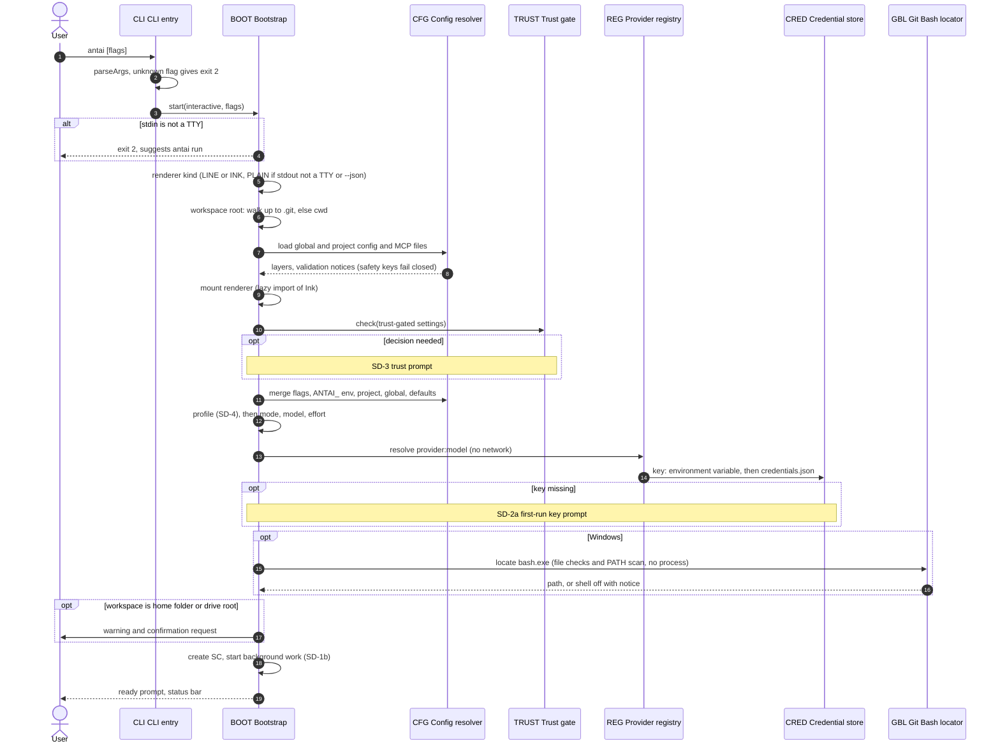

**Alternative and failure paths**

- Step 4: `antai` with stdin not a TTY exits with code 2 (FR-UI-06). `--json` with a TTY selects `PLAIN` with no human present (deliverable 01, section 4.3).
- Step 8: an invalid config value produces a message naming file, key and expected value; an invalid `mode` becomes `research`; an invalid list entry drops only that entry (FR-CFG-02). antai still starts.
- Step 10: the trust check runs before the key lookup, because a trusted project may change the provider, model or `baseURL`, which decides which key is needed and where it is sent (SD-D1, CR-08).
- Step 11: a project file that sets `auto` is ignored with a notice in every case (FR-CFG-05). `--dangerously-skip-permissions` sets the internal mode `skip` and the renderer shows a red banner for the whole session (FR-MODE-02).
- Step 15: `ANTAI_GIT_BASH_PATH`, then `shell.gitBashPath`, then the standard folders, then `git` found on `PATH`. An invalid override gives a warning and auto-detection continues (AC-24). `C:\Windows\System32\bash.exe` and a `git` inside the workspace are skipped. Not found: the `shell` tool is not registered and the notice from BRD 4.1 is shown (AC-23).
- Step 17: declining the home-folder confirmation exits with code 0 and no session (FR-TOOL-09).

**Start-up budget (NFR-PERF-01).** Median under 1 s from launch to a usable prompt, excluding MCP servers, first-run setup and `npx` download time. Deliverable 07 sets the per-stage budget; this flow fixes what is on the critical path:

| Work | When | Why |
|---|---|---|
| argv, config files, `trusted.json`, `credentials.json`, profile files | Before the prompt | Needed to show mode, model and profile |
| Git Bash location (Windows) | Before the prompt | File checks only; the notice must appear at start |
| Ink and React chunk | Before the prompt, TTY only | Lazy import (HLD-D12) |
| Instruction files, skill catalogue | Background; first submit, `/instructions`, `/skills` and the `/` menu wait for them | SD-D2 |
| MCP connect, OAuth refresh, `.env` scan, retention, log cleanup | Background (SD-1b) | Excluded from or not needed for the prompt |
| Bash parser WASM, tokenizer data | First use | HLD-D14; only the classifier and token estimates need them |

### 3.2 SD-1b Start-up: background work

| | |
|---|---|
| **Trigger** | Step 18 of SD-1a |
| **Preconditions** | Config and trust resolved; renderer mounted |
| **Postconditions** | Audit log has a `session-start` record; MCP servers connected, failed or "needs login" (shown in `/mcp`); `RED` holds the known-value matcher; old sessions, audit files and logs deleted; instruction files and skills loaded |
| **Realises** | FR-MCP-04, FR-SEC-03 (a), FR-HIS-09, FR-HIS-13 (audit retention), FR-ERR-03, FR-INS-02, FR-SKL-02, NFR-PERF-01, NFR-REL-02, HLD-D21 |

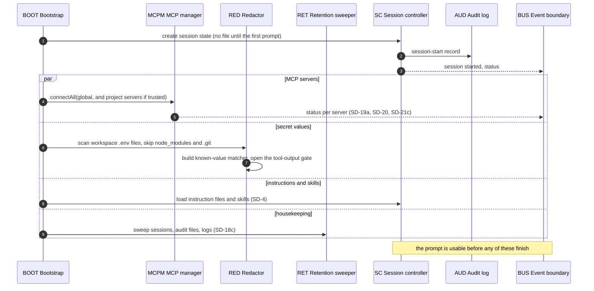

**Alternative and failure paths**

- A failing MCP server marks only itself failed (NFR-REL-02, AC-16).
- Until the `.env` scan finishes, tool outputs wait in `TREG`'s wrapper (HLD-D21); the first user message waits up to 5 s (deliverable 07, RT-D4); model text does not wait.
- A `.env` file created or changed by a command mid-session is picked up by a re-scan by modification time after each command and before each turn (deliverable 02, SEC-D15).

### 3.3 SD-2a First run without an API key

| | |
|---|---|
| **Trigger** | SD-1a step 14: no key for the resolved provider |
| **Preconditions** | Interactive; provider needs a key (not Ollama, not `lmstudio`) |
| **Postconditions** | `~/.antai/credentials.json` holds the key, mode `0600` (POSIX) or user-only profile ACL (Windows); the key is a known value in `RED`; ready prompt |
| **Realises** | FR-MOD-04, FR-SEC-05, NFR-USE-01, BRD 4.1, HLD-D20 |

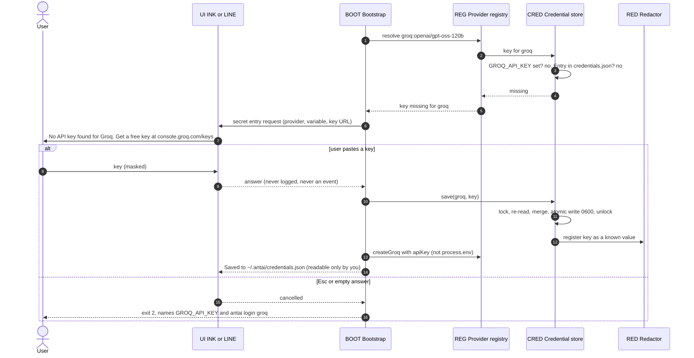

**Alternative and failure paths**

- `GROQ_API_KEY` in the environment: the lookup in step 3 finds it and steps 4 to 16 do not happen (AC-01).
- The key is not checked with a network call at entry (SD-D13). A wrong key surfaces on the first turn as SD-16c.
- `CRED` cannot write (permissions, disk): the key is used for this session only, with a message naming the file and the error.
- The audit log gets a `credential` event (action, provider), never the value (deliverable 04, section 5.9).

### 3.4 SD-2b `antai login`, `antai logout`, and `run` without a key

| | |
|---|---|
| **Trigger** | `antai login <provider>`, `antai logout <provider>`, or `antai run` with no key |
| **Preconditions** | — |
| **Postconditions** | Key stored or removed in `credentials.json`; for `run`, nothing stored and exit code 2 |
| **Realises** | FR-CLI-05, FR-MOD-04, FR-CLI-02, FR-SEC-05, AC-01 |

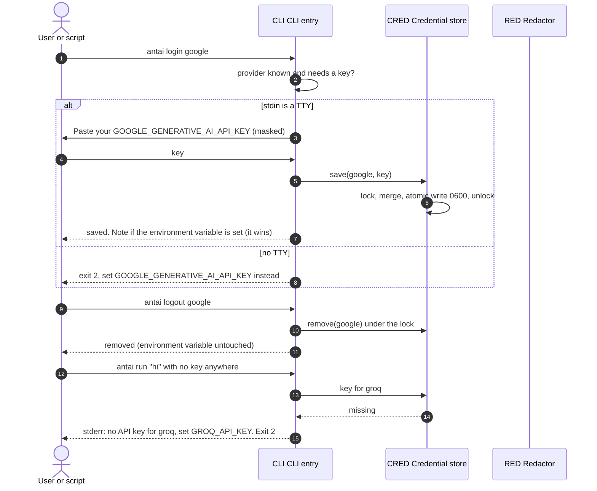

**Alternative and failure paths**

- Providers without a key (`ollama`, `lmstudio`) answer "no key needed" and exit 0.
- `antai login` refuses a pipe (SD-D14): scripts set the environment variable, which already has priority (FR-MOD-04).
- `/model` to a provider without a key prompts like SD-2a, inside the session (SD-14a).

### 3.5 SD-3 Workspace trust prompt

| | |
|---|---|
| **Trigger** | SD-1a step 10, or `/trust` |
| **Preconditions** | The workspace has trust-gated project settings: MCP servers in `.antai/mcp.json` or `.mcp.json`, `shell.allow`, `mcp.tools.allow`, project `mode` or `model`, a provider definition or any `baseURL`, a profile pin, or project profiles that set `mode` or `model` |
| **Postconditions** | `trusted.json` holds the root, the settings hash and the decision; an audit event records it; gated keys applied only if trusted |
| **Realises** | FR-CFG-04, FR-CFG-05, FR-PRF-02, FR-MCP-02, FR-MCP-03, FR-MCP-11 (no login before trust), FR-SH-05, FR-MOD-07, NFR-SEC-02, D15, BRD 4.10 |

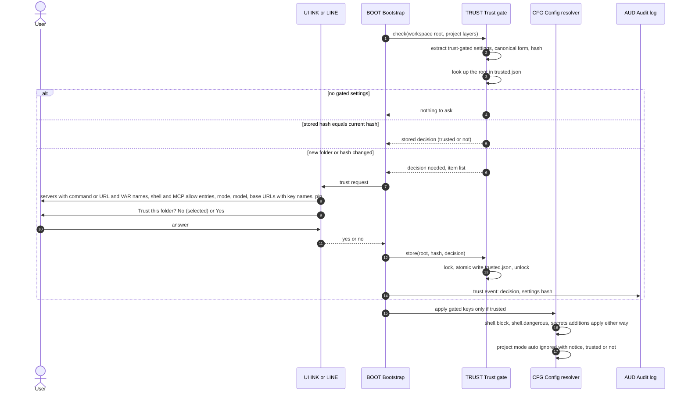

**Alternative and failure paths**

- Steps 2 and 3 compare hashes, so any change to a gated setting (for example after `git pull`) asks again (AC-19). An explicit "No" is stored with its hash and is not asked again until the settings change or the user runs `/trust` (SD-D12).
- "No" keeps instruction files, skills and profile instructions, and the tighten-only keys (`shell.block`, `shell.dangerous`, `secrets.paths`, `secrets.patterns`). Project MCP servers are not started and cannot start an OAuth login; project `shell.allow`, `mcp.tools.allow`, `mode`, `model`, profile pin, provider definitions and `baseURL` are ignored (AC-19, AC-35).
- A project profile's `mode` and `model` apply only when trusted, and `mode` only as `research` or `manual` (FR-PRF-02, AC-14). A config `shell.allow` entry can never move `sudo` below Dangerous or a hard-floor command out of the hard floor (AC-30, SD-8, SD-9).
- `antai run` never asks: a stored decision is used; otherwise the folder is untrusted, with one notice on stderr (deliverable 01, section 10.1).
- `/trust` shows the stored decision and the current item list, and lets the user change it. The change applies from the next start, because MCP servers and providers are created at start (SD-D12).

### 3.6 SD-4 Profiles, instruction files and skill catalogue

| | |
|---|---|
| **Trigger** | SD-1a step 12 (profile) and SD-1b step 8 (instructions, skills) |
| **Preconditions** | Trust decision made (SD-3) |
| **Postconditions** | Active profile (or none) with its defaults applied; loaded and skipped instruction files listed for `/instructions`; skill catalogue and invalid skills listed for `/skills`; `IB` ready to build instructions each turn |
| **Realises** | FR-PRF-01..05, FR-INS-01..04, FR-SKL-01..07, FR-AGT-03, FR-CFG-05, G5, D12, D14 |

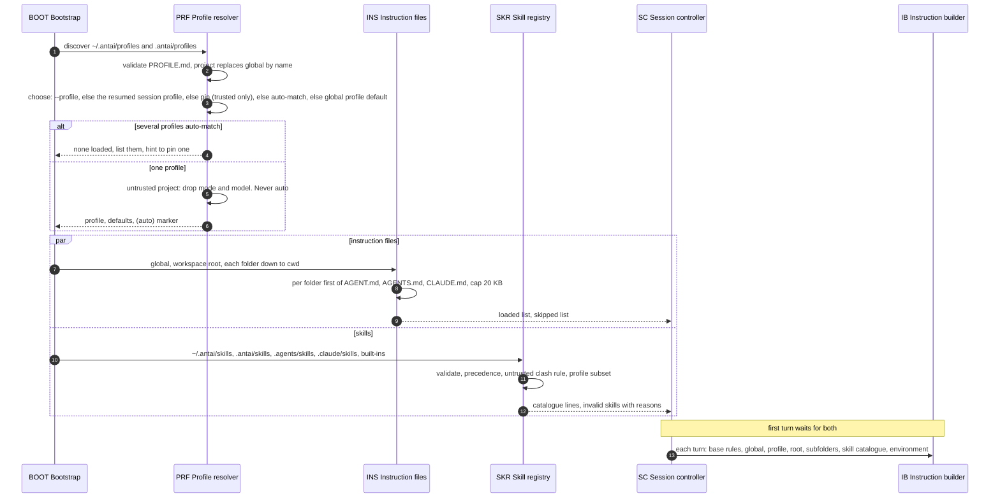

**Alternative and failure paths**

- Invalid `PROFILE.md` or `SKILL.md`: skipped and listed with the reason in `/profile` or `/skills` (FR-PRF-01, FR-SKL-06). Start continues (NFR-REL-02).
- Two files in one folder: the first of `AGENT.md`, `AGENTS.md`, `CLAUDE.md` loads; the others appear as skipped in `/instructions` (AC-15). A file over 20 KB is cut with a notice (FR-AGT-03).
- In an untrusted folder a project skill never replaces a global skill of the same name; the clash is listed (FR-SKL-02). Built-in slash commands win over skills of the same name (FR-SKL-04).
- `IB` rebuilds instructions every turn and never stores them, so a changed `AGENT.md` applies from the next turn.

---

## 4. Turns and Safe tools

### 4.1 SD-5a Plain turn with streaming text

| | |
|---|---|
| **Trigger** | User submits text that is not a slash command, with no turn running |
| **Preconditions** | Ready prompt; key available; instruction files and skills loaded |
| **Postconditions** | Session file holds the header (first turn), the user message, the response messages and a `usage` record; `index.json` updated; screen shows the answer and token counts |
| **Realises** | FR-AGT-01, FR-AGT-02, FR-AGT-03, FR-HIS-01, FR-HIS-02, FR-UI-01, FR-UI-02, NFR-SEC-05, NFR-PERF-02, NFR-MNT-01, HLD-D2, HLD-D18, HLD-D19 |

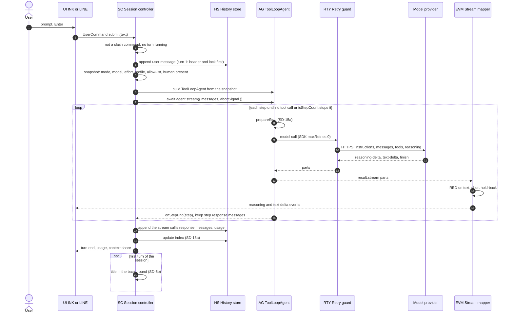

**Notes and alternative paths**

- Step 4 is on disk before any network call (FR-HIS-02). Response messages are written when a stream call ends: before an approval dialog (SD-7a) and at turn end (deliverable 04, DS-D6). `SC` keeps each step's messages from `onStepEnd` so that Esc can save completed steps (SD-12a, SD-D4). Writing every step at once (deliverable 04, P2) is not used in v1.
- Step 6: `AG` builds a fresh agent with `model` (from `REG`, wrapped by `RTY`), `instructions` (from `IB`), `tools` and `activeTools` (from `TREG`, by mode), `stopWhen: isStepCount(n)`, `reasoning` (effort), `prepareStep` (`PR`), `toolApproval` (`POL` through a wrapper, SD-D6), `maxRetries: 0` and `experimental_toolApprovalSecret` (through `SDK`, one random secret per process). Construction makes no network call (HLD-D2).
- Step 7: `messages` are the stored, redacted records, including this turn's user message, which `RED` redacts before step 4 stores it. A live and a resumed session therefore send the same bytes (deliverable 04, DS-D8). The first user message of a process waits up to 5 s for the background `.env` scan before step 4 redacts and stores it, so values from `.env` files are known before anything is written or sent (deliverable 07, RT-D4; deliverable 02, SEC-D15).
- Step 14: `EVM` redacts streamed text before any renderer or history sees it, holding back the trailing word until whitespace (a run without whitespace is released after 8 KB, except its last L − 1 characters, L being the longest known value) and an open PEM block until its end line or 16 KB (HLD-D19; deliverable 02, section 6.4, SEC-D14). Reasoning arrives as `reasoning-start`, `reasoning-delta` and `reasoning-end` parts.
- While the turn runs, Enter does not submit (HLD-D18). Esc interrupts (SD-12a).
- A tool call in the step leads to SD-6, SD-7 or SD-9. A provider error leads to SD-16.
- If `isStepCount` stopped the turn (the last step still had tool calls), `SC` shows "stopped after 25 steps" and `run` exits with code 4 (FR-AGT-02, AC-33).

### 4.2 SD-5b Usage accounting and session title

| | |
|---|---|
| **Trigger** | Every step end (usage); end of the first turn (title) |
| **Preconditions** | SD-5a running or finished |
| **Postconditions** | Status bar shows tokens and context share; session file holds a `usage` record per turn and one `title` record; `index.json` entry has the title |
| **Realises** | D30, FR-HIS-01, FR-UI-02, BRD 5.11 `/usage`, NFR-SEC-05 |

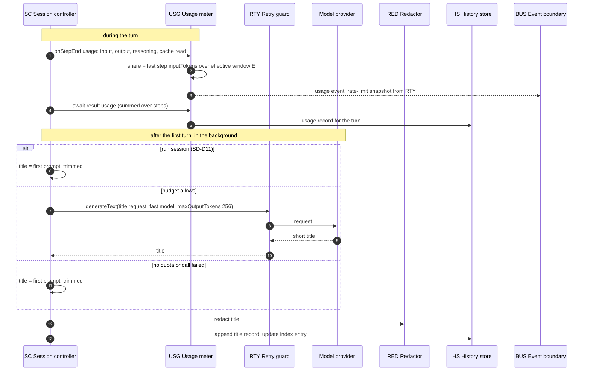

**Notes and alternative paths**

- Usage fields are the v7 nested names: `inputTokenDetails.cacheReadTokens`, `outputTokenDetails.reasoningTokens`. `result.usage` is already summed across steps.
- The title call uses the current provider's `fast` model when the catalogue has one and the same key serves it, otherwise the session model, with reasoning `low` and `maxOutputTokens` 256 (deliverable 09, MP-D24 and section 13.4). It goes through `RTY` with one attempt and no retries, so its pre-flight budget check can skip it on the Groq free plan rather than spend tokens the next turn needs (SD-D11).
- The title request contains the first prompt and the start of the first answer, both already redacted. A failure is silent except in the debug log. Titles are at most 80 characters; with `--no-history` no title call is made, because nothing stores it (deliverable 04, section 5.10).

### 4.3 SD-6 Turn with a Safe tool

| | |
|---|---|
| **Trigger** | The model calls a Safe tool, for example `list_directory` for "what files are in src?" |
| **Preconditions** | SD-5a running |
| **Postconditions** | No dialog; tool card marked done; the model and the expanded card get the same redacted, capped text; no audit record for read-only built-ins (a Safe shell command gets a `command` event, SD-10a) |
| **Realises** | FR-TOOL-01, FR-TOOL-04..06, FR-TOOL-08, FR-TOOL-09, FR-SKL-03, FR-SH-02, FR-AGT-07, FR-SEC-03, FR-UI-03, AC-02, AC-12 |

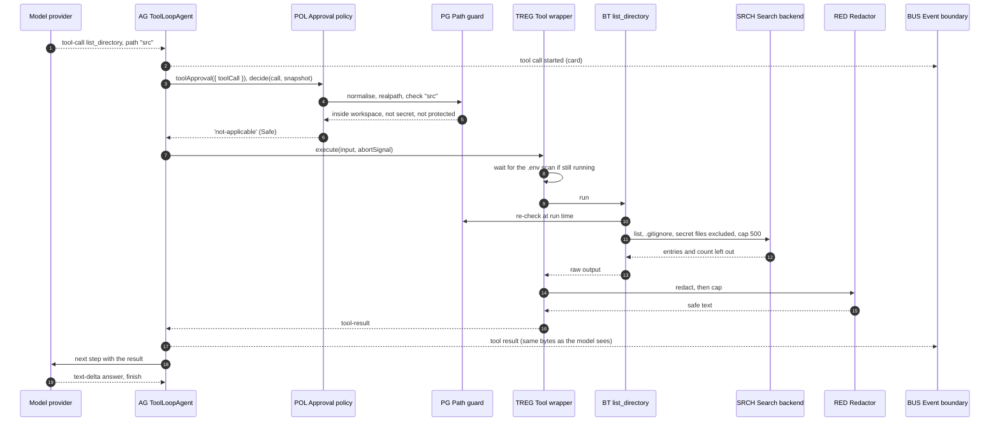

**Notes and alternative paths**

- `read_file`, `find_files`, `search_files` and `load_skill` follow the same path. `search_files` and `find_files` use `rg` from `PATH` through `PSV` when present, else the built-in walker; both exclude secret files whether or not `.gitignore` lists them (FR-TOOL-06).
- `load_skill` returns the skill body and its file list from `SKR` (FR-TOOL-08). The model calls it when a request matches a catalogue line (AC-12). A skill with `disable-model-invocation: true` is not in the catalogue.
- A tool that throws (file missing, binary file, span not found) returns a tool error to the model, never ends the turn (FR-AGT-07).
- Several read-only calls in one step may run together; side-effecting calls are serialised by `TREG` (HLD-D17).
- Steps 3 to 7 are HLD.png's "can I run?" and "yes" arrows: `POL` returns a decision and the SDK calls `TREG`. Steps 13 to 16 are its "raw output" and "clean result" arrows (section 1.3; deliverable 01, section 1.3).

---

## 5. Approvals and denials

### 5.1 SD-7a Approval request for a Normal write in `manual`

| | |
|---|---|
| **Trigger** | In `manual`, the model calls `write_file` or `edit_file` on a normal workspace path |
| **Preconditions** | Human present; not a protected or secret path |
| **Postconditions** | The audit log and the session file hold one approval event; a `tool-approval-response` is ready for SD-7b |
| **Realises** | FR-SH-02, FR-MODE-04, FR-UI-04, FR-SH-10, FR-HIS-13, FR-HIS-02, type-ahead guard and signed requests (section 1.5), AC-05, AC-31 |

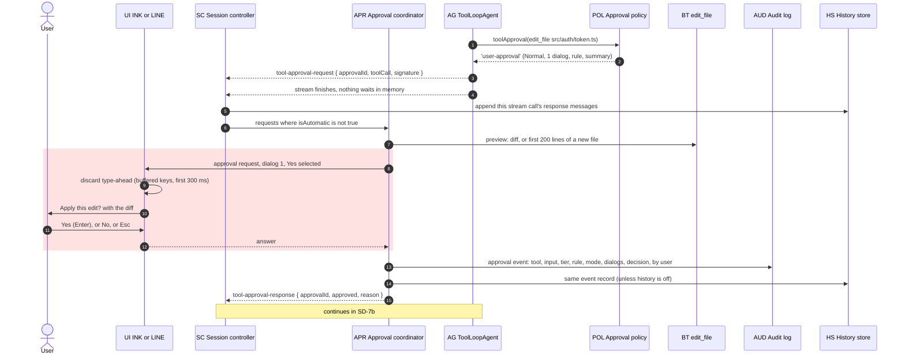

**Notes and alternative paths**

- Step 1: the wrapper in `AG` stores `POL`'s full decision (tier, rule ID, summary, dialog count) under `toolCall.toolCallId` for `APR` and the audit (SD-D6).
- Step 3: the request is signed with the per-process secret, so no other process or text can answer it (deliverable 02, section 3.10). Step 5 writes the tool call before the dialog opens, so a crash while the dialog is open leaves the call on disk and resume closes it as interrupted (deliverable 04, DS-D6; SD-17b, AC-17).
- Several requests in one step are shown one after another; each gets its own audit event. The single response message carries one `tool-approval-response` per request.
- Step 11: "No" or Esc gives `approved: false` with reason "declined by user"; the model is told the action was denied (AC-05).
- Steps 13 and 14: the audit record is written first, then the session record with the same `seq` (deliverable 04, DS-D14).
- Write dialogs do not offer "Yes, don't ask again this session"; only Normal shell commands do (BRD 4.3, SD-7c, SD-D7).

### 5.2 SD-7b Resumption after the decision

| | |
|---|---|
| **Trigger** | SD-7a step 15 |
| **Preconditions** | All open requests of the step are answered |
| **Postconditions** | Approved: file written, `file-write` event, tool result to the model. Denied: `tool-output-denied` on screen, `execution-denied` to the model. The turn continues |
| **Realises** | FR-SH-02, FR-AGT-02, FR-TOOL-02, FR-TOOL-03, FR-TOOL-09, FR-HIS-13, signed requests and `O_NOFOLLOW` (section 1.5), AC-05 |

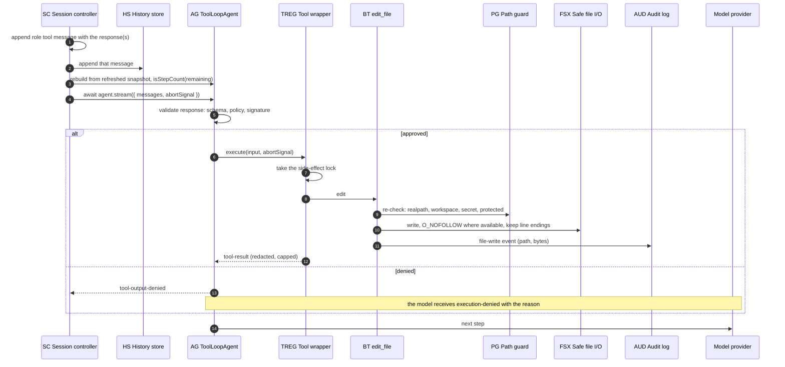

**Notes and alternative paths**

- Step 3: the agent is built again from the same mode, model, profile and effort (slash commands cannot run during a turn), with the session allow-list as it is now and `isStepCount(maxSteps − stepsUsedThisTurn)`, so the cap counts steps across all resumptions (FR-AGT-02, SD-D5).
- Step 5: a response whose signature does not match this process's secret fails with `InvalidToolApprovalSignatureError`; `SC` ends the turn with an internal-error message. This is what stops a replayed or injected approval. If the SDK calls `toolApproval` again during validation, `POL` gives the same answer for the same snapshot, and a changed answer denies; the P0 spike confirms which happens.
- Step 9: the path is checked again because approval and execution are separate moments. A path that became a symlink to a secret or outside the workspace fails as a tool error, and `FSX` opens the final path component with `O_NOFOLLOW` where available, so a link swapped after the check also fails.
- `edit_file` with a missing or ambiguous span returns a tool error after approval; nothing is written (FR-TOOL-03).

### 5.3 SD-7c "Yes, don't ask again this session"

| | |
|---|---|
| **Trigger** | User picks the second option in dialog 1 of a Normal shell command |
| **Preconditions** | `manual` mode; tier Normal (never Dangerous) |
| **Postconditions** | The exact command text is in `SC`'s session allow-list, in memory only; later identical calls in this session run with an automatic approval and an audit record; `/clear` and `/resume` start with an empty list |
| **Realises** | FR-SH-03, D27, FR-SH-10, AC-05 |

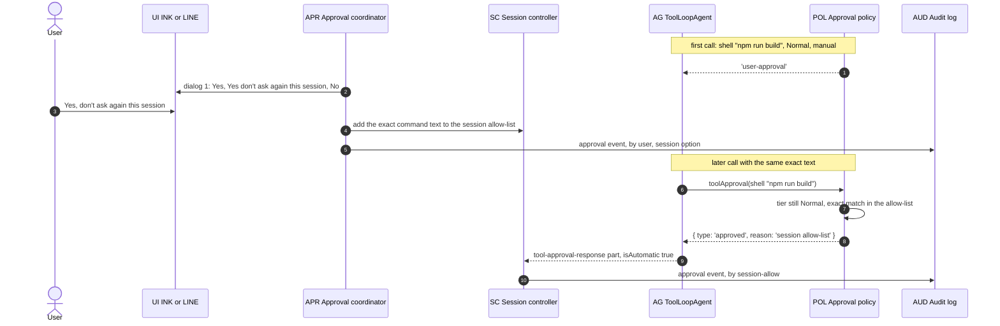

**Notes and alternative paths**

- The match is on the exact command text after normalising whitespace; `npm run build -- --watch` asks again.
- The classifier still runs each time: if the same text ever classified above Normal (for example after a rule-set change), the allow-list does not apply.
- The list is not saved and not restored by `--continue` or `--resume` (SD-D7). A new session asks again (AC-05).

### 5.4 SD-8 Dangerous command

| | |
|---|---|
| **Trigger** | The model calls a command the classifier rates Dangerous (for example `rm -rf ./build`, `bash -c "npm install"`, `sudo …`), or a write to a protected path |
| **Preconditions** | Not hard floor |
| **Postconditions** | One audit event recording the number of dialogs and the decision; the command runs only if every dialog said Yes |
| **Realises** | FR-SH-02, FR-SH-03, FR-SH-04, FR-SH-12, FR-TOOL-11, FR-MODE-02, FR-MODE-03, FR-UI-07, D8, AC-06, AC-07, AC-08, AC-10, AC-25 |

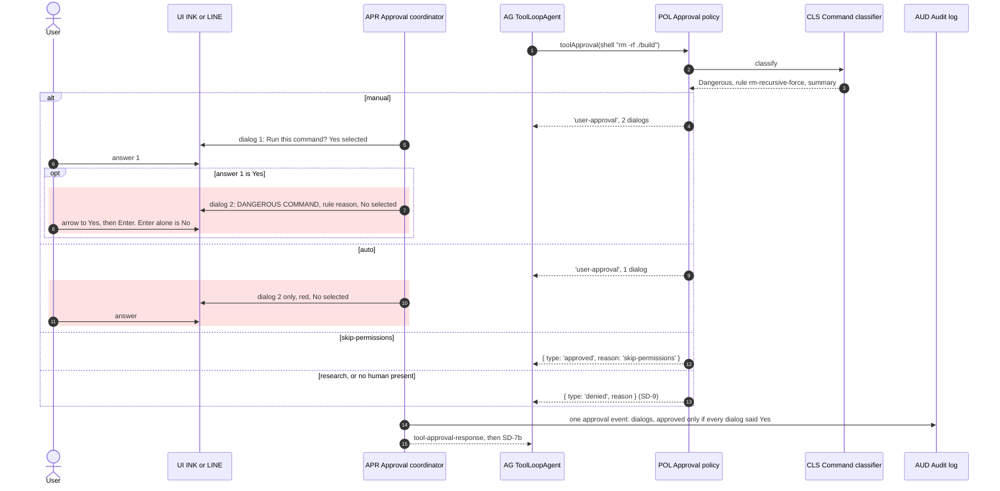

**Notes and alternative paths**

- Dialog text (summary, reason line) comes from the matched rule in `RULES`, never from the model (FR-SH-03, FR-SH-04). Without colour the dialog keeps its ▲ marker, heading and No default (FR-UI-07).
- No in dialog 1 cancels without showing dialog 2 (AC-06).
- Protected paths (`.antai/**`, `.mcp.json`, `.claude/**`, `.agents/**`, instruction files, `.git/**`, `~/.antai/**`, shell start-up files, and the additions in deliverable 02, section 5.4) make writes, edits and redirections Dangerous in every mode, so a model trying to set `mode: auto` in `.antai/config.json` needs two approvals in `manual`, and even then the setting needs trust and no project file can set `auto` (AC-10, SD-3).
- Nested shells and inline interpreters (`bash -c`, `python -c`, `node -e`, `xargs sh -c`) are Dangerous; their hard-floor contents are still denied (AC-25, SD-9).
- In `skip` mode the automatic approval is still audited, with `by: mode` (FR-SH-10); hard floor is still denied (AC-08).

### 5.5 SD-9 Automatic denials and replanning

| | |
|---|---|
| **Trigger** | `POL` returns `denied` for a tool call |
| **Preconditions** | Any mode |
| **Postconditions** | Nothing ran; red tool card with the reason; denial in the audit log and the session; the model got `execution-denied` and continues |
| **Realises** | FR-SEC-01, FR-SEC-02, FR-TOOL-09, FR-SH-01, FR-SH-05, FR-SH-07, FR-SH-12, FR-MODE-01, FR-CLI-02, FR-SH-10, D9, D19, D25, AC-03, AC-08, AC-09, AC-28, AC-29 |

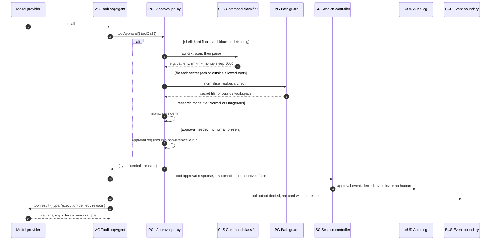

**Notes and alternative paths**

- In `research` mode `write_file` and `edit_file` are not in `activeTools`, so the model cannot call them; shell writes (`echo x > f.txt`, `sed -i`, `touch`) reach `POL` as Normal and are denied (AC-09).
- A read-only shell command with a path outside the workspace is not denied: it becomes Normal and asks once (AC-28, `cat /etc/hosts`). A secret path is hard floor for commands and refused for file tools, inside or outside the workspace (D25, AC-28).
- Commands that detach (trailing `&`, `nohup`, `setsid`, `disown`) are refused in every mode (FR-SH-07, AC-29).
- The reason string is short and fixed per rule (deliverable 08 owns the wording); it never echoes secret values.
- For routes that are not denied (for example `npm run dev` loading `.env`), redaction in SD-10a is the backstop (AC-03, AC-04).
- If the audit log cannot be written, calls that need an audit record are denied with the reason "audit log cannot be written" (deliverable 04, section 6.10; beyond the BRD, deliverable 04 P7).

---

## 6. Shell execution

### 6.1 SD-10a Shell execution with streamed output

| | |
|---|---|
| **Trigger** | An approved, automatically approved or Safe `shell` call |
| **Preconditions** | bash found (Git Bash on Windows); `.env` scan finished |
| **Postconditions** | Command finished; model, history and expanded card hold the same redacted, capped output; audit log has a `command` event with exit code and duration |
| **Realises** | FR-TOOL-07, FR-SH-06, FR-SH-07, FR-SH-08, FR-SEC-02, FR-SEC-03, FR-SEC-04, FR-UI-08, FR-HIS-13, NFR-COMP-02, HLD-D20, redact then cap (section 1.5), AC-03, AC-04, AC-22 |

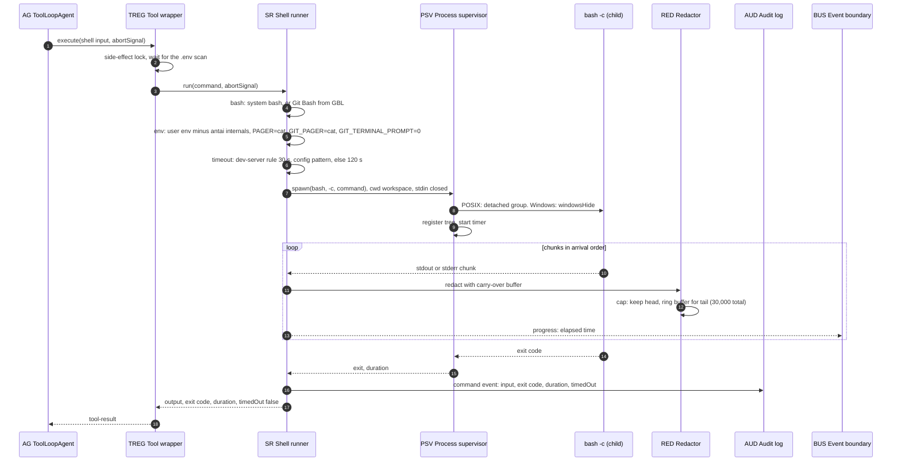

**Notes and alternative paths**

- Step 5: provider keys are not in `process.env` (HLD-D20), so children never inherit stored keys. Provider variables the user exported (for example `GROQ_API_KEY`) are kept, because they are the user's own environment; any value a command prints is masked by the name rule (deliverable 02, section 6.6).
- Steps 11 and 12: redaction runs on the full stream before the cap, so a secret split by a chunk boundary or by the cut is still caught (section 1.5, AC-04). Values of secret-named variables and secret files are masked from 4 characters, other `.env` values from 8 (FR-SEC-04).
- Step 13: the card shows a spinner and elapsed time; the output appears when the command ends (SD-D23).
- The audit record holds the redacted command, not the output (FR-HIS-13: no conversation text).
- On Windows without Git Bash the `shell` tool is not registered at all (SD-1a), so the model never calls it (AC-23).

### 6.2 SD-10b Timeout and process-tree kill

| | |
|---|---|
| **Trigger** | The command's timer fires, or the turn's abort signal (SD-12b), or shutdown (SD-23a) |
| **Preconditions** | A registered command tree |
| **Postconditions** | No process of the tree remains (best effort on Windows); the model gets the output so far marked timed out; the card shows "timed out", not done |
| **Realises** | FR-SH-07, NFR-REL-03, AC-29 |

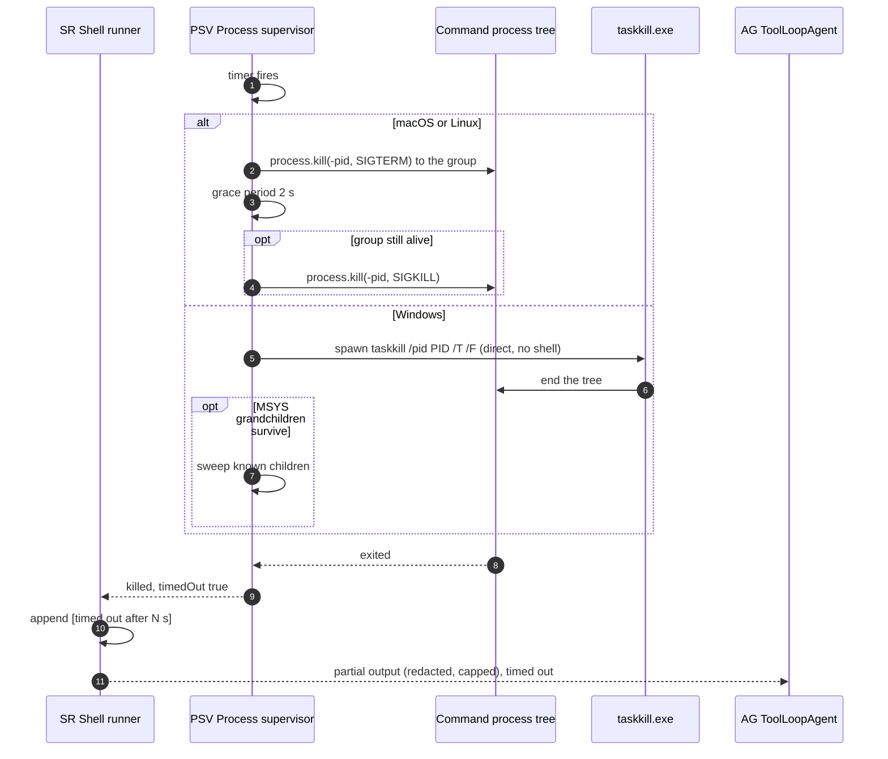

**Notes and alternative paths**

- The child was spawned in its own process group on POSIX, so one signal reaches every grandchild, including `sleep 1000` started by the command (AC-29).
- On Windows `detached` is not used, because it opens a console window; `taskkill /T /F` ends the tree (deliverable 01, section 6.5).
- The same kill path serves Esc (SD-12b) and shutdown (SD-23a); only the marker differs ("interrupted" instead of "timed out").

### 6.3 SD-11 `sudo` hand-off

| | |
|---|---|
| **Trigger** | An approved command with a segment that starts with `sudo` (Dangerous, SD-8) |
| **Preconditions** | macOS or Linux; `CLS` flagged the `sudo` segment |
| **Postconditions** | The user typed the password into `sudo` only; the command ran captured and redacted like any other; or a clear tool error |
| **Realises** | FR-SH-09, FR-UI-05 (keys go to the command that owns the terminal), D24, HLD-D3 |

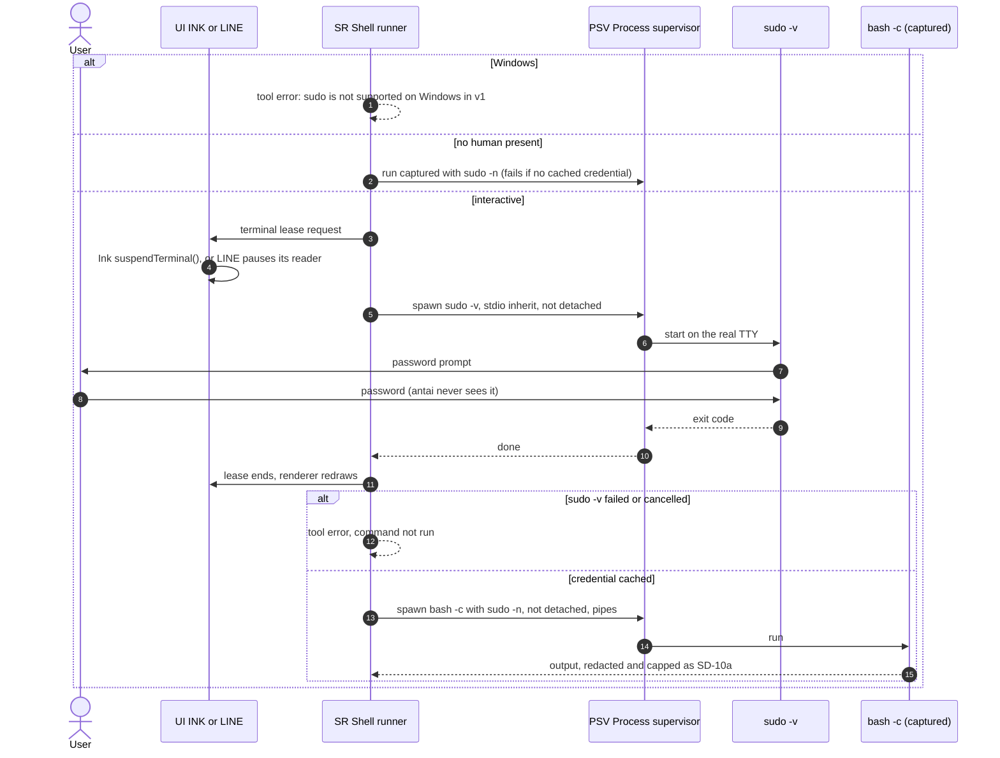

**Notes and alternative paths**

- `sudo -n` and the spawn without `detached` are used because a process in a new session has no controlling terminal, so it might not see the cached credential, and `-n` makes a missing cache fail instead of prompting behind the renderer (risk TR5; to be confirmed in the P0 spike).
- If `sudo` still asks after `sudo -v` (credential caching off), the captured run fails at once and the tool error tells the user to run the command themselves (FR-SH-09).
- After the captured run `SR` runs `sudo -k`, so later Normal commands cannot use the cached credential (FR-SH-09; deliverable 02, SEC-D28).
- On Windows `SR` refuses without running anything (SD-D15).
- While the lease is active, Esc and Ctrl+C reach `sudo`, not antai (FR-UI-05).

---

## 7. Interrupts

### 7.1 SD-12a Esc during streaming

| | |
|---|---|
| **Trigger** | Esc, or the first Ctrl+C, while the model streams |
| **Preconditions** | A turn is running; no dialog open |
| **Postconditions** | Provider request cancelled; completed steps and the partial text are in the session file; open tool calls have synthetic results; an `interrupted` event is in the session and the audit log; the next prompt works |
| **Realises** | FR-AGT-04, FR-UI-05, FR-HIS-02, FR-HIS-13, AC-17, AC-32 |

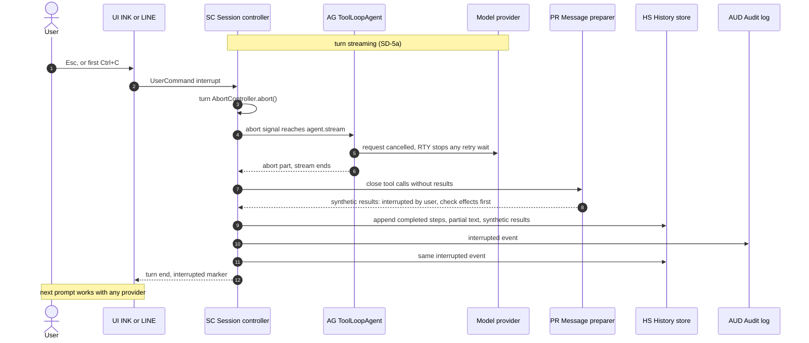

**Notes and alternative paths**

- Step 9 writes the completed steps of the current stream call (kept from `onStepEnd`), the text of the step in progress marked `partial`, and the synthetic results marked `synthetic: "interrupted"`. Earlier stream calls are already on disk (deliverable 04, section 6.6).
- Step 8: the synthetic result says the outcome was not recorded or the command was stopped, and that the model must check whether it took effect before running it again (SD-D9).
- This flow does not use `result.responseMessages` or `result.usage` after an abort, because the SDK may not resolve them then; it uses the `onStepEnd` records and `EVM`'s partial text.

### 7.2 SD-12b Esc during a running tool

| | |
|---|---|
| **Trigger** | Esc while a `shell` command or an MCP call runs |
| **Preconditions** | Tool executing in `TREG` |
| **Postconditions** | Command tree killed, or MCP request aborted; partial output (redacted, capped) kept in a synthetic result marked interrupted; audit record of the interrupted command |
| **Realises** | FR-AGT-04, FR-SH-07, NFR-REL-03, AC-32 |

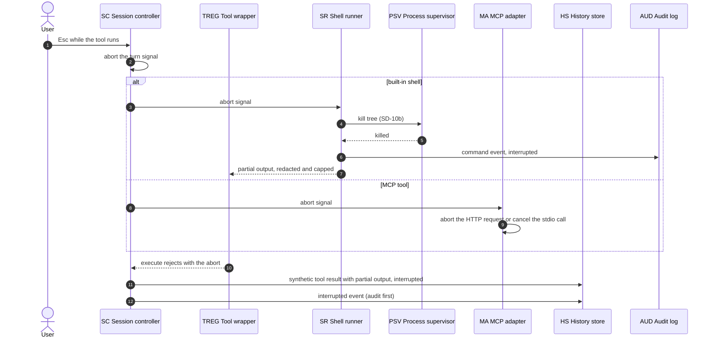

**Notes and alternative paths**

- A file write in progress is a single `FSX` call; it completes or fails, and the synthetic result says which.
- An MCP server may still finish the action on its side after the abort; the synthetic result says so (deliverable 10).

### 7.3 SD-12c Esc and Ctrl+C in a dialog and when idle

| | |
|---|---|
| **Trigger** | Esc or Ctrl+C while a dialog is open, or Ctrl+C at the idle prompt |
| **Preconditions** | — |
| **Postconditions** | Esc in a dialog: that call denied, turn continues. Ctrl+C in a dialog: turn interrupted. Ctrl+C twice within 2 s: shutdown |
| **Realises** | FR-UI-05, FR-AGT-04, FR-SH-10, AC-32 |

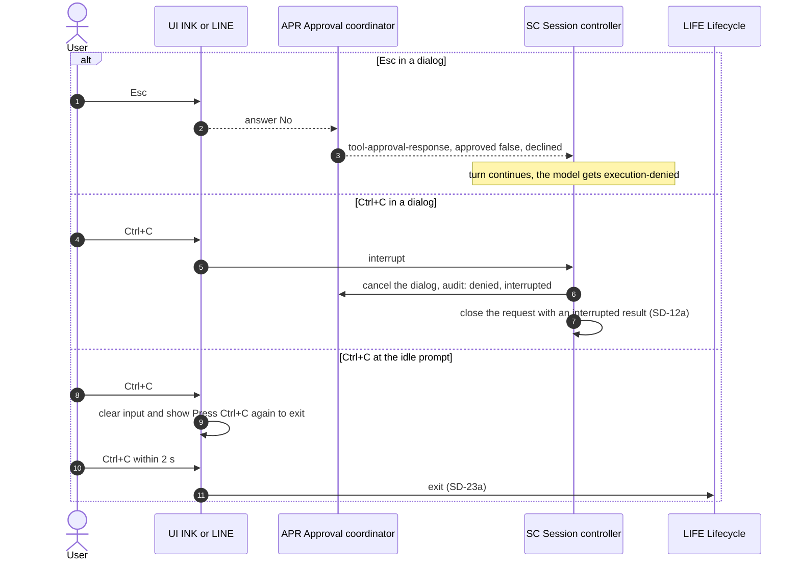

**Notes and alternative paths**

- The distinction follows FR-UI-05: Esc "in a dialog answers No"; Ctrl+C "interrupts the turn" (SD-D8).
- Ink runs with `exitOnCtrlC: false`, because raw mode suppresses SIGINT and antai needs its own double-press handler.

---

## 8. Non-interactive runs

### 8.1 SD-13a `antai run`: set-up

| | |
|---|---|
| **Trigger** | `antai run "<prompt>"` or `-p`, optionally `--json`, piped stdin, `--mode`, `--no-history` |
| **Preconditions** | — |
| **Postconditions** | `PLAIN` renderer, human present false, mode `research` unless `--mode`; piped text redacted and capped inside an untrusted block; MCP servers ready, failed or skipped; session file `kind: run` unless history is off |
| **Realises** | FR-CLI-02, FR-CLI-03, FR-UI-06, FR-HIS-01, FR-HIS-10, FR-MCP-11, D19, D26, HLD-D22, AC-20, AC-34 |

```mermaid
sequenceDiagram
    autonumber
    participant SCR as Script or CI
    participant CLI as CLI CLI entry
    participant BOOT as BOOT Bootstrap
    participant RED as RED Redactor
    participant MCPM as MCPM MCP manager
    participant SC as SC Session controller
    participant HS as HS History store
    SCR->>CLI: antai run "review" --json, diff on stdin
    CLI->>BOOT: start(run, json)
    BOOT->>BOOT: PLAIN, human present false, research unless --mode
    BOOT->>BOOT: config and stored trust, never a prompt
    alt no API key
        BOOT-->>SCR: stderr names the variable, exit 2
    end
    CLI->>CLI: read stdin up to 100 KB, cut the rest with a notice
    CLI->>RED: redact the piped text (after the .env scan)
    CLI->>SC: prompt plus a delimited untrusted-data block
    BOOT->>MCPM: connect, wait per server up to startupTimeoutMs (30 s)
    MCPM-->>SC: ready servers, OAuth servers without a valid token skipped
    SC->>HS: header kind run (none with --no-history)
    Note over SC: the turn runs as SD-5a with PLAIN
```

**Notes and alternative paths**

- A trust decision that would be needed is reported on stderr; the folder stays untrusted (deliverable 01, section 10.1).
- A skipped OAuth server prints "run `antai mcp login <name>`" on stderr (FR-MCP-11, AC-26).
- The `.env` scan runs before step 7 here, not in the background, because the piped text is redacted at once.

### 8.2 SD-13b `antai run`: execution and exit code

| | |
|---|---|
| **Trigger** | SD-13a finished |
| **Preconditions** | `PLAIN` attached |
| **Postconditions** | stdout holds text or one JSON object per event; stderr holds errors; every decision is in the audit log; exit code as FR-UI-06 |
| **Realises** | FR-CLI-02, FR-UI-06, FR-SH-10, FR-HIS-13, D19, D26, AC-20, AC-31 |

```mermaid
sequenceDiagram
    autonumber
    participant SCR as Script or CI
    participant PLAIN as PLAIN renderer
    participant SC as SC Session controller
    participant AG as AG ToolLoopAgent
    participant POL as POL Approval policy
    participant AUD as AUD Audit log
    participant LIFE as LIFE Lifecycle
    PLAIN-->>SCR: every line carries schemaVersion
    loop steps
        AG-->>PLAIN: text, tool-call, tool-result events
        AG->>POL: toolApproval
        opt tier needs approval
            POL-->>AG: denied: approval required in a non-interactive run
            AG-->>SC: automatic denial part
            SC->>AUD: approval event, denied, by no-human
            PLAIN-->>SCR: approval event, decision denied
        end
    end
    SC-->>PLAIN: usage event
    SC->>SC: exit code: 3 provider, 4 step cap, 5 denied action, else 0
    PLAIN-->>SCR: done event, errors on stderr
    SC->>LIFE: shutdown (SD-23a)
    LIFE-->>SCR: process exit code
```

**Notes and alternative paths**

- Exit codes (FR-UI-06): 0 done; 1 internal error; 2 usage or config error; 3 provider error; 4 step cap; 5 finished with a denied action. Precedence when several apply is fixed in deliverable 11.
- `--mode auto` lets Normal commands run; Dangerous ones still need a human and are denied. `--dangerously-skip-permissions` runs them; hard floor stays denied.
- `--no-history` writes no session file; audit events are still written (AC-31, AC-34).
- Without `--json` the same flow prints plain text; denials appear as one line each.
- The session title is the trimmed prompt, without a model call (SD-D11).

---

## 9. Slash commands and context

### 9.1 SD-14a `/model` with a provider switch

| | |
|---|---|
| **Trigger** | `/model <id>` or a choice in the `/model` picker, at the idle prompt |
| **Preconditions** | No turn running |
| **Postconditions** | New model from the next turn; conversation kept; setting change in the audit log and the session; status bar updated |
| **Realises** | FR-MOD-03, FR-MOD-04, FR-MOD-05, FR-SLC-01, FR-HIS-04, FR-HIS-13, AC-11 |

```mermaid
sequenceDiagram
    autonumber
    actor U as User
    participant UI as UI INK or LINE
    participant SLASH as SLASH Command router
    participant SC as SC Session controller
    participant REG as REG Provider registry
    participant CAT as CAT Model catalogue
    participant CRED as CRED Credential store
    participant AUD as AUD Audit log
    U->>UI: /model google:gemini-3.8-flash
    UI->>SLASH: submit
    SLASH->>REG: resolve alias or provider:model
    REG->>CAT: known? tool calling? context window?
    alt known not to support tool calling
        CAT-->>SLASH: refuse with a message
    else usable or unknown
        REG->>CRED: key for google: env, then file
        opt no key
            SLASH->>UI: secret entry request (as SD-2a)
            UI-->>SLASH: key, saved 0600, registered with RED
        end
        SLASH->>SC: set model, applies from the next turn
        SC->>AUD: setting event: model
        SC-->>UI: model change notice, status bar
    end
    Note over SC: next turn PR drops reasoning, signatures and provider metadata from the copy
```

**Notes and alternative paths**

- `/model` without an argument opens a picker of the default model, aliases, configured models and preset models whose key is set (BRD 4.7, FR-MOD-05).
- Provider-specific parts stay in the history file; only the request copy is stripped (SD-15a, AC-11).
- Cancelling the key prompt keeps the old model.

### 9.2 SD-14b `/mode`, `/effort`, `/profile`, `/clear`

| | |
|---|---|
| **Trigger** | The command at the idle prompt |
| **Preconditions** | No turn running |
| **Postconditions** | Session state changed in `SC` only; each change is a setting-change event in the audit log and the session, so resume can restore it |
| **Realises** | FR-MODE-01, FR-MODE-02, FR-MODE-03, FR-MOD-06, FR-PRF-03, FR-PRF-04, FR-PRF-05, FR-HIS-06, FR-HIS-13, BRD 5.11, AC-08, AC-14, AC-27 |

```mermaid
sequenceDiagram
    autonumber
    actor U as User
    participant SLASH as SLASH Command router
    participant SC as SC Session controller
    participant PRF as PRF Profile resolver
    participant CAT as CAT Model catalogue
    participant HS as HS History store
    participant AUD as AUD Audit log
    alt /mode auto
        U->>SLASH: /mode auto
        SLASH->>SC: set mode (research, manual or auto only)
    else /effort low
        U->>SLASH: /effort low
        SLASH->>CAT: model supports reasoning?
        SLASH->>SC: set effort, notice if the model ignores it
    else /profile node-dev
        U->>SLASH: /profile node-dev
        SLASH->>PRF: load, validate, trust limits
        PRF-->>SC: instructions, skill subset, defaults
        SC->>SC: apply model and effort, mode only if not looser
    else /clear
        U->>SLASH: /clear
        SLASH->>SC: end session
        SC->>HS: end event (clear), index update, release the lock
        SC->>SC: new session id, file created on the next prompt
    end
    SC->>AUD: setting event
    SC->>HS: same event in the session
```

**Notes and alternative paths**

- `/mode` has no value for skip-permissions; `/mode skip` or anything else gives "Unknown mode" with the valid values (FR-MODE-02, AC-08). `/mode` with no argument shows the current mode.
- A mid-session profile switch never loosens the mode; the user needs `/mode` for that (FR-PRF-03). `/profile none` removes instructions and the skill subset and leaves mode, model and effort (FR-PRF-04).
- `/clear` deletes nothing (FR-HIS-06).
- The new instructions apply from the next turn because `IB` runs per turn.

### 9.3 SD-14c `/<skill-name>`, unknown commands and `//`

| | |
|---|---|
| **Trigger** | Input that starts with `/` |
| **Preconditions** | No turn running |
| **Postconditions** | Built-in command handled locally; skill body expanded into a user message; unknown command never sent to the model |
| **Realises** | FR-SKL-04, FR-SKL-05, FR-SLC-01, FR-SLC-02, AC-13 |

```mermaid
sequenceDiagram
    autonumber
    actor U as User
    participant SLASH as SLASH Command router
    participant SKR as SKR Skill registry
    participant SC as SC Session controller
    U->>SLASH: input starting with /
    alt starts with // or the first word has a second /
        SLASH->>SC: send as a normal message (// removed)
    else built-in command
        SLASH->>SLASH: run locally, never sent to the model
    else user-invocable skill
        SLASH->>SKR: body of repo-tour
        SKR-->>SLASH: body
        SLASH->>SC: user message = skill body plus "focus on tests"
        Note over SC: turn as SD-5a, history keeps the expanded message
    else unknown
        SLASH-->>U: Unknown command, with a suggestion
    end
```

**Notes and alternative paths**

- Slash invocation works for any user-invocable skill, also outside the active profile's subset; `user-invocable: false` hides it from the menu (FR-SKL-04, FR-SKL-05).
- `/etc/hosts what is this?` is sent as a message because the first word contains a second `/` (FR-SLC-02).

### 9.4 SD-15a Context pruning in `prepareStep`

| | |
|---|---|
| **Trigger** | Before every model step (`prepareStep`) |
| **Preconditions** | Turn running |
| **Postconditions** | The request copy fits under `context.pruneAt` × the effective window E (deliverable 08, section 9), or the turn stops with a `/compact` hint. The history file is unchanged |
| **Realises** | FR-AGT-05, FR-MOD-05, FR-HIS-02, AC-11 |

```mermaid
sequenceDiagram
    autonumber
    participant AG as AG ToolLoopAgent
    participant PR as PR Message preparer
    participant CAT as CAT Model catalogue
    participant SC as SC Session controller
    participant BUS as BUS Event boundary
    AG->>PR: prepareStep({ messages, steps })
    opt provider differs from the one that produced the messages
        PR->>PR: drop reasoning, signatures, provider metadata from the copy
    end
    PR->>PR: dangling tool calls get synthetic interrupted results
    PR->>CAT: effective window E: context window (table, config, else 32k), or the plan limit if smaller
    PR->>CAT: estimate: last step input tokens plus new parts
    alt under E x pruneAt (0.75)
        PR-->>AG: { messages } unchanged
    else over
        PR->>PR: pruneMessages({ messages, reasoning, toolCalls, emptyMessages })
        PR->>PR: never split a tool call from its result
        PR->>CAT: estimate again
        alt now under
            PR-->>AG: { messages } pruned copy
            PR-->>BUS: notice: older output left out of the request
        else still over
            PR-->>SC: context limit error, the turn stops
            SC-->>BUS: Context window full, use /compact
        end
    end
```

**Notes and alternative paths**

- `pruneMessages` prunes by position, not by tokens, so `PR` estimates before and after. Token estimates use `gpt-tokenizer` (`o200k_harmony`) for gpt-oss, loaded lazily, and elsewhere characters ÷ 4 for prose and code and ÷ 3 for tool output and JSON, calibrated against reported usage (deliverable 08, 9.6).
- The stop in step 12 is a typed error thrown from `prepareStep` (SD-D10). `SC` handles both ways the SDK may surface it, an `error` part on `result.stream` or a rejected promise, and maps either to the "context window full" message.
- antai prunes at the BRD's 0.75 (FR-AGT-05) and leaves summaries to `/compact` (SD-15b); there is no automatic compaction (deliverable 08, section 10).
- A `context` event records that pruning ran or that the turn stopped, at most once per turn (deliverable 04, section 5.9).

### 9.5 SD-15b `/compact`

| | |
|---|---|
| **Trigger** | `/compact` at the idle prompt, usually after the SD-15a hint |
| **Preconditions** | No turn running |
| **Postconditions** | A summary `message` record with a `compaction` marker and a `compaction` event in the session file; later requests send the summary and the messages after it; older messages stay in the file |
| **Realises** | FR-AGT-06, FR-HIS-07 |

```mermaid
sequenceDiagram
    autonumber
    actor U as User
    participant SC as SC Session controller
    participant PR as PR Message preparer
    participant RTY as RTY Retry guard
    participant LLM as Model provider
    participant RED as RED Redactor
    participant HS as HS History store
    U->>SC: /compact
    SC->>PR: compact(messages)
    PR->>PR: keep a recent tail verbatim, summarise the rest
    PR->>RTY: generateText(summary request, older messages)
    RTY->>LLM: request
    LLM-->>RTY: summary
    RTY-->>PR: summary
    alt failed, or not shorter than the original
        PR-->>SC: refuse, history unchanged, message
    else accepted
        PR->>RED: redact the summary
        PR->>HS: append summary message (compaction, replacesThroughSeq) and event
        SC-->>U: compacted, tokens before and after
    end
```

The summary prompt and the tail size are in deliverable 08; the record shape is in deliverable 04, section 5.8.

---

## 10. Provider errors

### 10.1 SD-16a Transient error and retry

| | |
|---|---|
| **Trigger** | A model call fails with a network error, a 5xx or a per-minute 429 |
| **Preconditions** | Nothing of this call has been emitted yet |
| **Postconditions** | The call succeeds after one or more retries, or one final error ends the turn; each retry was shown with its time |
| **Realises** | FR-ERR-01, FR-ERR-02, HLD-D7, AC-21 |

```mermaid
sequenceDiagram
    autonumber
    participant AG as AG ToolLoopAgent
    participant RTY as RTY Retry guard
    participant LLM as Model provider
    participant BUS as BUS Event boundary
    AG->>RTY: doStream (middleware, SDK maxRetries 0)
    RTY->>LLM: request
    LLM-->>RTY: 503, 429 per-minute with retry-after, or ECONNRESET
    RTY->>RTY: classify: transient, nothing emitted yet
    loop up to the attempt limit
        RTY->>RTY: delay: retry-after (capped), else backoff with jitter
        RTY-->>BUS: retry-scheduled { attempt, at, reason }
        RTY->>LLM: same request again
        break success
            LLM-->>RTY: stream parts
            RTY-->>AG: parts (first part ends retry eligibility)
        end
    end
    opt attempts used up, or the error came after output began
        RTY-->>AG: final error
        AG-->>BUS: error: provider, cause, next step
    end
```

**Notes and alternative paths**

- `RTY` is a `wrapLanguageModel` middleware, so it retries only the model call. A tool that already ran is never run again (FR-ERR-02).
- An error after the first part of a call is final for that turn; the text so far stays on screen and in history.
- The attempt limit, cap and backoff numbers belong to deliverable 09 (5 attempts, at most 3 for timeouts, 2 s backoff doubling to 10 s). `RTY` reports each retry through `onRetry`, and `AG` forwards it to `BUS` as the `retry-scheduled` event (deliverable 07, section 9.2). The event carries an absolute time so every renderer shows the same countdown.
- Esc during a wait cancels it (SD-12a).
- Each scheduled retry is also stored as a `retry` event (deliverable 04, section 5.9).

### 10.2 SD-16b Token budget and daily quota

| | |
|---|---|
| **Trigger** | Every model call on a provider with known limits (Groq free plan first) |
| **Preconditions** | `RTY` has the last rate-limit headers, or none yet |
| **Postconditions** | The request waits for the per-minute reset, is refused as too large, or runs. A daily-quota error ends the turn with the reset time; the user message is already stored |
| **Realises** | FR-ERR-01, FR-ERR-02, FR-MOD-02, CR-01, BRD 4.12, AC-21 |

```mermaid
sequenceDiagram
    autonumber
    participant AG as AG ToolLoopAgent
    participant RTY as RTY Retry guard
    participant CAT as CAT Model catalogue
    participant LLM as Groq
    participant SC as SC Session controller
    participant HS as HS History store
    participant BUS as BUS Event boundary
    AG->>RTY: doStream(prompt, maxOutputTokens)
    RTY->>CAT: estimate input tokens
    RTY->>RTY: input plus maxOutputTokens vs remaining tokens this minute
    alt larger than the whole per-minute limit
        RTY-->>AG: request too large for this plan
        AG-->>BUS: suggest /compact or /model
    else more than what remains this minute
        RTY-->>BUS: retry-scheduled at the reset time
    end
    RTY->>LLM: request
    LLM-->>RTY: 429, remaining requests 0 or a long retry-after
    RTY->>RTY: daily quota: final, never retried
    RTY-->>AG: quota error (provider, limit, reset time)
    AG-->>SC: error part, turn ends
    SC->>HS: error event, audit first (user message already stored)
    SC-->>BUS: groq: rate limit reached (requests per day). Retry in 2h 14m
```

**Notes and alternative paths**

- Groq appears to count the requested maximum output against tokens per minute (to be confirmed in the P0 spike), so `maxOutputTokens` is always set and counted in step 3.
- Remaining tokens and requests come from `x-ratelimit-remaining-tokens`, `x-ratelimit-remaining-requests` and `x-ratelimit-reset-requests`, read through the provider `fetch` (deliverable 01, `RTY`). Other providers' quota signals are in deliverable 09.
- The final message names the provider, the limit and the next step: `/model`, or another provider in `~/.antai/config.json` (FR-ERR-01). The user retries by sending the prompt again; `run` exits 3.

### 10.3 SD-16c Offline, invalid key and other final errors

| | |
|---|---|
| **Trigger** | Network failure after retries; 401 or 403 from the provider; model not found; tool calling unsupported; context window exceeded |
| **Preconditions** | — |
| **Postconditions** | One line naming provider, cause and next step; the session continues; `run` exits 3 |
| **Realises** | FR-ERR-01, FR-ERR-02, NFR-USE-02, NFR-REL-02, AC-21 |

```mermaid
sequenceDiagram
    autonumber
    participant RTY as RTY Retry guard
    participant LLM as Model provider
    participant SC as SC Session controller
    participant BUS as BUS Event boundary
    alt offline: ENOTFOUND, ECONNREFUSED, timeout
        RTY->>LLM: request
        LLM--xRTY: network error
        RTY->>RTY: retry as SD-16a
        RTY-->>SC: final network error
        SC-->>BUS: groq: cannot reach the API. Check the network, then resend
    else 401 or 403: key rejected
        RTY->>LLM: request
        LLM-->>RTY: 401
        RTY-->>SC: not retried
        SC-->>BUS: groq: API key rejected (from env or file). antai login groq
    else model not found, no tool support, context too long
        RTY->>LLM: request
        LLM-->>RTY: 4xx with provider message
        RTY-->>SC: not retried
        SC-->>BUS: provider, cause, next step: /model or /compact
    end
    Note over SC: the session continues, run exits 3
```

**Notes and alternative paths**

- Error text passes through `RED` before display, because provider error bodies can echo keys (deliverable 01, section 10.6).
- A stall watchdog shows a notice after 20 s without stream data and aborts the attempt after 90 s (deliverable 07, section 9.2).

---

## 11. History and resume

### 11.1 SD-17a Resume: find and lock

| | |
|---|---|
| **Trigger** | `antai --continue`, `antai --resume <id>`, or `/resume <id or number>` |
| **Preconditions** | History enabled |
| **Postconditions** | The chosen session is locked by this process, or a new session holds a copy of its messages |
| **Realises** | FR-HIS-03, FR-HIS-04, FR-HIS-08, FR-HIS-11, AC-17, AC-18 |

```mermaid
sequenceDiagram
    autonumber
    actor U as User
    participant BOOT as BOOT Bootstrap
    participant HS as HS History store
    participant FSX as FSX Safe file I/O
    participant SC as SC Session controller
    U->>BOOT: antai --continue (or --resume id)
    BOOT->>HS: find session
    HS->>FSX: read sessions/index.json
    opt index missing or corrupt
        HS->>HS: rebuild from session headers, atomic write
    end
    HS->>HS: project key: normalised gitRoot, else cwd, case-folded
    HS->>HS: --continue: newest kind interactive with that key
    alt --resume id of another project
        HS-->>U: prints that project's path, starts nothing
    else nothing to continue
        HS-->>U: notice, a new session starts
    end
    HS->>FSX: create sessions/id.lock (exclusive, pid, host, time)
    alt held by a live process
        HS-->>SC: new session with a copy of its messages, notice
    else stale lock (process gone)
        HS->>FSX: take over the lock
    end
    HS-->>SC: session path, locked (SD-17b)
```

**Notes and alternative paths**

- `run` sessions are never picked by `--continue` (FR-HIS-01); `--resume <id>` can open one.
- Path normalisation resolves symlinks, case-folds on macOS and Windows and treats `C:\…` and `/c/…` as one path (FR-HIS-03).
- The lock is a `wx` file holding pid, host, start time and purpose; it is stale only when the holder is on this host and its pid is dead. A pid reused by another program makes the session look alive, so resume forks: the safe direction (deliverable 04, section 6.4).
- A file with an older `formatVersion` is never appended to: resume forks it into a new file; an unreadable header moves the file to `sessions/quarantine/` (deliverable 04, DS-D5, section 6.8).

### 11.2 SD-17b Resume: load, repair, restore

| | |
|---|---|
| **Trigger** | SD-17a step 12 |
| **Preconditions** | Session locked |
| **Postconditions** | Messages rebuilt and valid for any provider; repairs appended to the file; model, effort, profile and mode restored within FR-HIS-04; instructions rebuilt from current files; "Resuming …" shown |
| **Realises** | FR-HIS-02, FR-HIS-04, FR-AGT-04, FR-MODE-02, NFR-REL-01, HLD-D23, AC-17 |

```mermaid
sequenceDiagram
    autonumber
    participant HS as HS History store
    participant FSX as FSX Safe file I/O
    participant SC as SC Session controller
    participant PR as PR Message preparer
    participant IB as IB Instruction builder
    participant UI as UI INK or LINE
    HS->>FSX: read the session JSONL line by line
    FSX-->>HS: records
    opt last line torn
        HS->>HS: drop it, append a newline and a recovery event
    end
    opt format version newer than this antai
        HS-->>SC: refuse with a message to upgrade
    end
    HS-->>SC: messages (from the latest compaction on), setting events
    SC->>PR: repair
    PR->>PR: tool call without result: synthetic interrupted result
    PR->>PR: approval request without execution: closed as interrupted
    PR->>PR: orphan tool results dropped
    SC->>HS: append synthetic results, repair and resume events
    SC->>SC: restore model, effort, profile, mode (auto only with --mode auto)
    SC->>SC: flags given now win, skip-permissions never restored
    SC->>IB: instructions from current files (never stored)
    SC-->>UI: Resuming title (date, N turns)
```

**Notes and alternative paths**

- Step 8: an approval response stored in the file was signed by another process's secret and could not be honoured anyway. Giving every request a synthetic result means the SDK never sees a pending approval in resumed messages (SD-D22).
- Step 10 makes the file match what the model will see, so a second resume does not repair again.
- A session from another project resumes only from that project's folder (SD-17a). The session allow-list from SD-7c is not restored (SD-D7).
- If the copied history (SD-17a step 10) is used, the new session gets its own header (`forkedFrom`) and lock; the original file is not written.
- After a crash, the `command` and `file-write` events of the interrupted turn are shown to the user, because the model never saw their results (deliverable 04, section 6.8).

### 11.3 SD-18a History and audit writes, index update

| | |
|---|---|
| **Trigger** | User message, each decision, each step end, turn end |
| **Preconditions** | — |
| **Postconditions** | Session JSONL grown by whole lines, redacted; audit file for today grown; `index.json` updated, or left for reconciliation |
| **Realises** | FR-HIS-01, FR-HIS-02, FR-HIS-07, FR-HIS-08, FR-HIS-10, FR-HIS-13, FR-SH-10, NFR-REL-01, NFR-SEC-05, AC-18, AC-31 |

```mermaid
sequenceDiagram
    autonumber
    participant SC as SC Session controller
    participant HS as HS History store
    participant AUD as AUD Audit log
    participant RED as RED Redactor
    participant FSX as FSX Safe file I/O
    Note over SC,AUD: user message and each decision: at once
    SC->>AUD: event (approval, denial, automatic decision, command, file, setting)
    AUD->>RED: redact
    AUD->>FSX: append audit/YYYY-MM-DD.jsonl, 0600
    SC->>HS: append record (message, event, usage, title)
    HS->>RED: redact (tool output already redacted at the same size)
    HS->>FSX: one write per record on the append handle, no fsync per record
    Note over SC,FSX: at turn end
    HS->>FSX: lock index.json.lock (retry every 50 ms, up to 2 s)
    alt lock taken
        HS->>FSX: read index, upsert entry: title, turns, tokens, last activity
        HS->>FSX: atomic write (temp file, rename, Windows retry)
        HS->>FSX: release the lock
    else lock still held after 2 s
        HS->>HS: skip, /history reconciles later
    end
    opt --no-history or history.enabled false
        Note over HS,FSX: HS writes nothing, AUD still writes
    end
```

**Notes and alternative paths**

- Each process writes only its own session file (FR-HIS-11), so appends never interleave. `index.json` is the only shared session file, and it is a cache (FR-HIS-08). Deliverable 04 keeps `index.json` (DS-D11); the append-only `index.jsonl` (deliverable 04, P1) is not used in v1.
- The audit day file is shared by all processes; each record is one `O_APPEND` write of at most 8 KB, without a lock (deliverable 04, DS-D13).
- A crash between records leaves at most a torn last line, which readers skip (NFR-REL-01, SD-17b).
- Lock files hold pid and host; a short lock is stale when its pid is dead or it is older than 10 s (deliverable 04, section 6.4).

### 11.4 SD-18b `/history` with reconciliation

| | |
|---|---|
| **Trigger** | `/history` or `/history --all` |
| **Preconditions** | — |
| **Postconditions** | List shown under 200 ms with 1,000 sessions; missing index entries added back |
| **Realises** | FR-HIS-05, FR-HIS-08, FR-HIS-12, NFR-PERF-03, AC-18 |

```mermaid
sequenceDiagram
    autonumber
    actor U as User
    participant SLASH as SLASH Command router
    participant HS as HS History store
    participant FSX as FSX Safe file I/O
    U->>SLASH: /history (or --all)
    SLASH->>HS: list(project key or all)
    HS->>FSX: read index.json
    HS->>FSX: list the sessions folder
    HS->>HS: files missing from the index
    opt some are missing
        HS->>FSX: read header and last records of each
        HS->>FSX: add entries under the index lock
    end
    HS-->>SLASH: title, date, turns, tokens, newest first
    SLASH-->>U: list, /resume number to open one
```

`/history delete <id>` takes the session lock (refused if another process holds it), deletes the file and removes the index entry under the index lock (FR-HIS-12).

### 11.5 SD-18c Retention sweep

| | |
|---|---|
| **Trigger** | SD-1b, in the background at every start |
| **Preconditions** | — |
| **Postconditions** | Sessions past `history.retentionDays` deleted with their index entries, except locked ones; audit files past `audit.retentionDays`; logs older than 7 days |
| **Realises** | FR-HIS-09, FR-HIS-13, FR-ERR-03, AC-34 |

```mermaid
sequenceDiagram
    autonumber
    participant BOOT as BOOT Bootstrap
    participant RET as RET Retention sweeper
    participant HS as HS History store
    participant FSX as FSX Safe file I/O
    participant AUD as AUD Audit log
    BOOT->>RET: sweep, in the background
    alt global config unreadable or retention values invalid
        RET->>RET: skip this sweep, debug log notice
    else retention.lock held
        RET->>RET: another process is sweeping
    else lock taken
        RET->>HS: reconcile the index with the sessions folder
        RET->>HS: sessions whose last activity and file time are past the cutoff
        loop each candidate (none when retentionDays is 0)
            RET->>FSX: try the session lock
            alt held by a live process
                RET->>RET: keep it
            else free
                RET->>FSX: delete the file, then the index entry, then the lock
            end
        end
        RET->>FSX: audit files past audit.retentionDays (90), logs past 7 days
        RET->>AUD: retention record with counts
    end
```

The sweep is skipped when config cannot be read, because a sweep that guesses `retentionDays` could delete sessions the user meant to keep; a skipped sweep only waits for the next start (SD-D20, deliverable 04, DS-D22). Retention keys are read from global config only, so a cloned repository cannot shorten history or the audit trail (FR-CFG-01).

---

## 12. MCP

### 12.1 SD-19a MCP stdio connect and tool exposure

| | |
|---|---|
| **Trigger** | SD-1b, for each stdio server from `~/.antai/mcp.json`, and from `.antai/mcp.json` or `.mcp.json` in a trusted workspace |
| **Preconditions** | Server entry valid |
| **Postconditions** | Server process tree registered with `PSV`; status "connected, N tools" or "failed: reason"; tools offered as `mcp__<server>__<tool>` from the next turn |
| **Realises** | FR-MCP-01..05, FR-MCP-09, FR-MCP-10, HLD-D8, AC-16 |

```mermaid
sequenceDiagram
    autonumber
    participant MCPM as MCPM MCP manager
    participant RED as RED Redactor
    participant PSV as PSV Process supervisor
    participant SRV as stdio MCP server
    participant MC as @ai-sdk/mcp client
    participant MA as MA MCP adapter
    participant BUS as BUS Event boundary
    MCPM->>MCPM: substitute VAR references in env (FR-MCP-03)
    opt a variable is missing
        MCPM-->>BUS: failed: names the variable
    end
    MCPM->>RED: register substituted values
    opt Windows, command resolves to .cmd or .bat
        MCPM->>MCPM: run as cmd.exe /c with the same arguments
    end
    MCPM->>PSV: spawn tree, pipes, stderr to ring buffer and debug log
    PSV->>SRV: start
    MCPM->>MC: createMCPClient with antai's stdio transport
    MC->>SRV: handshake (2026-07-28 or 2025-11-25)
    MC->>SRV: list tools
    SRV-->>MC: tools with annotations
    MC-->>MCPM: client.tools()
    MCPM->>MCPM: drift check (SD-19b)
    MCPM->>MA: expose mcp__server__tool, minus mcp.tools.deny
    MCPM-->>BUS: connected, N tools (offered from the next turn)
    opt spawn error, crash or handshake timeout
        MCPM-->>BUS: failed with the reason, prompt never blocked
    end
```

**Notes and alternative paths**

- Step 4: `.cmd` launchers such as `npx.cmd` cannot be spawned without a shell, so they run under `cmd.exe /c`. This is antai's own spawn, not a model command, so the nested-shell rule does not apply.
- Steps 5 and 7: antai's own transport spawned through `PSV` gives the server tree the same kill path as commands (HLD-D8). If P0 finds that `createMCPClient` does not accept a custom transport, `Experimental_StdioMCPTransport` is used through `SDK`.
- Step 13: names are reduced to letters, digits, `_` and `-`, at most 64 characters with a hash suffix (FR-MCP-05).
- Tools reach the model from the next turn, because each turn's tool set comes from the snapshot (HLD-D2).

### 12.2 SD-19b MCP drift check

| | |
|---|---|
| **Trigger** | SD-19a step 12 and SD-20 step 18 |
| **Preconditions** | Tool list received |
| **Postconditions** | Baseline stored on first connect; on change, a warning and a diff in `/mcp`; tools stay available |
| **Realises** | FR-MCP-09, D29, annotation hash (section 1.5) |

```mermaid
sequenceDiagram
    autonumber
    participant MCPM as MCPM MCP manager
    participant SDK as SDK AI SDK shim
    participant FSX as FSX Safe file I/O
    participant BUS as BUS Event boundary
    MCPM->>SDK: fingerprintTools(tools)
    MCPM->>MCPM: hash each tool's annotations
    MCPM->>FSX: read the baseline for the server identity (mcp-fingerprints.json)
    alt no baseline
        MCPM->>FSX: store baseline (atomic, under the lock)
    else baseline exists
        MCPM->>SDK: detectToolDrift(current, baseline)
        SDK-->>MCPM: { added, removed, changed }
        opt any change, or an annotation hash differs
            MCPM->>FSX: write lastSeen next to the baseline
            MCPM-->>BUS: mcp-drift event, warning: see /mcp
            MCPM->>MCPM: tools stay available (D29)
        end
    end
```

- `fingerprintTools` and `detectToolDrift` come from `ai`, so `MCPM` reaches them through `SDK` (deliverable 01, section 8.2). They hash description, input schema and title; antai adds the annotation hash.
- The baseline is replaced only when the user acknowledges the change in `/mcp`, so the warning repeats at each start until then (SD-D18). A tool whose fingerprint or annotation hash changed loses Safe, whether from `trustReadOnlyHints` or `mcp.tools.allow`, until accepted and stays available at Normal (FR-MCP-06; deliverable 04, section 5.14).

### 12.3 SD-20 MCP Streamable HTTP connect

| | |
|---|---|
| **Trigger** | SD-1b, for each HTTP server (global, or project if trusted) |
| **Preconditions** | Server entry valid |
| **Postconditions** | Status "connected" with the negotiated protocol version, "needs login", or "failed"; tools exposed as SD-19a |
| **Realises** | FR-MCP-01, FR-MCP-03, FR-MCP-04, FR-MCP-11, CR-16, AC-16, AC-26 |

```mermaid
sequenceDiagram
    autonumber
    participant MCPM as MCPM MCP manager
    participant MOA as MOA OAuth provider
    participant MC as @ai-sdk/mcp transport
    participant SRV as HTTP MCP server
    participant BUS as BUS Event boundary
    MCPM->>MCPM: substitute VAR in headers, register values with RED
    MCPM->>MC: createMCPClient, transport type http, url, headers, redirect error, fetch
    Note over MCPM,MOA: authProvider MOA only when no Authorization header is configured
    MC->>MOA: tokens()
    MOA-->>MC: stored access token, or none
    MC->>SRV: POST server/discover (Bearer if any)
    alt 2026-07-28 server
        SRV-->>MC: capabilities, protocol version
    else older server
        SRV-->>MC: error
        MC->>SRV: POST initialize (2025-11-25)
        SRV-->>MC: protocol version
    else 401 and no usable token
        SRV-->>MC: 401 with WWW-Authenticate
        MC->>MOA: redirectToAuthorization (via auth())
        MOA-->>MC: background mode: opens nothing
        MC-->>MCPM: UnauthorizedError
        MCPM-->>BUS: needs login: antai mcp login name
    else redirect
        SRV-->>MC: 3xx, refused by redirect error
        MCPM-->>BUS: failed
    end
    MC->>SRV: list tools
    MCPM->>MCPM: expose and drift check as SD-19a and SD-19b
    MCPM-->>BUS: connected, version shown in /mcp
```

**Notes and alternative paths**

- The note after step 2: in `@ai-sdk/mcp` an OAuth token would override a configured `Authorization` header, so `MOA` is attached only to servers without one (SD-D16).
- Steps 10 to 13: with a stored refresh token, the SDK first tries a refresh on the 401 and reaches `redirectToAuthorization` only when that is impossible or fails (SD-21c). Tokens already known to be expired are refreshed at start, before step 3 (SD-21c).
- Step 12: outside an explicit login, `MOA.redirectToAuthorization` never opens a browser (deliverable 01, section 9.6).
- `redirect: 'error'` blocks redirects to other hosts. A static token that the server rejects gives "failed: 401" with a hint to check the variable.

### 12.4 SD-21a MCP OAuth login: discovery to browser

| | |
|---|---|
| **Trigger** | `antai mcp login <name>`, or Login in `/mcp` |
| **Preconditions** | Server from global config or a trusted project; a human present |
| **Postconditions** | Loopback listener waiting; browser open on the authorization URL; client record (DCR) stored per issuer |
| **Realises** | FR-MCP-11, FR-CFG-04, FR-CLI-05, D22, HLD-D26 |

```mermaid
sequenceDiagram
    autonumber
    actor U as User
    participant MCPM as MCPM MCP manager
    participant MOA as MOA OAuth provider
    participant OCB as OCB Callback listener
    participant MC as @ai-sdk/mcp auth()
    participant SRV as MCP server
    participant AS as Authorization server
    U->>MCPM: antai mcp login linear
    MCPM->>MCPM: global or trusted project server? else refuse
    MCPM->>OCB: listen on 127.0.0.1 and ::1, port 0 or oauth.callbackPort
    OCB-->>MOA: redirectUrl http://localhost:P/callback
    MCPM->>MC: createMCPClient with MOA in login mode
    MC->>SRV: POST server/discover, no token
    SRV-->>MC: 401, resource_metadata, scope
    MC->>SRV: GET protected resource metadata (same origin)
    MC->>MOA: validateAuthorizationServerURL
    MC->>AS: GET AS metadata, check issuer and S256
    MC->>MOA: clientInformation()
    alt oauth.clientId, or stored client for this issuer
        MOA-->>MC: client
    else none
        MC->>AS: POST register (DCR, application_type native)
        MC->>MOA: saveClientInformation (CRED, keyed by issuer)
    end
    MC->>MOA: state, saveState, saveCodeVerifier, saveAuthorizationServerInformation
    MC->>MOA: redirectToAuthorization(URL with S256 challenge, state, resource)
    MOA->>U: print the URL, open the browser (PSV opener)
    MC-->>MCPM: REDIRECT, UnauthorizedError
    MCPM->>U: waiting for login, Esc cancels (5 min)
```

**Notes and alternative paths**

- Steps 3 to 5: the listener starts before `createMCPClient`, because `redirectUrl` must already know the port.
- Step 10: if the authorization server publishes no metadata, antai refuses instead of using the SDK's legacy `/authorize` fallback, because without metadata the issuer and S256 checks of step 10 cannot run. The P0 spike picks the mechanism against the `@ai-sdk/mcp` bundle (deliverable 10).
- Step 13: if the server allows no registration and no `oauth.clientId` is set, login fails with a message asking for `oauth.clientId` (FR-MCP-11).
- Over SSH, where the browser cannot reach the loopback address, antai prints the URL and explains that browser login needs a local session (FR-MCP-11).
- An untrusted project server never reaches step 3 (AC-26).

### 12.5 SD-21b MCP OAuth login: callback to tokens

| | |
|---|---|
| **Trigger** | The browser follows the authorization server's redirect |
| **Preconditions** | SD-21a waiting |
| **Postconditions** | `credentials.json` holds access and refresh tokens for the server and issuer (`0600`); tokens are known values in `RED`; server connected |
| **Realises** | FR-MCP-11, FR-SEC-05, AC-26 |

```mermaid
sequenceDiagram
    autonumber
    actor U as User
    participant BRW as Browser
    participant AS as Authorization server
    participant OCB as OCB Callback listener
    participant MOA as MOA OAuth provider
    participant MC as @ai-sdk/mcp auth()
    participant CRED as CRED Credential store
    participant MCPM as MCPM MCP manager
    U->>BRW: sign in, consent
    BRW->>AS: authorise
    AS-->>BRW: redirect to localhost:P/callback with code, state, iss
    BRW->>OCB: GET /callback
    OCB->>OCB: check path, state equals stored state, iss rule
    alt a check fails
        OCB-->>BRW: error page, server stays needs login
    else checks pass
        OCB-->>BRW: You can close this tab
        OCB->>OCB: close the listener
        OCB-->>MOA: code, state, iss
        MOA->>MC: auth(provider, serverUrl, authorizationCode, callbackState, callbackIssuer)
        MC->>MC: storedState, issuer and AS pin checks
        MC->>AS: POST token: code, code_verifier, redirect_uri, resource
        AS-->>MC: access token, refresh token, expires_in
        MC->>MOA: saveTokens
        MOA->>CRED: lock, re-read, token set by server URL with issuer pin, 0600
        CRED->>CRED: register the tokens with RED
        MC-->>MCPM: AUTHORIZED
        MCPM->>MCPM: reconnect with Bearer, list tools, fingerprint
        MCPM-->>U: linear connected, N tools
    end
```

**Notes and alternative paths**

- Step 5: antai rejects a callback without `iss` when the authorization server advertises `authorization_response_iss_parameter_supported`; the SDK alone does not.
- Token requests refuse redirects, so codes and verifiers are never replayed elsewhere.
- Esc or the 5-minute timeout closes `OCB`; the server stays "needs login" (deliverable 01, section 10.3).
- The audit log records a `credential` event (`oauth-login`, server, issuer), never a token value (deliverable 04, section 5.13).

### 12.6 SD-21c Token refresh at start and on 401

| | |
|---|---|
| **Trigger** | A new process starts with stored tokens; or a request gets 401 mid-session |
| **Preconditions** | Tokens stored for the server and issuer |
| **Postconditions** | Connected without a new login (AC-26), with rotated tokens saved; or "needs login" |
| **Realises** | FR-MCP-11, FR-SEC-05, AC-26, deliverable 01, section 10.4 (refresh under the credentials lock) |

```mermaid
sequenceDiagram
    autonumber
    participant MCPM as MCPM MCP manager
    participant MOA as MOA OAuth provider
    participant CRED as CRED Credential store
    participant MC as @ai-sdk/mcp auth()
    participant AS as Authorization server
    participant SRV as MCP server
    participant BUS as BUS Event boundary
    Note over MCPM,CRED: start of a process, tokens stored
    MCPM->>MOA: expired? obtained_at plus expires_in
    opt expired
        MOA->>CRED: take the credentials lock, re-read tokens
        MOA->>MC: auth(provider, serverUrl)
        MC->>AS: POST token, grant_type refresh_token, resource
        AS-->>MC: new tokens (refresh token rotated)
        MC->>MOA: saveTokens, then the lock is released
    end
    MCPM->>SRV: connect with Bearer, no login
    Note over MCPM,SRV: later, mid-session
    SRV-->>MC: 401 on a request
    MC->>AS: refresh once, shared by concurrent 401s
    alt refreshed
        MC->>SRV: retry the request once
    else invalid_grant
        MC->>MOA: invalidateCredentials(tokens)
        MC->>MOA: redirectToAuthorization, background mode opens nothing
        MCPM-->>BUS: needs login
        Note over MCPM: the tool call returns a tool error naming antai mcp login
    end
```

**Notes and alternative paths**

- Step 2 re-reads tokens under the lock because refresh tokens rotate: a second process refreshing with an old token would get `invalid_grant` (deliverable 01, section 10.4, risk TR11).
- The SDK refreshes only on a 401 and never looks at `expires_in`, so the proactive refresh at start is antai's.

### 12.7 SD-21d Step-up, `run`, logout

| | |
|---|---|
| **Trigger** | A 403 with `error="insufficient_scope"`; `antai run` with an OAuth server; `antai mcp logout <name>` |
| **Preconditions** | Server uses OAuth |
| **Postconditions** | Step-up: new tokens with the union of scopes and the call retried once, or a tool error. `run`: server skipped. Logout: tokens deleted |
| **Realises** | FR-MCP-11, FR-CLI-05, AC-26 |

```mermaid
sequenceDiagram
    autonumber
    actor U as User
    participant MA as MA MCP adapter
    participant MCPM as MCPM MCP manager
    participant MOA as MOA OAuth provider
    participant SRV as MCP server
    participant CRED as CRED Credential store
    MA->>SRV: tool call
    SRV-->>MCPM: 403 insufficient_scope (seen by the fetch wrapper)
    alt interactive
        MCPM->>U: confirmation: linear needs more access. Log in again?
        U-->>MCPM: Yes
        MCPM->>MOA: login (SD-21a, SD-21b) with old plus new scopes
        MCPM->>SRV: retry the call once (at most two step-ups)
    else run, or the user answers No
        MCPM-->>MA: tool error naming the missing scope
    end
    Note over MCPM: run: a server without a valid token is skipped with a message
    U->>MOA: antai mcp logout linear
    MOA->>CRED: delete the token set of that server URL under the lock
```

The SDK has no 403 handling, so the transport `fetch` wrapper detects the challenge. A confirmation comes first because a browser login in the middle of a turn widens the server's access (SD-D17). `antai mcp remove` also deletes the client record when no other configured server uses that issuer (deliverable 04, section 8.3).

### 12.8 SD-22 MCP tool call through the safety gate and output filter

| | |
|---|---|
| **Trigger** | The model calls `mcp__<server>__<tool>` |
| **Preconditions** | Server connected |
| **Postconditions** | Call decided by the tier × mode matrix and audited; output redacted and capped before the model, history and screen see it |
| **Realises** | FR-MCP-05, FR-MCP-06, FR-MCP-07, FR-UI-04, FR-SH-10, D16, AC-03, AC-33 |

```mermaid
sequenceDiagram
    autonumber
    participant LLM as Model provider
    participant AG as AG ToolLoopAgent
    participant POL as POL Approval policy
    participant PG as PG Path guard
    participant APR as APR Approval coordinator
    participant TREG as TREG Tool wrapper
    participant MCPM as MCPM MCP manager
    participant SRV as MCP server
    participant RED as RED Redactor
    LLM-->>AG: tool-call mcp__github__create_issue
    AG->>POL: toolApproval({ toolCall })
    POL->>PG: scan string arguments for secret paths
    alt an argument names a secret file
        POL-->>AG: denied (SD-9)
    else
        POL->>POL: Normal by default, destructiveHint makes it Dangerous
        POL->>POL: readOnlyHint Safe only with trustReadOnlyHints, mcp.tools.allow Safe, both only for an unchanged tool
        POL-->>AG: matrix result, e.g. 'user-approval' in manual
    end
    AG-->>APR: tool-approval-request
    APR->>APR: dialog: server, tool, arguments (SD-7a)
    APR-->>AG: approved, resumes as SD-7b
    AG->>TREG: execute(input, abortSignal)
    TREG->>MCPM: call (side-effect lock, abort signal)
    MCPM->>SRV: tools/call
    SRV-->>MCPM: result or error
    MCPM-->>TREG: raw result
    TREG->>RED: redact, then cap
    TREG-->>AG: tool-result, or a tool error the model can handle
```

**Notes and alternative paths**

- The argument check is best effort; a server can read secrets in ways antai cannot see, so redaction is the backstop (FR-MCP-07, AC-03).
- Annotations come from the server and are untrusted unless the user set `trustReadOnlyHints` for that server (FR-MCP-06).
- A server that has disconnected returns a tool error; its status in `/mcp` becomes "failed" (NFR-REL-02).
- When the call returns, an `mcp-call` event (server, tool, error flag, duration) goes to the audit log and the session (deliverable 04, section 5.9).
- This is HLD.png's Tool Pipeline for an MCP tool: Safety Guard (`POL`, `PG`), Tool Service (`TREG`, with `MCPM` from the Machine Adapters) and Secret Filter (`RED`); `POL` returns its decision to `AG` instead of calling the tool (section 1.3).

---

## 13. Exit and crash

### 13.1 SD-23a Exit and cleanup

| | |
|---|---|
| **Trigger** | `/exit`, Ctrl+C twice within 2 s, SIGTERM, SIGHUP, terminal close, end of `run` |
| **Preconditions** | — |
| **Postconditions** | No child process left (except after SIGKILL of antai itself); history and audit flushed; locks released; terminal restored |
| **Realises** | FR-MCP-10, FR-UI-05, FR-HIS-02, NFR-REL-03, AC-29 |

```mermaid
sequenceDiagram
    autonumber
    participant LIFE as LIFE Lifecycle
    participant SC as SC Session controller
    participant PSV as PSV Process supervisor
    participant MCPM as MCPM MCP manager
    participant HS as HS History store
    participant AUD as AUD Audit log
    participant UI as UI Renderer
    Note over LIFE: /exit, Ctrl+C twice, SIGTERM, SIGHUP, end of run
    LIFE->>SC: abort the running turn
    SC->>HS: partial turn saved as interrupted (SD-12a)
    LIFE->>PSV: kill command trees (SD-10b)
    LIFE->>MCPM: close
    MCPM->>MCPM: client.close() for each server
    MCPM->>PSV: kill stdio server trees
    LIFE->>HS: end event, fsync and close, index update, release the lock
    LIFE->>AUD: flush
    LIFE->>LIFE: release other locks
    LIFE->>UI: unmount, raw mode off, cursor shown
    LIFE->>LIFE: exit with the code, each step time-bounded
```

**Notes and alternative paths**

- Each step has a time bound so a hanging MCP server cannot hold the exit; a second signal during shutdown exits at once. Deliverable 07, section 10.3 sets the bounds, with a 5 s total watchdog.
- SIGKILL cannot be handled; children may survive, as NFR-REL-03 states. The next start finds a stale session lock (SD-17a).

### 13.2 SD-23b Internal error and crash report

| | |
|---|---|
| **Trigger** | An uncaught exception or unhandled rejection |
| **Preconditions** | — |
| **Postconditions** | Terminal restored; children stopped; redacted crash report in `~/.antai/logs/`; a short message with its path; exit code 1; no stack trace on screen |
| **Realises** | FR-ERR-04, NFR-REL-03, NFR-SEC-05, AC-34 |

```mermaid
sequenceDiagram
    autonumber
    actor U as User
    participant ANY as Any component
    participant LIFE as LIFE Lifecycle
    participant UI as UI Renderer
    participant PSV as PSV Process supervisor
    participant DBG as DBG Debug logger
    participant RED as RED Redactor
    ANY-->>LIFE: uncaught exception or unhandled rejection
    LIFE->>UI: restore the terminal first
    LIFE->>PSV: kill all child trees
    LIFE->>DBG: crash report: version, OS, stack, no conversation text
    DBG->>RED: redact
    DBG->>DBG: write logs/crash-TIMESTAMP-PID.json (write once)
    LIFE->>U: antai stopped after an internal error. Report saved to path
    LIFE->>LIFE: exit 1
```

Records already appended stay valid; at most the response of the stream call in progress is lost (FR-HIS-02, deliverable 04, section 6.9). Tool errors and provider errors never reach this path (FR-AGT-07, FR-ERR-01).

---

## 14. OpenAI-compatible providers

### 14.1 SD-24 OpenAI-compatible preset or custom endpoint

| | |
|---|---|
| **Trigger** | The resolved model is `<preset>:<model>` or `<name>:<model>` for a custom `providers.<name>` with `type: "openai-compatible"` |
| **Preconditions** | Config resolved and trust decided (SD-3) |
| **Postconditions** | A provider instance with the right base URL and key; a non-local base URL shown in the status bar; turns then run as SD-5a |
| **Realises** | FR-MOD-01, FR-MOD-04, FR-MOD-07, FR-MOD-08, FR-CFG-04, D28, CR-08, HLD-D20, AC-35 |

```mermaid
sequenceDiagram
    autonumber
    participant BOOT as BOOT Bootstrap
    participant CFG as CFG Config resolver
    participant REG as REG Provider registry
    participant CAT as CAT Model catalogue
    participant CRED as CRED Credential store
    participant BUS as BUS Event boundary
    BOOT->>REG: resolve openrouter:model or my-gateway:model
    REG->>CFG: providers entry and the layer it came from
    alt preset
        REG->>REG: preset baseURL and key variable
    else custom openai-compatible
        REG->>REG: baseURL and apiKeyEnv from global, flags, env or trusted project
    end
    opt untrusted project sets a provider or baseURL
        CFG-->>BUS: notice: project provider settings ignored until trusted
    end
    REG->>CRED: key from the variable, then the file (lmstudio: none)
    REG->>REG: createOpenAICompatible with name, baseURL, apiKey, wrapped by RTY
    REG->>CAT: known not to support tools? refuse. Unknown? allow
    opt base URL is not local
        REG-->>BUS: status bar shows the base URL
    end
```

Presets: `openrouter`, `together`, `fireworks`, `deepseek`, `mistral`, `xai`, `lmstudio` (URLs and variables in FR-MOD-08, verified in P0). The only flow difference from SD-5a is here, at resolution: the trust gate on `baseURL` (AC-35) and the visible base URL (FR-MOD-07). Rate-limit headers differ per endpoint, so `RTY`'s pre-flight budget (SD-16b) applies only where deliverable 09 maps them.

---

## 15. Design decisions

| ID | Decision | Reason | Alternative rejected |
|---|---|---|---|
| SD-D1 | At start, the trust check and prompt come before the key lookup and first-run key prompt | A trusted project can change provider, model and `baseURL`, which decides which key is needed and where it is sent (CR-08) | Key prompt first (order of the text in deliverable 01, section 9.1) |
| SD-D2 | Instruction files and the skill catalogue load in the background; the first submit, `/instructions`, `/skills` and the `/` menu wait for them. Profiles stay on the critical path | NFR-PERF-01; the profile decides mode and model shown at the prompt | Load everything before the prompt |
| SD-D3 | A session file (header, lock) is created with the first user message (same as deliverable 04, DS-D3) | No empty sessions in `/history`, retention or `--continue`; starting antai and quitting without a prompt leaves nothing on disk | Create the file at start |
| SD-D4 | `SC` keeps each step's `step.response.messages` from `onStepEnd` and writes them when the stream call ends (before an approval dialog, at turn end) or at an abort | Esc saves completed steps without depending on the SDK result after an abort, which may not resolve; write timing follows deliverable 04, DS-D6, so AC-17's kill during a dialog finds the tool call on disk | Write only at turn end (BRD FR-HIS-02 as written); write every step at once (deliverable 04, P2) |
| SD-D5 | After an approval, `SC` rebuilds the agent from a refreshed snapshot with `isStepCount(maxSteps − stepsUsed)` | FR-AGT-02 counts steps across resumptions, but `isStepCount` counts within one `stream()` call; the refresh also picks up a new session allow-list entry | Reuse the agent, which restarts the count at each resumption |
| SD-D6 | `AG`'s `toolApproval` wrapper calls `POL.decide` and records the full decision by `toolCallId`; `SC` audits automatic decisions from the SDK's `tool-approval-response` parts with `isAutomatic: true` | Keeps `POL` free of side effects (HLD-D4) while the audit gets tier, rule and summary | `POL` writes the audit itself |
| SD-D7 | "Yes, don't ask again this session" only for Normal shell commands, exact text, in memory, not restored on resume | BRD 4.3 and D27 name commands; a write's content changes each call; a resumed process should not inherit standing approvals | Offer it for writes; persist it in session events |
| SD-D8 | Esc in a dialog answers No and the turn continues; Ctrl+C in a dialog interrupts the turn | FR-UI-05 gives each key that meaning; users keep a way to stop the whole turn | Esc interrupts the whole turn |
| SD-D9 | Synthetic results for interrupted calls are written at interruption, worded as "not recorded or stopped; check whether it took effect before running it again" | The wording stops the model from blindly re-running a command that may already have taken effect; the file is valid without waiting for a resume | A bare "interrupted", repaired only on resume |
| SD-D10 | If the copy is still over the limit after pruning, `PR` throws a typed error from `prepareStep` and the turn stops with a `/compact` hint | Never send a request known to overflow; on Groq it would also spend the per-minute budget | Send it and map the provider's overflow error |
| SD-D11 | The title call runs in the background after the first turn, through `RTY`, and is skipped when the budget check finds no room; `run` sessions use the trimmed first prompt (beyond the BRD: D30's fallback used directly) | Scripts get no extra latency or tokens; the user's work gets the quota first | Title call before `run` exits |
| SD-D12 | An explicit "No" is stored in `trusted.json` with the hash (same as deliverable 04, DS-D20); asked again only on change or through `/trust`, effective from the next start | No prompt at every start in a declined folder, because a repeated prompt invites a reflex Yes; servers and providers are created at start | Ask at every start until Yes |
| SD-D13 | The first-run key prompt does not validate the key over the network; Esc exits with code 2 and names the variable and `antai login` | No network call before the prompt (deliverable 01, section 6.4); a bad key surfaces clearly on the first turn (SD-16c) | Validate by listing models |
| SD-D14 | `antai login` needs a TTY; without one it exits 2 and names the variable | Scripts already have the environment variable, which wins (FR-MOD-04); a piped key adds a second path to test | Read the key from stdin |
| SD-D15 | On Windows, `SR` refuses `sudo` segments with a tool error and runs nothing | FR-SH-09: no elevation in v1; Windows 11 can provide its own `sudo` whose elevation prompt antai does not control | Run it and let it fail |
| SD-D16 | `MOA` is attached only to HTTP servers without a configured `Authorization` header | In `@ai-sdk/mcp` an OAuth token overrides a configured header; static-token servers must not start OAuth discovery | Attach to every HTTP server |
| SD-D17 | A 403 `insufficient_scope` asks a confirmation before a new browser login; `run` returns a tool error | A browser opening mid-turn is unexpected and widens access | Step up automatically |
| SD-D18 | A drift baseline is replaced only when the user acknowledges the change in `/mcp`; until then the warning repeats at each start (same as deliverable 04, DS-D21) | A changed description cannot silently become the new normal (R2) while tools stay available (D29) | Replace the baseline after one warning |
| SD-D19 | If the index lock cannot be taken within 2 s (deliverable 04, section 6.4), the index write is skipped and `/history` reconciles | The turn end never blocks on another process; FR-HIS-08 already requires reconciliation | Wait for the lock |
| SD-D20 | The retention sweep is skipped for that start when config is invalid or unreadable (same as deliverable 04, DS-D22) | An unreadable `retentionDays` must not delete sessions; a skipped sweep only waits for the next start | Fall back to the 30-day default |
| SD-D21 | `--continue` with nothing to continue starts a new session with a notice | `--continue` is interactive; a fresh session serves the user's intent better than an error | Exit with code 2 |
| SD-D22 | Resume appends its repairs (synthetic results, `repair` and `resume` events) before the first new turn (same as deliverable 04, DS-D7) | The file matches what the model sees; the SDK never meets a pending approval in resumed messages | Repair in memory on every resume |
| SD-D23 | A running shell card shows elapsed time; output appears when the command ends | The redaction carry-over and the head-and-tail cap work on the whole stream; FR-UI-08 asks only for spinner and time | Live output in the card |

---

## 16. Open questions

No answer is expected soon. Each row's default is what this document uses; nothing here waits on an answer.

| ID | Question | Options | Default assumed | Owner |
|---|---|---|---|---|
| Q03-1 | How does the SDK surface an exception thrown inside `prepareStep`: an `error` part on `result.stream`, or a rejected promise? To be confirmed in the P0 spike | Error part; rejection | Handle both; `SC` maps either to the "context window full" message | P0 spike |
| Q03-2 | After an abort, do `result.responseMessages` and `result.usage` resolve, and with what? To be confirmed in the P0 spike | Resolve with completed steps; reject | Do not rely on them; use `onStepEnd` records and `EVM`'s partial text | P0 spike |
| Q03-3 | When the SDK validates a `tool-approval-response` ("schema, policy, signature"), does it call `toolApproval` again, and what if the answer is now `denied`? To be confirmed in the P0 spike | Re-calls; checks only the stored request | `POL` is deterministic for the same snapshot, so the answer repeats; a changed answer denies | P0 spike, deliverable 07 |
| Q03-4 | [USER] Should `run` sessions get a model-generated title (D30), or the trimmed first prompt? | Model call before exit; first prompt | First prompt (D30's fallback used directly, SD-D11) | Daksh |
| Q03-5 | [USER] On a 403 `insufficient_scope`, confirm before a new browser login, or open the browser automatically? | Confirm; automatic | Confirm | Daksh |
| Q03-6 | [USER] Is the "don't ask again this session" list restored when the session is resumed? | Restore; do not restore | Do not restore | Daksh |
| Q03-7 | How long does `LIFE` wait for each shutdown step, and does a second signal force exit? | Fixed bounds; configurable | Bounded per step, a second signal exits at once; values in deliverable 07 | Deliverable 07 |
| Q03-8 | How does antai refuse login when authorization-server metadata is missing, given the SDK's legacy `/authorize` fallback? | `fetch` wrapper sees every metadata URL fail; `redirectToAuthorization` checks that an AS pin with metadata was saved | Decided in P0 against the `@ai-sdk/mcp` bundle | Deliverable 10, P0 |
| Q03-9 | Does the stdio transport negotiate the protocol version the same way as HTTP (`server/discover`, then `initialize`)? | Same; `initialize` only on stdio | The SDK handles it; antai shows the version in `/mcp` | Deliverable 10 |
| Q03-10 | Which model writes the session title? | Session model; the provider's `fast` alias | The provider's `fast` model when catalogued and served by the same key, reasoning `low`, `maxOutputTokens` 256; otherwise the session model (deliverable 09, MP-D24) | Deliverables 08, 09 |

Choices from deliverables 01, 02, 04 and 10 that the flows use as design: antai's own stdio transport (SD-19a), `sudo -n` without `detached` (SD-11), user-exported provider variables kept in child environments (SD-10a), stream hold-back to the end of a word (SD-5a), `run` waits for each MCP server up to its `startupTimeoutMs` (SD-13a), a definition or annotation change removes Safe until accepted (SD-19b, FR-MCP-06), `taskkill` plus a sweep of known MSYS children (SD-10b), `.env` re-scan by modification time (SD-1b), `index.json` kept (SD-18a).

---

## 17. Traceability

### 17.1 Acceptance criteria to flows

| AC | Flows |
|---|---|
| AC-01 | SD-1a, SD-2a, SD-2b |
| AC-02 | SD-6 |
| AC-03 | SD-9, SD-10a, SD-22 |
| AC-04 | SD-10a |
| AC-05 | SD-7a, SD-7b, SD-7c |
| AC-06, AC-07 | SD-8 |
| AC-08 | SD-8, SD-9, SD-14b |
| AC-09 | SD-9 |
| AC-10 | SD-8, SD-3 |
| AC-11 | SD-14a, SD-15a |
| AC-12 | SD-4, SD-6 |
| AC-13 | SD-14c |
| AC-14 | SD-3, SD-4, SD-14b |
| AC-15 | SD-4 |
| AC-16 | SD-1b, SD-19a, SD-20 |
| AC-17 | SD-12a, SD-17a, SD-17b |
| AC-18 | SD-17a, SD-18a, SD-18b |
| AC-19 | SD-3 |
| AC-20 | SD-13a, SD-13b |
| AC-21 | SD-16a, SD-16b, SD-16c |
| AC-22 | SD-5a, SD-5b, SD-10a, SD-18a |
| AC-23, AC-24 | SD-1a |
| AC-25 | SD-8 |
| AC-26 | SD-20, SD-21a, SD-21b, SD-21c, SD-21d |
| AC-27 | SD-4, SD-14b (live versatility task; no flow of its own) |
| AC-28 | SD-9 |
| AC-29 | SD-9, SD-10b, SD-23a |
| AC-30 | SD-3, SD-8 |
| AC-31 | SD-7a, SD-13b, SD-18a |
| AC-32 | SD-12a, SD-12b, SD-12c |
| AC-33 | SD-5a, SD-22 |
| AC-34 | SD-13a, SD-18c, SD-23b |
| AC-35 | SD-3, SD-24 |

### 17.2 Functional requirements to flows

| Requirement | Flows |
|---|---|
| FR-CLI-01, 04 | SD-1a |
| FR-CLI-02, 03 | SD-2b, SD-13a, SD-13b |
| FR-CLI-05 | SD-2b, SD-21a, SD-21d |
| FR-MOD-01..04 | SD-1a, SD-2a, SD-14a, SD-24 |
| FR-MOD-05, 06 | SD-14a, SD-14b, SD-15a |
| FR-MOD-07, 08 | SD-24, SD-3 |
| FR-AGT-01..03 | SD-5a, SD-4, SD-7b |
| FR-AGT-04 | SD-12a, SD-12b, SD-17b |
| FR-AGT-05, 06 | SD-15a, SD-15b |
| FR-AGT-07 | SD-6, SD-22 |
| FR-TOOL-01..08 | SD-6, SD-7b, SD-10a |
| FR-TOOL-09, 11 | SD-1a, SD-8, SD-9 |
| FR-SH-01..05, 12 | SD-7c, SD-8, SD-9 |
| FR-SH-06..08 | SD-10a, SD-10b |
| FR-SH-09 | SD-11 |
| FR-SH-10 | SD-7a, SD-8, SD-9, SD-18a |
| FR-SH-11, 13 | SD-1a |
| FR-MODE-01..04 | SD-8, SD-9, SD-14b |
| FR-SEC-01..04 | SD-9, SD-10a, SD-1b |
| FR-SEC-05 | SD-2a, SD-21b |
| FR-INS-01..04, FR-PRF-01..05, FR-SKL-01..07 | SD-4, SD-6, SD-14b, SD-14c |
| FR-CFG-01..05 | SD-1a, SD-3, SD-24 |
| FR-MCP-01..05 | SD-19a, SD-20 |
| FR-MCP-06, 07 | SD-22 |
| FR-MCP-09 | SD-19b |
| FR-MCP-10 | SD-23a |
| FR-MCP-11 | SD-20, SD-21a..d, SD-13a |
| FR-HIS-01, 02, 07, 08, 10, 13 | SD-5a, SD-18a, SD-13a |
| FR-HIS-03, 04, 11 | SD-17a, SD-17b |
| FR-HIS-05, 12 | SD-18b |
| FR-HIS-06 | SD-14b |
| FR-HIS-09 | SD-18c |
| BRD 5.11, FR-SLC-01, 02 | SD-14a, SD-14b, SD-14c |
| FR-UI-01..03 | SD-5a, SD-6 |
| FR-UI-04 | SD-7a, SD-22 |
| FR-UI-05 | SD-12a, SD-12c, SD-11 |
| FR-UI-06 | SD-1a, SD-13b |
| FR-UI-07, 08 | SD-8, SD-10a |
| FR-ERR-01, 02 | SD-16a, SD-16b, SD-16c |
| FR-ERR-03 | SD-18c |
| FR-ERR-04 | SD-23b |

### 17.3 Non-functional requirements and decisions to flows

| Requirement or decision | Flows |
|---|---|
| NFR-SEC-02 | SD-3, SD-8, SD-17b |
| NFR-SEC-05 | SD-5a, SD-10a, SD-18a, SD-23b |
| NFR-PERF-01 | SD-1a, SD-1b |
| NFR-PERF-02 | SD-5a |
| NFR-PERF-03 | SD-18b |
| NFR-REL-01 | SD-17b, SD-18a |
| NFR-REL-02 | SD-1b, SD-16c, SD-19a |
| NFR-REL-03 | SD-10b, SD-12b, SD-23a |
| NFR-MNT-01 | SD-5a, SD-11 (terminal lease) |
| NFR-USE-01, 02 | SD-2a, SD-16c |
| D8, D9 | SD-8, SD-9 |
| D13, D24 | SD-1a, SD-10a, SD-11 |
| D15 | SD-3 |
| D16 | SD-22 |
| D19 | SD-9, SD-13b |
| D22 | SD-21a |
| D25 | SD-9 |
| D26 | SD-13a, SD-18a |
| D27 | SD-7c |
| D28 | SD-24 |
| D29 | SD-19b |
| D30 | SD-5b |

---

## 18. Sources

External facts in this document (package versions, provider limits, API names) were checked on 12 October 2026 and are stated where they are used; the P0 spike re-checks the ones the design depends on.
