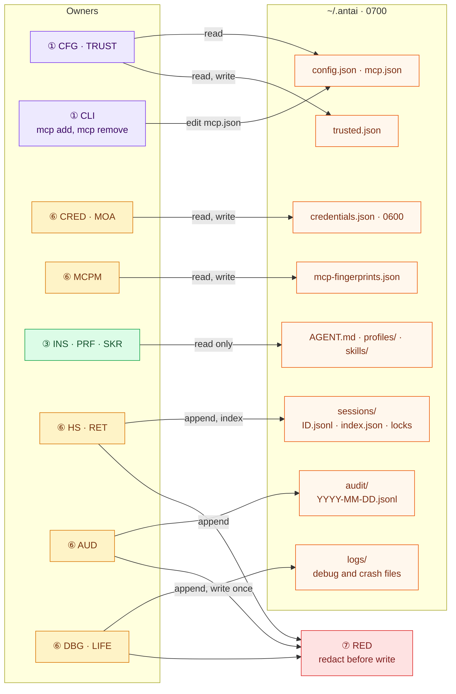
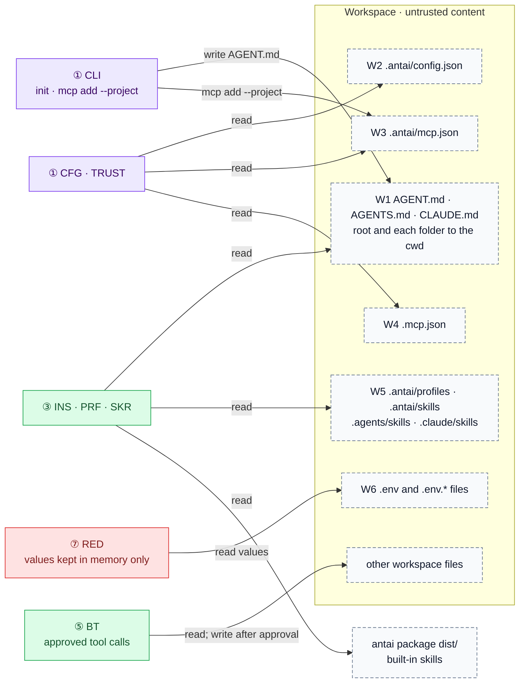
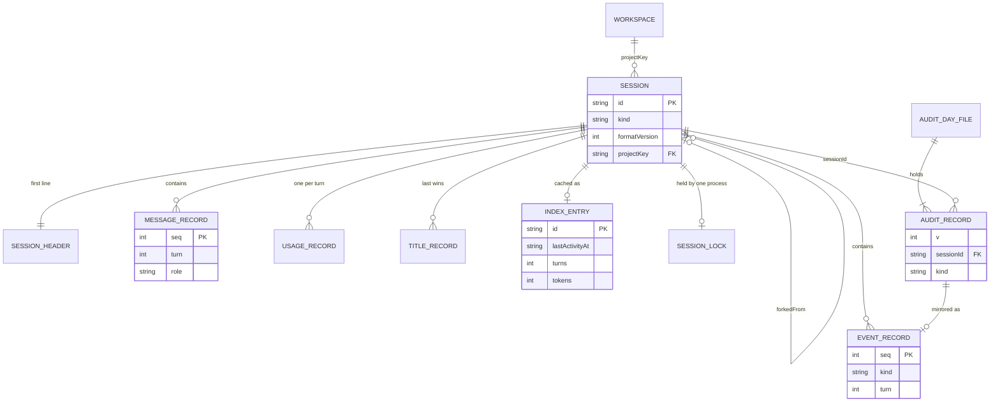
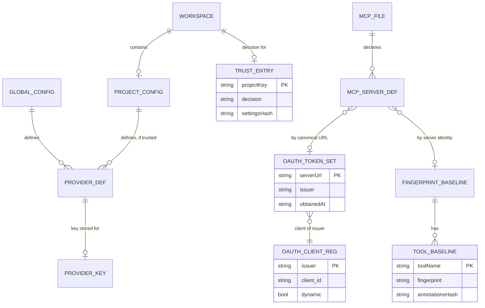
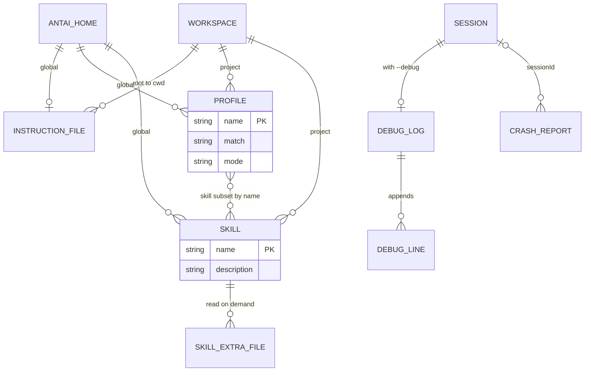
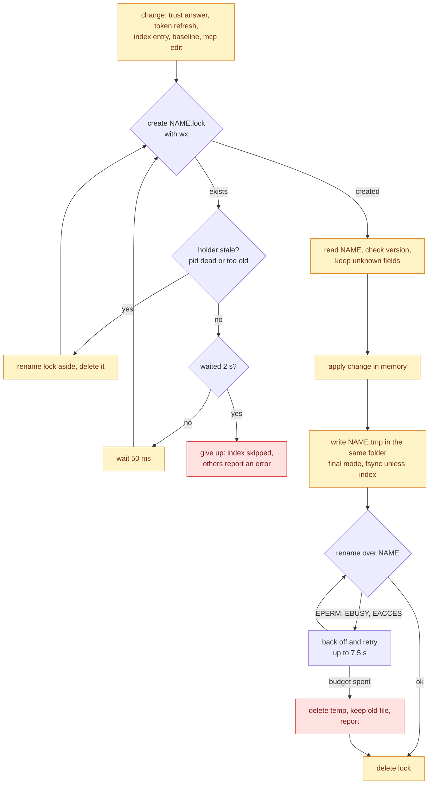
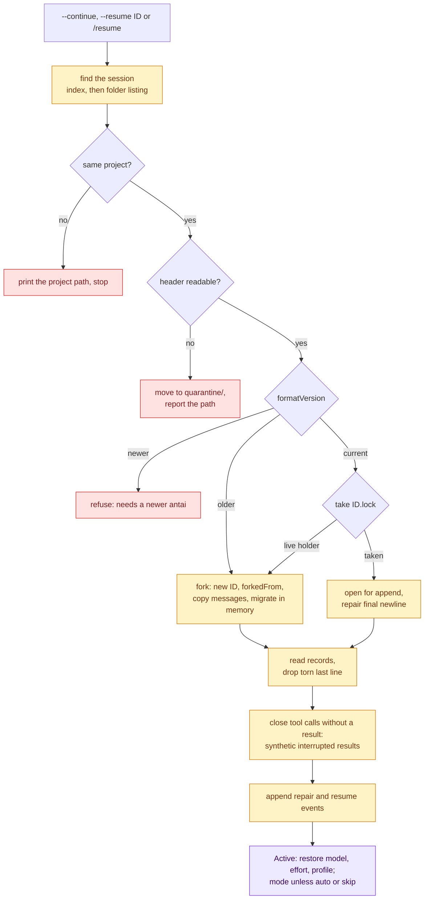
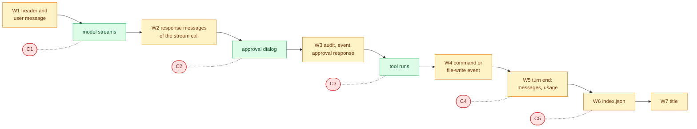
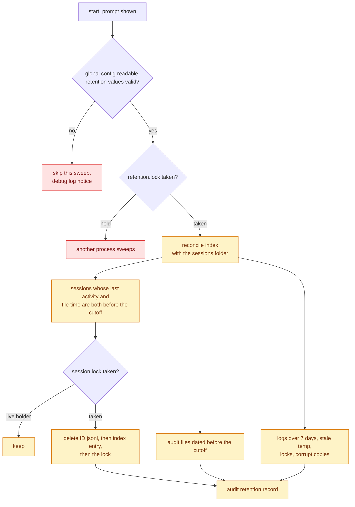
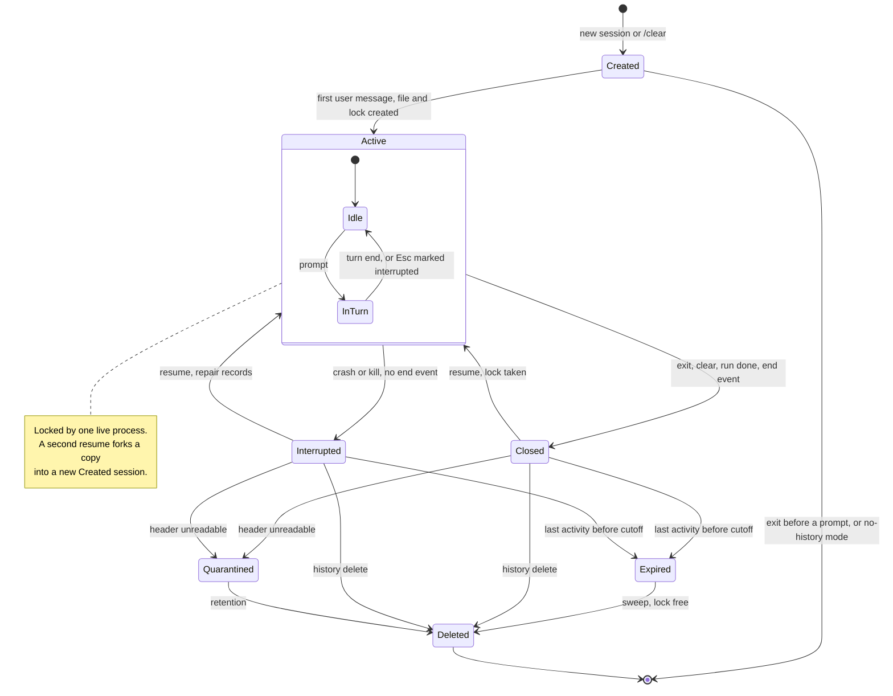

# antai — Data & Storage Design

| | |
|---|---|
| **Product** | antai (brand) / `antai` (command) |
| **Document** | Deliverable 04, Data & Storage Design for the v1 MVP |
| **Status** | Draft for review |
| **Version** | 0.1 |
| **Date** | 12 October 2026 |
| **Author** | Daksh Nagpal |
| **Based on** | BRD_1 v0.4, ARCHITECTURE_1 v0.1, DELIVERABLES_1 v0.2, deliverable 01 v0.1 (component IDs, module paths, on-disk layout), research notes B, C, E and F |

## Contents

1. Purpose, scope and principles
2. Storage locations (DS-1.1, DS-1.2)
3. File inventory
4. Entity model (DS-2.1 to DS-2.3)
5. Record and file schemas
6. Write and read rules (DS-3, DS-5, DS-6)
7. Redaction at write and what is never stored
8. Retention, deletion and privacy (DS-7)
9. Session file lifecycle (DS-4)
10. Schema versioning and migration
11. Permissions on each operating system
12. Sizing
13. Proposals pending BRD review
14. Design decisions
15. Open questions
16. Traceability
17. Sources

---

## 1. Purpose, scope and principles

### 1.1 Purpose

antai has no database and no server. Everything it keeps is a local file. This document replaces the "Database Design" of a web project: it lists every file antai reads or writes, where it lives on each operating system, what is in it, who writes it and how, how long it is kept, and what happens when a write is interrupted. A developer implementing `HS`, `AUD`, `RET`, `CRED`, `TRUST`, `CFG`, `MCPM`, `MOA`, `DBG` or `FSX` should be able to build the storage layer from this document alone.

### 1.2 Scope and related deliverables

| In this document | Elsewhere |
|---|---|
| Locations, file inventory, persisted entities, record schemas, write and read rules, locking, crash behaviour, redaction at write, retention, versioning, permissions, sizing | — |
| Component names, IDs and module paths | Deliverable 01, sections 5.9 and 8.1 (used here unchanged) |
| Trust boundaries, threat model, what counts as a secret | Deliverable 02 |
| Order of writes inside a turn, drawn as sequences | Deliverable 03 |
| TypeScript types (`SessionRecord`, `Store`), NDJSON `--json` contract, error codes | Deliverable 11 |
| Discovery and precedence of instructions, profiles, skills and MCP files; OAuth flow | Deliverable 10 |
| Debug log content, crash report content, `/usage` | Deliverable 15 |
| Tests and fixtures | Deliverable 14 |

Storage components and their modules (deliverable 01, section 5.9): `HS` history store `src/infra/history/`, `AUD` audit log writer `src/infra/audit/`, `RET` retention sweeper `src/infra/retention/`, `CRED` credential store `src/infra/credentials/`, `FSX` safe file I/O `src/infra/fs/`, `DBG` debug logger and crash reporter `src/infra/log/`, `MCPM` MCP manager `src/infra/mcp/`, `MOA` MCP OAuth client provider `src/infra/mcp/oauth/`, `CFG` config resolver `src/config/`, `TRUST` workspace trust gate `src/config/trust/`, `RED` redactor `src/redact/`, `PLAT` platform and path utilities `src/shared/platform/`. Every write under `~/.antai` goes through `FSX`, and every persisted text passes `RED` first (deliverable 01, rule 10).

### 1.3 Storage principles

| # | Principle | Why | BRD |
|---|---|---|---|
| SP1 | **Local files only.** No database, no server, no sync, no keychain in v1. | One process, no native modules, nothing to install or run (section 1.4). | NFR-COMP-04, NFR-PRIV-02, D20 |
| SP2 | **Human-readable formats.** JSON for state, JSONL for logs and sessions, Markdown for context files. UTF-8, LF line ends. | A user or a reviewer can inspect, grep and delete anything with standard tools. The secret-scan test reads text (AC-22). | D7, NFR-SEC-05 |
| SP3 | **Append-only where possible.** Sessions, the audit log and the debug log only ever grow by whole lines. | A crash can damage at most the last line, never earlier records (NFR-REL-01). | FR-HIS-02, FR-HIS-13 |
| SP4 | **Atomic replace everywhere else.** Small JSON state files are rewritten through a temp file and a rename, under a lock when several processes can write them. | A reader sees the old file or the new one, never half of each. | FR-HIS-08, FR-SEC-05 |
| SP5 | **Redact before write.** No text reaches disk without passing `RED`, except the credentials file, whose job is to hold secrets. | NFR-SEC-05 includes history, audit and logs. No comparable agent does this (research E, verdict 6), so it is designed and tested here. | FR-HIS-07, FR-SEC-03 |
| SP6 | **Same bytes as the model saw.** A stored tool result is the redacted, capped text the model received; a resumed session sends the model what the live session sent, minus the instructions, which are rebuilt. | Resume reproduces the context exactly; raw output exists nowhere. | FR-HIS-07, FR-UI-03, A-C6 |
| SP7 | **Versioned formats.** Every antai-owned file or record carries a version; readers accept older versions and never guess at newer ones. | Sessions outlive antai upgrades and SDK upgrades (deliverable 01, TD4). | — |
| SP8 | **Nothing outside `~/.antai` and the workspace.** No `os.tmpdir()`, no XDG folders, no registry, no caches in the workspace. Workspace writes only through approved tool calls, `antai init` and `antai mcp add --project`. | NFR-PRIV-02 and the file-location test in DLV-VER-01. | NFR-PRIV-02, D11 |
| SP9 | **Fail safe, not fail silent.** A corrupt file is moved aside, never overwritten. A sweep that cannot read its settings does not run. A missing audit log stops side effects (section 6.10). | Data loss and unaudited actions are the two failures that matter. | NFR-REL-01, FR-HIS-13 |

### 1.4 Why files and not a database

| | JSONL and JSON files (chosen) | SQLite |
|---|---|---|
| Who does it | Codex (sessions as JSONL, SQLite only for its index), Claude Code, Gemini CLI | OpenCode 2.x (`opencode.db`, WAL, `synchronous=NORMAL`, `busy_timeout=5000`, file, `-wal` and `-shm` chmod `0600`, 50 drizzle migrations); Goose since v1.10.0 (`sessions.db`, earlier `.jsonl` files imported) |
| Runtime dependency | `node:fs` only | `better-sqlite3` is a native module, excluded by NFR-COMP-04. `node:sqlite` exists in recent Node lines but its stability status on Node 22, 24 and 26 is not covered by the research notes (unverified) |
| Crash safety | One writer per session file and whole-line appends; a torn last line is skipped | Transactions and WAL; strong, but the WAL and shared-memory files add two more files to protect |
| Concurrency | Not needed for sessions (one writer each, FR-HIS-11). The only shared files are small and use a lock | Built in (busy timeout) |
| Inspection and secret scan | `cat`, `grep`, `jq`; the scan reads bytes | Needs SQL tooling; the scan must query tables |
| Queries | `/history` reads one cached index (`index.json`); 1,000 sessions in under 200 ms is met by a JSON cache (section 12) | Indexed queries |
| Schema change | Version field and in-memory migration | Migration scripts (Codex 61, OpenCode 50) |

The BRD fixes JSONL per session (D7, FR-HIS-01). The research confirms it is the mainstream choice for file-based agents and that the extra power of SQLite is not needed at antai's scale. The design keeps the BRD's JSONL and the `index.json` cache, and treats the index as rebuildable at any time.

### 1.5 Items in this document that are pending BRD review

Where this design needs something the BRD does not say, or improves on it, the text says "(pending BRD review, ref)". Section 13 lists every such item with its reason. The ones that change behaviour are: an append-only index (P1, alternative only), appending step messages earlier (P2, alternative only), retention keys from global config only (P3), wider secret-path coverage for credential copies (P4), read protection for history in a home-folder workspace (P5), three config keys that an untrusted project must not set (P6), and failing closed when the audit log cannot be written (P7).

---

## 2. Storage locations

### 2.1 Home folder per operating system

antai resolves its home as `path.join(os.homedir(), '.antai')` once, in `PLAT`, and every component asks `PLAT` for it.

| OS | `os.homedir()` comes from (research F 2.5) | Global home | As seen from Git Bash |
|---|---|---|---|
| macOS | `$HOME`, else the passwd entry | `/Users/<name>/.antai` | — |
| Linux | `$HOME`, else the passwd entry | `/home/<name>/.antai` | — |
| Windows 10/11 | `%USERPROFILE%`, else the current user's profile folder. `HOME` is ignored | `C:\Users\<name>\.antai` (`%USERPROFILE%\.antai`) | `/c/Users/<name>/.antai`; `PLAT` normalises both forms before any path check (FR-SH-13) |

**Environment overrides.** The BRD defines no variable that moves the antai home (`ANTAI_*` variables are config values, FR-CFG-01; `ANTAI_GIT_BASH_PATH` points at a program). The home moves only when `HOME` (POSIX) or `USERPROFILE` (Windows) is changed, because `os.homedir()` honours them. Tests isolate antai this way; on Windows a test must set `USERPROFILE`, not `HOME` (AC-08 says "HOME", which is not enough on Windows). An `ANTAI_HOME` override is an open question (Q04-12).

**Workspace equals home.** When antai starts in the home folder (it warns, FR-TOOL-09), `<workspace>/.antai` and `~/.antai` are the same folder. `CFG` compares the two realpaths and, when they match, loads that folder once, as the global layer. Otherwise the same `config.json` would be read twice, once as an untrusted project file.

**Long paths and names.** Node's file system calls use `\\?\` paths on Windows, so the 260-character limit does not apply to them (research F 2.5). antai's own file names are short, lowercase and never contain `:`, which Windows forbids.

### 2.2 DS-1.1 Global home

Every write arrow goes through `FSX`. `HS`, `AUD` and `DBG` pass every text through `RED` before writing.



Directory tree (names marked "proposed" in deliverable 01, section 6.3, are confirmed here):

```
~/.antai/                               0700
├── config.json                         user-written; antai never writes it
├── mcp.json                            user-written; `antai mcp add/remove` edits it
├── mcp.json.bak                        previous version, kept after an edit
├── credentials.json                    0600, CRED
├── trusted.json                        0600, TRUST
├── mcp-fingerprints.json               0600, MCPM drift baselines
├── *.lock                              short locks beside mcp.json, credentials.json, trusted.json,
│                                       mcp-fingerprints.json; exist only while held
├── retention.lock                      held while one process sweeps
├── AGENT.md | AGENTS.md | CLAUDE.md    global instructions, first found (FR-INS-03)
├── profiles/<name>/PROFILE.md
├── skills/<name>/SKILL.md              plus the skill's extra files
├── sessions/                           0700, HS
│   ├── index.json                      0600, cache
│   ├── index.json.lock
│   ├── <id>.jsonl                      0600, one per session
│   ├── <id>.lock                       held while a process owns the session
│   └── quarantine/<id>.jsonl           session files with an unreadable header
├── audit/                              0700, AUD
│   └── <YYYY-MM-DD>.jsonl              0600, one per UTC day
└── logs/                               0700, DBG
    ├── debug-<session-id>.jsonl        only with --debug; one rotated copy .1.jsonl
    └── crash-<YYYYMMDDTHHMMSSZ>-<pid>.json
```

Transient names that may appear anywhere above: `<name>.tmp-…` (atomic-replace temp file, deleted after the rename) and `<name>.corrupt-<YYYYMMDDTHHMMSSZ>` (an unparseable antai-owned file moved aside).

### 2.3 DS-1.2 Workspace and other locations

The workspace is the git root of the current folder, or the folder itself (BRD 5.4). Its content is untrusted data (NFR-SEC-02).



The workspace rows of the inventory (section 3, W1 to W6) give the details. Three further facts: `.gitignore` files are read by `SRCH` and never written; the package's `dist/` folder supplies built-in skills (FR-SKL-07) and is read-only; and antai never touches `os.tmpdir()`, because temp files sit next to their target so the rename never crosses a volume (deliverable 01, section 6.3). Workspace files that approved tool calls change are not antai storage; they appear in the audit log as `file-write` or `command` events.

---

## 3. File inventory

Identifiers `F01`… are used in later sections. "User" in the owner column means the user edits the file; antai only reads it.

### 3.1 Files, owners and access

| ID | Path | Owner | Format | Created when | Read when | Write method |
|---|---|---|---|---|---|---|
| F01 | `~/.antai/` and its subfolders | `FSX` (via `BOOT`) | folders | First start (lazily: subfolders on first use) | — | `mkdir` with mode `0700` |
| F02 | `~/.antai/config.json` | User; read by `CFG` | JSONC | By the user | Every start; `antai config` | Never written by antai |
| F03 | `~/.antai/mcp.json` | User and `CLI` | JSONC | By the user or `antai mcp add` | Every start (`CFG` → `MCPM`); `antai mcp list` | Comment-preserving edit, then atomic replace under lock; previous version kept as `mcp.json.bak` |
| F04 | `~/.antai/credentials.json` | `CRED`, `MOA` | JSON | First saved key or OAuth login | Start (`CRED`); before an OAuth refresh (re-read under lock) | Read-modify-write under `credentials.json.lock`, atomic replace with `fsync` |
| F05 | `~/.antai/trusted.json` | `TRUST` | JSON | First trust answer | Start, when the workspace has trust-gated settings; `/trust` | Read-modify-write under lock, atomic replace with `fsync` |
| F06 | `~/.antai/mcp-fingerprints.json` | `MCPM` | JSON | First successful MCP connect | Each server connect; `/mcp` | Read-modify-write under lock, atomic replace with `fsync`, only when something changed |
| F07 | `~/.antai/AGENT.md` (or `AGENTS.md`, `CLAUDE.md`) | User; `INS` | Markdown | By the user | Start | Never |
| F08 | `~/.antai/profiles/<name>/PROFILE.md` | User; `PRF` | Markdown with YAML frontmatter | By the user | Start; `/profile` | Never |
| F09 | `~/.antai/skills/<name>/SKILL.md` and extra files | User; `SKR` | Markdown with YAML frontmatter; any extra files | By the user | Start (frontmatter); `load_skill` (body) | Never |
| F10 | `sessions/<id>.jsonl` | `HS` | JSONL | First user message of a session (lazy) | Resume; `/history` reconcile and index rebuild (header and tail); retention | Created with `wx`; one `O_APPEND` write per record; `fsync` on close |
| F11 | `sessions/<id>.lock` | `HS` via `FSX` | JSON | Session file creation, or resume | Any process that wants the session; `RET` | Created with `wx`; deleted at session end |
| F12 | `sessions/index.json` | `HS` | JSON | First turn end | `/history`, `--continue`, `--resume`, `RET` | Read-modify-write under `index.json.lock`, atomic replace, no `fsync` (it is a cache) |
| F13 | `sessions/quarantine/<id>.jsonl` | `HS` | as F10 | When a session header cannot be read | Never by antai (user inspection) | Rename of F10 |
| F14 | `audit/<YYYY-MM-DD>.jsonl` | `AUD` | JSONL | First audit record of the UTC day | Never by antai, except `RET` by file name | One `O_APPEND` write per record, shared by all processes, no lock |
| F15 | `logs/debug-<session-id>.jsonl` | `DBG` | JSONL | First debug line with `--debug` | Never by antai | One append per line; rotated once at 10 MiB |
| F16 | `logs/crash-<ts>-<pid>.json` | `DBG` via `LIFE` | JSON | Unexpected internal error (FR-ERR-04) | Never by antai (path printed) | Written once, synchronously, with `wx` |
| F17 | `*.lock` beside F03 to F06, `retention.lock` | `FSX` | JSON | When a short lock is taken | Competing processes | `wx` create, delete on release |
| F18 | `<name>.tmp-…` | `FSX` | as target | During an atomic replace | Never | Written, then renamed over the target |
| F19 | `<name>.corrupt-<ts>`, `mcp.json.bak` | `FSX` | as original | Corrupt antai-owned file found; `mcp.json` edited | Never by antai | Rename (corrupt), copy (backup) |
| W1 | Workspace instruction files | User; `INS` | Markdown | By the user, or `antai init` | Start | `antai init` writes `AGENT.md` with `wx` (never overwrites) |
| W2 | `.antai/config.json` | User; `CFG` | JSONC | By the user | Start | Never by antai |
| W3 | `.antai/mcp.json` | User and `CLI` | JSONC | By the user or `antai mcp add --project` | Start, after trust | Comment-preserving edit, atomic replace; no backup in the repository |
| W4 | `.mcp.json` | User; `CFG` | JSON or JSONC | By the user or another tool | Start, after trust | Never by antai |
| W5 | Project profiles and skills | User; `PRF`, `SKR` | Markdown | By the user | Start; on demand | Never by antai |
| W6 | `.env*` | User; `RED` | dotenv | — | Background scan | Never |

### 3.2 Protection, retention and size

| ID | Permissions (POSIX) | Secrets? | Retention | Size bound | Schema name | BRD IDs |
|---|---|---|---|---|---|---|
| F01 | `0700` | — | Until the user deletes it | — | — | NFR-PRIV-02 |
| F02 | Left as the user created it | Should not; `${VAR}` references only | User | Read cap 1 MiB | `config.schema.json` (published, DLV-SW-09) | FR-CFG-01..05 |
| F03 | `0600` when antai creates it | Should not; antai warns on literal tokens (FR-MCP-08) | User; `.bak` until the next edit | Read cap 1 MiB | `mcp.schema.json` (published) | FR-MCP-02, 03, 08 |
| F04 | `0600` | **Yes**: provider keys, OAuth tokens, client registrations | Until `antai logout`, `antai mcp logout` or `antai mcp remove` | Small (section 12) | `credentials` (internal) | FR-MOD-04, FR-SEC-05, FR-MCP-11, D20 |
| F05 | `0600` | No | Kept | ~1 KB per workspace | `trusted` (internal) | FR-CFG-04 |
| F06 | `0600` | No | Kept | 256 KB of definitions per server | `mcp-fingerprints` (internal) | FR-MCP-09, D29, A-S11 |
| F07–F09 | User's | No | User | Instruction files cut at 20 KB when assembled | `profile-frontmatter`, `skill-frontmatter` (published) | FR-INS, FR-PRF-01, FR-SKL-01 |
| F10 | `0600` | No (redacted at write) | `history.retentionDays` (30) after last activity | Soft warning at 50 MB; 4 MiB per line | `session-record.schema.json` (published) | FR-HIS-01..12, NFR-REL-01 |
| F11 | `0600` | No | Session lifetime; stale ones removed | < 200 B | `lock` (internal) | FR-HIS-11 |
| F12 | `0600` | No | Entries removed with their sessions | ~0.45 KB per session | `session-index` (internal) | FR-HIS-05, 08 |
| F13 | `0600` | No (redacted) | As F10, by file time | as F10 | as F10 | NFR-REL-01 |
| F14 | `0600` (folder `0700`) | No (redacted) | `audit.retentionDays` (90) by file date | 8 KB per record | `audit-record.schema.json` (published) | FR-HIS-13, FR-SH-10, D26 |
| F15 | `0600` | No (redacted) | 7 days by modification time | 10 MiB per file, two files per session | `debug-line` (internal) | FR-ERR-03 |
| F16 | `0600` | No (redacted, no conversation text) | 7 days | 64 KB | `crash-report` (internal) | FR-ERR-04 |
| F17 | `0600` | No | Seconds | < 200 B | `lock` | FR-HIS-08 |
| F18 | Same as target (`0600` for F04) | As target | Deleted after rename; stale after 1 hour | As target | — | NFR-REL-01 |
| F19 | As original | `credentials.json.corrupt-…` **yes** | 30 days | As original | — | NFR-REL-01 |
| W1–W6 | Repository defaults | `.env*` yes; others no | User | — | — | FR-INS, FR-CFG, FR-SEC-03 |

---

## 4. Entity model

The persisted data falls into three groups. `WORKSPACE` is a logical entity: it is not a file, but trust entries, project config and sessions are keyed by its normalised root path (`projectKey`, FR-HIS-03).

### 4.1 DS-2.1 History and audit



### 4.2 DS-2.2 Configuration, trust, credentials and MCP



### 4.3 DS-2.3 Context files and diagnostics



### 4.4 Entity dictionary

| Entity | Stored in | Identity | Written by | Lifetime | Notes |
|---|---|---|---|---|---|
| `WORKSPACE` | Logical | `projectKey`: realpath of the workspace root, `/c/…` converted to `C:\…`, case-folded on macOS and Windows | — | — | Same normalisation for sessions and trust (FR-HIS-03) |
| `SESSION` | F10 | `id` = `YYYY-MM-DD_HHMM_<6 hex>` (UTC) | `HS` | Created at the first user message, deleted by retention or `/history delete` | `kind` `interactive` or `run` (FR-HIS-01) |
| `SESSION_HEADER` | F10, line 1 | `seq` 0 | `HS` | With the session | BRD record `session` |
| `MESSAGE_RECORD` | F10 | `seq` | `HS` on behalf of `SC` | With the session | One AI SDK `ModelMessage`; markers for synthetic, partial and compaction records |
| `EVENT_RECORD` | F10 | `seq` | `HS` on behalf of `SC`, `APR`, `TREG`, `MCPM` | With the session | Kinds in section 5.9 |
| `USAGE_RECORD` | F10 | `seq` | `HS` on behalf of `USG` | With the session | Tokens per turn plus a running total |
| `TITLE_RECORD` | F10 | `seq` | `HS` | With the session | Last one wins (D30) |
| `INDEX_ENTRY` | F12 | session `id` | `HS` | Removed with its session | Cache; rebuildable |
| `SESSION_LOCK` | F11 | session `id` | `HS` via `FSX` | While a process owns the session | FR-HIS-11 |
| `AUDIT_RECORD` | F14 | file + line | `AUD` | `audit.retentionDays` | Every event plus audit-only kinds (section 5.13) |
| `AUDIT_DAY_FILE` | F14 | UTC date | `AUD` | `audit.retentionDays` | Shared by all processes |
| `GLOBAL_CONFIG`, `PROJECT_CONFIG` | F02, W2 | path | User | User | Section 5.2 |
| `PROVIDER_DEF` | F02, W2 (trusted) | provider name | User | User | FR-MOD-08 |
| `MCP_FILE`, `MCP_SERVER_DEF` | F03, W3, W4 | file; server name | User, `CLI` | User | Section 5.4 |
| `PROVIDER_KEY` | F04 `providers` | provider name | `CRED` | Until logout | FR-MOD-04 |
| `OAUTH_TOKEN_SET` | F04 `mcpOAuth` | canonical MCP server URL | `MOA` via `CRED` | Until logout or invalid grant | Carries the authorization-server pin |
| `OAUTH_CLIENT_REG` | F04 `oauthClients` | authorization-server issuer | `MOA` via `CRED` | Until `antai mcp remove` of the last server using it | MCP 2026-07-28 requires issuer keying (research F 1.3) |
| `TRUST_ENTRY` | F05 | `projectKey` | `TRUST` | Kept | Trusted and untrusted answers |
| `FINGERPRINT_BASELINE`, `TOOL_BASELINE` | F06 | server identity; tool name | `MCPM` | Kept | SDK fingerprint plus a separate annotations hash (A-S11) |
| `INSTRUCTION_FILE`, `PROFILE`, `SKILL`, `SKILL_EXTRA_FILE` | F07–F09, W1, W5, package | path; name | User | User | Read-only for antai |
| `DEBUG_LOG`, `DEBUG_LINE` | F15 | session id | `DBG` | 7 days | Only with `--debug` |
| `CRASH_REPORT` | F16 | time and pid | `DBG`, `LIFE` | 7 days | No conversation text |

---

## 5. Record and file schemas

### 5.1 Conventions

| Topic | Rule | Why |
|---|---|---|
| Encoding | UTF-8 without BOM, LF line ends. Readers strip a leading BOM and a trailing `\r` | Windows editors add a BOM and CRLF to user files |
| JSON or JSONC | User-edited files (F02, F03, W2, W3, W4) are read as JSONC: comments and trailing commas allowed. antai-owned files are strict JSON, pretty-printed with two spaces | The BRD examples use comments; antai's own files must round-trip exactly |
| JSONL | One compact JSON object per line, no blank lines written | One record per write (section 6.3) |
| Names | antai's own fields are camelCase. Objects owned by others keep their names: AI SDK `ModelMessage`, OAuth token and client fields (snake_case, RFC 6749 and 7591) | Copying third-party shapes verbatim avoids mapping errors |
| Time | ISO 8601 UTC with milliseconds and `Z`; durations in ms; file-name stamps `YYYYMMDDTHHMMSSZ` | Sortable, no `:` in file names |
| Paths | Native absolute paths for `cwd` and `gitRoot`; `projectKey` normalised (section 4.4); paths inside the workspace in event records are workspace-relative with `/` | Portable and readable |
| Version | Session header `formatVersion`; audit, debug and crash records `v`; antai-owned JSON files a root `version` (section 10) | — |
| Unknown fields | Ignored on read and **kept** when antai rewrites a file | An older antai must not erase a newer antai's data |

### 5.2 Global `config.json`

`CFG` validates it against the schema generated from Zod (deliverable 01, HLD-D13). The table lists the keys the BRD names; deliverables 09 and 11 add the keys they own (for example the Ollama context size). "Project" says how the same key behaves in `<workspace>/.antai/config.json`.

| Key | Type | Default | Meaning | Project layer |
|---|---|---|---|---|
| `model` | `provider:model` or alias | `groq:openai/gpt-oss-120b` | Default model (FR-MOD-02) | Trusted only (FR-CFG-04) |
| `models.<alias>` | string | `fast` → `groq:openai/gpt-oss-20b` (A-C14) | Model alias (FR-MOD-03) | Trusted only, treated as `model` |
| `models.<provider:model>.contextWindow` | integer | Built-in table, else 32,000 | Context size for pruning (FR-AGT-05) | Any layer. The key shares `models` with aliases (P8) |
| `providers.<name>.type` | `"openai-compatible"` | — | Custom endpoint (FR-MOD-08) | Trusted only |
| `providers.<name>.baseURL` | URL | Package or preset default | Endpoint (FR-MOD-07) | Trusted only |
| `providers.<name>.apiKeyEnv` | variable name | Preset's variable | Where the key comes from | Trusted only |
| `profile` | string | none | Profile pin (FR-PRF-03) | Trusted only |
| `mode` | `research`, `manual`, `auto` | `manual` | Starting mode | `research` or `manual` only, trusted only (FR-CFG-05) |
| `effort` | `provider-default`, `none`, `low`, `medium`, `high` | `provider-default` | Reasoning effort (FR-MOD-06) | Any layer |
| `maxSteps` | integer 1–100 | 25 | Step cap (FR-AGT-02) | Any layer, ceiling 100 |
| `context.pruneAt` | number 0–1 | 0.75 | Pruning threshold (FR-AGT-05) | Any layer |
| `shell.timeoutMs`, `shell.timeouts` | ms; map of pattern → ms | 120,000; dev servers 30,000 | FR-SH-07 | Any layer |
| `shell.allow` | string[] | [] | Safe-list additions (FR-SH-05) | Trusted only; combined |
| `shell.dangerous`, `shell.block` | string[] | [] | Tighten only | Always applied; combined |
| `shell.gitBashPath` | path | "" | Git Bash override (FR-SH-11) | **Global only** (pending BRD review, P6): a project value would choose the program that runs every command |
| `tools.disabled` | string[] | [] | FR-TOOL-10 | Combined |
| `mcp.tools.allow` | string[] of `mcp__<server>__<tool>` | [] | Treat as Safe (FR-MCP-06) | **Trusted only** (pending BRD review, P6): an untrusted project could otherwise make global servers' tools run without asking |
| `mcp.tools.deny` | string[] | [] | Never offer | Combined |
| `secrets.paths`, `secrets.patterns` | string[] | [] | Extra secret paths and patterns (FR-SEC-01, 03) | Add only (Q01-22 on pattern safety) |
| `history.enabled` | boolean | true | Store conversations (FR-HIS-10) | `false` in any layer wins |
| `history.retentionDays` | integer ≥ 0 | 30 | FR-HIS-09; `0` keeps forever | **Global only** (pending BRD review, P3) |
| `audit.retentionDays` | integer ≥ 0 | 90 | FR-HIS-13; `0` keeps forever (P9) | **Global only** (pending BRD review, P3) |
| `workspace.extraReadPaths` | path[] | [] | Extra read roots (FR-TOOL-09) | **Global only** (pending BRD review, P6): a project value would open the home folder to reads without asking |

Example (comments allowed):

```jsonc
{
  "model": "groq:openai/gpt-oss-120b",
  "models": { "fast": "groq:openai/gpt-oss-20b", "groq:openai/gpt-oss-120b": { "contextWindow": 131072 } },
  "providers": { "my-gateway": { "type": "openai-compatible", "baseURL": "https://llm.example.com/v1", "apiKeyEnv": "MY_GATEWAY_API_KEY" } },
  "mode": "manual",
  "shell": { "allow": ["npm test", "npm run lint"], "dangerous": ["terraform destroy"] },
  "history": { "enabled": true, "retentionDays": 30 },
  "audit": { "retentionDays": 90 }
}
```

### 5.3 Project config

`<workspace>/.antai/config.json` uses the same schema. Merge rules are FR-CFG-01 (objects merge by key, lists combine, single values replace), with the per-key restrictions in the table above. `CFG` records the source of each resolved value so `antai config` can print it (FR-CFG-03). Invalid values follow FR-CFG-02: they fall back to defaults with an error naming the file and key; an invalid `mode` becomes `research`; an invalid safety-list entry drops only that entry.

### 5.4 MCP server files

`~/.antai/mcp.json`, `<workspace>/.antai/mcp.json` and `<workspace>/.mcp.json` share one shape: `{ "mcpServers": { "<name>": { … } } }` (FR-MCP-02). Name clashes resolve `.antai/mcp.json` › `.mcp.json` › global.

| Field | Type | Required | Meaning | Example |
|---|---|---|---|---|
| `type` | `stdio`, `http` | No; `stdio` when `command` is set | Transport. `sse`, `ws` and unknown values are skipped and listed in `/mcp` | `"http"` |
| `command` | string | For stdio | Program to start | `"npx"` |
| `args` | string[] | No | Arguments | `["-y", "@modelcontextprotocol/server-filesystem", "."]` |
| `env` | map of string, `${VAR}` allowed | No | Extra child environment (FR-MCP-03) | `{ "PGURL": "${DATABASE_URL}" }` |
| `url` | URL | For http | Endpoint | `"https://mcp.example.com/mcp"` |
| `headers` | map of string, `${VAR}` allowed | No | Static headers | `{ "Authorization": "Bearer ${GITHUB_TOKEN}" }` |
| `trustReadOnlyHints` | boolean | No (false) | Treat `readOnlyHint` tools as Safe (FR-MCP-06); honoured only from the global file or a trusted project | `true` |
| `oauth.clientId` | string | No | Pre-registered OAuth client (FR-MCP-11) | `"antai-cli"` |
| `oauth.callbackPort` | integer | No | Fixed loopback port (deliverable 01, section 4.2) | `53682` |
| `enabled` | boolean | No (true) | `false` keeps the entry but does not connect (deliverable 10) | `false` |
| `startupTimeoutMs` | integer | No (30000) | Connect and tool-list time limit; `run` waits up to this before its first step (deliverable 10) | `30000` |
| `toolTimeoutMs` | integer | No (120000) | Time limit for one tool call (deliverable 10) | `120000` |

Files keep the `${VAR}` text; substituted values exist only in memory and are registered with `RED` (FR-MCP-03). `antai mcp add` and `remove` edit the file with a comment-preserving JSONC edit (library chosen in P1, unverified) instead of re-serialising it, then replace it atomically; the global file's previous version is kept as `mcp.json.bak`. A literal token passed to `antai mcp add` is warned about (FR-MCP-08) and, if the user keeps it, written as given, which is why the file is created `0600`.

### 5.5 `credentials.json`

The only file that holds secrets. `CRED` loads it at start, registers every value with `RED` (FR-SEC-03 e) and passes keys straight to provider factories, never into `process.env` (A-S5).

| Field | Type | Required | Meaning | Example |
|---|---|---|---|---|
| `version` | integer | Yes | File version | `1` |
| `providers.<name>.apiKey` | string | Yes per entry | API key saved by the first-run prompt or `antai login` (FR-MOD-04) | `"gsk_…"` |
| `providers.<name>.savedAt` | time | Yes | When it was saved | |
| `mcpOAuth.<serverUrl>` | object | — | One token set per **canonical MCP server URL** (the RFC 8707 `resource` value: lowercase scheme and host, no fragment, no trailing slash) | key `"https://mcp.example.com/mcp"` |
| `….serverNames` | string[] | Yes | Config names last seen for this URL, for `antai mcp logout <name>` and display | `["linear"]` |
| `….issuer` | string | Yes | Authorization-server issuer the tokens came from | `"https://auth.example.com"` |
| `….authorizationServer` | object | Yes | The SDK's pin `{ issuer, authorizationServerUrl, tokenEndpoint }` (research F 1.1) | |
| `….tokens` | object | Yes | The SDK's `OAuthTokens` as saved through `saveTokens` (`access_token`, `token_type`, `expires_in`, `refresh_token`, `scope`, plus fields the SDK adds) | |
| `….obtainedAt`, `….expiresAt` | time | Yes; `expiresAt` when `expires_in` is given | For proactive refresh at start (research F 1.6) | |
| `oauthClients.<issuer>` | object | — | Client registration per issuer: `client_id`, optional `client_secret`, `client_id_issued_at`, `client_secret_expires_at`, `redirect_uris`, `token_endpoint_auth_method`, as returned by the SDK; plus `dynamic` and `registeredAt` | |

Why the token set is keyed by URL, not by server name: names are local labels, and a trusted project can define a server called `github` that points elsewhere. The SDK sends whatever `tokens()` returns as a bearer token on every request (research F 1.1), so a name-keyed store would hand one server's token to another. Client registrations are keyed by issuer because the MCP 2026-07-28 authorization spec requires it and requires re-registration when the issuer changes (research F 1.3).

```json
{
  "version": 1,
  "providers": {
    "groq": { "apiKey": "gsk_…", "savedAt": "2026-10-12T14:31:40.002Z" }
  },
  "mcpOAuth": {
    "https://mcp.example.com/mcp": {
      "serverNames": ["linear"],
      "issuer": "https://auth.example.com",
      "authorizationServer": {
        "issuer": "https://auth.example.com",
        "authorizationServerUrl": "https://auth.example.com",
        "tokenEndpoint": "https://auth.example.com/oauth/token"
      },
      "tokens": { "access_token": "eyJ…", "token_type": "Bearer", "expires_in": 3600, "refresh_token": "…", "scope": "read write" },
      "obtainedAt": "2026-10-12T14:40:02.511Z",
      "expiresAt": "2026-10-12T15:40:02.511Z"
    }
  },
  "oauthClients": {
    "https://auth.example.com": {
      "client_id": "c1f3…",
      "client_id_issued_at": 1760280000,
      "redirect_uris": ["http://localhost:53682/callback"],
      "token_endpoint_auth_method": "none",
      "dynamic": true,
      "registeredAt": "2026-10-12T14:39:41.020Z"
    }
  }
}
```

**OAuth write rules.** `saveTokens` and `saveClientInformation` are read-modify-writes under `credentials.json.lock`. A refresh takes the lock, re-reads the file and uses a newer token set if another process refreshed first, because refresh tokens rotate (deliverable 01, section 10.4). `invalidateCredentials('tokens', { tokens })` deletes only if the stored set still equals the one given (compare-and-delete, research F 1.1). `antai mcp logout` deletes the token set; `antai mcp remove` also deletes the client registration when no other configured server uses that issuer. PKCE verifiers, `state` values and authorization codes are never written (section 7.2).

### 5.6 `trusted.json`

| Field | Type | Required | Meaning | Example |
|---|---|---|---|---|
| `version` | integer | Yes | File version | `1` |
| `workspaces.<projectKey>` | object | — | One entry per workspace root | |
| `….path` | string | Yes | Root path as shown to the user | `"/Users/me/Downloads/someone-elses-repo"` |
| `….decision` | `trusted`, `untrusted` | Yes | Both answers are stored, so "No" is not asked again until the settings change | `"untrusted"` |
| `….settingsHash` | string | Yes | `sha256:` of the canonical JSON of the trust-gated settings (FR-CFG-04); deliverable 02 defines which settings | `"sha256:9f2c…"` |
| `….hashVersion` | integer | Yes | Version of the canonical form; a new form makes old hashes mismatch, so antai asks again | `1` |
| `….snapshot` | object | Yes | The trust-gated settings that were shown, redacted, so a re-ask can show what changed | |
| `….decidedAt`, `….by` | time; `prompt` or `/trust` | Yes | When and how | |

```json
{
  "version": 1,
  "workspaces": {
    "/users/me/downloads/someone-elses-repo": {
      "path": "/Users/me/Downloads/someone-elses-repo",
      "decision": "untrusted",
      "settingsHash": "sha256:9f2c…",
      "hashVersion": 1,
      "snapshot": { "mcpServers": { "db": { "command": "npx", "args": ["-y", "@example/postgres-mcp"] } }, "shell.allow": ["make test", "make lint"] },
      "decidedAt": "2026-10-12T15:02:11.300Z",
      "by": "prompt"
    }
  }
}
```

### 5.7 Session file: envelope and header

Every line of a session file has three envelope fields:

| Field | Type | Meaning |
|---|---|---|
| `type` | `session`, `message`, `event`, `usage`, `title` (BRD 5.10) | Record type. Readers skip unknown types |
| `seq` | integer | 0 for the header, then +1 per record. Lets audit records point at session records and lets a reader spot gaps |
| `ts` | time | When the record was written |

Records other than the header also carry `turn`: the number of user messages so far (0 before the first).

Header (`type: "session"`, always `seq` 0; its `ts` is the BRD's "created time"):

| Field | Type | Required | Meaning | Example |
|---|---|---|---|---|
| `formatVersion` | integer | Yes | BRD "format version" (section 10) | `1` |
| `id` | string | Yes | Session ID, equal to the file name stem | `"2026-10-12_1432_a1b2c3"` |
| `kind` | `interactive`, `run` | Yes | `run` sessions are skipped by `--continue` (FR-HIS-01) | `"interactive"` |
| `cwd`, `gitRoot` | path, path or null | Yes | FR-HIS-03 | `"/Users/me/shop-api"` |
| `projectKey` | string | Yes | Normalised match key | `"/users/me/shop-api"` |
| `provider`, `model` | string | Yes | At creation | `"groq"`, `"groq:openai/gpt-oss-120b"` |
| `mode`, `effort`, `profile`, `profileSource` | string; null for no profile | Yes | Starting state. `mode` may be `skip` when launched with `--dangerously-skip-permissions`, recorded for audit; resume never restores `skip` or `auto` (FR-HIS-04) | `"manual"` |
| `antaiVersion`, `sdkVersion` | string | Yes | antai version and exact `ai` version, so a later converter knows the `ModelMessage` shape (deliverable 01, TD4) | `"1.0.0"`, `"7.0.137"` |
| `os` | `darwin`, `linux`, `win32` | Yes | Platform | |
| `forkedFrom` | session ID or null | Yes | Set when this session is a copy (FR-HIS-11) | `null` |

### 5.8 `message` records

| Field | Type | Required | Meaning |
|---|---|---|---|
| `message` | AI SDK `ModelMessage` (`user`, `assistant` or `tool` role) | Yes | Stored as produced: user messages built by `SC`, response messages from `result.responseMessages` (A-C6). No `system` messages: instructions are rebuilt on resume |
| `synthetic` | `"interrupted"` | No | A tool result antai created for a call that has none (FR-AGT-04, FR-HIS-02) |
| `partial` | boolean | No | Assistant text cut off by Esc (FR-AGT-04) |
| `compaction` | `{ replacesThroughSeq, trigger }` | No | Marks a `/compact` summary (FR-AGT-06). On resume, the model gets this message and every message record after it; earlier ones stay in the file |

The `ModelMessage` content parts shown in section 5.11 (`text`, `tool-call`, `tool-result`, `tool-approval-request`, `tool-approval-response`, `execution-denied` output) are illustrative; deliverable 11 pins the exact type against `ai@7.0.137`. Provider-specific parts (reasoning, signatures, provider metadata) are kept in the file even after a provider switch (FR-MOD-05); `PR` leaves them out of the copy sent to a different provider.

### 5.9 `event` records

Common fields: `kind`, `turn`, and `toolCallId` where a tool call is involved. Every event record is also written to the audit log (BRD 5.10, FR-HIS-13), so no event field may hold conversation text: tool inputs are summarised in `input` (the command, the path, or the MCP arguments), redacted and capped.

| `kind` | Written when | Fields | BRD |
|---|---|---|---|
| `approval` | Any decision other than a Safe-tier call that simply runs: a dialog answer, an automatic run by mode, "don't ask again this session", a denial by policy or for lack of a human | `tool`, `input` (≤ 2,000 chars; MCP arguments ≤ 1,000), `tier`, `rule`, `mode`, `dialogs` (0–2), `decision` (`approved`, `denied`), `by` (`user`, `mode`, `session-allow`, `policy`, `no-human`), `reason` | FR-SH-10, D27 |
| `command` | A shell command ended, any tier | `input`, `tier`, `exitCode`, `signal`, `durationMs`, `timedOut`, `interrupted`, `outputChars` | FR-HIS-13 |
| `file-write` | `write_file` or `edit_file` changed a file | `tool`, `path`, `bytes`, `created` | FR-HIS-13 |
| `mcp-call` | An MCP tool call returned | `server`, `tool`, `isError`, `durationMs`, `outputChars` | FR-HIS-13 (design extension) |
| `setting` | Mode, model, effort or profile changed | `setting`, `from`, `to`, `by` (`user`, `flag`, `profile`, `resume`) | FR-HIS-04, 13 |
| `trust` | Trust answered or changed | `projectKey`, `decision`, `settingsHash`, `by` | FR-CFG-04 |
| `credential` | Key saved or removed, OAuth login, logout, or a refresh that failed | `action`, `provider` or `server`, `issuer`, `via` (`session`, `cli`) — never a value | FR-SEC-05, FR-MCP-11 |
| `interrupted` | Esc or Ctrl+C stopped a turn | `pendingToolCalls` | FR-AGT-04 |
| `repair` | Resume closed tool calls that had no result | `toolCallIds`, `cause` (`crash`, `approval-pending`) | FR-HIS-02 |
| `error` | An error was shown to the user | `category` (`provider`, `mcp`, `storage`, `internal`), `code`, `provider`, `message` (catalogue text, not a provider body) | FR-ERR-01 |
| `retry` | `RTY` scheduled a retry | `provider`, `attempt`, `at`, `reason` | FR-ERR-02 |
| `context` | Pruning ran in a turn, or the turn stopped over the window (at most once per turn) | `action` (`pruned`, `stopped`), `tokensBefore`, `tokensAfter`, `window` | FR-AGT-05 |
| `compaction` | A summary record was written | `trigger` (`user`, `overflow`), `replacesThroughSeq`, `tokensBefore`, `tokensAfter` | FR-AGT-06 |
| `mcp-drift` | Tool definitions or annotations differ from the baseline | `server`, `added`, `removed`, `changed`, `annotationsChanged` (tool names only) | FR-MCP-09, A-S11 |
| `resume` | The session was resumed, in place or as a copy | `from`, `forked`, `reason` (`locked`, `format`) | FR-HIS-04, 11 |
| `recovery` | The reader dropped a torn or unparseable line | `droppedLines`, `droppedBytes` | NFR-REL-01 |
| `end` | The session ended normally | `reason` (`exit`, `clear`, `run-complete`, `signal`), `exitCode` | FR-HIS-06 |

### 5.10 `usage` and `title` records

`usage`, one per turn (FR-HIS-02), in antai's own field names so an SDK rename (research B 6) does not change the file:

| Field | Type | Meaning |
|---|---|---|
| `provider`, `model`, `steps` | string, string, integer | What served the turn |
| `input`, `output`, `reasoning`, `cacheRead`, `cacheWrite`, `total` | integer or null | From the SDK usage (`inputTokens`, `outputTokenDetails.reasoningTokens`, `inputTokenDetails.cacheReadTokens`, …), summed over the turn |
| `sessionTotal` | integer | Running total, so the index can be rebuilt from the file's tail |
| `rateLimit` | object, optional | Last provider rate-limit snapshot, for example Groq's remaining requests and tokens with reset times as absolute timestamps (research E 5.5) |

`title`: `title` (redacted, at most 80 characters) and `source` (`model`, `prompt` fallback, or `fork`) (D30). With `--no-history` no title call is made, because nothing stores it.

### 5.11 Example session file

One `manual`-mode turn with an edit approval, then the title. Content-part names and the `edit_file` input fields are illustrative (deliverables 11 and 12 pin them).

```jsonl
{"type":"session","seq":0,"ts":"2026-10-12T14:32:04.118Z","formatVersion":1,"id":"2026-10-12_1432_a1b2c3","kind":"interactive","cwd":"/Users/me/shop-api","gitRoot":"/Users/me/shop-api","projectKey":"/users/me/shop-api","provider":"groq","model":"groq:openai/gpt-oss-120b","mode":"manual","effort":"provider-default","profile":null,"profileSource":null,"antaiVersion":"1.0.0","sdkVersion":"7.0.137","os":"darwin","forkedFrom":null}
{"type":"message","seq":1,"ts":"2026-10-12T14:32:04.120Z","turn":1,"message":{"role":"user","content":[{"type":"text","text":"fix the expiry check in src/auth/token.ts"}]}}
{"type":"message","seq":2,"ts":"2026-10-12T14:32:07.402Z","turn":1,"message":{"role":"assistant","content":[{"type":"tool-call","toolCallId":"call_1","toolName":"edit_file","input":{"path":"src/auth/token.ts","old":"now < token.expiresAt","new":"now <= token.expiresAt"}},{"type":"tool-approval-request","approvalId":"apr_1","toolCallId":"call_1"}]}}
{"type":"event","seq":3,"ts":"2026-10-12T14:32:11.950Z","turn":1,"kind":"approval","toolCallId":"call_1","tool":"edit_file","input":"src/auth/token.ts","tier":"normal","rule":"file-write","mode":"manual","dialogs":1,"decision":"approved","by":"user"}
{"type":"message","seq":4,"ts":"2026-10-12T14:32:11.951Z","turn":1,"message":{"role":"tool","content":[{"type":"tool-approval-response","approvalId":"apr_1","approved":true}]}}
{"type":"event","seq":5,"ts":"2026-10-12T14:32:12.030Z","turn":1,"kind":"file-write","toolCallId":"call_1","tool":"edit_file","path":"src/auth/token.ts","bytes":1832,"created":false}
{"type":"message","seq":6,"ts":"2026-10-12T14:32:13.884Z","turn":1,"message":{"role":"tool","content":[{"type":"tool-result","toolCallId":"call_1","toolName":"edit_file","output":{"type":"text","value":"Edited src/auth/token.ts (1 replacement)"}}]}}
{"type":"message","seq":7,"ts":"2026-10-12T14:32:13.885Z","turn":1,"message":{"role":"assistant","content":[{"type":"text","text":"Fixed. A token is now accepted in its expiry second."}]}}
{"type":"usage","seq":8,"ts":"2026-10-12T14:32:13.886Z","turn":1,"provider":"groq","model":"groq:openai/gpt-oss-120b","steps":2,"input":4120,"output":188,"reasoning":64,"cacheRead":3072,"cacheWrite":null,"total":4308,"sessionTotal":4308}
{"type":"title","seq":9,"ts":"2026-10-12T14:32:14.702Z","turn":1,"title":"Fix token expiry boundary","source":"model"}
```

Records appear in the order they were decided, not in conversation order: the `file-write` event (seq 5) is written when the tool returns, before the tool result message (seq 6) that ends the stream call. Readers order the conversation by the `message` records alone.

### 5.12 Session index (`sessions/index.json`)

```json
{
  "version": 1,
  "updatedAt": "2026-10-12T14:51:10.442Z",
  "sessions": {
    "2026-10-12_1432_a1b2c3": {
      "file": "2026-10-12_1432_a1b2c3.jsonl",
      "kind": "interactive",
      "title": "Fix token expiry boundary",
      "createdAt": "2026-10-12T14:32:04.118Z",
      "lastActivityAt": "2026-10-12T14:51:09.880Z",
      "turns": 6,
      "tokens": 15412,
      "projectKey": "/users/me/shop-api",
      "cwd": "/Users/me/shop-api",
      "gitRoot": "/Users/me/shop-api",
      "model": "groq:openai/gpt-oss-120b",
      "formatVersion": 1,
      "endedAt": null,
      "forkedFrom": null
    }
  }
}
```

| Field | Meaning | Rebuilt from |
|---|---|---|
| key, `file` | Session ID and file name | Folder listing |
| `kind`, `createdAt`, `cwd`, `gitRoot`, `projectKey`, `formatVersion`, `forkedFrom` | Copied from the header | First line |
| `title` | Last `title` record, else the first user message trimmed to 80 characters | First 64 KiB; full scan only if no title is found there |
| `lastActivityAt` | `ts` of the last record (retention key, FR-HIS-09) | Last 64 KiB; file modification time if unreadable |
| `turns`, `tokens` | `turn` of the last record; `sessionTotal` of the last `usage` | Last 64 KiB |
| `model` | Last model used | Last `usage` or `setting` record |
| `endedAt` | `ts` of the `end` event, or null. Null with no live lock means the session was interrupted | Last 64 KiB |

The index is keyed by ID so an update touches one entry. It holds no message text except the redacted title.

### 5.13 Audit log (`audit/<YYYY-MM-DD>.jsonl`)

One file per UTC day, shared by every antai process. Each record is a self-contained line:

| Field | Type | Meaning |
|---|---|---|
| `v` | integer | Audit record version (deliverable 01, section 10.8 left the name to this document) |
| `ts` | time | Decides the day file |
| `sessionId` | string or null | Always set inside a session, including `--no-history` and `run` (an in-memory ID). Null for subcommands such as `antai login` |
| `seq` | integer or null | The matching session record's `seq`; null when no session file is written |
| `kind` and kind fields | — | Every event kind of section 5.9, plus the audit-only kinds below |

| Audit-only `kind` | Written when | Fields |
|---|---|---|
| `session-start` | A session starts (the session file is lazy, so this is the only record of a session that never got a prompt) | `sessionKind`, `cwd`, `gitRoot`, `projectKey`, `mode`, `model`, `profile`, `historyEnabled`, `antaiVersion` |
| `config-file` | `antai mcp add`, `antai mcp remove`, `antai init` | `action`, `file`, `server` |
| `history-delete` | `/history delete` | `deletedSessionId` |
| `retention` | A sweep deleted something | `sessionsDeleted`, `auditFilesDeleted`, `logsDeleted` |

```jsonl
{"v":1,"ts":"2026-10-12T14:32:04.119Z","sessionId":"2026-10-12_1432_a1b2c3","seq":null,"kind":"session-start","sessionKind":"interactive","cwd":"/Users/me/shop-api","gitRoot":"/Users/me/shop-api","projectKey":"/users/me/shop-api","mode":"manual","model":"groq:openai/gpt-oss-120b","profile":null,"historyEnabled":true,"antaiVersion":"1.0.0"}
{"v":1,"ts":"2026-10-12T14:32:11.950Z","sessionId":"2026-10-12_1432_a1b2c3","seq":3,"kind":"approval","turn":1,"toolCallId":"call_1","tool":"edit_file","input":"src/auth/token.ts","tier":"normal","rule":"file-write","mode":"manual","dialogs":1,"decision":"approved","by":"user"}
{"v":1,"ts":"2026-10-12T14:40:02.600Z","sessionId":null,"seq":null,"kind":"credential","action":"oauth-login","server":"linear","issuer":"https://auth.example.com","via":"cli"}
{"v":1,"ts":"2026-10-13T08:00:03.004Z","sessionId":null,"seq":null,"kind":"retention","sessionsDeleted":3,"auditFilesDeleted":1,"logsDeleted":4}
```

The audit log holds commands, paths, decisions and settings, but no prompts, model text or tool output (FR-HIS-13). Deleting a session never deletes its audit records.

### 5.14 `mcp-fingerprints.json`

Answers Q01-13: baselines live in their own file, not in `mcp.json`, because `mcp.json` is user-written and may be shared, while baselines are machine state.

| Field | Type | Meaning |
|---|---|---|
| `version` | integer | File version |
| `servers.<identity>` | object | Identity `http:<canonical URL>` or `stdio:sha256(<command>\0<args…>)`, so a project server that reuses a global server's name gets its own baseline |
| `….name`, `….transport`, `….protocolVersion` | strings | Last seen name, transport and negotiated MCP version |
| `….baseline` | object | Accepted state: `acceptedAt`, `sdkVersion`, and `tools.<name>` = `{ fingerprint, annotationsHash, definition }` |
| `….lastSeen` | object or null | Same shape, present only while it differs from the baseline; `/mcp` shows the difference |
| `fingerprint` | string | Value from `fingerprintTools` (from `ai`, since 7.0.19), which digests description, input schema and title (research B 7). Stored as given |
| `annotationsHash` | string | `sha256:` of the canonical JSON of the tool's annotations, which the SDK fingerprint ignores (A-S11) |
| `definition` | object | `title`, `description`, `inputSchema`, `annotations`, kept so `/mcp` can show what changed and so fingerprints can be recomputed after an SDK upgrade. Capped at 256 KB per server; beyond that only hashes are kept |

```json
{
  "version": 1,
  "servers": {
    "http:https://api.githubcopilot.com/mcp": {
      "name": "github",
      "transport": "http",
      "protocolVersion": "2026-07-28",
      "baseline": {
        "acceptedAt": "2026-10-12T09:12:44.010Z",
        "sdkVersion": "7.0.137",
        "tools": {
          "list_pull_requests": {
            "fingerprint": "…",
            "annotationsHash": "sha256:41d0…",
            "definition": { "title": "List pull requests", "description": "…", "inputSchema": { "type": "object" }, "annotations": { "readOnlyHint": true } }
          }
        }
      },
      "lastSeen": null
    }
  }
}
```

The first connect records a baseline. On drift, `MCPM` writes `lastSeen`, emits an `mcp-drift` event and keeps the tools available (D29); the baseline is replaced only when the user accepts the change in `/mcp` (deliverable 10), so the warning repeats until then. A tool whose `annotationsHash` changed loses the Safe treatment from `trustReadOnlyHints` until accepted (Q01-16 default).

### 5.15 Debug log and crash reports

Debug log line (`logs/debug-<session-id>.jsonl`; subcommands use `debug-cli-<YYYYMMDDTHHMMSSZ>-<pid>.jsonl`). Only allow-listed serialisers write `data` (deliverable 01, section 10.7), and prompts are not recorded unless asked (deliverable 15):

```json
{"v":1,"ts":"2026-10-12T14:33:01.004Z","level":"debug","cat":"mcp","sessionId":"2026-10-12_1432_a1b2c3","msg":"connected","data":{"server":"github","transport":"http","protocolVersion":"2026-07-28","tools":34,"ms":812}}
```

| Field | Meaning |
|---|---|
| `v`, `ts`, `sessionId` | As in the audit log |
| `level` | `debug`, `info`, `warn`, `error` |
| `cat` | `provider`, `mcp`, `oauth`, `tool`, `history`, `config`, `ui` (filterable, deliverable 15) |
| `msg`, `data` | Short message and allow-listed structured data, redacted |

Crash report (`logs/crash-<YYYYMMDDTHHMMSSZ>-<pid>.json`, FR-ERR-04), written synchronously because the process is failing:

```json
{"v":1,"ts":"2026-10-12T15:10:44.512Z","antaiVersion":"1.0.0","node":"24.11.0","os":"darwin","arch":"arm64","sessionId":"2026-10-12_1432_a1b2c3","phase":"turn","error":{"name":"TypeError","message":"Cannot read properties of undefined (reading 'toolCallId')","stack":"TypeError: …\n    at mapPart (dist/cli.js:…)"}}
```

No conversation text, no environment variables, no config values. Message and stack pass `RED`, because error messages can echo keys.

### 5.16 Profiles, skills and instruction files

antai never writes these, except `antai init` creating a starter `AGENT.md`. Formats and fields are the BRD's: `PROFILE.md` frontmatter `name`, `description`, `match`, `mode`, `model`, `effort`, `skills` (FR-PRF-01, 02); `SKILL.md` frontmatter `name`, `description`, `disable-model-invocation`, `user-invocable`, with other fields ignored with a warning (FR-SKL-01, CR-04). Discovery, precedence, validation messages and caps are in deliverable 10. Nothing derived from them is cached on disk. Instruction files are re-read before each turn, so an edit applies from the next turn (deliverable 03, SD-4; deliverable 10). Profiles, the skill catalogue and MCP config are read at start (skill bodies on demand), so editing them takes effect at the next start.

---

## 6. Write and read rules

### 6.1 Write methods

| Method | Used for | Guarantee |
|---|---|---|
| Append | F10 sessions, F14 audit, F15 debug log | Whole lines only; earlier lines never change |
| Atomic replace under a lock | F03 and W3 MCP files (CLI edits), F04 credentials, F05 trust, F06 fingerprints, F12 index | Readers see the old or the new file; concurrent writers are serialised |
| Write once | F16 crash reports, F11 and F17 locks, W1 `antai init`, new session files | Created with `wx` (`O_CREAT | O_EXCL`), so an existing file is never overwritten |
| Rename | Quarantine, corrupt copies | Atomic on one volume |

### 6.2 Atomic replace and Windows retries

`FSX.writeAtomic(path, data, { fsync, mode })`:

1. Write `<name>.tmp-…` in the **same folder** (never `os.tmpdir()`), created with the final mode, so a credentials temp file is never readable by others even briefly.
2. `fsync` the temp file for F03, F04, F05, F06 and W3. Not for `index.json`: it is a rebuildable cache, and on macOS `fsync` maps to the slow `F_FULLFSYNC` (research F 2.2).
3. Rename over the target. On POSIX, `fsync` the folder afterwards for F04 and F05 so the rename itself survives a power cut. Windows cannot open a folder for `fsync`; the step is skipped there.
4. On Windows, the rename is `MoveFileExW(…, MOVEFILE_REPLACE_EXISTING)`, which fails with EPERM, EBUSY or EACCES while another process (antivirus, indexer, editor) holds the target without delete sharing (research F 2.1). It is retried.

| Implementation (research F 2.1) | Retries on | Budget |
|---|---|---|
| `write-file-atomic` 8.0.0 | none | — |
| `graceful-fs` 4.2.11 | EACCES, EPERM, EBUSY, but only when the target does **not** exist, so not for a replace | 60 s |
| `atomically` 2.1.1 | EMFILE, ENFILE, EAGAIN, EBUSY, EACCES, EPERM | 7,500 ms async |
| VS Code `pfs.rename` | EACCES, EPERM, EBUSY | 60 s, 10 ms steps to 100 ms |
| Gemini CLI | EBUSY, EPERM, EACCES | 5 attempts, 50·2ⁿ ms |

antai uses `atomically` 2.1.1 (deliverable 01, section 7), so a replace retries for up to **7.5 s**. If P1 shows that `atomically` cannot create the temp file with the requested mode (Q04-13), `FSX` uses `write-file-atomic` 8.0.0 and its own loop: EPERM, EBUSY and EACCES, 50 ms doubling to 800 ms, 5 s budget. When the budget is spent, the temp file is deleted, the old file stays, and the caller decides (section 6.10). antai never sets the Windows hidden attribute on its files, because opening an existing hidden file with `'w'` fails with EPERM (research F 2.1).

### 6.3 JSONL append and tolerant read

**Append.** `HS` opens the session file once with flag `'a'` (`O_APPEND`; `FILE_APPEND_DATA` on Windows) and writes each record as one `fs.write` of `JSON.stringify(record) + '\n'`. A short write is treated as a failure (section 6.10). There is no `fsync` per record: a process crash or `SIGKILL` cannot lose bytes that `write()` accepted, which is what AC-17 tests; an operating-system crash or power cut can lose the last seconds, as in Codex and Gemini CLI, neither of which syncs per record (research E, verdict 2). The file is synced once when the session closes.

**Newline repair.** Before the first append to an existing file (resume), `HS` reads its last byte. If it is not `\n`, the last line was torn by a crash; `HS` appends `\n` so the fragment becomes its own (unparseable) line, then appends a `recovery` event. The fragment is never truncated away: files are never rewritten.

**Audit appends** follow the same rule with one difference: the day file is shared by all processes. Each record is a single `O_APPEND` write of at most 8 KB, with no lock. POSIX guarantees that no other file modification comes between positioning at the end and the write (research F 2.2), and on local file systems a single small append is not interleaved in practice. CI checks this on all three operating systems with two processes writing 1,000 records each (Q04-8). A lock per audit write was rejected: a stale lock would block the one log that must never be skipped.

**Read.** Line by line through a stream, never the whole file at once:

| Case | Action |
|---|---|
| Last line does not parse, or has no `\n` | Torn write: dropped (NFR-REL-01) |
| A middle line does not parse | Skipped and counted; a `recovery` event is appended on resume. Possible only in the shared audit file or after disk damage |
| A line longer than 4 MiB | Skipped as corrupt, so a damaged file cannot exhaust memory |
| Unknown `type`, `kind` or field | Ignored (forward compatibility) |
| First line is not a readable `session` header | The file is moved to `sessions/quarantine/` and reported with its path |
| A `tool-result` whose call is missing | Dropped from the model copy (research E 1.1, `remove_orphan_outputs`) |

### 6.4 Locks

One helper in `FSX` serves every lock. A lock is a file created with `wx`, holding `{ "pid", "hostname", "startedAt", "antaiVersion", "purpose" }`.

| Lock | Held | Wait | Stale when |
|---|---|---|---|
| `sessions/<id>.lock` | While a process owns the session (hours) | None: if held by a live process, resume forks (FR-HIS-11) | Same host and the pid is dead (`process.kill(pid, 0)` fails with ESRCH; EPERM means alive) |
| `index.json.lock`, `credentials.json.lock`, `trusted.json.lock`, `mcp-fingerprints.json.lock`, `mcp.json.lock` | One read-modify-write (milliseconds) | Retry every 50 ms for up to 2 s | Pid dead on the same host, or older than 10 s, or (another host) older than 60 s |
| `retention.lock` | One sweep | None: another process is sweeping | As short locks |

A stale lock is renamed aside (only one process can win that rename), deleted, and the `wx` create is retried. A pid reused by an unrelated program makes a dead session look alive, so resume forks instead of resuming in place: the safe direction. A lock from another host is never judged stale for a session; antai prints the holder and the lock path. `O_EXCL` is unreliable on old NFS, so a home folder on a network share is not supported for concurrent processes (documented). Pid liveness on Windows is unverified (Q04-7).

Why not `proper-lockfile` (deliverable 01 lists it, with this fallback): it keeps a lock alive by touching its time stamp every few seconds and calls a lock stale after 10 s without a touch (research F 2.3). A laptop that sleeps with a session open would lose its session lock to another process, and two processes would then append to one file. A pid check fails the other way, which is safe here.

### 6.5 DS-5 Updating a shared file



### 6.6 When records are written

| Moment | Records | Order | BRD |
|---|---|---|---|
| Session starts | Audit `session-start` | — | FR-HIS-13 |
| First user message | Session file created (`wx`, `0600`), header and the user message; lock taken | Before any network call | FR-HIS-02 |
| Later user message | `message` (user) | Before the model call | FR-HIS-02 |
| `/mode`, `/model`, `/effort`, `/profile`, `/trust` | `setting` or `trust` event | Audit first, then session | FR-HIS-13 |
| A stream call ends with an approval request | That call's response messages | Before the dialog opens, so a crash during the dialog leaves a tool call without a result for the repair (AC-17) | FR-HIS-02 |
| Approval decided | `approval` event; then the `tool-approval-response` message | Audit first, then session; before the tool runs | FR-SH-10 |
| A tool returns | `command`, `file-write` or `mcp-call` event | Audit first, then session | FR-HIS-13 |
| Turn ends | Response messages of the last stream call, `usage`; then the index entry | — | FR-HIS-02, 08 |
| After the first turn | `title`; index entry | — | D30 |
| Esc | `partial` assistant message, `synthetic` results, `interrupted` event | At the abort | FR-AGT-04 |
| `/compact` | `compaction` message and event | — | FR-AGT-06 |
| Resume | `recovery`, `synthetic` results, `repair`, `resume` | Before the first new prompt | FR-HIS-02, 04 |
| End (`/exit`, `/clear`, end of `run`, SIGTERM, SIGHUP) | `end` event; `fsync`, close, delete the lock; index entry | Within `LIFE`'s shutdown order (deliverable 01, section 5.9) | FR-HIS-06 |

**Audit first.** The audit log is the record that must survive (FR-HIS-13), so `AUD` writes before `HS`. A crash between the two leaves the decision in the audit log only. `HS` assigns the `seq` before either write, so both carry the same number.

**What the in-memory conversation is.** `SC` sends the model the stored, redacted records, not the SDK's raw objects: the user message as soon as it is written, and the response messages from the next turn on. A live session and a resumed one therefore send identical messages, and a secret the user pastes into a prompt reaches neither the model nor the disk (G2). Inside one turn, the approval continuation uses the SDK's own messages, because the per-process approval signature (A-S8) may cover them (unverified which fields it covers).

### 6.7 Second writer and two processes in one workspace

FR-HIS-11: each process writes only its own session file. The cases:

| Situation | What happens on disk |
|---|---|
| Two fresh sessions in one workspace | Two files, two locks. Both update `index.json` under its lock (AC-18) |
| `antai --continue` in two terminals | The first takes `<id>.lock`. The second finds a live holder and **forks**: a new ID, header `forkedFrom`, copies of the message records (new `seq`, original `turn` and `ts`), the title with `source: "fork"`, then a `resume` event with `reason: "locked"`. No events or usage are copied: they belong to the original |
| Both end a turn at the same moment | The index lock serialises the two updates. If one waits more than 2 s it skips; `/history` reconciliation adds the entry back (FR-HIS-08) |
| Both start | Both try `retention.lock`; one sweeps |
| Both refresh one OAuth token | The credentials lock plus a re-read: the second uses the first's new token (section 5.5) |
| Both answer a trust prompt | Read-modify-write under the lock; the later answer wins for that workspace |
| `antai mcp add` while a session runs | `mcp.json` is replaced atomically; the running session keeps its servers until the next start (config is read at start) |
| `/history delete` of a session another process holds | Refused: the lock is live |

### 6.8 DS-6 Resume and fork



A pending `tool-approval-request` without a response is closed the same way (deliverable 01, HLD-D23): the per-process approval secret of the old process is gone, so it cannot be answered anyway. The synthetic result tells the model that the outcome was not recorded and that it must check before running the action again (wording in deliverable 08, after Claude Code's precedent, research E 1.6). After a crash, antai also shows the user the `command` and `file-write` events of the interrupted turn, because the model never saw their results.

### 6.9 DS-3 Crash points



| Crash point | What survives | What resume does |
|---|---|---|
| C1 while text streams (AC-17) | Header, user message and earlier turns. The partial answer is lost (FR-HIS-02) | Nothing to repair; the user message stands without an answer, and the next prompt follows it |
| C2 while a dialog is open (AC-17) | Everything up to W2, including the tool call and its approval request | Synthetic result for the pending call (`repair`, `approval-pending`) |
| C3 while a tool runs (AC-17) | W3: the approval in audit and session, the approval response | Synthetic interrupted result; the user is shown the events of that turn. For a Safe or automatic call there is no W2 before the tool runs (the step ends after it), so the call itself is lost from the conversation while its `command` event survives (P2 in section 13 closes this) |
| C4 between tool return and turn end | Events of executed tools; messages up to the last W2 | As C3 |
| C5 during the index update | The complete session file. The temp file may remain | Reconciliation adds the entry; `RET` deletes the stale temp after 1 hour |
| During `credentials.json` or `trusted.json` replace | The old file (the rename did not happen) or the new one | Nothing; a lost refresh means a new refresh or login |
| During an audit append | All earlier lines; perhaps a torn last line | The next process to open the file repairs the newline; the reader drops the fragment |
| During a retention delete | Session deleted, index entry still present | Reconciliation drops the entry |
| Between audit write and session write | The audit record | Nothing; the session lacks that one event |
| Power cut (not a process crash) | What the OS had written back; recent lines may be missing | Same tolerant read; files with `fsync` (credentials, trust) are intact |

### 6.10 Disk full and permission denied

| Operation | ENOSPC, EDQUOT, EACCES or EPERM | Why |
|---|---|---|
| Session append | History stops for this session with one notice naming the folder and the next step ("free disk space; this conversation is no longer saved"). The conversation continues | Precedent: Gemini CLI turns recording off on ENOSPC and continues (research E 1.2) |
| Audit append | Retried 3 times, 50 ms apart. Then the audit writer is marked failed: `POL` denies every call that would need an audit record (shell commands, writes, MCP calls) with the reason "audit log cannot be written". Each later call first retries the pending audit write; when one succeeds, the block lifts. Safe file reads still run (pending BRD review, P7) | The audit log is "always kept" (FR-HIS-13, D26); an action that cannot be audited does not run |
| Index update | Skipped; reconciled later | Cache |
| Credentials write | The key or token works for this session only; error with the path | NFR-USE-02 |
| `trusted.json` write | The answer applies to this session only; notice | — |
| Fingerprint write | Skipped; drift is checked again next time | — |
| Debug log | Debug logging stops with one notice | — |
| Crash report | Short message on stderr without a path | FR-ERR-04 |
| `~/.antai` cannot be created or written at start, or is owned by another user (for example after `sudo antai`) | One notice; history off; the audit writer is failed, so only Safe reads run | Fail closed |

---

## 7. Redaction at write and what is never stored

### 7.1 Redaction points for stored data

| Stored text | Redacted by | When |
|---|---|---|
| Tool output in `tool-result` messages | `TREG` wrapper → `RED`, redact then cap | Before the model sees it; stored as is (SP6) |
| User messages, piped stdin | `SC` and `CLI` → `RED` | Before they are stored and sent (G2, FR-CLI-03) |
| Model text and reasoning | `EVM` → `RED` | As it streams (deliverable 01, HLD-D19) |
| Tool-call inputs in assistant messages, event `input` fields | `HS` and `AUD` → `RED` | At write |
| Titles, error messages, crash reports, debug lines | `HS`, `DBG` → `RED` | At write |
| `trusted.json` snapshot | `TRUST` → `RED` | At write |

`RED` works on the **string values** of a structured record, never on its serialised JSON, so a mask never breaks the JSON and never splits an escape sequence. Opaque provider fields (signatures, encrypted reasoning, provider metadata) are not altered, because changing them makes the provider reject the next request; they are generated by the provider, not copied from user data. If redaction changes a signed reasoning part's text, `PR` leaves that part out of the model copy (deliverable 07). Known values come from workspace `.env*` files, secret-named environment variables, `CRED` and substituted `${VAR}` values; formats from `RULES` (FR-SEC-03, 04).

### 7.2 Never stored

| Item | Where it lives instead | Reference |
|---|---|---|
| Instructions and system prompt, environment summary | Rebuilt every turn by `IB` | A-C6, FR-AGT-03 |
| Raw (unredacted or uncapped) tool output | Nowhere; the stream is redacted, then capped | FR-HIS-07, FR-SH-08 |
| Secret values outside `credentials.json` | Memory only (`RED`'s known-value set) | FR-SEC-03, 05 |
| `.env` file contents | Read for values, kept in memory | FR-SEC-01 |
| The `sudo` password | Typed into `sudo -v` on the real terminal; antai never sees it. The command's own output is captured and redacted like any other | FR-SH-09 |
| OAuth authorization codes, PKCE verifiers, `state` values | Memory of the login attempt; discarded after the exchange | FR-MCP-11, research F 1.1 |
| The approval signing secret | Memory of the process | A-S8 |
| Substituted `${VAR}` values | Memory; files keep the reference | FR-MCP-03 |
| Prompts in the debug log | Not recorded unless asked | Deliverable 15 |
| Prompt history across sessions | Up and down arrows browse the current session's prompts only (Q04-10) | FR-UI-05 |
| Streamed partial deltas | Only final messages, plus a `partial` message on Esc | FR-AGT-04 |

### 7.3 How it is tested

| Test | What it proves | Reference |
|---|---|---|
| Seeded-secret scan: seed `.env` values, secret-named variables, `sk-`, `ghp_`, `AIza`, JWT, PEM, AWS secret, a stored API key and an OAuth token; run the suite; scan **every** file under the test home's `.antai/` except `credentials.json` itself, plus stdout, stderr and JSON events | No secret on disk outside the credentials file | AC-22, NFR-SEC-05, DLV-VER-03 |
| The scan checks raw bytes **and** every parsed JSON string value | A secret hidden by JSON escaping is still found | — |
| Same-bytes test: the mock model records its input; compare each stored `tool-result` with what the model received | FR-HIS-07 holds | NFR-MNT-02 |
| Resume equality: run a session, resume it, compare the messages sent on the next turn with the live session's | SP6 | FR-HIS-04 |
| Type-level guard: `HS`, `AUD` and `DBG` accept only `RedactedText` values, a branded type that only `RED` creates (deliverable 11) | Forgetting `RED` is a compile error | NFR-SEC-05 |
| File-location test: run the suite with a fresh home and workspace; list every file created | Writes only under `~/.antai` and approved workspace paths | NFR-PRIV-02, DLV-VER-01 |

---

## 8. Retention, deletion and privacy

### 8.1 Retention defaults

| Data | Default | Measured by | Setting |
|---|---|---|---|
| Sessions and their index entries | 30 days | `lastActivityAt` **and** file modification time both older than the cutoff | `history.retentionDays`; `0` keeps forever (FR-HIS-09) |
| Audit day files | 90 days | Date in the file name | `audit.retentionDays`; `0` keeps forever (P9) |
| Debug logs and crash reports | 7 days | Modification time | Fixed (FR-ERR-03) |
| Quarantined sessions | As sessions | Modification time | `history.retentionDays` |
| `*.corrupt-*` copies | 30 days | Modification time | Fixed |
| Stale temp files, stale locks | 1 hour; pid dead | Modification time; holder | Fixed |
| Credentials, trust entries, fingerprint baselines | Kept | — | Removed by logout, `/trust`, `antai mcp remove` |

Valid retention values are integers ≥ 0; a non-zero value below 1 is invalid (Gemini CLI's 1-day minimum, research E 1.2). Retention keys are read from global config only (pending BRD review, P3): the sweep deletes data of every project, and a cloned repository must not be able to set `history.retentionDays: 1` and wipe the user's history, or shorten the audit trail.

### 8.2 DS-7 Retention sweep

`RET` runs in the background after the prompt appears, so it never delays start-up (NFR-PERF-01).



Fail-safe rules (research E, recommendation 5): an unreadable or invalid config skips the whole sweep (Claude Code pauses its sweep the same way); a session held by a live process is never deleted (FR-HIS-09); the double time check keeps a session whose index entry is stale. The sweep trusts the system clock; a clock set years ahead would expire everything, which is accepted and documented.

### 8.3 User actions on stored data

| Action | Effect on disk |
|---|---|
| `--no-history` or `history.enabled: false` | No session file, no index entry, no title call. Audit records still written with an in-memory `sessionId` and `seq: null` (FR-HIS-10, FR-HIS-13, AC-31, AC-34) |
| `/clear` | `end` event (`reason: "clear"`), lock released, index updated. A new session ID; its file appears at the first prompt. Nothing is deleted (FR-HIS-06) |
| `/history delete <id>` | Refused for the current session and for one held by a live process. Otherwise: delete the file, then the index entry, then any stale lock; audit `history-delete` record. Audit records of that session stay (FR-HIS-12) |
| `antai logout <provider>` | Removes `providers.<name>` from `credentials.json`; audit `credential` record |
| `antai mcp logout <name>` | Removes the token set of that server's URL (FR-MCP-11) |
| `antai mcp remove <name>` | Removes the server from the MCP file, its token set, and its client registration if no other server uses the issuer |
| `/trust` | Replaces the workspace's trust entry; audit `trust` event |
| Delete everything | Remove `~/.antai`. antai has no purge command in v1 |

### 8.4 Privacy mapping

| Requirement | How storage meets it |
|---|---|
| NFR-PRIV-01 (data only to provider, MCP servers, OAuth servers) | No storage component opens a network connection. Nothing is synced or uploaded; there is no telemetry file. A doctor bundle, if added later, is written locally only (research E 5.5) |
| NFR-PRIV-02 (everything under `~/.antai`; project settings in the project) | Section 2. No temp files elsewhere, no caches in the workspace, no XDG or registry entries. Checked by the file-location test |
| NFR-PRIV-03 (provider terms) | Not a storage concern. Local history holds the same text the provider received, and is kept for 30 days by default |
| FR-HIS-07, NFR-SEC-05 (no secrets in history) | Section 7 |

---

## 9. Session file lifecycle

### 9.1 DS-4 States



### 9.2 State facts

| State | On disk | Index entry | Lock |
|---|---|---|---|
| Created | Nothing (lazy creation) | None | None |
| Active | Header plus records, growing | Updated at each turn end | Held |
| Closed | Ends with an `end` event | `endedAt` set | Deleted |
| Interrupted | No `end` event; maybe a torn last line | `endedAt` null | Stale or missing |
| Expired | Unchanged, past the cutoff | Present | Free |
| Quarantined | Under `sessions/quarantine/` | Removed | None |
| Deleted | Gone | Gone | Gone |

A file with an older `formatVersion` is never appended to: resuming it forks into a new file at the current version (section 10.2). A file with a newer `formatVersion` is listed in `/history` but cannot be resumed.

---

## 10. Schema versioning and migration

### 10.1 Version markers

| Data | Marker | Bumped when | Older file | Newer file |
|---|---|---|---|---|
| Session JSONL | Header `formatVersion` | A field is renamed, removed or changes meaning, or the stored `ModelMessage` shape changes with an SDK major | Read and migrated in memory; resume forks into a new file at the current version | Listed, not resumable; message names the version needed |
| Audit JSONL, debug lines, crash reports | `v` per record | Breaking change to a record | Read as is | Read known fields |
| `credentials.json`, `trusted.json`, `mcp-fingerprints.json` | Root `version` | Breaking change | Migrated in memory; written back at the new version on the next write | Known fields read; **never written** by the older antai; notice |
| `index.json` | Root `version` | Any change | Rebuilt | Rebuilt in memory; not written, so two antai versions do not keep rewriting each other's index |
| `config.json`, MCP files, frontmatter | None (user-written) | Schema grows additively | — | Unknown keys warn (FR-CFG-02) |

Additive changes (a new optional field, a new event `kind`, a new record `type`) never bump a version, because every reader ignores what it does not know.

### 10.2 Migration approach

- **In memory only.** Migrators are pure functions `migrateRecord(vN → vN+1)`, chained, run at read time. antai never rewrites a session or audit file, so a failed migration cannot destroy data, and an older antai can still read its own files.
- **One version per session file.** Appending current-version records to an older file would create a mixed file; instead resume forks (as for a held lock) with `reason: "format"`. Forks happen only after a breaking format change, which should be rare.
- **SDK upgrades.** The header's `sdkVersion` tells a converter which `ModelMessage` shape a file holds (deliverable 01, TD4). Fingerprint baselines keep their tool definitions, so `MCPM` recomputes fingerprints after an `ai` upgrade instead of reporting false drift for every tool.
- **Fixtures.** Every released format version has golden fixture files in `test/fixtures/storage/v<N>/`, and CI reads each with the current code (deliverable 14).

### 10.3 Corrupt files

| File | On a parse failure | Effect for the user |
|---|---|---|
| `credentials.json` | Moved to `credentials.json.corrupt-<ts>` (`0600`); a new empty file is used | Notice with the path; keys from environment variables still work; otherwise log in again. The copy holds secrets, so the secret-path list covers it (P4) |
| `trusted.json` | Moved aside; empty | Trust is asked again: fail safe |
| `mcp-fingerprints.json` | Moved aside; empty | New baselines are recorded; no drift warning that time (stated in the notice) |
| `index.json` | Rebuilt from the session files | None |
| Session file, bad header | Moved to `sessions/quarantine/` | Notice with the path |
| Session file, bad line | Line skipped, `recovery` event | None |
| `config.json`, MCP files | Never moved: user files. Invalid JSON is reported with file and position; defaults apply and safety keys fail closed (FR-CFG-02) | Error message, antai still starts |

---

## 11. Permissions on each operating system

| Item | macOS and Linux | Windows |
|---|---|---|
| `~/.antai` and `sessions/`, `audit/`, `logs/` | `0700`, set at creation | Inherits the `%USERPROFILE%` ACL, which by default grants the user, SYSTEM and Administrators only |
| Files antai creates under `~/.antai` | `0600`, set when the file is created (temp files too) | Inherit the folder ACL. `fs.chmod` and `mode` change only the read-only bit on Windows (research F 2.4) |
| Existing `~/.antai` or `credentials.json` with group or other bits | Reset to `0700` / `0600` with a notice | — |
| `credentials.json` owned by another user | Ignored with a warning (for example after `sudo antai`) | — |
| Mitigation for `0600` on Windows | — | When `~/.antai` is first created, `FSX` runs `%SystemRoot%\System32\icacls.exe` (absolute path, no shell, through `PSV`) to remove inherited entries and grant the current user full control (`/inheritance:r /grant:r "%USERNAME%:(OI)(CI)F"`). Best effort: on failure, one notice and the profile ACL remains. The switch spelling and side effects on backup tools are unverified (Q04-6) |
| Workspace files antai writes (`AGENT.md`, `.antai/mcp.json`) | Umask defaults: they are meant to be committed | Defaults |

Why not encrypt `credentials.json` on Windows: a key derived from host and user names (Gemini CLI's file fallback) only obscures the file, and DPAPI needs native code or a PowerShell call per read, which breaks the 1-second start target (NFR-PERF-01) and NFR-COMP-04. The OS keychain arrives in v1.1 (D20). AC-01's "readable only by the current user" is checked on Windows by reading the ACL with `icacls` in the test.

---

## 12. Sizing

Estimates from the caps in the BRD; JSON escaping of code and output adds about 5–10 %.

| Unit | Estimate | Basis |
|---|---|---|
| Record envelope | ~100 B | `type`, `seq`, `ts`, `turn` |
| Event record | 300–500 B | Section 5.9 |
| Typical turn | 10–25 KB | BRD 4.2: a test run (~4 KB output), a file read (~8 KB), a search, short answer, 3–5 events, usage |
| Heavy turn (NFR-PERF-04 reference) | ~90 KB | A 2,000-line read capped at 50 KB plus 30,000 characters of command output |
| Typical session | ~100 KB | 6 turns (BRD 4.9) |
| 100-turn reference session | ~9 MB | 100 heavy turns |
| Heavy user per month | ~100 MB of sessions | 8 sessions a day × 15 turns × 40 KB × 22 working days; with 30-day retention the steady state is about the same |
| Audit log | ~1.6 KB per turn; ~200 KB per heavy day; ~15 MB at 90 days | ~4 records per turn |
| Index | ~0.45 KB per session; 1,000 sessions ≈ 450 KB | Section 5.12 |
| `credentials.json` | ~0.2 KB per key; 2–4 KB per OAuth token set; ~0.5 KB per client | JWT access tokens are long |
| `mcp-fingerprints.json` | ~50 KB per server with 34 tools | ~1.5 KB per definition |
| Debug log | ≤ 20 MiB per session; 7 days | Cap and one rotation |

| Limit | Value | Beyond it |
|---|---|---|
| `/history` with 1,000 sessions | Under 200 ms (NFR-PERF-03): one 450 KB parse plus one folder listing | Linear growth; retention bounds the count |
| Index rebuild | Header and tail reads, ~1,000 small reads | Several hundred ms; happens only when the index is missing or corrupt |
| Session file | Soft warning at 50 MB | Resume streams the file and keeps only records after the last compaction for the model; notice suggests `/compact` or `/clear` |
| One line | 4 MiB | Skipped as corrupt |
| Approval `input` | 2,000 characters (MCP arguments 1,000) | Cut with a marker |
| Audit record | 8 KB | Fields cut with a marker |
| Title | 80 characters | Trimmed |
| Config and MCP files | 1 MiB read cap | Error naming the file; defaults apply |
| Fingerprint definitions | 256 KB per server | Hashes only; `/mcp` says "changed" without a diff |
| Debug log | 10 MiB per file, one rotation | Oldest lines dropped |
| Crash report | 64 KB | Stack trimmed |

Start-up reads only `config.json` files, MCP files, `trusted.json` and `credentials.json` (a few KB each) and appends one audit line; the index is read on demand and the sweep runs after the prompt, so storage adds little to NFR-PERF-01.

---

## 13. Proposals pending BRD review

The BRD design stays the baseline wherever it is specified. These items are proposals for the BRD review (DLV-PLN-01).

| # | Proposal | BRD baseline | Reason | Ref |
|---|---|---|---|---|
| P1 | Replace `index.json` with an append-only `sessions/index.jsonl`: one line per entry update, last line per ID wins, compacted by an atomic rewrite under `index.jsonl.lock` at start-up. Keep reconciliation and rebuild | `index.json` rewritten under a lock (FR-HIS-08, BRD 8.2). **Kept for v1** (answers Q01-23) | No read-modify-write of a shared file at every turn end and no Windows rename on that path; precedent Codex `session_index.jsonl` (research E 1.1). The baseline already meets AC-18 with its lock and reconciliation, so the change is an optimisation, not a fix | FR-HIS-08, Q04-1 |
| P2 | Append each step's response messages when the step ends (`onStepEnd`), not only at the end of each stream call | Response messages at turn end (FR-HIS-02); this design adds the write before each dialog that AC-17 needs | A Safe or automatic tool that ran before a crash leaves its call and result in the conversation, so the model knows what happened (crash point C3) | FR-HIS-02, AC-17, Q04-2 |
| P3 | `history.retentionDays` and `audit.retentionDays` only from global config, flags or environment | Any layer (FR-CFG-01 lists no rule) | The sweep deletes all projects' data; a cloned repository must not shorten it | FR-CFG-01, FR-HIS-09, 13, Q04-3 |
| P4 | Secret-path entry `~/.antai/credentials.json*` (a glob) instead of the exact file | Exact file (FR-SEC-01) | Temp files during a replace and `.corrupt-…` copies hold the same secrets and would otherwise be readable by a Normal-tier `cat` | FR-SEC-01, FR-TOOL-09, Q04-4 |
| P5 | Reads of `~/.antai/sessions`, `audit` and `logs` by tools are at least Normal, even when the workspace is the home folder | Safe inside the workspace (D25) | In a home-folder workspace the model could read every project's history without asking | FR-TOOL-09, Q04-5 |
| P6 | `shell.gitBashPath` and `workspace.extraReadPaths` from global config only; `mcp.tools.allow` only from trusted projects | Not in the trust-gated list (FR-CFG-04) | Each loosens safety from an untrusted repository: choosing the program that runs every command, opening reads outside the workspace, or making global MCP tools run without asking | FR-CFG-04, FR-SH-11, FR-TOOL-09, FR-MCP-06 |
| P7 | When the audit log cannot be written, deny calls that need an audit record | Not specified | "Always kept" (D26) should mean no unaudited action | FR-HIS-13, G2, Q04-9 |
| P8 | Disambiguate `models`: string values are aliases, object values are per-model metadata (or rename the latter) | One key used for both (5.8 example and FR-AGT-05) | The schema needs one meaning per key | FR-MOD-03, FR-AGT-05, Q04-11 |
| P9 | `audit.retentionDays: 0` keeps forever, as for history; non-zero values at least 1 | Not stated for the audit log | Consistent rules | FR-HIS-13 |

---

## 14. Design decisions

| ID | Decision | Reason | Alternative rejected |
|---|---|---|---|
| DS-D1 | Local JSON and JSONL files; no database | No native module (NFR-COMP-04), readable, matches D7 and the file-based agents (section 1.4) | SQLite (`better-sqlite3`, `node:sqlite`) as OpenCode 2.x and Goose |
| DS-D2 | Session ID `YYYY-MM-DD_HHMM_<6 hex>` in UTC, lowercase, file `<id>.jsonl`, created with `wx` and retried on a clash | Matches the BRD example; sortable; no DST jumps; safe on case-insensitive volumes | UUIDs; local time |
| DS-D3 | Create the session file at the first user message | No empty sessions from launches without a prompt (Codex defers creation too) | Create at start |
| DS-D4 | Every session record has `type`, `seq`, `ts`; `formatVersion` only in the header | `seq` links audit and session records and exposes gaps; one version per file is enough | A version on every line (research E) |
| DS-D5 | Never append to an older-format file; resume forks it | Files stay single-version and are never rewritten | Mixed-version files |
| DS-D6 | Write each stream call's response messages before an approval dialog, besides turn end | AC-17 needs tool calls on disk before a dialog crash | Turn end only |
| DS-D7 | Persist synthetic interrupted results and repair events | The file stays valid for every provider and the transcript shows what happened | Repair in memory at each resume |
| DS-D8 | From the next turn on, the conversation sent to the model is the stored, redacted records | Live and resumed sessions send identical bytes; pasted secrets never reach the model (G2) | Keep the SDK's raw messages in memory |
| DS-D9 | `RED` redacts string values of structured records and leaves opaque provider fields alone | JSON stays valid; signatures stay verifiable | Redacting serialised JSON text |
| DS-D10 | Usage stored with antai's own field names plus a running total | SDK renames do not change the file; the index can be rebuilt from the tail | Storing the SDK `LanguageModelUsage` object |
| DS-D11 | Keep `index.json` (cache, lock, atomic replace, no `fsync`, reconciliation) | BRD baseline; meets AC-18; answers Q01-23 | Append-only `index.jsonl` (proposal P1) |
| DS-D12 | One lock helper: `wx` files with pid and host; session locks judged only by pid | Safe failure (fork) on pid reuse; survives laptop sleep | `proper-lockfile` time-stamp heartbeat (stale after 10 s) |
| DS-D13 | Audit: shared UTC-day file, one `O_APPEND` write per record of at most 8 KB, no lock, tolerant reader | A stale lock must never block the audit log | A lock per append (Codex `history.jsonl`); one file per process |
| DS-D14 | Audit record written before the session record | The always-kept record survives a crash between the two | Session first |
| DS-D15 | Every event also goes to the audit log; audit-only kinds for session start, CLI config and credential changes, deletions and sweeps; `mcp-call` events for every MCP call | The audit answers "what did antai do" without the session file | Approvals and commands only |
| DS-D16 | OAuth token sets keyed by canonical MCP server URL with the issuer pin; client registrations keyed by issuer | A name-keyed store could send one server's token to another; the MCP spec requires issuer keying | Keyed by server name |
| DS-D17 | PKCE verifiers, `state` and authorization codes in memory only | Login completes inside one process; nothing to protect at rest | Persisting them |
| DS-D18 | Atomic replace with `atomically` (7.5 s Windows retry); `fsync` for credentials, trust, fingerprints and MCP files, not for the index | Windows rename failures are transient; the index is rebuildable | `write-file-atomic` without retry; `graceful-fs` |
| DS-D19 | Windows: profile ACL plus best-effort `icacls` on `~/.antai` at creation | No native code, no start-time cost | Encrypting the file; DPAPI through PowerShell |
| DS-D20 | `trusted.json` stores both answers, the hash, a hash version and a redacted snapshot | "No" is not asked at every start; a re-ask can show what changed | Hash of trusted folders only |
| DS-D21 | Drift baselines in `mcp-fingerprints.json`, keyed by server identity, with definitions; baseline replaced only on acceptance | Answers Q01-13; shows diffs; survives SDK upgrades | Baselines inside `mcp.json`; hashes only |
| DS-D22 | Retention: background sweep with a sweep lock, double time check, skipped when config is invalid | Never deletes on doubt; never blocks start | Sweep before the prompt; trust the index alone |
| DS-D23 | Corrupt antai-owned files moved to `.corrupt-<ts>`; bad session headers quarantined | Nothing is overwritten or lost | Overwrite or delete |
| DS-D24 | Debug log one JSONL file per session, 10 MiB with one rotation; crash reports as separate write-once files | Bounded, greppable, and a crash never depends on an open log | One global log file |
| DS-D25 | No prompt-history file | Fewer files holding user text | A `history.jsonl` like Codex |
| DS-D26 | `antai mcp add/remove` edit MCP files with a comment-preserving JSONC edit and keep `mcp.json.bak` | User comments survive | `JSON.stringify` rewrite |
| DS-D27 | When the workspace is the home folder, `~/.antai` is loaded once, as global | Avoids reading one file as both trusted global and untrusted project | Loading it twice |
| DS-D28 | No `fsync` per record; one `fsync` when a session or audit handle closes | `F_FULLFSYNC` cost on macOS; process crashes lose nothing | `fsync` per record or per turn |
| DS-D29 | Audit write failure denies calls that need an audit record (pending BRD review, P7) | No unaudited actions | Warn and continue |

---

## 15. Open questions

| ID | Question | Options | Default assumed | Owner |
|---|---|---|---|---|
| Q04-1 | Adopt the append-only `index.jsonl` (P1)? [USER] | Keep `index.json`; `index.jsonl` | Keep `index.json` for v1 | Daksh, BRD review |
| Q04-2 | Append response messages per step (P2)? [USER] | Per stream call; per step | Per stream call | Daksh, BRD review |
| Q04-3 | Read retention keys only from global config (P3)? [USER] | Global only; any layer | Global only | Daksh, BRD review |
| Q04-4 | Secret-path glob `~/.antai/credentials.json*` (P4)? | Glob; exact file plus no copies | Glob | Deliverable 02 |
| Q04-5 | Tool reads of `~/.antai/sessions`, `audit`, `logs` at least Normal (P5)? [USER] | Normal; Safe inside the workspace | Normal | Daksh, deliverable 02 |
| Q04-6 | Which `icacls` switch spelling works, and does removing inheritance on `~/.antai` disturb backup or sync tools? | `/inheritance:r`; `/inheritancelevel:r`; skip tightening | `/inheritance:r`, best effort | P0 spike |
| Q04-7 | Does `process.kill(pid, 0)` report liveness reliably on Windows? | Yes; use another check | Yes (unverified) | P0 spike |
| Q04-8 | Are concurrent single-write `O_APPEND` records of up to 8 KB never interleaved on NTFS, APFS and ext4? | Yes; add a lock | Yes, confirmed by the CI concurrency test | Deliverable 14 |
| Q04-9 | Deny side-effecting calls when the audit log cannot be written (P7)? [USER] | Deny; warn and continue | Deny | Daksh, BRD review |
| Q04-10 | Keep prompt history for the up arrow across sessions? [USER] | Current session only; a redacted prompt-history file | Current session only | Daksh |
| Q04-11 | How does config tell `models` aliases from per-model metadata (P8)? | By value type; a separate key | By value type | Deliverables 09 and 11 |
| Q04-12 | Add an `ANTAI_HOME` override for tests and portable installs? [USER] | No; yes (path guard must follow it) | No | Daksh |
| Q04-13 | Does `atomically` 2.1.1 create its temp file with the requested mode? | Yes; switch to `write-file-atomic` plus own retry | Verify in P1 | P1 |
| Q04-14 | Are MCP tool arguments in the audit log "conversation text" under FR-HIS-13? [USER] | Store redacted, capped at 1,000 characters; store only argument names | Store redacted and capped | Daksh |

---

## 16. Traceability

| Requirement | Sections |
|---|---|
| FR-HIS-01 | 5.7, 5.12, 6.6 |
| FR-HIS-02 | 5.8, 6.3, 6.6, 6.8, 6.9, 13 (P2) |
| FR-HIS-03 | 2.1, 4.4, 5.7 |
| FR-HIS-04 | 5.7, 6.8, 9 |
| FR-HIS-05 | 5.12, 12 |
| FR-HIS-06 | 6.6, 8.3, 9 |
| FR-HIS-07 | 1.3 (SP5, SP6), 5.8, 7 |
| FR-HIS-08 | 5.12, 6.4, 6.5, 6.7, 13 (P1) |
| FR-HIS-09 | 8.1, 8.2, 13 (P3) |
| FR-HIS-10 | 5.10, 8.3 |
| FR-HIS-11 | 6.4, 6.7, 6.8, 9 |
| FR-HIS-12 | 8.3 |
| FR-HIS-13, FR-SH-10, D26 | 5.9, 5.13, 6.3, 6.6, 6.10, 8.1, 13 (P7, P9) |
| FR-SEC-01, FR-SEC-03, FR-SEC-04 | 2.3, 7, 13 (P4, P5) |
| FR-SEC-05, FR-MOD-04, D20 | 5.5, 11 |
| FR-MCP-02, FR-MCP-03, FR-MCP-08 | 5.4 |
| FR-MCP-09, D29, A-S11 | 5.9, 5.14, 10.2 |
| FR-MCP-11, D22 | 5.5, 7.2, 8.3 |
| FR-CFG-01..05 | 2.1, 5.2, 5.3, 5.6, 13 (P3, P6) |
| FR-INS-02, FR-PRF-01, FR-SKL-01, 02, 07 | 2.3, 5.16 |
| FR-AGT-03, FR-AGT-04, FR-AGT-05, FR-AGT-06 | 5.8, 5.9, 6.6, 7.2 |
| FR-ERR-03, FR-ERR-04 | 5.15, 8.1 |
| FR-TOOL-09, FR-TOOL-11, FR-SH-11, FR-MCP-06 | 2.3, 5.2, 13 (P5, P6) |
| NFR-REL-01 | 1.3, 6.3, 6.9, 10.3 |
| NFR-PERF-01, NFR-PERF-03, NFR-PERF-04 | 8.2, 12 |
| NFR-PRIV-01, NFR-PRIV-02 | 1.3 (SP8), 2, 8.4 |
| NFR-SEC-02, NFR-SEC-05 | 2.3, 7 |
| NFR-COMP-03, NFR-COMP-04 | 1.4, 2.1, 11 |
| AC-01 | 11 |
| AC-17 | 6.6, 6.9 |
| AC-18 | 6.7 |
| AC-22 | 7.3 |
| AC-26 | 5.5 |
| AC-31, AC-34 | 8.1, 8.3 |
| D7, D11, D30 | 1.3, 1.4, 5.10 |
| A-C6, A-S5, A-S8 | 5.5, 5.8, 6.6, 7.2 |
| Q01-13, Q01-16, Q01-23 | 5.14, 13 (P1), 14 |
| DLV-SW-09, DLV-VER-01, DLV-VER-03 | 3.2, 7.3, 10.2 |

---

## 17. Sources

Research notes (checked 12 and 13 October 2026), which carry the full source lists: research B (`ai@7.0.137`, `fingerprintTools`, `@ai-sdk/mcp@2.0.73`), research C (MCP 2026-07-28 authorization, `.mcp.json` conventions), research E (session storage, locks, indexes, retention and config in Codex, Gemini CLI, OpenCode, Claude Code, Goose, Cline), research F (OAuth client provider, atomic replace, appends, locks, permissions, paths).

Primary sources used directly:

- Codex rollout storage, writer lock and session index: https://github.com/openai/codex/tree/f82e36592278a0a782fb0d0fc97e5fa10e832ac2/codex-rs (`rollout`, `state`, `message-history`)
- Gemini CLI chat recording, retention and trusted folders: https://github.com/google-gemini/gemini-cli/tree/51617c1bcbcb038291125b092501b4342f4e7f77/packages
- OpenCode 2.x database: https://github.com/anomalyco/opencode/tree/7e858f474d714a4307e7a458b9f08627c1349d02/packages (`core/src/database`, `core/src/session`)
- Claude Code storage and retention: https://code.claude.com/docs/en/claude-directory , https://code.claude.com/docs/en/sessions , https://code.claude.com/docs/en/authentication
- Goose sessions: https://goose-docs.ai/docs/guides/logs
- `atomically` 2.1.1: https://unpkg.com/atomically@2.1.1/readme.md
- `write-file-atomic` 8.0.0: https://unpkg.com/write-file-atomic@8.0.0/lib/index.js
- `graceful-fs` 4.2.11: https://unpkg.com/graceful-fs@4.2.11/polyfills.js
- `proper-lockfile` 4.1.2: https://unpkg.com/proper-lockfile@4.1.2/README.md
- VS Code rename retry: https://github.com/microsoft/vscode/blob/main/src/vs/base/node/pfs.ts
- libuv file system (Windows rename, `O_APPEND`; macOS `F_FULLFSYNC`): https://github.com/libuv/libuv/blob/v1.x/src/win/fs.c , https://github.com/libuv/libuv/blob/v1.x/src/unix/fs.c
- POSIX `write()` and `O_APPEND`: https://pubs.opengroup.org/onlinepubs/9799919799/functions/write.html
- Node.js `fs` and `os.homedir()`: https://github.com/nodejs/node/blob/v24.x/doc/api/fs.md , https://github.com/nodejs/node/blob/v24.x/doc/api/os.md
- `icacls`: https://learn.microsoft.com/en-us/windows-server/administration/windows-commands/icacls
- `@ai-sdk/mcp` OAuth types: https://unpkg.com/@ai-sdk/mcp@2.0.73/dist/index.d.ts
- MCP authorization 2026-07-28: https://github.com/modelcontextprotocol/modelcontextprotocol/tree/main/docs/specification/2026-07-28/basic/authorization
- AI SDK tool fingerprinting: https://ai-sdk.dev/docs/ai-sdk-core/mcp-tools , https://unpkg.com/ai@7.0.137/dist/index.d.ts
