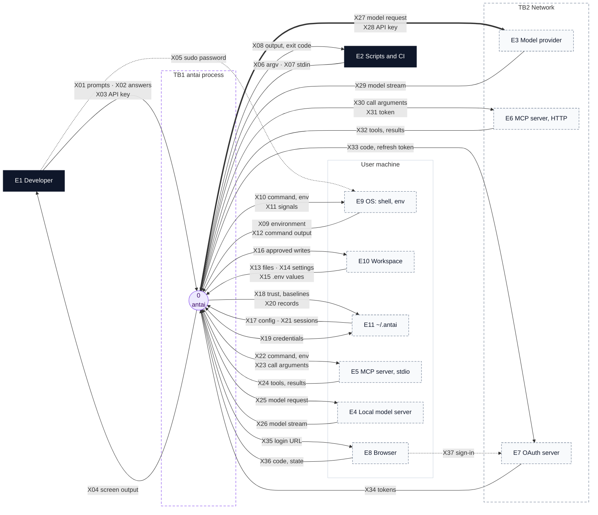
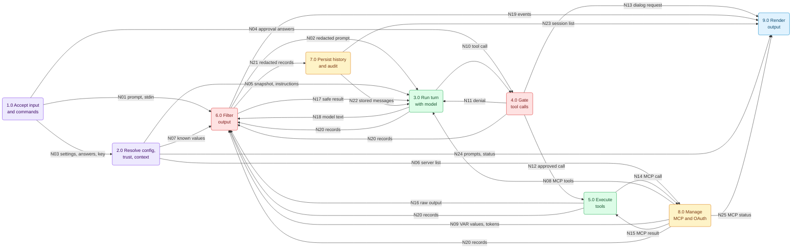
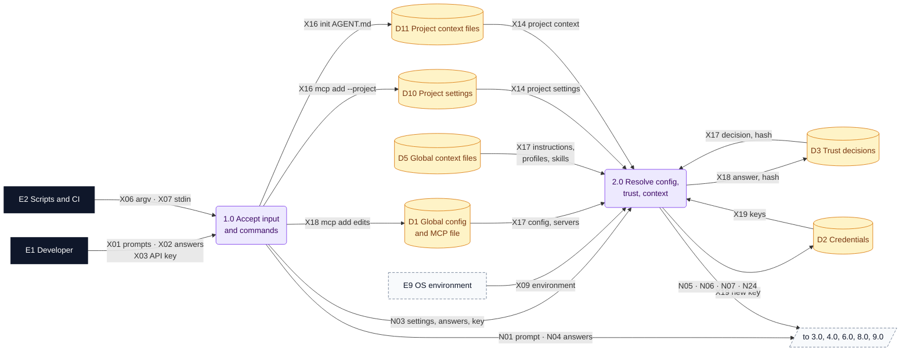
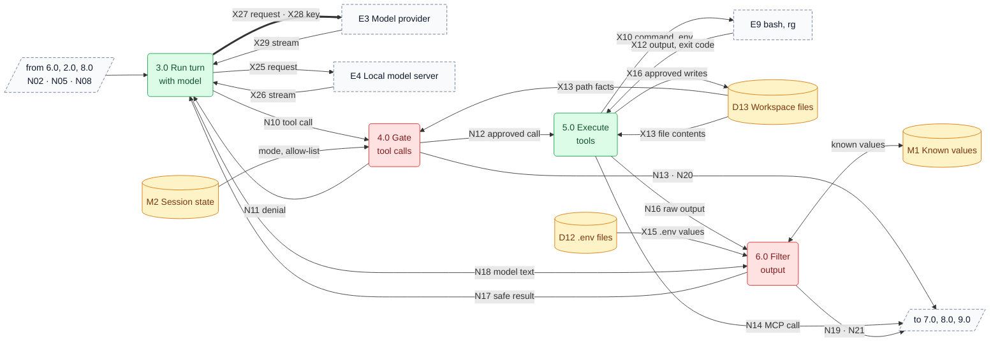
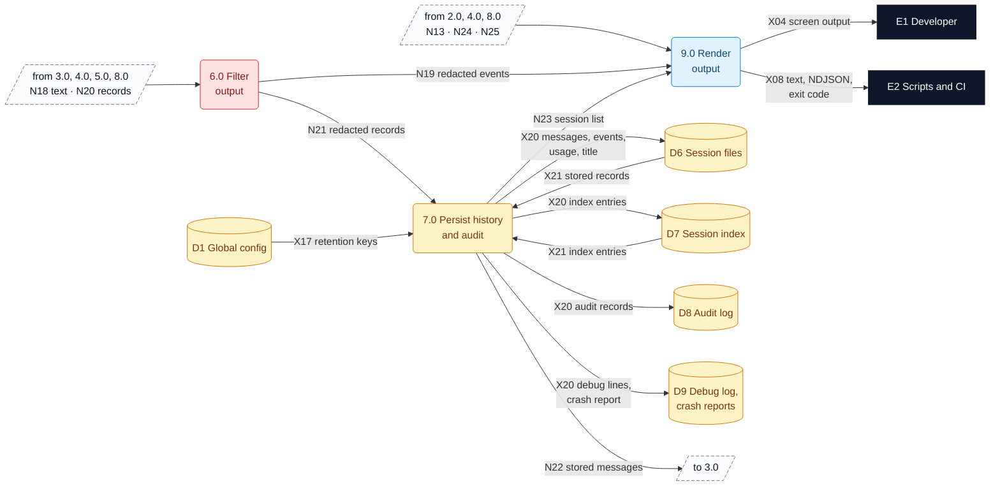
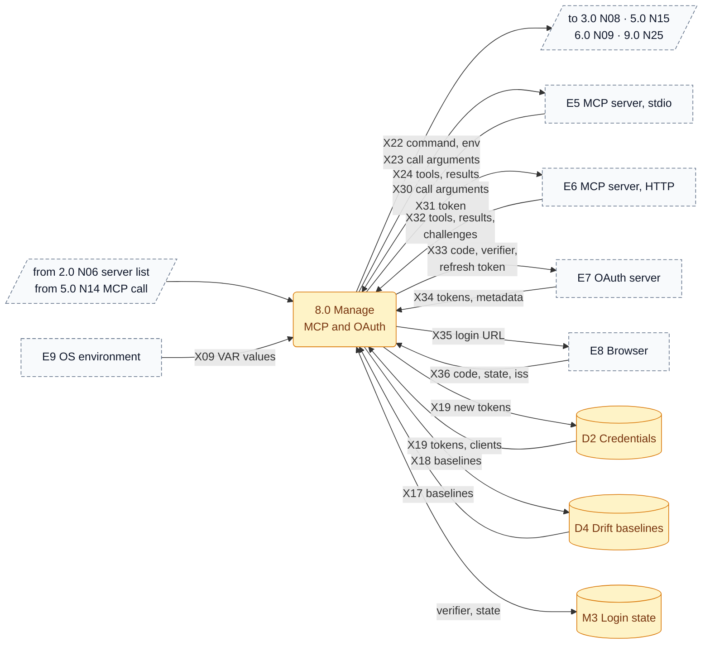
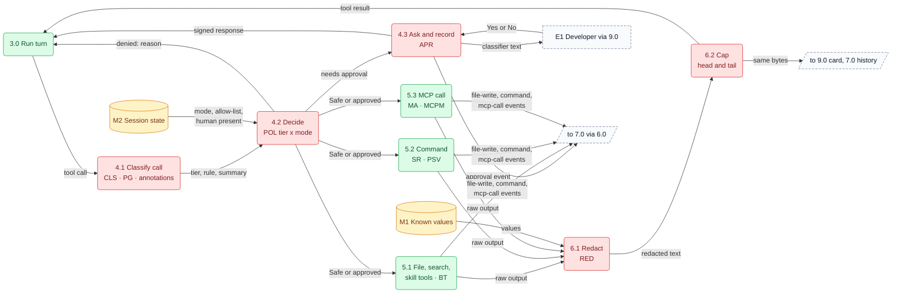
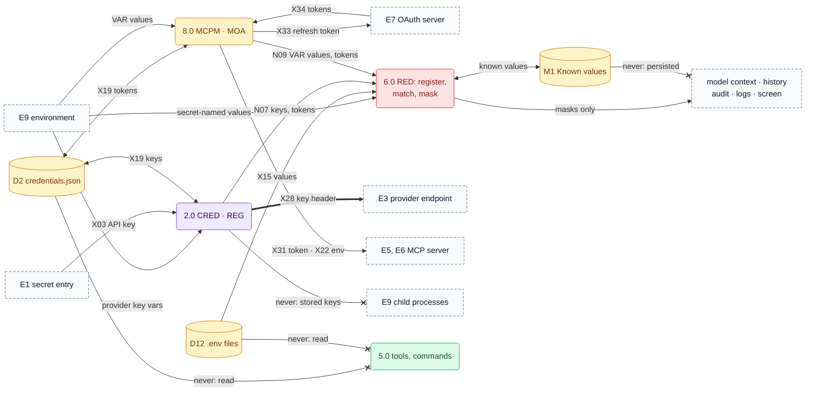
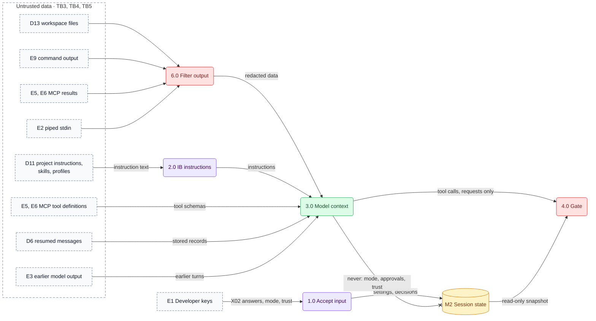
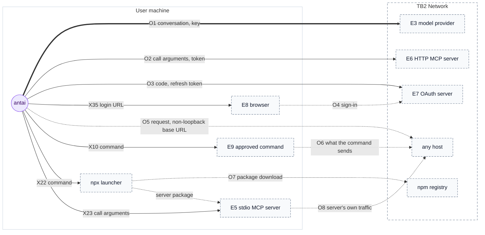

# antai — Data Flow Diagrams (DFD) L0 + L1

| | |
|---|---|
| **Product** | antai (brand) / `antai` (command) |
| **Document** | Deliverable 05, Data Flow Diagrams (DFD) L0 + L1 for the v1 MVP |
| **Status** | Draft for review |
| **Version** | 0.1 |
| **Date** | 12 October 2026 |
| **Author** | Daksh Nagpal |
| **Based on** | BRD_1 v0.4, HLD.png, deliverable 01 (HLD / Architecture Diagram) v0.1, deliverable 03 (Sequence Diagrams) v0.1, deliverable 04 (Data & Storage Design) v0.1, deliverables 02, 07, 09, 10 and 15 (where named in the text) |
| **How to use** | Reference design, not a fixed rail. Where the technology needs something different or extra, the implementation may change it; the change is then made in every deliverable it touches, so the set keeps agreeing. |

## Contents

1. Purpose, notation and data classification
2. Context diagram (DFD-0)
3. Level 1 (DFD-1.0 to DFD-1.4)
4. Level 2: tool pipeline and secrets (DFD-2.1, DFD-2.2)
5. Trust boundaries (DFD-3)
6. What leaves the machine (DFD-4)
7. Secret and credential flows
8. Data stores
9. Design decisions
10. Open questions
11. Traceability
12. Sources

---

## 1. Purpose, notation and data classification

### 1.1 Purpose and scope

This deliverable shows where data goes in antai v1: what enters the process, which part of antai handles it, where it is stored, what leaves the machine, and where secrets are matched and must never appear. Three later artefacts depend on it: deliverable 02 runs its STRIDE pass per element of these diagrams, the privacy note (DLV-DOC-06) takes its outbound table from section 6, and the secret-scan test (DLV-VER-03) takes its list of sinks from section 7.

| In this document | Detailed elsewhere |
|---|---|
| Context and level 1 data flows, level 2 for the tool pipeline and for secrets, data classes, trust boundaries, outbound flows, secret paths, store access | — |
| Component IDs, names and module paths | Deliverable 01, section 5.9 (used unchanged) |
| Message order inside each flow | Deliverable 03 (SD IDs cited per flow) |
| File locations, record schemas, write rules, retention | Deliverable 04 (file IDs F01 to F20, W1 to W6) |
| Threats, STRIDE, OWASP mapping, residual risks | Deliverable 02 |
| Debug log content | Deliverable 15 |

### 1.2 Notation and legend

Classic DFD elements, drawn in Mermaid flowcharts (Mermaid has no DFD type, and every diagram in this set is a standard Mermaid type).

| Element | Drawn as | Mermaid shape | Meaning |
|---|---|---|---|
| External entity | Rectangle, dashed grey (dark for people) | `["E1 Developer"]` | A source or sink antai does not control |
| Process | Level 0: circle numbered `0`. Level 1: rounded box numbered `1.0` to `9.0`. Level 2: `4.1`, `4.2`, … | `(("0"))`, `("3.0 …")` | Transforms data. Colour = layer of its main components |
| Data store | Cylinder, amber. `D1`–`D13` are files (mapped to deliverable 04 IDs); `M1`–`M4` are memory-only | `[("D6 …")]` | Data at rest |
| Data flow | Labelled arrow; the label names the **data**, prefixed with its flow ID | `-- "X27 model request" -->` | Direction of the data, not of the call |
| Bypass or indirect flow | Dotted arrow | `-.->` | Data that does not pass through antai, or leaves through another program |
| Forbidden flow | Arrow ending in a cross, labelled "never" | `--x` | A flow the design rules out; section 7 names the test that proves it |
| Off-page connector | Parallelogram | `[/"to 7.0"/]` | Continues in another level 1 diagram |
| Trust boundary | Dashed subgraph with a `TB` ID | `subgraph TB1` | Data crossing it changes trust (section 5) |

Every solid flow has a process at one end at least; flows between two external entities appear only as dotted bypass or indirect flows. Colours follow deliverable 01: purple orchestration, blue presentation, green agent and tools, red safety, amber infrastructure and stores, dashed grey external or untrusted.

Two DFD conventions are used on purpose. At level 0 the workspace and `~/.antai` are external entities, because they lie outside the process; at level 1 they are opened into stores D1 to D13, because their parts have different classes and owners (DFD-D4). And two flows that never touch antai (X05 `sudo` password, X37 browser sign-in) are drawn anyway, because the point of drawing them is to show that antai never sees that data (DFD-D9).

### 1.3 Identifiers

| Prefix | Meaning | Listed in |
|---|---|---|
| `E1`–`E11` | External entities | Section 2.2 |
| `0`, `1.0`–`9.0`, `4.1`… | Processes at levels 0, 1 and 2 | Sections 2, 3.1, 4 |
| `D1`–`D13`, `M1`–`M4` | File stores and memory-only stores | Section 8 |
| `X01`–`X37` | Flows that cross antai's process boundary | Section 2.3 |
| `N01`–`N25` | Flows between level 1 processes | Section 3.2 |
| `O1`–`O8` | Outbound paths that leave the machine | Section 6.2 |
| `TB1`–`TB8` | Trust boundaries | Section 5.1 |
| `SEC`, `CRD`, `CNV`, `WSP`, `EXT`, `CFG`, `MET`, `CTL` | Data classes | Section 1.4 |

`F01`–`F20` and `W1`–`W6` are deliverable 04's file IDs. This document uses them only to map stores, never for flows (DFD-D5).

### 1.4 Data classification

Each flow carries two attributes: a **class**, which says how sensitive the data is and where it may go, and a **trust level**, which says whether it may steer antai (DFD-D1). A flow that can carry several classes lists all of them; the strictest one sets the handling.

| Class | Name | Examples | May leave the machine | Stored by antai | Handling |
|---|---|---|---|---|---|
| `SEC` | Secret | `.env*` values; values of secret-named environment variables (FR-SEC-03 b); contents of secret files (FR-SEC-01); the `sudo` password; the user's sign-in at an authorization server | Never through antai. Only an approved command or a stdio MCP server can send one, indirectly (section 6) | Never (deliverable 04, section 7.2) | Masked by `RED` wherever it appears (FR-SEC-03, FR-SEC-04) |
| `CRD` | Credential | Provider API keys; MCP bearer tokens and header values; OAuth access and refresh tokens and client secrets; one-time OAuth values (PKCE verifier, `state`, authorization code); the per-process approval signing secret | Only to its owner: a key to its provider endpoint, a token to its MCP server URL, a refresh token or code to the pinned authorization server (FR-SEC-05) | Only in `credentials.json` (D2). One-time values and the signing secret stay in memory | Registered with `RED` as known values; never put into `process.env` (deliverable 01, rule 11; the outcome is now in BRD v0.4, FR-SH-06) |
| `CNV` | Conversation content (personal) | Prompts, model text and reasoning, tool calls and arguments, redacted tool results, titles, `/compact` summaries | To the selected model provider; tool arguments to the MCP server called | Session files (D6), redacted, 30 days | Redacted before it is stored or sent (deliverable 04, section 7.1) |
| `WSP` | Workspace content | File contents, listings, search results, command output, project instruction files, skills, profiles, project config | Only as `CNV`, after a tool returns it. Project config never | Only inside redacted tool results (D6) | Untrusted (NFR-SEC-02) |
| `EXT` | Untrusted external content | Model output, MCP tool definitions, annotations and results, piped stdin, OAuth metadata and callback parameters, data a command downloads | Model output becomes `CNV` | As `CNV` (redacted); MCP definitions in D4 | Data, never instructions (deliverable 01, rule 3) |
| `CFG` | Configuration and state | `config.json`, MCP server entries (with `${VAR}` names, not values), trust decisions, drift baselines, global instruction files, profiles, skills, session settings | Instruction text and tool schemas go to the provider with every request | D1, D3, D4, D5 | Project values apply only after trust (FR-CFG-04) |
| `MET` | Metadata and counters | Token usage, rate-limit snapshots, durations, exit codes, tool names, paths, approval decisions, index entries, audit records, debug lines | No. There is no telemetry (NFR-PRIV-01) | D6 to D9 | Redacted at write |
| `CTL` | Control input | Keypresses, approval and trust answers, `/mode`, `/model`, flags | No | As audit records of the decisions | Accepted only from the developer's keyboard and argv (deliverable 01, rule 7) |

| Trust level | Sources | Can change mode, approvals, trust or config? |
|---|---|---|
| Principal | E1 keyboard, E2 argv | Yes. The only ones (FR-MODE-03) |
| User-owned | `~/.antai` (D1 to D5), the process environment | Configure antai. Global instruction text still reaches the model, which is its purpose |
| Untrusted | Workspace (D10 to D13), piped stdin, model output, MCP servers, authorization servers, the browser callback, command output | No (NFR-SEC-02). Every path from these into the model context is listed in section 5.3 |

### 1.5 Additions beyond BRD v0.4

These go beyond BRD v0.4. The design uses them as stated; the BRD can adopt them later. CR numbers refer to deliverable 00, section 11.

| Ref | What this document assumes | Sections |
|---|---|---|
| Deliverable 01, rule 11 | Stored provider keys go straight to provider factories, never into `process.env` (the outcome is now in BRD v0.4, FR-SH-06) | 4.2, 7 |
| Deliverable 02, 6.3 | Redact first, then cap (BRD FR-SH-08 lists the other order), so a secret cut by the cap is still caught | 4.1 |
| Deliverable 01, rule 7; deliverable 02, 3.10 | Type-ahead discarded at a dialog; per-process approval signing secret | 5.1 (TB6), 8 (M4) |
| HLD-D7 | `RTY` retries model calls; SDK `maxRetries: 0` | 3.1 |
| Deliverable 02, 8.4 | MCP HTTP transport with `redirect: 'error'` | 5.4 |
| Deliverable 04 P3, P4, P6, P7 | Retention keys from global config only; secret-path glob `~/.antai/credentials.json*`; `shell.gitBashPath` and `workspace.extraReadPaths` from global config only, `mcp.tools.allow` from trusted projects only; audit write failure denies side effects. P3 and P6 are now in BRD v0.4 (FR-CFG-01, FR-CFG-04) | 3.3, 3.5, 7.1, 8 |
| Deliverable 02, 6.6 | Provider-key variables the user exported stay in child environments, because they are the user's own environment | 7.1 |
| Deliverable 02, SEC-D15 | `.env` known values re-scanned by modification time before each turn and after each command | 2.3 (X15) |
| CR-09 | Provider-specific privacy facts instead of a general warning | 6.3 |

---

## 2. Context diagram

### 2.1 DFD-0 Context diagram (level 0)

antai is one process. Every arrow is one or more boundary flows; section 2.3 gives each flow's data, class and requirement.

### 2.2 External entities

| ID | Entity | What it is | Trust | Flows |
|---|---|---|---|---|
| E1 | Developer | The person at the TTY | Principal: the only source of approvals, mode changes and trust decisions | X01–X05 |
| E2 | Scripts and CI | A parent process running `antai run`, or piping into it | argv is the user's intent; piped stdin is untrusted | X06–X08 |
| E3 | Model provider | Groq (default `groq:openai/gpt-oss-120b`), Google (`google:gemini-3.8-flash`), OpenAI, Anthropic, OpenAI-compatible presets and custom endpoints (D28) | Trusted with what the user chose to send; its output is untrusted | X27–X29 |
| E4 | Local model server | Ollama (`http://localhost:11434/api`), LM Studio (`http://localhost:1234/v1`) | As E3. A non-loopback base URL makes it a remote endpoint, shown in the status bar (FR-MOD-07) | X25, X26 |
| E5 | MCP server over stdio | A child process tree started from an MCP file entry | Untrusted; runs with the user's privileges | X22–X24 |
| E6 | MCP server over Streamable HTTP | A remote server at an MCP file `url` | Untrusted | X30–X32 |
| E7 | OAuth authorization server | Named by an MCP server's protected-resource metadata | Validated, not trusted: issuer pin, PKCE, `state`, `iss` (FR-MCP-11) | X33, X34, X37 |
| E8 | System browser | Opened by antai's opener during an explicit login | Its callback is untrusted until `state` and `iss` check out | X35–X37 |
| E9 | Operating system | bash or Git Bash and each command's process tree, `sudo -v`, `rg`, `taskkill`, `icacls`, the browser opener, and the environment antai inherits | Child processes run with the user's full privileges (NFR-SEC-03) | X05, X09–X12 |
| E10 | Workspace file system | The git root of the cwd, or the cwd: files, project settings, context files, `.env*` | Untrusted content (NFR-SEC-02) | X13–X16 |
| E11 | `~/.antai` | antai's home folder (deliverable 04, section 2.2) | User-owned, protected path (FR-TOOL-11) | X17–X21 |

### 2.3 Boundary flows

| ID | From → To | Data | Class | When | Requirements | Flow in deliverable 03 |
|---|---|---|---|---|---|---|
| X01 | E1 → 0 | Prompts, slash commands, keys (Enter, Esc, Ctrl+C) | `CNV`, `CTL` | At the prompt | FR-UI-05, FR-SLC-01, 02 | SD-5a, SD-14 |
| X02 | E1 → 0 | Answers to approval dialogs, the trust prompt and confirmations (home-folder workspace, OAuth step-up) | `CTL` | When asked | FR-SH-03, 04, FR-CFG-04 | SD-3, SD-7a, SD-8, SD-21d |
| X03 | E1 → 0 | API key typed at the secret-entry prompt or `antai login` | `CRD` | First run; `/model` to a provider without a key; `antai login` | FR-MOD-04 | SD-2a, SD-2b |
| X04 | 0 → E1 | Answers, reasoning, tool cards, dialogs with classifier text, status bar, notices, errors; all redacted | `CNV`, `MET` | Continuously | FR-UI-01..05, NFR-SEC-05 | SD-5a, SD-7a |
| X05 | E1 → E9 | `sudo` password typed into `sudo -v` on the real terminal. Does not pass through antai | `SEC` | Before a command with `sudo`, interactive only | FR-SH-09 | SD-11 |
| X06 | E2 → 0 | argv: prompt, flags, subcommand | `CNV`, `CTL` | Launch | FR-CLI-02, 04 | SD-13a |
| X07 | E2 → 0 | Piped stdin, capped at 100 KB | `EXT` | `antai run` | FR-CLI-03 | SD-13a |
| X08 | 0 → E2 | Text or NDJSON events on stdout, errors on stderr, exit code; redacted | `CNV`, `MET` | During and at the end of a run | FR-UI-06 | SD-13b |
| X09 | E9 → 0 | Process environment: provider key variables, secret-named variables, `ANTAI_*`, `HOME` or `USERPROFILE`, `PATH`, variables named by `${VAR}` | `SEC`, `CRD`, `CFG` | Start | FR-MOD-04, FR-CFG-01, FR-SEC-03 (b), FR-MCP-03 | SD-1a |
| X10 | 0 → E9 | Command text, workspace folder, child environment: the user's environment minus antai-internal variables, plus `PAGER=cat`, `GIT_PAGER=cat`, `GIT_TERMINAL_PROMPT=0` | `CNV`, `SEC` | Each Safe or approved `shell` call | FR-SH-06, deliverable 01 rule 11 | SD-10a |
| X11 | 0 → E9 | Signals and `taskkill` arguments for tree kill; terminal lease for `sudo -v`; `rg` arguments; opener arguments; `icacls` arguments when `~/.antai` is first created on Windows | `CTL`, `MET` | As needed | FR-SH-07, 09, NFR-REL-03 | SD-10b, SD-11 |
| X12 | E9 → 0 | stdout and stderr in arrival order, exit code, signal, duration, timed-out flag; `rg` results | `WSP`, `EXT` (may hold `SEC`) | Each command or search | FR-SH-08, FR-TOOL-06 | SD-10a |
| X13 | E10 → 0 | File contents, listings, search results; path facts (realpath, existence) for the path guard | `WSP` | Each file or search tool call | FR-TOOL-01, 04..06, 09 | SD-6 |
| X14 | E10 → 0 | Project settings (`.antai/config.json`, `.antai/mcp.json`, `.mcp.json`) and project context files (instruction files, profiles, skills) | `WSP`, `CFG` | Start; skill bodies on demand | FR-CFG-04, FR-INS-02, FR-PRF-01, FR-SKL-02 | SD-1a, SD-3, SD-4 |
| X15 | E10 → 0 | Values from `.env` and `.env.*` (not `.env.example`, `.sample`, `.template`), read only by `RED`'s scan | `SEC` | Background scan at start; re-scan by modification time before each turn and after each command (deliverable 02, SEC-D15) | FR-SEC-03 (a) | SD-1b |
| X16 | 0 → E10 | Approved writes and edits; `AGENT.md` from `antai init`; `.antai/mcp.json` from `antai mcp add --project` | `WSP`, `CFG` | After approval, or on the user's subcommand | FR-TOOL-02, 03, FR-CLI-06, FR-MCP-08 | SD-7b |
| X17 | E11 → 0 | `config.json`, `mcp.json`, `trusted.json`, `mcp-fingerprints.json`, global instruction files, profiles, skills | `CFG` | Start; `/trust`; on demand | FR-CFG-01, 04, FR-MCP-09 | SD-1a, SD-19b |
| X18 | 0 → E11 | Trust answer with hash and redacted snapshot; drift baselines; `mcp.json` edits by `antai mcp add` and `remove` | `CFG` | Trust answer; first connect or accepted drift; subcommand | FR-CFG-04, FR-MCP-08, 09 | SD-3, SD-19b |
| X19 | E11 ↔ 0 | `credentials.json`: provider keys, OAuth token sets, client registrations | `CRD` | Start; save; refresh; logout | FR-MOD-04, FR-SEC-05, FR-MCP-11 | SD-2a, SD-21b, SD-21c |
| X20 | 0 → E11 | Session records, index entries, audit records, debug lines, crash reports; all redacted | `CNV`, `MET` | As they happen (deliverable 04, section 6.6) | FR-HIS-01..13, FR-ERR-03, 04 | SD-18a, SD-23b |
| X21 | E11 → 0 | Stored sessions and the index | `CNV`, `MET` | Resume, `/history`, retention | FR-HIS-04, 05, 08, 09 | SD-17, SD-18b, SD-18c |
| X22 | 0 → E5 | Server start: command, args, environment with substituted `${VAR}` values | `CFG`, `CRD` | Background connect at start; project servers only after trust | FR-MCP-01..03 | SD-19a |
| X23 | 0 → E5 | JSON-RPC: `server/discover` or `initialize`, tool listing, `tools/call` arguments | `CNV` | Connect; each MCP call that passed the gate | FR-MCP-05..07 | SD-19a, SD-22 |
| X24 | E5 → 0 | Tool definitions and annotations, results, errors; stderr kept in a ring buffer and the debug log | `EXT` | Connect; each call | FR-MCP-06, 07, 09 | SD-19a, SD-22 |
| X25 | 0 → E4 | Model request, as X27 without a key | `CNV`, `WSP`, `CFG` | Each model step | FR-MOD-07 | SD-5a |
| X26 | E4 → 0 | Model stream | `EXT`, `MET` | Each step | FR-AGT-01 | SD-5a |
| X27 | 0 → E3 | Model request: instructions, messages, tool schemas (built-in and MCP), settings (model, `reasoning`, `maxOutputTokens`) | `CNV`, `WSP`, `CFG` | Each model step; title call after the first turn; `/compact` | FR-AGT-01, 03, D30 | SD-5a, SD-5b, SD-15b |
| X28 | 0 → E3 | API key in a request header | `CRD` | Each request | FR-MOD-04, FR-SEC-05 | SD-5a |
| X29 | E3 → 0 | Stream parts (text, reasoning, tool calls, usage, finish), rate-limit headers, error bodies | `EXT`, `MET` | Each step | FR-AGT-01, FR-ERR-01, 02 | SD-5a, SD-16 |
| X30 | 0 → E6 | JSON-RPC over HTTPS: `server/discover` or `initialize`, tool listing, `tools/call` arguments, protocol headers | `CNV`, `MET` | Connect; each MCP call that passed the gate | FR-MCP-01, 05..07 | SD-20, SD-22 |
| X31 | 0 → E6 | OAuth bearer token, or configured headers with substituted values | `CRD` | Every request | FR-MCP-03, 11 | SD-20 |
| X32 | E6 → 0 | Tool definitions, results, 401 and 403 challenges, protected-resource metadata | `EXT` | Connect; each call | FR-MCP-06, 07, 11 | SD-20, SD-21a |
| X33 | 0 → E7 | Metadata requests; client registration; token request with code, PKCE verifier, redirect URI and `resource`; refresh token | `CRD`, `MET` | Login; refresh at start or on 401; step-up | FR-MCP-11 | SD-21a..d |
| X34 | E7 → 0 | Authorization-server metadata, client ID (and secret if issued), access and refresh tokens, `expires_in` | `CRD`, `EXT` | Same | FR-MCP-11 | SD-21b, SD-21c |
| X35 | 0 → E8 | Authorization URL: `client_id`, PKCE challenge, `state`, `resource`, `scope`, redirect URI. Also printed on the terminal | `MET`, `CRD` (one-time `state`) | Explicit login only | FR-MCP-11, HLD-D26 | SD-21a |
| X36 | E8 → 0 | Loopback `GET /callback`: `code`, `state`, `iss` | `CRD`, `EXT` | After sign-in | FR-MCP-11 | SD-21b |
| X37 | E8 → E7 | The user's sign-in and consent. Does not pass through antai | `SEC` | Login | FR-MCP-11 | SD-21b |

---

## 3. Level 1

### 3.1 Processes and components

Level 1 splits antai by what happens to the data, not by code layer (DFD-D13). A component appears in two processes when it serves two functions: `CRED` (provider keys in 2.0, OAuth records in 8.0), `REG` (resolution in 2.0, model calls in 3.0) and `PSV` (commands in 5.0, server trees in 8.0).

**Relation to HLD.png.** HLD.png draws antai by folder; deliverable 01, section 1.3 maps its boxes to components. Level 1 cuts the same boxes by data: Screen UI and Event Bus become input (1.0) and output (9.0); Session is shared by 1.0 (`SLASH`), 3.0 (`SC`) and 4.0 (`APR`); Config, Context, Boot Service and the instruction parts of Agent Brain (`IB`, `ENV`) feed 2.0; the Engine (Agent Brain) and the Provider group (Model Gateway) are 3.0; the Tool Pipeline is 4.0 (Safety Guard), 5.0 (Tool Service and its Machine Adapters) and 6.0 (Secret Filter); History is 7.0. The drawing's "asks you Yes/No" is N13 and N04, and its "yes" is N12. Two things differ on purpose. Records reach History only through 6.0, where HLD.png draws Session saving straight to History, because every stored text is redacted first (deliverable 01, rule 10). MCP servers and OAuth get their own process 8.0, where HLD.png keeps them inside Tool Service and Machine Adapters, because they have their own stores (D2, D4, M3) and network flows.

| Process | Does | Components (deliverable 01, section 5.9) | Reads | Writes | Deliverable 03 |
|---|---|---|---|---|---|
| 1.0 Accept input and commands | Takes argv, piped stdin, keys and answers; routes slash commands; runs `antai login`, `init`, `mcp add` | `CLI`, input side of `INK`, `LINE`, `PLAIN`, `BUS` (`UserCommand`, answers), `SLASH`, `LIFE` (signals) | — | D1 (`mcp add`), D10 and D11 (`mcp add --project`, `init`) | SD-1a, SD-2b, SD-13a, SD-14 |
| 2.0 Resolve configuration, trust, credentials and context | Merges config, applies the trust gate, resolves the provider and key, assembles instructions each turn | `BOOT`, `CFG`, `TRUST`, `CRED` (keys), `REG` (resolution), `CAT`, `GBL`, `INS`, `PRF`, `SKR`, `IB`, `ENV`, `PLAT` | D1, D2, D3, D5, D10, D11 | D2, D3 | SD-1a, SD-2a, SD-3, SD-4, SD-24 |
| 3.0 Run turn with model | Builds the turn agent, prepares messages, calls the model, maps stream parts, counts usage | `SC`, `AG`, `PR`, `REG` and `RTY` (calls), `EVM`, `USG`, `SDK` (approval secret) | M2, M4 | through 6.0 only | SD-5, SD-15, SD-16, SD-17b |
| 4.0 Gate tool calls | Classifies each call, applies tier × mode, asks the developer, records decisions | `POL`, `CLS`, `PG`, `RULES`, `APR` | M2, D13 (path facts) | through 6.0 only | SD-7, SD-8, SD-9, SD-22 |
| 5.0 Execute tools | Runs built-in tools and commands; forwards MCP calls | `TREG`, `BT`, `MA`, `SR`, `GBL`, `PSV`, `SRCH`, `FSX` (workspace writes) | D13; D5 and D11 (`load_skill`) | D13 | SD-6, SD-7b, SD-10, SD-11, SD-12b |
| 6.0 Filter output | Redacts, then caps; holds the known-value set | `RED` with `RULES` | M1, D12 | M1 | SD-1b, SD-6, SD-10a, SD-22 |
| 7.0 Persist history and audit | Appends records, maintains the index, sweeps old files, writes debug and crash files | `HS`, `AUD`, `RET`, `DBG`, `FSX`, `LIFE` (crash path) | D1 (retention keys), D6, D7 | D6, D7, D8, D9 | SD-17, SD-18, SD-23b |
| 8.0 Manage MCP servers and OAuth | Connects servers, lists tools, checks drift, forwards calls, runs login and refresh | `MCPM`, `MA` (connection side), `MOA`, `OCB`, `CRED` (OAuth), `SDK`, `PSV` (server trees) | D2, D4, M3 | D2, D4 | SD-19, SD-20, SD-21 |
| 9.0 Render output | Draws events, dialogs and status; prints text or NDJSON; sets the exit code | `BUS` (events, interaction requests), output side of `INK`, `LINE`, `PLAIN` | — | — | SD-5a, SD-13b |

### 3.2 DFD-1.0 Level 1 overview

Processes and the flows between them. Stores and external entities are in DFD-1.1 to DFD-1.4.

| ID | From → To | Data | Class | Note |
|---|---|---|---|---|
| N01 | 1.0 → 6.0 | Prompt text; piped stdin inside a delimited untrusted block | `CNV`, `EXT` | Redacted before it is stored and before it is sent (deliverable 04, section 7.1; FR-CLI-03) |
| N02 | 6.0 → 3.0 | Redacted user message | `CNV` | The model gets the stored bytes (deliverable 04, DS-D8) |
| N03 | 1.0 → 2.0 | `/model`, `/mode`, `/effort`, `/profile`, `/trust`, flags; trust answer; typed API key | `CTL`, `CRD` | The key goes on to `CRED` and D2 only (SD-2a) |
| N04 | 1.0 → 4.0 | Approval answers | `CTL` | Only `APR` turns them into a `tool-approval-response` (deliverable 01, rule 7) |
| N05 | 2.0 → 3.0 | Turn snapshot (mode, model, effort, profile, allow-list, human present), instructions, provider instance | `CFG`, `CRD` | The key lives inside the provider instance only (deliverable 01, rule 11); instructions are rebuilt each turn, pass `RED` in `IB`, and are never stored |
| N06 | 2.0 → 8.0 | MCP server entries after the trust filter, with `${VAR}` names | `CFG` | No project server before trust (FR-CFG-04) |
| N07 | 2.0 → 6.0 | Known values to register (stored keys and tokens, secret-named environment values), `secrets.paths`, `secrets.patterns` | `CRD`, `SEC`, `CFG` | Patterns may come from an untrusted project (tighten only; unsafe patterns dropped with a warning, deliverable 02, SEC-D16) |
| N08 | 8.0 → 3.0 | MCP tool definitions and annotations as `mcp__<server>__<tool>` | `EXT` | Descriptions pass `RED` before each request but stay untrusted (section 5.3) |
| N09 | 8.0 → 6.0 | Substituted `${VAR}` values, newly saved OAuth tokens | `CRD` | Registered before any request uses them (SD-19a, SD-21b) |
| N10 | 3.0 → 4.0 | Tool call: name, arguments, `toolCallId`, MCP annotations | `EXT` | Model output: a request, never a command (TB5) |
| N11 | 4.0 → 3.0 | Denial with reason (`execution-denied`) | `MET` | The model replans (SD-9) |
| N12 | 4.0 → 5.0 | Approved call | `EXT`, `CTL` | Built-in, command or MCP |
| N13 | 4.0 → 9.0 | Approval request: tool, input summary, tier, classifier text, diff | `CNV`, `MET` | Dialog text never comes from the model (FR-SH-03, 04) |
| N14 | 5.0 → 8.0 | MCP call: server, tool, arguments, abort signal | `CNV` | After the gate (SD-22) |
| N15 | 8.0 → 5.0 | Raw MCP result | `EXT` | Not yet redacted |
| N16 | 5.0 → 6.0 | Raw tool output, streamed in chunks | `WSP`, `EXT`, possibly `SEC` | `TREG` wraps every tool (HLD-D5) |
| N17 | 6.0 → 3.0 | Redacted, capped tool result | `CNV` | Same bytes go to history and the tool card (FR-HIS-07, FR-UI-03) |
| N18 | 3.0 → 6.0 | Streamed text and reasoning; error text | `EXT` | Redacted in `EVM` before any renderer (HLD-D19) |
| N19 | 6.0 → 9.0 | Events: text deltas, tool results, usage, notices, errors | `CNV`, `MET` | Renderers never see raw output |
| N20 | 3.0, 4.0, 5.0, 8.0 → 6.0 | Records to persist: messages, usage, title, `approval`, `command`, `file-write`, `mcp-call`, `setting`, `credential` (no value) events | `CNV`, `MET` | Deliverable 04, section 5.9 |
| N21 | 6.0 → 7.0 | Redacted records; `HS`, `AUD` and `DBG` accept only `RedactedText` | `CNV`, `MET` | Deliverable 04, section 7.3 |
| N22 | 7.0 → 3.0 | Stored messages for resume, with repairs | `CNV` | Instructions are rebuilt, not read (SD-17b) |
| N23 | 7.0 → 9.0 | Session list for `/history` | `MET` | Redacted titles only |
| N24 | 2.0 → 9.0 | Interaction requests (trust prompt, secret entry, confirmations); status (provider, model, mode, non-local base URL) | `CFG`, `MET` | The secret-entry request carries no secret |
| N25 | 8.0 → 9.0 | MCP status, "needs login", drift warnings, login URL | `MET` | — |

### 3.3 DFD-1.1 Input, configuration, trust and context

- **Project settings before trust.** `CFG` reads D10 at every start, but only the tighten-only keys (`shell.block`, `shell.dangerous`, `secrets.paths`, `secrets.patterns`) take effect. Trust-gated keys reach N05 and N06 only when D3 holds a "trusted" answer with a matching settings hash (FR-CFG-04, deliverable 01 rule 15). Three keys never take effect from an untrusted project, and two of them not from any project: `shell.gitBashPath` and `workspace.extraReadPaths` are global only, `mcp.tools.allow` needs trust (FR-CFG-01, FR-CFG-04). Nothing in D10 starts a process or a network request before trust, so opening a cloned repository is never enough to run its code or send its data; AC-19 and AC-35 check this.
- **Project context files** (D11) load in an untrusted workspace too. They become instruction text (N05) and `load_skill` results, so they are a prompt-injection input (section 5.3), not configuration. A project profile's `mode` and `model` apply only when trusted, and never `auto` (FR-PRF-02, FR-CFG-05).
- **Keys.** `CRED` reads D2 once at start. A key goes into its provider instance (N05) and into the known-value set (N07), never into `process.env` (deliverable 01, rule 11). A key typed at the prompt (X03) is written to D2 under the lock and registered at once (SD-2a). The answer to a secret-entry request is never an event and never logged (deliverable 01, section 10.7).
- **The CLI's own writes.** 1.0 writes D1, D10 and D11 only for the user's subcommands `antai mcp add`, `antai mcp remove` and `antai init`. When the model wants to write the same paths, the call goes through 4.0 as a protected-path write, which is Dangerous in every mode (FR-TOOL-11).
- `TRUST` passes the settings snapshot it stores in D3 through `RED` first (deliverable 04, section 7.1).

### 3.4 DFD-1.2 Turn, gate, execution and filter

- **What one model request carries (X27).** Base rules, global instruction file, active profile, project root and subfolder instruction files, skill catalogue, environment summary (OS, bash path and version, cwd, workspace root, date) in FR-AGT-03 order; the messages (redacted user messages, assistant text and reasoning parts, tool calls, redacted and capped tool results); the schemas of every active tool, built-in and MCP; and the settings. After a provider switch, provider-specific parts are left out of the copy (FR-MOD-05). The same content goes to E4 for local models (X25).
- **There is no flow from D12 to 5.0.** Tools never read `.env*` files: the path guard denies them and the classifier puts direct shell reads on the hard floor (FR-SEC-01, FR-SEC-02). Only `RED` reads them, into M1. A command that loads `.env` itself (`npm run dev`) may print a value; it then arrives in X12 and is masked in 6.0 (AC-04).
- **Waiting for the scan.** Until the background `.env` scan has filled M1, `TREG` holds tool output back from 6.0 (HLD-D21, SD-1b). The first user message of a process waits too, for at most 5 s, and is then sent with the values known so far (deliverable 07, RT-D4); the prompt stays usable while it waits. Model text does not wait.
- 4.0 reads path facts (realpath, existence) from D13 to decide, and 5.0 re-checks them at execution with `O_NOFOLLOW` where available, because approval and execution are separate moments.
- `rg` (part of E9) reads D13 itself when `search_files` or `find_files` uses it; the same secret-file exclusions are passed as arguments (FR-TOOL-06).

### 3.5 DFD-1.3 Persistence and rendering

- **Everything that reaches 7.0 passes 6.0 first** (DFD-D6). This is deliverable 01's rule 10 drawn as data: `HS`, `AUD` and `DBG` accept only the `RedactedText` type that only `RED` creates (deliverable 04, section 7.3). The writes that bypass 6.0 are D2 (credentials, whose job is to hold secrets), D3 (redacted by `TRUST`), D4 (tool definitions) and the CLI's MCP file edits.
- **Audit first.** For each decision `AUD` writes D8 before `HS` writes D6, so the always-kept record survives a crash between the two (deliverable 04, DS-D14). With `--no-history` or `history.enabled: false`, nothing goes to D6 or D7 and no title request is sent to the provider, but D8 still gets every decision (FR-HIS-10, FR-HIS-13, AC-31, AC-34). If D8 cannot be written, 4.0 denies every call that needs an audit record (beyond the BRD, deliverable 04 P7), so no side effect happens without its record.
- D8 holds commands, paths, decisions and settings; MCP arguments are summarised, redacted and capped at 1,000 characters (deliverable 04, section 5.9). D8 is never read back except by `RET`, by file name.
- D9 gets prompts only when the user asks for it (deliverable 01, section 10.7); crash reports carry no conversation text and no environment (deliverable 04, section 5.15).
- `RET` reads its retention keys from D1 only (FR-CFG-01) and deletes from D6 to D9 in the background. Deletion is not drawn as a data flow.
- 9.0 sends nothing anywhere but the terminal and stdout. Renderers have no network access and no file access (deliverable 01, section 8.2).

### 3.6 DFD-1.4 MCP servers and OAuth

- **Variable values.** `MCPM` substitutes `${VAR}` from the environment in memory, registers each value with `RED` (N09) before the first request, and never writes it back: the files keep the reference (FR-MCP-03). FR-MCP-03 covers only substituted values, so `MCPM` also registers literal values that the user wrote despite the FR-MCP-08 warning: every `headers` and `env` value of 4 or more characters.
- **stdio server environment (X22).** A stdio server gets the environment `SR` builds for commands (the user's environment minus antai-internal variables) plus the entry's `env` after substitution (deliverable 02, section 6.6). The P0 spike confirms what the `@ai-sdk/mcp` transport passes by default.
- **Tokens go to one place each.** Token sets are keyed by the canonical MCP server URL with an issuer pin, so the access token is sent only to that URL (X31) and the refresh token only to the pinned token endpoint (X33) (deliverable 04, DS-D16). `MOA` is attached only to servers without a configured `Authorization` header (SD-D16).
- **One-time values** (PKCE verifier, `state`, authorization code) stay in M3 for one login attempt and are never written (deliverable 04, DS-D17). The browser receives only the PKCE challenge, never the verifier.
- **No login before trust or without a person.** A project server never reaches E7 or E8 before trust (AC-19, AC-26). Outside an explicit login, `MOA` opens no browser; a failed refresh only marks the server "needs login" (SD-20, SD-21c).
- D4 stores tool definitions as received (deliverable 04, section 5.14). They are `EXT` text at rest, used for drift diffs in `/mcp`, never sent to the model from the file.

### 3.7 Balancing level 0 and level 1

Every level 0 flow appears at level 1 with the same data. Where an external entity became stores, the flow lands on the store.

| Level 0 flows | Level 1 realisation |
|---|---|
| X01–X03, X06, X07 | Into 1.0 (DFD-1.1); X03 continues as N03 to 2.0 and D2 |
| X04, X08 | Out of 9.0 (DFD-1.3) |
| X05, X37 | Outside antai at every level (DFD-D9) |
| X09 | Into 2.0 (provider keys), 6.0 (secret-named values, registered in M1), 8.0 (`${VAR}` values); passed through 5.0 into X10 as the child environment |
| X10–X12 | Between 5.0 and E9 (DFD-1.2); X11 also from 8.0 (opener, server tree kill) |
| X13 | D13 → 4.0 (path facts) and 5.0 (contents) |
| X14 | D10, D11 → 2.0; skill bodies D5, D11 → 5.0 through `load_skill` |
| X15 | D12 → 6.0, which keeps the values in M1 |
| X16 | 5.0 → D13 (and D10, D11 as protected-path writes); 1.0 → D10, D11 for `mcp add --project` and `init` |
| X17, X18 | D1, D3, D5 ↔ 2.0; D4 ↔ 8.0; D1 → 7.0 (retention keys); 1.0 → D1 (`mcp add`, `remove`) |
| X19 | D2 ↔ 2.0 and 8.0 |
| X20, X21 | 7.0 ↔ D6 to D9 |
| X22–X24, X30–X36 | 8.0 ↔ E5 to E8 (DFD-1.4) |
| X25–X29 | 3.0 ↔ E3, E4 (DFD-1.2) |

---

## 4. Level 2: tool pipeline and secrets

### 4.1 DFD-2.1 Tool-call pipeline

Processes 4.0, 5.0 and 6.0 opened up. Every tool call, built-in or MCP, takes this path: gate, execute, redact, cap, then the model and history (deliverable 01, rule 2).

| Step | Input | Output | Control | Requirements |
|---|---|---|---|---|
| 4.1 Classify | Tool name and arguments from the model | Tier, rule ID, classifier summary | Shell: hard-floor scan on raw text, bash parse, wrappers stripped, maximum tier, fail closed to Dangerous. Files: normalise, realpath, workspace roots, secret paths denied, protected paths Dangerous. MCP: Normal default, `destructiveHint` tightens, `readOnlyHint` only with `trustReadOnlyHints`, string arguments scanned for secret paths | FR-SH-01, 05, 12, FR-TOOL-09, 11, FR-SEC-01, FR-MCP-06, 07 |
| 4.2 Decide | Tier, mode, allow-list, human present | Run, deny, ask once, ask twice | Tier × mode matrix; hard floor in every mode; no human means deny | FR-SH-02, FR-MODE-01..04, D19 |
| 4.3 Ask and record | Approval request | One or two dialogs; decision to D8 then D6; signed `tool-approval-response` | Type-ahead discarded; text from the classifier; per-process signature; the SDK re-validates when the turn resumes, so the call passes 4.2 again | FR-SH-03, 04, 10, D27 |
| 5.1–5.3 Execute | Approved call | Raw output, exit facts, events | Path re-check at run time with `O_NOFOLLOW`; filtered child environment without stored keys; timeout and tree kill (FR-SH-07); side-effecting calls serialised (HLD-D17); `file-write` events come from 5.1 like the `command` events of 5.2 | FR-TOOL-01..08, FR-SH-06..09, FR-MCP-05 |
| 6.1 Redact | Raw stream | Masked stream | Known values from M1 (longest first), formats from `RULES`, `secrets.patterns`; carry-over buffer at least as long as the longest value, so a value split across chunks is still caught | FR-SEC-03, 04, AC-04 |
| 6.2 Cap | Masked stream | Head and tail with an omission marker | Command output 30,000 characters; `read_file` 2,000 lines or 50 KB; listings and matches by count. Cap after redaction (beyond the BRD: FR-SH-08 lists the other order) | FR-SH-08, FR-TOOL-01, 04, 06 |
| Result | Capped text | The same bytes to the model (3.0), the tool card (9.0) and history (7.0, inside the response messages) | — | FR-HIS-07, FR-UI-03 |

Redacting before capping matters: a secret cut in half by the cap would be too short for any detector. The denial path also produces data: the model receives `execution-denied` with the reason, and the audit log gets an `approval` event with `decision: "denied"` (SD-9).

### 4.2 DFD-2.2 Secret and credential values

A level 2 view across 2.0, 6.0 and 8.0, with `RED` drawn as one node: where secret values enter, where they are held, where they are matched, where they may go, and where they must never go.

- **Entry points.** The process environment (X09), the secret-entry prompt and `antai login` (X03), `credentials.json` (X19), the token endpoint (X34), `.env*` files (X15), and, without antai's help, any command output that prints a secret (X12) or a prompt the user pastes (X01).
- **One matcher.** Every value antai learns is registered by 6.0 in M1, and 6.0 is the only place values are matched (step 6.1 of DFD-2.1). Formats from `RULES` (`gsk_`, `sk-`, `ghp_`, `AIza`, JWT, PEM blocks, `AKIA`, URL passwords) catch secrets antai was never told about (FR-SEC-03 c, d).
- **The cross-ended arrows** are the claims section 7 tests. User-exported variables still reach child processes as part of the user's environment; only stored keys are kept out.

---

## 5. Trust boundaries

### 5.1 Boundaries

| ID | Boundary | Separates | Enforced by | Requirements |
|---|---|---|---|---|
| TB1 | antai process | antai's memory from everything else | Schema validation and size caps on input; `RED` on every output path; writes only through `FSX` | NFR-SEC-02, NFR-SEC-05 |
| TB2 | Machine and network | The user's machine from remote endpoints | HTTPS endpoints (`http://` MCP URLs only on loopback); trust-gated `baseURL` (FR-MOD-07); `redirect: 'error'` on MCP HTTP; issuer pin and PKCE; only configured destinations | NFR-PRIV-01, FR-MCP-01, FR-MCP-11 |
| TB3 | Workspace content | Repository content from antai's configuration and authority | Trust gate on project settings; protected paths Dangerous; secret paths denied; workspace jail | FR-CFG-04, FR-TOOL-09, 11, FR-SEC-01 |
| TB4 | Child processes | antai from commands, stdio MCP servers, `rg` and the opener, which run with the user's privileges | Gate before every spawn; filtered environment; timeout and tree kill (`PSV`); output through `RED`. Not a sandbox | NFR-SEC-03, FR-SH-06..09, NFR-REL-03 |
| TB5 | Model | Model output from actions | Every tool call passes 4.0; dialog text from the classifier; no tool can change mode, profile, trust or permissions | FR-MODE-03, FR-SH-03, 04, deliverable 01 rule 2 |
| TB6 | Human control | Keypresses from all other input | Only `APR` creates approvals, from a renderer answer; per-process signature; type-ahead discarded; `PLAIN` answers "no human present" | FR-SH-03, D19, deliverable 01 rule 7 |
| TB7 | Loopback callback | The browser's callback from other local processes that can reach the port | Bind `127.0.0.1` and `::1` only; OS-assigned port unless `oauth.callbackPort` is set; one request on `/callback`; `state` and `iss` checks; 5-minute limit | FR-MCP-11, HLD-D26 |
| TB8 | Credential store | `credentials.json` from every tool and command | Secret path for all tools; hard floor for commands; `0600`; only `CRED` and `MOA` open it | FR-SEC-01, 05, D25 |

### 5.2 DFD-3 Untrusted data into the model context

The prompt-injection surface: every path by which untrusted data reaches the model, and the one path by which control reaches the gate.

### 5.3 Untrusted inputs to the model context

| Source | Enters the context as | Redacted | What limits the damage | Residual (deliverable 02) |
|---|---|---|---|---|
| Workspace files (D13) | Tool results of `read_file`, `search_files`, `list_directory`, `find_files` | Yes | Every call the model then makes passes 4.0; protected paths Dangerous; secret paths denied | Approval fatigue: the model can be steered towards calls that look reasonable |
| Command output (X12) | Tool results | Yes | Same | Same |
| MCP results (X24, X32) | Tool results | Yes | MCP calls Normal by default; destructive hints tighten | Data from one server can be passed by the model into another server's call or a command; in `manual` each such call asks unless it is Safe |
| MCP tool definitions and annotations (N08) | Tool schemas on every request | Descriptions yes, before each request (deliverable 02, SEC-D13) | Drift warnings with diffs (FR-MCP-09); `mcp.tools.deny`; annotations untrusted unless `trustReadOnlyHints` | A hostile description is in context from the first connect, before any baseline exists (DFD-D11) |
| Project instruction files, skills, profiles (D11) | Instructions (`IB`); `load_skill` results; `/<skill-name>` expansion | Yes: skill bodies through `load_skill`; instruction text in `IB` before each request | Base rules first and never overridden (FR-AGT-03); no text changes mode or approvals; project profile `mode` only when trusted; untrusted project skills never replace global ones (FR-SKL-02) | The text still steers behaviour |
| Piped stdin (X07) | User message, inside a delimited block marked untrusted | Yes | `run` defaults to `research`; the docs warn against `--mode auto` on untrusted input (FR-CLI-02) | A user who passes `--mode auto` accepts the risk |
| Resumed messages (D6) | Messages | Yes, at write | Approval responses in history cannot be replayed (per-process signature, deliverable 01, rule 7); pending approvals are closed as interrupted (HLD-D23) | Injected text from an earlier session persists in it |
| Earlier model output (X29) | Assistant messages | Yes, in `EVM` | Same as for all tool calls | — |
| Environment summary | Last instruction block | Yes, in `IB` | Built by antai from OS facts | Folder names are model input (low) |

Only E1 changes M2, through `SLASH`, dialogs and the trust prompt. The model context has no flow to M2 at all. Its only route to D1, D3 or D10 is a tool call that writes them, and such a call is a protected-path write, Dangerous in every mode (FR-TOOL-11, AC-10); a changed project config then asks for trust again (FR-CFG-04).

### 5.4 Boundary crossings and controls

| Flow | From → To | Boundary | Data | Control applied | Requirements |
|---|---|---|---|---|---|
| X01, X02 | E1 → 1.0 | TB1, TB6 | Prompts, answers | `SLASH` parses; only `APR` makes an approval; type-ahead discarded | FR-SLC-02, FR-SH-03 |
| X07 | E2 → 1.0 | TB1 | Piped stdin | 100 KB cap, `RED`, delimited untrusted block | FR-CLI-03 |
| X09 | E9 → 2.0, 6.0, 8.0 | TB1 | Environment | Secret-named values registered in M1; keys used only by provider instances | FR-SEC-03 (b), FR-MOD-04 |
| X14 | D10 → 2.0 | TB3 | Project settings | Validation, fail closed; trust-gated keys only after trust with a matching hash; tighten-only keys always; no `auto`, no skip | FR-CFG-02, 04, 05 |
| X14 | D11 → 2.0 → 3.0 | TB3, TB5 | Project context files | 20 KB cap per file; loaded as text; profile `mode` only when trusted | FR-AGT-03, FR-PRF-02, FR-SKL-02 |
| X13 | D13 → 5.0 | TB3 | File contents | Path guard (workspace roots, realpath, secret paths), caps, `RED` | FR-TOOL-01, 09, FR-SEC-01 |
| X15 | D12 → 6.0 | TB3 | `.env` values | Read only by `RED`; held in M1 only | FR-SEC-03 (a) |
| X10 | 5.0 → E9 | TB4 | Command, environment | Classifier, tier × mode, approvals, filtered environment, timeout, tree kill | FR-SH-01..09, deliverable 01 rule 11 |
| X12 | E9 → 5.0 → 6.0 | TB4, TB1 | Command output | Redact, then cap; same bytes everywhere | FR-SH-08, section 1.5 |
| X22 | 8.0 → E5 | TB4 | Server command, environment | Only from global config or a trusted project; the trust prompt shows command, args and variable names | FR-MCP-02, FR-CFG-04 |
| X23, X30 | 8.0 → E5, E6 | TB4, TB2 | Call arguments | Gate: Normal default, annotations, secret-path scan of arguments | FR-MCP-06, 07 |
| X24, X32 | E5, E6 → 8.0 | TB1, TB5 | Definitions, results | Results redacted and capped; definitions fingerprinted, drift warned | FR-MCP-07, 09, D29 |
| X27, X28 | 3.0 → E3 | TB2 | Request, key | `baseURL` only from global config, flags, environment or a trusted project; key only to its provider | FR-MOD-07, FR-SEC-05, AC-35 |
| X29 | E3 → 3.0 | TB2, TB5 | Model output | Text redacted in `EVM` before any renderer; tool calls go to 4.0 | HLD-D19, FR-SH-02 |
| X31 | 8.0 → E6 | TB2 | Token | Keyed by canonical URL; sent only there; no redirects | FR-MCP-11, DS-D16 |
| X33, X34 | 8.0 ↔ E7 | TB2 | Grants, tokens | Issuer pin, PKCE S256, `resource`, refuse when metadata is missing, no redirects on token requests; discovery and authorization-server URLs must be `https` and must not resolve to private, loopback or link-local addresses, unless the MCP server itself is on loopback | FR-MCP-11 |
| X35 | 8.0 → E8 | TB4 | Login URL | Opener spawned without a shell, during an explicit login only; `https` authorization URLs only | FR-MCP-11 |
| X36 | E8 → 8.0 | TB7 | Code, `state`, `iss` | Loopback, one request, `state` and `iss` checks | FR-MCP-11, HLD-D26 |
| X19 | D2 ↔ 2.0, 8.0 | TB8 | Credentials | `0600`; lock and re-read before refresh; secret path for every tool | FR-SEC-01, 05 |
| N10 | 3.0 → 4.0 | TB5 | Tool call | Gate before every execution; hard floor in every mode | FR-SH-02, deliverable 01 rule 2 |
| N04 | 1.0 → 4.0 | TB6 | Approval answers | Only `APR` builds the `tool-approval-response`; requests are signed per process, so a replayed one is rejected | Deliverable 01 rule 7 |
| N21 | 6.0 → 7.0 | TB1 | Records | `RedactedText` only; audit first | FR-HIS-07, FR-HIS-13 |

Deliverable 02 runs STRIDE per element of DFD-0 and DFD-1.x. Its inputs are the entity list (section 2.2), the processes (section 3.1), the stores (section 8) and these crossings.

---

## 6. What leaves the machine

### 6.1 DFD-4 Outbound paths

Solid arrows are antai's own connections (NFR-PRIV-01). Dotted arrows leave through another program; antai documents them but cannot stop them once that program runs (deliverable 01, section 3.3).

### 6.2 Outbound flows

| ID | Destination | Data | When | Under whose control | Retention by the destination | How to stop it |
|---|---|---|---|---|---|---|
| O1 | Model provider (X27, X28) | Instructions (base rules, global and project instruction files, profile, skill catalogue, environment summary with OS, bash version, cwd and workspace paths, date); redacted messages including file contents and command output returned by tools; tool schemas including MCP definitions; settings; API key header | Every model step; one title request after the first turn of an interactive session (first prompt and the start of the first answer, redacted, SD-5b; `run` sessions use the trimmed first prompt and send no title request, SD-D11); `/compact` (the conversation so far) | The user picks the provider and model (`/model`, flags, global config; a project only when trusted). Every tool result in it went through 4.0 first | Section 6.3 | Use a local model (`ollama:`, `lmstudio:`); `--no-history` stops the title request; `mcp.tools.deny` and `tools.disabled` shrink the tool schemas |
| O2 | HTTP MCP server (X30, X31) | Discovery and tool-list requests; call arguments written by the model, which can contain workspace content and conversation; protocol headers; bearer token or configured headers | Background connect at start; each MCP call that passed the gate | The user's MCP files (global, or project after trust); each call by tier × mode: asks in `manual`, runs in `auto` | The server operator's terms; unknown per server | Remove the server; `mcp.tools.deny`; `research` mode denies Normal-tier MCP calls |
| O3 | OAuth authorization server (X33) | Metadata requests; client registration (redirect URI, application type); code, PKCE verifier, redirect URI, `resource`; refresh token | `antai mcp login`, Login in `/mcp`; refresh at start when expired or on a 401; step-up after a confirmation | Login by the user; refresh automatic | The operator keeps the registration and the issued tokens | `antai mcp logout <name>`; `antai mcp remove <name>` |
| O4 | Authorization server, through the browser (X35, X37) | Authorization URL (client ID, PKCE challenge, `state`, scope); the user's sign-in and consent. The browser history keeps the URLs, including the callback with the code; the code is single-use and useless without the PKCE verifier, which never leaves antai | Explicit login only | The user | The operator; the browser's own history | Do not log in; use static tokens where the server issues them |
| O5 | A remote endpoint configured as an Ollama or LM Studio base URL (X25) | As O1, without a key | Every model step | The user's global config, flags or environment, or a trusted project (FR-MOD-07). The status bar shows a non-local base URL | The endpoint operator | Keep `baseURL` on loopback |
| O6 | Any host, through an approved command (X10) | Whatever the command sends: `git push`, `curl`, `npm install`, `scp`, … | When the command runs | Tier × mode. Uploads (`curl -d`, `scp`, `rsync` to a host, `nc`) are Dangerous: two dialogs in `manual`, one in `auto`. Downloads and `git push` without force are Normal: one dialog in `manual`, none in `auto`, as the BRD sets them; the privacy note says so. Everything except the hard floor runs under `--dangerously-skip-permissions` | The remote host | `research` mode; `tools.disabled: ["shell"]`; `shell.block`; `shell.dangerous` |
| O7 | npm registry, through `npx -y` (or `uvx`) in a stdio entry (X22) | Package name and version request; the user's IP address. The downloaded package then runs with the user's privileges | When the package is not cached, or to resolve an unpinned version (npm behaviour, to be confirmed in the P0 spike) | The MCP entry the user wrote or trusted | Registry operator | Install the server and point `command` at it; pin the version |
| O8 | Any host, through a stdio MCP server (X23) | Whatever the server sends: its call arguments, files it reads, its environment | While the server runs | The MCP entry; each call by tier × mode | The remote host | Remove the server; deny its tools |

Not sent anywhere: telemetry, usage counters, crash reports, debug logs, audit records, history, trust decisions, drift baselines, `.env` values, credentials except to their owner (NFR-PRIV-01, BRD 1.4). No update check. The debug log uses a private, local telemetry integration, never `@ai-sdk/otel` (deliverable 01, HLD-D27). antai itself opens no network connection before the prompt except background MCP connects and token refresh (deliverable 01, section 6.4). The npm registry is contacted by npm at install time, not by antai.

### 6.3 What providers do with the data

Provider terms as checked on 12 October 2026. These facts feed the privacy note (DLV-DOC-06) and replace the BRD's general warning (CR-09).

| Provider | Training on API data | Retention | Other terms |
|---|---|---|---|
| Groq (default) | Not permitted without the customer's permission or instruction, with no free-tier carve-out | No retention by default for inference; inputs and outputs may be logged up to 30 days for reliability and abuse investigation; every customer can turn on Zero Data Retention; stored in GCP in the US | Services are "not for consumer use" |
| Google Gemini, free tier ("Unpaid Services") | Yes: content and responses are used to provide, improve and develop Google products and machine-learning technologies; human reviewers may read, annotate and process them | Not stated in the terms checked; to be confirmed in the P0 spike | Google says not to submit sensitive, confidential or personal information. Only paid services may be used when making API clients available to users in the EEA, Switzerland or the UK |
| Google Gemini, paid tier | No ("Used to improve our products: Paid Tier: No") | Not stated in the terms checked; to be confirmed in the P0 spike | — |
| OpenAI, Anthropic, OpenRouter, Together AI, Fireworks AI, DeepSeek, Mistral, xAI, custom endpoints | Not checked on 12 October 2026; checked before the privacy note (DLV-DOC-06, P6) | Checked before the privacy note | The privacy note links to each provider's own terms |
| Ollama, LM Studio on loopback | Data stays on the machine | Whatever the local server keeps (to be confirmed in the P0 spike) | — |

NFR-PRIV-03 asks the docs to warn about free tiers that train on prompts. With these facts, the warning applies to the Gemini free tier, not to Groq. At run time antai shows a one-line notice at the first `google` request of each session, stating both tiers' terms; a free key cannot be told from a paid one, so every Google key gets it, and nothing is stored (deliverable 09, MP-D23).

---

## 7. Secret and credential flows

### 7.1 Each secret, end to end

| Secret | Class | Enters from | Held in | Processes that see the value | Leaves only to | Matched by | Must never appear in | Proof |
|---|---|---|---|---|---|---|---|---|
| Provider API key | `CRD` | Environment variable (wins), D2, X03 secret entry, `antai login` | `CRED` memory, the provider instance (factory argument), D2 | 2.0 (`CRED`, `REG`); the provider package's HTTP client in 3.0 | X28, to that provider's base URL only; a custom `baseURL` only from trusted sources | `RED` known value (FR-SEC-03 e; variable names `*_KEY` b); provider error text through `ERR`/`MSG` → `RED` | Model context, D6–D9, X04, X08, child environment (stored keys), request-header logging in D9 | AC-01 (`0600`), AC-22, AC-35; DLV-VER-03 with a stored `gsk_` canary and the `printenv` child test |
| MCP static header values (`${VAR}` or literal) | `CRD` | Environment through `${VAR}` in D1 or D10; literal values the user wrote (warned, FR-MCP-08) | `MCPM` memory; literal values also in the MCP file (`0600` when antai creates it) | 8.0 | X31, to that server's URL only | `RED`: substituted values registered (FR-MCP-03); literal values of 4 or more characters too | Model, D6–D9, screen; the trust prompt shows variable names, never values | AC-22, DLV-VER-03 |
| OAuth access and refresh tokens; client secret | `CRD` | X34; D2 at start | D2 (`0600`); `MOA` and SDK memory | 8.0 | Access token: X31 to the canonical server URL. Refresh token, client secret: X33 to the pinned token endpoint | `RED`, registered on load and on save | Model, D6–D9 (the audit `credential` event names the server and issuer only), screen, child environment | AC-26, AC-22; DLV-VER-03 with OAuth canaries; DLV-VER-05 |
| OAuth one-time values: PKCE verifier, `state`, authorization code | `CRD` | Generated in `MOA` (verifier, `state`); X36 (code) | M3, for one login attempt | 8.0 (`MOA`, `OCB`, SDK) | Verifier and code: X33. `state`: in X35 and back in X36. The browser gets only the challenge | Not needed: never stored or shown | D2, D6–D9 (deliverable 04, DS-D17) | AC-26 |
| `.env*` values | `SEC` | X15 scan; also inside X12 when a command loads `.env` itself | M1 only | 6.0 | Nowhere through antai; an approved command or a stdio server could send one (O6, O8) | `RED`: from 4 characters when the variable name is secret-like, else from 8 (FR-SEC-04) | Model, D6–D9, X04, X08. Tools never read the files | AC-03, AC-04, AC-22; DLV-VER-02 hard-floor rows; DLV-VER-03 |
| Secret-named environment variables (`*_KEY`, `*_TOKEN`, `*_SECRET`, `*_PASSWORD`, `*_PASS`, `*_PWD`, `*_CREDENTIALS`, `DATABASE_URL`) | `SEC` | X09 | `process.env` (inherited), M1 | 6.0; every child process inherits them as the user's own environment | Wherever a command sends them (O6) | `RED` from 4 characters | Model, D6–D9, screen | AC-04, AC-22; DLV-VER-03 |
| `sudo` password | `SEC` | X05: typed into `sudo -v` on the real terminal during a terminal lease | `sudo` only | None in antai | — | Not needed: never in antai | Everywhere in antai | SD-11; a DLV-VER-01 test that `sudo -v` runs with inherited stdio inside a lease and the captured run uses `sudo -n` (FR-SH-09) |
| Secret files (`~/.ssh/`, `~/.aws/`, `~/.antai/credentials.json*`, `*.pem`, `*.key`, …) | `SEC`, `CRD` | — | The file system | None by tools; `CRED` opens its own file only | — | `RED` formats (PEM blocks, AWS keys, token shapes) for indirect leaks | Model through any tool or command; MCP arguments that name them | AC-03, AC-28; DLV-VER-02; DLV-VER-03 (PEM and AWS canaries) |
| Approval signing secret | `CRD` | Generated per process through `SDK` | M4 | 3.0 (`AG`) | Nowhere | — | Anywhere outside memory | DLV-VER-04 replay case |
| Secrets pasted into a prompt | `SEC` | X01 | — | 1.0, then 6.0 | Redacted before X27 when `RED` recognises the value | `RED` (formats, known values) | D6, the model (when recognised) | DLV-VER-03 pasted canary |

### 7.2 Sinks and what keeps secrets out

| Sink | Mechanism | Test |
|---|---|---|
| Model context (X25, X27) | User messages, piped stdin, tool output, MCP results, instruction text and MCP tool descriptions pass `RED` before the request; keys travel as headers, never as messages | AC-03, AC-04; DLV-VER-03 scans every captured provider request |
| Session files and index (D6, D7) | `HS` accepts only `RedactedText` | AC-22 |
| Audit log (D8) | `AUD` accepts only `RedactedText`; `credential` events carry no value | AC-22, AC-31 |
| Debug log and crash reports (D9) | Allow-listed serialisers; `RED`; no request headers, no secret-entry answers; crash reports without conversation text or environment | AC-22, AC-34 |
| Screen and NDJSON (X04, X08) | `EVM` redacts streamed text; tool cards show the redacted bytes; `antai config` never prints secrets (FR-CFG-03); the trust prompt shows variable names only | AC-20, AC-22 |
| Error messages | `ERR` and `MSG` formatting passes `RED`, because provider error bodies can echo keys | AC-22 |
| Child process environment (X10, X22) | Stored keys never enter `process.env`; user-exported variables pass, as the user's own environment | DLV-VER-03 `printenv` test |
| MCP requests (X23, X30) | Argument secret-path scan (best effort); the model only ever saw masked values | AC-03, AC-33; DLV-VER-04 checks that no canary appears in captured MCP requests |
| Workspace writes (X16) | The model saw only masked values, so it cannot write a real value unless one reached it by a path `RED` missed | Residual, deliverable 02 |

### 7.3 Known limits

- Values shorter than 4 characters are never masked; other `.env` values shorter than 8 characters are not masked (FR-SEC-04).
- Encoded or transformed secrets (base64, hex, reversed) are not recognised. The hard floor blocks the direct ways to produce them from secret files (`base64 .env`); a value read some other way is not caught.
- Instruction text and MCP tool descriptions are masked only for known values and known formats; a secret in an unknown format still reaches the provider (deliverable 02, SEC-D13).
- If the `.env` scan takes longer than 5 s, the first user message is sent with the values known so far (deliverable 07, RT-D4).
- What an approved command or a stdio MCP server does with a secret it can read is outside antai's control (TB4, NFR-SEC-03).
- `credentials.json` is a `0600` file, not a keychain; on Windows it relies on the profile ACL and a best-effort `icacls` (deliverable 04, section 11; D20, R11).

---

## 8. Data stores

| ID | Store | Deliverable 04 IDs | Contents | Classes | Writers | Readers | Retention |
|---|---|---|---|---|---|---|---|
| D1 | Global config and MCP file | F02, F03, F19 (`mcp.json.bak`) | `config.json`; `mcp.json` with `${VAR}` references | `CFG` (literal tokens possible, warned) | User; 1.0 (`antai mcp add`, `remove`) | 2.0; 7.0 (retention keys) | User |
| D2 | Credentials | F04, F18 (temp), F19 (corrupt copy) | Provider keys, OAuth token sets with issuer pin, client registrations | `CRD` | 2.0 (`CRED`), 8.0 (`MOA` through `CRED`) | 2.0, 8.0 | Until logout or `mcp remove`; corrupt copies 30 days |
| D3 | Trust decisions | F05 | Decision, settings hash, redacted snapshot per workspace | `CFG` | 2.0 (`TRUST`) | 2.0 | Kept |
| D4 | MCP drift baselines | F06 | Fingerprints, annotation hashes, definitions per server identity | `CFG`, `EXT` | 8.0 (`MCPM`) | 8.0 | Kept |
| D5 | Global context files | F07, F08, F09; built-in skills in the package (read-only) | Instruction file, profiles, skills | `CFG` | User | 2.0 (`INS`, `PRF`, `SKR`); 5.0 (`load_skill`) | User |
| D6 | Session files | F10, F11 (locks), F13 (quarantine) | Header, messages, events, usage, title | `CNV`, `MET`, redacted | 7.0 (`HS`) | 7.0 (resume, reconcile, retention) | 30 days after last activity (`history.retentionDays`) |
| D7 | Session index | F12 | One entry per session, redacted title | `MET` | 7.0 | 7.0 | Removed with its session |
| D8 | Audit log | F14 | Decisions, commands, file writes, MCP calls, settings, trust, credential events (no values) | `MET`, redacted | 7.0 (`AUD`) | `RET` by file name only | 90 days (`audit.retentionDays`) |
| D9 | Debug log, crash reports and doctor bundles | F15, F16, F20 | Allow-listed debug lines; crash reports without conversation text; doctor bundles (conversation only on request, deliverable 15, section 6.4) | `MET`, redacted; `CNV` in a bundle only on request | 7.0 (`DBG`, `LIFE`); `BOOT` diagnostics for F20 | None by antai, apart from the doctor bundle | 7 days |
| D10 | Project settings | W2, W3, W4 | `.antai/config.json`, `.antai/mcp.json`, `.mcp.json` | `WSP`, `CFG`, untrusted | User; 1.0 (`mcp add --project`); 5.0 as protected-path writes | 2.0 (trust-gated keys only after trust) | User |
| D11 | Project context files | W1, W5 | Instruction files from root to cwd; project profiles and skills | `WSP`, untrusted | User; 1.0 (`antai init`); 5.0 as protected-path writes | 2.0; 5.0 (`load_skill`) | User |
| D12 | `.env*` files | W6 | Environment values for the project | `SEC` | User; commands | 6.0 only (`RED` scan) | User |
| D13 | Other workspace files | Not antai storage (deliverable 04, section 2.3) | Source, data, everything else | `WSP`, untrusted | 5.0 (approved writes and commands); user | 4.0 (path facts), 5.0 | User, git |
| M1 | Known-value set | Memory | Values to mask: `.env`, secret-named variables, stored keys and tokens, `${VAR}` values | `SEC`, `CRD` | 6.0 (scan), 2.0, 8.0 (N07, N09) | 6.0 | Process lifetime; never written |
| M2 | Session state | Memory | Mode, model, effort, profile, session allow-list, human present, the in-memory conversation | `CTL`, `CNV` | 1.0 through `SC` | 3.0, 4.0 | Process lifetime; persisted only as redacted records through 7.0 |
| M3 | Login attempt state | Memory | PKCE verifier, `state`, authorization-server information, code | `CRD` | 8.0 (`MOA`) | 8.0 | One login attempt |
| M4 | Approval signing secret | Memory | Per-process secret for `experimental_toolApprovalSecret` | `CRD` | 3.0 (`AG` through `SDK`) | 3.0 (SDK) | Process lifetime |

Lock files (F11, F17), temp files (F18) and folders (F01) hold no data of their own and are not drawn. Deliverable 04 uses W5 for project profiles and skills and W6 for `.env*`; this table follows it.

---

## 9. Design decisions

| ID | Decision | Reason | Alternative rejected |
|---|---|---|---|
| DFD-D1 | Two attributes per flow: a sensitivity class and a trust level | Where data may go (NFR-SEC-05, NFR-PRIV-01) and whether it may steer antai (NFR-SEC-02) are separate questions with separate controls | One combined list of labels |
| DFD-D2 | Separate `SEC` (no permitted destination) from `CRD` (exactly one permitted destination) | Credentials must reach their owner (FR-SEC-05); secrets must reach nobody (FR-SEC-01, 03). Tests differ: "only to X" versus "nowhere" | One "secret" class |
| DFD-D3 | Classic DFD notation in Mermaid flowcharts, with cross-ended arrows for forbidden flows | Every diagram in this set is a standard Mermaid type; reviewers know DFDs; a "never" arrow turns a claim into a test case | Prose lists of what must not happen |
| DFD-D4 | Level 0 shows the workspace and `~/.antai` as external entities; level 1 opens them into D1 to D13 | They are outside the process at level 0; their parts differ in class, owner and trust at level 1 | Stores at level 0 |
| DFD-D5 | Flow IDs `X` (boundary) and `N` (internal), separate from deliverable 04's `F` and `W` | No clash with file IDs; X flows are the threat model's input | Numbering flows per diagram |
| DFD-D6 | Every record reaches 7.0 only through 6.0; only D2, D3, D4 and the CLI's MCP file edits bypass it | Draws deliverable 01's rule 10 and the `RedactedText` type as data, so a reviewer can check each arrow | `RED` drawn as a sub-step inside 7.0 |
| DFD-D7 | `RED` is its own level 1 process (6.0) | It sits on five paths (tool output, user input, model text, records, errors); one process makes "red twice" visible | One redaction step per path |
| DFD-D8 | Memory-only stores M1 to M4 are drawn | Several guarantees ("never stored") depend on them; the diagrams show that no write flow leaves them | Leaving memory out of the DFD |
| DFD-D9 | The `sudo` password (X05) and the browser sign-in (X37) are drawn although they bypass antai | Makes "antai never sees it" visible and reviewable at level 0 | Omitting flows that do not touch antai |
| DFD-D10 | Indirect outbound paths (approved commands, stdio servers, `npx` downloads, non-loopback local-provider URLs) are listed with the direct ones | Users sending client code need the full picture (NFR-PRIV-03); deliverable 01, section 3.3 promised it | Listing only antai's own connections |
| DFD-D11 | MCP tool definitions are a separate prompt-injection input from MCP results | They are sent with every request, before any call, and before a baseline exists | Treating definitions as configuration |
| DFD-D12 | Model output is classed `EXT`, also after it is stored as conversation | NFR-SEC-02 and deliverable 01, rule 3: model output is data, never a command | Classing it as conversation content only |
| DFD-D13 | Level 1 processes follow the data, not the code layers; a component may serve two processes | DFDs show what happens to data; `CRED`, `REG` and `PSV` each serve two flows | One process per layer |

---

## 10. Open questions

No answer is expected soon. Each row's default is what this document uses; nothing here waits on an answer.

| ID | Question | Options | Default assumed | Owner |
|---|---|---|---|---|
| Q05-1 | Should instruction text (instruction files, profile body, skill catalogue, environment summary) pass `RED` before each request? Deliverable 01, section 10.6 lists no redaction point for it | Redact in `IB`; send as written | Redact in `IB`; prompt-cache stability changes only when a known value is present | Deliverables 02 and 08 |
| Q05-2 | Which environment does a stdio MCP server inherit? The documents specify it for `SR` only | Same as `SR` (user environment minus antai internals) plus the entry's `env`; a minimal set (`PATH`, `HOME`, …) plus `env` | Same as `SR`; the P0 spike confirms what the `@ai-sdk/mcp` transport passes by default | Deliverables 10 and 02 |
| Q05-3 | Are literal values in MCP `headers` and `env` registered with `RED`? FR-MCP-03 covers substituted values only | Every header value and every `env` value; `${VAR}` results only | Every header value and every `env` value of 4 or more characters | Deliverable 02 |
| Q05-4 | [USER] Training and retention terms of OpenAI, Anthropic and the OpenAI-compatible presets were not checked on 12 October 2026 | Check before DLV-DOC-06; link to each provider's terms only | Check before P6; the privacy note links to each provider's terms | Daksh |
| Q05-5 | [USER] How does antai give the NFR-PRIV-03 notice for Gemini, when a free key cannot be told from a paid one (to be confirmed in the P0 spike)? | A one-line notice at the first `google` request of each session, stating both tiers' terms; docs only | Notice per session, no stored state | Deliverables 09 and 13 |
| Q05-6 | Should the first user message wait for the `.env` scan, as tool output does? | Wait, bounded; send at once | Wait; the prompt stays usable and only the request waits | Deliverable 07 |
| Q05-7 | [USER] In `auto`, Normal-tier network commands (`git push` without force, `curl` and `wget` downloads) run without a dialog. Should commands that reach the network ask at least once? | BRD as is; at least one dialog | BRD as is, stated in the privacy note | Daksh |
| Q05-8 | Should antai refuse OAuth discovery and authorization-server URLs that resolve to private, loopback or link-local addresses (except for loopback MCP servers), and authorization URLs that are not `https`? | Refuse; warn | Refuse | Deliverables 02 and 10 |
| Q05-9 | Should an HTTP MCP `url` that is not `https` be refused unless it is loopback, since tokens would travel in clear text? | Refuse; warn; allow | Refuse (now BRD FR-MCP-01) | Deliverable 10 |
| Q05-10 | [USER] Should paths sent to the provider shorten the home folder to `~`, so the OS user name is not sent? | As is; `~` in the environment summary only | As is in v1, stated in the privacy note | Daksh, deliverable 08 |
| Q05-11 | Does `npx -y <package>` contact the registry at every server start when the version is not pinned (npm behaviour, to be confirmed in the P0 spike)? | Verify in P0 | Assume yes; docs recommend pinned versions or installed binaries | Deliverable 10, P0 |

---

## 11. Traceability

| Requirement | Sections |
|---|---|
| NFR-SEC-02 | 1.4, 3.3, 5.1, 5.2 (DFD-3), 5.3 |
| NFR-SEC-03 | 5.1 (TB4), 6.2 (O6, O8), 7.3 |
| NFR-SEC-05 | 3.5, 4.2 (DFD-2.2), 7.1, 7.2 |
| NFR-PRIV-01 | 2.3, 6.1 (DFD-4), 6.2 |
| NFR-PRIV-02 | 8 |
| NFR-PRIV-03 | 6.3 |
| FR-SEC-01, FR-SEC-02 | 3.4, 4.2, 5.1 (TB8), 7.1 |
| FR-SEC-03, FR-SEC-04 | 4.1 (DFD-2.1), 4.2, 7.1, 7.3 |
| FR-SEC-05 | 3.6, 5.1 (TB8), 7.1 |
| FR-HIS-01..09, 11, 12 | 3.5 (DFD-1.3), 8 |
| FR-HIS-07 | 3.5, 4.1, 7.2 |
| FR-HIS-10 | 3.5, 6.2 (O1 title request) |
| FR-HIS-13 | 3.5, 7.2, 8 (D8) |
| FR-CLI-02, FR-CLI-03 | 2.3, 5.3, 5.4 |
| FR-CFG-01..05 | 3.3 (DFD-1.1), 5.4 |
| FR-MOD-04, FR-MOD-07, FR-MOD-08 | 2.2, 6.2 (O1, O5), 7.1 |
| FR-MCP-02, 03, 06, 07, 09 | 3.6 (DFD-1.4), 4.1, 5.3, 5.4 |
| FR-MCP-11 | 3.6, 5.1 (TB7), 5.4, 6.2 (O3, O4), 7.1 |
| FR-SH-01..09 | 4.1, 5.4, 6.2 (O6), 7.1 |
| FR-TOOL-09, FR-TOOL-11 | 3.3, 3.4, 5.3, 5.4 |
| FR-AGT-03 | 3.4, 5.3 |
| FR-UI-03, FR-UI-06 | 3.5, 4.1 |
| FR-MODE-03 | 5.1 (TB5), 5.2, 5.3 |
| AC-01 | 7.1 |
| AC-03, AC-04 | 3.4, 7.1, 7.2 |
| AC-10, AC-19 | 3.3, 5.3 |
| AC-20, AC-31, AC-34 | 3.5, 7.2 |
| AC-22 | 7.1, 7.2 |
| AC-26 | 3.6, 7.1 |
| AC-28, AC-33 | 7.1, 7.2 |
| AC-35 | 3.3, 5.4, 7.1 |
| D6, D19, D20, D22, D25, D26, D28, D29, D30 | 2.2, 2.3, 4.1, 5.1, 6.2, 7.1, 7.3 |
| Additions beyond BRD v0.4 | 1.5, 3.4, 4.1, 5.1, 5.4, 7.1 |
| CR-08, CR-09 | 3.3, 6.3 |
| DLV-VER-01, DLV-VER-02, DLV-VER-03, DLV-VER-04, DLV-VER-05 | 7.1, 7.2 |
| DLV-DOC-05, DLV-DOC-06 | 6, 7.3 |

---

## 12. Sources

External facts in this document (provider training and retention terms, MCP authorization rules, npm behaviour) were checked on 12 October 2026 and are stated where they are used; the P0 spike re-checks the ones the design depends on.
