# antai — Class / UML & Domain Model

| | |
|---|---|
| **Product** | antai (brand) / `antai` (command) |
| **Document** | Deliverable 06, Class / UML & Domain Model for the v1 MVP |
| **Status** | Draft for review |
| **Version** | 0.1 |
| **Date** | 12 October 2026 |
| **Author** | Daksh Nagpal |
| **Based on** | BRD_1 v0.4, ARCHITECTURE_1 v0.1, DELIVERABLES_1 v0.2, deliverable 01 v0.1 (component catalogue, module map, import rules), deliverable 03 v0.1 (messages), deliverable 04 v0.1 (persisted entities, DS-4), research notes B and F, `ai@7.0.137` type definitions |

## Contents

1. Purpose and scope
2. Notation
3. Glossary terms and their types
4. Domain model (UML-1a to UML-1c)
5. Class diagrams per area (UML-2.1a to UML-2.9)
6. Event model (UML-3a to UML-3c)
7. State machines (UML-4a to UML-10)
8. Invariants
9. Design decisions
10. Open questions
11. Traceability
12. Sources

---

## 1. Purpose and scope

### 1.1 Purpose

This deliverable describes what a running antai process holds in memory and which code owns it: the domain entities and values, the TypeScript classes and interfaces that implement each component of deliverable 01, and the state machines for sessions, modes, turns, tool calls, approvals, MCP connections, OAuth token sets and workspace trust. A developer should be able to read off, for any piece of state, which class owns it, which operations change it, and which rules must always hold.

### 1.2 Scope

| In this document | Elsewhere |
|---|---|
| Entities and values, multiplicities, owners, lifetimes | — |
| Classes, interfaces and key operations per module, with TypeScript-style signatures | Exact contracts, error codes, NDJSON schema: deliverable 11 |
| Which classes hold mutable state; which functions are pure | Turn loop internals, concurrency, start-up budget: deliverable 07 |
| State machines with their transition rules | Message order between components: deliverable 03 |
| Mapping of AI SDK v7 stream parts to `AgentEvent`s | Screens and dialog layout: deliverable 13 |
| Invariants | Record schemas, file rules, persisted fields: deliverable 04, referenced by file ID (F01 to F19, W1 to W6), never repeated |

Component IDs, names and module paths are deliverable 01's (sections 5.9 and 8.1). Persisted entities are deliverable 04's (DS-2.1 to DS-2.3 and its entity dictionary in section 4.4); this document names the in-memory type behind each one.

### 1.3 How the types respect the import rules

Deliverable 01, section 8.2 lets a folder import only the folders below it plus `shared/`; type-only imports are allowed along a drawn path. Two consequences shape the model:

1. **Narrow views instead of one imported snapshot type.** `SessionSnapshot` lives in `src/session/`, which no lower layer may import. Each consumer declares the readonly view it needs: `PolicySnapshot` in `src/safety/`, `TurnSpec` in `src/agent/`, `ToolSetSpec` in `src/tools/`. TypeScript's structural typing makes the session's snapshot assignable to all three without an upward import (UML-D2).
2. **A small shared vocabulary.** `Mode`, `Tier`, `Effort`, `DecisionBy`, `DialogKind`, `Usage` and the `RedactedText` brand are needed by `config/`, `events/`, `safety/`, `session/` and `infra/`. Only `shared/` is visible to all of them, so they live in `src/shared/domain/`: types and pure helpers only, no I/O (new, not in deliverable 01; UML-D3).

Ports replace the remaining upward calls. Each is an interface declared by the caller's layer (or `events/`), implemented further down or in a sibling, and wired by `BOOT`: `ToolPreviewer` (APR to TREG), `PolicyPorts` (POL to CLS, PG, AUD and MCPM), `TerminalLease` (SR to the renderer), `TurnHooks` (AG to SC's turn state).

```ts
// src/shared/domain/ (new, not in deliverable 01)
export type Mode = 'research' | 'manual' | 'auto' | 'skip';   // 'skip' = --dangerously-skip-permissions
export type SelectableMode = Exclude<Mode, 'skip'>;           // what /mode, flags and global config accept
export type ProjectMode = 'research' | 'manual';              // what a project file may set (FR-CFG-05, FR-PRF-02)
export type Tier = 'safe' | 'normal' | 'dangerous' | 'hard-floor';
export declare function maxTier(tiers: readonly Tier[]): Tier; // pure; an empty list yields 'dangerous' (fail closed)
export type Effort = 'provider-default' | 'none' | 'low' | 'medium' | 'high';  // A-C4 levels not exposed
export type DecisionBy = 'user' | 'mode' | 'session-allow' | 'policy' | 'no-human'; // deliverable 04, section 5.9
export type DialogKind = 'confirm' | 'danger';                // dialog 1 and the red dialog 2
export type RedactedText = string & { readonly __brand: 'RedactedText' };   // made only in src/redact/
export interface Usage { input: number | null; output: number | null; reasoning: number | null;
  cacheRead: number | null; cacheWrite: number | null; total: number | null }  // antai names, DS-D10
```

### 1.4 Items pending BRD review used here

| Ref | What the model assumes | Where |
|---|---|---|
| A-C1, A-C2, A-C3, A-C5, A-C6, A-C8 | v7 names: `toolApproval` on the `ToolLoopAgent` constructor, `isStepCount`, `await agent.stream()`, `result.stream`, nested usage fields, `responseMessages`, `tool-output-denied` | UML-2.2a, section 6.4 |
| A-C7 | `maxRetries: 0` on the agent; `RetryMiddleware` retries | UML-2.2a, UML-2.3 |
| A-S5 | Provider keys go to provider factories only | UML-2.3, INV-17 |
| A-S6 | Redact first, then cap | UML-2.5b, UML-6 |
| A-S7, A-S8 | Type-ahead discarded when a dialog opens; per-process approval secret | UML-7, INV-4 |
| A-S10, A-S11 | Path re-checked at execution with `O_NOFOLLOW`; separate annotation hash | UML-6, UML-8 |
| Deliverable 04 P6, P7 | `mcp.tools.allow` from trusted projects only; a failed audit writer denies audited calls | UML-2.4a (`PolicyPorts.auditWritable`), UML-6 |

Deliverable 03 decisions used without change: SD-D4 (step messages kept from `onStepEnd`), SD-D5 (agent rebuilt per stream call with the remaining step budget), SD-D6 (automatic decisions audited from `isAutomatic` parts), SD-D7 (session allow-list in memory only), SD-D8 (Esc in a dialog answers No), SD-D10, SD-D12, SD-D15, SD-D17, SD-D18.

---

## 2. Notation

### 2.1 Class diagrams

| Element | Meaning |
|---|---|
| `<<entity>>` | Has an identity that stays while its fields change (session, turn, MCP server, token set) |
| `<<value>>` | Immutable, compared by content; created, never changed (snapshot, decision, usage) |
| `<<service>>` | A component class with no mutable state of its own after construction |
| `<<stateful>>` | A component class with mutable state; the state is private and changes only through the listed operations |
| `<<pure>>` | A module of pure functions: no I/O, no state, same output for the same input |
| `<<interface>>` | A contract or port, implemented by the classes joined to it with `..\|>` or `<\|..` |
| `<<union>>` | A TypeScript discriminated union; `<\|--` from it marks a member, not class inheritance |
| `<<enum>>` | A string-literal union |
| `<<abstract>>` | A supertype that is never instantiated on its own |
| `<<sdk>>` | A type from `ai@7.0.137` or `@ai-sdk/mcp@2.0.73`, used as is |
| Underlined operation (`$` in the source) | Pure function |
| `+` / `-` | Public operation or field / private state |
| `*--` | Composition: the part lives and dies with the whole |
| `o--` | Aggregation: the whole refers to parts it does not own |
| `-->` | Association, navigable in the arrow's direction |
| `--` | Association without a stated direction |
| `..>` | Dependency: calls, creates or reads |
| `"1"`, `"0..1"`, `"0..*"`, `"1..*"` | Multiplicity |
| `~T~` | Generic parameter: `Promise~T~` is `Promise<T>` |

Signatures are TypeScript-style and abbreviated: parameter types follow the name without a colon (Mermaid syntax), optional markers are left out, and deliverable 11 fixes final names. "Read-only" in the tables means no writes and no mutable state, but reads of the file system such as `realpath`; it is weaker than pure.

Colours follow ARCHITECTURE_1 on component classes only: purple orchestration (① and SL), blue presentation and event boundary, green agent and tools, red safety and output filter, amber infrastructure, dashed grey SDK types. Value, union and enum types stay uncoloured.

### 2.2 State diagrams

`stateDiagram-v2`, one state machine per diagram. `[*]` is the start or the end. A composite state groups sub-states. Arrow labels give the event and, after a comma, the guard. Actions and the BRD requirement for each transition are in the table under the diagram. Red states are failures, denials or the red dialog.

---

## 3. Glossary terms and their types

Every BRD section 13 term maps to one type, or a small set, in code.

| BRD term | Type(s) in code | Kind | Module |
|---|---|---|---|
| Agent loop | `TurnAgent` around the SDK `ToolLoopAgent`; `TurnState`; `Step` (SDK `StepResult`) | service, entity, value | `src/agent/`, `src/session/` |
| Approval | `ApprovalRequest` (SDK `tool-approval-request` part), `ApprovalDialogRequest`, `ApprovalDecision`, SDK `tool-approval-response` | value | `src/session/approval/`, `src/events/` |
| Hard floor | `Tier` value `'hard-floor'`; hard-floor rules in `RuleSet` | enum value, value | `src/shared/domain/`, `src/rules/` |
| Instruction file | `InstructionFile`, `InstructionSet` | value | `src/context/instruction-files/` |
| JSONL | `SessionRecord` and `AuditRecord` (one per line), written through `SafeFs` | union, service | `src/infra/history/`, `audit/`, `fs/` |
| MCP | `McpServer`, `McpTool`, `McpToolBinding`, `McpManager` | entity, value, service | `src/infra/mcp/`, `src/tools/mcp/` |
| Mode | `Mode`, `SelectableMode`, `ProjectMode` | enum | `src/shared/domain/` |
| Profile | `Profile`, `ActiveProfile`, `ProfileChoice` | entity, value, union | `src/context/profiles/` |
| Redaction | `Redaction`, `RedactedText`, `SecretMatcher`, `KnownValue` | value | `src/redact/` (brand type in `src/shared/domain/`) |
| Skill | `Skill`, `SkillCatalog`, `SkillBody` | entity, value | `src/context/skills/` |
| Streamable HTTP | `McpTransport` value `'http'` | enum value | `src/infra/mcp/` |
| stdio | `McpTransport` value `'stdio'`; `ChildTree` of kind `mcp-stdio` | enum value, entity | `src/infra/mcp/`, `src/infra/process/` |
| Workspace | `Workspace` | entity | `src/bootstrap/` (key from `PLAT`) |
| Workspace trust | `TrustDecision`, `TrustCheck`, `TrustGate` | entity, union, service | `src/config/trust/` |
| Allowlist (`shell.allow`) | `EffectiveRules.allow` | value | `src/rules/`, merged for `src/safety/classifier/` |
| Audit log | `AuditEvent`, `AuditLog` | union, service | `src/infra/audit/` |
| Effort | `Effort` | enum | `src/shared/domain/` |
| Git Bash | `BashLocation`, `GitBashLocator` | value, service | `src/infra/shell/git-bash.ts` |
| OAuth | `OAuthTokenSet`, `OAuthClientRegistration`, `LoginAttempt`, `AntaiOAuthProvider` | entity, value, service | `src/infra/mcp/oauth/`, `src/infra/credentials/` |
| OpenAI-compatible endpoint | `ProviderDefinition` with `kind: 'openai-compatible'` | value | `src/providers/` |
| Tier | `Tier` | enum | `src/shared/domain/` |

The session allow-list of D27 is not the BRD's "Allowlist": it is `SessionAllowList` in `src/session/`, exact command texts approved with "Yes, don't ask again this session", kept in memory only (SD-D7).

---

## 4. Domain model

The conceptual model has three parts. Classes show only identity fields; section 4.4 lists owner, lifetime and storage for each.

### 4.1 UML-1a Conversation and decisions

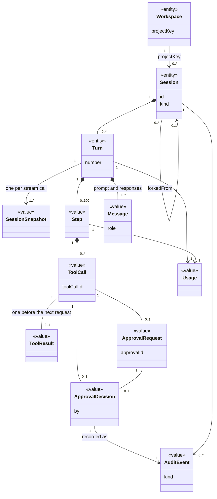

| Multiplicity | Why |
|---|---|
| Turn to Step `0..100` | The step cap counts across approval resumptions and has a hard ceiling of 100 (FR-AGT-02). A turn that fails before its first response has no step |
| Turn to SessionSnapshot `1..*` | One snapshot per stream call: the first, then one after each approval round trip (SD-D5) |
| ToolCall to ToolResult `0..1` | Exactly one result exists before the next model request: real output, a tool error, `execution-denied`, or a synthetic "interrupted" result (FR-AGT-04, INV-12). Zero only while the call is open |
| ToolCall to ApprovalDecision `0..1` | A Safe call that simply runs has no decision record. Every other call has exactly one (deliverable 04, section 5.9) |
| ApprovalRequest to ApprovalDecision `0..1` | Zero when the process dies with the dialog open; resume then closes the call as interrupted (HLD-D23) |
| Session to Session `forkedFrom` | A resume of a session held by another process, or of an older file format, forks a copy (FR-HIS-11, DS-D5) |

### 4.2 UML-1b Settings, policy and context

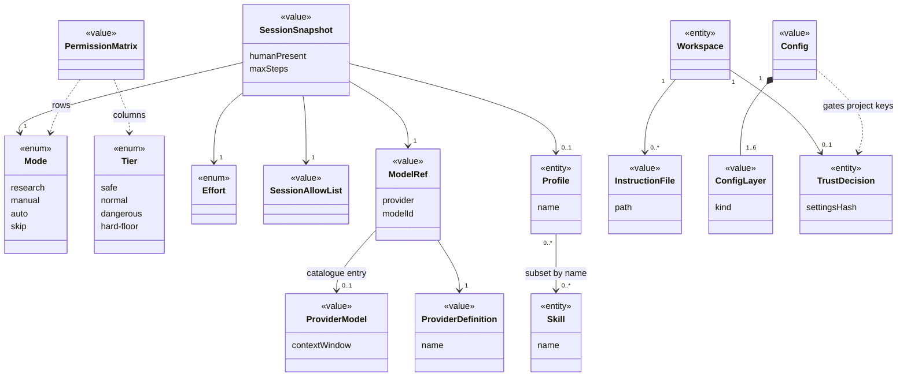

| Multiplicity | Why |
|---|---|
| Config to ConfigLayer `1..6` | Flags, `ANTAI_*` variables, active profile defaults, project, global, built-in defaults (FR-CFG-01). Built-in defaults always exist |
| ModelRef to ProviderModel `0..1` | Unknown models have no catalogue entry; the 32,000-token default applies (FR-AGT-05) |
| SessionSnapshot to Profile `0..1` | One profile at most (FR-PRF-04) |
| Profile to Skill `0..*` | A profile's `skills` subset names skills; slash invocation ignores the subset (FR-SKL-04) |
| Workspace to TrustDecision `0..1` | Stored for both answers, keyed by `projectKey` (DS-D20) |

### 4.3 UML-1c MCP, credentials and secrets

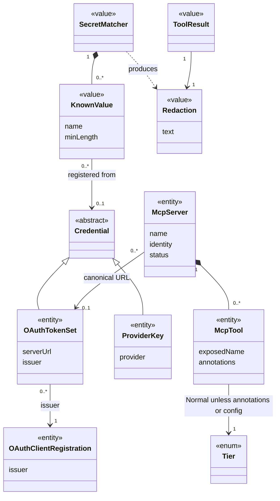

| Multiplicity | Why |
|---|---|
| McpServer to OAuthTokenSet `0..1`, many servers to one set | Token sets are keyed by canonical server URL, so two config names for one URL share a set; names never key tokens (DS-D16) |
| OAuthTokenSet to OAuthClientRegistration `1` | Client registrations are keyed by issuer (MCP 2026-07-28, research F 1.3) |
| KnownValue to Credential `0..1` | Known values also come from workspace `.env*` files, secret-named environment variables and substituted `${VAR}` values, which are not credentials antai stores (FR-SEC-03) |
| ToolResult to Redaction `1` | Every tool result passes `RED` exactly once (INV-5). History, audit, logs and streamed text carry a `Redaction` the same way |

### 4.4 Entity and value dictionary

"Owner" is the deliverable 01 component that creates and changes the object. "Stored in" uses deliverable 04's file IDs; "memory only" means nothing is written.

| Name (code type) | Kind | Owner | Lifetime | Stored in |
|---|---|---|---|---|
| `Workspace` | entity | `BOOT` creates; `PLAT` computes `projectKey` | Process | Logical key of F05, F10 header, F12 (DS-2.1) |
| `Session` (`SessionState`) | entity | `SC`; file by `HS` | Start to `/exit`, `/clear`, `/resume` or process end | F10 header and records, F11 lock, F12 entry |
| `SessionSnapshot` | value | `SC` | One stream call | Memory only; F10 header holds the starting values and `setting` events the changes |
| `Turn` (`TurnState`) | entity | `SC` | One prompt | No record of its own; records carry `turn` (F10) |
| `Step` (SDK `StepResult`) | value | SDK; kept by `SC` through `onStepEnd` | One model call | Its response messages become F10 `message` records |
| `Message` (`StoredMessage`) | value | `SC`; written by `HS` | Session | F10 `message` |
| `ToolCall` (SDK `TypedToolCall`) | value | SDK | Until its result | Inside an assistant message (F10) |
| `ToolResult` (`ToolOutput`) | value | `TREG` wrapper after `RED` | Until stored | Inside a tool message (F10) |
| `ApprovalRequest` | value | SDK part, queued in `TurnState` | Until answered or the turn ends | Inside an assistant message (F10) |
| `ApprovalDecision` | value | `APR` (user); `SC` (automatic, SD-D6) | Until recorded | `approval` event in F14 and F10; `tool-approval-response` in F10 |
| `AuditEvent` | value | Producers `SC`, `APR`, `TREG`, `BT`, `MCPM`, `TRUST`, `CRED`, `RET`; writer `AUD` | Until written | F14 always, F10 mirror (deliverable 04, sections 5.9 and 5.13) |
| `Mode`, `Tier`, `Effort` | enum | `shared/domain` | Code | Fields of F10 and F14 records |
| `PermissionMatrix` | value | `POL` | Code constant | Not stored |
| `SessionAllowList` | value | `SC` | Process | Memory only (SD-D7) |
| `Profile` | entity | `PRF` | Process | F08, W5 (read only) |
| `Skill` | entity | `SKR` | Process; body cached after first load | F09, W5, package (read only) |
| `InstructionFile` | value | `INS` | Process | F07, W1 (read only); the assembled instructions are never stored (A-C6) |
| `Config` (`ResolvedConfig`, `ConfigLayer`) | value | `CFG` | Process, read at start | F02, F03, W2, W3, W4 (read only) |
| `TrustDecision` | entity | `TRUST` | Kept until changed | F05 |
| `ModelRef` | value | `REG` | Session | F10 header `model`, `setting` events |
| `ProviderModel` | value | `CAT` | Code data | Package data file (DLV-PLN-03) |
| `ProviderDefinition` | value | `REG` from `CFG` | Process | F02, W2 (trusted only) |
| `Usage` | value | `USG` | Step, turn, session | F10 `usage` (antai field names, DS-D10) |
| `McpServer` | entity | `MCPM` | Process | Config F03, W3, W4; baseline F06 |
| `McpTool` | entity | `MCPM`; exposed by `MA` | While connected | F06 tool baseline |
| `OAuthTokenSet` | entity | `MOA` through `CRED` | Until logout, remove or invalid grant | F04 `mcpOAuth` |
| `OAuthClientRegistration` | entity | `MOA` through `CRED` | Until the last server of that issuer is removed | F04 `oauthClients` |
| `ProviderKey` | entity | `CRED` | Until `antai logout` | F04 `providers`; a key from an environment variable stays in memory only |
| `SecretMatcher`, `KnownValue` | value | `RED` | Process; replaced when values are added | Memory only (deliverable 04, section 7.2) |
| `Redaction` (`RedactedText`) | value | `RED` | With the text | Wherever the text is stored |
| `LoginAttempt` (verifier, `state`, issuer) | value | `MOA` | One login | Memory only (DS-D17) |
| `ChildTree` | entity | `PSV` | Child process lifetime | Memory only |

---

## 5. Class diagrams per area

Each diagram shows one area's classes, their key state and operations, and the dependencies that leave the area as plain class names. Tables under each diagram give what the diagram cannot: who calls, the effect, and the BRD requirement.

### 5.1 UML-2.1a Session controller and turn state (`src/session/`)

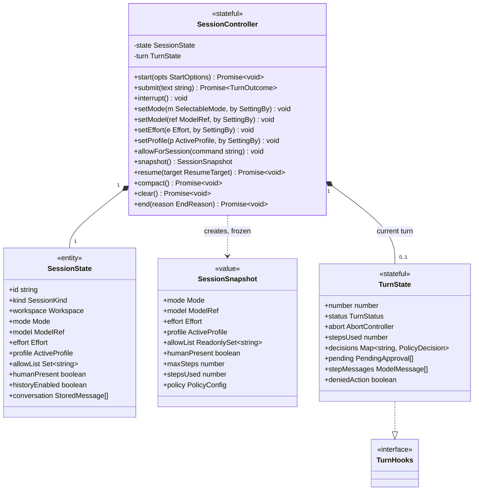

`SessionController` (SC) is the only writer of `SessionState` (deliverable 01, rule 4). Every other component receives a frozen `SessionSnapshot` or one of its narrow views.

| Operation | Called by | Effect | BRD |
|---|---|---|---|
| `start` | `BOOT` | Builds `SessionState` from config, flags, profile and resume data; mode per UML-4b; emits `session-started` and `status` | FR-CLI-01, FR-HIS-04 |
| `submit` | `BUS` on `UserCommand` `submit` | Refused while a turn runs (HLD-D18). `SLASH` routes slash input; otherwise runs a turn (UML-5) and returns its outcome | FR-AGT-01, FR-SLC-02 |
| `interrupt` | `BUS` on Esc or the first Ctrl+C | Aborts `TurnState.abort`; partial turn saved (UML-5) | FR-AGT-04 |
| `setMode`, `setModel`, `setEffort`, `setProfile` | `SLASH`, `start`, `resume` | Only while idle. Writes the `setting` event (audit first), emits `status`; applies from the next snapshot. `setMode` accepts `SelectableMode` only, so `skip` cannot be entered (FR-MODE-02) | FR-MODE-01..03, FR-MOD-05, 06, FR-PRF-03 |
| `allowForSession` | `APR` only, after "Yes, don't ask again this session" | Adds the normalised command text to `allowList` | D27, SD-D7 |
| `snapshot` | `SC` itself before each stream call | Copies state into a frozen value with `stepsUsed` of the current turn | HLD-D2, SD-D5 |
| `resume`, `clear`, `end` | `BOOT`, `SLASH`, `LIFE` | Session lifecycle (UML-4a); `HS` writes the `end` event and releases the lock | FR-HIS-04, 06, 11 |
| `compact` | `SLASH` (`/compact`) | `PR.compact`, then a `compaction` message and event | FR-AGT-06 |

`SessionSnapshot` and the views lower layers declare (all fields `readonly`):

| View | Declared in | Fields |
|---|---|---|
| `PolicySnapshot` | `src/safety/policy/` | `mode`, `humanPresent`, `allowList`, workspace roots, `policy` (effective rules, tool and MCP lists) |
| `ToolSetSpec` | `src/tools/registry/` | `mode`, `policy.tools` (`tools.disabled`, `mcp.tools.deny`) |
| `TurnSpec` | `src/agent/` | `PolicySnapshot` and `ToolSetSpec` fields, plus `model`, `effort`, `profile`, `maxSteps`, `stepsUsed` |

`TurnState` implements `TurnHooks` (UML-2.2a): `onStepEnd` keeps each step's `response.messages` for writing when the stream call ends or at an abort (SD-D4), and `recordDecision` keeps `POL`'s full decision by `toolCallId` for `APR`, the audit record and the denied card (SD-D6). `deniedAction` decides exit code 5 in `run` (FR-UI-06).

### 5.2 UML-2.1b Slash commands, approvals and usage

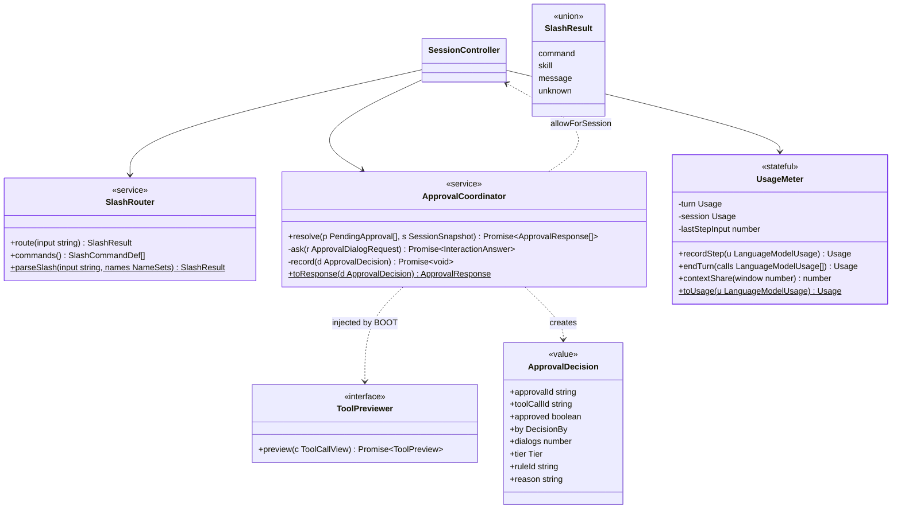

| Class | State | Key behaviour | BRD |
|---|---|---|---|
| `SlashRouter` (SLASH) | None | `parseSlash` is pure: built-in command (wins over a skill of the same name), `/<skill-name> [task]`, `//` escape, path-like input (second `/` in the first word) as a message, unknown with a suggestion. `route` then runs built-ins through `SC` setters, `SKR`, `PRF`, `HS`, `MCPM`, `USG`, `CFG` | BRD 5.11, FR-SLC-01, 02, FR-SKL-04 |
| `ApprovalCoordinator` (APR) | None between calls | For each pending request: one `ApprovalDialogRequest` per entry in `PolicyDecision.dialogs`, in order, through `BUS`; stops at the first No. Writes the decision to `AUD` then `HS` with one `seq` (DS-D14), then returns one `tool-approval-response` per request. The only creator of user approvals (INV-4) | FR-SH-03, 04, 10, FR-UI-04, D27, A-S7 |
| `UsageMeter` (USG) | Turn and session totals, last step's input tokens, last rate-limit snapshot | `toUsage` maps SDK fields to antai names: `inputTokens`, `outputTokens`, `outputTokenDetails.reasoningTokens`, `inputTokenDetails.cacheReadTokens`, `inputTokenDetails.cacheWriteTokens`, `totalTokens`. `recordStep` runs on each `finish-step`; `endTurn` sums the `result.usage` of each stream call of the turn (the SDK already sums steps within a call). `contextShare` is last-step input over the context window | FR-UI-02, BRD 5.11 `/usage`, A-C5 |

`APR` needs a diff or file preview for write dialogs (FR-UI-04). `ToolRegistry` implements `ToolPreviewer`, and `BOOT` injects it, so `src/session/` imports only the interface type and never `src/tools/` at run time (deliverable 01, section 8.2; UML-D9).

### 5.3 UML-2.2a Turn agent factory (`src/agent/`)

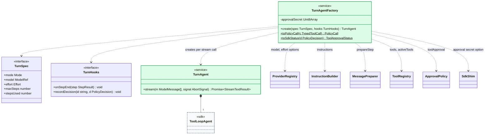

What `create` passes to the SDK. Every option name below is in the `ToolLoopAgentSettings` typings of `ai@7.0.137`; `maxRetries` comes in through `RequestOptions`.

```ts
// AG: a fresh ToolLoopAgent for each stream call of a turn (HLD-D2, SD-D5)
new ToolLoopAgent({
  model: registry.languageModel(spec.model),            // already wrapped by RetryMiddleware
  instructions: instructionBuilder.build(spec, sources), // FR-AGT-03 order; rebuilt, never stored (A-C6)
  tools: toolSet.tools,                                  // built once per turn (UML-D19)
  activeTools: toolSet.activeTools,                      // research: no write_file, edit_file (FR-MODE-01)
  stopWhen: isStepCount(spec.maxSteps - spec.stepsUsed), // cap across resumptions (FR-AGT-02)
  ...registry.effortOptions(spec.model, spec.effort),    // reasoning, or providerOptions (FR-MOD-06)
  prepareStep: (input) => preparer.prepareStep(input, spec),
  toolApproval: async ({ toolCall }) => {
    const d = await policy.decide(toPolicyCall(toolCall), spec);
    hooks.recordDecision(toolCall.toolCallId, d);        // SD-D6
    return toSdkStatus(d);
  },
  onStepEnd: hooks.onStepEnd,                            // SD-D4
  maxRetries: 0,                                         // A-C7
  ...sdk.approvalSecretOption(approvalSecret),           // experimental_toolApprovalSecret, only via SDK (A-S8)
});
```

| Element | Pure | Notes | BRD |
|---|---|---|---|
| `approvalSecret` | — | Random bytes made once per process (32, a design choice; the SDK signs with HMAC-SHA256); never stored or logged, so a replayed or injected approval fails the signature check | A-S8, NFR-SEC-02 |
| `toPolicyCall` | Yes | `TypedToolCall` to antai's `PolicyCall` (`toolCallId`, `toolName`, `input`, `annotations` from `toolMetadata`), so `src/safety/` needs no SDK type | FR-MCP-06 |
| `toSdkStatus` | Yes | `run` at Safe gives `'not-applicable'`; `run` above Safe gives `{ type: 'approved', reason }`; `deny` gives `{ type: 'denied', reason }`; `ask` gives `'user-approval'` | FR-SH-02, BRD 8.3 |
| `TurnAgent.stream` | No | `await agent.stream({ messages, abortSignal })`; the SDK returns a promise (A-C3) | FR-AGT-01 |

### 5.4 UML-2.2b Stream mapping, instructions and message preparation

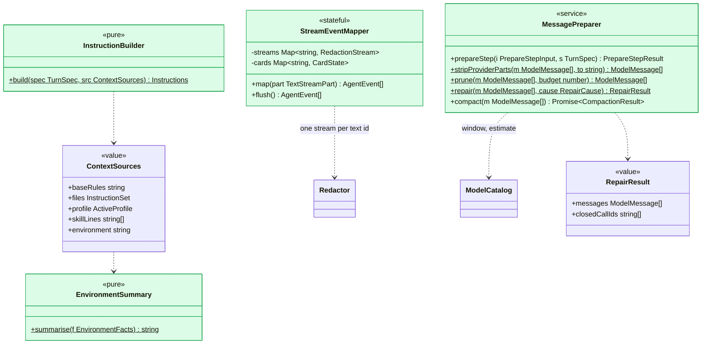

| Class | State | Key behaviour | BRD |
|---|---|---|---|
| `StreamEventMapper` (EVM) | One `RedactionStream` per open text or reasoning `id`; one card state per `toolCallId`. Created per turn | The only code that switches on SDK part names (section 6.4). The switch is exhaustive, so a new part type fails compilation (UML-D16) | NFR-MNT-01, NFR-SEC-05, HLD-D19 |
| `InstructionBuilder` (IB) | None | Pure: base rules, global file, profile, root file, subfolder files, skill catalogue, environment summary; stable parts first for provider prompt caching (deliverable 08) | FR-AGT-03, FR-SKL-03 |
| `EnvironmentSummary` (ENV) | None | Pure over `EnvironmentFacts` (OS, bash path and version, Git Bash path forms, cwd, workspace root, date passed in) | FR-SH-06, 13 |
| `MessagePreparer` (PR) | None | `prepareStep` estimates tokens through `CAT`, strips provider-specific parts after a provider switch, prunes at `context.pruneAt` without splitting a call from its result, and throws `ContextOverflowError` when still over (SD-D10). `repair` gives every open call a synthetic "interrupted" result. `compact` makes one model call | FR-AGT-04..06, FR-MOD-05, FR-HIS-02 |

### 5.5 UML-2.3 Providers (`src/providers/`)

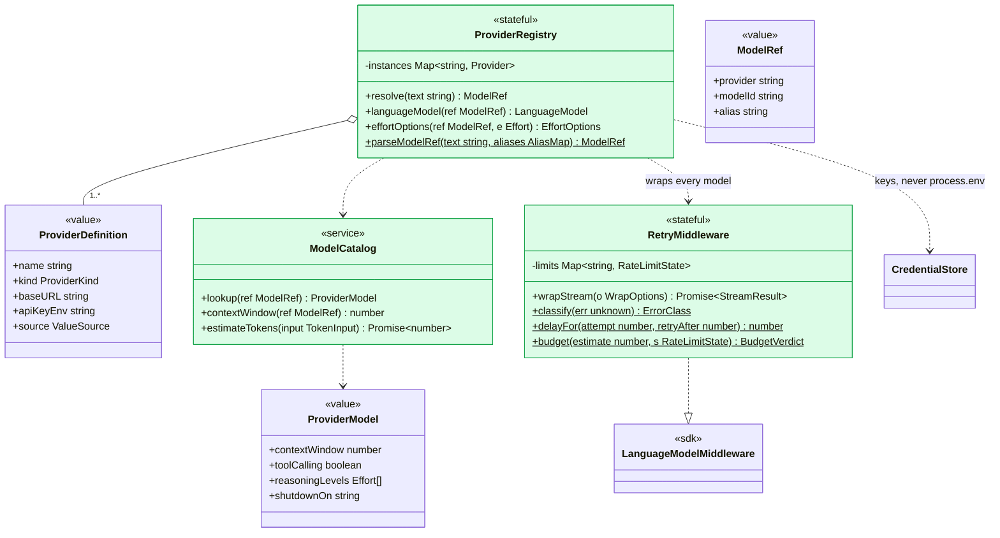

| Class | State | Key behaviour | BRD |
|---|---|---|---|
| `ProviderRegistry` (REG) | Lazily created provider instances, one per provider name | `parseModelRef` is pure: provider is the text before the first colon, the rest the model ID (`ollama:qwen3:14b`); aliases resolved first. `languageModel` creates the provider with the key passed directly (A-S5) and wraps the model with `RetryMiddleware` through `wrapLanguageModel`. A `baseURL` is honoured only from global config, flags, environment or a trusted project; `ProviderDefinition.source` records where it came from | FR-MOD-01..08, FR-CFG-04 |
| `ModelCatalog` (CAT) | Code data; lazily loaded tokenizer | `contextWindow`: built-in table, then `models.<id>.contextWindow`, then 32,000. `estimateTokens` uses `gpt-tokenizer` for gpt-oss, else characters ÷ 4. `lookup(ref).toolCalling` false makes `/model` refuse the model; an unknown model is allowed | FR-AGT-05, FR-MOD-02, 05 |
| `RetryMiddleware` (RTY) | Last rate-limit snapshot per provider (remaining requests and tokens, reset times) | `classify` is pure and returns transient, per-minute limit, daily quota, invalid key, model not found, request too large, no tool support, or network. Retries only before the first output part; never a daily quota; honours `retry-after`. `budget` checks estimated input plus `maxOutputTokens` against the remaining per-minute tokens | FR-ERR-01, 02, A-C7, CR-01 |

### 5.6 UML-2.4a Approval policy (`src/safety/policy/`)

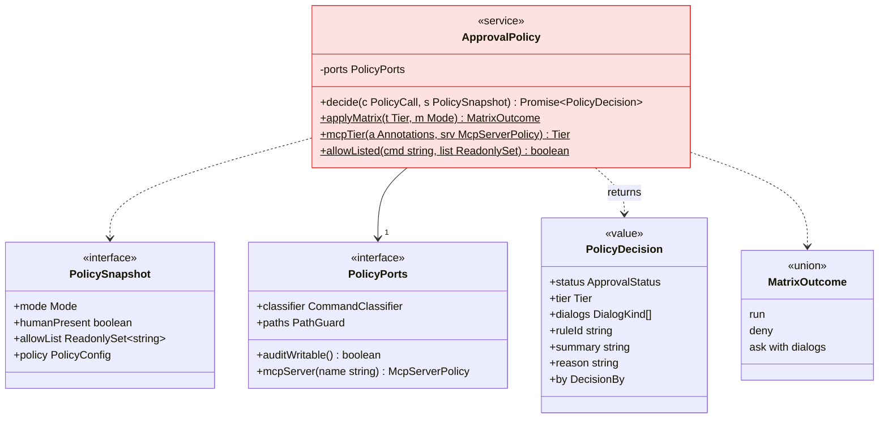

`PermissionMatrix` is a constant in this module; `applyMatrix` reads it (BRD 5.5, FR-SH-02). Dialog lists are ordered.

| Mode \ Tier | `safe` | `normal` | `dangerous` | `hard-floor` |
|---|---|---|---|---|
| `research` | run | deny | deny | deny |
| `manual` | run | ask `[confirm]` | ask `[confirm, danger]` | deny |
| `auto` | run | run | ask `[danger]` | deny |
| `skip` | run | run | run | deny |

`decide` in order. Each step can end the decision; the first that does wins.

1. **Classify.** `shell`: `CommandClassifier.classify`. File tools: `PathGuard.check` (reads Safe inside the workspace, skill folders and `workspace.extraReadPaths`; writes and edits Normal, Dangerous on protected paths; secret paths, and anything outside the allowed roots, denied). MCP tools: `mcpTier` (Normal; `destructiveHint` makes Dangerous; `readOnlyHint` Safe only with `trustReadOnlyHints` and an unchanged annotations hash; `mcp.tools.allow` Safe) and `PathGuard.scanArgs` (a secret path in any string argument denies). `load_skill` is Safe.
2. **Hard floor, secret path, `shell.block`, detaching command:** denied, `by: policy` (FR-SH-01, 05, 07, FR-SEC-01).
3. **Audit writer failed** and the call would need an audit record: denied, `by: policy` (pending BRD review, deliverable 04 P7).
4. **Matrix.** `deny` gives denied `by: policy` (research and hard floor). `run` above Safe gives approved `by: mode`.
5. **Session allow-list.** `ask` for a Normal `shell` call whose normalised text is in `allowList` gives approved `by: session-allow`. The list is consulted only where the matrix asks, so it never overrides `research` (D27, UML-D18).
6. **No human.** `ask` with `humanPresent` false gives denied `by: no-human`, reason "approval required in a non-interactive run" (D19, FR-CLI-02).
7. Otherwise `user-approval` with the matrix's dialog list, the rule ID and the classifier's summary (never model text, FR-SH-03, 04).

`decide` has no side effects and keeps no state, but it is read-only rather than pure: `PathGuard` resolves symlinks, and `auditWritable` and `mcpServer` are live reads. Tests inject fake ports, so the decision table is still table-tested (UML-D11, Q06-7).

### 5.7 UML-2.4b Classifier, path guard and rules (`src/safety/`, `src/rules/`)

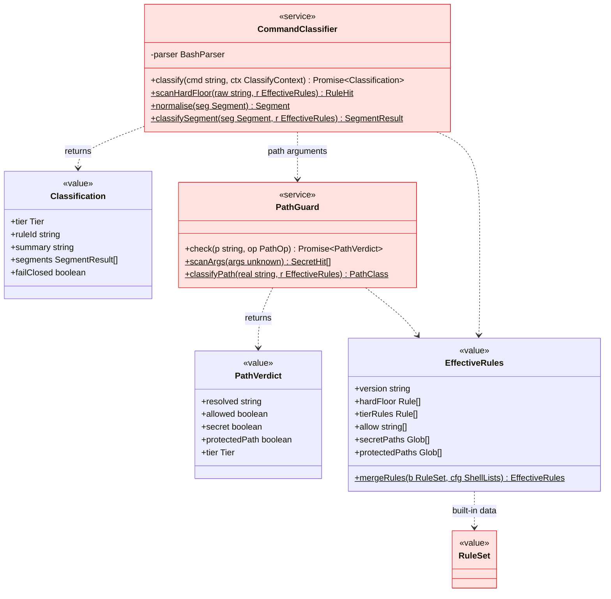

| Class | State | Key behaviour | BRD |
|---|---|---|---|
| `CommandClassifier` (CLS) | The bash parser, loaded lazily on the first `shell` call and never changed after | Order: `scanHardFloor` on the raw text; parse (failure or more than 10,000 characters gives Dangerous, `failClosed`); split into segments; `normalise` strips wrappers and resolves program names; `classifySegment` (first match: `shell.block`, nested shells and inline interpreters, Dangerous rules, Safe rules plus `allow`, else Normal); lift rules; `maxTier` over segments. A `shell.block` entry or a detaching command (`&`, `nohup`, `setsid`, `disown`) gives tier `hard-floor` with its own rule ID, because both never run in any mode. Path arguments outside the workspace lift to Normal through `PathGuard` | FR-SH-01, 05, 07, 12, FR-SEC-02, A-S1..S4 |
| `PathGuard` (PG) | None | `check` normalises `C:\` and `/c/` forms (`PLAT`), resolves symlinks (deepest existing parent for new files), checks allowed roots, then secret and protected lists. The pure core is `classifyPath`. Called again by `BT` at execution time (A-S10) | FR-TOOL-09, 11, FR-SEC-01, FR-SH-13, FR-MCP-07 |
| `EffectiveRules` | — | `mergeRules` is pure and never loosens: user `dangerous` and `block` lists are unions; `allow` can move an unknown (Normal) command to Safe, never a built-in Dangerous rule or the hard floor (INV-7); `secrets.paths` and `secrets.patterns` only add | FR-SH-05, FR-CFG-01, 04 |
| `RuleSet` (RULES) | — | Versioned data only: hard floor, tier rules, nested shells and interpreters, secret paths, protected paths, secret formats and name patterns, dev-server timeouts (DLV-SW-07) | DLV-SW-07, HLD-D28 |

### 5.8 UML-2.5a Tools (`src/tools/`)

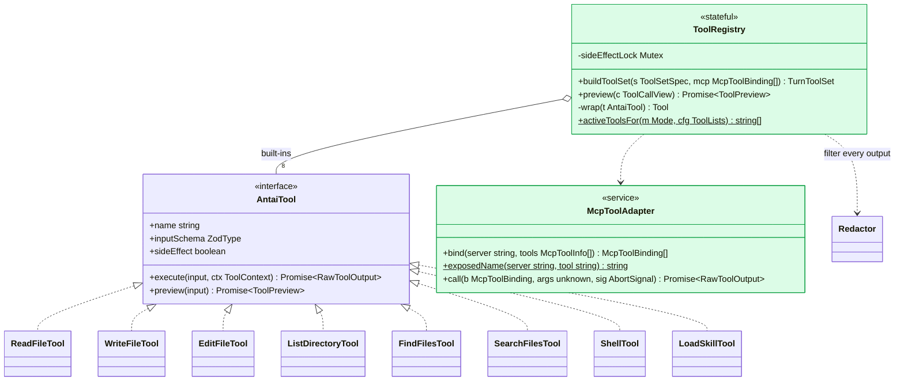

| Class | State | Key behaviour | BRD |
|---|---|---|---|
| `ToolRegistry` (TREG) | The side-effect lock | `buildToolSet` once per turn: built-ins (minus `shell` when Git Bash is missing) plus bound MCP tools, minus `tools.disabled` and `mcp.tools.deny`; `activeToolsFor` is pure and hides `write_file` and `edit_file` in `research`. `wrap` gives every tool, built-in or MCP, the same `execute`: take the lock if `sideEffect`, wait for the `.env` scan (`Redactor.ready`), run, then `Redactor.filter` (redact, then cap), so no tool returns unfiltered output (HLD-D5). Implements `ToolPreviewer` | FR-MODE-01, FR-TOOL-10, FR-MCP-05, 07, HLD-D17 |
| Built-in tools (BT) | None | One class per tool, `sideEffect` true for `write_file`, `edit_file`, `shell`. File tools call `PathGuard.check` again in `execute`; writes go through `SafeFs` with `O_NOFOLLOW`. `preview` gives a diff, or the first 200 lines of a new file | FR-TOOL-01..08, FR-UI-04, A-S10 |
| `McpToolAdapter` (MA) | None | `exposedName` is pure: `mcp__<server>__<tool>`, letters, digits, `_` and `-`, at most 64 characters, hash suffix when cut. `call` forwards to `McpManager.callTool` with the abort signal; MCP calls count as side-effecting | FR-MCP-05, 06 |

`ToolContext` carries `toolCallId`, the abort signal, the workspace roots and the per-tool output cap. `RawToolOutput` holds the unfiltered text (or chunks), `isError` and metadata (exit code, signal, duration, timed out, interrupted); it never leaves `TREG`'s wrapper.

### 5.9 UML-2.5b Output filter (`src/redact/`)

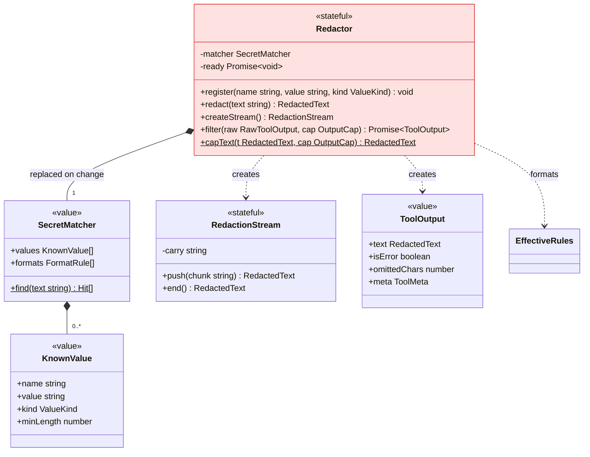

| Element | Behaviour | BRD |
|---|---|---|
| `Redactor` (RED) | Holds the current `SecretMatcher`; `register` builds a new matcher (longest value first) and swaps it in, so a matcher in use never changes. `ready` resolves when the background `.env` scan has finished; `filter` waits for it | FR-SEC-03, 04, HLD-D21 |
| `KnownValue.minLength` | Secret-named variables and stored credentials: 4; `${VAR}` values: 4 (design choice: they are credentials by intent); other `.env` values: 8; shorter values never masked | FR-SEC-04, FR-MCP-03 |
| `RedactionStream` | Keeps a carry-over tail at least as long as the longest known value, so a secret split across chunks is still found | FR-SH-08, A-S6 |
| `filter` | Redacts the whole stream first, then caps (head and tail, middle replaced by an omission marker). Shell output cap 30,000 characters; `read_file` 2,000 lines or 50 KB | FR-SH-08, FR-TOOL-01, A-S6 |
| `RedactedText` | Branded string; only `src/redact/` creates it. The records `HS`, `AUD` and `DBG` write, the text fields of `AgentEvent`s and `ToolOutput.text` hold only this type, so a missed redaction is a compile error. A lint rule forbids `as RedactedText` elsewhere | NFR-SEC-05, deliverable 04 section 7.3 |

### 5.10 UML-2.6a Processes, shell and search (`src/infra/shell/`, `process/`, `search/`)

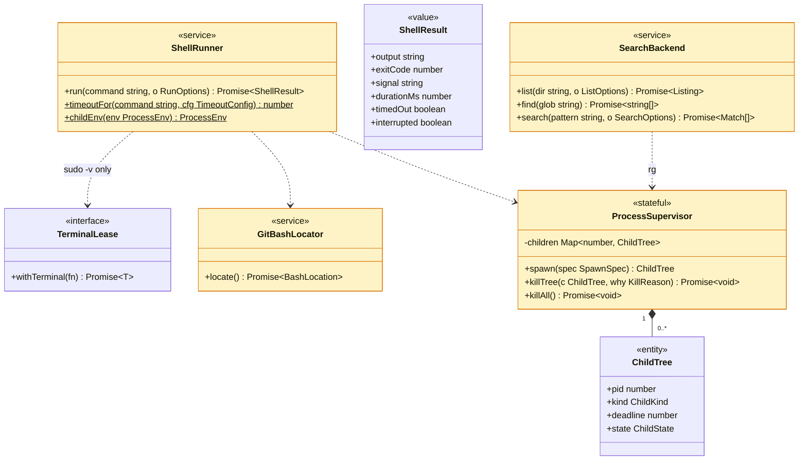

| Class | State | Key behaviour | BRD |
|---|---|---|---|
| `ShellRunner` (SR) | None | `run`: `bash -c` in the workspace through `PSV`, ordered stdout and stderr through `onChunk`, the abort signal and the timeout. `timeoutFor` is pure: config pattern, dev-server rule (30 s), else 120 s. `childEnv` is pure: user environment minus antai's internal variables, plus `PAGER=cat`, `GIT_PAGER=cat`, `GIT_TERMINAL_PROMPT=0`. For `sudo` it first runs `sudo -v` inside `TerminalLease.withTerminal`; refuses `sudo` on Windows (SD-D15) | FR-SH-06..09, FR-TOOL-07 |
| `GitBashLocator` (GBL) | None | `ANTAI_GIT_BASH_PATH`, `shell.gitBashPath`, standard folders, `git` on `PATH`; skips the WSL launcher; result `BashLocation` or "shell off" | FR-SH-11 |
| `ProcessSupervisor` (PSV) | Registry of live `ChildTree`s | The only spawner. `ChildKind`: command, sudo-v, mcp-stdio, rg, opener, taskkill, icacls. `ChildState`: running, exited, timed out, killed. `killTree`: process group on POSIX, `taskkill /T /F` on Windows; `killAll` at shutdown leaves the registry empty (INV-15) | FR-SH-07, FR-MCP-10, NFR-REL-03 |
| `SearchBackend` (SRCH) | None | `rg` from `PATH` (never from the workspace) or the built-in walker; `.gitignore` respected; secret files always excluded | FR-TOOL-04..06 |

### 5.11 UML-2.6b MCP manager (`src/infra/mcp/`)

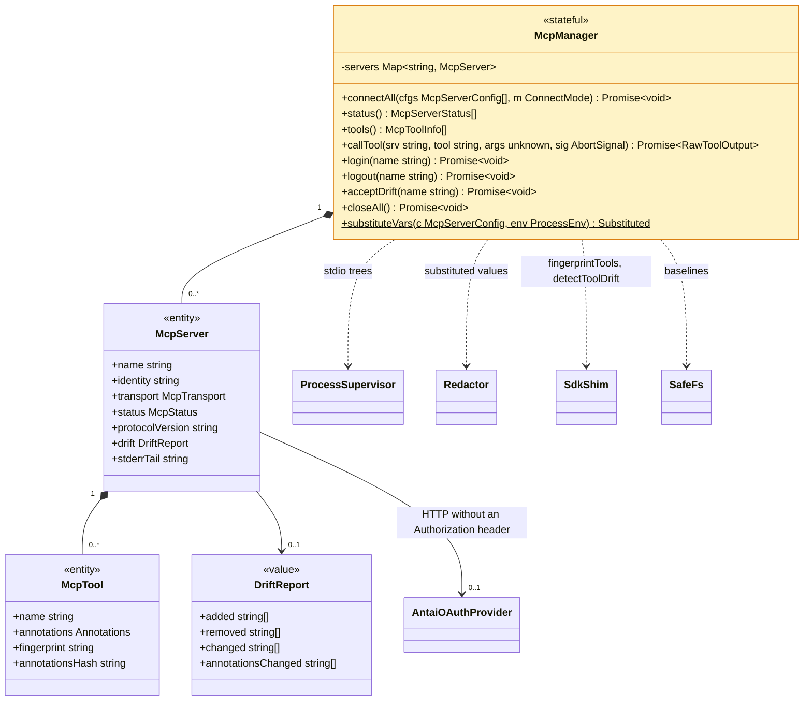

| Element | Behaviour | BRD |
|---|---|---|
| `connectAll` | Background connect of global servers, and project servers only when trusted (`CFG` filters). `ConnectMode` `background` never opens a browser; `run` waits a bounded time (Q01-9) and skips servers that need login | FR-MCP-01, 02, 04, 11, FR-CFG-04 |
| `substituteVars` | Pure: replaces `${VAR}` in `env`, `args` and `headers`; returns the values (for `RED.register`) and missing names (the server fails, naming the variable) | FR-MCP-03 |
| `McpServer.identity` | `http:<canonical URL>` or `stdio:sha256(command, args)`, as the baseline key in F06 | FR-MCP-09 |
| Drift | Fingerprints from `fingerprintTools` plus an annotations hash compared with the baseline; `DriftReport` kept until `acceptDrift`; tools stay available (D29); a tool whose annotations changed loses the `trustReadOnlyHints` Safe treatment until accepted (Q01-16 default) | FR-MCP-09, D29, A-S11 |
| `callTool` | Forwards with the abort signal; a 403 `insufficient_scope` asks for confirmation before a new login (SD-D17) | FR-MCP-07, 11 |
| `status` | One `McpStatus` per server (UML-8), shown in `/mcp` and `antai mcp list`, sent as `mcp-status` events | FR-MCP-04 |

### 5.12 UML-2.6c MCP OAuth (`src/infra/mcp/oauth/`)

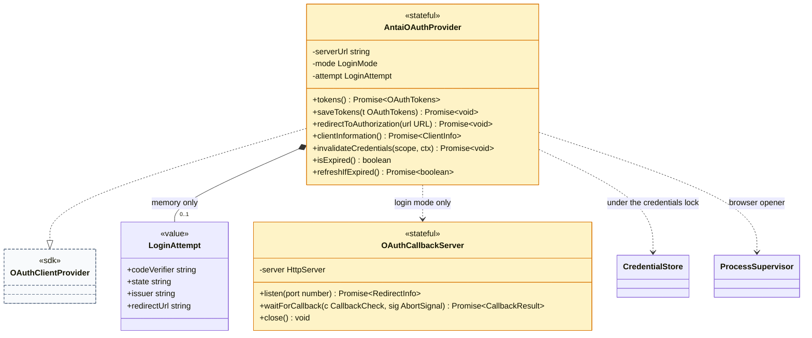

`AntaiOAuthProvider` (MOA) implements every `OAuthClientProvider` member of `@ai-sdk/mcp@2.0.73` that antai needs (research F 1.1). The diagram shows the main ones; the full set:

| Member | What `MOA` does |
|---|---|
| `tokens()`, `saveTokens(t)` | Read and write the token set for `serverUrl` through `CRED` (lock, re-read, merge, atomic `0600` write); `saveTokens` also records `obtainedAt` and `expiresAt` and registers the values with `RED` |
| `redirectToAuthorization(url)` | `login` mode: open the browser through `PSV` (or print the URL) and wait on `OCB`. `background` mode: open nothing; the server becomes "needs login" (deliverable 01, section 9.6) |
| `saveCodeVerifier(v)`, `codeVerifier()`, `state()`, `saveState(s)`, `storedState()` | Kept in `LoginAttempt`, memory only (DS-D17) |
| `redirectUrl`, `clientMetadata` (getters) | `http://localhost:<port>/callback` from `OCB.listen`, which therefore runs before `createMCPClient`; public native client metadata |
| `clientInformation()`, `saveClientInformation(i)`, `isClientInformationDynamicallyRegistered()` | `oauth.clientId` from config first, else the registration stored for the issuer |
| `saveAuthorizationServerInformation(i)`, `authorizationServerInformation()`, `validateAuthorizationServerURL(s, a)` | Issuer pin stored with the token set; refuse when authorization-server metadata is missing (Q03-8) |
| `invalidateCredentials(scope, ctx)` | Compare-and-delete: deletes the stored set only if it still equals `ctx.tokens` |
| `isExpired()`, `refreshIfExpired()` (antai's own) | Proactive refresh at start, under the credentials lock with a re-read (research F verdict 3) |

`OAuthCallbackServer` (OCB) binds `127.0.0.1` and `::1` on port 0 or `oauth.callbackPort`, accepts one request on `/callback`, checks `state` and the RFC 9207 `iss` rule, and closes on success, Esc or after 5 minutes (HLD-D26, FR-MCP-11).

### 5.13 UML-2.6d Credentials and storage (`src/infra/credentials/`, `history/`, `audit/`, `retention/`, `log/`, `fs/`)

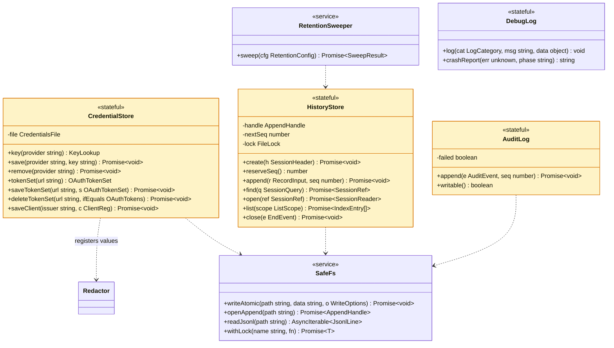

Record and file shapes are deliverable 04's (sections 5.5 to 5.15); the classes add only the in-memory side.

| Class | State | Key behaviour | BRD |
|---|---|---|---|
| `CredentialStore` (CRED) | In-memory copy of F04 | `key(provider)`: environment variable first, then the file (FR-MOD-04); values go only to their consumer, never into `process.env` (A-S5). Every write: lock, re-read, merge, atomic `0600` write. Registers every value with `RED` | FR-MOD-04, FR-SEC-05, FR-MCP-11 |
| `HistoryStore` (HS) | Append handle, next `seq`, session lock | `create` at the first user message (DS-D3). `reserveSeq` hands out the `seq` before the audit write, so the audit and session records carry the same number (deliverable 04, section 6.6); it returns null when history is off. `append` passes every string field through `RED` and writes a record that holds only `RedactedText`; tolerant reader; index under its lock; `delete` for `/history delete` (refused for a live lock) | FR-HIS-01..12, NFR-REL-01 |
| `AuditLog` (AUD) | `failed` flag | `append` redacts the same way and writes before `HS` (DS-D14); after three failed writes `failed` is set and `writable()` returns false, which `POL` reads through `PolicyPorts` (P7) | FR-HIS-13, FR-SH-10 |
| `SafeFs` (FSX) | None (locks are returned handles) | Atomic replace with Windows retry, JSONL append, tolerant JSONL read, `wx` locks, `0600` and `0700` modes | NFR-REL-01, FR-HIS-08 |
| `RetentionSweeper` (RET), `DebugLog` (DBG) | DBG: open log handle | Background sweep (DS-7); redacted debug lines and crash reports | FR-HIS-09, FR-ERR-03, 04 |

### 5.14 UML-2.7 Context sources (`src/context/`)

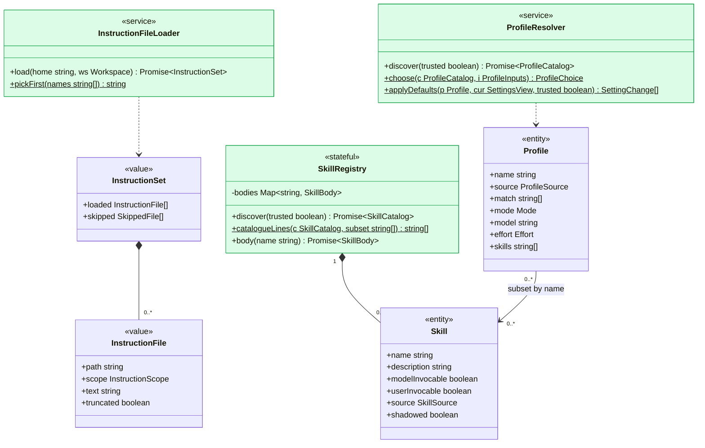

| Class | State | Key behaviour | BRD |
|---|---|---|---|
| `InstructionFileLoader` (INS) | None | Global, root, each folder down to the cwd; `pickFirst` is pure (`AGENT.md`, `AGENTS.md`, `CLAUDE.md`, case-insensitive, all-upper-case name wins); 20 KB cap with a notice | FR-INS-01..04, FR-AGT-03 |
| `ProfileResolver` (PRF) | None | `choose` is pure: flag, then project pin (trusted only), then auto-match; several matches load none. `applyDefaults` is pure: at load it applies `mode`, `model`, `effort`, but a mid-session switch never loosens the mode; project profiles may set only `research` or `manual`, and only when trusted | FR-PRF-01..05, FR-CFG-04, 05 |
| `SkillRegistry` (SKR) | Body cache filled on first `load_skill` or `/<skill-name>` | Precedence project (`.antai`, `.agents`, `.claude`), global, built-in; untrusted project skills never replace a global skill. `catalogueLines` is pure: one line per model-invocable skill in the profile's subset | FR-SKL-01..07, FR-TOOL-08 |

### 5.15 UML-2.8 Presentation boundary (`src/events/`, `src/ui/`)

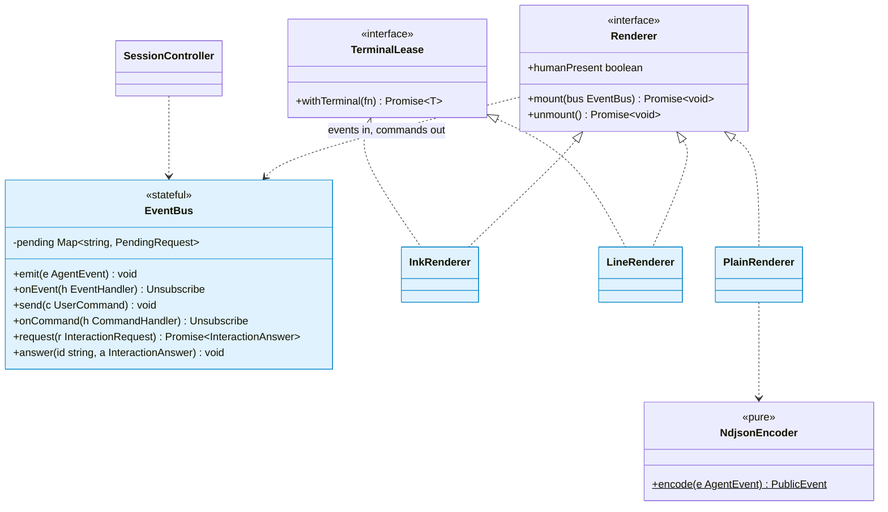

| Class | State | Key behaviour | BRD |
|---|---|---|---|
| `EventBus` (BUS) | Subscribers; open interaction requests by ID | `request` returns a promise answered by the renderer; each request has an ID and a safe default, so the core never blocks on a person (deliverable 01, rule 16). `BOOT` hands `SR` a `TerminalLease` that forwards to the active renderer. No logic beyond routing | NFR-MNT-01 |
| `InkRenderer` (INK) | View state only | Draws events; answers requests with dialogs (type-ahead guard); `withTerminal` through Ink's `suspendTerminal()` | FR-UI-01..05, 07, 08 |
| `LineRenderer` (LINE) | View state only | One line in, plain text out; numbered dialogs; second dialog with No as default; `withTerminal` pauses its line reader | FR-SH-03, 04, HLD-D9 |
| `PlainRenderer` (PLAIN) | Output stream | Answers every request at once with `no-human` and refuses a terminal lease (so `sudo -n` is used, FR-SH-09); `NdjsonEncoder` maps internal events to the seven public NDJSON types, `schemaVersion` in the first | FR-UI-06, FR-CLI-02 |

### 5.16 UML-2.9 Entry, configuration and trust (`src/bootstrap/`, `src/config/`)

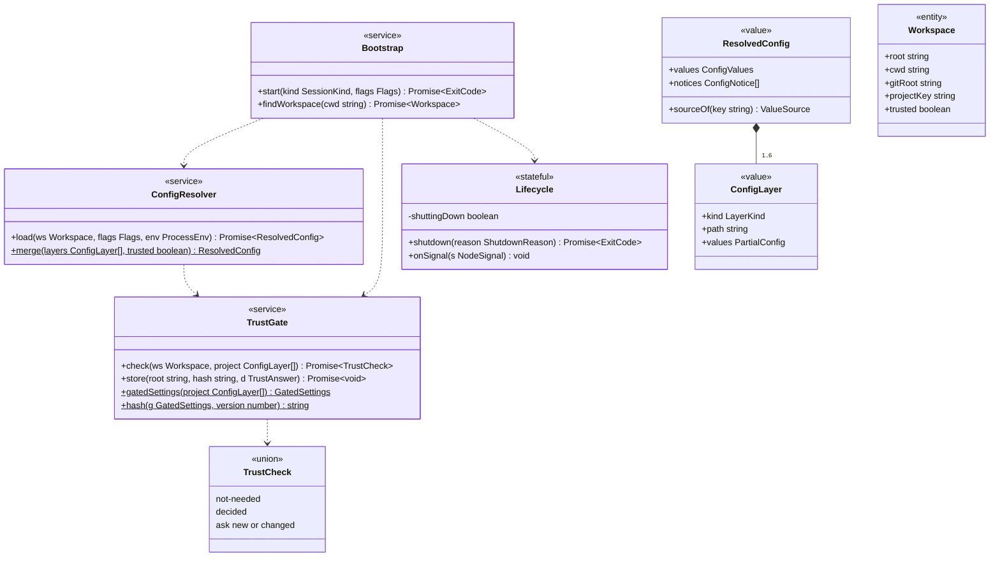

| Class | State | Key behaviour | BRD |
|---|---|---|---|
| `Bootstrap` (BOOT) | None after start | Composition root: the only module that constructs concrete classes and injects ports (`ToolPreviewer`, `PolicyPorts`, `TerminalLease`). `findWorkspace` walks up to `.git` (HLD-D16) | FR-CLI-01, NFR-PERF-01 |
| `Lifecycle` (LIFE) | `shuttingDown` | Shutdown order: abort turn, kill child trees, close MCP, flush history and audit, release locks, restore terminal; a second signal during shutdown exits at once (Q03-7 default) | FR-ERR-04, FR-MCP-10, NFR-REL-03 |
| `ConfigResolver` (CFG) | None | `merge` is pure: FR-CFG-01 order; lists combine; `history.enabled: false` anywhere wins; trust-gated project keys only when trusted; tighten-only keys always; a project `auto` dropped with a notice; an invalid `mode` becomes `research`; `sourceOf` for `antai config` | FR-CFG-01..05 |
| `TrustGate` (TRUST) | None | `gatedSettings` and `hash` are pure (canonical JSON, `hashVersion`); `check` compares with F05 (UML-10); `store` keeps both answers with a redacted snapshot | FR-CFG-04, DS-D20 |

### 5.17 Mutable state summary

Everything not listed here is immutable after construction.

| Class | Mutable state | Changed by | Lifetime |
|---|---|---|---|
| `SessionController` | `SessionState`: mode, model, effort, profile, allow-list, conversation | Its own operations only | Session |
| `TurnState` | Status, steps used, decisions, pending approvals, step messages, abort controller | `SC`; `AG` hooks | Turn |
| `UsageMeter` | Turn and session totals, last step input, rate-limit snapshot | `SC` from stream parts | Session |
| `StreamEventMapper` | Redaction streams, card states | `map`, `flush` | Turn |
| `ProviderRegistry` | Provider instance cache | `languageModel` | Process |
| `RetryMiddleware` | Rate-limit state per provider | Each model call | Process |
| `ToolRegistry` | Side-effect lock | Wrapper | Process |
| `Redactor`, `RedactionStream` | Current matcher; carry-over tail | `register`; `push` | Process; one stream |
| `ProcessSupervisor` | Child registry | `spawn`, exit, `killTree` | Process |
| `McpManager` | Server map, status, tools, drift | Connect, login, logout, accept, close | Process |
| `AntaiOAuthProvider`, `OAuthCallbackServer` | Login attempt, mode; listener | Login flow | Login |
| `CredentialStore` | Copy of F04 | `save`, `remove`, token-set writes | Process |
| `HistoryStore`, `AuditLog`, `DebugLog` | Handles, next `seq`, lock; `failed`; log handle | Appends, close | Session or process |
| `SkillRegistry` | Body cache | `body` | Process |
| `EventBus` | Subscribers, open requests | `request`, `answer` | Process |
| `Lifecycle` | `shuttingDown` | `shutdown` | Process |
| `InkRenderer`, `LineRenderer` | View state | Events and keys | Process |

---

## 6. Event model

`BUS` carries three channels (deliverable 01, section 5.8): `AgentEvent` from core to renderer, `UserCommand` from renderer to core, and interaction requests that the core asks and the renderer answers. All three are discriminated unions on `type` (or `kind` for requests). Class labels below are the `type` values; member names are proposals that deliverable 11 fixes. Every text field is `RedactedText`, so renderers never see raw output.

### 6.1 UML-3a AgentEvent: turn events

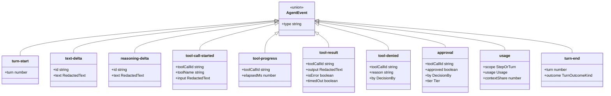

### 6.2 UML-3b AgentEvent: session and system events

```mermaid
classDiagram
    class AgentEvent {
        <<union>>
        +type string
    }
    class SessionStarted["session-started"] {
        +sessionId string
        +kind SessionKind
        +resumed boolean
    }
    class Status["status"] {
        +provider string
        +model string
        +mode Mode
        +effort Effort
        +profile string
        +workspace string
        +baseUrlNotice string
    }
    class RetryScheduled["retry-scheduled"] {
        +provider string
        +attempt number
        +at string
        +reason string
    }
    class Notice["notice"] {
        +level InfoOrWarn
        +code string
        +text RedactedText
    }
    class ErrorEv["error"] {
        +category ErrorCategory
        +code string
        +message RedactedText
        +nextStep string
    }
    class McpStatusEv["mcp-status"] {
        +server string
        +status McpStatus
        +toolCount number
        +drift boolean
    }
    AgentEvent <|-- SessionStarted
    AgentEvent <|-- Status
    AgentEvent <|-- RetryScheduled
    AgentEvent <|-- Notice
    AgentEvent <|-- ErrorEv
    AgentEvent <|-- McpStatusEv
```

| `AgentEvent` | Emitted by | NDJSON type (`PLAIN`) | Why it exists | BRD |
|---|---|---|---|---|
| `session-started` | `SC` | — (`schemaVersion` goes in the first event) | Renderer resets; "Resuming …" | FR-HIS-04 |
| `status` | `SC` | — | Status bar; red banner in `skip`; non-local base URL notice | FR-UI-02, FR-MOD-07, FR-MODE-02 |
| `turn-start` | `SC` | — | Locks input while a turn runs (HLD-D18). New, not in deliverable 01, section 5.8 | FR-UI-05 |
| `text-delta`, `reasoning-delta` | `EVM` | `text` (text only) | Streaming | FR-AGT-01 |
| `tool-call-started` | `EVM` | `tool-call` | Tool card | FR-UI-03 |
| `tool-progress` | `SC` timer | — | Spinner and elapsed time. New, not in deliverable 01 | FR-UI-08 |
| `tool-result` | `EVM` | `tool-result` | Same bytes as the model saw | FR-UI-03, FR-HIS-07 |
| `tool-denied` | `EVM` | — (the `approval` event carries the denial) | Red card with the reason | FR-SH-02 |
| `approval` | `APR` (user), `SC` (automatic) | `approval` | Every audited decision, approved or denied. New, not in deliverable 01 | FR-SH-10, FR-UI-06, AC-20 |
| `usage` | `USG` via `SC` | `usage` (turn scope only) | Status bar share; `/usage` | FR-UI-02 |
| `retry-scheduled` | `RTY` via `SC` | — | Time of the next attempt | FR-ERR-02 |
| `notice` | Any core component | — (stderr in `PLAIN`) | One-line notices (effort ignored, prune, untrusted settings) | FR-MOD-06, NFR-USE-02 |
| `error` | `SC` with `ERR`, `MSG` | `error` | Provider, cause, next step | FR-ERR-01 |
| `turn-end` | `SC` | `done` at the end of `run` | Unlocks input; outcome decides the exit code | FR-UI-06 |
| `mcp-status` | `MCPM` | — | `/mcp`, drift warning | FR-MCP-04, 09 |

### 6.3 UML-3c UserCommand, interaction requests and answers

```mermaid
classDiagram
    class UserCommand {
        <<union>>
        submit text
        interrupt
        exit reason
        answer requestId, answer
    }
    class InteractionRequest {
        <<union>>
        +id string
        +kind string
        +safeDefault InteractionAnswer
    }
    class ApprovalDialogRequest {
        +dialog DialogKind
        +tool string
        +input RedactedText
        +tier Tier
        +summary string
        +reason string
        +preview ToolPreview
        +offerSessionAllow boolean
    }
    class TrustPrompt {
        +items TrustItem[]
        +changed boolean
    }
    class SecretEntry {
        +provider string
        +variable string
    }
    class Confirmation {
        +topic ConfirmTopic
        +text string
    }
    class TerminalLeaseRequest {
        +purpose string
    }
    class InteractionAnswer {
        <<union>>
        yes, yes-session, no
        trust, distrust
        secret value
        granted, refused
        no-human
    }
    InteractionRequest <|-- ApprovalDialogRequest
    InteractionRequest <|-- TrustPrompt
    InteractionRequest <|-- SecretEntry
    InteractionRequest <|-- Confirmation
    InteractionRequest <|-- TerminalLeaseRequest
    InteractionRequest ..> InteractionAnswer : answered with
    UserCommand ..> InteractionAnswer : answer carries
```

| Request | Asked by | Safe default | Notes | BRD |
|---|---|---|---|---|
| `ApprovalDialogRequest` | `APR`, once per dialog | `no` | `confirm`: Yes selected; offers `yes-session` only for a Normal `shell` command. `danger`: red, No selected, Enter answers No. Text from the classifier rule, never the model. Type-ahead discarded when it opens | FR-SH-03, 04, FR-UI-04, D27, A-S7 |
| `TrustPrompt` | `BOOT`, `/trust` | `distrust` | Lists each server's command or URL and `${VAR}` names, allow entries, mode, model, base URLs; `changed` shows the difference from the stored snapshot | FR-CFG-04 |
| `SecretEntry` | `BOOT`, `SLASH` (`/model` to a provider without a key) | `refused` | The answer is never logged or emitted as an event | FR-MOD-04 |
| `Confirmation` | `BOOT` (home-folder or drive-root workspace), `MCPM` (step-up login) | `no` | — | FR-TOOL-09, FR-MCP-11 |
| `TerminalLeaseRequest` | `SR` through `TerminalLease.withTerminal(fn)` | `refused` | `INK` suspends with `suspendTerminal()`, `LINE` pauses its reader; `fn` (`sudo -v`) runs; the renderer redraws when `fn` settles. `PLAIN` refuses, so the command fails with a message | FR-SH-09 |

`PLAIN` answers every request with `no-human`; the requester turns it into a denial or an error. `UserCommand` `interrupt` comes from Esc or the first Ctrl+C during a turn; in a dialog Esc is an answer (`no`) and Ctrl+C is `interrupt` (SD-D8). `exit` comes from `/exit` or Ctrl+C twice within 2 s.

### 6.4 Stream parts to AgentEvents

`ai@7.0.137` defines 26 `TextStreamPart` types (verified in its `index.d.ts`). `EVM` handles every one in an exhaustive switch; "none" means no event, with the reason given.

| Part `type` | Fields antai reads | Becomes | Notes |
|---|---|---|---|
| `start` | — | none | `SC` emitted `turn-start` already; each resumption starts a new stream |
| `start-step` | `warnings` | `notice` | An `unsupported` reasoning warning becomes the one-line notice, once per model (FR-MOD-06, ARCHITECTURE_1 C4) |
| `text-start` | `id` | none | Opens a `RedactionStream` for `id` |
| `text-delta` | `id`, `text` | `text-delta` | Text released by the redaction stream after hold-back (Q01-8) |
| `text-end` | `id` | `text-delta` | The held-back tail; stream closed |
| `reasoning-start` | `id` | none | As `text-start` |
| `reasoning-delta` | `id`, `text` | `reasoning-delta` | Redacted the same way |
| `reasoning-end` | `id` | `reasoning-delta` | Tail |
| `reasoning-file` | `file` | none | Debug log only |
| `custom` | `kind` | none | Debug log only |
| `tool-input-start` | `id`, `toolName` | none | Card opens at `tool-call`, when the input is complete (Q06-3) |
| `tool-input-delta` | — | none | Partial JSON is never shown |
| `tool-input-end` | — | none | — |
| `source` | — | none | antai registers no provider-executed tools (deliverable 01, rule 13) |
| `file` | — | none | Debug log; not shown in v1 |
| `tool-call` | `toolCallId`, `toolName`, `input` | `tool-call-started` | Input summarised and redacted; the card waits for the decision |
| `tool-result` | `toolCallId`, `output` | `tool-result` | Output already filtered by `TREG`'s wrapper: same bytes as the model |
| `tool-error` | `toolCallId`, `error` | `tool-result` with `isError` | Message through `ERR` and `RED` (FR-AGT-07) |
| `tool-output-denied` | `toolCallId`, `toolName` | `tool-denied` | Reason from `TurnState.decisions` or the user's answer |
| `tool-approval-request` | `approvalId`, `toolCall`, `isAutomatic`, `signature` | none | `SC` queues requests whose `isAutomatic` is not true for `APR`; dialogs are interaction requests, not events (Q06-4) |
| `tool-approval-response` | `approvalId`, `toolCall`, `approved`, `reason` | `approval` | Automatic decisions; `SC` also writes their audit record (SD-D6) |
| `finish-step` | `usage`, `finishReason` | `usage` (step) | `USG.recordStep`; context share from `inputTokens` |
| `finish` | `finishReason`, `totalUsage` | none directly | `SC` moves the turn (UML-5): pending requests mean awaiting approval; otherwise `usage` (turn) and `turn-end`. `length` adds a notice |
| `abort` | `reason` | `turn-end` (interrupted) | After the partial turn is saved |
| `error` | `error` | `error`, then `turn-end` (failed) | Classified by `RTY`; text from `MSG`; provider bodies through `RED` |
| `raw` | — | none | antai never sets `includeRawChunks` |

---

## 7. State machines

### 7.1 UML-4a Session lifecycle

Owned by `SC`, in memory. Section 7.3 relates it to the session file's lifecycle (deliverable 04, DS-4).

```mermaid
stateDiagram-v2
    [*] --> Starting : antai, antai run, --continue, --resume
    Starting --> Open : workspace, config, trust, key and renderer ready
    Starting --> Closed : no key, or stdin not a TTY outside run
    state Open {
        [*] --> Idle
        Idle --> InTurn : submit, not a slash command
        InTurn --> Idle : turn ends (UML-5)
        Idle --> Idle : slash command or setting change
    }
    Open --> Closing : /exit, Ctrl+C twice, run done, SIGTERM, SIGHUP
    Open --> Closing : /clear or /resume, then a new session opens
    Open --> Crashed : uncaught error
    Closing --> Closed : end event, MCP closed, locks released
    Crashed --> Closed : crash report, children killed
    Closed --> [*]
    classDef bad fill:#fee2e2,stroke:#dc2626
    class Crashed bad
```

| From → To | Event | Guard | Action | BRD |
|---|---|---|---|---|
| [*] → Starting | `antai`, `antai run`, `--continue`, `--resume` | — | `BOOT` finds the workspace, loads config, trust and credentials; audit `session-start` | FR-CLI-01, 02, FR-HIS-13 |
| Starting → Open | Prerequisites ready | Key present, or provider needs none; renderer chosen | `SC.start`; mode per UML-4b; prompt shown; MCP, `.env` scan and retention in the background | FR-MOD-04, NFR-PERF-01 |
| Starting → Closed | Missing key in `run`, or the first-run key prompt cancelled (SD-D13); stdin not a TTY outside `run` | — | Exit code 2 naming the variable and `antai login`, or suggesting `antai run` | FR-CLI-02, FR-MOD-04, FR-UI-06 |
| Idle → InTurn | `submit` | Not a slash command; no turn running | First prompt creates the session file and lock | FR-AGT-01, FR-HIS-02 |
| InTurn → Idle | Turn reaches a final state | — | Records, usage, index; title after the first turn | FR-HIS-02, 08, D30 |
| Idle → Idle | Slash command | Idle only | Setting changes through `SC` setters; `setting` event, audit first | BRD 5.11, FR-HIS-13 |
| Open → Closing | `/exit`, Ctrl+C twice, end of `run`, SIGTERM, SIGHUP | — | `LIFE` shutdown order; a running turn is aborted first | FR-UI-05, FR-HIS-06 |
| Open → Closing | `/clear`, `/resume` | Idle | `end` event; a new session (clear: new ID, file at the next prompt; resume: SD-17) (Q06-2) | FR-HIS-04, 06 |
| Open → Crashed | Uncaught exception or rejection | — | Restore the terminal, kill children | FR-ERR-04 |
| Closing → Closed | Shutdown steps done | — | `end` event, close and `fsync`, lock released, index entry | FR-HIS-06, FR-MCP-10, NFR-REL-03 |
| Crashed → Closed | — | — | Redacted crash report, short message with its path, exit 1; no `end` event | FR-ERR-04 |

### 7.2 UML-4b Mode

A region of the `Open` state. `SC` holds the mode; the next snapshot carries it, so a change applies from the next turn. Changes happen only while idle.

```mermaid
stateDiagram-v2
    [*] --> Manual : default, config, profile, or resume of an auto session
    [*] --> Research : run without --mode, --mode research, config, profile, invalid mode
    [*] --> Auto : --mode auto, or global config
    [*] --> Skip : --dangerously-skip-permissions
    Manual --> Research : /mode research, or profile load
    Research --> Manual : /mode manual
    Manual --> Auto : /mode auto
    Auto --> Manual : /mode manual, or profile load
    Auto --> Research : /mode research, or profile load
    Research --> Auto : /mode auto
    Skip --> Manual : /mode manual (Q06-1)
    Skip --> Research : /mode research (Q06-1)
    Skip --> Auto : /mode auto (Q06-1)
    note right of Skip
        Entered only from the launch flag.
        No transition leads back to it.
    end note
```

| Transition | Event | Guard | Action | BRD |
|---|---|---|---|---|
| [*] → Manual | Start | No flag; config or profile says `manual`, or nothing does. On resume: the stored mode was `auto` or `skip` and the configured default is `manual` | Mode in the header, `status` event | FR-MODE-01, FR-HIS-04, D23 |
| [*] → Research | Start | `run` without `--mode` (D19, SD-13a); `--mode research`; config or profile `research`; an invalid `mode` value | As above | FR-CFG-02, D19 |
| [*] → Auto | Start | `--mode auto`, or global config `auto`. Never from a project file; a global profile's `auto` is Q06-8 | As above | FR-CFG-05 |
| [*] → Skip | Start | Launch flag only; never restored on resume | Red banner for the whole session; audit records `mode: skip` | FR-MODE-02, AC-08 |
| Between research, manual, auto | `/mode <m>` | Idle; `m` is a `SelectableMode` | `SC.setMode`; `setting` event (audit first); docs warn about `auto` on untrusted input | FR-MODE-01, FR-SH-10 |
| Tightening edges only | `/profile <name>` mid-session | The profile's `mode` is stricter than the current one; project profiles only in trusted folders | `setting` event `by: profile`; a looser profile mode is ignored with a notice | FR-PRF-02, 03 |
| Skip → any | `/mode <m>` | Q06-1 default: allowed, because it tightens | Banner stays for the session (FR-MODE-02); `skip` cannot be entered again | FR-MODE-02 |

Strictness order: `research` < `manual` < `auto` < `skip` (from strict to loose). `/mode` text in a tool result, file or model output is data and never runs (FR-MODE-03, AC-10).

### 7.3 Relation to the session file lifecycle (DS-4)

UML-4a is the controller's view; DS-4 is the file's. They line up as follows.

| UML-4a (memory) | DS-4 (file) | Note |
|---|---|---|
| Starting, and Open before the first prompt | Created | No file and no lock yet (DS-D3). With `--no-history` the file never appears; audit records still do |
| Open (Idle, InTurn) after the first prompt | Active (its Idle and InTurn sub-states) | Lock held; records appended |
| InTurn → Idle after Esc | Active, InTurn → Idle "marked interrupted" | UML-5 Interrupted writes the partial turn |
| Closing → Closed | Closed | `end` event written |
| Crashed → Closed, or SIGKILL (no in-memory transition) | Interrupted | No `end` event; the next resume repairs |
| Starting with `--continue` or `--resume`, then Open | Closed or Interrupted → Active | `resume` event; fork when the lock is held or the format is older |
| No process | Expired, Quarantined, Deleted | `RET` and `/history delete` act on files only |

### 7.4 UML-5 Turn

Owned by `SC` through `TurnState.status`. Only one turn exists at a time (INV-3).

```mermaid
stateDiagram-v2
    [*] --> Idle
    Idle --> Preparing : submit
    Preparing --> Streaming : snapshot taken, agent built
    state Streaming {
        [*] --> Requesting
        Requesting --> WaitingRetry : transient error, nothing emitted
        WaitingRetry --> Requesting : delay over
        Requesting --> Receiving : first part
    }
    Streaming --> RunningTool : tool call Safe or approved
    RunningTool --> Streaming : result returned, next step
    Streaming --> AwaitingApproval : stream ends with approval requests
    AwaitingApproval --> Preparing : every request answered
    Streaming --> Completed : finish, nothing pending, or step cap
    Streaming --> Failed : final error, context full, bad signature
    Streaming --> Interrupted : Esc or Ctrl+C
    RunningTool --> Interrupted : Esc or Ctrl+C
    AwaitingApproval --> Interrupted : Ctrl+C
    Completed --> Idle : records written
    Failed --> Idle : error shown
    Interrupted --> Idle : partial turn saved
    classDef bad fill:#fee2e2,stroke:#dc2626
    class Failed,Interrupted bad
```

| From → To | Event | Guard | Action | BRD |
|---|---|---|---|---|
| Idle → Preparing | `submit(text)` | Not a slash command; no turn running | `/<skill>` expanded; prompt redacted; `HS` appends the user message (the first creates the file); `turn-start` | FR-AGT-01, FR-HIS-02, FR-SKL-04 |
| Preparing → Streaming | Agent built | — | `SC.snapshot()` with `stepsUsed`; `AG.create`; `await agent.stream({ messages, abortSignal })` | FR-AGT-01, 02, SD-D5 |
| Requesting → WaitingRetry | Transient error | Nothing emitted by this call; not a daily quota | `RTY` waits (`retry-after` or back-off); `retry-scheduled` event and `retry` record | FR-ERR-02 |
| Requesting → Receiving | First part | — | This call can no longer be retried | FR-ERR-02 |
| Streaming → RunningTool | `tool-call`, then `not-applicable` or an automatic approval | — | UML-6 from Running | FR-SH-02 |
| RunningTool → Streaming | Tool returns | — | `ToolOutput` to the model; `tool-result` event; next step | FR-AGT-07, FR-SH-08 |
| Streaming → AwaitingApproval | Stream finishes with `tool-approval-request` parts | At least one without `isAutomatic` | `HS` appends this call's response messages before any dialog (DS-D6); `APR` runs UML-7 for each | FR-SH-03, 04, AC-17 |
| AwaitingApproval → Preparing | All requests answered | — | One tool message with every `tool-approval-response`, stored; `stepsUsed` carried | FR-AGT-02, FR-SH-10 |
| Streaming → Completed | `finish` | No pending request; or `isStepCount` reached | Response messages and `usage` appended; `usage` (turn) and `turn-end`; at the cap a notice (exit code 4 in `run`) | FR-AGT-02, FR-HIS-02 |
| Streaming → Failed | `error` part or thrown error | Final per `RTY`; `ContextOverflowError` (SD-D10); `InvalidToolApprovalSignatureError` | `error` event with a next step and an `error` record; the session continues (exit code 3 in `run` for provider errors) | FR-ERR-01, FR-AGT-05, A-S8 |
| Streaming, RunningTool → Interrupted | Esc or the first Ctrl+C | — | Abort controller fires; `PSV` kills trees; `partial` text, synthetic results, `interrupted` event | FR-AGT-04, AC-32 |
| AwaitingApproval → Interrupted | Ctrl+C in a dialog | — | Open dialog cancelled and audited as denied; as above. Esc in a dialog answers No instead (SD-D8) | FR-UI-05 |
| Final → Idle | — | — | Index entry updated; input unlocked | FR-HIS-08 |

### 7.5 UML-6 Tool call

No single object stores this status: the SDK owns the call, `TurnState.decisions` the decision, `TREG`'s wrapper and `PSV` the execution, and `EVM`'s card mirrors it for the renderer. The diagram is the combined view.

```mermaid
stateDiagram-v2
    [*] --> Proposed : tool-call part
    Proposed --> Classified : POL.decide gives tier and rule
    Classified --> Denied : policy, no human, audit unavailable
    Classified --> Running : Safe, not-applicable
    Classified --> Approved : automatic, by mode or session allow-list
    Classified --> AwaitingApproval : user-approval
    AwaitingApproval --> Approved : every dialog Yes (UML-7)
    AwaitingApproval --> Denied : No, Esc, or cancelled
    Approved --> Running : SDK validates response, runs tool
    Running --> Completed : raw output
    Running --> Failed : tool error, path re-check fails
    Running --> TimedOut : timeout, tree killed
    Running --> Interrupted : Esc, tree killed
    Completed --> Filtered : RED redacts, then caps
    Failed --> Filtered
    TimedOut --> Filtered : partial output, marked timed out
    Interrupted --> Filtered : partial output, synthetic result
    Filtered --> Delivered : same bytes to model, history, card
    Denied --> Delivered : execution-denied with the reason
    Delivered --> [*]
    classDef bad fill:#fee2e2,stroke:#dc2626
    class Denied,Failed,TimedOut,Interrupted bad
```

| From → To | Event | Guard | Action | BRD |
|---|---|---|---|---|
| [*] → Proposed | `tool-call` part | Tool exists in the turn's tool set | `tool-call-started` card | FR-UI-03 |
| Proposed → Classified | SDK calls `toolApproval` | — | `POL.decide` (section 5.6); `AG` records the decision (SD-D6) | FR-SH-01, 02, FR-MCP-06, 07 |
| Classified → Denied | Decision `denied` | Hard floor, secret path, outside allowed roots, `research`, `shell.block`, detaching command, no human, audit writer failed | SDK emits `tool-output-denied`; the model gets `execution-denied` with antai's reason; audit `approval` (`by: policy` or `no-human`) | FR-SH-01, 07, FR-SEC-01, D19, P7 |
| Classified → Running | `not-applicable` | Tier Safe | No approval record | FR-SH-02 |
| Classified → Approved | Automatic `approved` | `auto` (Normal), `skip` (Normal, Dangerous), or session allow-list | Audit `approval` (`by: mode` or `session-allow`) | FR-SH-02, 10, D27 |
| Classified → AwaitingApproval | `user-approval` | Human present | Stream ends; UML-7 | FR-SH-03, 04 |
| AwaitingApproval → Approved, Denied | APR answer | — | `tool-approval-response` appended; a crash here closes the call as interrupted on resume | FR-AGT-04, HLD-D23 |
| Approved → Running | Next `agent.stream()` | Signature and schema valid (A-S8) | `TREG` wrapper: side-effect lock, wait for the `.env` scan, `execute` | HLD-D17, HLD-D21 |
| Running → Failed | Tool throws | — | E.g. `edit_file` span missing; `PG` re-check at execution finds a secret or outside path (A-S10) | FR-AGT-07, FR-TOOL-03 |
| Running → TimedOut | Timer | Per-command timeout | `PSV.killTree`; output so far, `[timed out after N s]` | FR-SH-07, AC-29 |
| Running → Interrupted | Esc or Ctrl+C | — | `PSV.killTree`; HTTP MCP request aborted | FR-AGT-04, AC-32 |
| Completed, Failed, TimedOut, Interrupted → Filtered | Output ready | — | `RED.filter`: redact, then cap | FR-SH-08, FR-SEC-03, A-S6 |
| Filtered → Delivered | — | — | Tool result to the model; same text stored and shown; `command`, `file-write` or `mcp-call` event | FR-HIS-07, 13, FR-UI-03 |
| Denied → Delivered | — | — | Denial reasons are antai's own catalogue text (`MSG`), not tool output, so they skip `RED` | FR-SH-02 |

### 7.6 UML-7 Approval

Owned by `APR` for user decisions; automatic decisions come from `POL` through the SDK and are recorded by `SC`. One approval per tool call.

```mermaid
stateDiagram-v2
    [*] --> Approved : automatic, by mode or session allow-list
    [*] --> Denied : automatic, by policy or no human
    [*] --> Pending : user-approval, request signed
    Pending --> Dialog1 : manual
    Pending --> Dialog2 : auto and Dangerous
    Pending --> Denied : renderer answers no-human
    Dialog1 --> Dialog2 : Yes, tier Dangerous
    Dialog1 --> Approved : Yes, tier Normal
    Dialog1 --> SessionAllowed : Yes, don't ask again
    SessionAllowed --> Approved : text added to the allow-list
    Dialog1 --> Denied : No, or Esc
    Dialog2 --> Approved : selection moved to Yes, Enter
    Dialog2 --> Denied : Enter on default No, or Esc
    Dialog1 --> Cancelled : Ctrl+C
    Dialog2 --> Cancelled : Ctrl+C
    Cancelled --> Denied : turn interrupted
    Approved --> Recorded : audit, then session event
    Denied --> Recorded : audit, then session event
    Recorded --> [*] : tool-approval-response
    classDef red fill:#fee2e2,stroke:#dc2626
    class Dialog2,Denied red
```

| From → To | Event | Guard | Action | BRD |
|---|---|---|---|---|
| [*] → Approved, Denied | `POL` decides automatically | `run` above Safe, session allow-list, `deny`, or no human | The SDK emits a `tool-approval-response` part with `isAutomatic`; `SC` records it (SD-D6) | FR-SH-02, 10, D19, D27 |
| [*] → Pending | `user-approval` | — | Request part signed with the per-process secret; stream ends; response messages stored before the dialog (DS-D6) | A-S8, AC-17 |
| Pending → Dialog1 | `APR` asks | `manual`, Normal or Dangerous | `ApprovalDialogRequest` `confirm`, Yes selected; type-ahead discarded | FR-SH-03, A-S7 |
| Pending → Dialog2 | `APR` asks | `auto` and Dangerous | Only the red dialog, No selected | FR-SH-02, 04, AC-07 |
| Dialog1 → Dialog2 | Yes | Dangerous in `manual` | Second request, red, No selected; No on dialog 1 never shows it (AC-06) | FR-SH-04, D8 |
| Dialog1 → SessionAllowed | "Yes, don't ask again this session" | Offered only for a Normal `shell` command | `SC.allowForSession(text)`; memory only, not restored on resume | D27, SD-D7, AC-05 |
| Dialog1, Dialog2 → Denied | No, Esc, or Enter on the default No | — | Reason "declined by user"; the model is told the action was denied | FR-UI-05, AC-05, AC-06 |
| Dialog1, Dialog2 → Cancelled → Denied | Ctrl+C | — | Decision denied; the turn moves to Interrupted (UML-5) | FR-UI-05, SD-D8 |
| Approved, Denied → Recorded | Decision made | — | One `approval` event to `AUD`, then `HS` with the same `seq`; `dialogs` = number shown; approved only if every dialog said Yes | FR-SH-10, FR-HIS-13, DS-D14 |
| Recorded → [*] | — | User decisions | `APR.toResponse` builds the `tool-approval-response`; `SC` appends one tool message for all requests of the step | FR-SH-10 |

### 7.7 UML-8 MCP server connection

One machine per configured server, owned by `MCPM` (`McpServer.status`).

```mermaid
stateDiagram-v2
    [*] --> Configured : global file, or trusted project file
    Configured --> Skipped : unsupported transport
    Configured --> Failed : missing VAR
    Configured --> Connecting : background connect at start
    Connecting --> Connected : handshake, tools listed
    Connecting --> NeedsLogin : 401, no usable token
    Connecting --> Failed : spawn, protocol, redirect, timeout
    state Connected {
        [*] --> InSync
        InSync --> DriftWarned : baseline differs
        DriftWarned --> InSync : change accepted in /mcp
    }
    Connected --> NeedsLogin : 401, refresh fails
    Connected --> LoggingIn : 403 insufficient_scope, confirmed
    Connected --> Failed : process exits, transport error
    NeedsLogin --> LoggingIn : antai mcp login, or Login in /mcp
    NeedsLogin --> Skipped : antai run
    LoggingIn --> Connecting : AUTHORIZED
    LoggingIn --> NeedsLogin : Esc, timeout, state or iss mismatch
    Connected --> Closed : shutdown
    NeedsLogin --> Closed : shutdown
    Failed --> Closed : shutdown
    Skipped --> [*]
    Closed --> [*]
    classDef bad fill:#fee2e2,stroke:#dc2626
    class Failed bad
```

| From → To | Event | Guard | Action | BRD |
|---|---|---|---|---|
| [*] → Configured | Start | Global file, or a project file in a trusted workspace; clash order `.antai/mcp.json` › `.mcp.json` › global | `substituteVars`; values registered with `RED` | FR-MCP-02, 03, FR-CFG-04 |
| Configured → Skipped | — | `sse`, `ws` or unknown `type` | Listed in `/mcp` with the reason | FR-MCP-02 |
| Configured → Failed | — | A `${VAR}` is not set | Error naming the variable | FR-MCP-03 |
| Configured → Connecting | Background task | — | stdio: own transport through `PSV` (Windows `.cmd` via `cmd.exe /c`); HTTP: SDK transport with `redirect: 'error'`, `MOA` in background mode when no `Authorization` header | FR-MCP-01, 04, HLD-D8, A-C12, A-C13 |
| Connecting → Connected (InSync) | Handshake done, tools listed | Fingerprints and annotation hashes equal the baseline, or no baseline yet (recorded now) | Tools bound by `MA`, offered from the next turn; `mcp-status` | FR-MCP-05, 09 |
| InSync → DriftWarned | After listing | Baseline differs | `mcp-drift` event, `lastSeen` written; tools stay available; changed annotations lose the Safe treatment | D29, A-S11, Q01-16 |
| DriftWarned → InSync | User accepts in `/mcp` | — | Baseline replaced (SD-D18) | FR-MCP-09 |
| Connecting, Connected → NeedsLogin | 401 | No token, or refresh failed (UML-9) | Background mode opens nothing; tool calls get a tool error naming `antai mcp login` | FR-MCP-11 |
| NeedsLogin → LoggingIn | Explicit login | Interactive; trusted server | `OCB.listen`, `MOA` in login mode | FR-MCP-11, AC-26 |
| Connected → LoggingIn | 403 `insufficient_scope` | User confirms (Q03-5) | Login with the union of scopes; call retried at most twice | FR-MCP-11, SD-D17 |
| LoggingIn → Connecting | `auth()` returns `AUTHORIZED` | — | Reconnect with the bearer token | FR-MCP-11 |
| NeedsLogin → Skipped | — | `antai run` | Message: run `antai mcp login <name>` | FR-MCP-11, AC-26 |
| Any → Failed | Spawn error, crash, protocol error, 3xx, timeout | — | Status with the reason; other servers unaffected; no automatic reconnect (Q06-5) | NFR-REL-02, AC-16 |
| Any → Closed | Shutdown | — | `client.close()`, then `PSV` tree kill | FR-MCP-10 |

### 7.8 UML-9 OAuth token set

One machine per canonical server URL, owned by `MOA` and stored by `CRED` (F04 `mcpOAuth`).

```mermaid
stateDiagram-v2
    [*] --> None
    None --> Authorising : login started
    Authorising --> Valid : callback checked, code exchanged
    Authorising --> None : Esc, timeout, state or iss mismatch
    Valid --> Expiring : expiresAt passed, seen at start
    Valid --> Refreshing : 401 from the server
    Expiring --> Refreshing : start, refresh token present
    Refreshing --> Valid : new tokens saved
    Refreshing --> Invalid : invalid_grant, or issuer pin changed
    Refreshing --> Expiring : network or server error
    Invalid --> None : compare-and-delete
    Valid --> Authorising : step-up confirmed
    Valid --> None : mcp logout or mcp remove
    Expiring --> None : mcp logout or mcp remove
    classDef bad fill:#fee2e2,stroke:#dc2626
    class Invalid bad
```

| From → To | Event | Guard | Action | BRD |
|---|---|---|---|---|
| None → Authorising | `antai mcp login`, Login in `/mcp`, step-up | Server from global config or a trusted project; interactive | `LoginAttempt` (verifier, `state`, issuer) in memory; browser opened; `OCB` waits up to 5 minutes. Over SSH the URL is printed | FR-MCP-11, FR-CFG-04 |
| Authorising → Valid | Callback | Path, `state`, `iss` rule pass; issuer pin unchanged | Code exchanged by the SDK; `saveTokens` under the lock; values registered with `RED`; audit `credential` | FR-MCP-11, FR-SEC-05 |
| Authorising → None | Esc, timeout, mismatch | — | Listener closed; nothing stored | FR-MCP-11 |
| Valid → Expiring | Start of a process | `obtainedAt` + `expires_in` passed | Without a refresh token the set stays Expiring and the server shows "needs login" | AC-26 |
| Expiring → Refreshing | Proactive refresh at start | Refresh token present | Credentials lock, re-read; if another process already refreshed, use its set and go to Valid without a request | HLD 10.4, TR11 |
| Valid → Refreshing | 401 mid-session | Refresh token and matching issuer pin | SDK refreshes once, shared by concurrent 401s | FR-MCP-11 |
| Refreshing → Valid | New tokens | — | `saveTokens`; rotated refresh token stored | FR-MCP-11 |
| Refreshing → Invalid | `invalid_grant`, or the issuer pin no longer matches | — | The SDK calls `invalidateCredentials('tokens', …)`; server "needs login" | FR-MCP-11 |
| Refreshing → Expiring | Network or server error | — | Tokens kept; server shows "needs login" with the cause, retried at the next start (Q06-6) | NFR-REL-02 |
| Invalid → None | — | Stored set still equals the rejected one | `invalidateCredentials` compare-and-delete | research F 1.1 |
| Valid, Expiring → None | `antai mcp logout`, `antai mcp remove` | — | Token set deleted; `remove` also deletes the client registration if no other server uses the issuer | FR-MCP-11, FR-CLI-05 |

### 7.9 UML-10 Workspace trust

One machine per `projectKey`, owned by `TRUST`; the stored states survive across processes in F05. Each start derives the state from F05 and the current trust-gated settings.

```mermaid
stateDiagram-v2
    [*] --> Unknown
    Unknown --> NotNeeded : no trust-gated project settings
    Unknown --> Asked : gated settings found, interactive
    Unknown --> Untrusted : antai run, nothing stored
    Asked --> Trusted : Yes
    Asked --> Untrusted : No, or Esc
    Trusted --> Changed : next start, hash differs
    Untrusted --> Changed : next start, hash differs
    Changed --> Asked : interactive
    Changed --> Untrusted : antai run, nothing stored
    Trusted --> Untrusted : /trust, from the next start
    Untrusted --> Trusted : /trust, from the next start
    classDef bad fill:#fee2e2,stroke:#dc2626
    class Untrusted bad
```

| From → To | Event | Guard | Action | BRD |
|---|---|---|---|---|
| Unknown → NotNeeded | Start | No MCP servers, `shell.allow`, `mode`, `model`, provider or `baseURL`, profile pin, or profile `mode`/`model` in the project | Nothing asked; tighten-only keys apply; instructions, skills and profile instructions load | FR-CFG-04 |
| Unknown → Asked | Start | Gated settings found; interactive | `TrustPrompt` lists servers (command or URL and `${VAR}` names), allow entries, mode, model, base URLs | FR-CFG-04, AC-19 |
| Unknown, Changed → Untrusted | `antai run` | — | Gated keys ignored for this run; notice on stderr; nothing stored | FR-CFG-04, FR-CLI-02 |
| Asked → Trusted | Yes | — | `store`: decision, `settingsHash`, `hashVersion`, redacted snapshot, `by: prompt`; audit `trust` | FR-CFG-04, DS-D20 |
| Asked → Untrusted | No or Esc | — | Same, with `untrusted`; not asked again until the settings change (SD-D12) | FR-CFG-04 |
| Trusted, Untrusted → Changed | Start | `settingsHash` or `hashVersion` differs | — | FR-CFG-04, AC-19 |
| Changed → Asked | Start | Interactive | Prompt shows what changed against the stored snapshot | FR-CFG-04 |
| Trusted ↔ Untrusted | `/trust` | — | Stored at once; effective from the next start, because servers and providers are created at start (SD-D12); audit `trust` | FR-CFG-04 |

While Untrusted: no project MCP server starts, no project `baseURL` is used, no OAuth login starts, project `mode` and profile `mode`/`model` are ignored; project `shell.block`, `shell.dangerous` and secret additions still apply (FR-CFG-04, deliverable 01 rule 15). No project file can set `auto` or `skip` in either state (FR-CFG-05).

---

## 8. Invariants

Each invariant names how it is enforced: by type (compile time), by structure (only one code path exists), or by a runtime check, and the test that guards it (deliverable 14).

| # | Invariant | Enforced by | BRD |
|---|---|---|---|
| INV-1 | Only `SC` changes mode, model, effort, profile and the session allow-list. Every other component gets a frozen `SessionSnapshot` or a readonly view | Structure: `SessionState` is private to `SC`; views are `readonly`; snapshots frozen | FR-MODE-03, deliverable 01 rule 4 |
| INV-2 | Mode, model, effort and profile do not change during a turn. Between stream calls of one turn only `stepsUsed` and the allow-list change | Runtime: setters refuse unless idle; slash input refused while a turn runs | HLD-D18, SD-D5 |
| INV-3 | At most one active turn per session, and one session per process at a time | Runtime: `SC.submit` refuses while `turn` is set | HLD-D18, FR-HIS-11 |
| INV-4 | A user approval exists only when `APR` created it from a renderer answer to an `ApprovalDialogRequest`. Requests carry the per-process signature, so no approval from history, files or model output is honoured | Structure plus SDK signature check (`InvalidToolApprovalSignatureError`) | FR-MODE-03, NFR-SEC-02, A-S8, deliverable 01 rule 7 |
| INV-5 | Every tool output, built-in or MCP, passes `RED` exactly once (redact, then cap) inside `TREG`'s wrapper before the model, history or a renderer sees it | Type: `ToolOutput.text` is `RedactedText`; structure: `wrap` is the only `execute` the SDK sees | FR-SH-08, FR-MCP-07, NFR-SEC-05, HLD-D5 |
| INV-6 | Every text written under `~/.antai` passes `RED` first, except `credentials.json` | Type: the records `HS`, `AUD` and `DBG` write hold only `RedactedText`; seeded-secret scan (AC-22) | FR-HIS-07, FR-SEC-03, deliverable 01 rule 10 |
| INV-7 | Tiers are ordered `safe` < `normal` < `dangerous` < `hard-floor`; a command's tier is the maximum of its segments; merging rules is a maximum, except that `shell.allow` can lower an unknown (Normal) command to Safe, never a built-in Dangerous rule or the hard floor | Pure `maxTier`, `mergeRules`; classifier table tests | FR-SH-01, 05, NFR-SEC-01 |
| INV-8 | Hard floor is denied in every mode, including `skip` | `PermissionMatrix` column; checked before the matrix | D9, AC-08 |
| INV-9 | Every tool call gets exactly one `PolicyDecision` before it runs | Structure: `toolApproval` is a generic function on every agent; no provider-executed tools | FR-SH-02, deliverable 01 rules 2 and 13 |
| INV-10 | Every decision except a Safe call that simply runs produces exactly one `approval` audit record, written to `AUD` before `HS` and before the tool runs | `APR.record` and `SC` for automatic parts; AC-31 test | FR-SH-10, FR-HIS-13, DS-D14 |
| INV-11 | `skip` comes only from the launch flag; `auto` never from a project file; a profile switch mid-session never loosens the mode | Type: `SelectableMode`, `ProjectMode`; runtime in `PRF.applyDefaults` | FR-MODE-02, FR-CFG-05, FR-PRF-03 |
| INV-12 | Before any model request, every tool call in the conversation has exactly one result: output, error, `execution-denied`, or a synthetic interrupted result | `PR.repair` on Esc and resume; dangling-call test | FR-AGT-04, FR-HIS-02 |
| INV-13 | A process writes only its own session file, and a session file has at most one live lock holder | `HS` lock; fork on a live holder | FR-HIS-11, AC-18 |
| INV-14 | Dialog text comes from the classifier rule and the tool preview, never from model text | `ApprovalDialogRequest` fields filled by `POL` and `ToolPreviewer` only | FR-SH-03, 04 |
| INV-15 | Every child process is registered with `PSV`; after shutdown the registry is empty | Structure: `node:child_process` only in `src/infra/process/`; orphan test | NFR-REL-03, AC-29 |
| INV-16 | An OAuth token set is sent only to the server whose canonical URL keys it; client registrations are keyed by issuer | `CRED` keys; `MOA` constructed per server URL | FR-SEC-05, DS-D16 |
| INV-17 | Provider keys and tokens never enter `process.env` | Structure: `CRED` returns values to `REG` and `MOA` only | A-S5, deliverable 01 rule 11 |
| INV-18 | A model call is retried only before its first output part, and never for a daily quota; a tool never runs twice because of a retry | `RetryMiddleware` state per call | FR-ERR-02 |
| INV-19 | Steps across all stream calls of a turn never exceed `maxSteps`, which never exceeds 100 | `isStepCount(maxSteps − stepsUsed)`; config schema ceiling | FR-AGT-02 |
| INV-20 | Instructions are rebuilt for every stream call and never stored | `IB` output is not a `SessionRecord` type | A-C6, FR-AGT-03 |
| INV-21 | Side-effecting tool calls run one at a time, so audit order matches execution order | `TREG` side-effect lock | HLD-D17 |
| INV-22 | Untrusted project settings never cause execution or network traffic | `CFG.merge` drops gated keys; `MCPM` gets no untrusted server; `MOA` refuses untrusted login | FR-CFG-04, deliverable 01 rule 15 |

---

## 9. Design decisions

| ID | Decision | Reason | Alternative rejected |
|---|---|---|---|
| UML-D1 | One mutable `SessionState` inside `SC`; a frozen `SessionSnapshot` per stream call for everyone else | A single owner makes FR-MODE-03 checkable by structure; a frozen copy cannot be changed by a tool mid-turn | A shared mutable settings object read by all |
| UML-D2 | Lower layers declare narrow readonly views (`PolicySnapshot`, `TurnSpec`, `ToolSetSpec`) that `SessionSnapshot` satisfies structurally | Deliverable 01, section 8.2 forbids imports of `session/` from below; each layer sees only what it needs | One snapshot type in `shared/`, which would pull model and profile types into the kernel |
| UML-D3 | A types-only `src/shared/domain/` module for `Mode`, `Tier`, `Effort`, `DecisionBy`, `DialogKind`, `Usage` and the `RedactedText` brand (new, not in deliverable 01) | `config/`, `events/`, `safety/`, `session/` and `infra/` all need them, and only `shared/` is visible to all | Duplicating the literal unions per layer |
| UML-D4 | Discriminated unions on `type` (kebab-case values) for events, commands, answers, slash results and trust checks | Serialisable across `BUS` and NDJSON; strict TypeScript checks exhaustive switches | Class hierarchies with a visitor |
| UML-D5 | Classes only for components with state or injected ports; everything that can be pure is an exported function (matrix, segment rules, path matching, instruction order, environment summary, rule and config merging, model-ref parsing, `${VAR}` substitution, hashes) | Table tests without mocks; purity is visible in the signature | Every component a class with methods |
| UML-D6 | `POL` works on antai types (`PolicyCall`, `PolicyDecision` with its own status union); `AG` converts with `toPolicyCall` and `toSdkStatus` | `src/safety/` stays free of SDK types; an SDK rename touches `AG` only (R6) | `POL` takes `TypedToolCall` and returns `ToolApprovalStatus` |
| UML-D7 | `Tier` includes `'hard-floor'` as the top rank; `maxTier([])` is `dangerous` | One ordering for classifier, audit and policy; empty input fails closed | ARCHITECTURE_1 3.3's tier type without hard floor plus a separate flag |
| UML-D8 | Dialog plan as an ordered `DialogKind[]` (`confirm`, `danger`) | `auto` Dangerous needs one dialog that is the red one; a count cannot say which | A dialog count only |
| UML-D9 | `ToolPreviewer` port implemented by `TREG` and injected into `APR` by `BOOT` | `src/session/` may not import `src/tools/` at run time (deliverable 01, section 8.2) | `APR` calling `BT` directly, as drawn in deliverable 03, SD-7a |
| UML-D10 | One `InteractionRequest` per dialog; dialog 2 is a second request after dialog 1's Yes | Each dialog has its own default and type-ahead guard; renderers stay simple; No on dialog 1 needs no special case | One request describing both dialogs |
| UML-D11 | `POL` reads live ports (`auditWritable`, `mcpServer`) and `PathGuard`; `decide` is side-effect free but read-only | An audit failure or drift acceptance mid-session must apply at once; symlinks must be resolved | Freezing these facts in the snapshot, which goes stale within a turn |
| UML-D12 | MCP connection status as one state machine per server in `MCPM`, with drift as a sub-state of Connected and Skipped, NeedsLogin distinct | Tools stay available on drift (D29); `/mcp` and `run` need to tell "needs login" from "skipped" | A status string plus a separate drift flag |
| UML-D13 | `MOA` carries an explicit `mode` (`login` or `background`) | In background `redirectToAuthorization` must open nothing (deliverable 01, section 9.6); one class, one switch | Two provider classes |
| UML-D14 | `Credential` is abstract with `ProviderKey` and `OAuthTokenSet`; `OAuthClientRegistration` is a separate entity keyed by issuer | Matches F04's three maps and the issuer keying of MCP 2026-07-28 | One flat secrets map |
| UML-D15 | `EVM` is created per turn with one `RedactionStream` per text or reasoning `id` | Carry-over buffers never mix parts or turns | One redaction stream for all streamed text |
| UML-D16 | `EVM`'s switch over all 26 stream part types is exhaustive; unused parts map to no event with a debug-log line | A new part in an SDK update fails compilation instead of being dropped silently (TR1) | A default branch that ignores unknown parts |
| UML-D17 | `AgentEvent` adds `turn-start`, `tool-progress` and `approval` to deliverable 01's list | Input lock (HLD-D18), elapsed time (FR-UI-08) and NDJSON `approval` events for every decision (FR-UI-06, AC-20) | Renderers inferring them from other events |
| UML-D18 | The session allow-list is consulted only where the matrix asks, for Normal `shell` calls | It can never override `research` or the hard floor (D27) | Checking the allow-list before the matrix |
| UML-D19 | The tool set is built once per turn; approval resumptions reuse it | Matches deliverable 03 (MCP tools offered from the next turn); a stable tool list keeps the provider prompt cache valid (research F 5.1) | Rebuilding tools per stream call |
| UML-D20 | `/mode` may leave `skip` but nothing re-enters it (pending Q06-1) | Tightening is always safe; FR-MODE-02 forbids entry, not exit | `skip` locked until restart |
| UML-D21 | `HS` and `AUD` pass every string field through `RED` themselves and write records typed with `RedactedText` only; producers hand them plain values | Joins deliverable 01, section 10.6 and deliverable 03, SD-18a (writers call `RED`) with deliverable 04, section 7.3 (writers hold only `RedactedText`); no producer can forget redaction | Every producer redacting before calling `append` |

---

## 10. Open questions

| ID | Question | Options | Default assumed | Owner |
|---|---|---|---|---|
| Q06-1 | [USER] Can `/mode` leave `skip` mode during the session? | Allowed (tightens), banner stays for the session; refused until restart | Allowed; the red banner stays for the whole session as FR-MODE-02 says | Daksh |
| Q06-2 | Which `end` reason does a session closed by `/resume` get? Deliverable 04, section 5.9 lists `exit`, `clear`, `run-complete`, `signal` | Reuse `clear`; add `resume` (additive, readers ignore unknown values) | Add `resume` | Deliverable 04 |
| Q06-3 | Should a tool card open at `tool-input-start`, before the input is complete? | At `tool-call` only; an early "preparing" card | At `tool-call` only | Deliverable 13 |
| Q06-4 | Does `ai@7.0.137` emit `tool-approval-request` parts with `isAutomatic: true` besides the automatic `tool-approval-response`? (unverified) | Both appear; only responses appear | Handle both: ignore automatic requests, record automatic responses | P0 spike |
| Q06-5 | Can a failed MCP server be reconnected during a session? | "Reconnect" in `/mcp`; restart only | Restart only in v1; a login reconnects its server | Deliverable 10 |
| Q06-6 | When a refresh fails with a network or server error, what status does the server show? The SDK falls through to a new authorisation, which background mode turns into "needs login" | "Needs login" with the cause; "failed: network" | "Needs login" with the cause text; tokens kept and retried at the next start | Deliverable 10 |
| Q06-7 | Should `POL.decide` become fully pure by having `AG` resolve paths, audit health and MCP server policy first? | Read-only ports (as here); a pre-resolved facts object | Read-only ports, faked in tests | Deliverable 07 |
| Q06-8 | [USER] May a global profile set `auto`? FR-CFG-05 says only flags, `/mode` and global config can set it; FR-PRF-02 restricts only project profiles | Allow (user-owned like global config); ignore with a notice | Ignore with a notice, following FR-CFG-05's list | Daksh, BRD review |

Questions from other deliverables used here without change: Q01-8 (stream hold-back), Q01-9 (`run` MCP wait), Q01-16 (annotation drift and Safe), Q03-3 (whether the SDK calls `toolApproval` again when it validates a response), Q03-5 (step-up confirmation), Q03-6 (allow-list on resume), Q03-8 (missing authorization-server metadata).

---

## 11. Traceability

| Requirement | Sections |
|---|---|
| FR-AGT-01, 02 | 5.1, 5.3, 7.4, INV-19 |
| FR-AGT-03 | 5.4, 5.14, INV-20 |
| FR-AGT-04, FR-HIS-02 | 4.1, 5.4, 7.4, 7.5, INV-12 |
| FR-AGT-05, 06, FR-MOD-05 | 5.4, 5.5, 7.4 |
| FR-AGT-07 | 6.4, 7.5 |
| FR-MOD-01..08 | 5.5, 5.13 |
| FR-MODE-01..04 | 3, 5.1, 5.6, 7.2, INV-1, INV-11 |
| FR-SH-01, 05, 12, FR-SEC-01, 02 | 5.6, 5.7, 7.5, INV-7, INV-8 |
| FR-SH-02..04, D8, D27 | 5.2, 5.6, 6.3, 7.6, INV-4, INV-14 |
| FR-SH-06..09, 11 | 5.10, 6.3 |
| FR-SH-10, FR-HIS-13, D26 | 5.2, 5.13, 7.6, INV-10 |
| FR-SEC-03..05 | 4.3, 5.9, 5.13, INV-5, INV-6, INV-17 |
| FR-TOOL-01..11 | 5.7, 5.8, 7.5 |
| FR-INS-01..04, FR-PRF-01..05, FR-SKL-01..07 | 3, 4.2, 5.14, 7.2 |
| FR-CFG-01..05 | 4.2, 5.16, 7.2, 7.9, INV-22 |
| FR-MCP-01..10 | 4.3, 5.8, 5.11, 7.7 |
| FR-MCP-11, D22 | 5.12, 7.7, 7.8, INV-16 |
| FR-HIS-01, 03, 04, 06, 11 | 4.4, 5.1, 7.1, 7.3, INV-13 |
| BRD 5.11, FR-SLC-01, 02 | 5.2 |
| FR-UI-01..08 | 5.15, 6.1 to 6.3 |
| FR-ERR-01..04 | 5.5, 5.16, 6.4, 7.4, INV-18 |
| FR-CLI-01, 02, D19 | 5.6, 6.3, 7.1, 7.2 |
| NFR-SEC-02, 05 | 1.3, 5.9, INV-4, INV-5, INV-6 |
| NFR-MNT-01 | 1.3, 5.15, 6 |
| NFR-REL-01..03 | 5.10, 5.13, 7.7, INV-15 |
| AC-05..08, AC-25 | 5.6, 7.2, 7.6 |
| AC-10, AC-14, AC-19 | 7.2, 7.9 |
| AC-16, AC-26 | 7.7, 7.8 |
| AC-17, AC-18 | 7.3, 7.4, INV-13 |
| AC-20, AC-31 | 6.2, INV-10 |
| AC-29, AC-32 | 5.10, 7.4, 7.5 |
| D23, D29, D30 | 7.1, 7.2, 7.7 |
| A-C1..C8, A-S5..S11 | 1.4, 5.3, 5.9, 7.5, 7.6 |

---

## 12. Sources

Research notes (checked 12 October 2026), which carry their own source lists: research B (`ToolLoopAgent` options, approval statuses, `pruneMessages`, usage fields, `fingerprintTools`), research F (`OAuthClientProvider` members and SDK OAuth behaviour, usage shape, callbacks).

Primary sources read for this document:

- `ai@7.0.137` type definitions, https://unpkg.com/ai@7.0.137/dist/index.d.ts: `TextStreamPart` (26 part types and their fields), `ToolApprovalStatus`, `GenericToolApprovalFunction`, `ToolApprovalRequestOutput` and `ToolApprovalResponseOutput` (`isAutomatic`, `signature`), `ToolLoopAgentSettings` (`toolApproval`, `experimental_toolApprovalSecret`, `prepareStep`, `activeTools`, `stopWhen`, `onStepEnd`), `RequestOptions.maxRetries`, `LanguageModelUsage`, `ToolLoopAgent.stream` returning a promise.
- `@ai-sdk/mcp@2.0.73` type definitions, https://unpkg.com/@ai-sdk/mcp@2.0.73/dist/index.d.ts (through research F 1.1).
