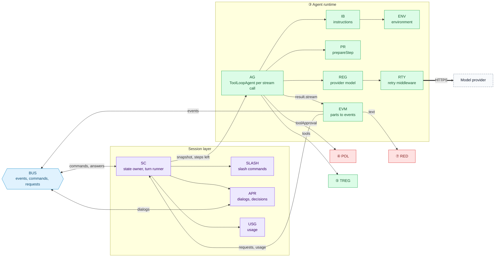
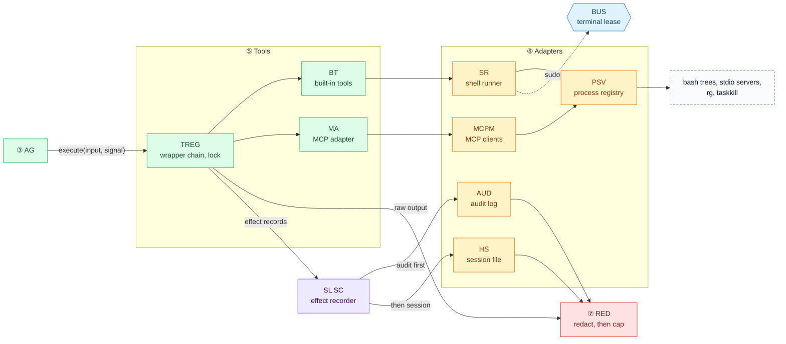
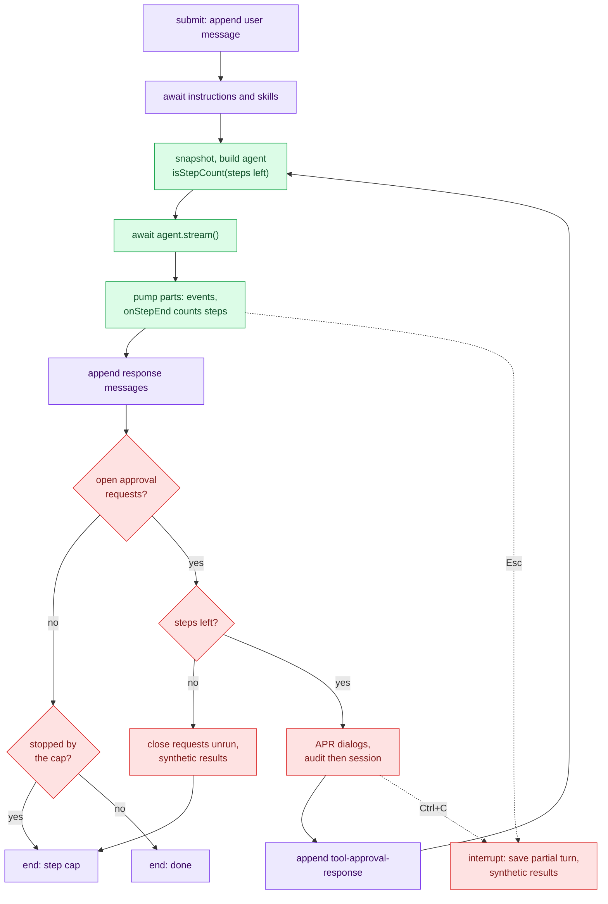
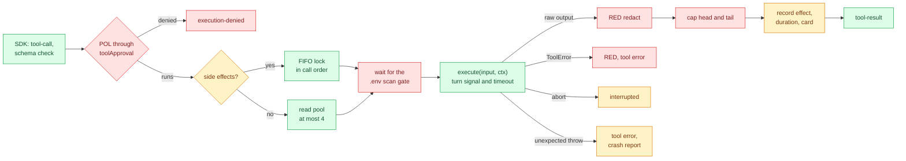
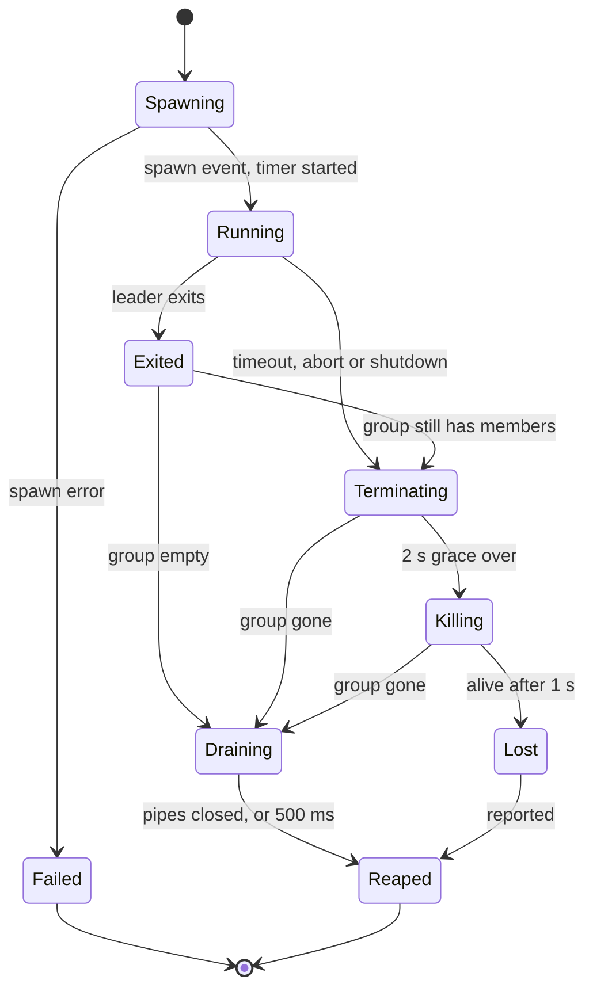
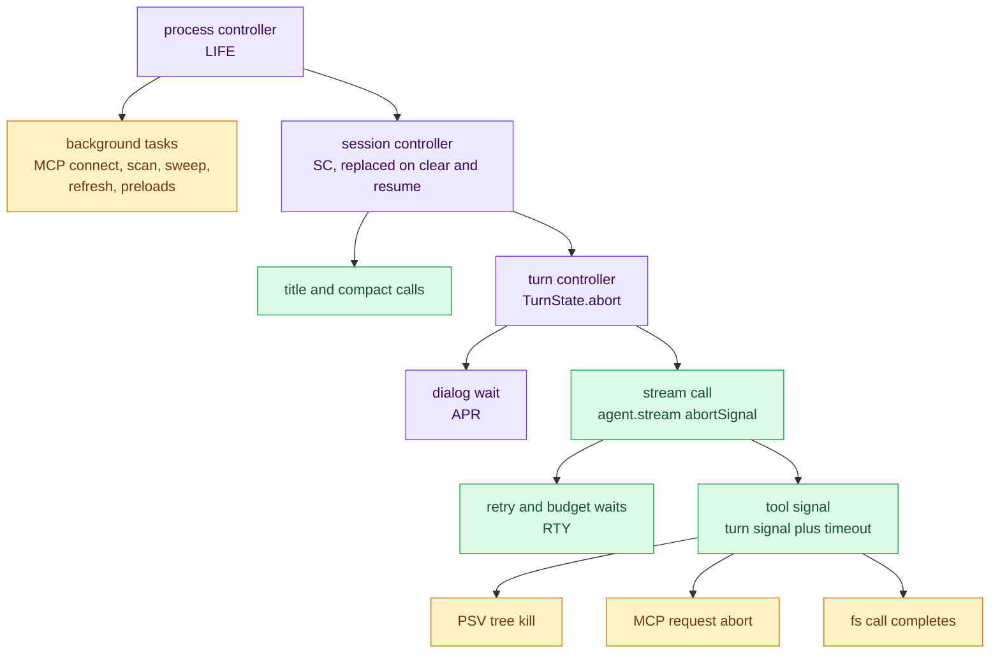
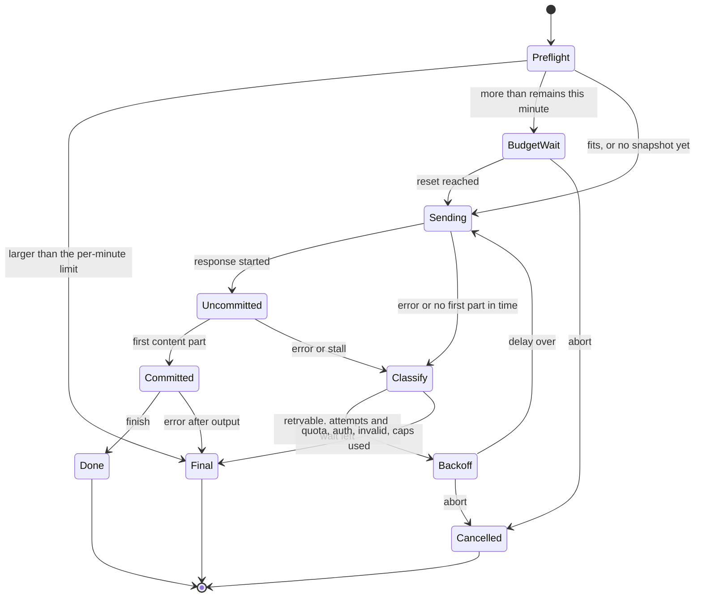
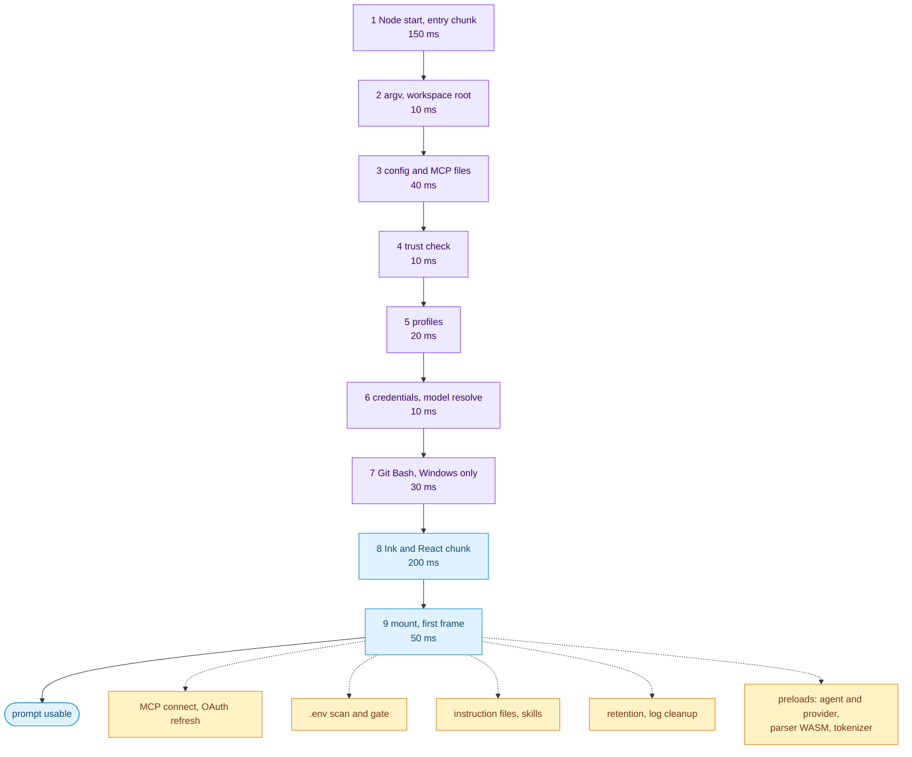
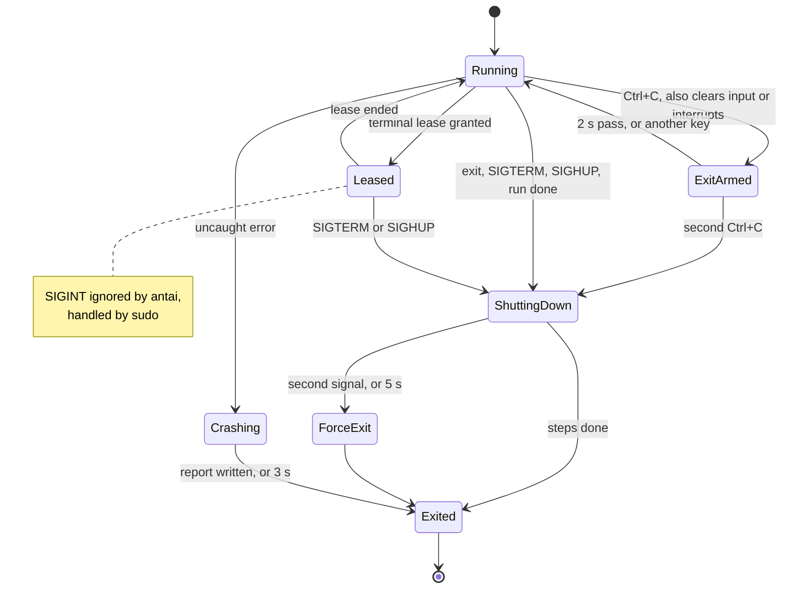

# antai — Agent Runtime Architecture

| | |
|---|---|
| **Product** | antai (brand) / `antai` (command) |
| **Document** | Deliverable 07, Agent Runtime Architecture for the v1 MVP |
| **Status** | Draft for review |
| **Version** | 0.1 |
| **Date** | 12 October 2026 |
| **Author** | Daksh Nagpal |
| **Based on** | BRD_1 v0.4, HLD.png, deliverable 00 (v0.3), deliverables 01, 02, 03, 04, 05, 06, 09 and 10 (v0.1), deliverables 08 and 11 to 13 (where named in the text) |
| **How to use** | Reference design, not a fixed rail. Where the technology needs something different or extra, the implementation may change it; the change is then made in every deliverable it touches, so the set keeps agreeing. |

## Contents

1. Purpose and scope
2. Process and event-loop model
3. Session controller internals
4. Turn agent construction
5. Stream handling
6. Tool execution
7. Process supervision
8. Cancellation
9. Errors, retry and resilience
10. Startup and shutdown
11. Runtime configuration
12. Testability
13. Design decisions
14. Open questions
15. Traceability
16. Sources

---

## 1. Purpose and scope

### 1.1 Purpose

This document is the detailed design of the antai core below the event boundary. It covers how the session controller, the turn agent, the tool wrappers, the process supervisor, cancellation, retries, start-up and shutdown work inside. A developer should be able to implement `src/session/`, `src/agent/`, the call loop of `src/providers/retry/`, `src/tools/registry/`, `src/infra/process/` and `src/bootstrap/lifecycle.ts` from it.

It does not repeat the component catalogue (deliverable 01, section 5.9), redraw the flows (deliverable 03), or restate the types and state machines (deliverable 06). It cites them by ID and adds what they leave open: ordering, numbers, failure handling and the code-level shape of the loops.

### 1.2 Scope

| In this document | Elsewhere |
|---|---|
| Event-loop model, background work, back-pressure, memory bounds | Components and module paths: deliverable 01, sections 5.9 and 8 |
| Turn loop, approval resumptions, step budget, slash dispatch | Message order per flow: deliverable 03. Classes, invariants, session and turn state machines: deliverable 06 (UML-2.1a, UML-4a, UML-5, section 8) |
| `ToolLoopAgent` options, `prepareStep`, `toolApproval` wrapper, approval secret | Instruction text, pruning parameters, token budgets: deliverable 08 |
| Where streamed-text redaction runs, reasoning display, usage collection | Stream-part to `AgentEvent` table: deliverable 06, section 6.4. Hold-back rule: deliverable 02, section 6.4. Event union and NDJSON: deliverable 11 |
| Tool wrapper chain, serialisation, timeouts, outcome classes | Per-tool schemas: deliverable 12. MCP lifecycle and per-server timeouts: deliverable 10 |
| Spawn options, environments, tree kill, terminal lease, orphan prevention | Threat model, classifier, child-environment policy: deliverable 02 |
| Cancellation tree, keys and signals | Screens and key hints: deliverable 13 |
| Error taxonomy, where `RTY` sits, stall watchdog, crash handler | Retry numbers, budget guard, classification, provider error codes: deliverable 09 (MP-5, MP-6, MP-7, section 10). Error codes and exit-code precedence: deliverable 11 |
| Start-up budget, lazy loading, shutdown order | Bundling and chunks: deliverable 16. Benchmarks: deliverable 15 |
| Runtime knobs, test seams | Test plan: deliverable 14 |

### 1.3 Additions beyond BRD v0.4

These go beyond BRD v0.4. The design uses them as stated; the BRD can adopt them later.

| Ref | What this document assumes | Sections |
|---|---|---|
| Deliverable 06, section 5.3 | AI SDK v7 names: `toolApproval` on the agent, `isStepCount`, `await agent.stream()`, `result.stream`, nested usage fields, `tool-output-denied` | 4, 5 |
| Deliverable 09, section 9.1 | SDK `maxRetries: 0`; antai's own retry with deliverable 09's numbers. BRD FR-ERR-02 still says "retried by the SDK (default 2 retries)" | 4.1, 9.2 |
| Deliverable 01, rule 11 | Provider keys never in `process.env` (the outcome is now in BRD v0.4, FR-SH-06) | 7.3 |
| Deliverable 02, section 6.3 | Redact first, then cap (BRD FR-SH-08 lists the other order) | 2.5, 6.1 |
| Deliverable 02, section 3.10; deliverable 01, rule 7 | Type-ahead discard; per-process approval secret | 4.5, 11 |
| CR-01 | `maxOutputTokens` always set; Groq per-minute token guard | 4.1, 9.2 |
| Deliverable 03, SD-11 | Captured `sudo` command spawned without `detached`, with `sudo -n` | 7.2, 7.7 |
| Deliverable 04, DS-D6 | Response messages written when each stream call ends (BRD FR-HIS-02 says "when the turn ends") | 3.3 |
| Deliverable 04, section 13, P7 | Side-effecting calls denied while the audit log cannot be written | 9.5 |

### 1.4 Runtime overview

RT-1a shows the session layer and the agent runtime; RT-1b shows the tool side. Names are deliverable 01 component IDs.

In HLD.png terms, this document is the runtime of the Engine (Agent Brain, `agent/`) and of its links: to the Session (`session/`), to Context (instructions from `context/`), to the Model Gateway (`providers/`: `REG`, `RTY`) and to the Tool Pipeline (Safety Guard `POL`, Tool Service `TREG`, Secret Filter `RED`). Deliverable 01, section 1.3 has the full mapping. Where the diagrams differ from the drawing, the reason is given:

- **The Safety Guard returns a decision; it does not call the tool.** `POL` answers the SDK's `toolApproval` hook, and the SDK then calls the tool through `TREG`. The SDK owns the tool loop, so HLD.png's "yes" arrow is the SDK running an approved call.
- **The loop is split in two.** The model and tool loop runs in the Agent Brain (`ToolLoopAgent` inside `AG`). The outer loop across approval resumptions runs in `SC` (section 3.3), because only the session opens the "asks you Yes/No" dialogs and writes history.
- **`REG` and `RTY` are drawn inside layer ③**, as in deliverable 01, section 5.1, because the wrapped model they return is one of each turn agent's options. Their code stays in `providers/`, HLD.png's Model Gateway.
- **Shutdown sits with the Boot Service.** `LIFE` (`src/bootstrap/lifecycle.ts`) handles signals, shutdown and crashes (sections 7.8, 9.4 and 10.3). It lives in `bootstrap/` because it undoes, in reverse order, the wiring that start-up made.

#### RT-1a Core collaboration: session and agent



#### RT-1b Core collaboration: tools, processes and records



Two refinements of deliverables 01 and 06 follow from these diagrams:

- **Tools report effects through a port.** `TREG`, `BT` and `SR` must not import `src/session/` (deliverable 01, section 8.2). They write `command`, `file-write` and `mcp-call` events through an `EffectRecorder` in `ToolContext` (new, not in deliverable 06, section 5.8). `SC` implements it and writes the audit log first and the session file second (deliverable 04, section 6.6; deliverable 06, INV-10). The "`SR` → `AUD`" arrow in deliverable 03, SD-10a is the audit half of that write.
- **`REG` has two halves.** Resolving `provider:model`, aliases and the key needs no SDK code and stays on the start-up path. Creating the provider instance imports `@ai-sdk/<provider>` and `ai`, and is preloaded after the first frame (section 10.2).

---

## 2. Process and event-loop model

### 2.1 One process, one loop

antai is one Node.js process with one event loop and no worker threads (HLD-D1). Everything below runs as asynchronous work on that loop. Child processes (section 7) are the only parallel execution. The design therefore guarantees three things:

- input and rendering never wait for the core;
- no piece of synchronous work holds the loop for long;
- every buffer has a bound.

Node has no task priorities, so antai orders work by when it starts and how it yields:

| Priority | Work | Rule |
|---|---|---|
| 1 Input and display | Key handling in the renderer, `BUS` dispatch, `EVM` mapping of one stream part | Synchronous and short. The core never awaits a renderer for a text delta |
| 2 The running turn | Reading `result.stream`, tool I/O, approval round trips, history appends | Asynchronous I/O only; CPU steps bounded per call (section 2.3) |
| 3 Background tasks | Started after the first frame (section 10.2); CPU-heavy steps chunked and yielding with `setImmediate` | Never awaited by input handling; some gate a later step (table below) |

### 2.2 Background tasks

Every background task runs through one helper, `runBackground(name, signal, fn)`, which catches and logs every error. An unhandled rejection therefore always means a bug, and it takes the crash path (section 9.4).

| Task | Starts | Concurrency | Bound | Who waits for it | On failure |
|---|---|---|---|---|---|
| MCP connect, per server (SD-19a, SD-20) | After the first frame; project servers only when trusted | All servers in parallel | Server's `startupTimeoutMs`, default 30 s (deliverable 10, EXT-D21) | Nobody interactively. `run` waits until every server is connected, failed or needs login (deliverable 10) | That server is "failed" (NFR-REL-02) |
| OAuth proactive refresh (SD-21c) | Before that server's connect | One per server, under the credentials lock | Lock 2 s; token request within the connect bound | That server's connect | Server "needs login" |
| First `.env` known-value scan (SD-1b) | After the first frame; in `run`, before stdin is read | Async walk, at most 8 files open | None. A notice after 10 s (section 9.5) | Every tool output (the gate in `TREG`, HLD-D21). The first user message, for at most 5 s (section 5.2) | Unreadable folders skipped and logged |
| `.env` re-check by modification time (deliverable 02, SEC-D15) | At the start of each turn and after each shell command | One | As the first scan | The next tool output | As above |
| Instruction files and skills (SD-4) | After the first frame | Parallel reads | 5 s, then missing files listed as skipped | First submit, `/instructions`, `/skills`, the `/` menu (SD-D2) | Listed with the reason (FR-SKL-06) |
| Retention sweep and log cleanup (SD-18c) | 2 s after the prompt is ready | Sequential deletes | None; cancelled at shutdown | Nobody | Skipped; debug log |
| Session title (SD-5b) | After the first turn ends. Not in `run` (its title is the first prompt) or with `--no-history` | One | One attempt, no retry wait (section 9.2) | Nobody | First prompt, trimmed |
| `index.json` update (SD-18a) | Turn end | One | Lock wait 2 s | Nobody | Skipped; `/history` reconciles |
| Preloads: agent and provider chunk, bash parser WASM, tokenizer | After the first frame, when the loop is idle | One at a time | None | First submit, first `shell` decision, first budget estimate | First use loads it again and reports any error |

### 2.3 What must never block the loop

| Hazard | Rule |
|---|---|
| Synchronous file I/O | Only at start-up for small files (config 1 MiB cap, `trusted.json`, `credentials.json`), and in the crash and exit handlers. Everything else uses `fs/promises` |
| Large redaction or regular-expression work | `RED` works on chunks of at most 64 KB and yields between chunks. Project `secrets.patterns` are checked for catastrophic backtracking before use (deliverable 02) |
| Bash parsing | Command text is capped at 10,000 characters before `CLS` parses it (risk TR10) |
| Token estimation | Incremental: the last step's reported `inputTokens` plus an estimate of the new parts only. The whole history is never re-tokenised per step (SD-15a). `gpt-tokenizer` is loaded lazily |
| `JSON.parse` of big files | Session files are read line by line with a 4 MiB line cap (deliverable 04, section 6.3) |
| `fsync` | Async only; used at session close and for credentials and trust writes (DS-D28) |
| Lock waits | Timers in 50 ms steps, never busy loops |
| `spawnSync` | Only in the `exit` handler and the crash path (section 7.8) |
| Markdown rendering | Renderer side. Deliverable 13 keeps finished output out of re-renders |

`--debug` samples event-loop delay with `perf_hooks.monitorEventLoopDelay()` and logs the p99 per turn. A regression then shows up in the benchmark job (DLV-VER-08) before it reaches NFR-PERF-02.

### 2.4 Back-pressure

| Stream | Producer | Consumer | Mechanism |
|---|---|---|---|
| Model stream | Provider HTTP response, through `RTY` | The turn runner's pump | `SC` reads `result.stream` with `for await` and maps each part synchronously. If the consumer pauses, the `ReadableStream` stops pulling and TCP flow control slows the provider |
| `BUS` to `INK` or `LINE` | `EVM`, `SC` | Renderer state | Synchronous dispatch. The renderer coalesces text deltas into its next frame (deliverable 13) and never blocks the dispatch |
| `BUS` to `PLAIN` | As above | `process.stdout` (pipe or file) | `PLAIN` exposes a drain port. When more than 1 MiB is buffered because `stdout.write()` returned `false`, the pump awaits `drained` before it reads the next part. A slow consumer downstream then slows the model stream instead of growing memory |
| Command output | Child stdout and stderr | `SR` | Never paused: a paused pipe would block the child and turn a fast command into a timeout. Memory stays bounded because `RED` and the cap keep only the head, the tail and a carry-over (section 2.5) |
| stdio MCP server | Child stdout | antai's transport | JSON-RPC messages parsed as they arrive; size bound in deliverable 10 |

### 2.5 Memory bounds

NFR-PERF-04 allows 300 MB RSS in the 100-turn reference session. The bounds below cover every buffer antai owns. The rest (Node, code, Ink, the SDK) is measured in P0 and tracked by DLV-VER-08.

| Buffer | Bound | Why it is enough |
|---|---|---|
| Tool output kept for the model, history and card | 30,000 characters: 6,000 head and 24,000 tail (FR-SH-08; split in deliverable 08, 8.4) | The middle is counted and dropped, never stored |
| Redaction carry-over per stream (`RedactionStream`, deliverable 06, UML-2.5b) | The longest known value and at least 4 KB (deliverable 02, 6.3), and an open PEM block up to 16 KB (deliverable 02, SEC-D14) | A private-key block is the longest format detected |
| How the cap is applied | The head is redacted as it fills, with the carry-over as look-ahead. The middle is only counted. The tail ring is redacted once at the end, with the carry-over as look-behind | Every kept character is redacted with full context on both sides. The result is the same as redacting the whole stream first, at a fraction of the CPU |
| Streamed text held back for redaction | 8 KB per run without whitespace; 16 KB for an open PEM block (deliverable 02, section 6.4) | Usually one word |
| `read_file` result | 2,000 lines or 50 KB (FR-TOOL-01) | — |
| Piped stdin in `run` | 100 KB (FR-CLI-03) | — |
| Conversation in memory | The stored records from the latest compaction on. About 9 MB for the 100-turn heavy reference (deliverable 04, section 12) | The request copy that `PR` builds each step is a shallow array copy; JavaScript strings are shared, not duplicated |
| Step messages kept for an abort (`TurnState.stepMessages`, SD-D4) | One stream call's steps; cleared when written | Written before each dialog and at turn end |
| stdio MCP stderr | 200-line ring buffer per server (deliverable 10) | Shown in `/mcp` |
| Debug log | 10 MiB per file, one rotation (DS-D24) | — |
| Tokenizer rank data | 2.4 MB file, loaded once and only for gpt-oss models | — |

---

## 3. Session controller internals

### 3.1 Session state and snapshots

`SessionController` (`SC`) is the only writer of `SessionState` (deliverable 06, UML-2.1a; INV-1). The fields are in deliverable 06. The runtime rules are:

- **A `SessionSnapshot` is taken before every stream call** (UML-D1) and deep-frozen. Lower layers see only their readonly views (`PolicySnapshot`, `ToolSetSpec`, `TurnSpec`; UML-D2).
- **Setters refuse unless idle** (INV-2). Within a turn, only `stepsUsed` and the allow-list can differ between two snapshots. The allow-list changes when the user picks "Yes, don't ask again this session" (SD-D5, SD-7c).
- **Per-turn state lives in `TurnState`** (UML-2.1a):
  - `number`, `status` (UML-5);
  - `abort`: the turn's `AbortController` (section 8.1);
  - `stepsUsed`;
  - `decisions`: the policy decisions by `toolCallId`;
  - `pending`: approval requests not yet answered;
  - `stepMessages`: step messages not yet written;
  - `deniedAction`: set when an approvable call is denied; drives exit code 5 (deliverable 11, IC-P2).

  `TurnState` implements `TurnHooks` (`onStepEnd`, `recordDecision`). It is discarded at turn end, so a failed turn leaves no half-updated state behind (section 9.4).
- **Context sources are fixed per turn.** The tool set is built once per turn (UML-D19). The instruction sources (files, profile, skill lines, environment facts) are captured at turn start. `IB` rebuilds the instructions for every stream call and never stores them (INV-20). Because its inputs are fixed, the text is byte-identical within the turn. The request prefix therefore stays stable and the provider prompt cache keeps hitting across approval resumptions. A changed `AGENT.md` applies from the next turn.

### 3.2 Submission, slash commands and the one-turn rule

Deliverable 06, UML-4a has the session lifecycle and UML-5 the turn states. The dispatch code:

```ts
// src/session/controller.ts (sketch)
submit(text: string): void {
  if (this.turn || this.commandRunning) return emit(notice('turn-running')); // INV-3, HLD-D18: Enter refused
  const r = slash.route(text);              // '//' escape, path-like first word, built-in, skill, unknown (FR-SLC-02)
  switch (r.type) {
    case 'message': return void this.runTurn({ text: r.text });
    case 'skill':   return void this.runTurn({ text: r.expanded, skill: r.name });   // FR-SKL-04
    case 'command': return void this.runCommand(r);   // never sent to the model
    case 'unknown': return emit(notice('unknown-command', r.suggestion));
  }
}
interrupt(): void { this.turn?.abort.abort({ kind: 'user' }) ?? this.command?.abort({ kind: 'user' }); }
```

- **One turn at a time.** Enter is refused while a turn or a waiting command runs; the renderer keeps the text. There is no queue (HLD-D18).
- **Waiting commands.** Most built-in commands finish at once (UML-4a, the Idle self-transition). Some wait: `/compact` makes a model call, `/mcp` login waits for the browser, `/model` may ask for a key, `/resume` opens a session. These set `commandRunning` and take a child of the session `AbortController`, so Esc cancels them. A cancelled `/compact` writes nothing (SD-15b).

### 3.3 The turn loop

Deliverable 03, SD-5a and SD-7 show the messages; deliverable 06, UML-5 the states. This is the control flow.

```ts
// src/session/turn-runner.ts (sketch; names other than AI SDK ones are antai's)
async runTurn(input: UserInput): Promise<void> {
  const turn = this.beginTurn();                          // TurnState: number, abort, stepsUsed = 0
  try {
    await race(red.firstScan, 5_000, turn.abort.signal);  // section 5.2: known values before anything is sent
    await history.appendUser(red.redact(input.text));     // FR-HIS-02: on disk before any network call
    await race(context.ready, 5_000, turn.abort.signal);  // instruction files and skills (SD-D2)
    const sources = context.capture(this.state);          // fixed for the turn (section 3.1)
    const toolSet = treg.buildToolSet(this.snapshot(), mcpm.bindings());   // once per turn (UML-D19)
    await reg.ensureLoaded(this.state.model);             // provider chunk, so AG.create stays synchronous
    let messages = conversation.forModel();               // stored, redacted records (DS-D8)

    for (;;) {
      const spec = this.snapshot();                       // frozen, with stepsUsed (UML-D1)
      const agent = ag.create(spec, turn, { sources, toolSet });     // turn implements TurnHooks
      const result = await agent.stream(messages, turn.abort.signal);
      const pumped = await this.pump(result.stream, turn);           // EVM.map per part; collects open requests
      if (pumped.error) throw pumped.error;               // classified by RTY (deliverable 09, MP-7)
      const response = await result.responseMessages;     // not awaited after an abort (section 5.4)
      await history.appendMessages(response);             // DS-D6: before any dialog
      turn.stepMessages.length = 0;
      messages = messages.concat(response);               // within a turn: the SDK's own messages (04, section 6.6)

      if (turn.pending.length === 0) {
        return this.endTurn(turn, turn.stoppedByStepCap() ? 'step-cap' : 'done');
      }
      if (turn.stepsUsed >= spec.maxSteps) {              // request raised in the last allowed step
        await this.closeUnrun(turn, 'step-cap');          // synthetic results, no dialog (RT-D3)
        return this.endTurn(turn, 'step-cap');
      }
      const responses = await apr.resolve(turn.pending, spec);       // dialogs; audit, then session (SD-7a)
      const approvalMessage = toolMessage(responses);                // one role 'tool' message
      await history.appendMessages([approvalMessage]);
      messages = messages.concat(approvalMessage);
      turn.pending = [];
    }
  } catch (err) {
    await this.handleTurnError(turn, err);               // abort, provider error, context overflow, contained bug
  } finally {
    await this.finishTurn(turn);                         // usage record, index update, title after turn 1, idle
  }
}
```

Rules the code encodes:

- **The user message is written before anything can fail.** A provider error, an abort or a crash leaves it on disk (deliverable 04, crash point C1).
- **Response messages are written when each stream call ends**, before any dialog opens (DS-D6). The `stepMessages` buffer filled by `onStepEnd` covers an abort in between (SD-D4).
- **`stoppedByStepCap()`** is true when `stepsUsed >= maxSteps` and the last step's finish reason was tool calls. In that case the cap stopped the loop, not the model. The turn ends with "stopped after 25 steps", and `run` exits 4 (FR-AGT-02, AC-33).
- **`handleTurnError`** depends on the error:
  - Abort (SD-12a): write the buffered step messages, the partial text marked `partial`, synthetic results from `PR.repair` for every call without a result, and the `interrupted` event (audit first).
  - Final provider error: write the `error` event and show one line (SD-16c, deliverable 09, section 10).
  - `ContextOverflowError`: show the `/compact` hint (SD-15a).
  - Anything else: a contained internal error (section 9.4).

### 3.4 RT-2 Approval resumptions and the step budget

FR-AGT-02 counts model steps across the whole turn. `isStepCount(n)` counts steps within one `agent.stream()` call. So the agent is rebuilt for every resumption with `isStepCount(maxSteps − stepsUsed)` (SD-D5; deliverable 06, INV-19). `stepsUsed` is counted from the same `onStepEnd` callbacks the SDK uses to count steps. Both counters use the SDK's own definition of a step, so they cannot drift apart. This holds whether the SDK runs approved tools inside the first step of the continuation or before it.



- **A request in the last allowed step is not shown.** If step 25 raised a `tool-approval-request`, the model would need a 26th step to see the result. The runner closes the request with a synthetic result ("not run: the step limit for this turn was reached") and ends the turn with the cap message. The user never approves something that then cannot run (RT-D3).
- **Other calls in the same step** that were Safe or approved automatically have already run when the stream ends. The open requests run in the continuation. The side-effect lock (section 6.2) keeps audit order equal to execution order.
- **A denial costs a step too.** The continuation returns `execution-denied` to the model, which replans in a model step.
- **The SDK may re-validate a response by calling `toolApproval` again.** If it does, the wrapper answers from `TurnState.decisions` (section 4.4), so the decision cannot change between the dialog and execution.

### 3.5 Mode, model, effort and profile changes

| Change | Entry points | Validated by | Applies | Restrictions | Record |
|---|---|---|---|---|---|
| Mode | `/mode`, `--mode`, profile load | `SLASH`: `research`, `manual`, `auto` only (`SelectableMode`) | Next turn (`activeTools`, `POL`) | `skip` only by launch flag (FR-MODE-02). A mid-session profile switch never loosens (FR-PRF-03). No project file sets `auto` (FR-CFG-05) | `setting` event, audit first (SD-14b) |
| Model | `/model`, `--model`, profile | `REG` resolves. `CAT` refuses known non-tool models. Key prompt if missing (deliverable 09, section 11.1) | Next turn; `PR` strips provider-specific parts from the copy (FR-MOD-05, MP-8) | Untrusted project `model` ignored (FR-CFG-04) | `setting` (SD-14a) |
| Effort | `/effort`, `--effort`, profile | Five BRD levels (the SDK's extra levels `minimal`, `xhigh` and `max` are not exposed); `CAT` says whether the model reasons | Next turn (`reasoning`, deliverable 09, section 6) | Notice when ignored (FR-MOD-06) | `setting` |
| Profile | `/profile`, `--profile`, pin, auto-match | `PRF`: validation, trust limits | Next turn: instructions and skill subset. Defaults for model and effort. Mode only if not looser | One active profile (FR-PRF-04) | `setting` |
| Allow-list | Dialog option on a Normal shell command | `APR` (D27) | At once, through the next snapshot | Not persisted, not restored (SD-D7) | `approval` event, `by: user` |
| `/clear`, `/resume` | Slash commands | — | At once: the session ends and another opens (UML-4a) | Idle only | `end`, `resume` events |

---

## 4. Turn agent construction

### 4.1 `ToolLoopAgent` options

`TurnAgentFactory` (`AG`, deliverable 06, UML-2.2a) creates a new agent for every stream call: once per turn, and once per approval resumption (HLD-D2, SD-D5). Construction makes no network call. Option names are the AI SDK v7 names of deliverable 06, section 5.3 (`ai@7.0.137`); the P0 spike re-checks them against the typings.

| Option | Value | Comes from | Requirement |
|---|---|---|---|
| `model` | `REG.languageModel(ref)`: the provider instance's model wrapped by `RetryMiddleware` through `wrapLanguageModel`. Instances are cached per provider, base URL and key source (deliverable 09, section 2.2) | Snapshot `model`; key from `CRED` or the environment, passed as `apiKey`, never through `process.env` | FR-MOD-01..08; own retry (section 9.2) |
| `instructions` | `IB.build(spec, sources)`, sources fixed per turn (section 3.1) | `INS`, `PRF`, `SKR`, `ENV` | FR-AGT-03, INV-20 |
| `tools` | The turn's tool set: built-ins plus connected MCP tools, minus `tools.disabled`, `mcp.tools.deny`, and `shell` without bash. Every `execute` is wrapped (section 6.1). Built in a fixed order (built-ins, then MCP tools sorted by name) | Config; `MCPM` status at turn start | FR-TOOL-10, FR-MCP-05, 06 |
| `activeTools` | Names allowed in the mode (section 4.6) | Snapshot `mode` | FR-MODE-01 |
| `stopWhen` | `isStepCount(maxSteps − stepsUsed)` | Snapshot | FR-AGT-02, INV-19 |
| `prepareStep` | `MessagePreparer.prepareStep` (section 4.3) | Snapshot, `CAT` | FR-AGT-05, FR-MOD-05 |
| `toolApproval` | Generic async function around `POL.decide` (section 4.4) | Snapshot | FR-SH-02 |
| `experimental_toolApprovalSecret` | Per-process secret, set through the `SDK` shim (section 4.5) | `AG` | Deliverable 01, rule 7 |
| `reasoning`, `providerOptions` | `REG.effortOptions(model, effort)`, plus Ollama `num_ctx` (deliverable 09, section 6) | Snapshot `effort`, `CAT`, config | FR-MOD-06, 07 |
| `maxOutputTokens` | Always sent: `models.<ref>.maxOutputTokens`, else the catalogue's `defaultMaxOutputTokens`. That is 4,096 for gpt-oss on Groq, provisional (deliverable 09, section 4.2). This is the upper bound: `PR` lowers it per step to min(O_max, E − I − margin) and `RTY`'s middleware applies that value to the request (deliverable 08, 9.3) | `CAT`, config | CR-01 |
| `maxRetries` | `0` (through `RequestOptions`, deliverable 06, section 5.3) | Constant | Own retry in `RTY` (section 9.2) |
| `onStepEnd` | `TurnHooks.onStepEnd` (section 4.7) | `TurnState` | FR-AGT-02, SD-D4 |
| `onEnd` | Marks the stream call complete | `TurnState` | — |
| `telemetry` | Not set per agent. Under `--debug`, `DBG` registers its private integration once with `registerTelemetry` through `SDK` (HLD-D27) | — | FR-ERR-03 |
| `agent.stream({ messages, abortSignal })` | Conversation copy; the turn's signal (section 8.1) | Turn runner | FR-AGT-01, 04 |

Not used: `toolChoice` (provider default), `prepareCall`, `toolSearch` (deliverable 01, TD5), provider-executed tools (deliverable 01, rule 13), `allowSystemInMessages` (instructions never go into `messages`).

### 4.2 Construction sketch

```ts
// src/agent/turn-agent-factory.ts (sketch; aligns with deliverable 06, section 5.3)
create(spec: TurnSpec, hooks: TurnHooks, t: { sources: ContextSources; toolSet: TurnToolSet }): TurnAgent {
  const agent = new ToolLoopAgent({
    model: this.registry.languageModel(spec.model),          // chunk preloaded by SC; wrapped by RetryMiddleware
    instructions: InstructionBuilder.build(spec, t.sources),
    tools: t.toolSet.tools,
    activeTools: t.toolSet.activeTools,
    stopWhen: isStepCount(spec.maxSteps - spec.stepsUsed),
    prepareStep: (input) => this.preparer.prepareStep(input, spec),
    toolApproval: approvalWrapper(spec, hooks, this.policy),  // section 4.4
    ...this.registry.effortOptions(spec.model, spec.effort),
    maxOutputTokens: this.registry.maxOutputTokens(spec.model),
    onStepEnd: hooks.onStepEnd,
    maxRetries: 0,
    ...this.sdk.approvalSecretOption(this.approvalSecret),
  });
  return { stream: (messages, abortSignal) => agent.stream({ messages, abortSignal }) };
}
```

`create` stays synchronous, as deliverable 06 draws it. The two asynchronous dependencies are awaited by `SC` before it calls `create`: the provider chunk (`REG.ensureLoaded`) and the context sources. The bash parser is awaited inside `POL.decide` (section 4.4).

### 4.3 `prepareStep`

`prepareStep` runs before every model step and must be cheap. In order:

1. **Strip provider-specific parts** (reasoning, signatures, provider metadata) from the copy for messages that a different provider produced (FR-MOD-05; deliverable 09, MP-8). The history file keeps them.
2. **Estimate the request size**: the previous step's reported `inputTokens` plus an estimate of the parts added since. On the first step of a turn, estimate the whole copy (deliverable 09, section 4.6).
3. **Prune** with `pruneMessages` when the estimate exceeds `context.pruneAt` × the effective window E (deliverable 08, 9.1), never separating a call from its result, then estimate again. If still over, throw `ContextOverflowError`, which ends the turn with the `/compact` hint (SD-D10). The turn runner handles both an `error` part and a rejected promise, so the outcome is the same whichever way the SDK reports the exception. Pruning parameters belong to deliverable 08.
4. **Count the step** (`stepsUsed + 1` of `maxSteps`). No event: renderers take the budget from `turn-start.stepBudget` and get one `usage` event with `scope: 'step'` per step (deliverable 11, sections 4.1 and 4.5, EB-G9).
5. Return `{ messages }` only when the copy changed.

Not in `prepareStep`:

- the step cap (`stopWhen` does it);
- the per-minute token guard (`RTY` checks the final request, deliverable 09, MP-5);
- the repair of dangling calls (done on abort and resume, so the conversation already satisfies INV-12);
- instructions (fixed per turn).

Removing all tools on the last allowed step, to force a final answer, was considered and rejected (RT-D3).

### 4.4 The `toolApproval` wrapper

```ts
// src/agent/approval.ts (sketch)
function approvalWrapper(spec: TurnSpec, hooks: TurnHooks, policy: ApprovalPolicy) {
  return async ({ toolCall }: { toolCall: TypedToolCall }) => {
    const prior = hooks.decisionFor(toolCall.toolCallId);
    if (prior) return toSdkStatus(prior);            // same answer if the SDK asks again
    let d: PolicyDecision;
    try {
      d = await policy.decide(toPolicyCall(toolCall), spec);   // read-only ports; awaits CLS.ready for shell
    } catch (err) {
      dbg.error('policy', err);
      d = deniedDecision('internal-policy-error');   // fail closed (deliverable 01, rule 14)
    }
    hooks.recordDecision(toolCall.toolCallId, d);    // for APR, the audit record and the denied card (SD-D6)
    return toSdkStatus(d);                           // deliverable 06, UML-2.2a
  };
}
```

- **`POL.decide` keeps its read-only ports** (deliverable 06, UML-D11). It stays asynchronous, because `PathGuard` resolves symlinks and the classifier may still be loading its WASM grammar. Pre-resolving those facts in `AG` would only move the same I/O. It would also make the audit-health check stale within a turn.
- That the SDK accepts a promise from `toolApproval` is taken from deliverable 06's verified option list. If P0 finds otherwise, the parser preload and a synchronous `realpath` would make `decide` synchronous with the same results.
- Automatic decisions (`approved` or `denied`) reach `SC` as `tool-approval-response` parts with `isAutomatic: true`. `SC` writes their `approval` events with the recorded tier, rule and summary (SD-D6). Automatic `tool-approval-request` parts, if the SDK emits them, are ignored.

### 4.5 The approval secret

- `TurnAgentFactory` holds 32 random bytes from `crypto.randomBytes`, made once per process (deliverable 06, UML-2.2a). Only the `SDK` shim names `experimental_toolApprovalSecret` (HLD-D10). P0 reads the option's accepted type from the typings.
- The secret never appears in a snapshot, an event, a log, a crash report or history. A new process has a new secret, so a `tool-approval-request` stored in a session file cannot be answered after resume. Resume closes it as interrupted instead (HLD-D23, SD-17b).
- `InvalidToolApprovalSignatureError` on a continuation means antai produced a response the SDK rejects. Only `APR` builds responses (INV-4), so this is a bug, not an attack. The turn ends as a contained internal error (section 9.4).

### 4.6 Active tools per mode

| Mode | `activeTools` | Why |
|---|---|---|
| `research` | `read_file`, `list_directory`, `find_files`, `search_files`, `load_skill`, `shell`, every `mcp__*` tool | `write_file` and `edit_file` are hidden (FR-MODE-01). `shell` and MCP tools stay, so Safe commands and Safe MCP tools work; `POL` denies Normal and above (AC-09) |
| `manual`, `auto`, `skip` | Every registered tool | `POL` applies the tier × mode matrix call by call |

The registered set already excludes:

- `tools.disabled` and `mcp.tools.deny`;
- `shell` when bash is missing (FR-SH-11, AC-23);
- MCP servers not connected at turn start. A server that connects mid-turn is offered from the next turn (SD-19a).

gpt-oss on Groq makes no parallel tool calls. No option is set for that, because `TREG` serialises side effects for every model (section 6.2).

### 4.7 Callbacks

| Callback | antai use |
|---|---|
| `onStepEnd(step)` | `stepsUsed += 1`. Push `step.response.messages` to `stepMessages` (SD-D4). Remember the finish reason for `stoppedByStepCap()` |
| `onEnd` | Mark the stream call complete. Nothing is written here: the turn runner writes after the pump, so an exception in a callback cannot lose records |
| Others (`onStart`, `onStepStart`, `onToolExecutionStart`/`End`, `onLanguageModelCallStart`/`End`) | Not used. `prepareStep` emits step starts and `TREG` measures tools; the `--debug` integration sees the rest |

`ToolLoopAgent` has no `onError` or `onAbort`. Errors and aborts are read from the `error` and `abort` parts, and `agent.stream()` is wrapped in `try`.

---

## 5. Stream handling

### 5.1 Mapping rules

`StreamEventMapper` (`EVM`) is created per turn and holds one `RedactionStream` per open text or reasoning `id` (deliverable 06, UML-D15). Deliverable 06, section 6.4 maps all 26 `TextStreamPart` types to events, in an exhaustive switch (UML-D16). The runtime adds these rules:

| Part | Runtime handling |
|---|---|
| `text-*`, `reasoning-*` | Hold-back per deliverable 02, SEC-D14 (section 5.2); the tail is flushed on `*-end` |
| `tool-call` | Every open `RedactionStream` is flushed first (SEC-D14 rule 3), so text appears before the card |
| `tool-approval-request` without `isAutomatic` | Pushed to `TurnState.pending`; no event. `APR` raises the interaction requests after the stream ends |
| `tool-approval-response` with `isAutomatic: true` | `approval` event; `SC` writes the audit record (SD-D6) |
| `finish-step` | `UsageMeter.recordStep(usage)`; `usage` (step) event (section 5.4) |
| `finish` | Returned to the turn runner, which decides between awaiting approval and ending the turn (UML-5). Finish reason `length` adds a notice naming `models.<ref>.maxOutputTokens` (deliverable 09, section 4.2) |
| `error`, `abort` | Returned to the turn runner (section 3.3); any held text is flushed first |
| A part outside the typings at run time | No event; counted in the debug log. The exhaustive switch catches additions at compile time, and this branch covers a mismatch between typings and the bundle |

Every event carries a per-process `seq` that `BUS` assigns, and turn events carry the `turnId` (deliverable 11, section 4.1). `BUS` delivers events synchronously in emission order.

### 5.2 Streamed-text redaction and the first message

- **Hold-back.** `EVM` applies deliverable 02, section 6.4 (SEC-D14). It holds back the trailing run of non-whitespace characters, or an open PEM block up to 16 KB. It releases a run longer than 8 KB except its last L − 1 characters, where L is the length of the longest known value. It flushes at the end of each step, before a tool card, and on abort. Ordinary prose waits at most one word, so `EVM`'s share of NFR-PERF-02's 50 ms stays small. DLV-VER-08 measures it.
- **One matcher per call.** `RED.register` swaps in a new matcher and never changes one in use (deliverable 06, UML-2.5b). A value found by a mid-turn re-check therefore applies from the next push.
- **The first user message waits for the scan** (RT-D4). The first turn of a process waits for the initial `.env` scan for at most 5 s. Only then does it redact and store the user message (section 3.3). The prompt stays usable during the wait; only the request waits. If the scan is still running after 5 s, the message is redacted with the values known so far and sent, with a notice that the scan has not finished. The scan normally takes well under a second, and this message is the user's own text. A bound keeps a huge repository from blocking the first answer. Tool output, which can carry file contents, keeps waiting without a bound (RT-D12).
- **Property test.** For random splits of the same text, the concatenated output must equal `RED` applied to the whole text (section 12).

### 5.3 Reasoning

- Reasoning deltas are redacted like text, because a model can echo what it read.
- `INK` shows reasoning dimmed and collapsible. `LINE` prints a one-line "thinking…" marker. `PLAIN` emits no reasoning in v1: NDJSON 1.0 (the seven FR-UI-06 types plus `notice`, deliverable 11, section 5.3) has no slot for it.
- Reasoning parts stay in the stored response messages (FR-MOD-05). `PR` strips them from the copy after a provider switch.
- For gpt-oss, reasoning tokens count inside `maxOutputTokens`. A high effort can therefore end a step at `length` (deliverable 09, section 6.4).

### 5.4 Usage collection

| What | Source | Used for |
|---|---|---|
| Per step: input, output, reasoning, cache read, cache write | The `finish-step` part's usage: `inputTokens`, `outputTokens`, `outputTokenDetails.reasoningTokens`, `inputTokenDetails.cacheReadTokens`, `inputTokenDetails.cacheWriteTokens`. `UsageMeter.toUsage` maps them | Status bar after each step |
| Context share | The last step's `inputTokens` ÷ the effective window E: the window from `CAT`, or the plan's per-minute token limit when smaller (deliverable 08, 9.1) | Status bar (FR-UI-02) |
| Per turn | `UsageMeter` sums the steps of every stream call in the turn. `result.usage` covers one stream call only and is not relied on after an abort. When present, it is compared with the sum, and a mismatch is logged | `usage` record at turn end (deliverable 04, section 5.10) |
| Rate-limit snapshot | `RTY`'s state for the model (deliverable 09, section 8.3) | `/usage`, `usage.rateLimit` |
| Title and `/compact` calls | Their own usage, added to the session total | `/usage` |

An interrupted turn's `usage` record holds the completed steps only. The tokens of the step in progress are unknown.

---

## 6. Tool execution

### 6.1 RT-3 The wrapper chain

`ToolRegistry.wrap` (`TREG`, deliverable 06, UML-2.5a) gives every tool, built-in or MCP, the same `execute` (HLD-D5). The SDK validates the input against the tool's schema and calls `toolApproval` before the wrapper runs.



```ts
// src/tools/registry/wrap.ts (sketch)
function wrap(tool: AntaiTool, reg: ToolRegistryState, turn: ToolTurnContext): Tool['execute'] {
  return async (input, options) => {
    const release = tool.sideEffect
      ? await reg.sideEffectLock.acquire(turn.callIndex(options.toolCallId))   // FIFO by call order
      : await reg.readPool.acquire();
    try {
      await race(reg.envScanReady, options.abortSignal);                      // HLD-D21
      const signal = AbortSignal.any([options.abortSignal, AbortSignal.timeout(tool.timeoutMs(input))]);
      const ctx: ToolContext = { toolCallId: options.toolCallId, signal, roots: turn.roots,
                                 cap: tool.cap, effects: turn.effects, progress: turn.progress };
      const started = clock.now();
      const raw = await abandonAfterAbort(tool.execute(input, ctx), signal, 2_000);   // section 8.4
      const out = await red.filter(raw, tool.cap);                            // redact, then cap (INV-5)
      await turn.effects.record(tool.effectOf(input, raw, clock.now() - started));    // audit, then session
      return tool.toModelOutput(out);
    } catch (err) {
      throw toModelFacingError(err, tool, signal);                            // section 6.4; text through RED
    } finally {
      release();
    }
  };
}
```

`ToolContext` (deliverable 06, section 5.8) gains two members here:

- `effects`, the `EffectRecorder` described in section 1.4;
- `progress`, which reports elapsed time for cards (FR-UI-08).

The terminal-lease port (`TerminalLease.withTerminal`, UML-2.6a) reaches `SR` through `BOOT`'s wiring, not through the tool context.

### 6.2 Serialisation and parallelism

The SDK may start several `execute` calls of one step at the same time. gpt-oss on Groq never returns more than one call per step, but OpenAI, Anthropic, Gemini and `qwen/qwen3.8-27b` can.

| Tool | Class | Rule |
|---|---|---|
| `write_file`, `edit_file`, `shell` (every tier), every `mcp__*` tool | Side effects (`sideEffect: true`) | One FIFO lock per session (INV-21). Waiters are ordered by the index of their `tool-call` part in the step, not by arrival at the lock, so the audit order is the model's call order (HLD-D17) |
| `read_file`, `list_directory`, `find_files`, `search_files`, `load_skill` | Read-only | Up to 4 at once; a fifth waits |

Safe `shell` commands also take the lock. They start processes, and two commands running in one folder at once make output and timing hard to follow. MCP tools take the lock even with a trusted `readOnlyHint`: annotations are hints, and the order of remote effects matters more than speed.

### 6.3 Timeouts per tool

| Tool | Timeout | On expiry |
|---|---|---|
| `shell` | 120 s; 30 s for dev-server commands; per-pattern config (FR-SH-07) | `PSV` kills the tree; the output so far is marked timed out (section 7.5). The wrapper's own timer is the command timeout plus 5 s, as a backstop |
| `read_file` | 15 s | Tool error; `fs/promises` reads take the signal |
| `list_directory`, `find_files`, `search_files` | 30 s | `rg` killed; results so far returned with a "stopped after 30 s" marker |
| `write_file`, `edit_file` | 15 s, which covers the 7.5 s Windows rename retry (deliverable 04, section 6.2) | Tool error saying the outcome is unknown; `FSX` does not abort a rename half-way |
| `load_skill` | 5 s | Tool error |
| `mcp__*` | The server's `toolTimeoutMs`, default 120 s (deliverable 10, EXT-D21) | Request aborted; tool error XM-30. The server is not killed for one slow call, and it may still finish the action (deliverable 10; SD-12b) |

The non-shell, non-MCP values are proposals of this document (section 11).

### 6.4 Outcomes: errors, denials, timeouts, crashes

Deliverable 06, UML-6 is the tool-call state machine. What each outcome means at run time:

| Outcome | Raised by | The model gets | Card | Record | Turn |
|---|---|---|---|---|---|
| Success | Tool | Output text | Done | `command`, `file-write` or `mcp-call` | Continues |
| Expected tool error (file missing, binary file, span not found, MCP error result, server gone) | Tool throws `ToolError` | Tool error with a short message (wording: deliverable 08) | Error | `command` or `mcp-call` if something ran | Continues (FR-AGT-07) |
| Invalid input | SDK schema check | Tool error from the SDK | Error | — | Continues |
| Timed out | `PSV` timer or wrapper timer | Partial output plus `[timed out after N s]`; not an error | Timed out (FR-SH-07) | `command` with `timedOut` | Continues |
| Denied by policy or for lack of a human | `POL` | `execution-denied` with the reason | Red | `approval`, `by: policy` or `no-human` | Continues |
| Declined by the user | `APR` | `execution-denied`, "declined by user" | Red | `approval`, `by: user` | Continues |
| Interrupted | Turn abort | Synthetic result written by `SC` (SD-D9) | Interrupted | `interrupted` | Ends |
| Unexpected exception inside a tool (a bug) | Wrapper `catch` | Tool error "internal error in `<tool>`" | Error | Crash report written, no exit (section 9.4) | Continues |

### 6.5 Result shapes

`RED.filter` returns a `ToolOutput` (deliverable 06, UML-2.5b): redacted text, `isError`, omitted-character count and metadata. The model gets the text plus a short status line. The metadata goes to the card and the effect record:

- status (`ok`, `timed-out`);
- exit code;
- duration;
- paths.

Per-tool shapes are in deliverable 12, the types in deliverable 11, and the wording of markers and errors in deliverable 08. MCP results are flattened to text before `RED`, with structured content serialised as JSON (deliverable 10), so one redaction path serves every tool.

---

## 7. Process supervision

### 7.1 `PSV` contract

`ProcessSupervisor` (`PSV`, deliverable 06, UML-2.6a) is the only importer of `node:child_process` (HLD-D6; INV-15).

```ts
// src/infra/process/supervisor.ts (sketch; extends deliverable 06, UML-2.6a)
interface ProcessSupervisor {
  spawn(spec: SpawnSpec): ChildTree;              // registered before the first await
  killTree(c: ChildTree, why: KillReason): Promise<void>;   // 'timeout' | 'user' | 'shutdown' | 'sweep'
  killAll(): Promise<void>;                       // shutdown; leaves the registry empty
  killAllSync(): void;                            // crash and exit handlers only (new here)
}
interface SpawnSpec {
  kind: ChildKind;           // command, sudo-v, mcp-stdio, rg, opener, taskkill, icacls
  file: string;              // absolute path, always (RT-D7)
  args: string[];
  cwd: string;
  env: Record<string, string>;
  detached: boolean;         // set by PSV per kind and OS (section 7.2), not by callers
  timeoutMs?: number;
  owner: { turn?: number; server?: string };
  killOnShutdown: boolean;   // false only for the browser opener
}
```

### 7.2 Spawn options

| Kind | Program | `detached` | `stdio` | Notes |
|---|---|---|---|---|
| `command` | Absolute bash path. macOS and Linux: `/bin/bash`, else `bash` resolved on `PATH`. Windows: Git Bash `bash.exe` from `GBL`. Args `['-c', command]` | POSIX `true` (own process group and session); Windows `false` | `['ignore', 'pipe', 'pipe']` | `cwd` workspace; environment per section 7.3; `shell: false`; Windows `windowsHide: true` |
| `command` with a `sudo` segment | As above, with `sudo -n` in the segment (deliverable 03, SD-11) | `false`, so the command can use the credential that `sudo -v` cached | As above | Killed through `sudo`'s signal relay; P0 confirms. When it ends, on every path, `SR` runs `sudo -k` the same way (not detached), so no later command reuses the credential (FR-SH-09; deliverable 02, SEC-D28) |
| `sudo-v` | Absolute `sudo`, args `['-v']` | `false`: it needs the controlling terminal | `'inherit'` | Only inside a terminal lease (section 7.7); macOS and Linux only |
| `mcp-stdio` | The entry's `command` and `args`. Windows `.cmd` and `.bat` run as `%ComSpec% /c …` | POSIX `true`; Windows `false` | `['pipe', 'pipe', 'pipe']` | Environment per section 7.3 |
| `rg` | Absolute path found on `PATH`, skipping the workspace and relative entries (HLD-D15) | `false` | `['ignore', 'pipe', 'pipe']` | One call each |
| `taskkill` | `%SystemRoot%\System32\taskkill.exe`, args `['/pid', pid, '/T', '/F']` | `false` | `'ignore'` | Spawned directly, never through Git Bash, so MSYS argument conversion cannot mangle `/T` and `/F` |
| `icacls` | `%SystemRoot%\System32\icacls.exe` (deliverable 02, section 6.7) | `false` | `'ignore'` | Once, when `~/.antai` is created |
| `opener` | `open` (macOS) or `xdg-open` (Linux), absolute; Windows `explorer.exe <url>` or `rundll32 url.dll,FileProtocolHandler <url>`, without a shell, picked in the P0 spike | `true`, then `unref()` | `'ignore'` | Not killed at shutdown: it starts the user's browser |

**Programs are always spawned by absolute path** (RT-D7). On Windows, libuv searches the child's working directory for a bare program name before `PATH` (libuv behaviour, to be confirmed in the P0 spike). The working directory is the workspace, so a planted `taskkill.exe`, `rg.exe` or `bash.exe` would run. On POSIX, a `PATH` with an empty or `.` entry has the same effect. `PSV` therefore refuses a `SpawnSpec` whose `file` is not absolute. MCP `command` values are resolved the same way, skipping the workspace unless the entry is itself a path inside it.

### 7.3 Child environments

This follows deliverable 02, section 6.6. A stdio MCP server gets the same base as a command. Both children are built from one snapshot of `process.env`:

| Item | `bash -c` command | stdio MCP server |
|---|---|---|
| The user's environment | Copied. On Windows, names compare case-insensitively, and duplicates such as `Path` and `PATH` collapse to one entry with the original spelling | Same |
| Stored provider keys, OAuth tokens, the approval secret | Never present: they are never in `process.env` (FR-SH-06; INV-17; deliverable 01, rule 11) | Same |
| Provider-key variables the user exported (`GROQ_API_KEY`) | Kept, because they are the user's own environment; a printed value is masked by the name rule | Kept. A project MCP file that references one through `${VAR}` is skipped (FR-MCP-03; deliverable 10) |
| `ANTAI_*` variables | Removed | Removed |
| `PAGER=cat`, `GIT_PAGER=cat`, `GIT_TERMINAL_PROMPT=0` | Set (FR-SH-06) | Not set |
| Entry `env` with `${VAR}` substitution | — | Laid over the scrubbed base; every value registered with `RED` before the spawn (FR-MCP-03; deliverable 10) |
| stdin | Closed | JSON-RPC pipe |

With antai's own stdio transport (HLD-D8), antai passes this environment explicitly. In the fallback (`Experimental_StdioMCPTransport` through `SDK`), what `@ai-sdk/mcp` passes by default is to be confirmed in the P0 spike. antai then supplies the full environment itself through the transport's `env` option, so an SDK default subset never applies.

ANSI escape sequences in command output pass through unchanged in v1. Stripping them would save tokens on the Groq free plan, so they are stripped only if P0 token measurements show a real cost.

### 7.4 RT-4 Child lifecycle and tree kill

This is the execution view of one `ChildTree`. The registry stores the coarser `ChildState` of deliverable 06, UML-2.6a:

- `Running` maps to running;
- `Exited` and `Draining` map to exited;
- `Terminating` and `Killing` map to timed out or killed, depending on the `KillReason`.



| Step | macOS and Linux | Windows |
|---|---|---|
| Terminate | `process.kill(-pgid, 'SIGTERM')` | `taskkill /pid <pid> /T /F` (section 7.2), 5 s timeout. No grace period: Windows has no polite tree signal |
| Probe | `process.kill(-pgid, 0)`: `ESRCH` means the group is gone; `EPERM` means a member is alive under another user | `process.kill(pid, 0)` on the root (reliability to be confirmed in the P0 spike) |
| Escalate | After 2 s, `process.kill(-pgid, 'SIGKILL')`, then probe every 50 ms for 1 s | Root still alive: `subprocess.kill()`, then `Lost` |
| `Lost` | Notice "a process could not be stopped (pid N)"; debug log; the card says so | Same. MSYS grandchildren that `/T` misses are the Windows gap below |

Options for the Windows gap. v1 uses `taskkill`, plus a sweep for known MSYS children if P0 shows survivors:

| Option | Catches orphaned descendants | Native code | Status |
|---|---|---|---|
| `taskkill /T /F` | No: it follows parent links, which break when an intermediate process exits | No | Default |
| Job Object with kill-on-close | Yes | Needs a native addon or a helper executable (conflicts with NFR-COMP-04) | Not in v1 unless P0 finds a way without native code |
| Sweep of descendants recorded while the command runs (CIM query through `powershell.exe`) | Partly | No; costs a PowerShell start per sweep | Candidate for that sweep |
| Git Bash's own `kill` on the MSYS process group | MSYS children (to be confirmed in the P0 spike) | No | Candidate for the P0 spike |

### 7.5 Timeouts and completion

- The per-command timer starts at the `spawn` event and covers the whole run, including the drain.
- **Completion is the leader's `exit` event, not `close`.** Otherwise a grandchild that keeps stdout open would hold the call until the timeout.
- **After the leader exits, `PSV` sweeps the group** on POSIX. If any member remains, it is terminated as above, and the result tells the model that background processes were stopped (RT-D6). This is the second line of defence behind the refusal of detaching commands.
- **Drain.** Once the group is gone, `SR` waits up to 500 ms for both pipes to end, then destroys them. Output is redacted and capped as it arrives (section 2.5), so the result is ready at once.
- On timeout `SR` appends `[timed out after N s]`; on abort, `[interrupted]` (SD-10b).

### 7.6 Detaching commands

`CLS` refuses commands that detach (a trailing `&`, `nohup`, `setsid`, `disown`) in every mode, before anything is spawned (FR-SH-07, AC-29). A process can still escape, for example a program that calls `setsid()` itself. It then leaves the group, and neither the sweep nor the shutdown kill can find it. This residual risk is recorded in deliverable 02 and stated in the docs (NFR-SEC-03).

### 7.7 The `sudo -v` terminal lease

Flow: deliverable 03, SD-11. Runtime rules:

1. `SR` calls `TerminalLease.withTerminal(fn)` (deliverable 06, UML-2.6a), which travels as a `terminal-lease` interaction request on `BUS`. Each renderer answers differently:
   - `INK` calls `useApp().suspendTerminal(callback)` and resolves the callback's promise only when `fn` settles.
   - `LINE` pauses its reader.
   - `PLAIN` refuses, and `SR` takes the `sudo -n` path.
2. Inside `fn`, `PSV` spawns `sudo -v` with `stdio: 'inherit'`, not detached. The terminal is in cooked mode, so Ctrl+C sends SIGINT to the foreground process group, and that group contains antai as well as `sudo`. **`LIFE` ignores SIGINT while a lease is active** (RT-D8). `sudo` handles the signal and exits non-zero, which `SR` reports as "sudo -v cancelled".
3. The lease ends in a `finally` block on every path, and the renderer repaints.
4. antai adds no time limit; `sudo` has its own password timeout. SIGTERM or SIGHUP during a lease still shuts antai down, and `PSV` kills `sudo`.
5. If `sudo -v` fails or the lease is refused, the command is not run. The tool error tells the user to run it themselves (FR-SH-09).
6. Once `sudo -v` has succeeded, `SR` runs `sudo -k` after the captured command ends, whatever the outcome (exit, error, timeout, Esc or a failed spawn). It is spawned as a `command` child without `detached`, like the captured run, so no later command can reuse the cached credential without a new approval (FR-SH-09; deliverable 02, SEC-D28; the effect is confirmed in the P0 spike).

### 7.8 Orphan prevention

| Exit path | What stops the children |
|---|---|
| `/exit`, Ctrl+C twice, Ctrl+D twice on an empty input, end of `run` | `LIFE` shutdown: `PSV.killAll()`, graceful (section 10.3) |
| SIGTERM, SIGHUP, Windows console close, SIGBREAK | Same |
| Uncaught exception or unhandled rejection | Crash path: `PSV.killAllSync()` (section 9.4) |
| Any `process.exit()` | A `process.on('exit')` hook runs `killAllSync()` as the last line. On POSIX it sends SIGKILL to each registered group, synchronously. On Windows it runs `spawnSync` of `taskkill` per root, with a 2 s timeout each |
| SIGKILL of antai, power loss | Cannot be handled (NFR-REL-03 says so). stdio MCP servers see end-of-file on stdin and well-behaved servers exit. Commands run until they end by themselves. antai does not hunt for old processes at the next start, because a recorded pid may since belong to another program |

### 7.9 stdio MCP servers under `PSV`

- **Transport.** antai's own stdio transport (HLD-D8) writes JSON-RPC to the child's stdin and reads newline-delimited messages from stdout. stderr goes to the 200-line ring buffer and the debug log (deliverable 10).
- **Start.** The connect, including tool listing, must finish within the server's `startupTimeoutMs`. Otherwise the server is "failed" and `PSV` kills its tree.
- **Close.** `client.close()`, end stdin, wait up to 1 s for exit, then `killTree` (SD-23a).
- **Crash.** `PSV` reports the exit and the transport closes. `MCPM` marks the server failed. Calls in flight become tool errors, and the server's tools leave the next turn's tool set (NFR-REL-02). There is no automatic restart; Reconnect in `/mcp` starts it again (deliverable 10, EXT-D22).
- **Fallback.** With `Experimental_StdioMCPTransport` the SDK spawns the process, so `PSV` cannot register it. Shutdown then relies on `client.close()`, and risk TR4 applies.

---

## 8. Cancellation

### 8.1 RT-5 AbortController tree



```ts
// src/shared/abort.ts (sketch)
type AbortReason = { kind: 'user' | 'shutdown' | 'timeout' | 'crash' | 'session-end' };
function childController(parent: AbortSignal): AbortController {
  const c = new AbortController();
  if (parent.aborted) c.abort(parent.reason);
  else parent.addEventListener('abort', () => c.abort(parent.reason), { once: true });
  return c;
}
// per tool call (section 6.1): AbortSignal.any([options.abortSignal, AbortSignal.timeout(ms)])
```

Every abort carries a typed reason. A handler can then tell "interrupted by the user" from "timed out" or "shutting down", and write the right marker. A `TimeoutError` from `AbortSignal.timeout` maps to `kind: 'timeout'`. Listeners are added with `{ once: true }` and removed when the work completes, so long sessions do not accumulate them.

### 8.2 Keys and signals

Node documents three relevant behaviours of its `process` signal events:

- `'SIGHUP'` is generated on Windows when the console window is closed, and Windows terminates Node about 10 seconds later;
- SIGTERM can be listened for on Windows but is not sent by the system;
- `'SIGBREAK'` is Ctrl+Break.

antai handles a Windows console close like SIGHUP. Whether closing a Windows Terminal tab or a VS Code terminal raises the same event is to be confirmed in the P0 spike. Ink runs with `exitOnCtrlC: false`, so only `LIFE` decides what Ctrl+C does.

| Input | Idle | Turn running (stream or tool) | Dialog open | Lease active | Shutting down |
|---|---|---|---|---|---|
| Esc (renderer key) | Nothing | Interrupt the turn | Answer No (SD-D8) | Goes to `sudo` | Ignored |
| First Ctrl+C (`INK`, `LINE` key) | Clear the input; arm exit for 2 s | Interrupt the turn; arm exit | Interrupt the turn; arm exit | SIGINT to the process group; `LIFE` ignores it | Force exit |
| Second Ctrl+C within 2 s | Shutdown (FR-UI-05) | Shutdown | Shutdown | — | Force exit |
| SIGINT under `PLAIN` (`run`, pipes) | Shutdown | Interrupt the turn, then shutdown | — | — | Force exit |
| SIGTERM, SIGHUP, SIGBREAK, Windows console close | Shutdown | Interrupt, then shutdown | Interrupt, then shutdown | Shutdown (`sudo` killed) | Force exit |
| `EPIPE` on stdout (`run \| head`) | Shutdown | Interrupt, then shutdown | — | — | — |

After SIGHUP the terminal is gone. Renderers swallow write errors (`EIO`, `EPIPE`) during shutdown, and nothing waits for the screen. Signal-triggered exits use 130 for SIGINT in `run`, 143 for SIGTERM and 129 for SIGHUP; `/exit`, Ctrl+C twice and Ctrl+D twice exit 0 (deliverable 11, IC-P1; deliverable 13, UI-D13).

### 8.3 What is cancelled and what is saved

| Trigger | Cancels | Saved | Flow |
|---|---|---|---|
| Esc while the model streams | Provider request; any `RTY` wait | Completed steps, partial text (`partial`), synthetic results for open calls, `interrupted` event (audit first) | SD-12a |
| Esc while a tool runs | Tool signal: tree kill or MCP abort | As above, plus the partial output in the synthetic result and an interrupted `command` event | SD-12b |
| Esc in a dialog | That approval only | `approval` event, declined | SD-12c |
| Ctrl+C in a dialog | The turn | `approval` event (denied, interrupted); synthetic results | SD-12c |
| Esc during the first-message or instruction wait | The turn, before any model call | The user message if already stored; the `interrupted` event | — |
| Esc during `/compact` | The summary call | Nothing; history unchanged | SD-15b |
| Esc during an OAuth wait | The login | Nothing; the server stays "needs login" | SD-21b |
| Command timeout | One command | Partial output, `timedOut` | SD-10b |
| Shutdown (any trigger) | Everything | Partial turn as for Esc; `end` event | SD-23a |
| SIGKILL | — | Records already appended | Deliverable 04, DS-3 |

### 8.4 Work that does not stop on abort

| Work | Behaviour on abort |
|---|---|
| Provider HTTP request | `fetch` honours the signal |
| `RTY` back-off and budget waits | Timer cleared; the call rejects with the abort reason and no error line (deliverable 09, MP-6) |
| MCP HTTP call | Request aborted. Whether `@ai-sdk/mcp` forwards the signal for tool calls is to be confirmed in the P0 spike, so `MA` also races the call against the signal |
| MCP stdio call | `MA` abandons the call. Whether a cancellation notification is sent is deliverable 10's |
| `FSX` write or rename | Runs to completion; the synthetic result says whether it completed (SD-12b) |
| Bash parsing, redaction | Synchronous and bounded; they finish |
| A tool that ignores its signal | The wrapper resolves 2 s after the abort with "interrupted; the tool did not confirm that it stopped". The late result is discarded and logged |
| `sudo -v` | antai cannot abort it; the user answers or cancels `sudo` |

---

## 9. Errors, retry and resilience

### 9.1 Error taxonomy

| Class (`ERR`) | Examples | Detected by | User sees (`MSG`, through `RED`) | Model sees | Session | `run` exit | Record |
|---|---|---|---|---|---|---|---|
| Provider | Codes `provider.*` of deliverable 09, section 10.1 | `RTY` (MP-7), turn runner | One line: provider · cause · next step (FR-ERR-01) | Nothing; the turn ends | Continues | 3 | `error` (`provider`), `retry` events |
| Model reference | Codes `model.*` (deliverable 09) | `REG` before any call | File or command, cause, fix | — | Unchanged model, or start-up fallback | 2 | — |
| Context limit (antai) | Still over the window after pruning | `PR` (`ContextOverflowError`) | "Context window full · /compact" | — | Continues | 3 | `context` (`stopped`) |
| Tool | Section 6.4 rows | Tool, `TREG` | Card status | Tool error | Continues | — | `command`, `mcp-call` |
| Safety denial | Policy, user, no human, audit unavailable | `POL`, `APR` | Red card | `execution-denied` | Continues | 5 when an approvable call was denied (by `research` mode or for lack of a human, IC-P2); precedence in deliverable 11 | `approval` |
| Config | Invalid value, unknown flag, missing key in `run` | `CFG`, `CLI` | File, key and expected value (FR-CFG-02) | — | Starts with defaults, or exits | 2 | — |
| Storage | `ENOSPC`, `EACCES` on history, audit or index | `HS`, `AUD`, `FSX` | One notice (deliverable 04, section 6.10) | — | Continues, degraded | — | — |
| Internal, contained | Bug inside a turn; `InvalidToolApprovalSignatureError` | Turn runner `catch` | "Internal error; report saved to `<path>`" | — | Turn ends; session continues | 1 | `error` (`internal`), crash report |
| Internal, uncaught | Exception outside a turn, renderer crash, unhandled rejection | Process handlers, `LIFE` | Short message with the report path, no stack trace (FR-ERR-04) | — | Process exits | 1 | Crash report |
| Cancellation | Esc, signals | `SC`, `LIFE` | Interrupted marker | Synthetic result | Turn ends | 130, 143 or 129 (section 8.2) | `interrupted` |

### 9.2 Where `RTY` sits, and the stall watchdog

`RetryMiddleware` (`RTY`) wraps the model inside the agent, through `wrapLanguageModel` (HLD-D7). So it retries only the model call within one step. A tool that ran in an earlier step is never re-run (FR-ERR-02, INV-18). Deliverable 09 owns the policy: MP-5 the budget guard, MP-6 the call loop, MP-7 the classification, section 9.1 the numbers. They replace FR-ERR-02's "SDK, default 2 retries" (beyond the BRD, section 1.3). In summary:

| Setting (deliverable 09) | Value |
|---|---|
| Attempts per model call | 5 in total; at most 3 of them after timeouts. Config `retry.maxAttempts`, 1 to 10 |
| Back-off without a server hint | 2 s, 4 s, 8 s, 10 s (doubling, capped at 10 s), each multiplied by 0.8 to 1.2 |
| Server hint (`retry-after`, Groq and OpenAI `x-ratelimit-reset-tokens`, Gemini `RetryInfo`) | Wait that long plus 0–500 ms, never less, up to 60 s. A hint above 60 s makes the error final, and the reset time is shown |
| Total wait per call | 120 s. Config `retry.maxWaitMs` |
| No retry after output | `RTY` holds the non-content parts and releases them with the first content part. Before that point an error is retryable; after it, the error is final for the turn and the text so far stays |
| Never retried | Daily quota, billing, auth, 4xx (except one immediate retry of a malformed tool call), connection refused on loopback |
| Per-minute token guard | Groq only (MP-5): estimated input plus `maxOutputTokens`, minus the expected cached prefix, against the remaining tokens from the headers. No guard until a snapshot exists. Guard waits count toward the 60 s and 120 s caps |
| Title call (SD-5b) | One attempt; skipped when the guard would wait (SD-D11) |

What this document adds is the **stall watchdog**, which produces the "timeout" class that MP-7 retries. Deliverable 09 assigns it here.

| Watchdog | Value | Effect |
|---|---|---|
| Time to first part | 60 s for hosted providers; 300 s for `ollama` and `lmstudio`, where a local model may load first | Abort the attempt; class "timeout" (retryable, within the 3 timeout attempts) |
| Stall notice | 20 s without a part | Notice "waiting for groq · check your network", so the user can tell a slow network from a hung turn. Used by deliverable 03, SD-16c |
| Stall abort | 90 s without a part | Abort the attempt: class "timeout" before the commit point, `provider.stream_interrupted` after it |

`RTY` reports each scheduled retry through `onRetry` (deliverable 09, section 9.4). `AG` forwards each call to `BUS` as the `retry-scheduled` event (`attempt`, `maxAttempts`, `at`, `reason`; deliverable 11, section 4.1), and `SC` stores a `retry` record (deliverable 04, section 5.9). Esc during a wait cancels it at once (section 8.4).

### 9.3 RT-6 `RTY` state per model call

This refines the `Streaming` sub-states of deliverable 06, UML-5:

- `Requesting` covers `Preflight`, `Sending` and `Uncommitted`;
- `WaitingRetry` covers `BudgetWait` and `Backoff`;
- `Receiving` is `Committed`.



### 9.4 Crash handler and contained errors

```ts
// src/bootstrap/lifecycle.ts (sketch)
process.on('uncaughtException', (err) => crash(err, 'uncaught-exception'));
process.on('unhandledRejection', (reason) => crash(toError(reason), 'unhandled-rejection'));

function crash(err: Error, origin: string): never {
  if (crashing) { fs.writeSync(2, msg.crashLoop()); process.exit(1); }   // a second failure exits at once
  crashing = true;
  setTimeout(() => process.exit(1), 3_000).unref();     // the crash path never hangs
  renderer.restoreSync();                               // raw mode off, cursor shown: the terminal first (FR-ERR-04)
  psv.killAllSync();                                    // no child outlives antai
  const file = dbg.writeCrashReportSync(err, origin);   // wx, redacted, at most 64 KB, no conversation text
  fs.writeSync(2, msg.crashed(file));                   // short message with the path, no stack trace
  process.exit(1);
}
```

- **No records on the crash path.** It writes no session or audit records, because state may be inconsistent and appended records are already valid. The session ends "Crashed" (deliverable 06, UML-4a), and its file is "Interrupted" (deliverable 04, DS-4). Resume repairs it (SD-17b).
- **Contained internal errors.** An exception that reaches the turn runner's `catch` and matches no known class ends that turn only. `SC` writes a crash report without exiting, shows an internal-error line with the report path, writes the `error` event and returns to Idle. `TurnState` is discarded and `SessionState` changes only through idle setters (INV-2), so nothing half-updated survives. `run` exits 1. This reads FR-ERR-04 as applying to errors that stop antai (RT-D13).
- **Renderer exceptions** are uncaught from the core's point of view, so they take the crash path. A broken screen cannot be trusted to show approval dialogs.

### 9.5 Recovery rules

| Failure | Effect | Recovery |
|---|---|---|
| Provider final error | The turn ends; the user message stays in history without an answer | The user resends. The next request carries both user messages. Provider packages merge consecutive user messages; if P0 finds one that rejects them, `PR` merges them in the copy |
| Context limit | The turn stops before sending | `/compact` or `/model` |
| MCP server crash or disconnect | Server "failed"; its calls return tool errors; its tools leave the next turn | Reconnect in `/mcp` (deliverable 10) |
| `.env` scan slow | Tool outputs keep waiting; the gate never opens on a timer. After 10 s, a notice "waiting for the .env scan (N files checked)"; Esc interrupts | The scan finishes; unreadable folders are skipped and logged (RT-D12) |
| History write failure | History off for this session, with one notice (deliverable 04, section 6.10) | Continue |
| Audit write failure | `POL` denies calls that need an audit record; each later call retries the audit write first (beyond the BRD, deliverable 04, P7) | The block lifts when a write succeeds |
| Index lock timeout | Index update skipped | `/history` reconciliation (SD-D19) |
| Title call failure | First prompt used | Silent except for the debug log |
| Terminal lease refused, or `sudo -v` failed | Tool error | The user runs the command |
| Renderer write fails (`EIO`, `EPIPE`) | Shutdown | — |

---

## 10. Startup and shutdown

### 10.1 RT-7 Start-up critical path and budget

NFR-PERF-01 asks for a median under 1 s from launch to a usable prompt, over 10 warm starts. MCP servers, first-run setup and `npx` downloads are excluded. The trust prompt and the first-run key prompt wait for the user and are outside the budget. The budgets below are targets for P0 and P6 measurement (DLV-VER-08), not measurements. Each step is marked with `performance.mark()` and reported under `--debug`.



| # | Step | Components | Budget | Notes |
|---|---|---|---|---|
| 1 | Node start; load and evaluate the entry chunk | — | 150 ms | Entry chunk: `CLI`, `BOOT`, `LIFE`, `CFG`, `TRUST`, `CRED`, `PRF`, `REG` (resolve half), `SC`, `BUS`, `LINE`/`PLAIN`, `RED` core, `PLAT`, `MSG`, `ERR`, Zod schemas. No `ai`, providers, Ink, `@ai-sdk/mcp`, parser or tokenizer |
| 2 | `parseArgs`; walk up to `.git` | `CLI`, `BOOT` | 10 ms | No `git` process (HLD-D16) |
| 3 | Read, parse and validate global and project config and MCP files | `CFG` | 40 ms | 1 MiB read cap each |
| 4 | Trust hash and `trusted.json` lookup | `TRUST` | 10 ms | A prompt, if needed, is outside the budget |
| 5 | Profile discovery and validation | `PRF` | 20 ms | On the critical path because the profile sets mode and model (SD-D2) |
| 6 | Credentials; resolve `provider:model` and key | `CRED`, `REG` | 10 ms | No provider import, no network |
| 7 | Git Bash location (Windows) | `GBL` | 30 ms | File checks and a `PATH` scan, no process |
| 8 | Import the Ink and React chunk (TTY only) | `BOOT` | 200 ms | Skipped for `PLAIN` |
| 9 | Mount; first frame with the status bar | `INK` | 50 ms | — |
| | **Total** | | **490 ms** (520 ms on Windows) | About 480 ms left for slow disks, antivirus scanning and cold caches |

Fast paths:

- `--version` and `--help` exit after step 2, without reading config.
- `antai run` skips steps 8 and 9, runs the `.env` scan before it reads stdin, and waits for MCP servers (SD-13a). The 1 s target does not apply to `run`.

### 10.2 Lazy loading and deferred work

| Module | Loaded | Who waits |
|---|---|---|
| Ink, React, Markdown renderer | Step 8, TTY only (HLD-D12) | First frame |
| `ai`, `src/agent/`, `RTY`, the selected provider package | Preloaded after the first frame when idle; other providers on `/model` | First submit (`REG.ensureLoaded`), if the preload has not finished |
| `@ai-sdk/mcp` and the MCP transport | When the first MCP connect starts | MCP connects only |
| `web-tree-sitter` and the bash WASM grammar | Preloaded after the first frame when `shell` is registered | The first `shell` decision in `POL.decide` |
| `gpt-tokenizer` (`o200k_harmony`) | Preloaded after the first frame for gpt-oss models; otherwise never | First guard or prune estimate; until then characters ÷ 4, or ÷ 3 for tool output and JSON (deliverable 08, section 9.6) |
| Instruction files, skills | Background (SD-D2) | First submit |
| Provider network | Never before the first submit (deliverable 01, section 6.4) | — |

Preloading the agent chunk in idle time moves its cost off the first answer without putting it on the start-up path (RT-D15).

### 10.3 RT-8 Shutdown order and time bounds

The order is deliverable 03, SD-23a; the bounds and the force-exit rules are here.

| # | Step | Bound | If the bound is reached |
|---|---|---|---|
| 0 | Stop accepting input; show "Exiting…"; arm force exit; cancel background tasks | — | — |
| 1 | Abort the turn; `SC` saves the partial turn (SD-12a) | 1.0 s | Stop saving; records already appended stay valid |
| 2a | Kill command trees (`PSV`: kinds `command`, `sudo-v`, `rg`) | 2 s grace + 1 s | SIGKILL; `Lost` reported |
| 2b | In parallel with 2a: `client.close()` for each MCP server, then tree kill of stdio servers | 1.0 s close, then as 2a | Kill |
| 3 | `HS`: `end` event, `fsync`, close, index update (lock wait 0.5 s), release the session lock | 1.0 s | Index skipped and reconciled later; a lock left behind is stale by pid |
| 4 | `AUD` and `DBG`: close with `fsync` | 0.5 s | Close without waiting |
| 5 | Release the remaining locks | 0.1 s | Stale-lock rules clean up (deliverable 04, section 6.4) |
| 6 | Unmount the renderer; raw mode off; cursor shown | 0.2 s | Write the reset sequences directly |
| 7 | `process.exit(code)` | — | — |

- **Total watchdog: 5 s** from the start of shutdown, then force exit. Steps 2a and 2b overlap, so the normal worst case is about 4 s. 5 s also leaves margin inside the roughly 10 s that Windows allows after a console close.
- **Force exit** (second signal, second Ctrl+C, or the watchdog) runs `PSV.killAllSync()`, restores the terminal synchronously and exits at once, without further writes.
- **`process.exit()` is called explicitly.** Otherwise keep-alive sockets in the provider's HTTP agent would keep the process alive.

The diagram is `LIFE`'s process view; the session view is deliverable 06, UML-4a.



---

## 11. Runtime configuration

"Config" means a key in `config.json`, with the `ANTAI_*` and flag layers of FR-CFG-01 where deliverable 12 defines them. "Constant" means fixed in code for v1. "Proposed" marks values that are new in this document.

| Knob | Default | Range or note | Set by | Source |
|---|---|---|---|---|
| Step cap | 25 | 1 to 100 (hard ceiling) | Config `maxSteps` | FR-AGT-02, D18 |
| Prune threshold | 0.75 of the effective window E | — | Config `context.pruneAt` | FR-AGT-05 |
| Context window when unknown | 32,000 tokens | `models.<ref>.contextWindow` | `CAT`, config | FR-AGT-05; deliverable 09, section 4.5 |
| `maxOutputTokens` | Catalogue `defaultMaxOutputTokens`: 4,096 for gpt-oss on Groq (provisional; the P0 spike tunes it); 4,096 for unknown models | `models.<ref>.maxOutputTokens`; lowered per step by `PR` (deliverable 08, 9.3) | `CAT`, config | CR-01; deliverable 09, section 4.2 |
| Shell timeout | 120,000 ms | Per-pattern `shell.timeouts` | Config `shell.timeoutMs` | FR-SH-07, D18 |
| Dev-server timeout | 30,000 ms | Rule data | `RULES` | FR-SH-07 |
| Kill grace (POSIX); SIGKILL confirm | 2 s; 1 s | — | Constants | Deliverable 01, section 6.5; this document |
| `taskkill` timeout | 5 s | — | Constant, proposed | Section 7.4 |
| Pipe drain after exit | 500 ms | — | Constant, proposed | Section 7.5 |
| Tool output cap | 30,000 characters, 20 % head and 80 % tail (deliverable 08, 8.4) | The BRD gives a default but no key | Constant | FR-SH-08, D18 |
| Streamed-text hold-back | 8 KB per run; 16 KB for a PEM block | — | Constant | Deliverable 02, SEC-D14 |
| First-message scan wait | 5 s, then sent with the values known so far | Tool output has no such bound | Constant, proposed | Section 5.2, RT-D4 |
| `.env` scan notice | 10 s | The tool-output gate never opens on a timer | Constant, proposed | Section 9.5 |
| Instruction and skill load wait | 5 s, then listed as skipped | — | Constant, proposed | Section 2.2 |
| `read_file`, `list_directory`, `search_files` caps | 2,000 lines or 50 KB; 500 entries; 200 matches | `find_files` cap in deliverable 12 | Constants | FR-TOOL-01, 04, 06 |
| Piped stdin cap | 100 KB | — | Constant | FR-CLI-03 |
| Instruction file cap | 20 KB | 1 KB to 100 KB | Config `context.maxInstructionBytes` | FR-AGT-03; deliverable 10, section 3.3 |
| Read-only tool concurrency | 4 | — | Constant, proposed | Section 6.2 |
| Non-shell tool timeouts | Read 15 s; list, find and search 30 s; write and edit 15 s; `load_skill` 5 s | — | Constants, proposed | Section 6.3 |
| MCP start-up and tool timeouts | 30 s; 120 s | Per server | Config `startupTimeoutMs`, `toolTimeoutMs` | Deliverable 10, EXT-D21 |
| Abandon a tool after abort | 2 s | — | Constant, proposed | Section 8.4 |
| SDK `maxRetries` | 0 | — | Constant | Section 9.2; deliverable 09, section 9.1 |
| Retry attempts; total wait | 5 (3 for timeouts); 120 s | 1 to 10 | Config `retry.maxAttempts`, `retry.maxWaitMs` | Deliverable 09, section 9.1 |
| Back-off; longest single wait | 2 s doubling to 10 s, ±20 %; 60 s | — | Constants | Deliverable 09, section 9.1 |
| First part timeout | 60 s hosted; 300 s `ollama`, `lmstudio` | — | Constant per provider kind | Section 9.2, proposed |
| Stall notice; stall abort | 20 s; 90 s | — | Constants, proposed | Section 9.2 |
| OAuth callback wait | 5 min | — | Constant | Deliverable 01, section 4.2 |
| Ctrl+C exit window | 2 s | — | Constant | FR-UI-05 |
| Type-ahead discard | 300 ms after a dialog opens | — | Constant | Deliverable 02, section 3.10 |
| Short lock wait | 2 s in 50 ms steps | 0.5 s during shutdown | Constant | Deliverable 04, section 6.4 |
| Shutdown watchdog; crash watchdog | 5 s; 3 s | Step bounds in section 10.3 | Constants, proposed | Section 10.3, RT-D14 |
| Approval secret | 32 random bytes per process | — | Constant | Section 4.5 |
| `PLAIN` back-pressure threshold | 1 MiB buffered | — | Constant, proposed | Section 2.4 |
| Debug log; crash report | 10 MiB with one rotation; 64 KB | — | Constants | Deliverable 04, section 12 |

---

## 12. Testability

The core runs headless (NFR-MNT-01). `SC`, `AG`, `TREG` and `PSV` take their collaborators as constructor arguments from `BOOT`, and tests construct them with fakes. Deliverable 14 owns the plan; this section fixes the seams.

| Seam | Production | Test double |
|---|---|---|
| Language model | `REG.languageModel()` | `MockLanguageModelV4` from `ai/test` (NFR-MNT-02) |
| Provider HTTP | Provider `fetch` option | Fake `fetch` returning status, headers (`x-ratelimit-*`, `retry-after`) and bodies, for `RTY` |
| Processes | `PSV` | `FakeSupervisor`: scripted children that emit chunks, exit with codes, or ignore SIGTERM; records kill calls |
| Clock and timers | `Clock` (`now`, `setTimeout`) | Vitest fake timers for back-off, timeouts, grace periods and the Ctrl+C window |
| Randomness | `Random` (jitter, approval secret, session ID suffix) | Seeded source |
| File system | `FSX` under a home path given to `BOOT` | A temporary folder per test; crash tests use a real child process |
| Environment and platform | `Env` snapshot, `PLAT` | Fixed maps; Windows path logic tested on every OS with `path.win32` |
| Renderer | `BUS` subscribers | Recording subscriber with scripted answers to interaction requests |

Mock-model pattern for a turn with an approval:

```ts
import { MockLanguageModelV4, convertArrayToReadableStream } from 'ai/test';

const usage = { inputTokens: { total: 120, noCache: 120, cacheRead: 0, cacheWrite: 0 },
                outputTokens: { total: 12, text: 12, reasoning: 0 } };      // V4 shape
const script = [
  [{ type: 'tool-call', toolCallId: 'c1', toolName: 'write_file', input: '{"path":"a.txt","content":"x"}' },
   { type: 'finish', finishReason: { unified: 'tool-calls', raw: 'tool_calls' }, usage }],
  [{ type: 'text-delta', id: 't1', delta: 'Created a.txt.' },
   { type: 'finish', finishReason: { unified: 'stop', raw: 'stop' }, usage }],
];
const model = new MockLanguageModelV4({
  doStream: async () => ({ stream: convertArrayToReadableStream(script.shift()!) }),
});
// Expect: approval interaction request; answer Yes; then the file is written, the audit event precedes
// the session event, stepsUsed === 2, one usage record. Answer No: execution-denied reaches the model, no file.
```

The stream-part shapes in the script follow the AI SDK 6 provider specification. P0 pins the V4 fixtures, because fixtures written for v6 need rewriting.

| Layer | Scope | Real | Faked |
|---|---|---|---|
| Unit | `POL`, `CLS`, `PG`, `RED` (including the hold-back property test of section 5.2), `RTY` classification and state, `PR`, abort helpers | Everything in scope | Clock |
| Core component | `SC` with `AG`, `EVM`, `TREG`, `APR`. Covers: turn loop, step budget across resumptions, last-step request, two parallel calls under the lock, Esc in each state, contained errors, first-message scan wait | The AI SDK loop | Model, `PSV`, renderer, clock, home folder |
| Process integration | `PSV`, `SR`, `GBL` on macOS, Linux and Windows. Covers: tree kill (AC-29), group sweep, `taskkill` path, environment filtering, refusal of relative paths | Real bash and children | — |
| Storage and crash | `HS`, `AUD`, with antai killed at the points of deliverable 04, DS-3 (AC-17) | Everything | Model |
| Scenario | `LINE`-driven sessions for the ACs | Everything except the model | A `mock:` provider compiled only into the test build, never into the release bundle (RT-D17; deliverable 16) |

The headless test of deliverable 01, section 8.3 (core loaded without Ink or React) runs in the core component layer.

---

## 13. Design decisions

| ID | Decision | Reason | Alternative rejected |
|---|---|---|---|
| RT-D1 | One async turn runner in `SC`. Agent rebuilt per stream call with `isStepCount(maxSteps − stepsUsed)`. Tool set and instruction sources fixed for the turn | Implements FR-AGT-02 across resumptions (SD-D5). Byte-identical prefix keeps the provider prompt cache within the turn | Re-reading context sources on every resumption |
| RT-D2 | `stepsUsed` counts `onStepEnd` callbacks | The same unit the SDK uses for `isStepCount`, whatever it does with approved tools | Counting model requests in `RTY` |
| RT-D3 | An approval request raised in the last allowed step is closed unrun, with a synthetic result and the cap message; no dialog | The user never approves something that then cannot run; AC-33's stop message stays | A dialog plus one extra step; removing tools on the last step |
| RT-D4 | The first user message of a process waits up to 5 s for the initial `.env` scan, then is sent with the values known so far and a notice | Pasted `.env` values are masked before the first request and before the first write. A huge repository cannot block the first answer | Sending at once; an unbounded wait |
| RT-D5 | Side-effecting calls (writes, every `shell`, every MCP tool) take one FIFO lock ordered by call index. Read-only built-ins run up to 4 at once | Audit order equals call order (HLD-D17, INV-21). Parallel reads stay fast for models that batch calls | Serialising everything; trusting MCP read-only hints for parallelism |
| RT-D6 | After a command's leader exits, `PSV` kills whatever remains in its process group and tells the model | No stray background processes; second line behind the detach refusal | Leaving survivors until shutdown |
| RT-D7 | Every program is spawned by absolute path, resolved outside the workspace | On Windows a bare name is searched in the working directory first (to be confirmed in the P0 spike); a planted `taskkill.exe` or `rg.exe` must not run | Spawning by name |
| RT-D8 | `LIFE` ignores SIGINT while a terminal lease is active | `sudo -v` shares antai's process group, so the user's Ctrl+C would otherwise stop antai too | Spawning `sudo -v` detached (it would have no terminal) |
| RT-D9 | Command completion: the leader's `exit`, then the group sweep, then at most 500 ms of pipe drain | A grandchild holding stdout cannot stall the call until the timeout | Waiting for `close` |
| RT-D10 | Cancellation is a tree of `AbortController`s with typed reasons. Tools that ignore the signal are abandoned after 2 s | One mechanism for Esc, timeouts and shutdown; markers say what happened | Separate flags per component |
| RT-D11 | Stall watchdog: first part within 60 s (300 s for local providers), notice after 20 s of silence, abort after 90 s | Gives deliverable 09's "timeout" class concrete triggers; used by deliverable 03, SD-16c | No watchdog (a hung stream would hold the turn until Esc) |
| RT-D12 | The tool-output `.env` gate never opens on a timer; a notice appears after 10 s and Esc stays available | No unredacted tool output (HLD-D21), and the user keeps control | Opening the gate after a timeout |
| RT-D13 | Internal errors caught inside a turn end only that turn, with a crash report. Uncaught errors take the FR-ERR-04 crash path | One bug degrades one turn (NFR-REL-02). `TurnState` is discarded and `SessionState` changes only when idle | Exiting on every internal error |
| RT-D14 | Shutdown: fixed order with per-step bounds; MCP close in parallel with command kills; 5 s watchdog; a second signal forces exit | Fits inside Windows' console-close window. A hung server cannot hold the exit | Unbounded graceful shutdown |
| RT-D15 | The entry chunk excludes `ai`, providers, Ink, MCP, the parser and the tokenizer. The agent and provider chunk, parser and tokenizer are preloaded after the first frame; `AG.create` stays synchronous | Meets section 10.1's budget with room to spare; the first answer does not pay the import | Loading on first use only; loading everything at start |
| RT-D16 | Back-pressure: the core never waits for interactive renderers. `PLAIN` pauses the model stream through a drain port above 1 MiB | Interactive latency stays low; piped JSON cannot grow memory without bound | Unbounded buffering in `PLAIN` |
| RT-D17 | Scenario tests use a `mock:` provider compiled only into the test build | No test hook in the shipped package (NFR-SEC-04) | An environment variable that switches the model in release builds |
| RT-D18 | Tools write effect records through an `EffectRecorder` in `ToolContext`, implemented by `SC`: audit first, then session | Keeps the import rules of deliverable 01, section 8.2. One place enforces the write order of deliverable 04, section 6.6 | Tools importing `HS` and `AUD` directly |
| RT-D19 | The `toolApproval` wrapper answers repeat calls from `TurnState.decisions` and fails closed on a policy exception. `POL.decide` keeps its asynchronous read-only ports | Same answer if the SDK asks again. A bug denies instead of running. Live audit health and symlink checks | Pre-resolving facts in `AG` |

---

## 14. Open questions

No answer is expected soon. Each row's default is what this document uses; nothing here waits on an answer.

| ID | Question | Options | Default assumed | Owner |
|---|---|---|---|---|
| Q07-1 | Does the SDK execute approved tools inside the first step of the continuation call, or before it? | Inside; before | Irrelevant to the count (RT-D2); P0 records it for the tests | P0 spike |
| Q07-2 | Does `ToolLoopAgent` in `ai@7.0.137` accept `maxOutputTokens` as a setting? Deliverable 06, section 5.3 verified the other options; this one is not in its list | Setting; through `prepareCall`; per `stream()` call | Setting, with `prepareCall` as the fallback | P0 spike |
| Q07-3 | Is deliverable 09's provisional `maxOutputTokens` of 4,096 for gpt-oss on Groq right? Reasoning tokens count as output, and the maximum counts against 8,000 tokens per minute | Keep 4,096; lower it; vary it by effort level | 4,096 (deliverable 09, section 4.2); P0 tunes it with a 10-step turn (FR-MOD-02) | Deliverable 09, P0 spike |
| Q07-4 | Should `SR` strip ANSI escape sequences from command output before redaction and the cap? | Strip; keep | Keep in v1 (FR-SH-08 is silent); strip if P0 token measurements show a cost | Deliverables 08 and 12 |
| Q07-5 | Which exit codes do signal-triggered exits use? FR-UI-06 lists 0 to 5 only | 128 + signal (130, 129, 143); 1; the turn's code | 130 for SIGINT in `run`, 129 for SIGHUP, 143 for SIGTERM; `/exit`, Ctrl+C twice and Ctrl+D twice exit 0 | Deliverable 11 |
| Q07-6 | [USER] On the last allowed step, should antai remove all tools so the model writes a final answer, instead of stopping mid-task? | Stop with the cap message; force a final answer | Stop (AC-33 expects the stop message) | Daksh |
| Q07-7 | [USER] Should an internal error inside a turn end only that turn (RT-D13), or stop antai as FR-ERR-04 describes? | Contain; exit | Contain, with a crash report and an error line | Daksh |
| Q07-8 | On Windows, does libuv search the child's working directory before `PATH` for a bare program name? Expected from libuv's Windows spawn rules, not tested | Yes; no | Yes; RT-D7 applies either way | P0 spike |
| Q07-9 | Does `INK`'s `suspendTerminal()` leave the terminal in a state where Ctrl+C reaches `sudo` as SIGINT? Does `LINE`'s paused reader do the same? | Yes; needs an explicit `setRawMode(false)` | Yes: raw mode is turned off | P0 spike |

Questions from other deliverables answered or narrowed here:

| Question | Where answered |
|---|---|
| Q01-4 | Section 8.2: documented behaviour; terminal-tab cases stay with P0 |
| Q03-1 | Section 4.3: both outcomes handled |
| Q03-2 | Sections 3.3 and 5.4: not relied on |
| Q03-3 | RT-D19 |
| Q03-7 | RT-D14 |
| Q05-6 | RT-D4 |
| Q06-4 | Section 4.4: both handled |
| Q06-7 | RT-D19 |

Choices from other deliverables used here as stated: antai's own stdio MCP transport, with the SDK transport as the fallback (HLD-D8; section 7.9); a captured `sudo` command runs with `sudo -n` and without `detached` (deliverable 03, SD-11; sections 7.2 and 7.7); provider-key variables the user exported stay in child environments (section 7.3); streamed text is held back as deliverable 02, SEC-D14 says (section 5.2); `run` waits for each MCP server up to its start-up timeout (deliverable 10); one turn at a time, with no queue (HLD-D18); the Windows tree kill is `taskkill`, plus a sweep for known MSYS children if P0 shows survivors (section 7.4); known `.env` values are re-checked by modification time per turn and after each command (deliverable 02, SEC-D15); a static check drops unsafe project `secrets.patterns` with a warning (deliverable 02, SEC-D16); on Windows, `process.kill(pid, 0)` on the root is the liveness probe, confirmed in the P0 spike (section 7.4); a stdio MCP server gets the same environment base as a command (section 7.3).

---

## 15. Traceability

| Requirement | Sections |
|---|---|
| FR-AGT-01 | 3.3, 4.1, 5.1 |
| FR-AGT-02, AC-33 | 3.3, 3.4, 4.1, 4.7, RT-D1 to RT-D3 |
| FR-AGT-03 | 3.1, 4.1 |
| FR-AGT-04, AC-32 | 3.3, 8.1 to 8.4 |
| FR-AGT-05, FR-AGT-06 | 4.3, 9.1 |
| FR-AGT-07 | 6.4, 9.1 |
| FR-MOD-02, CR-01 | 4.1, 9.2, 11 |
| FR-MOD-05, FR-MOD-06 | 3.5, 4.1, 4.3, 5.3 |
| FR-MODE-01..03 | 3.1, 3.5, 4.6 |
| FR-SH-02..04, FR-SH-10 | 3.4, 4.4, 6.4 |
| FR-SH-06, FR-SH-07, AC-29 | 6.3, 7.2 to 7.6 |
| FR-SH-08 (redact, then cap) | 2.5, 6.1, 11 |
| FR-SH-09 | 7.2, 7.7 |
| FR-SEC-03, FR-SEC-04, NFR-SEC-05 | 2.5, 5.2, 6.1, 7.3 |
| FR-TOOL-01..11 | 4.6, 6.2, 6.3, 11 |
| FR-MCP-03, FR-MCP-04, FR-MCP-10 | 2.2, 7.3, 7.9, 10.3 |
| FR-HIS-02, FR-HIS-13, AC-17 | 3.3, 6.1, 8.3, 9.4 |
| FR-CLI-02, FR-CLI-03 | 2.2, 8.2, 10.1 |
| FR-UI-05 | 8.2, 10.3 |
| FR-UI-06 | 2.4, 5.3, 8.2, 9.1 |
| FR-UI-08 | 6.1 |
| FR-ERR-01, FR-ERR-02, AC-21 | 9.1 to 9.3 |
| FR-ERR-03 | 2.3, 4.1 |
| FR-ERR-04 | 9.4, RT-D13 |
| NFR-PERF-01 | 10.1, 10.2 |
| NFR-PERF-02 | 2.3, 2.4, 5.2 |
| NFR-PERF-04 | 2.5 |
| NFR-REL-01 | 3.3, 9.4 |
| NFR-REL-02 | 2.2, 7.9, 9.5 |
| NFR-REL-03 | 7.4 to 7.9, 10.3 |
| NFR-MNT-01, NFR-MNT-02 | 1.4, 12 |
| NFR-SEC-04 | 4.5, 12 |
| D18, D19, D27, D30 | 2.2, 3.5, 11 |
| AI SDK v7 API names; SDK `maxRetries: 0` with antai's own retry | 4, 5, 9.2 |
| Keys never in `process.env`; type-ahead discard; approval secret | 7.3, 11, 4.5 |
| HLD-D1, HLD-D2, HLD-D5..D7, HLD-D17, HLD-D18, HLD-D21 | 2, 3, 4, 6, 7, 9 |
| Deliverable 06, INV-2, 3, 5, 10, 12, 15, 17..21 | 3, 4.3, 6, 7, 9.2 |
| Other deliverables' questions settled here | 14 |

---

## 16. Sources

External facts in this document (package versions, provider limits, API names, Node and operating-system behaviour) were checked on 12 and 13 October 2026 and are stated where they are used; the P0 spike re-checks the ones the design depends on.
