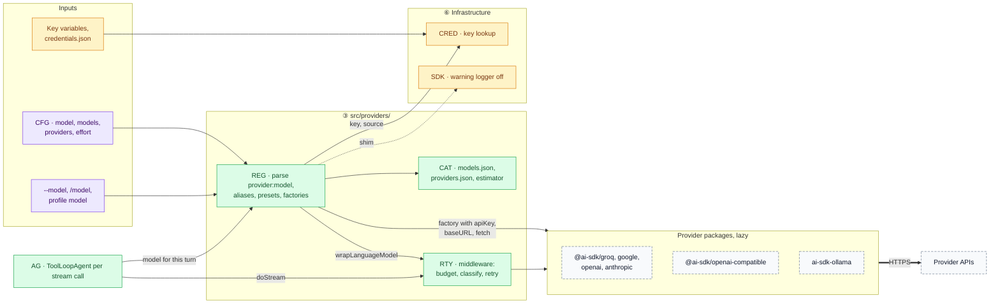
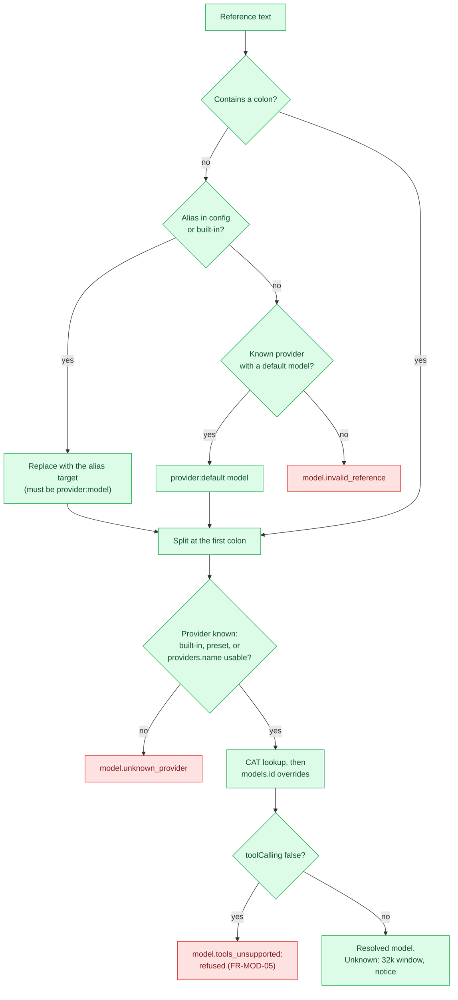
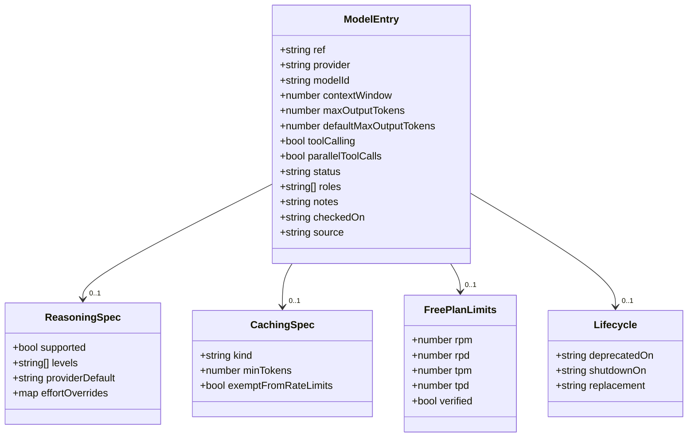
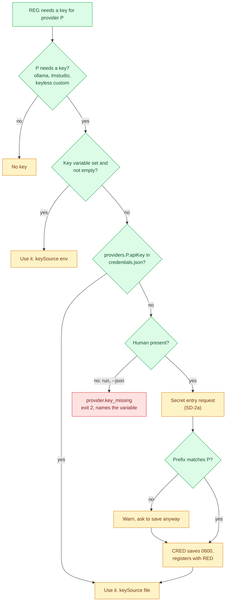
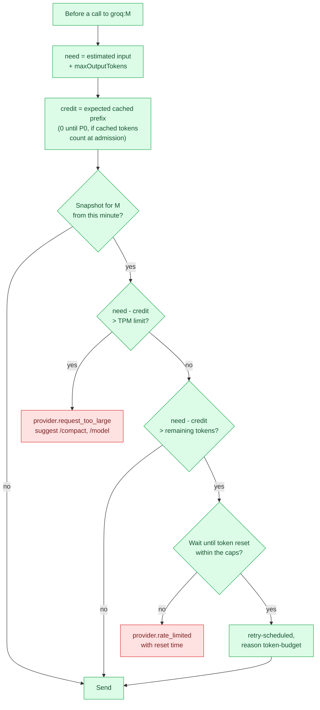
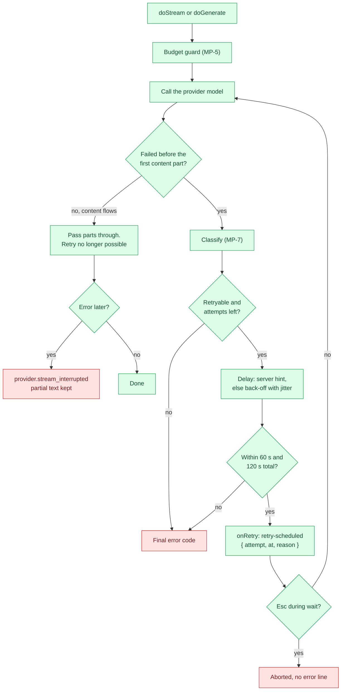
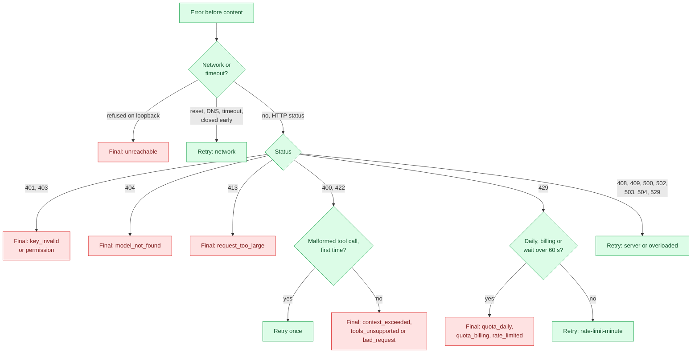
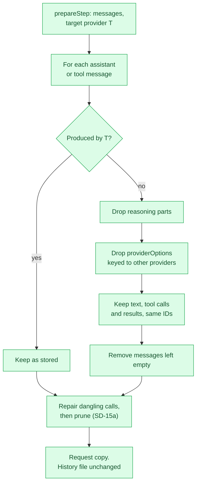

# antai — Model & Provider Integration

| | |
|---|---|
| **Product** | antai (brand) / `antai` (command) |
| **Document** | Deliverable 09, Model & Provider Integration for the v1 MVP |
| **Status** | Draft for review |
| **Version** | 0.1 |
| **Date** | 12 October 2026 |
| **Author** | Daksh Nagpal |
| **Based on** | BRD_1 v0.4, HLD.png, deliverables 00 (register), 01 (HLD), 03 (sequence diagrams) and 04 (data and storage) |
| **How to use** | Reference design, not a fixed rail. Where the technology needs something different or extra, the implementation may change it; the change is then made in every deliverable it touches, so the set keeps agreeing. |

## Contents

1. Purpose, scope and principles
2. Provider integration (MP-1, MP-2)
3. Supported providers
4. Model catalogue (MP-3)
5. Capability matrix
6. Reasoning effort mapping
7. Credentials per provider (MP-4)
8. Rate limits and quotas (MP-5)
9. Retry policy (MP-6, MP-7)
10. Error mapping
11. Switching provider mid-session (MP-8)
12. Data use and privacy per provider
13. Model selection process
14. Configuration keys added by this deliverable
15. Design decisions
16. Open questions
17. Traceability
18. Sources

---

## 1. Purpose, scope and principles

### 1.1 Purpose

This deliverable defines how antai talks to model providers: how a `provider:model` reference becomes a working language model, which providers and models ship in v1, what each can do, how `/effort` maps to each provider, where keys come from, how rate limits and quotas are handled, how antai retries, how provider errors reach the user, and what happens to the conversation when the user switches provider. Developers build `REG`, `CAT` and `RTY` (deliverable 01, section 5.9) from it; reviewers check it against FR-MOD-01..08, FR-ERR-01..02 and NFR-PRIV-01..03.

### 1.2 Scope and related deliverables

| In this document | Elsewhere |
|---|---|
| Provider registry, presets, Ollama, model catalogue and aliases, capability matrix, effort mapping, credentials per provider, rate limits, retry policy numbers, provider error codes, provider switch, data-use facts | — |
| Where `RTY` sits in the turn loop, stall watchdog, abort handling | Deliverable 07 |
| Token budgets for instructions and tools, pruning and compaction, prompt-cache layout | Deliverable 08 |
| TypeScript contracts, the full error-code catalogue, exit-code precedence, NDJSON events | Deliverable 11 (its section 11.2 adopts the codes in section 10 unchanged) |
| `credentials.json` schema, `usage` and `retry` records | Deliverable 04, sections 5.5, 5.9, 5.10 |
| Flows: start-up key lookup, first run, `/model`, provider errors | Deliverable 03, SD-1a, SD-2a, SD-2b, SD-14a, SD-16a..c, SD-24 |
| Status bar and notices on screen | Deliverable 13 |

Deliverable 01 (section 1.2) splits retries the same way: this document owns the policy (its numbers and classification); deliverable 07 owns where it runs in the turn loop.

### 1.3 Principles

| # | Principle | Consequence |
|---|---|---|
| MP-P1 | **Provider choice is configuration, not code** (G3, D3). | Providers, presets and models are data in `src/providers/catalog/`. A new OpenAI-compatible endpoint or a new model ID needs a config entry or a catalogue row, never a code change. Only a new package type needs code. |
| MP-P2 | **Free by default.** | Groq free plan with `groq:openai/gpt-oss-120b`, confirmed in the P0 spike (section 13.3). Its 8K tokens-per-minute limit shapes the guard in section 8 and the budgets in deliverable 08. |
| MP-P3 | **Explicit about data use** (NFR-PRIV-03, CR-09). | Each provider's training and retention facts are in the provider profile, shown once per session where a free tier trains on prompts, and in the privacy note (DLV-DOC-06). |
| MP-P4 | **No SDK default retries** (beyond the BRD, HLD-D7). | Every model call sets `maxRetries: 0`. `RTY` is the only retry, so a daily-quota 429 is never retried and every wait is visible. |
| MP-P5 | **Keys go only to their provider** (FR-SEC-05, HLD-D20). | Keys are passed straight to provider factories, never written to `process.env`, never logged, and redacted everywhere. |
| MP-P6 | **The catalogue advises, the provider decides.** | antai warns about deprecated or unknown models but does not block them, except a model known not to call tools (FR-MOD-05). No network call is made to check models. |
| MP-P7 | **Never repeat a side effect.** | Only the model call is retried, and only before it has emitted anything (FR-ERR-02). |

### 1.4 Additions beyond BRD v0.4

These go beyond BRD v0.4. The design uses them as stated; the BRD can adopt them later.

| Ref | What this document uses |
|---|---|
| HLD-D7 | SDK `maxRetries: 0`; `RTY` middleware retries. BRD FR-ERR-02 still says "retried by the SDK" |
| Deliverable 01, section 1.4 | `/effort` keeps the five BRD levels; the SDK's `minimal`, `xhigh`, `max` are not exposed |
| CR-02, CR-15 | Default `groq:openai/gpt-oss-120b`, alias `fast` = `groq:openai/gpt-oss-20b`, Gemini `google:gemini-3.8-flash`. BRD 4.7, 5.8, FR-MOD-03 and AC-11 still name retired models |
| HLD-D20 | Provider keys never in `process.env`; stored keys never in child environments is now in BRD v0.4 (FR-SH-06) |
| CR-01 | Groq free-plan limits and the pre-flight token budget |
| CR-06, HLD-D24 | Ollama through `ai-sdk-ollama` by default, decided by the P0 spike |
| CR-08 | Provider settings are trust-gated, and the trust prompt names the key sent to each base URL (both now in FR-CFG-04; section 7.6) |
| CR-09 | Provider-specific data-use facts replace the general warning in NFR-PRIV-03 |
| P8 (deliverable 04) | `models` holds aliases and per-model metadata, told apart by key shape and value type (section 4.5) |

---

## 2. Provider integration

### 2.1 MP-1 Provider integration

`AG` asks `REG` for a model each time it builds an agent: at the start of every turn and after each approval round trip (deliverable 01, HLD-D2). `REG` returns the provider's language model wrapped by `RTY`, plus the call settings for that turn. Provider packages are imported only in `src/providers/` and only when first used, so start-up loads one provider package (NFR-PERF-01, DLV-PLN-02 question 11).

### 2.2 Components

| ID | Responsibility in this deliverable | Module path |
|---|---|---|
| `REG` | Parse references (section 2.3); resolve aliases; pick the provider profile (built-in, preset or custom); check trust for custom providers and base URLs (FR-CFG-04); get the key from `CRED`; create the provider instance once per process per (provider, base URL, key source); wrap models with `RTY`; compute call settings: `maxOutputTokens`, `reasoning`, `providerOptions` (section 6); report the effective effort and whether the base URL is local | `src/providers/` |
| `CAT` | Two data files: `models.json` (section 4) and `providers.json` (provider profiles: package, key variable, base URL, rate-limit header map, quota patterns, data-use facts). Token estimator (section 4.6). No network | `src/providers/catalog/` |
| `RTY` | Language-model middleware around `doStream` and `doGenerate`: pre-flight budget guard (section 8.4), error classification (section 9.3), retry loop (section 9.2), rate-limit snapshot from response headers, `retry-scheduled` events through a callback port | `src/providers/retry/` |
| `CRED` | Key lookup and storage (section 7) | `src/infra/credentials/` |
| `SDK` | Turns off the SDK's own console warning logger (`globalThis.AI_SDK_LOG_WARNINGS`), so warnings reach antai as data and never print into the Ink screen | `src/sdk/` |

`RTY` cannot import `events/` (deliverable 01, section 8.2). `AG` passes it a plain callback (`onRetry`) and the turn's abort signal when the model is built.

In HLD.png, `REG`, `CAT` and `RTY` are the Model Gateway (`providers/`) and the provider APIs are the AI model outside antai; together they form the Provider group. The Agent Brain (`AG`, `agent/`) calls it for every model step; Session also uses `REG` for `/model` and the title call (deliverable 01, sections 1.3 and 8.2). Two pieces sit outside `providers/`. `CRED` is in `infra/` because it is a file adapter like the other stores: HLD.png's Config box ("settings + API keys") is split into `CFG` for settings and `CRED` for keys. The `SDK` shim has its own `sdk/` folder so that experimental AI SDK names are imported in one place only (NFR-SEC-04).

### 2.3 MP-2 Resolving a model reference

A reference comes from `--model`, `/model`, `model` in config, a profile's `model` or an alias value. The provider is the text before the first colon; the rest is the model ID (FR-MOD-03), so `ollama:qwen3:14b` is provider `ollama`, model `qwen3:14b`.

Rules:

- **Alias names never contain a colon**, so a reference without one is always an alias (or a provider name). An alias must point to a full `provider:model`; an alias that points to another alias is a config error, so resolution cannot loop.
- **A bare provider name** (`/model google`) selects that provider's default model from `providers.json` (`google:gemini-3.8-flash`). Aliases win over provider names. Providers whose models vary per install (`ollama`, `lmstudio`, custom endpoints) have no default, so a bare name is an error with a hint.
- **"Usable"** means: built-in providers always; presets always; a `providers.<name>` entry only from global config, flags, environment or a trusted project (FR-MOD-07, FR-MOD-08, FR-CFG-04). A provider defined only by an untrusted project is reported as unknown, with the notice from SD-24.
- **Where the error shows.** At start, an invalid `model` in config falls back to the built-in default with a message naming the file and key (FR-CFG-02). An invalid `--model` exits with code 2. `/model` with an invalid reference shows the message and keeps the current model.

### 2.4 What `REG` returns for a turn

| Field | Meaning |
|---|---|
| `ref` | Canonical `provider:model` |
| `entry` | Catalogue entry merged with `models.<ref>` overrides, or the unknown-model defaults (section 4.5) |
| `model` | The provider's language model wrapped by `RTY` |
| `callSettings` | `maxOutputTokens` (always set, section 4.2; an upper bound that `PR` lowers per step and `RTY` applies, deliverable 08, 9.3), `reasoning` and `providerOptions` from the effort mapping (section 6), `maxRetries: 0` |
| `effectiveEffort` | The level the provider will actually use, for the status bar (FR-MOD-06) |
| `keySource` | `env:<VARIABLE>`, `file` or `none`, so an invalid-key message can name where the key came from (SD-16c) |
| `baseURL`, `isLocal` | For the status bar: a base URL whose host is not `localhost`, `127.0.0.0/8` or `::1` is shown (FR-MOD-07) |

Exact TypeScript shapes belong to deliverable 11.

---

## 3. Supported providers

### 3.1 Providers

Pins are the versions on the npm registry on 12 and 13 October 2026. The release pins exact versions (deliverable 01, HLD-D12); "line" is the range a pin may move within.

| Provider ID | Package (pin, line) | Priority | Auth | Base URL | Notes |
|---|---|---|---|---|---|
| `groq` | `@ai-sdk/groq` 4.0.59, 4.x | Must (default, D3) | `GROQ_API_KEY` | Package default (`https://api.groq.com/openai/v1`, deliverable 01, section 6.4) | Package model list knows `openai/gpt-oss-120b`, `openai/gpt-oss-20b`, `qwen/qwen3.6-27b` only; other IDs pass through as strings |
| `google` | `@ai-sdk/google` 4.0.93, 4.x | Must | `GOOGLE_GENERATIVE_AI_API_KEY` | Package default | v7 renamed the factory to `createGoogle` (old name kept) |
| `openai` | `@ai-sdk/openai` 4.0.91, 4.x | Should | `OPENAI_API_KEY` | Package default | `openai(id)` uses the Responses API. antai sets `store: false` (section 12) |
| `anthropic` | `@ai-sdk/anthropic` 4.0.78, 4.x | Should | `ANTHROPIC_API_KEY` | Package default | Prompt caching needs explicit breakpoints (section 5) |
| `ollama` | `ai-sdk-ollama` 4.4.0, 4.x (default, CR-06) | Should | None | `http://localhost:11434/api` (FR-MOD-07) | Section 3.3 |
| presets, custom | `@ai-sdk/openai-compatible` 3.0.68, 3.x | Should (FR-MOD-08, D28) | Preset variable or `apiKeyEnv` | Section 3.2 | 3.0.68 depends on `@ai-sdk/provider` 4.0.27 while `ai@7.0.137` depends on 4.0.26; the release aligns the pins to one provider-spec version (deliverable 16, section 3.4) |

All packages require Node 22 or newer and accept Zod `^3.25.76 || ^4.1.8`; `ollama-ai-provider-v2` requires Zod 4, which antai uses anyway (HLD-D13).

### 3.2 OpenAI-compatible presets and custom endpoints

Presets are rows in `providers.json`, so adding one is a data change. Every URL below comes from FR-MOD-08 and is **to be confirmed in the P0 spike**.

| Preset | Base URL | Key variable | Local | Notes |
|---|---|---|---|---|
| `openrouter` | `https://openrouter.ai/api/v1` | `OPENROUTER_API_KEY` | No | Routes to many upstream providers; data terms depend on the route (section 12) |
| `together` | `https://api.together.xyz/v1` | `TOGETHER_API_KEY` | No | |
| `fireworks` | `https://api.fireworks.ai/inference/v1` | `FIREWORKS_API_KEY` | No | |
| `deepseek` | `https://api.deepseek.com/v1` | `DEEPSEEK_API_KEY` | No | |
| `mistral` | `https://api.mistral.ai/v1` | `MISTRAL_API_KEY` | No | Tool-call ID format may be constrained; IDs are kept and the P0 spike checks them (section 11.3) |
| `xai` | `https://api.x.ai/v1` | `XAI_API_KEY` | No | |
| `lmstudio` | `http://localhost:1234/v1` | none | Yes | |

`REG` creates each with `createOpenAICompatible` from `@ai-sdk/openai-compatible`, passing `name` (the provider ID, which also becomes the `providerOptions` key), `baseURL`, `apiKey` and antai's `fetch` wrapper. It also requests usage in streamed responses (the package's `includeUsage` option; name confirmed in P0), because `/usage` and the budget guard need it.

Custom endpoints follow BRD 5.8: `providers.<name>` with `type: "openai-compatible"`, `baseURL` and `apiKeyEnv`. A custom name may not reuse a built-in or preset ID; a global `providers.<preset>` entry may override a preset's `baseURL` or `apiKeyEnv` (FR-MOD-07). Preset and custom models go through the same tool-calling check (FR-MOD-05): unknown models are allowed, with the unknown-model notice.

### 3.3 Ollama

**Package choice (CR-06, HLD-D24; the P0 spike confirms it, DLV-PLN-02 question 7).**

| Option | Facts (package READMEs read 13 October 2026) | Role |
|---|---|---|
| `ai-sdk-ollama` 4.4.0 | Targets `ai@^7` (`4.x` line); built on the official `ollama` JS client; better maintained (0 open issues); `think` model setting; context through `options: { num_ctx }` on the model; documented tool-calling reliability features (response synthesis, JSON repair) | Default |
| `ollama-ai-provider-v2` 4.0.1 | Peer `ai ^7.0.0`, implements `LanguageModelV4`, forces Zod 4; `providerOptions: { ollama: { think, options: { num_ctx } } }`; its README documents the AI SDK 7 top-level `reasoning` option | First fallback |
| `@ai-sdk/openai-compatible` at Ollama's OpenAI endpoint | No extra dependency | Last fallback (BRD 7.1) |

Why `ai-sdk-ollama` stays the default: it is maintained against AI SDK 7 and adds tool-call robustness. **Caveat found while writing this:** its README ties response synthesis to its own `generateText` and `streamText` wrapper exports. Its `ToolLoopAgent` example passes the plain model, and the README does not say whether the reliability features apply there. HLD-D24's reason ("tool-call repair") is therefore unproven for antai, which uses `ToolLoopAgent`. The spike decides on measured results.

**Spike criteria (DLV-PLN-02 question 7):** on one local model with tool calling, run the ten seed tasks through `ToolLoopAgent` with streaming; compare valid tool calls, streamed tool-call parts, `reasoning`/`think` handling, `num_ctx` honoured (prompt over 8K tokens not truncated), abort on Esc, and install size. Pick the package with more valid tool calls; on a tie, `ai-sdk-ollama`.

**Settings `REG` always passes:**

| Setting | Value | Why |
|---|---|---|
| Base URL | `providers.ollama.baseURL`, default `http://localhost:11434/api`. For `ai-sdk-ollama`, whose examples use the bare host, `REG` strips a trailing `/api` (to be confirmed in the P0 spike) | One config form whatever the package |
| Context size | `providers.ollama.numCtx`, default 32,768 (BRD "32k") | Ollama's small default truncates agent prompts (FR-MOD-07). `CAT` uses the same number as the context window for every Ollama model |
| Key | None | FR-MOD-04 |
| Effort | Section 6.2 | |

`OLLAMA_HOST` is not read: neither package README documents it, and FR-MOD-07 names config, flags and environment variables antai defines (deliverable 12). A model that is not pulled returns "not found": the hint is `ollama pull <model>`. Ollama not running gives connection refused on loopback: not retried (section 9.3), hint "start Ollama".

### 3.4 Base URL rules

| Rule | Source |
|---|---|
| A `baseURL` for any provider is honoured only from global config, flags, environment variables or a trusted project | FR-MOD-07, FR-CFG-04, AC-35 |
| An untrusted project's provider definitions and base URLs are ignored with one notice | SD-24 |
| A non-local base URL is shown in the status bar for the whole session | FR-MOD-07 |
| A stored key is sent only to the base URL its provider resolves to; the trust prompt names that key (section 7.6) | FR-CFG-04, CR-08 |
| The `fetch` wrapper never follows a redirect to another host for model calls (whether provider packages follow redirects is to be confirmed in the P0 spike) | NFR-PRIV-01 |

---

## 4. Model catalogue

### 4.1 MP-3 Data structure

The catalogue is `src/providers/catalog/models.json`, bundled into `dist/` and validated by a Zod schema in CI (DLV-PLN-03, HLD-D13). Provider profiles live next to it in `providers.json`.

| Field | Meaning | Used by |
|---|---|---|
| `ref` | `provider:model`, unique | `REG` |
| `contextWindow` | Input tokens the model accepts | `PR` pruning (FR-AGT-05) |
| `maxOutputTokens` | Provider's maximum | Upper bound for config |
| `defaultMaxOutputTokens` | What antai sends as `maxOutputTokens` unless `models.<ref>.maxOutputTokens` is set | Budget guard, cost control |
| `toolCalling` | `true`, `false` or absent (unknown). `false` refuses the model (FR-MOD-05) | `REG`, `/model` |
| `parallelToolCalls` | Whether the model can return several calls in one step | Tests; antai never relies on it (section 5) |
| `reasoning.levels` | BRD levels the model accepts natively; `providerDefault` is the level it uses when none is sent; `effortOverrides` maps a BRD level to explicit `providerOptions` where the SDK mapping is wrong for this model | Section 6 |
| `caching` | `automatic-prefix`, `implicit`, `explicit` or `none`; minimum cacheable tokens; whether cached tokens are exempt from rate limits | `RTY` guard, deliverable 08 |
| `freePlan` | Free-plan limits and whether they are verified | `RTY`, `/usage`, docs |
| `status` | `production`, `stable`, `preview`, `deprecated`, `shut-down` | Warnings, `/model` picker |
| `lifecycle` | Dates and replacement | Warnings (section 4.3) |
| `roles` | `default`, `fast` (per provider) | Defaults, title model |
| `checkedOn`, `source` | Date and URL of the fact | Catalogue refresh |

### 4.2 Shipped v1 entries

Values were checked on the provider's pages or in the package code on 12 and 13 October 2026, or on the date shown. "Provisional" means the entry is a sensible default that DLV-PLN-03 confirms at P3.

| `ref` | Context | Max out | antai default `maxOutputTokens` | Tools | Parallel | Reasoning levels (provider default) | Caching | Free plan | Status, dates | Role |
|---|---|---|---|---|---|---|---|---|---|---|
| `groq:openai/gpt-oss-120b` | 131,072 | 65,536 | 4,096 (provisional, P0 tunes) | Yes | **No** | low, medium, high (medium); `none` rejected | Automatic prefix, 2 h, cached tokens not counted against limits | 30 RPM, 1K RPD, 8K TPM, 200K TPD | Production; no deprecation announced (12 Oct 2026) | `default`, alias `smart` |
| `groq:openai/gpt-oss-20b` | 131,072 | 65,536 | 4,096 (provisional) | Yes | **No** | low, medium, high (medium) | As above | 30 RPM, 1K RPD, 8K TPM, 200K TPD | Production | `fast`, alias `fast` |
| `groq:qwen/qwen3.8-27b` | 131K (exact value to be confirmed in the P0 spike) | 16,384 | 4,096 | Yes | Yes | none, low, medium, high (`default`) | Not listed for caching | 30 RPM, 1K RPD, 8K TPM, 200K TPD | **Preview**: opt-in only, "not for production" | — |
| `google:gemini-3.8-flash` | 1,048,576 | 65,536 | 16,384 | Yes | To be confirmed in the P0 spike | low, medium, high; `minimal` returns an error | Implicit, minimum 4,096 tokens | Yes; limits not published (AI Studio only), **to be confirmed in the P0 spike** | Stable, 2 Sep 2026 | `default` for `google` |
| `openai:gpt-6.1-sol` | About 1,050,000 (page shows "1.05M"); catalogue stores 1,000,000 | 128,000 | 16,384 | Yes | To be confirmed in the P0 spike | low, medium, high (also xhigh, max) | Automatic (to be confirmed in the P0 spike) | No free plan | **Provisional**; checked 13 Oct 2026 | `default` for `openai` |
| `openai:gpt-6-luna` | As above | 128,000 | 16,384 | Yes | As above | none, low, medium, high | As above | No | **Provisional** | `fast` for `openai` |
| `anthropic:claude-sonnet-5-5` | 1,000,000 | 128,000 | 16,384 | Yes | To be confirmed in the P0 spike | Adaptive thinking, effort (high) | Explicit breakpoints; cache reads not counted against ITPM | No | **Provisional**; retirement not before 28 Sep 2027 | `default` for `anthropic` |
| `anthropic:claude-haiku-5-5` | 1,000,000 | 128,000 | 16,384 | Yes | To be confirmed in the P0 spike | Adaptive thinking, effort (medium) | As above | No | **Provisional**; retirement not before 7 Oct 2027 | `fast` for `anthropic` |
| `ollama:qwen3:14b` | `numCtx` (32,768) | To be confirmed in the P0 spike | 4,096 | To be confirmed in the P0 spike | To be confirmed in the P0 spike | `think` on or off | None | Local | **Provisional**, BRD 4.7 example; P0 spike checks tool calling | — |

Why `defaultMaxOutputTokens` is always sent: Groq appears to count the requested maximum against tokens per minute (one public report; the P0 spike confirms), so an unset maximum (the model's 65,536) would make every request exceed 8K TPM. A bounded value also bounds cost per step on paid providers. When a step ends with finish reason `length`, antai shows a notice naming `models.<ref>.maxOutputTokens`.

### 4.3 Retired-model entries

The BRD examples and older guides name models that no longer work on free keys. The catalogue keeps them as entries with `toolCalling` unchanged and a `lifecycle`, so a user who configured one gets a clear warning instead of a provider error.

| `ref` | Status | Date | Replacement | Source |
|---|---|---|---|---|
| `groq:llama-3.3-70b-versatile` | Shut down for free and developer tiers | 16 Aug 2026 | `groq:openai/gpt-oss-120b` | Groq, checked 12 Oct 2026 |
| `groq:llama-3.1-8b-instant` | Shut down for free and developer tiers | 16 Aug 2026 | `groq:openai/gpt-oss-20b` | Groq, checked 12 Oct 2026 |
| `groq:moonshotai/kimi-k2-instruct-0905` | Shut down | 15 Apr 2026 | `groq:openai/gpt-oss-120b` | Groq, checked 12 Oct 2026 |
| `groq:qwen/qwen3-32b` | Shut down | 17 Jul 2026 | `groq:openai/gpt-oss-120b` | Groq, checked 12 Oct 2026 |
| `google:gemini-3.5-flash` | Deprecated; requests routed to `gemini-3.6-flash` | Released 19 May 2026 | `google:gemini-3.8-flash` | Google, checked 12 Oct 2026 |
| `google:gemini-3.7-flash` | Deprecated; routed to `gemini-3.8-flash` | — | `google:gemini-3.8-flash` | Google, checked 12 Oct 2026 |

Behaviour: past `deprecatedOn` → one-line warning at start and on `/model`. Past `shutdownOn` → a warning that names the replacement. Neither blocks the request (MP-P6): the catalogue can be out of date, and enterprise contracts keep some models. The provider's "model not found" error (section 10) is the backstop. No network call is made (DLV-PLN-03).

### 4.4 Aliases

| Alias | Target | Source |
|---|---|---|
| `fast` | `groq:openai/gpt-oss-20b` | BRD 5.8, updated to current models (section 1.4) |
| `smart` | `groq:openai/gpt-oss-120b` | BRD 5.8, updated to current models (section 1.4) |

Users add aliases in `models` (FR-MOD-03); a config alias with the same name replaces the built-in one. Aliases are trust-gated in project config, because they act like `model` (deliverable 04, section 5.2). The `/model` picker lists, in order: the current model, the default, aliases, catalogue models of providers that are usable now (key present or keyless), and models with config metadata. Deprecated entries are marked; preview models appear only when configured. Preset providers have no catalogue rows, so the picker offers `<preset>:` with free text (BRD 4.7).

### 4.5 Unknown models and per-model config

`models` holds two kinds of entry, told apart by key shape **and** value type (proposal P8 in deliverable 04):

| Key | Value | Meaning | Example |
|---|---|---|---|
| No colon | String `provider:model` | Alias | `"fast": "groq:openai/gpt-oss-20b"` |
| Contains a colon | Object | Per-model metadata | `"ollama:qwen3:14b": { "contextWindow": 32768, "toolCalling": true }` |

A key whose value has the wrong type is a validation error naming the key (FR-CFG-02); the entry is ignored. Allowed metadata fields: `contextWindow`, `maxOutputTokens`, `toolCalling`, `reasoning` (boolean). Metadata is accepted from any layer: it changes no destination and no permission.

**Resolution order for each field:** `models.<ref>` in config, then the catalogue entry, then the provider profile (for Ollama, `numCtx`), then the unknown-model default.

**Unknown model defaults (FR-MOD-03, FR-AGT-05):** context window 32,000 tokens; `defaultMaxOutputTokens` 4,096; `toolCalling` unknown (allowed); reasoning unknown (the effort setting is sent and any SDK warning becomes a notice). The first use in a session shows one notice: `Unknown model groq:new-model: context window assumed 32k. Set models."groq:new-model".contextWindow in ~/.antai/config.json.`

### 4.6 Token estimation

| Case | Method | Source |
|---|---|---|
| gpt-oss models | `gpt-tokenizer` 4.0.0 with `o200k_harmony`, loaded lazily on first use, plus 4 tokens per message and 64 per request for the chat format (deliverable 08, 9.6) | Groq's reported usage; P0 re-measures |
| Other models | Characters ÷ 4 for prose and code, ÷ 3 for tool output and JSON, times the calibration factor k (deliverable 08, 9.6) | Measured on samples; P0 repeats on real sessions |
| Within a turn | Last step's measured `inputTokens` plus an estimate of the parts added since | Deliverable 03, SD-15a |

Provider usage is the source of truth; estimates exist only for the budget guard and pruning. P0 compares estimates with measured usage on the seed tasks; at run time the calibration factor k corrects the estimate (deliverable 08, 9.6).

### 4.7 Updating the catalogue

| When | What | Who |
|---|---|---|
| P0 | Provisional entries from the spike (DLV-PLN-02 questions 1, 2, 7) | Tech lead |
| P3 | Confirmed by the eval suite (DLV-VER-06) | Product owner (DLV-PLN-03) |
| P6 | Refreshed before release; every listed model must be available on the report date | Product owner |
| Any time a provider retires a default | Patch release with a new default and a lifecycle entry for the old one | Engineering |

Each change is a merge request that updates `checkedOn` and `source`. CI checks: the schema; the default model and every built-in alias point to entries with `toolCalling: true` and no `shutdownOn` in the past; every provider has at most one `default` and one `fast` entry. A release-time script (not part of antai at runtime) may compare entries with provider model lists, such as Groq's `GET /openai/v1/models`.

---

## 5. Capability matrix

"Bundle" means read from the published package code on 13 October 2026.

| Capability | Groq (`@ai-sdk/groq`) | Google (`@ai-sdk/google`) | OpenAI (`@ai-sdk/openai`) | Anthropic (`@ai-sdk/anthropic`) | Ollama (`ai-sdk-ollama`) | OpenAI-compatible |
|---|---|---|---|---|---|---|
| Tool calling | All Groq models | Yes for `gemini-3.8-flash` | Yes for listed models | Yes for all current models | Per local model | Per endpoint and model |
| Parallel tool calls | **No** on gpt-oss; yes on qwen3.8 | To be confirmed in the P0 spike | Package option `parallelToolCalls` | To be confirmed in the P0 spike | To be confirmed in the P0 spike | Per endpoint |
| Streaming | Yes | Yes | Yes | Yes | Yes | Yes (usage needs `includeUsage`) |
| Reasoning parts | gpt-oss returns a `reasoning` field | Thought summaries with `includeThoughts`; signatures in provider metadata (bundle) | Reasoning summaries; item IDs or encrypted content (bundle) | Thinking blocks with signatures, summarised display (bundle) | `think` output | Endpoint-specific |
| Effort mapping | Section 6.2 | Section 6.2 | Section 6.2 | Section 6.2 | Section 6.2 | `reasoning` passed through |
| Prompt caching | Automatic, exact prefix, 2 h, 50 % discount, cached tokens exempt from limits (checked 12 Oct 2026) | Implicit on 2.5 and newer, minimum 4,096 tokens for 3.8 Flash (checked 12 Oct 2026) | Automatic (to be confirmed in the P0 spike) | Explicit `cacheControl` breakpoints (`ephemeral`, TTL `5m` or `1h`), at most 4 (bundle); cache reads exempt from ITPM (checked 12 Oct 2026) | None | Endpoint-specific |
| Usage fields filled | input, output, `cacheRead`, `reasoning` (bundle) | input, output, `cacheRead` from `cachedContentTokenCount`, `reasoning` from `thoughtsTokenCount` (bundle) | input, output, `cacheRead`, `cacheWrite`, `reasoning` (bundle) | input, output, `cacheRead`, `cacheWrite`, `reasoning` (bundle) | input, output (to be confirmed in the P0 spike) | Whatever the endpoint reports |
| Rate-limit headers | `x-ratelimit-{limit,remaining,reset}-requests` (per day), `…-tokens` (per minute), `retry-after` on 429 | None known; quota details in the 429 body | `x-ratelimit-{limit,remaining,reset}-{requests,tokens}` (per minute), project-token variants, `Retry-After` when present | `anthropic-ratelimit-{requests,tokens,input-tokens,output-tokens}-{limit,remaining,reset}` (reset in RFC 3339), `retry-after` on 429 | None | Endpoint-specific |
| Error body | OpenAI-style `error` object (format to be confirmed in the P0 spike) | Google RPC error with `status` and `details` (`RetryInfo`, quota IDs) | `error` with `type` and `code` | `{ type: "error", error: { type, message, details } }` (checked 12 Oct 2026) | Ollama error text | Endpoint-specific |

Consequences for antai:

- **Sequential tool calls are the baseline.** gpt-oss makes none in parallel, and side-effecting calls are serialised anyway (deliverable 01, HLD-D17). antai does not set `parallelToolCalls`.
- **Stable prefix.** Groq and Gemini cache by prefix without any request option, so instructions and tool definitions stay first and unchanged (deliverable 08). For Anthropic, `REG` sets `providerOptions.anthropic.cacheControl` at the breakpoints deliverable 08 chooses.
- **Headers are read by the `fetch` wrapper** that `REG` passes to each factory: every response updates `RTY`'s snapshot for that `provider:model`, successful or not. The packages also return raw response headers on stream and generate results (bundle), but the wrapper sees them before any part is streamed.

---

## 6. Reasoning effort mapping

### 6.1 Levels

`/effort` takes the five BRD levels: `provider-default`, `none`, `low`, `medium`, `high` (FR-MOD-06). The SDK's `reasoning` option also accepts `minimal`, `xhigh` and `max`; antai does not expose them in v1, following deliverable 01 section 1.4, because the providers that matter most (Groq gpt-oss, Gemini 3.8 Flash) have no native tier for them and the SDK would coerce them. The setting is portable: `REG` passes `reasoning` and lets each package translate it. Provider-specific `providerOptions` override it, so `REG` adds them only where the catalogue's `effortOverrides` says the SDK mapping is wrong for a model.

### 6.2 Mapping

| antai level | Groq gpt-oss | Gemini 3.8 Flash | OpenAI gpt-6.x | Anthropic Sonnet/Haiku 5.5 | Ollama | OpenAI-compatible |
|---|---|---|---|---|---|---|
| `provider-default` | Nothing sent; Groq uses `medium` | Nothing sent | Nothing sent | Nothing sent; model default effort | Nothing sent | Nothing sent |
| `none` | SDK pushes `unsupported` warning and ignores it (only `qwen/qwen3.6-27b` accepts `none` in the bundle); effective `medium` | `thinkingLevel` = the model's minimum, `low` for 3.7 and newer (bundle): thinking cannot be turned off | `none` where the model lists it (`gpt-6-luna`); otherwise the SDK warns (to be confirmed in the P0 spike for the Responses model) | Lowest the model allows: `between_tools` thinking or `effort: low`, with a `compatibility` warning (bundle) | `think: false` | `reasoning_effort` passed through |
| `low` | `reasoning_effort: low` | `thinkingLevel: low` | `low` | Adaptive thinking, `effort: low` | `think: true` | Passed through |
| `medium` | `medium` | `medium` | `medium` | `effort: medium` | `think: true` | Passed through |
| `high` | `high` | `high` | `high` | `effort: high` | `think: true` | Passed through |

The mapping is read from the `@ai-sdk/groq` 4.0.59, `@ai-sdk/google` 4.0.93 and `@ai-sdk/anthropic` 4.0.78 bundles. The Groq package maps `minimal` and `low` to `low`, `medium` to `medium`, and `high`, `xhigh` and `max` to `high`; it accepts `none` only for `qwen/qwen3.6-27b`. Extra per-provider settings `REG` adds:

| Provider | Extra `providerOptions` | Why |
|---|---|---|
| `google` | `thinkingConfig.includeThoughts: true` | Thought summaries reach `EVM`; without it Gemini returns no reasoning text (effect on usage measured in P0) |
| `openai` | `store: false` and encrypted reasoning content requested (option names confirmed in the package types in P1) | Privacy (section 12); with `store: false` the package drops reasoning items that have no encrypted content (bundle) |
| `ollama` | `think` as above; `num_ctx` | `ai-sdk-ollama` does not document the top-level `reasoning` option |
| `groq` `qwen/qwen3.8-27b` | `effortOverrides.none` → `reasoningEffort: "none"` | Groq accepts `none` for qwen3.8 but the bundle maps it only for qwen3.6 |

### 6.3 Unsupported and coerced levels

1. **Before the call.** `REG` computes `effectiveEffort` from `reasoning.levels` and `providerDefault`, so the status bar shows the level that will actually apply as soon as the user types `/effort`, for example `effort: none → medium` on gpt-oss (FR-MOD-06, BRD 4.7).
2. **During the call.** The SDK reports `{ type: "unsupported", feature: "reasoning", … }` for ignored values and `{ type: "compatibility", … }` for coerced ones (bundle). `EVM` reads the warnings from the step result in `onStepEnd` (the P0 spike confirms where v7 exposes them) and emits one notice per (model, level) per session: `groq:openai/gpt-oss-120b does not support effort none; using medium.`
3. Warnings of type `other` (for example Gemini's injected thought-signature placeholder, section 11) go to the debug log only, because they need no user action.
4. Unknown models have no `reasoning.levels`; their notice comes only from step 2.

### 6.4 Reasoning output

Reasoning arrives as `reasoning-start`, `reasoning-delta` and `reasoning-end` stream parts. `EVM` redacts it like text (NFR-SEC-05) and the renderer decides how to show it (deliverable 13). Reasoning tokens are counted in `usage.reasoning` (deliverable 04, section 5.10) and, for gpt-oss, inside the output budget, so a high effort with a small `maxOutputTokens` can end a step at `length` (section 4.2 notice).

---

## 7. Credentials per provider

### 7.1 MP-4 Key lookup order

Order follows FR-MOD-04: environment variable, then `~/.antai/credentials.json`, then a prompt that only interactive sessions show. There is **no key flag**: a key on the command line would land in shell history and in the process list. The key is not checked over the network at entry (deliverable 03, SD-D13); a wrong key surfaces on the first call as `provider.key_invalid`. Cancelling the prompt exits with code 2 at start and keeps the old model after `/model` (SD-14a).

### 7.2 Variables and formats per provider

| Provider | Variable | Known key prefix | Covered by FR-SEC-03 (d) | Key page shown in the prompt |
|---|---|---|---|---|
| `groq` | `GROQ_API_KEY` | `gsk_` | Yes | `https://console.groq.com/keys` (BRD 4.1) |
| `google` | `GOOGLE_GENERATIVE_AI_API_KEY` | `AIza` | Yes | In `providers.json`, URL checked in P0 |
| `openai` | `OPENAI_API_KEY` | `sk-` | Yes | As above |
| `anthropic` | `ANTHROPIC_API_KEY` | `sk-ant-` (to be confirmed in the P0 spike) | Yes, through `sk-` | As above |
| `openrouter` | `OPENROUTER_API_KEY` | `sk-or-` (to be confirmed in the P0 spike) | Yes, through `sk-` | As above |
| `xai` | `XAI_API_KEY` | `xai-` (to be confirmed in the P0 spike) | No: proposed addition to `RULES` (DLV-SW-07) | As above |
| `together`, `fireworks`, `deepseek`, `mistral` | Preset variable (section 3.2) | None known | No | As above |
| `lmstudio`, `ollama` | none | — | — | — |
| custom | `apiKeyEnv` | — | No | — |

The prefix check at entry only warns ("This does not look like a Groq key, which starts with gsk_. Save anyway?"), because prefixes change and some providers have none. Format detection is a second line of redaction; the first is exact values:

- `CRED` registers every stored key with `RED` (deliverable 04, section 5.5).
- Every key `REG` reads from the environment is a known value as well. Preset variables all end in `_API_KEY` and match FR-SEC-03 (b), but a custom `apiKeyEnv` such as `LLM_AUTH` would not, so `REG` registers the value explicitly.
- Provider error bodies pass `RED` before display, because some echo part of the key (deliverable 03, SD-16c).

### 7.3 Keys never in `process.env` (HLD-D20)

`REG` always passes the key explicitly (`createGroq({ apiKey, fetch })` and equivalents), even when it came from the environment. Two reasons: packages otherwise read their own variable, so antai could not say where a rejected key came from; and a key loaded from `credentials.json` must never be copied into `process.env`, where every shell command would inherit it. `SR` leaves provider variables the user exported in command environments, because they are the user's own, and removes only antai's internal variables (deliverable 01, section 10.6). The `fetch` wrapper strips `Authorization`, `x-api-key`, `x-goog-api-key` and similar headers before anything reaches the debug log.

### 7.4 `antai login` and `antai logout`

`antai login <provider>` accepts any provider that needs a key: built-in, preset, or a custom provider from global config (deliverable 03, SD-2b). It needs a TTY (SD-D14), stores the key as `providers.<name>.apiKey` with `savedAt`, and prints a note when the provider's variable is also set, because the variable wins. `antai logout <provider>` removes the stored key and leaves environment variables alone. Both write an audit `credential` event with no value (deliverable 04, section 5.9).

### 7.5 Switching to a provider without a key

`/model` to a provider with no key shows the same secret entry request as first run (FR-MOD-04, SD-14a). In `run`, `--model` naming a provider without a key exits with code 2 and names the variable.

### 7.6 Custom endpoints and trust

A trusted project can define a provider or change a base URL (FR-CFG-04), so it decides where a key goes. The trust prompt therefore lists, for each provider setting, the base URL **and the key that would be sent there**: `providers.my-gateway → https://llm.example.com/v1, sends $MY_GATEWAY_API_KEY` or `providers.openrouter.baseURL → https://proxy.example.com/v1, sends your stored openrouter key` (now in BRD v0.4, FR-CFG-04; CR-08). Without the second half, a project could point `apiKeyEnv` at an unrelated secret such as `AWS_SECRET_ACCESS_KEY` and the prompt would show only a URL.

---

## 8. Rate limits and quotas

### 8.1 Groq free plan

| Model (free plan) | RPM | RPD | TPM | TPD |
|---|---|---|---|---|
| `openai/gpt-oss-120b` | 30 | 1K | 8K | 200K |
| `openai/gpt-oss-20b` | 30 | 1K | 8K | 200K |
| `qwen/qwen3.8-27b` | 30 | 1K | 8K | 200K |

Facts (Groq rate-limit and prompt-caching pages, checked 12 October 2026; headers re-checked 13 October 2026): limits apply per organisation and are listed per model; whichever is hit first triggers; a request over a limit gets HTTP 429; cached tokens do not count toward limits, but "are subtracted from your limits after processing"; the Developer plan allows 1K RPM, 500K RPD and 250K TPM for these models. A single request whose input plus requested maximum exceeds the TPM limit was rejected with HTTP 413 "Limit 8000, Requested 8271" (one public report; the P0 spike confirms).

### 8.2 What the free plan means for a turn

Derived from the limits, not measured. P0 measures (DLV-PLN-02 question 1).

| Constraint | Arithmetic | Consequence |
|---|---|---|
| One request | input + 4,096 `maxOutputTokens` ≤ 8,000 if cached tokens count at admission | Input of at most about 3,900 tokens per step at the full 4,096; `PR` lowers the output per step down to 1,024 (deliverable 08, 9.3), which allows about 6,500. Whether cached tokens count at admission is the key unknown; the guard assumes they do not (section 8.4) and the P0 spike measures it |
| Steps per minute | 8,000 ÷ (uncached input + output per step) | With a stable prefix cached, a step may cost 1,000–2,000 tokens, so 4–8 steps a minute; without caching, about one |
| Turns per day (A2: at least 30) | 200,000 TPD ÷ 30 = about 6,700 uncached tokens per turn | Only reachable when most of each step's input is a cache hit |
| Requests per day | 1,000 RPD ÷ 25 steps = 40 maximal turns | Not the binding limit for typical turns |
| Requests per minute | 30 RPM, one request every 2 s | Not binding for sequential steps that each take seconds |

### 8.3 Rate-limit state

`RTY` keeps one snapshot per `provider:model`, filled by the `fetch` wrapper from every response:

| Field | Groq header | OpenAI header | Anthropic header |
|---|---|---|---|
| Requests remaining, limit, reset | `x-ratelimit-remaining-requests`, `-limit-requests`, `-reset-requests` (**per day**) | `x-ratelimit-…-requests` (per minute) | `anthropic-ratelimit-requests-…` |
| Tokens remaining, limit, reset | `x-ratelimit-remaining-tokens`, `-limit-tokens`, `-reset-tokens` (**per minute**) | `x-ratelimit-…-tokens` (per minute) | `anthropic-ratelimit-tokens-…` (most restrictive limit) |
| Wait | `retry-after` (seconds, 429 only) | `Retry-After` when present | `retry-after` |

Reset values such as `2m59.56s` and `7.66s` (Groq, OpenAI) are parsed as durations; Anthropic resets are RFC 3339 times. The snapshot stores absolute times, is shown by `/usage` and is saved in the turn's `usage.rateLimit` (deliverable 04, section 5.10). A value that does not parse is ignored, never guessed.

### 8.4 MP-5 Per-minute token guard

The guard runs inside `RTY` before each call, for providers whose profile enables it. In v1 that is **Groq only**: it is the only provider known to count the requested maximum against a small per-minute limit, and the only default on a free plan. Elsewhere, 429 handling (section 9) is enough.

- **Credit for cached tokens.** The expected cached prefix is the previous call's input tokens for the same model in this session, if the call was within the cache's 2 h life and the instructions and tool set have not changed since. Groq states that cached tokens do not count, but not whether its admission check excludes them before processing. The provider profile flag `cachedTokensCountAtAdmission` decides; until P0 measures it, the default is `false` (credit applied), because refusing locally on a wrong assumption would make multi-step turns impossible, while a wrong optimistic guess costs one rejected request that Groq reports as 413.
- **No snapshot yet** (first call, or older than its reset time): send without a guard. Groq's response or 429 corrects the state. This also avoids pacing paid Developer-plan users to free-plan numbers; the header `x-ratelimit-limit-tokens` tells antai the real limit.
- **No client-side RPM pacing.** There is no per-minute request header, and 30 RPM does not bind sequential steps (section 8.2).
- Waits count toward the retry caps in section 9.1 and show the same countdown.

### 8.5 Daily quota detection

A 429 is a daily quota, never retried, when any of these hold:

| Provider | Signal | Reset shown |
|---|---|---|
| Groq | `x-ratelimit-remaining-requests` is `0` (requests per day) | From `x-ratelimit-reset-requests` |
| Groq | Error message names a per-day limit, "(RPD)" or "(TPD)" (exact format to be confirmed in the P0 spike) | From the message or `retry-after` |
| Google | Quota ID in the error details contains `PerDay` or `Daily` | Midnight Pacific time, when free-tier requests per day reset (checked 12 Oct 2026) |
| Anthropic | `error.details.error_code` is `enforced_spend_limit_reached` (monthly spend cap; no `retry-after`) | The date in the message |
| OpenAI | Quota or billing error (the provider says not to retry these; exact code to be confirmed in the P0 spike) | — |
| Any | `retry-after` longer than 60 s (section 9.1) | `retry-after` |

Patterns for messages and codes are data in `providers.json`, so a provider's wording change is a data fix.

### 8.6 Other providers

| Provider | Free limits | What antai does |
|---|---|---|
| Google | Free tier exists; limits are no longer published and are shown only in Google AI Studio per project (checked 12 Oct 2026); actual limits **to be confirmed in the P0 spike** | No guard; 429 handling. `/usage` shows nothing for limits |
| OpenAI, Anthropic | No free plan; tiered paid limits | No guard; honour `Retry-After` |
| Ollama, LM Studio | None | No guard |
| Other presets | Endpoint-specific | No guard |

### 8.7 What the user sees

| Situation | Interactive (one line, then the session continues) | `run` |
|---|---|---|
| Waiting for a per-minute limit | `groq · rate limit (tokens per minute) · retrying in 23s · attempt 2/5 · Esc to stop` (live countdown) | One stderr line per scheduled retry |
| Daily quota (BRD 4.12, AC-21) | `✗ groq: rate limit reached (requests per day). Retry in 2h 14m.` and `Switch model with /model, or set another provider in ~/.antai/config.json.` | Same on stderr, exit 3 |
| Request too large for the plan | `groq: this request needs about 9.1k tokens; the plan allows 8k per minute. Use /compact, or /model to switch.` | Exit 3 |
| Gemini daily quota | `google: quota reached (requests per day). Resets at midnight Pacific time. Switch with /model.` | Exit 3 |

The user message is already in history, so the turn can be resent (BRD 4.12). Each line names provider, limit and next step (FR-ERR-01, NFR-USE-02); texts live in `MSG`.

---

## 9. Retry policy (`RTY`)

### 9.1 Numbers

| Setting | Value | Why |
|---|---|---|
| SDK retries | `maxRetries: 0` on `ToolLoopAgent`, title and `/compact` calls | The SDK retries every 429, daily quota included, and shows nothing |
| Attempts per model call | 5 in total (4 retries), config `retry.maxAttempts`, 1 to 10 | Enough to ride out a per-minute limit twice |
| Timeout attempts | At most 3 of the 5 | A timing-out endpoint rarely recovers quickly |
| Back-off without a server hint | 2 s, 4 s, 8 s, 10 s (doubling, capped at 10 s), each multiplied by a random factor from 0.8 to 1.2 | Short waits suit a per-minute window; jitter spreads parallel antai processes |
| Server hint | `retry-after` (seconds or HTTP date), Groq and OpenAI `x-ratelimit-reset-tokens` for token waits, Gemini `RetryInfo` delay; wait that long plus 0–500 ms, never less | The server knows its window; waiting less only burns a request |
| Longest single wait | 60 s. A hint above 60 s makes the error final, with the time shown | A per-minute window never needs more; longer waits are daily or account limits; 60 s keeps an interactive user in control |
| Longest total wait per call | 120 s, config `retry.maxWaitMs` | Bounds a turn that cannot progress |
| Malformed tool call reported by the provider | 1 immediate retry | Model output varies; Groq is reported to return HTTP 400 for these (to be confirmed in the P0 spike) |
| Esc | Cancels the wait at once; no further attempts | FR-AGT-04 |
| `run` | Same numbers | Scripts usually prefer a short wait to a failure |

### 9.2 MP-6 Call loop

**No retry after output.** `RTY` holds back the parts that carry no content (stream start with warnings, response metadata) and releases them with the first content part (`text-delta`, `reasoning-delta`, tool-input or tool-call parts). An error before that point is retryable; after it, the error is final for the turn and the text so far stays on screen and in history (deliverable 03, SD-16a). Because `RTY` wraps only the model, a tool that already ran in an earlier step is never re-run (FR-ERR-02).

### 9.3 MP-7 Classification

Network errors retried: `ECONNRESET`, `ETIMEDOUT`, `EPIPE`, `ENOTFOUND`, `EAI_AGAIN`, `ECONNREFUSED` to a non-loopback host, `UND_ERR_HEADERS_TIMEOUT`, `UND_ERR_BODY_TIMEOUT`, `UND_ERR_CONNECT_TIMEOUT`, `ERR_STREAM_PREMATURE_CLOSE`: the transient socket, DNS and timeout errors. Connection refused on loopback (Ollama, LM Studio not running) is final: the server will not start by itself within seconds. The SDK's `APICallError` gives the status, response headers and body, and its `isRetryable` flag is used only as a hint: antai's 429 rules override it.

Per provider:

| Provider | Retried | Final |
|---|---|---|
| Groq | Per-minute 429 (tokens or requests per minute); 5xx; network | Remaining requests 0; per-day message; 413 request larger than TPM; 401 |
| Google | 429 with a per-minute quota ID; 500, 503; network | Per-day quota ID; `RetryInfo` over 60 s; 400; 403 |
| OpenAI | 429 rate limit with `Retry-After`; 503 overloaded; 5xx | Quota or billing errors (provider says not to retry them) |
| Anthropic | 429 `rate_limit_error` with `retry-after`; 5xx and 529 overloaded (529 to be confirmed in the P0 spike) | `enforced_spend_limit_reached`; 400 "specified API usage limits" |
| Ollama, LM Studio | 5xx (model loading) | Connection refused; 404 model not pulled |
| OpenAI-compatible | Generic rules above | Generic rules above |

### 9.4 Countdown event

`RTY` calls `onRetry({ provider, model, attempt, maxAttempts, at, reason, code, limit })`, where `at` is an absolute time and `reason` is one of `rate-limit-minute`, `token-budget`, `server-error`, `overloaded`, `network`, `timeout`, `invalid-tool-call`. `limit` is `requests-per-minute` or `tokens-per-minute` when the provider's headers say which limit was hit, else null; the countdown names it (section 8.7; deliverable 13, UI-26). `AG` forwards each call to `BUS` as the `retry-scheduled` event (deliverable 01, section 5.8; deliverable 11, section 4.1), so the Ink UI, the line renderer and the plain renderer all count down to the same instant. `SC` stores it as a `retry` event record (`provider`, `attempt`, `at`, `reason`; deliverable 04, section 5.9). FR-UI-06 defines no NDJSON event type for retries, so `--json` runs write the line to stderr only (deliverable 11, section 5.1).

### 9.5 Comparison with the SDK default

| Policy | Attempts | Back-off | Server hint | Never retried | Shown to the user |
|---|---|---|---|---|---|
| **antai** | 5 (3 for timeouts) | 2 s doubling to 10 s, ±20 % | Honoured up to 60 s; longer is final | Daily quota, billing, auth, 4xx except one malformed-tool-call retry | Countdown event with attempt and time |
| AI SDK `ai@7.0.137` default | 3 (`maxRetries` 2) | 2 s doubling | Only if under 60 s | Anything not `isRetryable`; 408, 409, 429, 5xx all retried, daily quota included | Nothing |

Unlike the SDK default, antai never retries a daily quota and shows every wait. It does not go beyond 5 attempts because its default plan resets per minute, the countdown keeps the user informed, and the free plan's daily budget is better spent on a resend the user chooses than on silent attempts.

---

## 10. Error mapping

### 10.1 Provider error codes

Deliverable 11 owns the error model and the precedence of exit codes; its error code table (section 11.2) adopts these codes unchanged. This table adds the trigger and an example message for each. Exit codes are FR-UI-06: 2 usage or config error, 3 provider error. Every message names provider, cause and next step (FR-ERR-01) and passes `RED`.

| Code | Trigger | User message (`MSG`, example) | `run` exit |
|---|---|---|---|
| `model.invalid_reference` | Reference cannot be parsed or an alias does not resolve | `Model "fats" is not an alias or provider:model. Aliases: fast, smart.` | 2 |
| `model.unknown_provider` | Provider not built in, not a preset, not a usable `providers.<name>` | `Unknown provider "foo". Use groq, google, openai, anthropic, ollama, a preset, or define providers.foo.` | 2 |
| `model.tools_unsupported` | Catalogue or config says `toolCalling: false` (refused before any call) | `<ref> cannot call tools, which antai needs. Pick another with /model.` | 2 |
| `provider.key_missing` | No key and no human present | `No API key for groq. Set GROQ_API_KEY, or run antai login groq.` | 2 (FR-MOD-04) |
| `provider.key_invalid` | 401, or 403 for authentication | `groq: API key rejected (from GROQ_API_KEY). Check it, or run antai login groq.` | 3 |
| `provider.permission` | 403 for access (model, region, project) | `google: access denied for gemini-3.8-flash. Check the key's project and region.` | 3 |
| `provider.rate_limited` | Per-minute limit after attempts, or a wait over 60 s | `groq: rate limit reached (tokens per minute). Retry in 40s.` | 3 |
| `provider.quota_daily` | Section 8.5 daily signals | BRD 4.12 text | 3 |
| `provider.quota_billing` | Spend cap, billing or quota exhausted | `anthropic: monthly spend limit reached; access resumes on 1 Nov. Switch with /model.` | 3 |
| `provider.request_too_large` | 413, or the guard's local refusal | Section 8.7 | 3 |
| `provider.context_exceeded` | Provider says the prompt exceeds the context window | `groq: conversation is longer than the model's context window. Use /compact.` | 3 |
| `provider.model_not_found` | 404 or a "model not found / decommissioned" error | `groq: model llama-3.3-70b-versatile not found. It was shut down on 16 Aug 2026; try groq:openai/gpt-oss-120b.` (replacement from `CAT`) | 3 |
| `provider.tools_unsupported` | Provider rejects tools for this model | `ollama: qwen2:0.5b does not support tools. Pick another with /model.` | 3 |
| `provider.tool_call_invalid` | Malformed tool call after the one retry | `groq: the model produced an invalid tool call twice. Resend, or try /model.` | 3 |
| `provider.bad_request` | Other 400 or 422 | Provider text, redacted; if it mentions reasoning: `try /effort provider-default` | 3 |
| `provider.overloaded` | 503 or 529 after attempts | `anthropic: service overloaded. Resend in a minute.` | 3 |
| `provider.server_error` | Other 5xx after attempts | `groq: server error (502). Resend in a moment.` | 3 |
| `provider.unreachable` | Network error after attempts; refused on loopback | `groq: cannot reach the API. Check the network, then resend.` / `ollama: not running at localhost:11434. Start Ollama.` | 3 |
| `provider.timeout` | Three timeouts | `openai: no response in time. Resend, or check the network.` | 3 |
| `provider.stream_interrupted` | Error after the first content part | `groq: the response stopped early. The partial answer is kept; resend to continue.` | 3 |
| `provider.content_filtered` | Finish reason content filter or a safety block | `google: the response was blocked by the provider's safety filter.` | 3 |
| `provider.unknown` | Anything else | `<provider>: unexpected error (<status>). Details in the debug log with --debug.` | 3 |

### 10.2 Where errors surface

| Stage | Behaviour |
|---|---|
| Resolution (`model.*`) | Before any call: at start (fallback to default, FR-CFG-02), on `--model` (exit 2) or on `/model` (message, model unchanged) |
| Call (`provider.*`) | `RTY` raises a typed error (`ERR`); the turn ends with one `error` event; the session continues (NFR-REL-02); the `error` event record carries `category: provider`, `code`, `provider` and the catalogue message (deliverable 04, section 5.9) |
| `run` | The same line on stderr and exit 3, or 2 for `model.*` and `provider.key_missing` |

---

## 11. Switching provider mid-session

### 11.1 Checks at `/model`

`/model <id>` runs at the idle prompt and applies from the next turn (FR-MOD-05, SD-14a). In order:

1. Resolve the reference (section 2.3). Known no-tools models are refused.
2. Find a key, or ask for one (section 7.5).
3. Recompute the effective effort for the new model and show it if it changes (`effort: low → low`, or `none → medium`).
4. Compare the conversation's size with the new context window: the last measured input tokens plus the user's next message. If it is over `context.pruneAt` × window, say so now: `The conversation (~180k tokens) is larger than groq:openai/gpt-oss-120b's 131k window. Older output will be pruned; /compact is recommended.` On the Groq free plan also compare with the per-minute limit.
5. If the new provider's profile has a data-use notice not yet shown this session, show it (section 12.2).
6. Record a `setting` event (model) in the audit log and the session (FR-HIS-13).

### 11.2 MP-8 Preparing the message copy after a switch

`PR` prepares the request copy in `prepareStep` (deliverable 03, SD-15a). It needs to know which provider produced each assistant message. Message records carry no provider (deliverable 04, section 5.8), so `SC` keeps a map from turn number to `provider:model`, rebuilt on resume from the session header and `setting` events.

### 11.3 What is stripped or kept

| Content | Same provider | Different provider | Why |
|---|---|---|---|
| Text parts | Kept | Kept | The conversation continues (FR-MOD-05) |
| Reasoning parts (text, signatures, encrypted content, redacted thinking) | Kept | **Dropped** | FR-MOD-05. Packages already drop foreign reasoning with a warning (Anthropic: "unsupported reasoning metadata"; OpenAI: "Non-OpenAI reasoning parts are not supported", bundle), but Google would forward it as a thought without a signature, so antai drops it first |
| `providerOptions` on parts and messages (`google.thoughtSignature`, `openai.itemId`, `anthropic.cacheControl`, …) | Kept | Keys of other providers dropped | Foreign metadata is meaningless or harmful to the target |
| Tool-call and tool-result parts | Kept | Kept, IDs unchanged | The model needs earlier results (AC-11). Some endpoints may constrain ID format (reported for Mistral; to be confirmed in the P0 spike) |
| Tool calls without a result | Synthetic "interrupted" result | Same | FR-AGT-04 |
| Approval request and response parts | Left to the SDK | Same | The SDK owns their conversion |
| History file | Unchanged | Unchanged | FR-MOD-05; provider parts are kept for a later switch back |

A switch back (A → B → A) restores A's own reasoning for the turns A produced, because the rule is "produced by the target", not "produced since the last switch". Within one provider a model change keeps everything, Gemini thought signatures included, because the BRD strips them only on a provider change; the P0 spike (DLV-PLN-02 question 8) confirms that Gemini accepts them.

**Gemini 3 and tool calls from another provider.** Gemini 3 expects thought signatures on function calls. For calls that have none (all calls Groq produced), `@ai-sdk/google` 4.0.93 inserts the placeholder `skip_thought_signature_validator` and pushes a warning of type `other` (bundle). antai relies on this for AC-11, logs the warning at debug level only, and the P0 spike (DLV-PLN-02 question 8) confirms the request succeeds.

### 11.4 Side effects of a switch

| Effect | Detail |
|---|---|
| Prompt cache lost | Caches are per provider. The first request after a switch pays for its whole input; on the Groq free plan this counts against 8K TPM and may trigger the guard (section 8.4) |
| Context window changes | The next `prepareStep` prunes against the new window; still over means the turn stops with `/compact` (FR-AGT-05, SD-15a). Step 4 of section 11.1 warns earlier |
| Effort | The stored antai level stays; the new provider maps it (section 6) |
| Rate-limit snapshot | Kept per `provider:model`; the new model starts without one |
| Usage | `usage` records carry provider and model per turn (deliverable 04, section 5.10) |
| Title model | Follows the session's current provider (section 13.4) |

---

## 12. Data use and privacy per provider

### 12.1 Facts

| Provider | Training on API data | Retention and review | Regional rules | Source |
|---|---|---|---|---|
| Groq (all plans) | **Not used** for training without the customer's permission | No retention by default; logs up to 30 days for reliability and abuse; Zero Data Retention available to all customers; stored in GCP in the US | — | Groq terms, checked 12 Oct 2026 |
| Google, free tier | **Used** to provide, improve and develop Google products and machine learning | Human reviewers may read, annotate and process input and output; Google says not to submit sensitive, confidential or personal information | Only paid services may be used when making API clients available to users in the EEA, Switzerland or the UK | Gemini API terms, checked 12 Oct 2026 |
| Google, paid tier | Not used | — | — | Gemini API terms, checked 12 Oct 2026 |
| OpenAI, Anthropic | Not checked on 12 October 2026; checked before the privacy note (DLV-DOC-06, P6), which links to each provider's own terms | Checked before the privacy note. antai sets OpenAI `store: false` so it asks for no stored responses | — | DLV-DOC-06 checks |
| OpenRouter, Together, Fireworks, DeepSeek, Mistral, xAI | Depends on the provider and, for OpenRouter, the upstream route (**to be confirmed**, DLV-DOC-06) | — | — | DLV-DOC-06 checks |
| Ollama, LM Studio with a loopback base URL | Nothing leaves the machine | — | — | FR-MOD-07 |

antai itself adds no telemetry: data goes only to the chosen provider (NFR-PRIV-01, deliverable 01, section 6.4).

### 12.2 How antai informs the user

| Where | What | Requirement |
|---|---|---|
| First use of a provider in a session whose profile marks "free tier trains on prompts" (v1: `google`) | One notice: `Google: on the free tier, prompts and responses may be used to improve Google products and read by human reviewers; the paid tier is not. In the EEA, Switzerland and the UK only the paid tier may be used.` antai cannot tell a free key from a paid one, so the notice is shown for every Google key; `privacy.dataUseNotice: false` in global config silences it | NFR-PRIV-03, CR-09 |
| `/model` picker | A marker on providers whose free tier trains on prompts | NFR-PRIV-03 |
| Non-local base URL | Shown in the status bar for the session | FR-MOD-07 |
| First run (Groq) | BRD 4.1 text; the privacy note is linked from `--help` | NFR-USE-01 |
| Privacy note (DLV-DOC-06) | The table in 12.1 with check dates; advice to send client code only through providers with suitable terms | NFR-PRIV-03 |

The notice is not persisted, because deliverable 04 defines no state file for acknowledgements; once per session keeps it visible without new storage.

---

## 13. Model selection process

### 13.1 Deliverables

- **DLV-PLN-02 (P0 spike report)** answers the provider questions in 13.2 with measurements.
- **DLV-PLN-03 (model selection report and catalogue)** justifies the shipped defaults (FR-MOD-02), owns `models.json`, and is provisional at P0, confirmed at P3 with the eval suite (DLV-VER-06: at least 4 of 5 trials per AC-linked task, at least 80 % of the suite on the default model), and refreshed at P6.

### 13.2 P0 spike questions for providers

| # | Question | Measurement | Feeds |
|---|---|---|---|
| DLV-PLN-02 q1 | Groq free-plan budget | Tokens for instructions, tool schemas, skill catalogue, a 34-tool MCP server; steps per minute with and without cache hits; tokens and requests per typical session | Section 8.2, `defaultMaxOutputTokens`, deliverable 08 |
| q2 | Default model | Tool-calling reliability of `openai/gpt-oss-120b`, `openai/gpt-oss-20b`, `gemini-3.8-flash` on ten seed tasks | Section 13.3 |
| q7 | Ollama package | Section 3.3 criteria | CR-06 |
| q8 | Gemini thought signatures across turns, and after a Groq-to-Gemini switch | AC-11 replayed live | Section 11.3 |
| q10 | Quota errors | `maxRetries: 0` plus `RTY`; a daily-quota 429 shown once with the reset time | Section 9 |
| q11 | Launch time | Providers loaded lazily | NFR-PERF-01 |
| New | Does Groq's admission check count cached tokens? | Repeat a large cached prefix with `x-ratelimit-remaining-tokens` recorded | Section 8.4 |
| New | Groq error bodies for TPM, TPD, RPD and malformed tool calls | Record real bodies | `providers.json` patterns |
| New | `maxRetries` on `ToolLoopAgent`, middleware hook names, where step warnings appear | Read types, run once | Sections 6.3, 9 |
| New | OpenAI-compatible preset URLs (BRD 10) | One tool-using call per preset with a key | Section 3.2 |
| New | Tool-call IDs replayed across providers | Replay a Groq session to each provider and preset | Section 11.3 |

### 13.3 Decision rule

Q3 is decided by assumption A2 (BRD 7.2): at least 90 % correct tool calls on a 20-task scripted run, a 25-step turn that fits the per-minute token limit, and at least 30 typical turns a day within the daily token limit. FR-MOD-02 also requires the shipped default to pass the smoke suite with at least 95 % valid tool calls and a typical 10-step turn to fit the free tier's per-minute and per-day limits. The two sets of numbers differ; **the default must pass both**. "Fits the per-minute limit" is read as: completes using only waits shorter than the 60 s single-wait cap, never a `request_too_large`.

Starting point (DLV-PLN-03): `groq:openai/gpt-oss-120b` default, `groq:openai/gpt-oss-20b` as `fast`, `google:gemini-3.8-flash` for Google. Preview models are never defaults.

### 13.4 Fallbacks and the title model

- **No Groq model passes:** the default becomes Gemini's free tier (BRD 7.1), with the data-use notice. A Groq default that passes but is slowed by the per-minute limit stays the default: antai explains the limit when it is hit (section 8.7), and the documentation names Gemini and Ollama as alternatives.
- **Title model:** the session title call (D30) uses the current provider's `fast` model when the catalogue has one and the same key serves it, with reasoning `low` and `maxOutputTokens` 256; otherwise the session model. On Groq the `fast` model has its own per-model limits (section 8.1), so the title does not spend the main model's per-minute budget. The call goes through `RTY` with one attempt (no retries) and is skipped when the guard finds no room (deliverable 03, SD-D11); a failure falls back to the trimmed first prompt.

---

## 14. Configuration keys added by this deliverable

Deliverable 04 (section 5.2) lists the BRD keys and leaves provider keys to this deliverable. Schemas are generated from Zod (DLV-SW-09).

| Key | Type | Default | Meaning | Project layer |
|---|---|---|---|---|
| `models.<alias>` | `provider:model` | `fast`, `smart` (section 4.4) | Alias (FR-MOD-03) | Trusted only |
| `models.<provider:model>.contextWindow` | integer | Catalogue, else 32,000 | FR-AGT-05 | Any |
| `models.<provider:model>.maxOutputTokens` | integer, at most the catalogue maximum | Catalogue `defaultMaxOutputTokens`, else 4,096 | Upper bound sent on every call; lowered per step on a short window (deliverable 08, 9.3) | Any |
| `models.<provider:model>.toolCalling` | boolean | Catalogue, else unknown | `false` refuses the model | Any |
| `models.<provider:model>.reasoning` | boolean | Catalogue, else unknown | `false` sends no `reasoning` | Any |
| `providers.<name>.type`, `.baseURL`, `.apiKeyEnv` | — | BRD 5.8 | Custom endpoints and overrides | Trusted only |
| `providers.ollama.numCtx` | integer ≥ 2,048 | 32,768 | Ollama context size (FR-MOD-07) | Any |
| `retry.maxAttempts` | integer 1–10 | 5 | Section 9.1 | Any |
| `retry.maxWaitMs` | integer 0–600,000 | 120,000 | Total wait per model call | Any |
| `privacy.dataUseNotice` | boolean | true | Section 12.2 | **Global only**: a project must not silence a privacy notice |

---

## 15. Design decisions

| ID | Decision | Reason | Alternative rejected |
|---|---|---|---|
| MP-D1 | Providers, presets and models are data (`providers.json`, `models.json`) read by `REG` and `CAT` | Provider choice is configuration (G3, MP-P1); a retired model is a data fix | Provider and model logic in code |
| MP-D2 | `maxRetries: 0` on every SDK call; `RTY` middleware is the only retry (beyond the BRD, HLD-D7) | The SDK retries daily-quota 429s invisibly | SDK default retries (BRD FR-ERR-02 text) |
| MP-D3 | 5 attempts (3 for timeouts), back-off 2 s doubling to 10 s ±20 %, server hints honoured up to 60 s, 120 s total | Fits per-minute windows; bounded; visible | 10 attempts |
| MP-D4 | A server wait over 60 s is final, with the reset time shown | Longer waits are daily or account limits; the user chooses to wait, switch or resend | Waits of 5 or 15 minutes |
| MP-D5 | No retry after the first content part; non-content parts held back until then | A retry must not duplicate visible text; tools never re-run | Retry whole steps |
| MP-D6 | Per-minute token guard for Groq only in v1 | Only provider known to count the requested maximum against a small limit | Guard every provider with headers |
| MP-D7 | Guard credits the expected cached prefix until P0 shows cached tokens count at admission | A wrong pessimistic guess blocks multi-step turns; a wrong optimistic guess costs one rejected request | Count every input token |
| MP-D8 | No guard before the first snapshot; no client-side RPM pacing | Avoids pacing paid users to free numbers; 30 RPM does not bind sequential steps | Pace from catalogue limits |
| MP-D9 | `maxOutputTokens` always sent, from config or the catalogue (Groq gpt-oss 4,096 provisional) | An unset maximum alone exceeds 8K TPM on Groq; bounds cost | Provider defaults |
| MP-D10 | `/effort` keeps five levels; mapping through the portable `reasoning` option, with `providerOptions` only where the catalogue says the SDK is wrong | Follows deliverable 01, section 1.4; the packages own provider quirks | Expose `minimal`, `xhigh`, `max` |
| MP-D11 | Effective effort from the catalogue for the status bar; SDK `unsupported`/`compatibility` warnings become one notice per (model, level); SDK console logger off | FR-MOD-06 asks for the effective level and a one-line notice; console output would corrupt the Ink screen | Show raw SDK warnings |
| MP-D12 | Unknown models allowed with a 32k default and a notice; only known no-tools models refused | FR-MOD-03, FR-MOD-05; new models work on day one | Allow only catalogued models |
| MP-D13 | `models` entries told apart by key shape and value type | One key as in BRD 5.8; unambiguous | A separate `modelSettings` key |
| MP-D14 | A bare word resolves as an alias first, then as a provider's default model | Short `/model google` without hiding user aliases | Aliases only |
| MP-D15 | No `--api-key` flag | Keys on the command line leak through shell history and the process list | A flag for scripts (they already have the variable) |
| MP-D16 | Keys always passed explicitly to factories; environment keys and custom `apiKeyEnv` values registered with `RED` | Keys stay out of `process.env` (HLD-D20); error messages can name the key's source; custom names may not match redaction patterns | Let packages read their own variables |
| MP-D17 | Key prefix check at entry warns, never blocks | Catches pasting the wrong provider's key without a network call | Validate with a model list call |
| MP-D18 | Trust prompt names the key each provider setting would receive (now in BRD v0.4, FR-CFG-04; CR-08) | A trusted project could otherwise aim any secret variable at its own URL | Show base URLs only |
| MP-D19 | On a switch, strip reasoning and foreign `providerOptions` by producer provider, using a turn-to-model map from `SC` | A → B → A keeps A's reasoning; no change to the message record schema | Strip everything once a switch happened |
| MP-D20 | OpenAI Responses with `store: false` and encrypted reasoning | antai asks for no stored conversations (NFR-PRIV-01 spirit) | Package default `store: true` |
| MP-D21 | Google `includeThoughts: true` | Reasoning text reaches `EVM` for display and history | No thought summaries |
| MP-D22 | Ollama through `ai-sdk-ollama` (HLD-D24), `numCtx` 32,768 passed explicitly, base URL normalised per package; spike decides on measured tool calls | Follows deliverable 01; its stated reason is unproven for `ToolLoopAgent` (section 3.3) | Decide without a bake-off |
| MP-D23 | Data-use notice once per session for providers whose free tier trains (Google), silenced only from global config | CR-09; no new state file | Persisted acknowledgement |
| MP-D24 | Title call on the provider's `fast` model with `low` effort | Saves the main model's per-minute budget on Groq | Always the session model |
| MP-D25 | Retired models kept as catalogue entries; warnings never block | Clear message for BRD-era configs; the catalogue may be stale | Remove them; block past shutdown dates |
| MP-D26 | Connection refused on loopback is not retried | Ollama or LM Studio not running needs the user, not a wait | Retry like any network error |
| MP-D27 | Provider packages loaded lazily, one per start | NFR-PERF-01 | Import all providers at start |
| MP-D28 | Quota and error patterns stored as data in `providers.json` | Provider wording changes need a data fix, not code | Hard-coded parsing |

---

## 16. Open questions

No answer is expected soon. Each row's default is what this document uses; nothing here waits on an answer.

| ID | Question | Options | Default used | Owner |
|---|---|---|---|---|
| Q09-1 | Does Groq's admission check count cached prompt tokens against TPM before processing? | Counted; exempt | Exempt (credit applied), Groq's 413 as backstop | P0 spike |
| Q09-2 | What do Groq's error bodies say for per-minute, per-day (RPD, TPD) limits and for a malformed tool call? | Record real bodies | Match "(RPD)", "(TPD)", "(TPM)", "(RPM)"; remaining requests 0 means daily | P0 spike |
| Q09-3 | Which Ollama package, given that `ai-sdk-ollama`'s reliability features are documented for its wrapper functions? Which base URL form does each accept? | `ai-sdk-ollama`; `ollama-ai-provider-v2`; `@ai-sdk/openai-compatible` | `ai-sdk-ollama` with `/api` stripped | P0 spike (q7) |
| Q09-4 | [USER] Provisional OpenAI and Anthropic defaults: `gpt-6.1-sol` with `fast` `gpt-6-luna`, and `claude-sonnet-5-5` with `fast` `claude-haiku-5-5`? | These; flagship models (`gpt-6-astra`, `claude-opus-5-5`); cheaper models | These | Daksh, DLV-PLN-03 |
| Q09-5 | Does `ToolLoopAgent` pass `maxRetries` to its model calls, and are the v7 middleware hooks still `wrapStream` and `wrapGenerate`? | Yes; set per call | Yes | P0 spike |
| Q09-6 | Where does v7 expose call warnings to `agent.stream()` users: a stream part or the step result? | Stream part; `onStepEnd` step | Step result in `onStepEnd` | P0 spike |
| Q09-7 | [USER] Show the Google data-use notice once per session, or persist an acknowledgement (needs a new state file in deliverable 04)? | Per session; persisted | Per session, silenced by `privacy.dataUseNotice` | Daksh |
| Q09-8 | [USER] Accept `GEMINI_API_KEY` as a second variable for Google, as Google's own docs use? | BRD name only; both | BRD name only | Daksh |
| Q09-9 | Do any providers or presets reject tool-call IDs produced by another provider (reported for Mistral, to be confirmed in the P0 spike)? | Keep IDs; rewrite IDs consistently on switch | Keep IDs; add a rewrite only if P0 finds a failure | P0 spike |
| Q09-10 | Must Gemini thought signatures be dropped when switching between two Gemini models? | Keep; drop | Keep (BRD strips only on provider change) | P0 spike (q8) |
| Q09-11 | Option names for OpenAI `store: false` with encrypted reasoning in `@ai-sdk/openai` 4.0.91 | Confirm in types | `store: false` plus the package's include option for encrypted reasoning | P1 |
| Q09-12 | Should assistant `message` records carry the producing `provider:model` instead of deriving it from the header and `setting` events? | Derive; add a field in deliverable 04 | Derive | Deliverable 04 |
| Q09-13 | Training and retention terms for OpenAI, Anthropic and the presets | Check each provider's terms | Listed as to be confirmed until DLV-DOC-06 | Product owner, P6 |
| Q09-14 | [USER] FR-MOD-02 (95 % valid tool calls, 10-step turn) and A2 (90 % on 20 tasks, 25-step turn, 30 turns a day) give different thresholds for the default. Which is the gate? | Both; FR-MOD-02 only; A2 only | Both must pass | Daksh |
| Q09-15 | `@ai-sdk/openai-compatible` 3.0.68 depends on `@ai-sdk/provider` 4.0.27, `ai@7.0.137` on 4.0.26. Which pin set gives one provider-spec version in the bundle? | Align pins; accept two copies | Align pins at release | Deliverable 16 |
| Q09-16 | Default `maxOutputTokens` for gpt-oss on the Groq free plan | 2,048; 4,096; measured | 4,096 until P0 | P0 spike (q1) |
| Q09-17 | Should a model past its catalogue shutdown date be refused locally? | Warn; refuse | Warn (DLV-PLN-03) | Product owner |

Questions from other deliverables answered here: Q03-10 (title model, section 13.4), Q04-11 (`models` key, section 4.5). Used with their defaults: Q01-5 (provider variables stay in child environments, section 7.3), BRD Q3 and register Q9 (Groq stays the default, sections 13.3 and 13.4).

---

## 17. Traceability

| Requirement | Sections |
|---|---|
| FR-MOD-01 | 3.1, 3.2, 3.3, 5 |
| FR-MOD-02 | 4.2, 8.2, 13.3 |
| FR-MOD-03 | 2.3, 4.4, 4.5 |
| FR-MOD-04 | 7.1, 7.2, 7.4, 7.5 |
| FR-MOD-05 | 2.3, 4.5, 11 |
| FR-MOD-06 | 6 |
| FR-MOD-07 | 2.4, 3.3, 3.4, 12.2 |
| FR-MOD-08 | 3.2, 3.4, 7.6 |
| FR-AGT-04 | 9.1, 11.3 |
| FR-AGT-05 | 4.1, 4.5, 4.6, 11.4 |
| FR-ERR-01 | 8.7, 10 |
| FR-ERR-02 | 8.5, 9 (beyond the BRD, HLD-D7) |
| FR-CFG-02, FR-CFG-04 | 2.3, 3.4, 4.5, 7.6, 14 |
| FR-SEC-03, FR-SEC-05 | 7.2, 7.3 |
| FR-CLI-02, FR-CLI-05 | 7.1, 7.4, 10 |
| FR-UI-02, FR-UI-06 | 2.4, 8.7, 9.4, 10.1 |
| FR-HIS-13 | 7.4, 11.1 |
| NFR-PRIV-01..03 | 3.4, 7.3, 12 |
| NFR-SEC-04 | 2.2, 3.1 |
| NFR-SEC-05 | 6.4, 7.2, 7.3 |
| NFR-USE-02 | 8.7, 10.1 |
| NFR-PERF-01 | 2.1, 15 (MP-D27) |
| NFR-REL-02 | 10.2 |
| AC-01 | 7.1 |
| AC-11 | 11.2, 11.3 |
| AC-21 | 8.5, 8.7 |
| AC-35 | 3.2, 3.4 |
| D3, D28, D30 | 3.1, 3.2, 13.4 |
| BRD 4.1, 4.7, 4.12 | 7.2, 4.4, 8.7 |
| BRD 7.1, 7.2 (A2), Q3 | 13.3, 13.4 |
| R3, R6 | 8.2, 13; 3.1 |
| Additions beyond BRD v0.4 (section 1.4) | 6.1, 9.1, 4.2, 7.3 |
| CR-01, CR-02, CR-06, CR-08, CR-09, CR-15 | 8, 4.3, 3.3, 7.6, 12, 4.4 |
| DLV-PLN-02, DLV-PLN-03 | 4.7, 13 |
| Title model (MP-D24), `models` key (MP-D13) | 13.4, 4.5 |

---

## 18. Sources

External facts in this document (package versions, provider limits, prices, API names, and the data terms that section 12.1 marks as checked) were checked on 12 October 2026, with package code and some provider pages re-checked on 13 October 2026, and are stated where they are used; the P0 spike re-checks the ones the design depends on.
