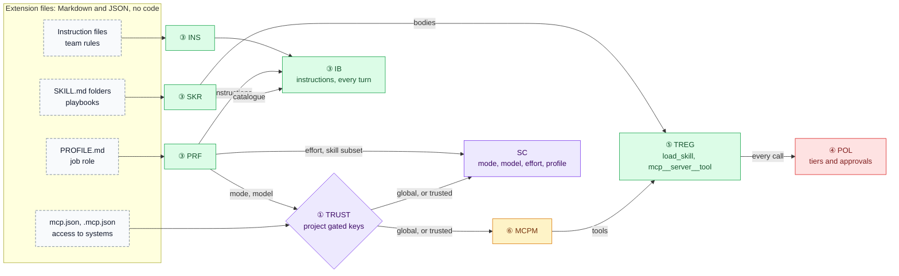
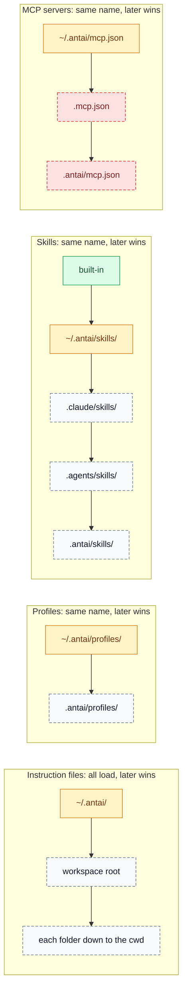
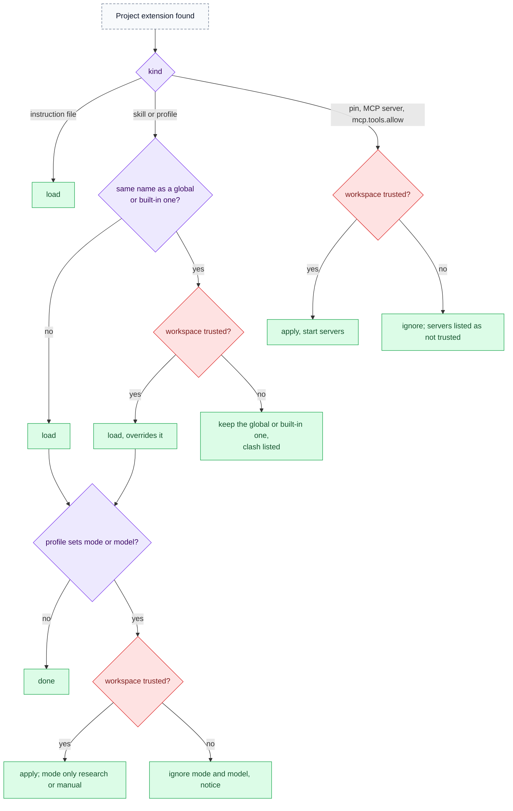
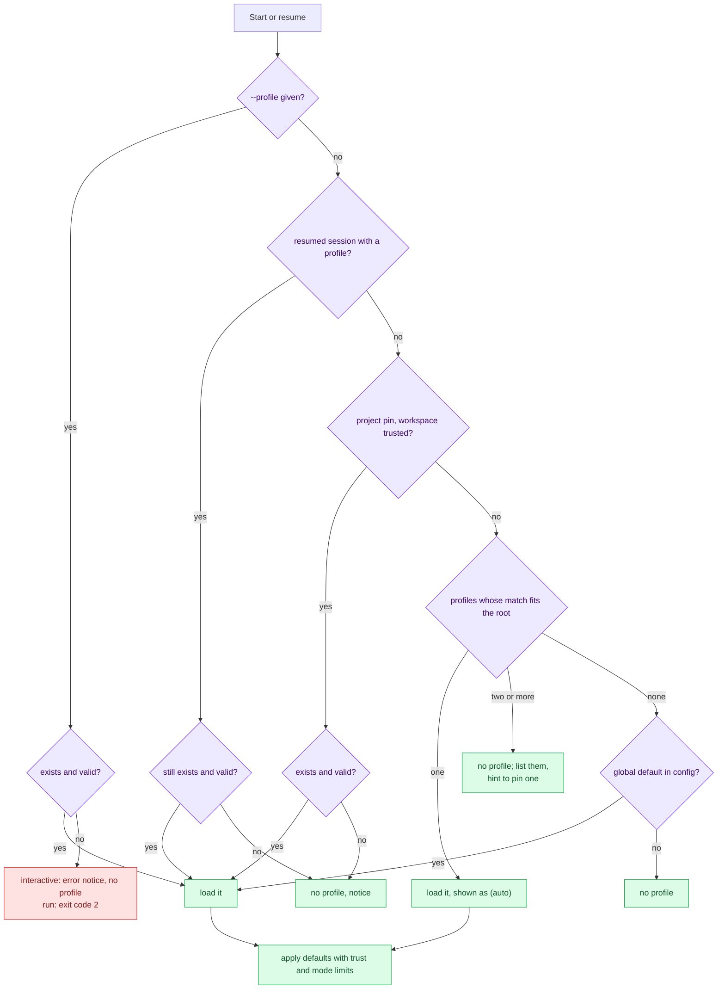
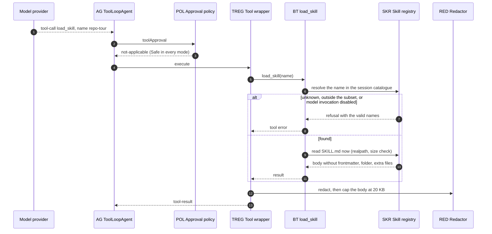
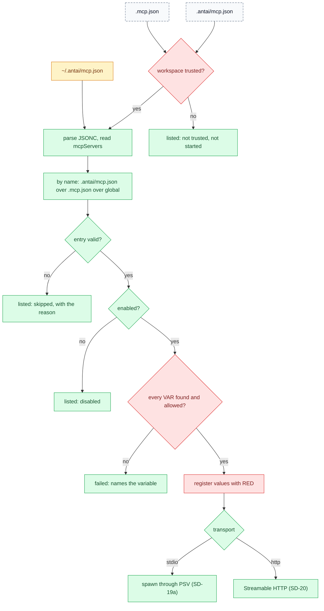
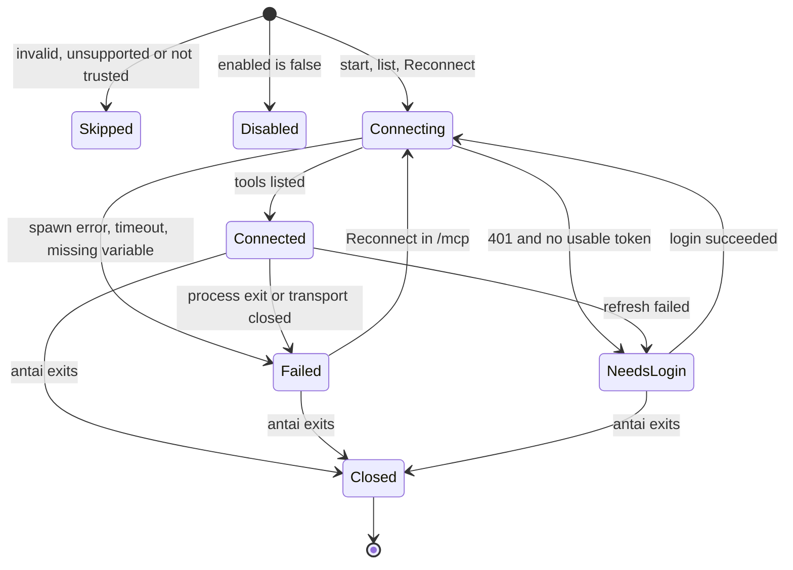
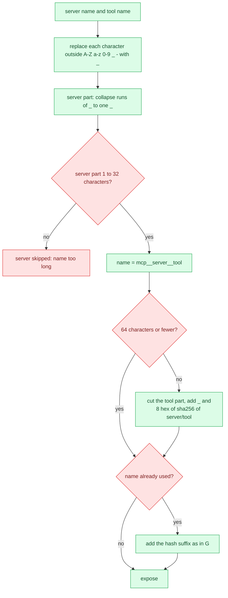
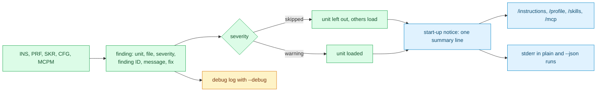

# antai — Extensibility: Instructions, Profiles, Skills & MCP

| | |
|---|---|
| **Product** | antai (brand) / `antai` (command) |
| **Document** | Deliverable 10, Extensibility: Instructions, Profiles, Skills & MCP for the v1 MVP |
| **Status** | Draft for review |
| **Version** | 0.1 |
| **Date** | 12 October 2026 |
| **Author** | Daksh Nagpal |
| **Based on** | BRD_1 v0.4, ARCHITECTURE_1 v0.1, DELIVERABLES_1 v0.2, deliverables 01 to 05, research notes B, C, E and F (checked 12 October 2026) |

## Contents

1. Purpose and scope (EXT-1)
2. Discovery and precedence (EXT-2, EXT-3)
3. Instruction files
4. Profiles (EXT-4)
5. Skills (EXT-5)
6. MCP client (EXT-6 to EXT-8)
7. Validation and error reporting (EXT-9)
8. Authoring guide outline and worked example
9. Compatibility matrix
10. Design decisions
11. Open questions
12. Traceability
13. Sources

---

## 1. Purpose and scope

### 1.1 Purpose

antai has no fixed job (BRD 1.1). Teams specialise it by writing files, not code: instruction files are the team's rules, a profile is the job role, skills are the playbooks, and MCP servers are access to company systems. This deliverable designs those four extension points for v1 so that G1 (one install adapts through configuration) and G5 (a file dropped in a recognised location appears on the next start; invalid files are listed with the reason) hold.

It is the reference for every recognised location and its precedence, the file formats, validation and the message for each invalid case, the `load_skill` tool and `/<skill-name>`, the built-in skills, the MCP client lifecycle, transports, both MCP spec versions, tool naming, drift detection, the OAuth summary, and compatibility with other agents' conventions. Deliverable 04, section 5.16, defers discovery, precedence, validation messages and caps to this document.

### 1.2 Scope

| In this document | Detailed elsewhere |
|---|---|
| Locations, search order, precedence, collisions, trust effects, reload rules | — |
| `PROFILE.md`, `SKILL.md` and MCP server fields and their validation | Schemas generated for DLV-SW-09 (deliverable 11 conventions) |
| `load_skill` behaviour, slash invocation, built-in skills | Exact tool schema: deliverable 12. Prompt text: deliverable 08 |
| MCP lifecycle, transports, versions, naming, drift, failure isolation | Flows SD-19a to SD-22: deliverable 03. State machines in UML: deliverable 06 |
| OAuth login summary | Security checks: deliverable 02. Flows: deliverable 03, SD-21a to SD-21d. Token storage: deliverable 04, section 5.5 |
| What `/instructions`, `/profile`, `/skills` and `/mcp` must show | Screens: deliverable 13 |
| Trust effects on extensions | Trust model and hash content: deliverables 02 and 04 |
| Conformance and interoperability cases (DLV-VER-05) | Test plan: deliverable 14 |

### 1.3 EXT-1 The extension model



| | Instruction files | Profile | Skill | MCP server |
|---|---|---|---|---|
| Analogy (BRD 1.1) | Team rules | Job role | Playbook | Access to company systems |
| File | `AGENT.md`, `AGENTS.md` or `CLAUDE.md` | `<name>/PROFILE.md` | `<name>/SKILL.md` plus extra files | `mcpServers` entry in `mcp.json` or `.mcp.json` |
| Where (section 2.1) | `~/.antai/`, workspace root, folders down to the cwd | `~/.antai/profiles/`, `.antai/profiles/` | Built-in, `~/.antai/skills/`, `.claude/skills/`, `.agents/skills/`, `.antai/skills/` | `~/.antai/mcp.json`, `.mcp.json`, `.antai/mcp.json` |
| Reaches the model as | Text in every request | Text in every request, plus session defaults | One catalogue line; body only on `load_skill` or `/<skill-name>` | Tools `mcp__<server>__<tool>` |
| How many active | All files in the chain | One at a time (FR-PRF-04) | All valid skills; the profile may narrow the model's list | All enabled, connected servers |
| Same name in two places | All load; later wins on conflict | Project wins (section 2.4) | Project wins (section 2.4) | `.antai/mcp.json` › `.mcp.json` › global |
| Needs workspace trust (project copy) | No | Only its `mode`, `model` and a pin | No, but cannot replace a global or built-in skill untrusted | Yes |
| Can change approvals | No | Only the default mode, within limits; never looser mid-session | No (`allowed-tools` ignored) | No; tools follow the tier rules |

Three rules hold for every extension:

1. **Text never grants power.** No instruction file, profile body or skill can change mode, approvals or permissions (FR-MODE-03, NFR-SEC-02). Project text is untrusted data, wrapped with its source when it reaches the model (deliverable 08).
2. **Code runs only through two doors.** A stdio MCP server is a program antai starts, so project servers need trust (FR-CFG-04). A skill's scripts run only through the `shell` tool under the normal tiers (FR-SKL-01).
3. **One bad file degrades one unit.** An invalid file is skipped or loaded with a warning and listed with its reason; antai always starts (NFR-REL-02, G5).

### 1.4 Components

All components come from deliverable 01, section 5.9. This document adds none.

| ID | Role in extensibility |
|---|---|
| `INS` | Finds and reads instruction files, applies the per-file cap, lists skipped files |
| `PRF` | Discovers and validates profiles, selects one (flag, resume, pin, auto-match), applies trust and mode limits |
| `SKR` | Discovers skills, validates them (strict and lenient), resolves precedence, builds the catalogue, serves bodies |
| `IB` | Assembles instructions in FR-AGT-03 order every turn |
| `SLASH` | Expands `/<skill-name>`; built-in commands win |
| `BT` | Hosts `load_skill` |
| `CFG`, `TRUST` | Read MCP files, drop trust-gated project keys unless trusted |
| `MCPM`, `MA` | Connect servers, track status and drift; expose and forward tools |
| `MOA`, `OCB`, `CRED` | OAuth login, callback, token storage |
| `POL`, `PG`, `RED` | Tiers for MCP tools, secret-path checks, redaction of extension text and tool output |
| `PSV`, `SDK` | Spawn stdio servers; the only importer of `fingerprintTools`, `detectToolDrift` and experimental MCP APIs |

### 1.5 Items pending BRD review used here

| Ref | What this document assumes | Sections |
|---|---|---|
| CR-04 | Skill fields pinned to the agentskills.io six plus the two Claude Code extensions; unknown fields warn | 5.1, 5.6 |
| CR-16 | MCP servers on spec 2026-07-28 and 2025-11-25 both work | 6.7 |
| A-C10 | `toolSearch` not used in v1 unless the P0 spike shows it is needed | 6.10 |
| A-C11, A-S11, Q01-16 | Fingerprints from `ai` plus an annotation hash; a changed annotation suspends Safe status from `trustReadOnlyHints` | 6.12 |
| A-C12, A-C13 | Windows `.cmd` launchers through `cmd.exe /c`; stateless HTTP, `redirect: 'error'` | 6.6 |
| Deliverable 04, P6 | `mcp.tools.allow` honoured only from global config or a trusted project | 6.3 |
| EXT-D6 (new) | A skill's identity is its folder name; a missing or different frontmatter `name` warns instead of skipping (Q10-1) | 5.6 |
| EXT-D7 (new) | In an untrusted folder, project skills and profiles never replace a global or built-in one of the same name (Q10-14) | 2.4 |
| EXT-D16 (new) | `${VAR:-default}` accepted next to `${VAR}` in `env` and `headers`; `${VAR}` in `command`, `args` or `url` skips the entry (Q10-16) | 6.2 |
| EXT-D17 (new) | Project MCP files cannot reference provider-key or `ANTAI_*` variables | 6.2 |
| Deliverable 05, Q05-2, Q05-3, Q05-8, Q05-9 | stdio servers get the scrubbed shell environment plus `env`; literal `headers` and `env` values of 4 or more characters are registered with `RED`; non-loopback `http://` server URLs are refused; OAuth discovery refuses non-`https` and private, loopback or link-local endpoints | 6.1, 6.2, 6.6, 6.13 |
| EXT-D21 (new) | MCP server fields `enabled`, `startupTimeoutMs`, `toolTimeoutMs` | 6.1 |
| Q10-4 (new) | `profile` in global config is a default below auto-match | 4.3 |

---

## 2. Discovery and precedence

### 2.1 Recognised locations

`<root>` is the workspace root: the git root of the current folder (found by walking up to `.git`, HLD-D16), or the current folder without git.

| Type | Location | Scope | Needs trust | BRD |
|---|---|---|---|---|
| Instruction file | `~/.antai/` | Global | — | FR-INS-02 |
| Instruction file | `<root>/` | Project | No | FR-INS-02 |
| Instruction file | Each folder from `<root>` down to the cwd | Project | No | FR-INS-02 |
| Profile | `~/.antai/profiles/<name>/PROFILE.md` | Global | — | FR-PRF-01 |
| Profile | `<root>/.antai/profiles/<name>/PROFILE.md` | Project | `mode` and `model` only | FR-PRF-01, 02 |
| Profile pin | `"profile"` in `<root>/.antai/config.json` | Project | Yes | FR-PRF-03 |
| Skill | Built-in, inside the package (`dist/skills/<name>/`) | Built-in | — | FR-SKL-07 |
| Skill | `~/.antai/skills/<name>/SKILL.md` | Global | — | FR-SKL-02 |
| Skill | `<root>/.claude/skills/<name>/SKILL.md` | Project | No | FR-SKL-02 (Should) |
| Skill | `<root>/.agents/skills/<name>/SKILL.md` | Project | No | FR-SKL-02 (Should) |
| Skill | `<root>/.antai/skills/<name>/SKILL.md` | Project | No | FR-SKL-02 |
| MCP servers | `~/.antai/mcp.json` | Global | — | FR-MCP-02 |
| MCP servers | `<root>/.mcp.json` | Project | Yes | FR-MCP-02 |
| MCP servers | `<root>/.antai/mcp.json` | Project | Yes | FR-MCP-02 |
| MCP tool overrides | `mcp.tools.allow`, `mcp.tools.deny` in any `config.json` | Any | `allow` only (section 6.3) | FR-MCP-06 |

```
~/.antai/                            <root>/
├── AGENTS.md                        ├── AGENT.md
├── profiles/node-dev/PROFILE.md     ├── services/billing/AGENTS.md   (loaded if the cwd is at or below it)
├── skills/repo-tour/SKILL.md        ├── .antai/
└── mcp.json                         │   ├── config.json              ("profile" pin)
                                     │   ├── mcp.json
                                     │   ├── profiles/api-dev/PROFILE.md
                                     │   └── skills/release-notes/SKILL.md
                                     ├── .agents/skills/<name>/SKILL.md
                                     ├── .claude/skills/<name>/SKILL.md
                                     └── .mcp.json
```

Anything else is not read. Section 9 lists the conventions of other tools that antai does not read in v1 (for example `~/.agents/skills/`, `CLAUDE.local.md`, `GEMINI.md`).

### 2.2 EXT-2 Search order per type

Arrows point from lower to higher precedence. Amber: the user's own files in `~/.antai`. Green: shipped with antai. Dashed grey: project content (untrusted data). Dashed red: project files used only in a trusted workspace.



Why project wins over global for profiles, skills and servers: the team's shared copy should beat a personal default inside that team's repository, which is the cross-client norm for skills (research C 4.3). Claude Code does the opposite for skills (personal over project); section 9 records the difference. Why `.antai/` wins among project paths: it is antai's own folder, so a team that writes there means it for antai (FR-SKL-02, FR-MCP-02).

### 2.3 Scanning rules

| Rule | Reason |
|---|---|
| File names `AGENT.md`, `AGENTS.md`, `CLAUDE.md`, `PROFILE.md` and `SKILL.md` are matched case-insensitively against the folder listing; a name that is not exactly upper-case gets a warning for `PROFILE.md` and `SKILL.md` | One behaviour on case-sensitive Linux and case-insensitive macOS and Windows |
| Only direct children of a `skills/` or `profiles/` folder are units (`skills/<name>/SKILL.md`). Nested folders and hidden folders (`.name`) are not scanned | Predictable names; a helper folder is not mistaken for a skill |
| Project skill and profile folders are looked up at `<root>` only, not in subfolders | BRD names `<workspace>/…` only; one place per team |
| At most 200 skill folders and 100 profile folders per location; extra folders are skipped with one notice | Bounds start-up work against a hostile or generated repository |
| At discovery, `PROFILE.md` and `SKILL.md` are read up to the end of the frontmatter (at most 16 KB); files over 256 KB are skipped | Start-up reads metadata only (progressive disclosure, FR-SKL-03) |
| Profiles load on the critical path; instruction files and skills load in the background, and the first submit, `/instructions`, `/skills` and the `/` menu wait for them | The profile decides the mode and model shown at the prompt (deliverable 03, SD-D2; NFR-PERF-01) |

### 2.4 Name collisions

| Case | Winner | Shown in |
|---|---|---|
| Several recognised instruction names in one folder | First non-empty of `AGENT.md`, `AGENTS.md`, `CLAUDE.md` (FR-INS-03, section 3.1) | `/instructions` lists the others as skipped |
| Instruction names that differ only in case (case-sensitive file system) | The all-upper-case name (FR-INS-01); among other spellings, the first in byte order | `/instructions` |
| Instruction files in different folders | All load in order global, root, deeper folders; later text wins on conflict (FR-AGT-03) | `/instructions` |
| Profile in `~/.antai/profiles/` and `.antai/profiles/` | Project (FR-PRF-01). In an untrusted folder the global profile is kept and the clash listed (pending BRD review, EXT-D7) | `/profile` |
| Skill of the same name in several locations | `.antai/skills` › `.agents/skills` › `.claude/skills` › `~/.antai/skills` › built-in (FR-SKL-02, FR-SKL-07) | `/skills` marks the winner "overrides <source>" |
| Untrusted folder: project skill named like a global or built-in skill | The global or built-in skill (FR-SKL-02; built-in pending BRD review, EXT-D7) | `/skills` lists the clash |
| Skill named like a built-in slash command (`help`, `model`, …) | The command, for `/name`. The model can still load the skill (FR-SKL-04) | `/skills` marks it "shadowed for /" |
| Invalid unit at a higher precedence | Skipped units take no part in precedence; the next valid one loads | Both listed, the invalid one with its reason |
| Skill and profile with the same name | No relation: separate namespaces | — |
| MCP server name in several files | `.antai/mcp.json` › `.mcp.json` › global; the whole entry is replaced, never merged field by field (FR-MCP-02) | `/mcp` shows "overrides <file>" |
| Two server names that become the same tool prefix after sanitising | The one from the higher-precedence file, then the first in file order; the other is skipped (section 6.9) | `/mcp` |
| Two tools of one server that sanitise to the same name | The second gets a hash suffix (section 6.9) | `/mcp` tool list |
| MCP tool versus built-in tool | Cannot happen: every MCP tool starts with `mcp__` (FR-MCP-05) | — |

Why an untrusted project cannot replace a global or built-in unit of the same name: a cloned repository could otherwise swap the user's own `commit-message` skill or `node-dev` profile for a hostile one while the user types the familiar name (review item FR-SKL-02). BRD FR-SKL-02 states this for global skills; this design extends it to built-in skills and to profiles for the same reason.

### 2.5 EXT-3 Trust gating of project extensions



| Project extension | Untrusted workspace | Trusted workspace |
|---|---|---|
| Instruction files | Load | Load |
| Profile instructions, `match`, `skills`, `effort` | Load | Load |
| Profile `mode`, `model` | Ignored with a notice (FR-PRF-02, AC-14) | Apply; `mode` only `research` or `manual` (FR-CFG-05) |
| Profile pin | Ignored | Applies (FR-PRF-03) |
| Skills | Load; never replace a global or built-in skill | Load and override |
| MCP servers (`.mcp.json`, `.antai/mcp.json`) | Not started; no OAuth login; listed as "not trusted" | Started (FR-MCP-02) |
| `mcp.tools.deny` | Applies (only tightens) | Applies |
| `mcp.tools.allow`, `trustReadOnlyHints` | Ignored | Honoured |

Text loads untrusted because it cannot change approvals, and refusing it would break the common case of a cloned repository with an `AGENTS.md`. Servers and the settings above need trust because they run programs, route data or relax prompts. The trust prompt and its hash cover every MCP entry, the pin and each project profile's `mode` and `model` (FR-CFG-04; hash content in deliverables 02 and 04). `antai run` never asks; it uses the stored decision (deliverable 01, section 10.1).

### 2.6 Reading extension files safely

| Rule | Why |
|---|---|
| Every extension path is resolved with `realpath` before reading | Symbolic links are common (`AGENTS.md -> CLAUDE.md`) and must not bypass checks |
| A target on the secret-path list (FR-SEC-01) is never read, global or project | An `AGENT.md` linked to `~/.ssh/id_rsa` would put a key in every request |
| A project file whose target is outside the workspace root is skipped | An untrusted repository must not pull other local files into the prompt |
| Global files may point anywhere except secret paths | They are the user's own choice |
| Link loops and broken links skip that unit | Never block start-up |
| Extension text passes through `RED` before it reaches the model | Defence in depth: a token pasted into a team's `AGENTS.md` is masked like tool output (NFR-SEC-05) |
| Writes to every location in section 2.1 are protected-path writes, Dangerous in every mode (FR-TOOL-11) | The model cannot rewrite its own instructions, skills, profiles or servers without the red dialog |

### 2.7 Reload behaviour

| What | Read when | A change takes effect |
|---|---|---|
| Instruction files | Discovered at start; re-resolved before each turn (one folder listing per folder in the chain; a file is re-read when its size or modification time changed) | Next turn, with a one-line notice "AGENTS.md changed, reloaded" |
| Profiles | List and frontmatter at start; the selected profile's file again at `/profile <name>` | New or removed profiles: next start (G5). Edits to a profile: next `/profile <name>` or next start |
| Skill catalogue | At start | Next start (G5) |
| Skill body and extra files | At each `load_skill` and `/<skill-name>` | At once |
| MCP files | At start | Next start; MCP servers are created at start (deliverable 03, SD-D12) |
| MCP tool list of a server | At connect and at Reconnect in `/mcp` | Next connect; list-change notifications are ignored in v1 (Q10-15) |

Instruction files are re-resolved per turn because `IB` rebuilds the instructions every turn anyway (A-C6) and users edit `AGENTS.md` while they work; the cost is a few folder listings. Everything else is read once, because profiles decide the mode at start, the catalogue should stay stable for prompt caching, and servers are processes. There are no file watchers in v1: they are fragile across three operating systems and the single-process design does not need them (HLD-D1).

---

## 3. Instruction files

### 3.1 Names

| Order in one folder | Name (any letter case) | Typical origin |
|---|---|---|
| 1 | `AGENT.md` | antai's own name; `antai init` writes it |
| 2 | `AGENTS.md` | Cross-tool standard (agents.md) |
| 3 | `CLAUDE.md` | Claude Code |

In each folder antai loads the first of these that exists and is not empty, and lists the others as skipped (FR-INS-03, D14). `Agent.md` counts as `AGENT.md` (FR-INS-01, D5). A file holding only whitespace is treated as absent, so the next name in that folder is used (EXT-D2); this follows Codex's "first non-empty file" rule (research C 5) and avoids an empty `agent.md` silently hiding a team's `CLAUDE.md`. Not recognised: `AGENTS.override.md`, `CLAUDE.local.md`, `GEMINI.md` (section 9).

### 3.2 Locations and order

The chain is global, then the workspace root, then each folder down to the folder where the session started (FR-INS-02). Files in other subfolders are not loaded in v1. Example: session started in `~/shop-api/services/billing`, root `~/shop-api`:

| Position | Path | Loaded |
|---|---|---|
| 1 | `~/.antai/AGENTS.md` | Yes (global) |
| 2 | `~/shop-api/AGENT.md` | Yes (root); `~/shop-api/CLAUDE.md` skipped |
| 3 | `~/shop-api/services/AGENTS.md` | Yes |
| 4 | `~/shop-api/services/billing/CLAUDE.md` | Yes |
| — | `~/shop-api/web/AGENTS.md` | No: not on the path to the cwd |

When the workspace is the home folder, `~/AGENT.md` is the root file and `~/.antai/` is read once, as global (deliverable 04, DS-D27).

### 3.3 Size limits

| Limit | Value | Behaviour |
|---|---|---|
| Per instruction file | 20 KB (20,480 bytes) default (FR-AGT-03); config key proposed as `context.maxInstructionBytes`, range 1 KB to 100 KB (deliverable 11 confirms) | Cut at the last line break before the cap, or at the cap on a UTF-8 character boundary; a marker line (text in deliverable 08) says how much was cut; one notice per file per session |
| Profile body | Same cap | Same |
| Skill body (`load_skill`, `/<skill-name>`) | Same cap (section 5.4) | Same |
| Total across files | No separate cap in v1 | `INS` reports a token estimate per file; `IB` warns when the total exceeds the budget set in deliverable 08 (Q10-3) |

20 KB is about 5,000 tokens. On the Groq free plan (8,000 tokens per minute, CR-01) one full file takes most of a minute's budget, so the authoring guide advises a few kilobytes per file and moving procedures into skills (section 8.1).

### 3.4 No imports or includes

antai has no import syntax in v1. A line such as `@docs/conventions.md` or a Markdown link stays plain text. AGENTS.md defines no include mechanism (research C 5). Claude Code's `@path` imports (Claude Code memory docs; not checked in the research notes) are not supported, because an include would let a project file pull arbitrary paths into every request outside the path guard, and would make the size cap and `/instructions` harder to reason about. The supported pattern is to name the document in the instructions; the model reads it with `read_file` under the normal rules when it needs it.

### 3.5 Encoding and content rules

| Case | Handling |
|---|---|
| UTF-8 with or without BOM | BOM removed |
| CRLF line endings | Normalised to LF |
| Invalid UTF-8 sequences | Replaced with U+FFFD; warning |
| NUL byte in the first 8 KB | Treated as binary; skipped |
| YAML frontmatter at the top | Kept as text; instruction files have no fields |
| Unreadable (permissions, a folder named `AGENT.md`) | Skipped with the reason; the next name in the folder is tried |

### 3.6 How they reach the model

`IB` assembles, in order: antai base rules, global instruction file, active profile, root instruction file, subfolder instruction files, skill catalogue, environment summary (FR-AGT-03). Each file is wrapped with a label giving its source path (relative to the root for project files) and marking it as guidance that cannot change modes or approvals, following research E 3.5. The wrapper text, the token budget and cache placement are deliverable 08's. Instructions are rebuilt every turn and never stored in history (A-C6).

### 3.7 `/instructions` and `antai init`

`/instructions` (FR-INS-04) lists, in load order: position, path, recognised name, status (`loaded`, `cut`, `skipped: <reason>`), size in bytes and estimated tokens, then the total. Reasons are the findings in section 7.3.

`antai init` (FR-CLI-06) writes a starter `AGENT.md` in the root, created with `wx` so it never overwrites. If any recognised instruction file already exists in the root, in any letter case, `init` writes nothing and names that file, because a new `AGENT.md` would shadow the team's `AGENTS.md` or `CLAUDE.md` (FR-INS-03).

---

## 4. Profiles

### 4.1 `PROFILE.md` format

A profile is a session-wide preset: instructions plus optional defaults (FR-PRF-02). The file is YAML frontmatter followed by a Markdown body.

| Field | Type | Required | Default | Rules |
|---|---|---|---|---|
| `name` | string | Yes | — | 1 to 64 characters, lowercase `a-z`, `0-9` and single hyphens, no leading or trailing hyphen; must equal the folder name, else the profile is skipped |
| `description` | string | No (warning when missing) | `""` | At most 1,024 characters; shown in `/profile` and the picker |
| `match` | string or list of strings | No | `[]` | Up to 20 entries. Each is the name of a file or folder directly in the workspace root; `*` and `?` wildcards allowed; no `/`, no `..`. Compared with the platform's file-name case rules |
| `mode` | `research`, `manual`, `auto` | No | none | Global profiles: any of the three. Project profiles: `research` or `manual`, trusted folders only (FR-PRF-02, FR-CFG-05). An invalid value fails closed to `research` (FR-CFG-02) |
| `model` | string | No | none | `provider:model` or an alias (FR-MOD-03); project profiles: trusted folders only |
| `effort` | `provider-default`, `none`, `low`, `medium`, `high` | No | none | FR-MOD-06 |
| `skills` | list of skill names | No | absent = every skill | Narrows the skills the model sees (catalogue and `load_skill`). `[]` = none. Unknown names warn |
| Body | Markdown | No | empty | Capped like an instruction file (section 3.3). A profile may be defaults only |

Fields that would grant tools or permissions (`tools`, `allowed-tools`, `mcpServers`, `mcp`, `shell`, `permissions`) are ignored with a specific warning: a profile cannot add MCP servers, enable tools or change safety rules (FR-PRF-02). Any other unknown field warns. `name` is strict here, unlike skills (section 5.6), because `PROFILE.md` is antai's own format with no foreign producers. `match` allows wildcards because some ecosystems have no fixed marker file (`*.csproj`, `*.sln`); paths are not allowed so that matching stays a single folder listing (EXT-D13).

### 4.2 What a profile may set

| Setting | Global profile | Project profile, untrusted | Project profile, trusted | Mid-session `/profile <name>` |
|---|---|---|---|---|
| Instructions | Yes | Yes | Yes | Replaced |
| Skill subset | Yes | Yes | Yes | Replaced |
| `effort` | Yes | Yes | Yes | Applied from the next turn |
| `model` | Yes | Ignored, notice | Yes | Applied from the next turn, as `/model` (FR-MOD-05), including the key prompt |
| `mode` | `research`, `manual`, `auto` | Ignored, notice | `research`, `manual` | Applied only if not looser than the current mode; else a notice to use `/mode` (FR-PRF-03) |
| Tools, MCP servers, allow lists, tiers, `--dangerously-skip-permissions` | Never | Never | Never | Never |

"Looser" follows `research` < `manual` < `auto`. At start, profile defaults are one configuration layer: below flags and `ANTAI_*` variables, above project and global config (FR-CFG-01). So `--mode research` beats a profile's `manual`, and a profile's `model` beats `model` in config.

### 4.3 EXT-4 Selection



| Source | Priority | Notes |
|---|---|---|
| `--profile <name>` | 1 | Unknown or invalid name: interactive sessions start without a profile and show an error; `antai run` exits with code 2, because a script asked for a behaviour it would not get (EXT-D14) |
| Resumed session | 2 | FR-HIS-04 restores the last profile; flags given at resume win |
| Project pin (`"profile"` in `.antai/config.json`) | 3 | Trusted folders only (FR-PRF-03). An unknown or invalid pin gives a notice and no profile; it does not fall back to auto-match, because the team chose a specific profile (EXT-D15) |
| Auto-match | 4 | Section 4.4 |
| `"profile"` in global config | 5 | Default when nothing above applies (pending BRD review, Q10-4). BRD 5.8 shows the key but defines it only as a project pin |

### 4.4 Auto-match rules

- Evaluated once, at start, and only when no flag, resumed profile or pin applies. Never re-evaluated mid-session.
- Candidates are all valid profiles after name resolution, global and project, including project profiles in an untrusted folder (AC-14).
- A profile matches when any `match` entry matches an entry directly in the workspace root. There is no specificity ranking: two matches mean no profile.
- Several matches: no profile loads; a notice lists them and suggests a pin or `--profile` (FR-PRF-03).
- A profile without `match` never auto-matches.
- An auto-matched profile shows `profile: <name> (auto)` in the status bar (FR-PRF-05).

### 4.5 Switching, clearing and resuming

- `/profile <name>` re-reads that profile's file, then applies section 4.2's mid-session column. The new instructions and skill subset apply from the next turn.
- `/profile none` removes the profile's instructions and skill subset; mode, model and effort stay (FR-PRF-04).
- Each selection or change is recorded as a `setting` event (deliverable 04, section 5.9).
- On resume, the profile's instructions and subset are re-read from its file; mode, model and effort come from the session's own events, not from the profile, and `auto` is restored only with `--mode auto` (FR-HIS-04).
- `/profile` shows: the active profile, its source and how it was chosen (flag, resume, pin, auto, global default, user), the defaults applied and those ignored with the reason, every available profile with description, source and `match`, clashes, and invalid profiles with reasons.

### 4.6 Examples

Global profile, as shipped in the starter content (DLV-SW-10) and in BRD 5.7:

```markdown
---
name: node-dev
description: Node.js and TypeScript development
match: ["package.json", "tsconfig.json"]
mode: manual
model: groq:openai/gpt-oss-120b
effort: medium
skills: [repo-tour, commit-message, explain-error]
---
You are working in a Node.js project. Use npm scripts for tests and builds.
Run the tests after every code change. Prefer small diffs.
```

Project profile in `.antai/profiles/docs-writer/PROFILE.md`: read-only by default, so a writer can explore without approval prompts, and needs `/mode manual` before editing.

```markdown
---
name: docs-writer
description: Writes and reviews documentation in docs/
mode: research
skills: [repo-tour]
---
Write in plain British English. Keep headings short. Every page starts with
one sentence that says who it is for. Never invent API names; read the code.
```

In an untrusted clone, `docs-writer` loads its instructions and skill subset, and `mode: research` is ignored with a notice (section 2.5).

---

## 5. Skills

### 5.1 `SKILL.md` format and fields

A skill is a folder with `SKILL.md`: YAML frontmatter plus a Markdown body, in the agentskills.io format (FR-SKL-01).

```markdown
---
name: release-notes
description: Drafts release notes from merged pull requests since the last tag. Use when the user asks for release notes or a changelog entry.
disable-model-invocation: true
---
1. Find the last tag with `git describe --tags --abbrev=0`.
2. ...
```

| Field | Origin | Type and spec limit | antai behaviour |
|---|---|---|---|
| `name` | Spec, required | 1 to 64 characters: `a-z`, `0-9`, hyphens; no leading or trailing hyphen, no `--`; equals the folder name | The skill's identity is its folder name. Missing or different `name`: warning, loaded under the folder name (pending BRD review, EXT-D6) |
| `description` | Spec, required | 1 to 1,024 characters | Missing or empty: skipped. Longer: cut to 1,024 in the catalogue, warning |
| `license` | Spec | string | Kept; shown in `/skills` |
| `compatibility` | Spec | 1 to 500 characters | Kept; shown in `/skills`; not evaluated |
| `metadata` | Spec | map of string to string | Kept; not used |
| `allowed-tools` | Spec, experimental | space-separated string | Ignored with a notice: skills never change approvals (FR-SKL-01) |
| `disable-model-invocation` | Claude Code extension | boolean, default `false` | Honoured: `true` leaves the skill out of the catalogue and `load_skill` refuses it; `/<name>` still works (FR-SKL-05) |
| `user-invocable` | Claude Code extension | boolean, default `true` | Honoured: `false` hides it from the `/` menu and `/<name>` (FR-SKL-05) |
| Other Claude Code fields (`when_to_use`, `argument-hint`, `arguments`, `disallowed-tools`, `model`, `effort`, `context`, `agent`, `background`, `hooks`, `paths`, `shell`) | Claude Code | — | Ignored with a warning "not used by antai". `model`, `effort`, `hooks` and `shell` never take effect: a skill cannot change the session or run code by itself |
| Anything else | — | — | Ignored with a warning (CR-04) |

Names use the ASCII reading of the spec (`a-z`, `0-9`), matching BRD FR-SKL-01; the reference validator also accepts Unicode letters (research C 4.2), and the conformance tests state antai's choice. Booleans accept YAML `true` and `false`; the strings `"true"` and `"false"` are accepted with a warning; anything else uses the default with a warning. A skill with `disable-model-invocation: true` and `user-invocable: false` can never be used; it is listed with a warning.

The frontmatter is parsed with a safe YAML parser (no custom tags, alias expansion limited; library chosen in P1). If parsing fails, antai retries once with the client guide's fallback that quotes values containing an unquoted colon (research C 4.3), and warns when the fallback was needed.

### 5.2 Folder resources

```
release-notes/
├── SKILL.md
├── scripts/changed-prs.py       run only through the shell tool
├── references/format.md         read with read_file when the body says so
└── assets/template.md
```

`scripts/`, `references/` and `assets/` are the spec's conventional folders; any layout works. Rules:

- Skill folders are read-only allowed roots for the file tools, also when they sit outside the workspace (FR-TOOL-09). Symbolic links inside a skill folder are resolved; a target outside the skill folder is refused, and a secret path always (FR-SEC-01).
- Scripts run only through `shell`, under the normal tiers (FR-SKL-01): `python3 scripts/x.py` is Normal, `bash scripts/x.sh` is Dangerous (A-S4), and a path outside the workspace lifts a command to at least Normal (D25). Nothing in a skill pre-approves a command.
- The model learns the files from the `load_skill` result (section 5.4): relative paths, at most 100 entries, hidden entries and `node_modules` skipped.

### 5.3 Catalogue entry

The instructions carry one line per skill: its name and description (FR-SKL-03). Exact wording and placement are deliverable 08's; the content rules are:

| Rule | Reason |
|---|---|
| Only skills the model may invoke: not `disable-model-invocation`, and inside the active profile's `skills` subset when it has one | FR-SKL-04, FR-SKL-05 |
| Sorted by name | A stable prefix for provider prompt caching |
| Name and description only, no path | Saves tokens; the path comes with `load_skill` |
| Descriptions cut at 1,024 characters | Spec limit; bounds a hostile description |
| No catalogue at all when no skill qualifies, and `load_skill` removed from `activeTools` | The client guide's advice (research C 4.3); no tokens for a tool that cannot succeed (EXT-D8) |

`/skills` shows the catalogue's estimated token size. Twenty skills with 200-character descriptions cost roughly 1,200 tokens per request, which matters on the Groq free plan (CR-01).

### 5.4 EXT-5 The `load_skill` tool



| Aspect | Design |
|---|---|
| Input | `{ name }`, where `name` is an enum of the catalogue's names (the client guide's suggestion; small models pick valid names more reliably). Rebuilt per turn, so a profile switch updates it (EXT-D8) |
| Tier | Safe in every mode, including `research`: it only reads text antai already lists (EXT-D10). No dialog, no audit record (deliverable 04, section 5.9) |
| Result fields (exact shape: deliverable 12) | `name`, `source` (`built-in`, `global`, or the project path), `folder` (absolute, in the path form used elsewhere for the model, deliverable 08), `instructions` (body), `files` (relative paths), `filesOmitted`, `truncated` |
| Freshness | The file is read at each call, so an edit applies at once; a file that vanished or became invalid gives a tool error, and `/skills` shows the reason |
| Cap | Body cut at 20 KB, the same cap as an instruction file, because the body becomes instructions (EXT-D9) |
| Errors | Tool errors the model can recover from (FR-AGT-07), naming the valid skills |
| On screen | Tool card `skill  repo-tour  ✓ loaded` (BRD 4.6) |

### 5.5 `/<skill-name>` invocation

The flow is deliverable 03, SD-14c. Rules:

- `/<name> [task]` works for every user-invocable skill, also outside the profile's subset and also for `disable-model-invocation` skills (FR-SKL-04, FR-SKL-05).
- `SLASH` reads the body fresh, redacts and caps it as in section 5.4, and builds one user message with the body, the folder path, the file list and the task text; the format is deliverable 08's. History keeps the expanded message. The tool card shows `skill  <name>  (invoked)`.
- Built-in commands win over skills of the same name (FR-SKL-04). `/<name>` for a skill with `user-invocable: false` answers "Unknown command", with the hint that the skill is model-only.
- `antai run "/<name> <task>"` expands a user-invocable skill the same way, so CI scripts can call team playbooks (EXT-D11). Other input starting with `/` follows FR-SLC-02; an unknown command in `run` is a usage error (exit code 2).
- The `/` menu lists user-invocable skills with their descriptions (FR-SLC-01).

### 5.6 Strict validator and lenient loader

DLV-VER-05 asks for both. They are one `SKR` module with two modes: the strict mode is used by the conformance tests and fills the "spec" column of `/skills`; the lenient mode decides what antai loads.

| Check | Strict validator | Lenient loader |
|---|---|---|
| `SKILL.md` exists | Error | Folder skipped |
| Frontmatter present and parseable | Error | Retry with the colon-quoting fallback; then skipped |
| Folder name follows the name rules | Error | Skipped (it is the skill's identity) |
| `name` present and equal to the folder name | Error | Warning; folder name used (EXT-D6, Q10-1) |
| `name` length and characters | Error | Warning |
| `description` 1 to 1,024 characters | Error | Missing: skipped. Too long: cut, warning |
| `compatibility` length, `metadata` shape | Error | Warning; field ignored |
| Fields outside the six spec fields, extensions included | Error (the reference validator rejects them, research C 4.4) | Warning; the two extensions honoured |
| Body over 500 lines or about 5,000 tokens | Warning (spec recommendation) | Cut at 20 KB at load |

The strict mode follows the reference validator `skills-ref` (its `ALLOWED_FIELDS` are the six spec fields); the conformance suite uses fixtures from the `agentskills/agentskills` repository with `skills-ref` as the golden oracle (research C 4.6). Why the loader is lenient on `name`: the agentskills client guide says to warn and load on a name mismatch (research C 4.3), skills arrive from other tools' folders, and using the folder name as identity keeps `/<name>` and `load_skill` unambiguous. BRD FR-SKL-01 says the name "must match", so this is pending BRD review.

### 5.7 Built-in skills

Q5's default list is `repo-tour`, `commit-message` and `explain-error` (FR-SKL-07). They live in `src/context/skills/` (deliverable 01, section 8.1), ship in `dist/skills/`, and have the lowest precedence. Each uses only spec fields, so it passes the strict validator, and each has at least one eval task (DLV-SW-10, EXT-D12). They use Safe tools where they can, so they also work in `research` mode, and they read files in line ranges to stay inside the free-plan budget.

```yaml
---
name: repo-tour
description: Gives a guided tour of the current repository - what it is for, how it is laid out, its entry points, how to build, run and test it, and where to start reading. Use when the user asks for an overview, a tour, onboarding help or where to start in a codebase.
---
```

Purpose and body outline: list the root; read the README and the build manifest (`package.json`, `pyproject.toml`, `go.mod`, `Cargo.toml` and similar) in line ranges; find entry points with `find_files`; take build and test commands from the manifest without running them; answer with sections Purpose, Layout (folder to role), Entry points, Build run and test, Conventions, Where to start reading. Eval: on a fixture repository, "give me a tour of this repo" calls `load_skill` and the answer has the sections (AC-12).

```yaml
---
name: commit-message
description: Writes a commit message for the staged changes, following the repository's existing convention or Conventional Commits. Use when the user asks for a commit message or to describe staged changes.
---
```

Purpose and body outline: run `git diff --staged` (Safe); if nothing is staged, say so and suggest `git add` without staging anything; read `git log -n 10 --format=%s` (Safe) to detect the convention; write an imperative subject of at most 72 characters (for example `feat(auth): accept tokens on their exact expiry second`, BRD 4.6) and a body that explains why; never put secrets or redaction markers in the message; run `git commit` only when the user asks, which is Normal tier and asks in `manual`. Eval: `/commit-message` on a fixture with staged changes (AC-13).

```yaml
---
name: explain-error
description: Explains an error message, failing command output or stack trace in plain language, finds the likely cause in the code and suggests a fix. Use when the user pastes an error or asks why a command, build or test failed.
---
```

Purpose and body outline: identify the tool or language; locate workspace frames with `search_files` and `read_file`; explain the cause in two or three sentences; propose a minimal fix and offer to apply it (edits need approval); re-run a failing command only if the user agrees, since most are Normal tier; refer to masked values as `[REDACTED:…]` and never ask the user to paste secrets. Eval: a pasted stack trace from a fixture project leads to the faulty line.

There are no built-in profiles. The `node-dev` profile in section 4.6 ships as starter content to copy, not as a loaded profile (DLV-SW-10).

---

## 6. MCP client

### 6.1 Configuration files and fields

All three files share one shape, `{ "mcpServers": { "<name>": { … } } }` (FR-MCP-02), parsed as JSON with comments. antai writes only `~/.antai/mcp.json` and `.antai/mcp.json` (through `antai mcp add` and `remove`), never `.mcp.json` (deliverable 04, W4).

| Field | Type | Default | Transport | Notes |
|---|---|---|---|---|
| `type` | `stdio`, `http` (alias `streamable-http`) | `stdio` when `command` is set; `http` when only `url` is set, with a warning | — | `sse`, `ws` and other values: entry skipped with the reason (FR-MCP-02) |
| `command` | string | — | stdio, required | Resolved on `PATH` (with `PATHEXT` on Windows); no `${VAR}` (section 6.2) |
| `args` | list of strings | `[]` | stdio | No `${VAR}` (section 6.2) |
| `env` | map of string to string | `{}` | stdio | Laid over the scrubbed environment that shell commands get (deliverable 05, Q05-2); `${VAR}` allowed (FR-MCP-03) |
| `url` | string | — | http, required | `https://`, or `http://` to a loopback host only; any other `http://` URL is refused (deliverable 05, Q05-9); no `${VAR}` |
| `headers` | map of string to string | `{}` | http | `${VAR}` allowed. An `Authorization` header turns OAuth off for this server (SD-D16). `Content-Type`, `Accept`, `Host` and `Mcp-*` headers are dropped with a warning, because they belong to the protocol |
| `enabled` | boolean | `true` | both | `false`: listed as disabled, not started (new, EXT-D21) |
| `startupTimeoutMs` | integer, 1,000 to 300,000 | 30,000 | both | Connect and tool listing must finish in time (new) |
| `toolTimeoutMs` | integer, 1,000 to 600,000 | 120,000 | both | Per tool call (new) |
| `trustReadOnlyHints` | boolean | `false` | both | Honoured from the global file or a trusted project (FR-MCP-06) |
| `oauth.clientId` | string | — | http | Pre-registered OAuth client (FR-MCP-11) |
| `oauth.callbackPort` | integer, 1,024 to 65,535 | OS-assigned | http | Fixed loopback port (deliverable 04, section 5.4) |

Unknown fields warn. The three new fields extend deliverable 04's table in section 5.4. The 30-second start-up default follows Codex's MCP start-up bound (research E 4.4); the tool default matches the shell timeout (FR-SH-07).

```jsonc
// <root>/.antai/mcp.json
{
  "mcpServers": {
    "github": {
      "type": "http",
      "url": "https://api.githubcopilot.com/mcp/",
      "headers": { "Authorization": "Bearer ${GITHUB_TOKEN}" },
      "trustReadOnlyHints": true
    },
    "db": {
      "command": "npx",
      "args": ["-y", "@example/postgres-mcp"],
      "env": { "DATABASE_URL": "${DATABASE_URL:-postgres://localhost/dev}" },
      "startupTimeoutMs": 60000
    }
  }
}
```

### 6.2 `${VAR}` substitution

| Rule | Detail |
|---|---|
| Syntax | `${NAME}` and `${NAME:-default}` (the default form pending BRD review, EXT-D16), `NAME` = `[A-Za-z_][A-Za-z0-9_]*`. `$NAME` without braces is literal. No nesting, no escape syntax |
| Fields | `env` values and `headers` values only (FR-MCP-03; deliverable 05, Q05-2). A `${…}` reference in `command`, `args` or `url` skips that entry with finding XM-31 and the hint to pass the value through `env`. Reason: command lines are visible to other local processes, and a substituted URL could carry a token to a host. Claude Code substitutes in all five fields (research C 3.7), so such `.mcp.json` entries need editing (Q10-16) |
| Source | antai's process environment at start. Never `.env` files |
| Missing variable, no default | That server fails with a message naming the variable (FR-MCP-03). Claude Code instead leaves the text and warns; antai fails, so a half-configured token is never sent |
| Project files | A reference to a provider-key variable (`GROQ_API_KEY` and the others in FR-MOD-04, preset and custom `apiKeyEnv` names, FR-MOD-08) or an `ANTAI_*` variable skips that server (pending BRD review, EXT-D17). A repository must not route antai's own keys to a server it names; Claude Code empties such variables in remote URLs and headers (research C 3.7) |
| Redaction | Every substituted value is registered with `RED` (FR-MCP-03), and so is every literal value of 4 or more characters in `headers` and `env` (deliverable 05, Q05-3), so a token typed straight into a file is masked too |
| Trust | The trust prompt lists every referenced name (FR-MCP-03, FR-CFG-04). The trust hash uses the unsubstituted text, so a new token value in the user's environment does not re-ask |
| Storage | Files keep `${VAR}`; values exist only in memory (deliverable 04, section 5.4) |

### 6.3 Per-tool allow and deny

Per-tool overrides stay in `config.json`, as in BRD 5.8, not in the MCP files.

| Key | Effect | Layers |
|---|---|---|
| `mcp.tools.deny` | Matching tools are never offered to the model (removed from the tool set) | Combined from every layer, including an untrusted project, because it only tightens |
| `mcp.tools.allow` | Matching tools are treated as Safe | Global config, flags and environment, or a trusted project (pending BRD review, deliverable 04 P6) |

Patterns match the exposed name (`mcp__<server>__<tool>`); `*` matches any run of characters (FR-MCP-06). `deny` beats `allow`. A pattern that matches no tool of a connected server is reported in `/mcp`. The full tier order is deliverable 02's (SEC-2c): default Normal, an explicit `destructiveHint: true` is Dangerous and wins over `mcp.tools.allow`, `readOnlyHint` counts only with `trustReadOnlyHints`. Deliverable 02 also binds global allow entries to the server identity, so a trusted project server that reuses a global server's name does not inherit them.

### 6.4 EXT-6 From files to servers



A file that is not valid JSON is skipped as a whole, with the line and column; the other files still load. Untrusted project files are dropped before the merge, so a global server keeps its name.

### 6.5 `antai mcp` commands

Syntax is in deliverable 12; behaviour (FR-CLI-05, FR-MCP-08, FR-MCP-11):

| Command | Behaviour |
|---|---|
| `antai mcp list` | Connects every enabled server (global, and project servers if the workspace is trusted), each bounded by its `startupTimeoutMs`; prints name, transport, source file, status, tool count, protocol version and a next step; closes them. Refreshes expired OAuth tokens as at start; never starts a browser login; never asks for trust |
| `antai mcp add <name> [--project] [--env K=V] -- <command> [args]` and `… --url <url> [--header "N: v"]` | Validates the name and entry (section 7.6); refuses a name already in the target file; warns when a literal value looks like a token (known formats, or a `*_TOKEN`, `*_KEY`, `*_SECRET` name) and suggests `${VAR}` (FR-MCP-08). Writes with a comment-preserving edit and atomic replace; the global file keeps `mcp.json.bak` (DS-D26). `--project` writes `.antai/mcp.json`, never `.mcp.json`. Does not connect; prints how to check |
| `antai mcp remove <name> [--project]` | Removes the entry from that file only; a server defined in `.mcp.json` gets a message that antai does not edit that file. Deletes the server's OAuth tokens, its client registration when no other configured server uses the issuer, and its drift baseline when no other server shares the identity (deliverable 04, section 5.5) |
| `antai mcp login <name>` | Needs a TTY. Only for HTTP servers from the global file or a trusted project, without a configured `Authorization` header (SD-D16); stdio servers take credentials from the environment (MCP spec, research C 3.4). Flow: deliverable 03, SD-21a and SD-21b |
| `antai mcp logout <name>` | Deletes that server's token set (deliverable 04, section 5.5) |

When `antai mcp add --project` runs in a trusted workspace, antai compares the stored trust hash with the hash before the edit. If they are equal (nothing else changed since the user trusted the folder), it stores the hash after the edit, because the user has just approved this server by typing the command. Otherwise it leaves the decision alone and the next start asks again (EXT-D28).

### 6.6 Transports

| | stdio | Streamable HTTP |
|---|---|---|
| Client | `createMCPClient` with antai's own transport spawned through `PSV` (HLD-D8); fallback `Experimental_StdioMCPTransport` from `@ai-sdk/mcp/mcp-stdio`, wrapped in `SDK` (Q01-2) | `createMCPClient` with `transport: { type: 'http', url, headers, redirect: 'error', fetch, authProvider? }` (research B 7) |
| Process or connection | Child process tree in the workspace root; environment = the scrubbed environment built for shell commands (deliverable 01, section 10.6) plus the entry's `env` after substitution (deliverable 05, Q05-2) | HTTPS requests (plain HTTP to loopback only); `redirect: 'error'` blocks redirects to other hosts (A-C13); antai's `fetch` wrapper sees 403 challenges and writes redacted debug lines (research F 1.6) |
| Credentials | From `env` (MCP spec: stdio implementations take credentials from the environment) | `headers`, or OAuth through `MOA` when no `Authorization` header is configured |
| Diagnostics | stderr kept in a 200-line ring buffer shown in `/mcp` and written to the debug log, redacted | Last HTTP status and error in `/mcp`; debug log |
| Windows | A command that resolves to `.cmd` or `.bat` (such as `npx.cmd`) runs as `cmd.exe /c …` with arguments escaped the way `cross-spawn` does (A-C12; Q10-9). antai's own spawn, so the nested-shell rule does not apply | No difference |
| Close (FR-MCP-10) | Client close, 2-second grace, then `PSV` tree kill | Client close |

Starting a stdio server runs a program with the user's rights, which is why project servers need trust. A first `npx -y` run downloads the package and can exceed 30 seconds; the timeout message suggests raising `startupTimeoutMs`. For deliverable 05's Q05-11, this design assumes that `npx -y <package>` without a pinned version may contact the npm registry at every start and may pick up a new release (npm behaviour, unverified; checked in P0). The authoring guide therefore recommends a pinned version (`@example/postgres-mcp@1.4.2`) or an installed binary, and a new release that changes tools still shows up as drift (section 6.12).

### 6.7 MCP spec versions 2026-07-28 and 2025-11-25

`@ai-sdk/mcp` 2.0.73 is dual-era: it targets 2026-07-28 and falls back to 2025-11-25 (also accepting 2025-06-18, 2025-03-26 and 2024-11-05) (research C 3.5). antai relies on that and shows the negotiated version in `/mcp` (CR-16, A-C13).

| Topic | 2026-07-28 | 2025-11-25 | antai |
|---|---|---|---|
| Start of a connection | No handshake; `server/discover` | `initialize`, then `notifications/initialized` | The SDK probes `server/discover` and falls back to `initialize`; the spec asks the same on stdio, so this answers Q03-9 (verified in VER-05) |
| Sessions, GET stream, SSE resumability | Removed | `Mcp-Session-Id`, GET stream | Handled by the SDK; antai does not depend on them |
| Request headers | `Mcp-Method`, `Mcp-Name` required | — | Set by the SDK; config cannot override them (section 6.1) |
| Authorization | RFC 9207 `iss` validation; credentials keyed by issuer; DCR deprecated | DCR allowed | `MOA` adds the `iss` rule; storage keyed by issuer (deliverable 04, DS-D16) |
| Roots, sampling, logging | Deprecated | Present | Not declared |
| Elicitation | Replaced by input-required results | `elicitation/create` | Not declared in v1; a server that needs it gets a tool error (unverified, Q10-8) |
| `tools/list` | Deterministic order recommended; `ttlMs` added | — | Fingerprints are per tool, so order does not matter; `ttlMs` ignored |

A client that speaks only 2025-11-25 fails against a server that speaks only 2026-07-28 (research C 3.1), which is why VER-05 tests one server of each era over both transports. Versions older than 2025-11-25 are best effort and untested.

### 6.8 EXT-7 Connection lifecycle and `/mcp` status

Deliverable 06 owns the UML state machine; this is the behaviour it must show.



| Status in `/mcp` and `antai mcp list` | Meaning and next step shown |
|---|---|
| `connecting` | Started in the background; tools arrive from the next turn |
| `connected · 34 tools (3 hidden)` | Ready; "hidden" counts tools removed by `mcp.tools.deny` |
| `needs login` | `antai mcp login <name>`, or Login in `/mcp` (BRD 4.8) |
| `failed: <reason>` | Reason from section 7.6 and the fix; Reconnect in `/mcp` |
| `disabled` | `enabled: false` in `<file>` |
| `skipped: <reason>` | Invalid or unsupported entry (FR-MCP-02) |
| `not trusted` | Project server in an untrusted workspace; `/trust` |

`/mcp` also shows, per server: source file and any entry it overrides, transport, negotiated protocol version, tool list with exposed names and tiers, estimated tokens of its tool definitions, stderr tail (stdio), OAuth state (logged in and expiry time, never a token), drift warning, and the actions Login, Reconnect and Accept changes (FR-MCP-04, FR-MCP-09, FR-MCP-11).

Timing rules:

- Servers connect in parallel in the background at start; the prompt is never blocked (FR-MCP-04, NFR-PERF-01).
- A server that connects during a turn adds its tools from the next turn, because each turn's tool set comes from the snapshot (HLD-D2); a one-line notice says so. The first interactive turn does not wait (EXT-D23, Q10-7).
- `antai run` waits until every enabled server is connected, failed or needs login, each bounded by its `startupTimeoutMs`, before the first step. This answers Q01-9 and implements HLD-D22. A server that needs login is skipped at once with "run antai mcp login <name>" (FR-MCP-11).
- A crashed stdio server is not restarted automatically; Reconnect in `/mcp` starts it again (EXT-D22). This avoids crash loops and keeps a failing server's cost visible.

### 6.9 EXT-8 Tool naming and limits



| Rule | Reason |
|---|---|
| Letters, digits, `_` and `-` only; at most 64 characters (FR-MCP-05) | Providers reject other names |
| The server part never contains `__`, so the first `__` after `mcp__<server>` separates server and tool | Allow and deny patterns and logs can always be parsed |
| Server names are at most 32 characters after sanitising | Leaves at least 25 characters for the tool part |
| The hash is computed from the original names | The same tool gets the same exposed name in every session, so allow and deny lists and fingerprints keep working |
| Two servers with the same sanitised prefix: the later one is skipped | Silent renaming would make deny patterns miss tools |
| The terminal and the audit log use the original server and tool names; only the model sees the exposed name | Readable cards (BRD 4.8 shows `github · list_pull_requests`) |
| Tool descriptions are cut at 2,000 characters; input schemas are passed as given | Descriptions are untrusted prompt text and cost tokens every step (Q10-13). Schemas that a provider rejects are Q10-12 |

### 6.10 Tool count, prompt size and `toolSearch`

Every exposed MCP tool's name, description and schema is sent with every model step. The 34-tool server of BRD 4.8 is the P0 spike's test case for the Groq free plan (DLV-PLN-02, question 1). v1 gives the user these controls:

| Control | Effect |
|---|---|
| `mcp.tools.deny` with wildcards | Removes tools from every request |
| `enabled: false` | Server not started |
| Token estimate per server and in total in `/mcp` | The user sees what each server costs |
| Start-up warning when MCP tool definitions alone exceed the budget in deliverable 08 | Points at the two controls above |

`toolSearch()` (in `ai` since 7.0.104) lets tools marked `deferLoading: true` be found by search and become callable on the next step, and works with MCP tools (research B 9). It is not used in v1 (A-C10, deliverable 01 TD5): the API is a few weeks old, and every discovery changes the tool list and so breaks the cached prompt prefix. If the P0 spike shows that a typical server set does not fit the free plan, the design point is ready: `MA` marks the tools of large servers `deferLoading: true` and `TREG` adds the search tool, both behind `SDK` (Q10-6).

### 6.11 Tool results

| Content in the MCP result | What the model gets |
|---|---|
| Text | The text |
| `structuredContent` without text | Its JSON as text |
| Embedded text resource | The text, labelled with its URI |
| Image, audio, binary resource | A placeholder such as `[image omitted: image/png, 34 KB]`; v1 has no image input (BRD 2.2) |
| Resource link | `[resource: <uri>]` |
| `isError: true` | A tool error with the text, so the model can recover (FR-AGT-07) |

Everything then passes `RED` and the 30,000-character head-and-tail cap used for shell output, redacting first (FR-MCP-07, FR-SH-08, A-S6). A call that exceeds `toolTimeoutMs` is aborted and returns a tool error; a stdio server is not killed for one slow call. Esc aborts the call through the turn's abort signal (FR-AGT-04). Each call writes an `mcp-call` event (deliverable 04, section 5.9).

### 6.12 Drift detection

The flow is deliverable 03, SD-19b; the storage is deliverable 04, section 5.14.

| Aspect | Design |
|---|---|
| What is compared | `fingerprintTools` from `ai` (description, input schema and title per tool) through `SDK` (A-C11), plus antai's own `sha256` of each tool's annotations, which the SDK ignores (A-S11) |
| Baseline key | Server identity: `http:<canonical URL>` or `stdio:sha256(<command>, <args>)`. A changed command gets a new baseline, but it also changes the trust hash, so a project cannot slip one past the user |
| First connect | Baseline stored |
| Change found | `mcp-drift` event; warning at start ("github: 2 tools changed, see /mcp"); `/mcp` shows added, removed and changed tools with a description diff. Tools stay available (D29). In `run`, the warning goes to stderr |
| Annotation change | The tool loses the Safe treatment from `trustReadOnlyHints` and runs at Normal until accepted (Q01-16 default) |
| Accept changes in `/mcp` | Replaces the baseline for that server; the warning stops (SD-D18) |
| Limit | Fingerprints cannot see a behaviour change behind an unchanged definition (research B 7); approvals remain the control |

ARCHITECTURE_1 A-S9 proposed re-approval on drift; D29 chose warn-only, and this design follows D29.

### 6.13 OAuth login summary

| Topic | Design (detail in deliverables 02, 03 and 04) |
|---|---|
| When | An HTTP server with no `Authorization` header answers 401 and no usable token exists: status "needs login" (SD-20) |
| Who may log in | A human, for a server from the global file or a trusted project (FR-CFG-04, AC-26) |
| Engine | `@ai-sdk/mcp` performs discovery, PKCE, dynamic client registration, refresh and issuer pinning; antai supplies `MOA` (the `OAuthClientProvider`) and `OCB` (loopback listener on `127.0.0.1` and `::1`, redirect `http://localhost:<port>/callback`, HLD-D26) (research F 1) |
| antai's extra checks | `state`; reject a missing `iss` when the server advertises support; refuse when authorization-server metadata is missing; confirm before a step-up on 403 `insufficient_scope`, at most two attempts (SD-D17); refresh expired tokens at start |
| Missing metadata (answers Q03-8, default) | The `fetch` wrapper records whether an authorization-server metadata request succeeded in this attempt and the `authorization_endpoint` it gave. `MOA.redirectToAuthorization` refuses unless the URL it receives starts with that endpoint, which rules out the SDK's legacy `/authorize` fallback. P0 confirms against the bundle |
| Registration | `oauth.clientId` if set, else dynamic registration with `application_type: native`; no Client ID Metadata Document in v1 (deliverable 01, TD3) |
| Storage | `credentials.json` (`0600`): token sets by canonical server URL with the issuer pin; client records by issuer (DS-D16) |
| Non-interactive | `run` skips a server without a valid token with "run antai mcp login <name>" (FR-MCP-11) |
| Over SSH | antai prints the URL and explains that browser login needs a local session (FR-MCP-11) |
| Addresses | A non-loopback `http://` server URL is refused before any request (deliverable 05, Q05-9). Discovery refuses authorization-server, metadata and token URLs that are not `https` or that resolve to private, loopback or link-local addresses (deliverable 05, Q05-8). The SDK's own guard allows loopback OAuth endpoints only when the MCP server itself is on loopback (research F 1.2); AC-26's local test server relies on that case, which deliverable 02 must keep (EXT-D29) |

### 6.14 Failure isolation

One server's failure never blocks the prompt, never affects other servers, built-in tools or the session, and is always visible in `/mcp` (FR-MCP-04, NFR-REL-02, AC-16).

| Failure | Effect | Shown |
|---|---|---|
| Invalid entry, unsupported transport, missing variable | That server only | `/mcp` skipped or failed, start-up summary |
| Command not found, spawn error, exit during start, start-up timeout | That server only | `failed: …` with stderr tail |
| 401, refresh failure | Server needs login; its tools are not offered | `needs login` |
| Server crash or transport closed mid-session | Calls to it return a tool error naming the server and status | `failed`, Reconnect |
| Tool call timeout or error | One tool error; the turn continues | Tool card |
| Huge output | Redacted, then capped | Tool card shows the cut |
| Provider rejects an MCP tool schema | The model request fails for that turn (FR-ERR-01 names the tool when the provider does); the user denies the tool | Error message, Q10-12 |
| Drift | Warning only | `/mcp`, start-up notice |

### 6.15 What is not in v1

Resources, prompts (Claude Code exposes them as slash commands; antai does not), roots, sampling, logging, elicitation, subscriptions, tasks, MCP Apps, list-change notifications, the HTTP+SSE and WebSocket transports, the server's optional `instructions` text (untrusted and costly; shown in `/mcp` only), device-code login and Client ID Metadata Documents. BRD 5.9 asks only for tools; each of these adds untrusted surface or tokens without a v1 requirement (EXT-D25).

---

## 7. Validation and error reporting

### 7.1 Principles

1. **Never block start.** Each finding concerns one unit (a file, a profile, a skill, a server); the unit is skipped or loaded with a warning, and everything else loads (NFR-REL-02, G5).
2. **Two severities.** *Skipped* means the unit is not used. *Warning* means it is used, possibly without one field. Informational lines (overrides, clashes) appear only in the views.
3. **Every message says what and what next** (NFR-USE-02): `<path>: <problem>. <fix>.` Messages live in the `MSG` catalogue; finding IDs below are local to this document, and deliverable 11 maps them to error codes.
4. **Unknown fields warn, never fail** (DLV-VER-05, CR-04).
5. **Paths are shown** relative to the workspace root for project files and with `~` for global files.

### 7.2 EXT-9 Where findings appear



| Place | Content |
|---|---|
| Start-up notice | One line, for example "2 skills skipped, 1 profile warning, 1 MCP server failed: see /skills, /profile, /mcp" |
| `/instructions`, `/profile`, `/skills`, `/mcp` | Every finding for that type, with the full message |
| `antai mcp list` | MCP findings |
| Plain renderer and `--json` | Warnings as lines on stderr; stdout stays clean. FR-UI-06 has no notice event type; whether one is added is deliverable 11's decision |
| Debug log | Every finding, redacted (deliverable 15) |

### 7.3 Instruction file findings

| ID | Case | Severity | Message (shortened) |
|---|---|---|---|
| XI-1 | Another recognised name loaded in the same folder | Skipped | `CLAUDE.md` skipped: `AGENT.md` in the same folder is loaded (FR-INS-03) |
| XI-2 | Names differing only in case | Skipped | `agents.md` skipped: `AGENTS.md` takes precedence. Remove one |
| XI-3 | File is empty or whitespace | Skipped | `AGENT.md` is empty; using `AGENTS.md` (or: nothing loaded from this folder) |
| XI-4 | Over the per-file cap | Warning | `AGENTS.md` cut at 20 KB of 34 KB. Move procedures into skills |
| XI-5 | NUL byte (binary) | Skipped | `AGENT.md` is not a text file |
| XI-6 | Invalid UTF-8 | Warning | `AGENT.md` has invalid UTF-8; bad bytes replaced. Save it as UTF-8 |
| XI-7 | Unreadable | Skipped | Cannot read `AGENT.md`: permission denied |
| XI-8 | Link to a secret path | Skipped | `AGENT.md` points to a secret file and is never loaded |
| XI-9 | Project link target outside the workspace | Skipped | `AGENT.md` points outside the workspace |
| XI-10 | Broken link or loop | Skipped | `AGENT.md` is a broken link |
| XI-11 | Changed during the session | Info | `AGENTS.md` changed; reloaded for the next request |

### 7.4 Profile findings

| ID | Case | Severity | Message (shortened) |
|---|---|---|---|
| XP-1 | Folder without `PROFILE.md`, or file over 256 KB | Skipped | `profiles/x`: no `PROFILE.md` (or: file too large) |
| XP-2 | No frontmatter, or YAML error | Skipped | `PROFILE.md`: YAML error at line 4, column 7 |
| XP-3 | `name` missing, invalid or not the folder name | Skipped | `name` must be `api-dev`, the folder name |
| XP-4 | `description` missing | Warning | Add a description so `/profile` can show it |
| XP-5 | `match` not a list, or an entry with `/` or `..` | Warning | Entry ignored: `match` names entries in the workspace root only |
| XP-6 | `mode` not a known value | Warning | `mode: fast` is not valid; `research` used (FR-CFG-02) |
| XP-7 | Project profile sets `mode: auto` | Warning | Project profiles cannot set `auto` (FR-CFG-05); ignored |
| XP-8 | Project profile `mode` or `model` in an untrusted folder | Warning | Ignored until this folder is trusted (`/trust`) |
| XP-9 | `model` malformed, unknown provider, or no tool calling | Warning | `model` ignored; check `provider:model` (FR-MOD-03, FR-MOD-05) |
| XP-10 | `effort` invalid | Warning | Ignored; use provider-default, none, low, medium or high |
| XP-11 | `skills` not a list, or unknown names | Warning | Unknown skill `deploy` in `skills` |
| XP-12 | Field granting tools or permissions | Warning | Profiles cannot change tools, MCP servers or permissions (FR-PRF-02) |
| XP-13 | Unknown field | Warning | Unknown field `colour` ignored |
| XP-14 | Body over the cap | Warning | Body cut at 20 KB |
| XP-15 | Several profiles auto-match | Info | `node-dev` and `web` both match; none loaded. Pin one in `.antai/config.json` or use `--profile` |
| XP-16 | `--profile` names an unknown or invalid profile | Error | Profile `x` not found (`run`: exit code 2) |
| XP-17 | Pin names an unknown or invalid profile | Warning | Pinned profile `x` not found; no profile loaded |
| XP-18 | Untrusted project profile named like a global one | Info | Project `node-dev` not used: folder not trusted; global `node-dev` kept |

### 7.5 Skill findings

| ID | Case | Severity | Message (shortened) |
|---|---|---|---|
| XS-1 | Folder without `SKILL.md`, or file over 256 KB | Skipped | `skills/x`: no `SKILL.md` |
| XS-2 | `skill.md` not in upper case | Warning | Rename to `SKILL.md` for other tools |
| XS-3 | Folder name breaks the name rules | Skipped | Folder `My Skill` is not a valid skill name: use lowercase letters, digits and hyphens |
| XS-4 | No frontmatter, or YAML error after the fallback | Skipped | `SKILL.md`: YAML error at line 3 |
| XS-5 | YAML parsed only with the colon-quoting fallback | Warning | Quote values that contain a colon |
| XS-6 | `name` missing or different from the folder | Warning | `name` should be `release-notes`; loaded under the folder name |
| XS-7 | `description` missing or empty | Skipped | A skill needs a description: the model uses it to decide when to load the skill |
| XS-8 | `description` over 1,024 characters | Warning | Description cut to 1,024 characters |
| XS-9 | `compatibility` too long, `metadata` not a map of strings | Warning | Field ignored |
| XS-10 | `allowed-tools` present | Info | Ignored: skills never change approvals (FR-SKL-01) |
| XS-11 | Claude Code-only field | Warning | `context` is a Claude Code field not used by antai |
| XS-12 | Unknown field | Warning | Unknown field `tags` ignored |
| XS-13 | Boolean field with another type | Warning | `user-invocable` must be true or false; default used |
| XS-14 | Model-invocation disabled and not user-invocable | Warning | This skill can never be used |
| XS-15 | Body over 20 KB | Warning | Body is cut at 20 KB when loaded |
| XS-16 | More than 200 skill folders in one location | Warning | Only the first 200 folders read |
| XS-17 | Link to a secret path or outside the workspace (project) | Skipped | Link target not allowed |
| XS-18 | Overrides a lower-precedence skill | Info | Overrides global `commit-message` |
| XS-19 | Untrusted project skill named like a global or built-in one | Info | Project `commit-message` not used: folder not trusted |
| XS-20 | Named like a built-in command | Info | `/help` runs the command; the model can still load this skill |
| XS-21 | File vanished or became invalid after start | Tool error | Skill `x` can no longer be read; see `/skills` |

### 7.6 MCP findings

| ID | Case | Severity | Message (shortened) |
|---|---|---|---|
| XM-1 | File is not valid JSON or JSONC | File skipped | `.mcp.json`: invalid JSON at line 12, column 3 |
| XM-2 | `mcpServers` missing or not an object | File skipped | Expected `{ "mcpServers": { … } }` |
| XM-3 | Entry not an object, or wrong field types | Skipped | `db.args` must be a list of strings |
| XM-4 | `type` `sse`, `ws` or unknown | Skipped | Transport `sse` is not supported; use Streamable HTTP (`type: http`) |
| XM-5 | stdio without `command`; http without `url` | Skipped | `db`: `command` is required |
| XM-6 | `url` invalid or not `http(s)` | Skipped | `url` is not a valid HTTP URL |
| XM-7 | `http://` to a non-loopback host | Skipped | Plain `http://` is allowed only for localhost; use `https://` (Q05-9) |
| XM-8 | Server name empty or over 32 characters after sanitising, or same prefix as another server | Skipped | Server name `x` clashes with `x` from `~/.antai/mcp.json` after sanitising |
| XM-9 | Missing variable | Failed | `github`: environment variable `GITHUB_TOKEN` is not set |
| XM-10 | Project file references a provider-key or `ANTAI_*` variable | Skipped | Project files cannot use `GROQ_API_KEY` |
| XM-11 | Protocol header in `headers` | Warning | Header `Mcp-Method` dropped |
| XM-12 | Timeout outside its range | Warning | Default used |
| XM-13 | `oauth.*` on a stdio server; unknown field | Warning | Field ignored |
| XM-14 | `enabled: false` | Info | Disabled in `<file>` |
| XM-15 | Project file in an untrusted folder | Info | Not trusted: not started (`/trust`) |
| XM-16 | Overrides an entry in another file | Info | Overrides `github` from `~/.antai/mcp.json` |
| XM-17 | Command not found | Failed | `command not found: uvx` (BRD 4.8) |
| XM-18 | Process exited during start | Failed | Exited with code 1; last stderr lines shown |
| XM-19 | Start-up timeout | Failed | No answer in 30 s; a first `npx` download can be slow: raise `startupTimeoutMs` |
| XM-20 | No protocol version in common | Failed | Server speaks an unsupported MCP version |
| XM-21 | 401 without a usable token | Needs login | Run `antai mcp login linear` |
| XM-22 | 401 with a configured `Authorization` header | Failed | The server rejected the token: check `GITHUB_TOKEN` |
| XM-23 | Redirect refused | Failed | The server redirected to another address; set its final URL |
| XM-24 | DNS, TLS or connection error | Failed | Cannot reach `mcp.example.com`: <cause> |
| XM-25 | Tool name cut or hashed | Info | Tool `…` exposed as `mcp__x__…_1a2b3c4d` |
| XM-26 | Allow or deny pattern matches no tool | Warning | `mcp__github__delete_*` matches no tool |
| XM-27 | Drift | Warning | 2 tools changed since you accepted them: review in `/mcp` |
| XM-28 | Tool definitions over the budget | Warning | MCP tools add about 9,800 tokens per request; deny unused tools |
| XM-29 | Literal token given to `antai mcp add` | Warning | Store a `${VAR}` reference instead of the token |
| XM-30 | Tool call timeout | Tool error | `mcp__db__query` timed out after 120 s |
| XM-31 | `${…}` in `command`, `args` or `url` | Skipped | Variables are substituted only in `env` and `headers`; pass the value through `env` (FR-MCP-03) |
| XM-32 | OAuth endpoint not `https`, or on a private, loopback or link-local address | Needs login, login refused | The authorization server address is not allowed (Q05-8) |

---

## 8. Authoring guide outline and worked example

### 8.1 DOC-04 outline

`docs/guide/extending.md` (DLV-DOC-04, P6). Acceptance: a team lead who has not seen the code adds a skill, a profile, an instruction file and an MCP server by following it alone.

1. **The model in one page.** The four extension types, the analogy, EXT-1 and the precedence summary.
2. **Instruction files.** Names, locations, the chain, the 20 KB cap, what to write (commands, conventions, boundaries), keeping them short for the free plan, why there are no imports.
3. **Profiles.** Format, `match`, defaults and their limits, selection order, pinning, `/profile`.
4. **Skills.** Format, writing a description that triggers loading, slash-only skills, folder resources and scripts under the shell tiers, checking with `/skills`, compatibility with `.claude/skills` and `.agents/skills`.
5. **MCP servers.** Adding with `antai mcp add`, tokens through `${VAR}` in `env` and `headers`, pinned package versions for `npx` servers, OAuth login, `trustReadOnlyHints`, deny lists, timeouts, reading `/mcp`, the cost of many tools.
6. **Sharing with a team.** What to commit, what teammates see at the trust prompt, what loads untrusted, what re-asks trust.
7. **Troubleshooting.** Every finding in section 7 with its fix.
8. **Safety notes.** Extensions never change approvals; protected paths; project text is untrusted; the guardrail-not-sandbox statement (NFR-SEC-03).

### 8.2 Worked example: a team adds a profile, a skill and an MCP server

The `shop-api` team wants antai to act as an API developer, draft release notes on request, and read GitHub pull requests. Nobody writes TypeScript. The lead commits these files:

```
shop-api/
├── AGENTS.md                                   already there: build and test commands
└── .antai/
    ├── config.json                             { "profile": "api-dev" }
    ├── mcp.json
    ├── profiles/api-dev/PROFILE.md
    └── skills/release-notes/
        ├── SKILL.md
        └── references/format.md
```

`.antai/profiles/api-dev/PROFILE.md`:

```markdown
---
name: api-dev
description: Backend work on the shop-api service
model: groq:openai/gpt-oss-120b
effort: medium
mode: manual
skills: [repo-tour, explain-error, release-notes]
---
Every endpoint change needs a test in test/api/. Run npm test before saying a
change is done. Never edit migrations that are already on main.
```

`.antai/skills/release-notes/SKILL.md` (slash-only, so the model never drafts release notes uninvited):

```markdown
---
name: release-notes
description: Drafts release notes for a version from pull requests merged since the last tag. Use when the user asks for release notes.
disable-model-invocation: true
---
1. Run `git describe --tags --abbrev=0` to find the last tag.
2. List pull requests merged since that tag with the GitHub MCP tools.
3. Group them as Features, Fixes and Internal, following references/format.md.
4. Show the draft. Do not create a release or edit files unless asked.
```

`.antai/mcp.json` holds the `github` entry from section 6.1; each developer exports `GITHUB_TOKEN`.

What a teammate sees after `git pull` and `antai`:

| Step | What happens | Requirement |
|---|---|---|
| 1 | The trust prompt lists server `github` with its URL and the variable `GITHUB_TOKEN`, the profile pin `api-dev`, and the profile's `mode` and `model` | FR-CFG-04 |
| 2 | Yes: `api-dev` loads through the pin; status bar `profile: api-dev` | FR-PRF-03 |
| 3 | `/skills` lists `release-notes` (project, slash-only) with the built-ins | FR-SKL-06 |
| 4 | `/mcp` shows `github connected · N tools`; with `trustReadOnlyHints`, read-only tools run without a prompt | FR-MCP-06 |
| 5 | `/release-notes v1.4.0` expands the skill; the model runs `git describe` (Safe) and calls `mcp__github__list_pull_requests` | FR-SKL-04, AC-13 |
| 6 | A teammate who answers No: `AGENTS.md`, the profile's instructions and the skill load; the pin, `mode`, `model` and `github` do not; `/mcp` shows "not trusted" | FR-CFG-04, AC-19 |
| 7 | A typo such as `descripton:` in `SKILL.md`: the skill is skipped and `/skills` shows XS-7 with the fix | G5 |

Next week the lead adds a second skill folder. It appears in `/skills` at the next start with no build or install step (G5, AC-27).

---

## 9. Compatibility matrix

| Convention | Origin | antai v1 | Differences |
|---|---|---|---|
| `AGENTS.md` in root and folders to the cwd | agents.md (AAIF); Codex | Read | Codex concatenates root to cwd with a 32 KiB total; antai the same order with 20 KB per file. antai prefers `AGENT.md` when both exist in one folder (D14). `AGENTS.override.md` not read |
| `CLAUDE.md` | Claude Code | Read as the third name per folder | Claude Code reads `AGENTS.md` only without a `CLAUDE.md`; antai the reverse. `CLAUDE.local.md`, `@path` imports and on-demand subfolder files are not supported; `~/.claude/CLAUDE.md` not read |
| `GEMINI.md` | Gemini CLI | Not read | Teams can rename or link it to `AGENTS.md` |
| `SKILL.md` format | agentskills.io | Read | Six spec fields; unknown fields warn instead of failing |
| `disable-model-invocation`, `user-invocable` | Claude Code | Honoured | Not spec fields; the strict validator flags them (CR-04) |
| Other Claude Code skill fields | Claude Code | Ignored with a warning | `model`, `effort`, `hooks`, `shell`, `context`, `agent` never take effect |
| `<project>/.claude/skills/` | Claude Code; read by opencode and goose too | Read (lowest project precedence) | Claude Code ranks personal over project; antai ranks project over global |
| `<project>/.agents/skills/` | Cross-client convention; Codex, Gemini CLI, goose | Read at the root only | Codex also walks from the cwd up to the root |
| `~/.agents/skills/`, `~/.claude/skills/` | Cross-client and Claude Code user folders | Not read (Q10-2) | Copy or link into `~/.antai/skills/` |
| `.mcp.json` with `mcpServers` | Claude Code project scope | Read, needs trust | `type` `stdio` and `http` (`streamable-http` alias); `sse` and `ws` skipped. `url` without `type` is treated as `http` (Claude Code skips it). A missing variable fails the server (Claude Code keeps the text). Non-loopback `http://` URLs refused. Never written by antai |
| `${VAR}`, `${VAR:-default}` | Claude Code | Supported in `env` and `headers` only (FR-MCP-03) | Claude Code also substitutes in `command`, `args` and `url`; antai skips such entries with a hint (XM-31). Provider-key and `ANTAI_*` variables refused in project files |
| Codex `mcp_servers` (TOML), Gemini `settings.json` `mcpServers` | Codex, Gemini CLI | Not read | Copy entries into `mcp.json` |
| MCP spec 2026-07-28 and 2025-11-25 | MCP | Both (CR-16) | No resources, prompts, sampling, roots or elicitation |

---

## 10. Design decisions

| ID | Decision | Reason | Alternative rejected |
|---|---|---|---|
| EXT-D1 | Instruction files re-resolved before each turn; profiles, skill catalogue and MCP config read at start | `IB` rebuilds every turn anyway and users edit `AGENTS.md` while working; the rest decide mode, cache prefix or processes | Everything at start only (deliverable 04, section 5.16); file watchers |
| EXT-D2 | A whitespace-only instruction file counts as absent; the next name in the folder is used | An empty file must not hide the team's real file; Codex uses the first non-empty file | Load the empty file as "first found" |
| EXT-D3 | No import or include syntax in instruction files | Includes would bypass the path guard and blur the size cap | Claude Code-style `@path` imports |
| EXT-D4 | Extension files resolved with `realpath`; secret targets refused; project targets outside the workspace refused | Links must not bypass FR-SEC-01 or pull other files into the prompt | Read links as they are |
| EXT-D5 | Extension text passes `RED` before reaching the model | A token pasted into a shared file is masked like tool output | Trust the author |
| EXT-D6 | A skill's identity is its folder name; a missing or different `name` warns (pending BRD review) | agentskills client guide; skills arrive from other tools; `/name` stays unambiguous | Skip, as BRD FR-SKL-01 reads |
| EXT-D7 | Untrusted project skills and profiles never replace a global or built-in one of the same name (pending BRD review) | Stops a cloned repository from swapping the user's familiar unit | BRD as written: skills protect global only, profiles always replaced |
| EXT-D8 | `load_skill` takes an enum of catalogue names and is removed from `activeTools` when the catalogue is empty | Small models pick valid names; no tokens for a useless tool | Free string, always present |
| EXT-D9 | Skill bodies capped at 20 KB, like instruction files | A body becomes instructions; one cap for one kind of text | The 50 KB `read_file` cap |
| EXT-D10 | `load_skill` is Safe in every mode, including `research` | It reads text antai already lists; skills are useful for read-only work | Normal tier |
| EXT-D11 | `antai run "/<skill> …"` expands user-invocable skills | CI can call team playbooks without new flags | Interactive only |
| EXT-D12 | Built-in skills use only the six spec fields | They pass the strict validator and serve as conformance fixtures | Use the Claude Code extensions |
| EXT-D13 | Profile `match` accepts `*` and `?` on root entry names, no paths | Ecosystems such as .NET have no fixed marker file; one folder listing | Exact names only; full globs |
| EXT-D14 | Unknown `--profile`: error notice interactively, exit code 2 in `run` | A script must not silently run with a different role | Always start; always fail |
| EXT-D15 | An unknown pinned profile gives no profile, not auto-match | The team chose a specific profile; a guess could load the wrong role | Fall back to auto-match |
| EXT-D16 | `${VAR}` and `${VAR:-default}` only in `env` and `headers`; a reference elsewhere skips the entry (default form pending BRD review) | FR-MCP-03 and deliverable 05: no secrets in command lines or URLs; the default form helps shared files | Substitute in all five fields as Claude Code does (and SD-19a for args) |
| EXT-D17 | Project MCP files cannot reference provider-key or `ANTAI_*` variables | A repository must not route antai's keys to a server it names (CR-08 precedent) | Allow with trust |
| EXT-D18 | `url` without `type` means `http`, with a warning; `streamable-http` accepted | Streamable HTTP is the only remote transport antai has | Skip the entry, as Claude Code does |
| EXT-D19 | Server prefixes never contain `__`; a sanitised clash skips the later server | Names stay parseable; deny patterns never miss renamed tools | Hash-suffix server names |
| EXT-D20 | Over-long tool names: cut plus 8 hex characters of a hash of the original names | Deterministic across sessions for allow lists and fingerprints | Sequential numbers |
| EXT-D21 | Per-server `enabled`, `startupTimeoutMs` (30 s) and `toolTimeoutMs` (120 s) | Slow `npx` servers and long tools need local control; turning off without deleting | Global timeouts only |
| EXT-D22 | No automatic restart of a crashed stdio server; Reconnect in `/mcp` | Avoids crash loops and hidden cost | Restart with back-off |
| EXT-D23 | The first interactive turn does not wait for connecting servers; `run` waits up to each server's start-up timeout (answers Q01-9) | FR-MCP-04 for people; scripts need their tools (HLD-D22) | A fixed global wait |
| EXT-D24 | MCP tool descriptions cut at 2,000 characters; server `instructions` not sent to the model | Untrusted text with a token cost every step | Pass as given |
| EXT-D25 | Resources, prompts, sampling, roots, logging and elicitation not used in v1 | BRD asks for tools only; less untrusted surface | Prompts as slash commands |
| EXT-D26 | Non-text MCP content replaced by placeholders | v1 has no image input (BRD 2.2) | Pass images to the model |
| EXT-D27 | Protocol headers in config dropped with a warning | They belong to the SDK and the spec version | Allow overrides |
| EXT-D28 | `antai mcp add --project` updates the trust hash only when nothing else changed since trust | The user just approved this server; any other change still re-asks | Always re-ask; always update |
| EXT-D29 | Non-loopback `http://` server URLs refused; OAuth endpoints must be `https` and not private, loopback or link-local (deliverable 05, Q05-8, Q05-9) | Headers and bearer tokens must not cross the network in clear text; discovery must not be steered at internal hosts | Warn on plain HTTP and allow it |
| EXT-D30 | Login refused when authorization-server metadata is missing, checked in `redirectToAuthorization` against the endpoint seen by the `fetch` wrapper (answers Q03-8 by default) | The spec says refuse; the SDK falls back to `/authorize` | Rely on the SDK |
| EXT-D31 | Validation never blocks start; findings per unit, one summary line, details in the views | G5 and NFR-REL-02 | Fail on the first error |
| EXT-D32 | `PROFILE.md` `name` is strict; `SKILL.md` `name` is lenient | antai owns the profile format; skills come from other tools | One rule for both |

---

## 11. Open questions

| ID | Question | Options | Default assumed | Owner |
|---|---|---|---|---|
| Q10-1 | [USER] A skill whose frontmatter `name` is missing or differs from its folder: load under the folder name with a warning, or skip? | Lenient (agentskills client guide); skip (BRD FR-SKL-01) | Lenient (EXT-D6) | Daksh, BRD review |
| Q10-2 | [USER] Read the user-level `~/.agents/skills/` (and `~/.claude/skills/`) as well? | Yes; no | No in v1; documented in section 9 | Daksh |
| Q10-3 | Is a total cap across instruction files needed, beyond 20 KB per file? | Total cap (Codex 32 KiB); warning only | Warning at deliverable 08's budget | Deliverable 08 |
| Q10-4 | [USER] Is `"profile"` in global config a default profile below auto-match? | Default; ignored outside project config | Default (pending BRD review) | Daksh |
| Q10-5 | [USER] May a profile tighten tools (for example `tools.disabled`) in v1? | Yes, tighten-only; no | No; v1.1 candidate | Daksh |
| Q10-6 | Use `toolSearch` for MCP tools in v1? | Not in v1; defer tools of large servers | Not in v1 unless the P0 budget test fails | P0 spike |
| Q10-7 | [USER] Should the first interactive turn wait briefly for servers still connecting? | No wait; wait up to a few seconds with Esc to skip | No wait, with a notice when tools arrive | Daksh |
| Q10-8 | How does `@ai-sdk/mcp` behave on abort (cancellation sent?) and when a server returns an input-required result or elicitation that antai did not declare? (unverified) | — | Treat as a tool error | P0 spike |
| Q10-9 | How are arguments escaped when antai's own stdio transport runs a `.cmd` launcher through `cmd.exe /c`? | Reuse `cross-spawn`'s escaping; own code | `cross-spawn` rules, confirmed in P0 spike question 6 | P0 spike |
| Q10-10 | [USER] Add a CLI that runs the strict validator over skills, profiles and MCP files with an exit code, for team CI? | Not in v1; `antai check` | Not in v1; DOC-04 uses `/skills` and `antai mcp list` | Daksh |
| Q10-11 | [USER] How does a user switch off a trusted project's server for themselves without editing the shared file? | Global `mcp.disabledServers` (tighten-only); decline trust | Add `mcp.disabledServers` to global config (deliverable 11 confirms) | Daksh |
| Q10-12 | Which JSON Schema keywords in MCP input schemas does each provider reject, and should `MA` strip or simplify them? | Pass as given; normalise per provider | Pass as given; the error names the tool | Deliverable 09, P0 spike |
| Q10-13 | Is 2,000 characters the right cap for MCP tool descriptions under the Groq budget? | Lower; higher | 2,000 | Deliverable 08 |
| Q10-14 | [USER] In an untrusted folder, does a project profile replace a global profile of the same name? | Keep global (EXT-D7); replace (BRD FR-PRF-01 literal) | Keep global, clash listed | Daksh, BRD review |
| Q10-15 | Does `@ai-sdk/mcp` surface tool-list change notifications, and should antai refetch tools mid-session? | Ignore; refetch and re-run the drift check | Ignore in v1 | P0 spike |
| Q10-16 | [USER] Extend `${VAR}` to `command`, `args` and `url` for `.mcp.json` compatibility with Claude Code, and keep `${VAR:-default}`? | Env and headers only (FR-MCP-03, deliverable 05); all five fields | Env and headers only, with the default form (EXT-D16) | Daksh, BRD review |

Questions answered here: Q01-9 (section 6.8, EXT-D23), Q03-8 (section 6.13, EXT-D30, default pending P0), Q03-9 (section 6.7), Q05-9 (section 6.1, EXT-D29), Q05-11 (section 6.6, assumption pending P0). Used without change: Q01-2 (custom stdio transport), Q01-16 (annotation drift), Q5 (built-in skills, Product owner).

---

## 12. Traceability

| Requirement | Sections |
|---|---|
| G1 | 1.1, 1.3, 8.2 |
| G5 | 1.1, 2.7, 7, 8.2 |
| FR-INS-01..04 | 2.1, 2.4, 3.1 to 3.7, 7.3 |
| FR-AGT-03 | 3.3, 3.6, 5.3 |
| FR-CLI-04 (`--profile`), FR-CLI-05, FR-CLI-06 | 3.7, 4.3, 6.5 |
| FR-PRF-01..05 | 2.1, 2.4, 2.5, 4, 7.4 |
| FR-SKL-01..07 | 2.1, 2.4, 2.5, 5, 7.5 |
| FR-TOOL-08 | 5.4 |
| FR-TOOL-09, FR-TOOL-11, FR-SEC-01 | 2.6, 5.2 |
| FR-SLC-01, FR-SLC-02 | 5.5 |
| FR-CFG-01, FR-CFG-02, FR-CFG-04, FR-CFG-05 | 2.5, 4.1, 4.2, 6.2, 6.3, 6.5 |
| FR-MODE-03, NFR-SEC-02 | 1.3, 2.5, 2.6 |
| FR-HIS-04 | 4.3, 4.5 |
| FR-MCP-01 | 6.6, 6.7 |
| FR-MCP-02 | 2.1, 2.4, 6.1, 6.4, 7.6 |
| FR-MCP-03 | 6.2 |
| FR-MCP-04, FR-MCP-10 | 6.6, 6.8, 6.14 |
| FR-MCP-05 | 6.9 |
| FR-MCP-06, FR-MCP-07 | 6.3, 6.11 |
| FR-MCP-08 | 6.5 |
| FR-MCP-09 | 6.12 |
| FR-MCP-11 | 6.5, 6.13 |
| NFR-REL-02, NFR-USE-02, NFR-PERF-01 | 2.3, 6.14, 7 |
| AC-12, AC-13 | 5.4, 5.5, 5.7 |
| AC-14 | 2.5, 4.4, 4.6 |
| AC-15 | 2.4, 3.1 |
| AC-16, AC-33 | 6.8, 6.11, 6.14 |
| AC-19, AC-26 | 2.5, 6.13, 8.2 |
| AC-27 | 8.2 |
| D5, D12, D14 | 3.1, 4 |
| D15, D16, D22, D29 | 2.5, 6.3, 6.12, 6.13 |
| CR-04, CR-16 | 5.1, 5.6, 6.7 |
| A-C10..A-C13, A-S9, A-S11 | 6.6, 6.7, 6.10, 6.12 |
| DLV-SW-09, DLV-SW-10, DLV-VER-05, DLV-DOC-04 | 4.1, 5.1, 5.6, 5.7, 8.1 |
| Q5, Q01-9, Q03-8, Q03-9 | 5.7, 6.7, 6.8, 6.13 |

---

## 13. Sources

Checked on 12 October 2026 through research notes B, C, E and F unless stated.

**Agent Skills and instruction files**
- Agent Skills specification: https://agentskills.io/specification
- Client implementation guide: https://agentskills.io/client-implementation/adding-skills-support
- Reference validator `skills-ref`: https://github.com/agentskills/agentskills/blob/main/skills-ref/src/skills_ref/validator.py
- Claude Code skills: https://code.claude.com/docs/en/skills
- Claude Code memory (`CLAUDE.md`, `AGENTS.md`): https://code.claude.com/docs/en/memory
- AGENTS.md: https://agents.md/
- Codex AGENTS.md: https://learn.chatgpt.com/docs/agent-configuration/agents-md
- Codex skills: https://learn.chatgpt.com/docs/build-skills
- Gemini CLI skills: https://geminicli.com/docs/cli/skills/
- opencode skills: https://opencode.ai/docs/skills/

**MCP**
- Versioning: https://modelcontextprotocol.io/specification/versioning
- 2026-07-28 changelog: https://github.com/modelcontextprotocol/modelcontextprotocol/blob/main/docs/specification/2026-07-28/changelog.mdx
- Streamable HTTP (2026-07-28): https://modelcontextprotocol.io/specification/2026-07-28/basic/transports/streamable-http
- Tools and annotations: https://modelcontextprotocol.io/specification/2026-07-28/server/tools
- Authorization (2026-07-28): https://github.com/modelcontextprotocol/modelcontextprotocol/blob/main/docs/specification/2026-07-28/basic/authorization/index.mdx
- Claude Code MCP (`.mcp.json`, `${VAR}`): https://code.claude.com/docs/en/mcp

**AI SDK**
- MCP tools in the AI SDK: https://ai-sdk.dev/docs/ai-sdk-core/mcp-tools
- `@ai-sdk/mcp` 2.0.73 types and bundle: https://unpkg.com/@ai-sdk/mcp@2.0.73/dist/index.d.ts and https://unpkg.com/@ai-sdk/mcp@2.0.73/dist/index.js
- Tool fingerprinting: https://app.unpkg.com/ai@7.0.40/files/src/generate-text/tool-fingerprint.ts
- Tool search: https://ai-sdk.dev/docs/ai-sdk-core/tool-search
