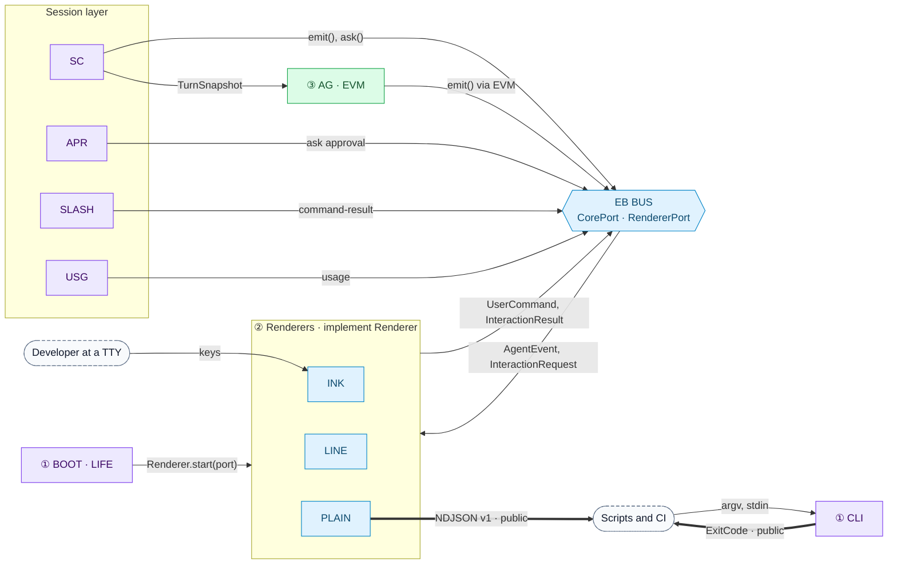
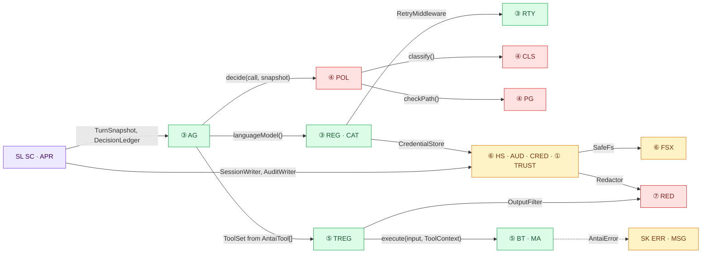
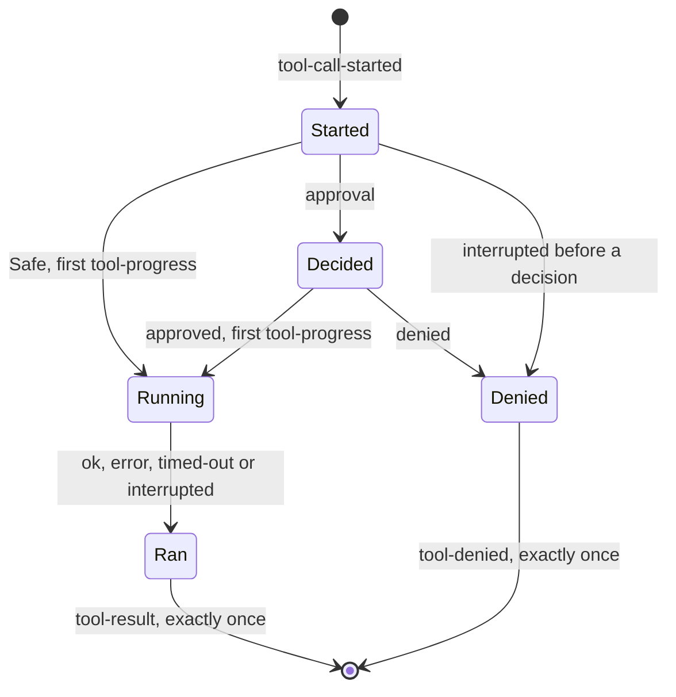
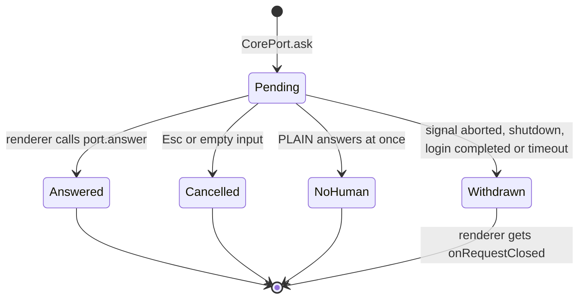
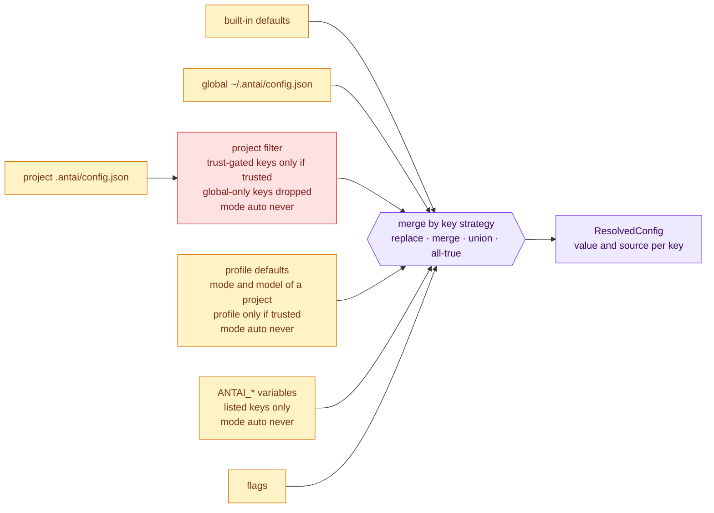
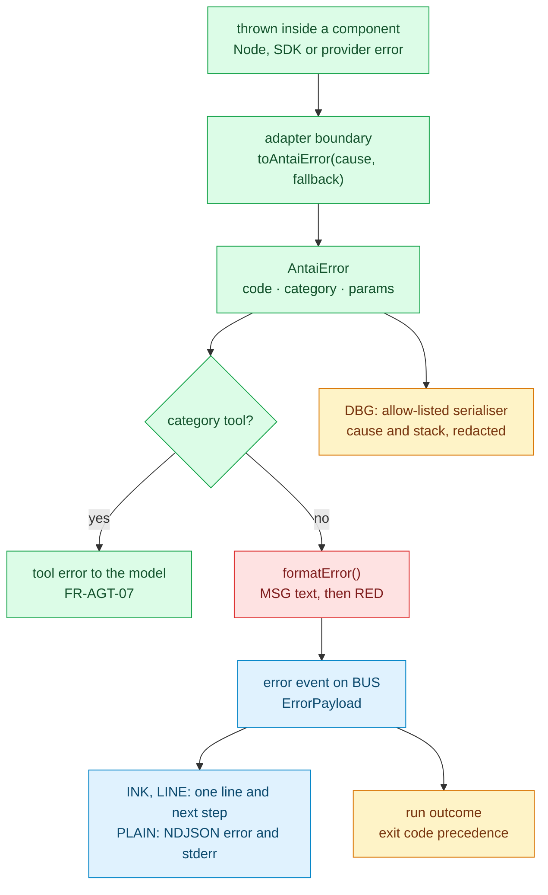

# antai — Interface Contracts & Conventions

| | |
|---|---|
| **Product** | antai (brand) / `antai` (command) |
| **Document** | Deliverable 11, Interface Contracts & Conventions for the v1 MVP |
| **Status** | Draft for review |
| **Version** | 0.1 |
| **Date** | 12 October 2026 |
| **Author** | Daksh Nagpal |
| **Based on** | BRD_1 v0.4, HLD.png, deliverables 00, 01, 02, 03, 04, 06, 07, 09 and 10 (v0.1) |
| **How to use** | Reference design, not a fixed rail. Where the technology needs something different or extra, the implementation may change it; the change is then made in every deliverable it touches, so the set keeps agreeing. |

## Contents

1. Purpose, scope and contract principles
2. Contract map (IC-1a, IC-1b)
3. Shared vocabulary types
4. Event boundary contract (IC-2, IC-3)
5. `--json` NDJSON contract (public API)
6. Tool contract
7. Safety contracts
8. Provider, model and agent contracts
9. Store contracts
10. Config contract and conventions (IC-4)
11. Error model (IC-5)
12. Exit codes
13. Message catalogue
14. Versioning
15. Code conventions
16. Design decisions
17. Open questions
18. Traceability
19. Sources

---

## 1. Purpose, scope and contract principles

### 1.1 Purpose

antai has no HTTP API. Its "API contracts" are the typed interfaces between its components, the `--json` event stream that scripts read, the files users write, the error codes and the exit codes. This document fixes them exactly, so that two developers implementing the two sides of a boundary write compatible code, and so that a script written against `antai run --json` keeps working across releases. In the hand-drawn architecture `HLD.png`, these are the contracts of the Event Bus (`events/`) and of the arrows between the other boxes.

Deliverable 06 shows the same types as diagrams (structure and state machines) and calls its member names proposals for this document to fix. This document is the exact contract: where the two differ, this document wins and 06 is corrected. This document keeps 06's event names (`turn-start`, `tool-result`, `tool-denied`, `approval`, `turn-end`) and adds what 06 leaves open, for example an end event per text block (`text-end`) and the `CallFacts` that `POL.decide` reads for each call through its read-only ports (section 7.1). Where member names differ from 06's proposals, the names here apply.

### 1.2 Scope

| In this document | Elsewhere |
|---|---|
| TypeScript contracts at every component boundary named in deliverable 01, section 5.9 | Component responsibilities: deliverable 01 |
| The `AgentEvent`, `UserCommand` and interaction-request unions; the `Renderer` port | Screens drawn from them: deliverable 13 |
| The public NDJSON event stream (`--json`), its versioning and stability promise | — |
| The `AntaiTool` interface, tool context and result envelope | Each tool's input schema, output and errors: deliverable 12 |
| `POL`, `CLS`, `PG` and `RED` call signatures and result types | The rules behind them: deliverable 02 |
| Provider, model, catalogue, retry and usage types | Catalogue data, retry numbers: deliverable 09 |
| Store interfaces (`HS`, `AUD`, `CRED`, `TRUST`, `FSX`) and their error behaviour | Record field tables, locks, write rules: deliverable 04, sections 5 and 6 (referenced, not repeated) |
| Config schema conventions and merge rules | Every key, flag and environment variable: deliverable 12 |
| `AntaiError`, the error code table, exit codes and their precedence | Model-facing error and denial wording: deliverable 08 |
| Message catalogue rules | Debug log and crash report content: deliverable 15 |
| Code conventions, versioning | CI, bundling, release: deliverable 16 |

### 1.3 Contract principles

| # | Principle | Why |
|---|---|---|
| CP1 | **The core is UI-independent.** Nothing below `src/events/` imports a renderer. Renderers receive `AgentEvent`s and interaction requests and send back `UserCommand`s and answers | NFR-MNT-01; the headless test in deliverable 01, section 8.3 |
| CP2 | **Every boundary is typed.** A value that crosses a folder boundary has a named, exported type in the callee's `index.ts` | Rules that are not written down decay |
| CP3 | **Unions are discriminated.** Every union that crosses a boundary has a string-literal discriminant: `type` for messages and records, `kind` for nested variants and interaction requests. Consumers `switch` on it with an exhaustiveness check | A new variant is a compile error in every consumer that has not handled it |
| CP4 | **No `any` across a boundary.** Untrusted or foreign data is `unknown` until a Zod schema parses it at the boundary that receives it | Model output, MCP results and files are untrusted (NFR-SEC-02) |
| CP5 | **Redaction is in the type.** Text that may reach the screen, `--json` output, history, the audit log or a log is `RedactedText`, a branded type only `RED` creates | NFR-SEC-05; deliverable 04, section 7.3 relies on it |
| CP6 | **Schemas come from Zod.** Config, MCP files, frontmatter, session records and the NDJSON events are defined once in Zod; validation and the published JSON Schemas are generated from the same definition | DLV-SW-09, HLD-D13 |
| CP7 | **Evolution is additive.** Readers ignore unknown fields, record types and event types. Renaming, removing or changing the meaning of a field is a breaking change with a version bump (section 14) | Sessions, audit files and scripts outlive releases |
| CP8 | **Plain data across boundaries.** Events, records and results are JSON-serialisable, read-only plain objects: no class instances, `Error` objects, functions or SDK objects, with two named exceptions (`Secret` and `TerminalLease`) | Events can be logged, compared in tests and serialised to NDJSON without custom code |
| CP9 | **No side effects where deliverable 01 says so.** `CLS.classify` and `PG.checkPath` take every fact as input and do no I/O. `POL.decide` changes nothing and reads live facts only through read-only ports, faked in tests (section 7.1; deliverable 07, RT-D19) | Table-driven tests (NFR-SEC-01) and deterministic decisions (HLD-D4, deliverable 02, section 3.9) |
| CP10 | **SDK names stay inside.** Only `EVM` switches on AI SDK stream-part names, only `AG` builds SDK approval statuses, only `src/sdk/` imports experimental SDK names | AI SDK churn (risk TR1) touches one place |

### 1.4 Additions beyond BRD v0.4

These go beyond BRD v0.4. The design uses them as stated; the BRD can adopt them later.

| Ref | Item | BRD baseline | Section |
|---|---|---|---|
| IC-P1 | Exit codes 130, 143 and 129 when `run` ends on SIGINT, SIGTERM or SIGHUP | FR-UI-06 lists 0 to 5 only | 12 |
| IC-P2 | "Denied for lack of approval" read as: a call of an approvable tier (Normal or Dangerous, no refusal rule) that was not approved, whether because no human was present or because `research` mode denies it | FR-UI-06: exit 5 "finished, but at least one action was denied for lack of approval" | 12 |
| IC-P3 | Exit-code precedence when several outcomes apply | Not specified (deliverables 01 and 03 defer to this document) | 12.2 |
| IC-P4 | Subcommand failures caused by a remote service (OAuth or MCP server) exit with 3 | 3 is "provider error" | 12.3 |
| IC-P5 | `schemaVersion` on every NDJSON line, not only the first; every `tool-call` paired with one `tool-result`, including denied calls; a `result` field on `done` | FR-UI-06 requires `schemaVersion` on the first event and names seven types; these are compatible additions | 5 |
| IC-P6 | An eighth NDJSON type, `notice`, for warnings and information (extension findings, MCP failures and drift, provider data-use and unsupported-setting notices) | FR-UI-06 names seven types; deliverables 09 and 10 need a slot for notices | 5.3 |

Additions from other documents used here unchanged: the AI SDK v7 API names as used by antai (`result.stream`, nested usage fields, `tool-output-denied`), the SDK's `maxRetries: 0` with antai's own retry wrapper (`RTY`), provider keys kept out of `process.env` and child environments (the latter now in BRD v0.4, FR-SH-06), redact first and then cap, type-ahead discarded when a dialog opens, a per-process approval signing secret, and deliverable 04 P7 (audit failure denies side effects).

---

## 2. Contract map

The two maps refine the hand-drawn architecture in `HLD.png` (deliverable 01, section 1.3 maps every box): Screen UI is `INK`, `LINE` and `PLAIN`; Event Bus is `BUS`; Session is `SC` with `APR`, `SLASH` and `USG`; Agent Brain is `AG` with `EVM`; Model Gateway is `REG`, `CAT` and `RTY`; the Tool Pipeline is `POL` (Safety Guard), `TREG` (Tool Service) and `RED` (Secret Filter). Three points differ from the drawing, each for a reason:

- `EVM` emits stream events onto `BUS` itself instead of passing them through `SC`, so streamed text reaches the screen without an extra hop; `SC` still owns turns, approvals and storage.
- The Safety Guard returns a decision (`POL.decide`) instead of calling the tool itself, so the SDK's approval round trip can stop for a dialog and `decide` stays free of side effects and table-tested with faked ports (section 7.1).
- API keys are read through `CRED` (`src/infra/credentials/`), a store with its own lock and file mode, rather than through `config/`; and `src/cli/`, `src/sdk/` and `src/shared/` hold the entry point, the SDK shim and the shared kernel (types, errors, messages), which no box in the drawing owns; `src/rules/` holds the Safety Guard's rule data in a folder of its own (deliverable 01, section 1.3).

### 2.1 IC-1a Presentation, session and public outputs



Thick arrows are the two public contracts (sections 5 and 12). Everything else is internal and may change in any release, as long as both sides change together.

### 2.2 IC-1b Agent runtime, safety, tools and stores



### 2.3 Contract index

| Contract | Exposed by (module) | Used by | Section |
|---|---|---|---|
| `AgentEvent`, `UserCommand`, `InteractionRequest`, `InteractionResult`, `Renderer`, `CorePort`, `RendererPort` | `BUS` (`src/events/`) | `SC`, `APR`, `SLASH`, `USG`, `EVM`, `BOOT`, `INK`, `LINE`, `PLAIN` | 4 |
| NDJSON v1 lines | `PLAIN` (`src/ui/plain/`) | Scripts and CI | 5 |
| `AntaiTool`, `ToolContext`, `EffectRecorder`, `RawToolOutput`, `ToolResult`, `ToolPreviewer` | `TREG` (`src/tools/registry/`) | `BT`, `MA`, `AG`, `APR` (previews), `POL` (types) | 6 |
| `ApprovalPolicy` (`decide`), `PolicyPorts`, `CallFacts`, `PolicyDecision`, `ClassifierResult`, `PathVerdict` | `POL`, `CLS`, `PG` (`src/safety/`) | `AG`, `APR` (types), `BT` (path re-check) | 7 |
| `Redactor`, `OutputFilter`, `StreamRedactor` | `RED` (`src/redact/`) | `TREG`, `EVM`, `CLI`, `HS`, `AUD`, `DBG`, `CRED`, `MCPM` | 7.4 |
| `ModelRef`, `ModelEntry`, `ProviderRegistry`, `RetryMiddleware`, `Usage` | `REG`, `CAT`, `RTY` (`src/providers/`) | `AG`, `SC`, `SLASH`, `USG`, `PR` | 8 |
| `TurnSnapshot`, `DecisionLedger`, `PendingApproval`, `ApprovalOutcome` | `SC`, `AG` | `AG`, `APR`, `TREG`, `EVM` | 8.5 |
| `HistoryStore`, `AuditWriter`, `CredentialStore`, `TrustStore`, `SafeFs` | `HS`, `AUD`, `CRED`, `TRUST`, `FSX` | `SC`, `APR`, `BOOT`, `REG`, `MOA`, `RET` | 9 |
| `ResolvedConfig`, `ConfigKeyMeta` | `CFG` (`src/config/`) | `BOOT`, `SC`, `REG`, `POL` (via snapshot) | 10 |
| `AntaiError`, `ErrorCode`, `ErrorPayload`, `ExitCode` | `ERR` (`src/shared/errors/`) | Every component | 11, 12 |
| `MessageKey`, `format()` | `MSG` (`src/shared/messages/`) | Every component that shows text | 13 |

---

## 3. Shared vocabulary types

Types used on both sides of the event boundary cannot live in `src/events/` (the core's lower layers may not import it) or in `src/safety/` (renderers may not import it). They live in the shared-kernel module `src/shared/domain/` that deliverable 06 introduced (UML-D3; listed in deliverable 01, section 8.1 as part of the shared kernel `SK`, not a new component). It holds types and pure helpers only and has no dependencies.

```ts
// src/shared/domain/index.ts
declare const brand: unique symbol;
export type Brand<T, B extends string> = T & { readonly [brand]: B };

export type SessionId = Brand<string, 'SessionId'>;         // "2026-10-12_1432_a1b2c3" (deliverable 04, DS-D2)
export type TurnId = Brand<string, 'TurnId'>;               // "<sessionId>#<turn>"
export type ToolCallId = Brand<string, 'ToolCallId'>;       // opaque, from the provider
export type ApprovalId = Brand<string, 'ApprovalId'>;       // opaque, from the SDK
export type InteractionId = Brand<string, 'InteractionId'>;
export type ProviderId = Brand<string, 'ProviderId'>;       // "groq", "openrouter", "my-gateway"
export type ProjectKey = Brand<string, 'ProjectKey'>;       // deliverable 04, section 4.4
export type IsoTime = Brand<string, 'IsoTime'>;             // ISO 8601 UTC, ms, "Z"
export type EpochMs = number;

/** Text that has passed RED. Only src/redact/ may produce it (lint rule, section 15.5). */
export type RedactedText = Brand<string, 'RedactedText'>;

export type JsonValue = null | boolean | number | string | readonly JsonValue[] | JsonObject;
export type JsonObject = { readonly [key: string]: JsonValue };
/** A JSON object whose string leaves have passed RED (deliverable 04, DS-D9). */
export type RedactedObject = Brand<JsonObject, 'RedactedObject'>;

export type Mode = 'research' | 'manual' | 'auto' | 'skip';    // 'skip' only from --dangerously-skip-permissions
export type SelectableMode = Exclude<Mode, 'skip'>;            // /mode, --mode, global config (FR-MODE-02, FR-CFG-05)
export type ProjectMode = 'research' | 'manual';               // what a project file may set (FR-CFG-05, FR-PRF-02)
export type Tier = 'safe' | 'normal' | 'dangerous' | 'hard-floor';
export type DialogKind = 'confirm' | 'danger';                 // dialog 1 and the red dialog 2 (FR-SH-03, 04)
export type Effort = 'provider-default' | 'none' | 'low' | 'medium' | 'high';  // FR-MOD-06; the SDK's minimal, xhigh and max are not exposed
export type ModelRefText = `${string}:${string}`;              // "groq:openai/gpt-oss-120b" (FR-MOD-03)
export type DecisionBy = 'user' | 'mode' | 'session-allow' | 'policy' | 'no-human';  // deliverable 04, section 5.9
export type ToolSource = { readonly kind: 'builtin' } | { readonly kind: 'mcp'; readonly server: string; readonly tool: string };

/** Token counts in antai's own names (deliverable 04, section 5.10). null: the provider did not report it. */
export interface Usage {
  readonly input: number | null;
  readonly output: number | null;
  readonly reasoning: number | null;
  readonly cacheRead: number | null;
  readonly cacheWrite: number | null;
  readonly total: number | null;
}

export interface RateLimitSnapshot {
  readonly provider: ProviderId;
  readonly observedAt: EpochMs;
  readonly remainingRequests: number | null;
  readonly remainingTokens: number | null;
  readonly limitRequests: number | null;      // the plan's limits, for "remaining of limit" in /usage (deliverable 15, OBS-D21)
  readonly limitTokens: number | null;
  readonly requestsResetAt: EpochMs | null;
  readonly tokensResetAt: EpochMs | null;
}

/** A secret value in transit (API key, token). Never prints itself. */
export class Secret {
  readonly #value: string;
  constructor(value: string) { this.#value = value; }
  reveal(): string { return this.#value; }
  toString(): string { return '[secret]'; }
  toJSON(): string { return '[secret]'; }
  [Symbol.for('nodejs.util.inspect.custom')](): string { return '[secret]'; }
}

export type Result<T, E> = { readonly ok: true; readonly value: T } | { readonly ok: false; readonly error: E };
export interface Clock { now(): EpochMs }                      // injected; tests use a fake clock
export type DistributiveOmit<T, K extends PropertyKey> = T extends unknown ? Omit<T, K> : never;
```

`Secret` is one of the two class instances allowed to cross a boundary (CP8): its `toString`, `toJSON` and inspect hooks make an accidental log line print `[secret]`, so a key typed into the first-run prompt cannot reach a log through `console.log`, `JSON.stringify` or `util.inspect`.

---

## 4. Event boundary contract

`BUS` (`src/events/`) carries three channels (deliverable 01, section 5.8): `AgentEvent`s from the core to the renderer, `UserCommand`s from the renderer to the core, and interaction requests that the core asks and the renderer answers. `BUS` contains types and an in-process dispatcher, no logic.

### 4.1 `AgentEvent`

```ts
// src/events/agent-event.ts
interface EventBase {
  readonly seq: number;        // 1, 2, 3 … per process, assigned by BUS; no gaps
  readonly ts: EpochMs;        // assigned by BUS from the Clock
}
interface TurnScoped extends EventBase { readonly turnId: TurnId }

export type AgentEvent =
  | SessionStartedEvent | StatusEvent | TurnStartEvent
  | TextDeltaEvent | TextEndEvent | ReasoningDeltaEvent | ReasoningEndEvent
  | ToolCallStartedEvent | ApprovalEvent | ToolProgressEvent | ToolResultEvent | ToolDeniedEvent
  | UsageEvent | RetryScheduledEvent | NoticeEvent | ErrorEvent | TurnEndEvent
  | McpStatusEvent | McpDriftEvent | CommandResultEvent | SessionEndedEvent;
export type AgentEventInit = DistributiveOmit<AgentEvent, 'seq' | 'ts'>;

export interface SessionStartedEvent extends EventBase {
  readonly type: 'session-started';
  readonly sessionId: SessionId;
  readonly kind: 'interactive' | 'run';
  readonly resumed: null | { readonly from: SessionId; readonly forked: boolean; readonly turns: number };
  readonly historyEnabled: boolean;
  readonly antaiVersion: string;
}

export interface StatusEvent extends EventBase {
  readonly type: 'status';
  readonly status: StatusSnapshot;           // full snapshot, never a diff
}
export interface StatusSnapshot {
  readonly sessionId: SessionId;
  readonly provider: ProviderId;
  readonly model: ModelRefText;
  readonly mode: Mode;                        // 'skip' → red banner for the whole session (FR-MODE-02)
  readonly effort: Effort;
  readonly effortSupported: boolean | null;   // null: model unknown to the catalogue
  readonly profile: null | { readonly name: string; readonly source: 'flag' | 'pin' | 'auto' | 'command' | 'resume' };
  readonly workspace: { readonly root: string; readonly display: string; readonly homeOrDriveRoot: boolean };
  readonly baseUrl: string | null;            // set only when the endpoint is not local (FR-MOD-07)
  readonly trust: 'trusted' | 'untrusted' | 'not-needed';
  readonly shellAvailable: boolean;           // false on Windows without Git Bash (FR-SH-11)
  readonly historyEnabled: boolean;
}

export interface TurnStartEvent extends TurnScoped {
  readonly type: 'turn-start';                // locks input while the turn runs (HLD-D18)
  readonly turn: number;                      // 1-based, the session file's `turn`
  readonly source: 'prompt' | 'skill' | 'run';
  readonly stepBudget: number;                // maxSteps for the whole turn (FR-AGT-02)
}

export interface TextDeltaEvent extends TurnScoped {
  readonly type: 'text-delta';
  readonly blockId: string;
  readonly delta: RedactedText;               // after EVM's redaction hold-back (HLD-D19)
}
export interface TextEndEvent extends TurnScoped {
  readonly type: 'text-end';
  readonly blockId: string;
  readonly text: RedactedText;                // the whole block, equal to the concatenated deltas
  readonly partial: boolean;                  // true when Esc cut it off (FR-AGT-04)
}
export interface ReasoningDeltaEvent extends TurnScoped {
  readonly type: 'reasoning-delta'; readonly blockId: string; readonly delta: RedactedText;
}
export interface ReasoningEndEvent extends TurnScoped {
  readonly type: 'reasoning-end'; readonly blockId: string; readonly partial: boolean;
}

export interface ToolCallStartedEvent extends TurnScoped {
  readonly type: 'tool-call-started';
  readonly toolCallId: ToolCallId;
  readonly toolName: string;                  // "read_file" or "mcp__github__create_issue"
  readonly source: ToolSource;
  readonly input: RedactedObject;             // the model's arguments, redacted
  readonly summary: RedactedText;             // one-line card text built by the tool (section 6.1)
}
export interface ApprovalEvent extends TurnScoped {
  readonly type: 'approval';                  // every decision except a Safe call that simply runs (audited, FR-SH-10)
  readonly toolCallId: ToolCallId;
  readonly toolName: string;
  readonly tier: Tier;
  readonly decision: 'approved' | 'denied';
  readonly by: DecisionBy;
  readonly dialogs: 0 | 1 | 2;                // dialogs shown, as in the audit record (deliverable 04, section 5.9)
  readonly approvable: boolean;               // a human in manual could have approved it (exit code 5, section 12)
  readonly ruleId: string | null;
  readonly reason: RedactedText | null;
}
export interface ToolProgressEvent extends TurnScoped {
  readonly type: 'tool-progress';             // first one when execution starts, then at most one per second
  readonly toolCallId: ToolCallId;
  readonly elapsedMs: number;
  readonly outputChars: number | null;        // shell and MCP only
}
export interface ToolResultEvent extends TurnScoped {
  readonly type: 'tool-result';               // the call ran (or started and was interrupted)
  readonly toolCallId: ToolCallId;
  readonly toolName: string;
  readonly status: 'ok' | 'error' | 'timed-out' | 'interrupted';
  readonly output: RedactedText;              // exactly the bytes the model received (FR-UI-03, FR-HIS-07)
  readonly truncated: boolean;
  readonly exitCode: number | null;           // shell only; a non-zero exit code is still status 'ok'
  readonly durationMs: number;
  readonly errorCode: ErrorCode | null;       // set when status is 'error'
  readonly resultSummary: RedactedText | null;  // card note such as "4 matches", built by the tool; null when it gives none (deliverable 13, UI-11)
}
export interface ToolDeniedEvent extends TurnScoped {
  readonly type: 'tool-denied';               // the call never ran: policy, user, no human, or interrupted before a decision
  readonly toolCallId: ToolCallId;
  readonly toolName: string;
  readonly by: DecisionBy | 'interrupted';
  readonly reason: RedactedText;              // the text the model received as execution-denied
}

export interface UsageEvent extends TurnScoped {
  readonly type: 'usage';
  readonly scope: 'step' | 'turn';
  readonly provider: ProviderId;
  readonly model: ModelRefText;
  readonly usage: Usage;                      // this step, or the turn total (result.usage)
  readonly sessionTotal: number;
  readonly context: { readonly lastInput: number | null; readonly window: number | null; readonly share: number | null };
  readonly rateLimit: RateLimitSnapshot | null;
}
export interface RetryScheduledEvent extends EventBase {
  readonly type: 'retry-scheduled';
  readonly turnId: TurnId | null;
  readonly provider: ProviderId;
  readonly attempt: number;                   // 1 = first retry
  readonly maxAttempts: number;
  readonly at: EpochMs;                       // absolute, so every renderer shows the same countdown (03, SD-16a)
  readonly reason: RetryReason;               // deliverable 09, section 9.4
  readonly code: ErrorCode;                   // the error that caused the retry, e.g. 'provider.rate_limited'
  readonly limit: 'requests-per-minute' | 'tokens-per-minute' | null;  // which limit, when the provider says (deliverable 13, UI-26)
}
export type RetryReason =
  | 'rate-limit-minute' | 'token-budget' | 'server-error' | 'overloaded' | 'network' | 'timeout' | 'invalid-tool-call';

export interface NoticeEvent extends EventBase {
  readonly type: 'notice';                    // also a public NDJSON line (section 5.3, IC-P6)
  readonly turnId: TurnId | null;
  readonly level: 'info' | 'warning';
  readonly source: NoticeSource;
  readonly code: NoticeCode;                  // stable, for scripts: 'extension.skill_skipped', 'mcp.drift'
  readonly messageKey: MessageKey;            // catalogue entry used for the text; may be more specific than code
  readonly ref: string | null;                // what it is about: finding ID (deliverable 10, section 7), server, file, model
  readonly text: RedactedText;                // rendered "what happened"
  readonly hint: RedactedText | null;         // rendered "what to do next"
}
export type NoticeSource = 'config' | 'trust' | 'extension' | 'provider' | 'mcp' | 'context' | 'session' | 'storage';
export interface ErrorEvent extends EventBase {
  readonly type: 'error';
  readonly turnId: TurnId | null;
  readonly scope: 'turn' | 'session' | 'startup';
  readonly error: ErrorPayload;               // section 11.3
}
export interface TurnEndEvent extends TurnScoped {
  readonly type: 'turn-end';
  readonly reason: 'completed' | 'step-cap' | 'interrupted' | 'error';
  readonly steps: number;
  readonly usage: Usage;
  readonly errorCode: ErrorCode | null;
}

export interface McpStatusEvent extends EventBase {
  readonly type: 'mcp-status';
  readonly server: string;
  readonly transport: 'stdio' | 'http';
  readonly state: 'connecting' | 'connected' | 'needs-login' | 'failed' | 'skipped' | 'closed';
  readonly toolCount: number | null;
  readonly protocolVersion: string | null;    // "2026-07-28" or "2025-11-25"
  readonly detail: null | { readonly code: ErrorCode; readonly text: RedactedText };
}
export interface McpDriftEvent extends EventBase {
  readonly type: 'mcp-drift';                 // tool names only, never descriptions (deliverable 04, section 5.9)
  readonly server: string;
  readonly added: readonly string[];
  readonly removed: readonly string[];
  readonly changed: readonly string[];
  readonly annotationsChanged: readonly string[];
}
export interface CommandResultEvent extends EventBase {
  readonly type: 'command-result';            // output of a built-in slash command
  readonly command: string;                   // "/usage"
  readonly view: CommandView;
}
export type CommandView =
  | { readonly kind: 'text'; readonly lines: readonly RedactedText[] }
  | { readonly kind: 'table'; readonly columns: readonly string[]; readonly rows: readonly (readonly RedactedText[])[] }
  | { readonly kind: 'key-value'; readonly entries: readonly { readonly key: string; readonly value: RedactedText; readonly source: string | null }[] };

export interface SessionEndedEvent extends EventBase {
  readonly type: 'session-ended';
  readonly sessionId: SessionId;
  readonly reason: 'exit' | 'clear' | 'resume' | 'run-complete' | 'signal' | 'error';  // 'error': a run stopped by an error (exit 1 or 3)
  readonly exit: null | { readonly code: ExitCode; readonly outcome: RunOutcome };  // null for /clear and /resume
  readonly summary: {
    readonly turns: number; readonly steps: number; readonly toolCalls: number;
    readonly denials: number; readonly usage: Usage; readonly durationMs: number;
  };
  readonly result: RedactedText | null;       // last assistant text of the last turn
}
```

Why full `status` snapshots: there are about ten status values that change rarely; a snapshot is idempotent, so a renderer that mounts late (Ink is imported lazily) or misses one event still shows the right state, and `LINE` and `INK` need no merge logic.

Why `text-end` repeats the whole block: `PLAIN` writes complete blocks to NDJSON (section 5.4), and `INK` moves finished text to static output (NFR-PERF-02). Both need the block boundary; neither should reassemble deltas itself.

Why `tool-result` and `tool-denied` are separate (deliverable 06, UML-3a): a denied call never ran, so it has no output, exit code or duration. Together they close every call (EB-G4); `PLAIN` maps both to the public `tool-result` line (section 5.7).

**Notices.** Every one-line warning or information that is not an error is a `notice`: extension findings (deliverable 10, section 7; one start-up summary plus one notice per skipped or warned unit), ignored untrusted settings, the unknown-model and effort-unsupported notices and the data-use notice (deliverable 09, sections 4.5, 6.3, 12.2), pruning (deliverable 03, SD-15a), MCP failures and drift (`MCPM` emits `mcp-status` and `mcp-drift` for `/mcp`, and `SC` adds a `notice` for each failure or drift so that non-interactive runs see it), and storage degradation (deliverable 04, section 6.10). Notice codes are listed in section 11.2.

### 4.2 `UserCommand`

```ts
// src/events/user-command.ts
export type UserCommand =
  | { readonly type: 'submit'; readonly text: string }      // raw input, unredacted; SLASH or SC decides what it is
  | { readonly type: 'interrupt'; readonly source: 'escape' | 'ctrl-c' }   // Esc, or Ctrl+C during a turn or dialog
  | { readonly type: 'exit'; readonly source: 'ctrl-c-twice' | 'ctrl-d-twice' }   // /exit arrives as submit text; Ctrl+D twice on an empty input (deliverable 13, UI-D13)
  | { readonly type: 'answer'; readonly requestId: InteractionId; readonly result: InteractionResult };
```

`submit.text` is the only unredacted text that crosses the boundary, and it flows inwards: `SC` redacts it before it is stored or sent (deliverable 04, DS-D8). While a turn runs, `SC` refuses `submit` (HLD-D18) with a `notice`; the renderer keeps the text in its input box.

### 4.3 Interaction requests and results

```ts
// src/events/interaction.ts
interface RequestBase { readonly id: InteractionId; readonly createdAt: EpochMs }

export type InteractionRequest =
  | ApprovalRequest | TrustRequest | SecretRequest | ConfirmRequest
  | ChoiceRequest | TerminalLeaseRequest | LoginRequest;

export interface ApprovalRequest extends RequestBase {
  readonly kind: 'approval';
  readonly toolCallId: ToolCallId;
  readonly dialog: DialogKind;                // 'danger' = red "DANGEROUS COMMAND" dialog (FR-SH-04); one request per dialog (UML-D10)
  readonly tier: Tier;
  readonly toolName: string;
  readonly source: ToolSource;
  readonly summary: RedactedText;             // from the classifier or the tool kind, never from the model (FR-SH-03)
  readonly reason: RedactedText | null;       // dialog 2: the matched rule's reason
  readonly preview: ApprovalPreview;
  readonly options: readonly ApprovalChoice[];   // confirm: yes, yes-session (Normal shell only, D27), no; danger: no, yes
  readonly initial: 'yes' | 'no';                // confirm: yes; danger: no
  readonly discardTypeAheadMs: number;           // 300: type-ahead is discarded when a dialog opens
}
export type ApprovalChoice = 'yes' | 'yes-session' | 'no';
export type ApprovalPreview =
  | { readonly kind: 'command'; readonly command: RedactedText }
  | { readonly kind: 'diff'; readonly path: string; readonly diff: RedactedText; readonly truncated: boolean }
  | { readonly kind: 'new-file'; readonly path: string; readonly head: RedactedText; readonly totalLines: number }  // first 200 lines (FR-UI-04)
  | { readonly kind: 'mcp'; readonly server: string; readonly tool: string; readonly args: RedactedObject };

export interface TrustRequest extends RequestBase {
  readonly kind: 'trust';
  readonly workspace: string;
  readonly changed: boolean;                  // asked again because the settings hash changed (FR-CFG-04)
  readonly items: readonly TrustItem[];
  readonly initial: 'no';
}
export type TrustItem =
  | { readonly kind: 'mcp-server'; readonly name: string; readonly transport: 'stdio' | 'http'; readonly commandOrUrl: RedactedText; readonly variables: readonly string[]; readonly file: string }
  | { readonly kind: 'shell-allow'; readonly entry: string }
  | { readonly kind: 'mcp-tools-allow'; readonly entry: string }
  | { readonly kind: 'mode'; readonly value: ProjectMode }
  | { readonly kind: 'model'; readonly value: string }
  | { readonly kind: 'provider'; readonly name: string; readonly baseUrl: string; readonly sends: string | null }   // key variable or stored key sent there; null when none (deliverable 09, 7.6)
  | { readonly kind: 'profile-pin'; readonly name: string }
  | { readonly kind: 'profile-defaults'; readonly profile: string; readonly mode: ProjectMode | null; readonly model: string | null };

export interface SecretRequest extends RequestBase {
  readonly kind: 'secret';
  readonly purpose: 'provider-key';
  readonly provider: ProviderId;
  readonly envVar: string;                    // "GROQ_API_KEY"
  readonly helpUrl: string | null;            // where to get a key (BRD 4.1)
}
export interface ConfirmRequest extends RequestBase {
  readonly kind: 'confirm';
  readonly purpose: 'home-workspace' | 'oauth-step-up';
  readonly messageKey: MessageKey;
  readonly text: RedactedText;
  readonly initial: 'yes' | 'no';
}
export interface ChoiceRequest extends RequestBase {
  readonly kind: 'choice';
  readonly purpose: 'model' | 'mode' | 'effort' | 'resume' | 'profile' | 'mcp-action';   // pickers of deliverable 13, UI-D24
  readonly title: string;
  readonly options: readonly { readonly id: string; readonly label: RedactedText; readonly detail: RedactedText | null }[];
  readonly initialId: string | null;
}
export interface TerminalLeaseRequest extends RequestBase {
  readonly kind: 'terminal-lease';
  readonly purpose: 'sudo-validate';          // only `sudo -v` gets the terminal (FR-SH-09)
}
export interface LoginRequest extends RequestBase {
  readonly kind: 'login';                     // "waiting for login, Esc cancels"
  readonly server: string;
  readonly authorizationUrl: string;          // printed for SSH users (FR-MCP-11)
  readonly browserOpened: boolean;
  readonly expiresAt: EpochMs;                // 5 minutes (deliverable 01, section 4.2)
}

export interface AnswerMap {
  readonly approval: { readonly choice: ApprovalChoice; readonly via: 'enter' | 'escape' | 'shortcut' };  // Esc answers No (FR-UI-05)
  readonly trust: { readonly decision: 'trusted' | 'untrusted' };
  readonly secret: { readonly value: Secret };
  readonly confirm: { readonly confirmed: boolean };
  readonly choice: { readonly optionId: string };
  readonly 'terminal-lease': { readonly lease: TerminalLease };
  readonly login: { readonly action: 'cancel' };   // success arrives as 'withdrawn: completed'
}
export type InteractionKind = keyof AnswerMap;
export type WithdrawReason = 'interrupted' | 'shutdown' | 'completed' | 'timeout';
export type InteractionResult<K extends InteractionKind = InteractionKind> =
  | { readonly status: 'answered'; readonly answer: AnswerMap[K] }
  | { readonly status: 'cancelled' }                      // Esc or empty input on a non-approval request
  | { readonly status: 'no-human' }                       // PLAIN, at once
  | { readonly status: 'withdrawn'; readonly reason: WithdrawReason };

/** The second allowed class-like value (CP8). The core must call release() in a finally block. */
export interface TerminalLease { release(): Promise<void> }
```

Each request kind has a safe default that the core applies when the result is `no-human`, `cancelled` or `withdrawn` (rule 16 of deliverable 01: the core never blocks on a person):

| Kind | Safe default | Who asks | Requirement |
|---|---|---|---|
| `approval` | Denied, `by: 'no-human'` (or `'user'` for Esc and No) | `APR` | FR-CLI-02, D19, FR-UI-05 |
| `trust` | Untrusted, not stored (a stored "No" needs an answer) | `BOOT`, `/trust` | FR-CFG-04 |
| `secret` | No key: exit 2 at start, or the old model kept for `/model` | `BOOT`, `SLASH` | FR-MOD-04 |
| `confirm` | No | `BOOT`, `MCPM` | FR-TOOL-09, SD-D17 |
| `choice` | Nothing changes | `SLASH` | BRD 5.11 |
| `terminal-lease` | Refused: the command runs captured with `sudo -n` | `SR` | FR-SH-09 |
| `login` | Login not completed; server stays "needs login" | `MOA` | FR-MCP-11 |

### 4.4 `Renderer` and the two ports

```ts
// src/events/renderer.ts
export interface Renderer {
  readonly kind: 'ink' | 'line' | 'plain';
  readonly humanPresent: boolean;             // false only for PLAIN (deliverable 01, section 4.3)
  start(port: RendererPort): Promise<void>;   // mount; INK is imported lazily by BOOT
  onEvent(event: AgentEvent): void;           // synchronous; must not throw and must not block
  onRequest(request: InteractionRequest): void;               // answer later through port.answer()
  onRequestClosed(id: InteractionId, reason: WithdrawReason): void;
  stop(reason: 'exit' | 'signal' | 'crash'): Promise<void>;   // idempotent; restores the terminal; PLAIN drains stdout
}
export interface RendererPort {
  send(command: Exclude<UserCommand, { type: 'answer' }>): void;
  answer<K extends InteractionKind>(id: InteractionId, result: InteractionResult<K>): void;  // sent as a UserCommand 'answer'
  setBackpressure(paused: boolean): void;     // PLAIN only: true above 1 MiB buffered on stdout (deliverable 07, RT-D16)
}

// src/events/bus.ts — what the core sees
export interface CorePort {
  emit(event: AgentEventInit): void;          // BUS adds seq and ts
  ask<K extends InteractionKind>(
    request: DistributiveOmit<Extract<InteractionRequest, { kind: K }>, 'id' | 'createdAt'>,
    signal?: AbortSignal,                     // aborting withdraws the request ('interrupted' or 'shutdown')
  ): Promise<InteractionResult<K>>;
  onCommand(handler: (command: UserCommand) => void): () => void;   // returns unsubscribe
  drained(): Promise<void>;                   // resolves at once unless the renderer set back-pressure
}

// src/events/terminal-lease.ts — the port SR imports as a type (deliverable 06, TerminalLease)
export interface TerminalLeasePort {
  withTerminal<T>(fn: () => Promise<T>): Promise<{ readonly granted: true; readonly value: T } | { readonly granted: false }>;
}
```

`BOOT` implements `TerminalLeasePort` on top of `ask({ kind: 'terminal-lease' })`: it asks, runs `fn` while the lease is held, and calls `release()` in a `finally` block. `INK` answers the request inside Ink's `useApp().suspendTerminal()` callback and returns from the callback when `release()` is called; `LINE` pauses its line reader; `PLAIN` answers `no-human`, so `withTerminal` returns `granted: false` and `SR` takes the `sudo -n` path (deliverable 07, section 7.7).

### 4.5 Ordering and lifecycle guarantees

| ID | Guarantee | Enforced by |
|---|---|---|
| EB-G1 | Events reach the renderer in emission order. `seq` is strictly increasing with no gaps | `BUS` (single FIFO dispatcher) |
| EB-G2 | `session-started` comes before any other event of that session, then a `status`; `session-ended` is the last event of a session | `SC` |
| EB-G3 | Every `turn-start` is followed by exactly one `turn-end` with the same `turnId`; turns never overlap | `SC` (one turn at a time, HLD-D18) |
| EB-G4 | Every `tool-call-started` is followed by exactly one `tool-result` or `tool-denied` with the same `toolCallId`, before the `turn-end` of its turn. A call left open when a turn ends is closed with `tool-result` `interrupted` if it was running, else `tool-denied` `by: 'interrupted'` | `EVM`'s open-call set; `SC` closes leftovers at turn end |
| EB-G5 | `approval` for a call comes after its `tool-call-started` and before its `tool-result` or `tool-denied`. A Safe call that runs has none | `APR`, `SC`, `EVM` |
| EB-G6 | `tool-progress` for a call appears only between its decision (or start, when Safe) and its end | `TREG` |
| EB-G7 | Every `text-delta` of a block precedes exactly one `text-end` of that block; `text-end.text` equals the concatenated deltas | `EVM` |
| EB-G8 | Within one step, reasoning blocks precede the text and tool calls that follow them in the provider stream; antai does not reorder parts | `EVM` |
| EB-G9 | One `usage` with `scope: 'step'` per model step and one with `scope: 'turn'` just before `turn-end` | `USG` |
| EB-G10 | An `error` with `scope: 'turn'` is followed by `turn-end` with `reason: 'error'` | `SC` |
| EB-G11 | Every text-bearing field is `RedactedText` or a `RedactedObject`; no event carries a secret, an `Error`, a stack trace or an SDK object | Types (CP5, CP8) |
| EB-G12 | Every interaction request ends with exactly one result. Late or duplicate answers are dropped and logged | `BUS` |

A tool call's life on the boundary:

#### IC-2 Tool call as seen by a renderer



#### IC-3 Interaction request lifecycle



### 4.6 Threading and async rules

- **One event loop, no worker threads** (HLD-D1). `BUS` dispatches `onEvent` synchronously, in order, from `emit`.
- **No re-entrancy.** `RendererPort.send` and `answer` are delivered to the core on the next microtask (`queueMicrotask`), so a renderer that answers inside `onEvent` never runs core code in the middle of an `emit`.
- **Renderers never block the core.** `onEvent` returns at once; heavy work (Markdown layout) is scheduled by the renderer. A renderer that throws is an internal error: `BUS` catches it, `LIFE` restores the terminal and writes a crash report (`internal.renderer_failed`).
- **The core never blocks on a person.** `ask()` returns a promise; while it is pending the event loop keeps running, so Esc (`interrupt`) still arrives and withdraws the request through the abort signal. Approvals are round trips: nothing waits in the SDK (deliverable 01, section 9.3).
- **Back-pressure.** `INK` and `LINE` never apply it: text deltas are small, and they coalesce them. `PLAIN` writes to stdout through an ordered queue; above 1 MiB buffered it calls `setBackpressure(true)`, and `SC` awaits `drained()` before reading the next stream part, so a slow consumer slows the model stream instead of growing memory (deliverable 07, section 2.4, RT-D16). `PLAIN.stop()` resolves only after the last line is flushed, so `done` is never lost to an early exit (`LIFE` waits for `stop()` before `process.exit`).
- **Interaction requests are serial per kind.** `APR` shows one approval dialog at a time; several requests of one step are asked one after another (deliverable 03, SD-7a).

---

## 5. `--json` NDJSON contract (public API)

**This section is a public API.** Scripts and CI pipelines depend on it. It changes only under the rules in section 5.6.

### 5.1 When it is used

`PLAIN` writes NDJSON (one JSON object per line, UTF-8, `\n` line ends) to **stdout** when `--json` is given: with `antai run` (FR-CLI-02, AC-20) and with interactive `antai --json` (deliverable 01, section 4.3; no human present). stdout then carries only NDJSON lines. Every error and notice is also written to **stderr** as one plain-text line with its next step, in `--json` and in text mode alike, so a CI log stays readable without parsing JSON (FR-UI-06: "Errors go to stderr"); retry countdowns appear only on stderr. stderr text is not part of this contract.

### 5.2 Envelope

Every line has these fields, followed by the fields of its type at the same level:

| Field | Type | Meaning |
|---|---|---|
| `schemaVersion` | string `"<major>.<minor>"` | `"1.0"` in v1. On every line, so a line read alone is still interpretable (FR-UI-06 requires it on the first) |
| `type` | string | One of the eight types in section 5.3: the seven of FR-UI-06 plus `notice` (IC-P6). Consumers must skip unknown types |
| `seq` | integer | 1, 2, 3 … per process, no gaps. A gap means a lost line |
| `ts` | string | ISO 8601 UTC with milliseconds and `Z` |
| `sessionId` | string or null | Session ID (deliverable 04, DS-D2), also with `--no-history`. `null` only when antai stops before a session exists (usage errors) |

### 5.3 Line types

```ts
// src/ui/plain/ndjson-v1.ts — the Zod twin of these types generates dist/schemas/events.v1.schema.json
interface LineBase {
  readonly schemaVersion: `1.${number}`;
  readonly seq: number;
  readonly ts: string;
  readonly sessionId: string | null;
}
type Tokens = { readonly input: number | null; readonly output: number | null; readonly reasoning: number | null;
                readonly cacheRead: number | null; readonly cacheWrite: number | null; readonly total: number | null };

export type NdjsonLineV1 =
  | TextLine | ToolCallLine | ToolResultLine | ApprovalLine | UsageLine | ErrorLine | NoticeLine | DoneLine;

export interface TextLine extends LineBase {
  readonly type: 'text'; readonly turn: number; readonly text: string; readonly partial: boolean;
}
export interface ToolCallLine extends LineBase {
  readonly type: 'tool-call'; readonly turn: number; readonly toolCallId: string;
  readonly tool: string; readonly server: string | null; readonly input: { readonly [key: string]: unknown };
}
export interface ToolResultLine extends LineBase {
  readonly type: 'tool-result'; readonly turn: number; readonly toolCallId: string; readonly tool: string;
  readonly status: 'ok' | 'error' | 'denied' | 'timed-out' | 'interrupted';
  readonly output: string; readonly truncated: boolean; readonly exitCode: number | null;
  readonly durationMs: number | null; readonly errorCode: string | null;
}
export interface ApprovalLine extends LineBase {
  readonly type: 'approval'; readonly turn: number; readonly toolCallId: string; readonly tool: string;
  readonly tier: 'safe' | 'normal' | 'dangerous' | 'hard-floor';
  readonly decision: 'approved' | 'denied';
  readonly by: 'user' | 'mode' | 'session-allow' | 'policy' | 'no-human';
  readonly approvable: boolean;               // a denied approvable call makes the exit code 5 (section 12)
  readonly rule: string | null; readonly reason: string | null;
}
export interface UsageLine extends LineBase {
  readonly type: 'usage'; readonly turn: number; readonly provider: string; readonly model: string;
  readonly steps: number; readonly tokens: Tokens;
}
export interface ErrorLine extends LineBase {
  readonly type: 'error'; readonly turn: number | null; readonly code: string; readonly category: string;
  readonly message: string; readonly hint: string | null; readonly retryable: boolean;
  readonly retryAt: string | null; readonly provider: string | null;
}
export interface NoticeLine extends LineBase {
  readonly type: 'notice'; readonly turn: number | null; readonly level: 'info' | 'warning';
  readonly source: 'config' | 'trust' | 'extension' | 'provider' | 'mcp' | 'context' | 'session' | 'storage';
  readonly code: string; readonly messageKey: string; readonly ref: string | null;
  readonly message: string; readonly hint: string | null;
}
export interface DoneLine extends LineBase {
  readonly type: 'done'; readonly exitCode: number;
  readonly outcome: 'completed' | 'denied' | 'step-cap' | 'provider-error' | 'usage-error' | 'internal-error' | 'interrupted';
  readonly result: string | null; readonly turns: number; readonly steps: number;
  readonly toolCalls: number; readonly denials: number; readonly tokens: Tokens; readonly durationMs: number;
}
```

| Type | Emitted when | Notes |
|---|---|---|
| `text` | An assistant text block is complete | Whole blocks, not deltas (IC-D6). `partial: true` when an interrupt cut the block off |
| `tool-call` | The model called a tool | `input` redacted. `server` set for MCP tools |
| `approval` | Any decision other than a Safe call that simply runs: automatic approvals by mode, session allow-list hits, denials by policy and for lack of a human | AC-20: "each denial is reported as an `approval` event with `denied`" |
| `tool-result` | The call ended, including denied calls | `output` is the redacted, capped text the model received. Every `tool-call` gets exactly one `tool-result` |
| `usage` | A turn ended | Turn totals in antai's names (deliverable 04, section 5.10) |
| `error` | An error was shown | Same text as the stderr line; never a provider body or stack trace |
| `notice` | A warning or information line was shown (beyond the BRD, IC-P6) | Extension findings, ignored untrusted settings, MCP failures and drift, unknown model, effort not supported, data-use notice, pruning, storage degradation (section 4.1). `code` is stable; `messageKey` names the text; `ref` names the subject, for example the finding ID `XS-7` or a server name. Same text as the stderr line |
| `done` | antai is about to exit | Always the last line; `exitCode` equals the process exit code (section 12); `result` is the final assistant text of the last turn |

Ordering: `seq` strictly increases; a call's `tool-call` precedes its `approval` (if any), which precedes its `tool-result`; a turn's `usage` follows its last `text` and `tool-result`; start-up notices precede the first `tool-call`; an `error` precedes `done`; `done` is last. When `--json` is present in argv, every exit path that runs antai code writes `done`, including usage errors (`sessionId: null`, `exitCode: 2`). Only `SIGKILL`, a crash inside `PLAIN` itself or a closed stdout can prevent it.

### 5.4 Example lines

A `run --mode manual` over a piped diff, in a workspace with a skipped skill, where `npm test` needs an approval nobody can give:

```jsonl
{"schemaVersion":"1.0","type":"notice","seq":1,"ts":"2026-10-12T14:40:00.902Z","sessionId":"2026-10-12_1440_9f3e21","turn":null,"level":"warning","source":"extension","code":"extension.skill_skipped","messageKey":"extension.skill_skipped.no_description","ref":"XS-7","message":".antai/skills/release-notes: a skill needs a description.","hint":"Add description to its SKILL.md frontmatter."}
{"schemaVersion":"1.0","type":"tool-call","seq":2,"ts":"2026-10-12T14:40:01.204Z","sessionId":"2026-10-12_1440_9f3e21","turn":1,"toolCallId":"call_1","tool":"read_file","server":null,"input":{"path":"src/auth/token.ts"}}
{"schemaVersion":"1.0","type":"tool-result","seq":3,"ts":"2026-10-12T14:40:01.219Z","sessionId":"2026-10-12_1440_9f3e21","turn":1,"toolCallId":"call_1","tool":"read_file","status":"ok","output":"1\timport { now } from './clock';\n…","truncated":false,"exitCode":null,"durationMs":11,"errorCode":null}
{"schemaVersion":"1.0","type":"tool-call","seq":4,"ts":"2026-10-12T14:40:03.870Z","sessionId":"2026-10-12_1440_9f3e21","turn":1,"toolCallId":"call_2","tool":"shell","server":null,"input":{"command":"npm test"}}
{"schemaVersion":"1.0","type":"approval","seq":5,"ts":"2026-10-12T14:40:03.874Z","sessionId":"2026-10-12_1440_9f3e21","turn":1,"toolCallId":"call_2","tool":"shell","tier":"normal","decision":"denied","by":"no-human","approvable":true,"rule":"unknown-command","reason":"approval required in a non-interactive run"}
{"schemaVersion":"1.0","type":"tool-result","seq":6,"ts":"2026-10-12T14:40:03.875Z","sessionId":"2026-10-12_1440_9f3e21","turn":1,"toolCallId":"call_2","tool":"shell","status":"denied","output":"Denied: approval required in a non-interactive run","truncated":false,"exitCode":null,"durationMs":null,"errorCode":null}
{"schemaVersion":"1.0","type":"text","seq":7,"ts":"2026-10-12T14:40:06.512Z","sessionId":"2026-10-12_1440_9f3e21","turn":1,"text":"The diff accepts a token in its expiry second. I could not run the tests.","partial":false}
{"schemaVersion":"1.0","type":"usage","seq":8,"ts":"2026-10-12T14:40:06.515Z","sessionId":"2026-10-12_1440_9f3e21","turn":1,"provider":"groq","model":"groq:openai/gpt-oss-120b","steps":3,"tokens":{"input":5210,"output":402,"reasoning":96,"cacheRead":3072,"cacheWrite":null,"total":5612}}
{"schemaVersion":"1.0","type":"done","seq":9,"ts":"2026-10-12T14:40:06.540Z","sessionId":"2026-10-12_1440_9f3e21","exitCode":5,"outcome":"denied","result":"The diff accepts a token in its expiry second. I could not run the tests.","turns":1,"steps":3,"toolCalls":2,"denials":1,"tokens":{"input":5210,"output":402,"reasoning":96,"cacheRead":3072,"cacheWrite":null,"total":5612},"durationMs":5402}
```

A daily-quota error (BRD 4.12):

```jsonl
{"schemaVersion":"1.0","type":"error","seq":1,"ts":"2026-10-12T14:41:00.010Z","sessionId":"2026-10-12_1441_0c77aa","turn":1,"code":"provider.quota_daily","category":"provider","message":"groq: rate limit reached (requests per day). Retry in 2h 14m.","hint":"Switch model with --model, or set another provider in ~/.antai/config.json.","retryable":false,"retryAt":"2026-10-12T16:55:00.000Z","provider":"groq"}
{"schemaVersion":"1.0","type":"done","seq":2,"ts":"2026-10-12T14:41:00.020Z","sessionId":"2026-10-12_1441_0c77aa","exitCode":3,"outcome":"provider-error","result":null,"turns":1,"steps":0,"toolCalls":0,"denials":0,"tokens":{"input":null,"output":null,"reasoning":null,"cacheRead":null,"cacheWrite":null,"total":null},"durationMs":610}
```

The rule ID `unknown-command` (deliverable 02, section 3.9), the message key variant and all texts are illustrative; deliverable 02 owns rule IDs, deliverable 10 the finding texts and deliverable 08 the model-facing wording.

### 5.5 Redaction and what is never emitted

Every string in a line comes from a `RedactedText` or `RedactedObject` field of an `AgentEvent` (CP5), so NDJSON shows the same bytes as the model, the history file and the expanded tool card (FR-HIS-07, NFR-SEC-05, AC-22). Never emitted: reasoning text; instructions, the environment summary and skill bodies; piped stdin as such; interaction requests and answers (a key typed at a prompt cannot reach stdout); OAuth URLs and tokens; approval signatures; provider error bodies; stack traces; debug data; config values.

### 5.6 Stability promise and versioning

| Change | Allowed in | Version effect |
|---|---|---|
| New optional field on an existing type | Minor (`1.0` → `1.1`) | Consumers must ignore unknown fields |
| New line type | Minor | Consumers must skip unknown `type` values |
| New value of an open enum (`by`, `outcome`, `category`, `code`, `status`, `tier`, `source`, `level`) | Minor | Consumers must treat unknown values as "other" |
| New error or notice code | Minor or patch | Codes are an open enum |
| Removing or renaming a field or type; changing a field's type or meaning; removing an enum value; weakening an ordering rule in 5.3 | Major only (`2.0`), and only in a major package release | Old major kept behind a flag for one major release |
| Text of `message`, `hint`, `reason`, `output`; `messageKey` variants | Any release | Not part of the contract; match on `code`, `rule`, `status` |

The schema version is independent of the package version (section 14). Before package 1.0.0 (phases P1 to P5) the promise does not apply, although `schemaVersion` stays `"1.0"`. The JSON Schema `events.v1.schema.json` is generated from the Zod definitions (CP6) and published with the package (section 10.5); AC-20's test validates every line against it.

### 5.7 Relation to internal `AgentEvent`s

The public stream is a projection of the internal union, not a second model, so the two cannot drift. `PLAIN`'s mapper is one exhaustive `switch`: a new `AgentEvent` variant does not compile until someone decides what it maps to.

| `AgentEvent` | NDJSON | stderr (text mode and `--json`) |
|---|---|---|
| `text-delta`, `text-end` | `text` on `text-end` | Text mode: deltas to stdout |
| `reasoning-delta`, `reasoning-end` | — | — |
| `tool-call-started` | `tool-call` | — |
| `approval` | `approval` | Text mode: one line per denial |
| `tool-result` | `tool-result` | — |
| `tool-denied` | `tool-result` with `status: 'denied'` and the reason as `output` | — |
| `usage` (`scope: 'turn'`) | `usage` | — |
| `usage` (`scope: 'step'`), `status`, `turn-start`, `tool-progress`, `command-result`, `session-started`, `mcp-status`, `mcp-drift` | — (failures and drift arrive as `notice` events, section 4.1) | — |
| `notice` | `notice` | One line, plus the next step |
| `retry-scheduled` | — (not in NDJSON 1.0) | One line per scheduled retry |
| `error` | `error` | One line, plus the next step |
| `turn-end` | — (feeds `done`) | Text mode: "stopped after N steps" |
| `session-ended` | `done` | — |

---

## 6. Tool contract

### 6.1 `AntaiTool`

Every built-in tool implements `AntaiTool`; `MA` wraps every MCP tool in the same interface, so `TREG`, `POL` and `EVM` handle one shape. Per-tool input schemas, outputs and errors are in deliverable 12.

```ts
// src/tools/contract.ts
export type BuiltinToolName =
  | 'read_file' | 'write_file' | 'edit_file' | 'list_directory'
  | 'find_files' | 'search_files' | 'shell' | 'load_skill';
export type McpToolName = `mcp__${string}__${string}`;       // sanitised, at most 64 characters (FR-MCP-05)
export type ToolName = BuiltinToolName | McpToolName;

export interface AntaiTool<I = unknown> {
  readonly name: ToolName;
  readonly description: string;               // model-facing; built-ins load it from DLV-SW-08 files (deliverable 08)
  readonly inputSchema: ToolInputSchema<I>;
  readonly safety: ToolSafety<I>;             // what POL needs; a tool never decides its own tier
  readonly sideEffect: boolean;               // true: TREG's FIFO lock; false: read pool of 4 (deliverable 07, RT-D5)
  readonly hiddenIn: readonly Mode[];         // write_file, edit_file: ['research'] (FR-MODE-01)
  readonly cap: OutputCap;                    // per-tool output cap (deliverable 12)
  timeoutMs(input: I): number;                // wrapper backstop; values in deliverable 07, section 6.3
  summarize(input: I): string;                // one-line card text from input fields only
  preview?(input: I, signal: AbortSignal): Promise<ToolPreview>;   // dialogs (FR-UI-04)
  execute(input: I, ctx: ToolContext): Promise<RawToolOutput>;
}

export type ToolInputSchema<I> =
  | { readonly kind: 'zod'; readonly schema: z.ZodType<I> }       // every built-in
  | { readonly kind: 'json-schema'; readonly schema: JsonObject };  // MCP tools; parsed into unknown

export type ToolSafety<I> =
  | { readonly kind: 'file'; readonly access: 'read' | 'write'; paths(input: I): readonly string[] }
  | { readonly kind: 'shell'; command(input: I): string }
  | { readonly kind: 'internal' }                                  // load_skill
  | { readonly kind: 'mcp'; readonly server: string; readonly tool: string;
      readonly annotations: McpAnnotations | null; readonly trustReadOnlyHints: boolean };
export interface McpAnnotations { readonly readOnlyHint?: boolean; readonly destructiveHint?: boolean }

export type ToolPreview =
  | { readonly kind: 'command'; readonly command: string }
  | { readonly kind: 'diff'; readonly path: string; readonly diff: string; readonly truncated: boolean }
  | { readonly kind: 'new-file'; readonly path: string; readonly head: string; readonly totalLines: number }
  | { readonly kind: 'mcp'; readonly args: JsonObject };

/** Declared for APR (deliverable 06, UML-D9); TREG implements it; BOOT injects it, so session/ never imports tools/ at run time. */
export interface ToolPreviewer {
  preview(call: { readonly toolName: string; readonly input: unknown }, signal: AbortSignal): Promise<ToolPreview | null>;
}
```

The tier hint each safety kind gives `POL` (deliverable 02 owns the full rules):

| `safety.kind` | Tier hint | Path check | Tools |
|---|---|---|---|
| `file`, `access: 'read'` | Safe | Every path from `paths()`: allowed roots, secret list | `read_file`, `list_directory`, `find_files`, `search_files` |
| `file`, `access: 'write'` | Normal; Dangerous for a protected path (FR-TOOL-11) | Workspace only, secret list, protected list | `write_file`, `edit_file` |
| `shell` | From `CLS` | Inside `CLS` | `shell` |
| `internal` | Safe | — | `load_skill` |
| `mcp` | Normal; Dangerous with `destructiveHint`; Safe with a trusted `readOnlyHint` or `mcp.tools.allow`, only while the tool is unchanged since accepted (FR-MCP-06) | Secret-path scan of string arguments (FR-MCP-07) | Every `mcp__*` tool |

Services (file access, path guard, shell runner, search, skills) are injected when `BOOT` constructs each tool (`createReadFileTool({ fs, pathGuard, search })`), not passed per call. The per-call context carries only what changes per call:

```ts
export interface ToolContext {                // deliverable 06, section 5.8, with deliverable 07's two members
  readonly toolCallId: ToolCallId;
  readonly signal: AbortSignal;               // the turn's signal combined with timeoutMs (FR-AGT-04)
  readonly roots: AllowedRoots;               // workspace; skill folders and extraReadPaths read-only
  readonly workspace: WorkspaceInfo;          // cwd, os, path style shown to the model
  readonly cap: OutputCap;
  readonly effects: EffectRecorder;           // deliverable 07, section 1.4 and RT-D18
  progress(p: { readonly outputChars?: number }): void;   // → tool-progress, throttled (FR-UI-08)
}
/** Implemented by SC: writes the audit record first, then the session record with the same seq (DS-D14). */
export interface EffectRecorder {
  record(effect: EffectRecord): Promise<void>; // command, file-write, mcp-call (deliverable 04, section 5.9)
}
export interface WorkspaceInfo {
  readonly root: string; readonly cwd: string;
  readonly os: 'darwin' | 'linux' | 'win32'; readonly modelPathStyle: 'posix' | 'git-bash';
}
```

A tool never calls `AUD` or `HS` directly; `EffectRecord` holds only the fields of deliverable 04, section 5.9, built from `RedactedText` values. The lock, the read pool and the `.env` gate stay inside `TREG`'s wrapper. The terminal lease reaches `SR` through `BOOT`'s wiring (`TerminalLeasePort`, section 4.4), not through the context.

### 6.2 Result envelope

A tool returns raw output; `TREG`'s wrapper turns it into the one envelope every tool shares:

```ts
export interface RawToolOutput {              // never leaves TREG's wrapper (deliverable 06, section 5.8)
  readonly output: string | FilteredOutput;   // raw text, or already filtered by SR's stream filter
  readonly exitCode?: number | null;          // shell
  readonly signal?: string | null;            // shell
  readonly timedOut?: boolean;                // FR-SH-07
  readonly interrupted?: boolean;             // Esc during execution
  readonly summary?: string | null;           // short note for the tool card, e.g. "4 matches" (deliverable 13, UI-11)
}

export interface ToolResult {                 // after TREG: redacted, then capped
  readonly status: 'ok' | 'error' | 'timed-out' | 'interrupted';
  readonly output: RedactedText;              // exactly what the model receives
  readonly truncated: boolean;
  readonly omittedChars: number;
  readonly redactions: number;                // masks applied; > 0 means "redacted"
  readonly exitCode: number | null;
  readonly durationMs: number;
  readonly errorCode: ErrorCode | null;
  readonly resultSummary: RedactedText | null;  // from RawToolOutput.summary, redacted
}
export interface ToolResultSink { put(toolCallId: ToolCallId, result: ToolResult): void }   // per turn, read by EVM
```

Failure is signalled by throwing an `AntaiError` with category `tool` (section 11), never by returning an error string. Anything else thrown inside a tool becomes `tool.execution_failed` and a contained crash report (deliverable 07, section 6.4).

### 6.3 What `TREG` does around `execute`

The SDK validates the input against the tool's schema and calls `toolApproval` before the wrapper runs (deliverable 07, section 6.1); an invalid input reaches the model as an SDK tool error, which `EVM` maps to `tool.invalid_input`. The wrapper then:

1. Waits for `RED.whenReady()` (the `.env` scan, HLD-D21) and takes the side-effect lock or a read-pool slot.
2. Emits the first `tool-progress` through the context, then calls `execute` with the turn signal combined with `timeoutMs`.
3. Runs the output through `RED.createOutputFilter(cap)` unless it is already a `FilteredOutput`, builds the `ToolResult` and puts it into the `ToolResultSink`.
4. Returns `output` as the SDK tool's result text. For a failure it throws a `ToolFailure` whose `message` is the redacted, model-facing text from deliverable 08; the SDK reports it as a `tool-error` part (one of the 26 part types verified in deliverable 06, section 6.4), which the model reads as a tool error (FR-AGT-07). The exact model-facing shape of that error is to be confirmed in the P0 spike.

`TREG` builds the SDK `ToolSet` with `tool()` from `ai` (`description`, `inputSchema`, `execute`); the SDK passes the tool call ID and abort signal in its execute options. `EVM` reads the `ToolResult` from the sink when the SDK's `tool-result` part arrives, so the `tool-result` event carries exit code, truncation and duration that the model-facing text does not.

### 6.4 MCP tools

`MA` turns each tool from `MCPM` into an `AntaiTool`:

| Field | Value |
|---|---|
| `name` | `mcp__<server>__<tool>`, sanitised to letters, digits, `_` and `-`, at most 64 characters with a hash suffix (FR-MCP-05) |
| `description` | The server's description, untrusted text (deliverable 08 decides how it is framed) |
| `inputSchema` | `{ kind: 'json-schema' }` from the server's `inputSchema` |
| `safety` | `{ kind: 'mcp', server, tool, annotations, trustReadOnlyHints }`; annotations ignored for Safe unless `trustReadOnlyHints`; no MCP tool is Safe, by annotation or `mcp.tools.allow`, while a change to its definition or annotations is unaccepted (FR-MCP-06) |
| `sideEffect` | Always `true`: MCP calls take the lock even with a trusted `readOnlyHint` (deliverable 07, section 6.2) |
| `timeoutMs` | The server's `toolTimeoutMs`, default 120,000 (deliverable 10) |
| `execute` | `MCPM.call(server, tool, args, signal)`. Text content parts are joined; structured content is serialised as JSON; other parts become `[<type> content omitted]`; `isError: true` throws `mcp.call_failed` with the server's text as the model-facing message |

---

## 7. Safety contracts

### 7.1 `POL.decide`

`decide` has no side effects and is total: it never throws and always returns a `PolicyDecision` (fail closed: an unexpected state is `denied`). It is read-only rather than pure (deliverable 01, HLD-D4; deliverable 06, UML-D11): for each call it reads the live facts it needs (`CallFacts`) through read-only ports (`PolicyPorts`) that `BOOT` injects at construction, namely resolved paths from `PG.gather`, whether the audit writer works, and the server's MCP policy. It is asynchronous, because it waits for the bash parser while that still loads, and `AG`'s `toolApproval` wrapper awaits it (deliverable 07, section 4.4, RT-D19). Reading the ports at each call keeps an audit failure or an accepted drift effective at once, and tests inject fake ports, so `decide` stays table-testable as deliverable 02 (section 3.9) requires.

```ts
// src/safety/policy/index.ts
export interface PolicyCall {
  readonly toolCallId: ToolCallId; readonly toolName: string; readonly input: unknown;
  readonly tool: ToolDescriptor | null;       // null: unknown tool → denied
}
export type ToolDescriptor = Pick<AntaiTool, 'name' | 'inputSchema' | 'safety' | 'sideEffect'>;

export interface PolicySnapshot {             // a narrow view that SC's snapshot satisfies structurally (UML-D2)
  readonly mode: Mode;
  readonly humanPresent: boolean;
  readonly sessionAllowList: ReadonlySet<string>;   // exact, whitespace-normalized Normal shell commands (D27)
  readonly rules: EffectiveRules;                   // RULES data plus merged config lists (deliverable 06, UML-2.4b)
  readonly roots: AllowedRoots;                     // workspace; skill folders and extraReadPaths read-only
  readonly mcpTools: { readonly allow: readonly string[]; readonly deny: readonly string[] };
  readonly parser: BashParser;                      // loaded parser; decide awaits CLS.ready before it reads this for a shell call (deliverable 07, sections 4.2 and 4.4)
}
export interface CallFacts {                        // read per call through POL's read-only ports
  readonly paths: readonly ResolvedPath[];          // PG.gather: file-tool paths, shell path arguments after parsing, path-like MCP string arguments
  readonly auditWritable: boolean;                  // false: deny calls that need an audit record (04, P7)
  readonly mcpServer: null | { readonly trustReadOnlyHints: boolean; readonly toolUnchanged: boolean };   // definition and annotations equal the accepted baseline (FR-MCP-06)
}
export interface PolicyPorts {                      // read-only, injected by BOOT (deliverable 06, UML-2.4a); faked in tests
  gatherPaths(tool: ToolDescriptor, input: unknown, roots: AllowedRoots): readonly ResolvedPath[];  // PG.gather (7.3)
  auditWritable(): boolean;                         // AUD health, read at each call
  mcpServer(server: string, tool: string): CallFacts['mcpServer'];   // the server's MCP policy and the tool's drift state
}

export interface PolicyDecision {
  readonly status: 'not-applicable' | 'approved' | 'denied' | 'user-approval';
  readonly tier: Tier;
  readonly dialogs: readonly DialogKind[];          // manual Dangerous: ['confirm', 'danger']; auto Dangerous: ['danger']
  readonly by: Exclude<DecisionBy, 'user'> | null;  // set for automatic approved and denied
  readonly approvable: boolean;                     // Normal or Dangerous and no refusal rule: a human in manual could approve
  readonly ruleIds: readonly string[];              // every matched rule, most severe first
  readonly ruleId: string;                          // the deciding rule, e.g. 'rm-recursive', 'secret-path' (deliverable 02)
  readonly summary: string;                         // plain language, from rule data (FR-SH-03)
  readonly reason: string | null;                   // denial reason or dialog 2 text, from rule data (FR-SH-04)
  readonly offerSessionAllow: boolean;              // Normal shell command in manual only (D27, SD-D7)
  readonly classification: ClassifierResult | null; // shell only
  readonly paths: readonly PathVerdict[];
}

export interface ApprovalPolicy {                   // POL; BOOT constructs it with PolicyPorts; AG's toolApproval wrapper awaits decide
  decide(call: PolicyCall, snapshot: PolicySnapshot): Promise<PolicyDecision>;   // reads CallFacts through the ports (deliverable 06, UML-2.4a)
}
```

Status meanings follow deliverable 02, section 3.9 and the step order of deliverable 06, section 5.6: `not-applicable` for Safe calls; `approved` for Normal or Dangerous calls the mode runs without asking (`by: 'mode'`) and session allow-list hits (`by: 'session-allow'`); `denied` for hard floor, secret path, outside the allowed roots, `shell.block`, detaching commands, a failed audit writer and `research` with Normal or Dangerous (`by: 'policy'`), or approval needed without a human (`by: 'no-human'`); `user-approval` otherwise. `approvable` is false for every refusal rule and true for `research` and `no-human` denials of Normal and Dangerous calls; it decides exit code 5 (section 12). `AG`'s wrapper is the only code that converts a `PolicyDecision` into the SDK's `ToolApprovalStatus` (`'not-applicable'`, `{ type: 'approved', reason }`, `{ type: 'denied', reason }`, `'user-approval'`), and it stores the full decision in the `DecisionLedger` under `toolCallId` for `APR` and the audit (SD-D6, deliverable 07, section 4.4).

The SDK validates the input against the tool's schema before it calls `toolApproval` (deliverable 07, section 6.1). If `decide` still cannot read the input it needs (for example no `command` string), the call is `denied` with reason "invalid input": `POL` never lets the SDK run a call it could not inspect.

### 7.2 Classifier result

```ts
// src/safety/classifier/index.ts
export function classify(command: string, ctx: ClassifyContext): ClassifierResult;   // no side effects, sync; path arguments resolved through ctx.resolvePath
export interface ClassifyContext {
  readonly rules: EffectiveRules; readonly parser: BashParser;
  readonly workspaceRoot: string; readonly home: string; readonly os: 'darwin' | 'linux' | 'win32';
  readonly resolvePath: (word: string, access: 'read' | 'write') => ResolvedPath;   // PG (7.3) for one path argument: realpath, or the deepest existing parent for a new path
}
export interface ClassifierResult {
  readonly tier: Tier;                        // maximum over segments and lifts
  readonly ruleIds: readonly string[];
  readonly decisiveRuleId: string;
  readonly segments: readonly SegmentClass[]; // empty when the raw-text hard-floor scan matched first
  readonly summary: string;                   // from the decisive rule's template
  readonly reasons: readonly string[];        // from every Dangerous and Hard floor rule matched
  readonly parse: 'ok' | 'failed' | 'too-long';   // failed and too-long are Dangerous (fail closed)
  readonly refused: null | 'hard-floor' | 'block-list' | 'detaching';
  readonly usesSudo: boolean;                 // SR's sudo -v hand-off (FR-SH-09)
  readonly devServer: boolean;                // 30 s timeout rule (FR-SH-07)
}
export interface SegmentClass {
  readonly text: string;
  readonly program: string | null;            // after wrapper stripping and path reduction
  readonly tier: Tier;
  readonly ruleIds: readonly string[];
  readonly lifts: readonly ('redirect' | 'substitution' | 'sudo' | 'nested-shell' | 'inline-code'
                            | 'outside-workspace' | 'protected-path' | 'secret-path')[];
  readonly nested: readonly SegmentClass[];   // contents of $(…), backticks, <(…)
}
```

Command path arguments are normalised by the classifier (`~` and `$HOME` expanded), then resolved through `PG` (`ctx.resolvePath`) with `realpath` (the deepest existing parent for a new path) before the secret, protected and workspace checks, as for file tools in 7.3 (BRD 5.5; deliverable 02, 4.1 step ⑥). Arguments that are not literal paths stay text and lift the segment as deliverable 02, 4.1 step ⑦ says.

### 7.3 Path guard

```ts
// src/safety/path-guard/index.ts
export function gather(tool: ToolDescriptor, input: unknown, roots: AllowedRoots): readonly ResolvedPath[];  // sync I/O: realpath
export function checkPath(path: ResolvedPath, roots: AllowedRoots, rules: EffectiveRules): PathVerdict;  // pure
export function recheck(raw: string, access: 'read' | 'write', roots: AllowedRoots, rules: EffectiveRules): Promise<PathVerdict>; // at execution: catches a path changed since approval

export interface ResolvedPath {
  readonly raw: string;                       // as the model wrote it, "C:\…" or "/c/…" (FR-SH-13)
  readonly normalized: string;                // absolute, native form
  readonly real: string | null;               // realpath; for a new file, realpath of the deepest existing parent plus the rest
  readonly access: 'read' | 'write';
}
export interface PathVerdict {
  readonly raw: string;
  readonly display: string;                   // workspace-relative with '/', else absolute
  readonly access: 'read' | 'write';
  readonly verdict: 'allowed' | 'denied';
  readonly root: 'workspace' | 'skill' | 'extra-read' | null;
  readonly secret: boolean;                   // FR-SEC-01 list: always denied
  readonly protected: boolean;                // FR-TOOL-11: writes are Dangerous
  readonly outsideWorkspace: boolean;
  readonly ruleId: string | null;
  readonly reason: string | null;
}
```

`gather` uses synchronous `fs.realpathSync` and `fs.lstatSync`, so the same code works whether or not the SDK accepts a promise from `toolApproval` (deliverable 07, section 4.4 builds an async wrapper; the P0 spike confirms the SDK side). It runs only for the paths one call names, so its cost is a few system calls.

### 7.4 Redactor

```ts
// src/redact/index.ts
export interface Redactor {
  redact(text: string): RedactedText;                         // whole string
  redactObject(value: JsonObject): RedactedObject;            // string leaves only (DS-D9)
  redactModelMessage(message: ModelMessage): ModelMessage;    // skips signatures and provider metadata (DS-D9)
  createStreamRedactor(): StreamRedactor;                     // EVM: streamed model text
  createOutputFilter(cap: OutputCap): OutputFilter;           // tool output: redact, then cap
  register(value: Secret, label: string, strength: 'secret' | 'env'): void;  // masked from 4 or 8 characters (FR-SEC-04)
  whenReady(): Promise<void>;                                 // resolves when the .env scan is done (HLD-D21)
  readonly generation: number;                                // increases on every register or re-scan
}
export interface StreamRedactor {
  push(chunk: string): RedactedText;          // the releasable prefix; holds back the trailing word (at most 8 KB) or an open PEM block (at most 16 KB), deliverable 02, 6.4
  flush(): RedactedText;                      // releases everything held: end of step, before a tool card, on abort
}
export interface OutputFilter {
  write(chunk: string): void;                 // redaction with a carry-over buffer
  end(): FilteredOutput;
}
export interface FilteredOutput {
  readonly text: RedactedText; readonly truncated: boolean;
  readonly omittedChars: number; readonly redactions: number;
}
export interface OutputCap { readonly maxChars: number; readonly headChars: number; readonly tailChars: number }
```

`redact`, `redactObject` and the filters do no I/O and are deterministic for a given `generation`. Masks look like `[REDACTED:NAME]` (FR-SEC-03) and never contain the value, so redacting twice is harmless. `register` takes a `Secret`, so the value never travels as a plain string.

---

## 8. Provider, model and agent contracts

### 8.1 Model reference

```ts
// src/providers/model-ref.ts
export interface ModelRef {
  readonly provider: ProviderId;              // text before the first colon
  readonly modelId: string;                   // the rest: "openai/gpt-oss-120b", "qwen3:14b" (FR-MOD-03)
  readonly text: ModelRefText;
}
export function parseModelRef(text: string): Result<ModelRef, ModelError>;    // 'model.invalid_reference'
export function resolveModel(nameOrRef: string, config: ResolvedConfig): Result<ModelRef, ModelError>;  // deliverable 09, MP-2
```

`models` follows deliverable 09, section 4.5: a key without a colon is an alias whose value is a `provider:model` string; a key with a colon is per-model metadata whose value is an object (`contextWindow`, `maxOutputTokens`, `toolCalling`, `reasoning`). A key whose value has the wrong type is a `config.invalid_value` for that key; an alias that points to another alias is invalid, so resolution cannot loop.

### 8.2 Catalogue entry

The catalogue type is deliverable 09's `ModelEntry` (MP-3); its data lives in `src/providers/catalog/models.json` and `providers.json`. Field names are fixed here as 09 draws them:

```ts
// src/providers/catalog/schema.ts — Zod schema, data owned by deliverable 09
export interface ModelEntry {
  readonly ref: ModelRefText;
  readonly provider: ProviderId;
  readonly modelId: string;
  readonly contextWindow: number;
  readonly maxOutputTokens: number | null;
  readonly defaultMaxOutputTokens: number;          // always sent (deliverable 09, section 4.2)
  readonly toolCalling?: boolean;                   // absent: unknown, allowed; false: refused (FR-MOD-05)
  readonly parallelToolCalls?: boolean;
  readonly status: 'production' | 'stable' | 'preview' | 'deprecated' | 'shut-down';
  readonly roles: readonly ('default' | 'fast')[];
  readonly reasoning?: { readonly supported: boolean; readonly levels: readonly Effort[]; readonly providerDefault: Effort;
                         readonly effortOverrides: Readonly<Record<string, JsonObject>> };
  readonly caching?: { readonly kind: 'automatic-prefix' | 'implicit' | 'explicit' | 'none';
                       readonly minTokens: number | null; readonly exemptFromRateLimits: boolean };
  readonly freePlan?: { readonly rpm: number; readonly rpd: number; readonly tpm: number; readonly tpd: number; readonly verified: boolean };
  readonly lifecycle?: { readonly deprecatedOn: string | null; readonly shutdownOn: string | null; readonly replacement: ModelRefText | null };
  readonly notes?: string;
  readonly checkedOn: string;                       // ISO date of the fact
  readonly source: string;                          // URL of the fact
}
```

### 8.3 Provider registry

```ts
// src/providers/index.ts
export interface ProviderRegistry {
  resolve(nameOrRef: string): Result<ResolvedModel, ModelError>;     // no network call (deliverable 09, MP-2)
  forTurn(model: ResolvedModel, effort: Effort): TurnModel;          // what AG gets each turn (deliverable 09, section 2.4)
}
export interface ResolvedModel {
  readonly ref: ModelRef;
  readonly entry: ModelEntry;                 // catalogue merged with models.<ref>, or unknown-model defaults
  readonly keySource: `env:${string}` | 'file' | 'none';   // names the source in an invalid-key message (SD-16c)
  readonly baseURL: string | null;
  readonly isLocal: boolean;                  // false → the status bar shows baseURL (FR-MOD-07)
}
export interface TurnModel {
  readonly model: LanguageModel;              // the provider's model wrapped by RTY
  readonly callSettings: { readonly maxOutputTokens: number; readonly reasoning?: Effort;
                           readonly providerOptions?: JsonObject; readonly maxRetries: 0 };
  readonly effectiveEffort: Effort | 'unsupported';
}
```

`LanguageModel` is the SDK type; it never leaves `src/providers/` and `src/agent/`. Keys go from `CRED` to the provider factory as an argument, never through `process.env` or a child environment.

### 8.4 Retry middleware (`RTY`)

```ts
// src/providers/retry/index.ts
export function createRetryMiddleware(policy: RetryPolicy, deps: RetryDeps): RetryMiddleware;
// RetryMiddleware = the middleware type accepted by wrapLanguageModel({ model, middleware }) in ai@7.0.137 (name checked in P0)
export interface RetryPolicy {                // numbers owned by deliverables 07 (section 9.2) and 09 (section 9.1)
  readonly maxAttempts: number;               // 5
  readonly maxTimeoutAttempts: number;        // 3
  readonly baseDelayMs: number; readonly maxDelayMs: number; readonly jitter: number;   // 2,000; 10,000; 0.2
  readonly maxRetryAfterMs: number;           // 60,000: a longer hint is final
  readonly maxTotalWaitMs: number;            // 120,000
}
export interface RetryDeps {
  readonly clock: Clock;
  readonly catalog: CatalogLookup;            // token estimate and free-plan limits (CR-01)
  onRetry(info: { readonly provider: ProviderId; readonly model: ModelRefText; readonly attempt: number;
                  readonly maxAttempts: number; readonly at: EpochMs; readonly reason: RetryReason;
                  readonly code: ErrorCode; readonly limit: 'requests-per-minute' | 'tokens-per-minute' | null }): void;   // deliverable 09, section 9.4
  onRateLimit(snapshot: RateLimitSnapshot): void;
}
```

| Rule | Detail |
|---|---|
| Scope | Wraps the model call only (`doStream`, `doGenerate`); a tool never runs twice (FR-ERR-02). The agent sets the SDK's `maxRetries: 0`, so only `RTY` retries |
| Retry window | A call is retried only before its first content part; after it an error is final as `provider.stream_interrupted` (deliverable 09, MP-6) |
| Classification | Deliverable 09, MP-7: network, timeout, per-minute 429, 5xx and overload are retried; everything else is final with one of the `provider.*` codes in section 11.2 |
| Pre-flight | Estimated input plus `maxOutputTokens` against the remaining per-minute tokens: wait (`reason: 'token-budget'`) or throw `provider.request_too_large` (deliverable 09, MP-5) |
| Abort | A pending wait ends at once when the turn's signal aborts |
| Final failure | Throws a `ProviderError` (section 11) with `code`, `retryAt` and `provider`; the provider's body is kept only as `cause` for the debug log |

`RTY` cannot import `src/events/`; `AG` passes `onRetry` when the model is built and forwards each call to `BUS` as a `retry-scheduled` event, which `SC` also stores as a `retry` record (deliverable 07, section 9.2); `onRateLimit` feeds `USG`.

### 8.5 Session-to-agent contracts

```ts
// src/session/snapshot.ts — built by SC per stream call: per turn and after each approval round trip (SD-D5)
// Deliverable 06 calls the same value SessionSnapshot; lower layers see it through narrow views (UML-D2).
export interface TurnSnapshot extends PolicySnapshot {
  readonly sessionId: SessionId;
  readonly turnId: TurnId;
  readonly model: ResolvedModel;
  readonly effort: Effort;
  readonly profile: ActiveProfile | null;
  readonly stepsRemaining: number;            // maxSteps minus steps used this turn (FR-AGT-02)
  readonly workspace: WorkspaceInfo;
  readonly abortSignal: AbortSignal;
}

// src/agent/ledger.ts — one per turn, held in SC's TurnState (deliverable 07, section 4.4)
export interface DecisionLedger {
  set(toolCallId: ToolCallId, decision: PolicyDecision): void;
  get(toolCallId: ToolCallId): PolicyDecision | undefined;   // same answer if the SDK asks again (RT-D19)
}

// what AG hands SC when the stream ends with approval requests
export interface PendingApproval {
  readonly approvalId: ApprovalId;
  readonly toolCallId: ToolCallId;
  readonly toolName: string;
  readonly input: RedactedObject;
  readonly decision: PolicyDecision;          // from the ledger; APR asks one request per entry of decision.dialogs
}                                             // APR gets the preview through ToolPreviewer (section 6.1)
// what APR returns; SC turns it into { type: 'tool-approval-response', approvalId, approved, reason }
export interface ApprovalOutcome {
  readonly approvalId: ApprovalId;
  readonly approved: boolean;                 // true only if every dialog said Yes
  readonly reason: string;                    // "declined by user", "approval required in a non-interactive run"
  readonly by: DecisionBy;
  readonly dialogsShown: 0 | 1 | 2;
  readonly addedToSessionAllow: string | null;
}
```

The snapshot is deep-frozen in development and test builds, so a component that tries to change session state fails fast (rule 4 of deliverable 01).

`EVM` is the only code that switches on SDK stream-part names:

| SDK part (`result.stream`) | `AgentEvent` |
|---|---|
| `text-start`, `text-delta`, `text-end` | `text-delta` after the hold-back; `text-end` with the whole block |
| `reasoning-start`, `reasoning-delta`, `reasoning-end` | `reasoning-delta`, `reasoning-end` |
| `start-step` warnings (`unsupported`, `compatibility`) | `notice` (`provider.effort_unsupported`, once per model and level) |
| `tool-call` | `tool-call-started` (once per `toolCallId`) |
| `tool-approval-request` without `isAutomatic` | none; handed to `SC` as `PendingApproval` |
| `tool-approval-response` with `isAutomatic: true` | `approval` (via `SC`, which audits it, SD-D6) |
| `tool-result` | `tool-result` from the sink's `ToolResult` |
| `tool-error` | `tool-result` with `status: 'error'` |
| `tool-output-denied` | `tool-denied` with the reason from the ledger or the user's answer |
| `finish-step` | `usage` (`scope: 'step'`) |
| `error`, `abort` | `SC` maps to `error` or `turn-end` with `reason: 'interrupted'` |
| `finish` | `SC` emits `usage` (`scope: 'turn'`) and `turn-end` |

This follows deliverable 06, section 6.4, which lists all 26 `TextStreamPart` types of `ai@7.0.137`; the parts not named here map to no event and a debug-log line, in an exhaustive switch (UML-D16).

### 8.6 Usage mapping

`USG` is the only code that reads the SDK usage object:

| antai `Usage` | AI SDK `LanguageModelUsage` |
|---|---|
| `input` | `inputTokens` |
| `output` | `outputTokens` |
| `reasoning` | `outputTokenDetails.reasoningTokens` |
| `cacheRead` | `inputTokenDetails.cacheReadTokens` |
| `cacheWrite` | `inputTokenDetails.cacheWriteTokens` |
| `total` | `totalTokens` |

### 8.7 SDK shim exports

`src/sdk/` re-exports experimental or very new SDK APIs under antai names (deliverable 01, rule 12), so an SDK rename changes one file:

| antai export | Wraps | Used by |
|---|---|---|
| `approvalSecretOption(secret)` | `experimental_toolApprovalSecret` | `AG` |
| `fingerprintTools`, `detectToolDrift` | Same names from `ai` | `MCPM` |
| `registerDebugTelemetry(sink)` | `registerTelemetry` | `DBG` |
| `createStdioTransport(spec)` | antai's own transport through `PSV`; `Experimental_StdioMCPTransport` only if the P0 spike rules that out | `MCPM` |

---

## 9. Store contracts

Record fields, file layouts, lock timings and crash behaviour are in deliverable 04; this section fixes only the call signatures and the errors each call can raise. Every store accepts only redacted values (`RedactedText`, `RedactedObject`, or record types built from them), so forgetting `RED` is a compile error (deliverable 04, section 7.3).

### 9.1 History store (`HS`)

```ts
// src/infra/history/index.ts
export interface HistoryStore {
  create(header: SessionHeaderInit): Promise<SessionWriter>;            // at the first user message (DS-D3)
  open(id: SessionId): Promise<OpenResult>;                             // resume (SD-17a)
  findLatest(projectKey: ProjectKey): Promise<SessionIndexEntry | null>;  // --continue: kind 'interactive' only
  list(query: { readonly projectKey: ProjectKey } | { readonly all: true }): Promise<readonly SessionIndexEntry[]>;  // reconciles
  read(id: SessionId): AsyncIterable<SessionRecord>;                    // tolerant reader (04, section 6.3)
  delete(id: SessionId): Promise<void>;
}
export type OpenResult =
  | { readonly kind: 'locked'; readonly writer: SessionWriter; readonly records: readonly SessionRecord[] }
  | { readonly kind: 'held-elsewhere'; readonly records: readonly SessionRecord[]; readonly holder: LockInfo }   // SC forks (FR-HIS-11)
  | { readonly kind: 'older-format'; readonly records: readonly SessionRecord[] }                               // SC forks (DS-D5)
  | { readonly kind: 'newer-format'; readonly formatVersion: number }
  | { readonly kind: 'quarantined'; readonly movedTo: string };

export interface SessionWriter {
  readonly id: SessionId;
  readonly failed: boolean;                   // true after a write failure: history off for this session (04, section 6.10)
  reserveSeq(): number;                       // so the audit record can carry the session seq (DS-D14)
  append(record: SessionRecordInit, seq?: number): Promise<void>;   // one write per line; assigns seq and ts if absent
  updateIndex(): Promise<'written' | 'skipped'>;                     // skipped when the lock is not taken in 2 s
  close(end: EndEventInit): Promise<void>;                           // end event, fsync, index, release lock
}
export type SessionRecord = SessionHeaderRecord | MessageRecord | EventRecord | UsageRecord | TitleRecord;
```

`SessionRecord` is a union discriminated on `type` (`session`, `message`, `event`, `usage`, `title`), and `EventRecord` on `kind`, with exactly the fields of deliverable 04, sections 5.7 to 5.10. The Zod schemas in `src/infra/history/schema.ts` are the single source for both the TypeScript types and `session-record.schema.json` (DLV-SW-09). `MessageRecord.message` is the SDK's `ModelMessage` as typed by `ai@7.0.137` (`import type { ModelMessage } from 'ai'`), stored as produced and validated only structurally (role and content array). Verified parts: `ToolContent = Array<ToolResultPart | ToolApprovalResponse>` and the `execution-denied` output. Whether `tool-approval-request` parts appear in `result.responseMessages`, as deliverable 04's example shows, is confirmed by the P0 approval spike.

### 9.2 Audit writer (`AUD`)

```ts
// src/infra/audit/index.ts
export interface AuditWriter {
  readonly available: boolean;                // false after a failed write: POL denies side effects (04, P7)
  write(record: AuditRecordInit): Promise<void>;   // one O_APPEND write ≤ 8 KB; 3 retries 50 ms apart
  flush(): Promise<void>;                     // fsync on shutdown
}
```

`write` throws `storage.audit_unavailable` after its retries and sets `available` to false; the next `write` tries the pending record again and, on success, sets it back (deliverable 04, section 6.10). `SC` owns the audit-first order: reserve the session `seq`, write the audit record, then append the session record.

### 9.3 Credential store (`CRED`)

```ts
// src/infra/credentials/index.ts
export interface CredentialStore {
  providerKey(provider: ProviderId): Promise<KeyLookup>;      // environment variable first, then the file (FR-MOD-04)
  saveProviderKey(provider: ProviderId, key: Secret): Promise<void>;   // lock, re-read, merge, atomic 0600, RED.register
  removeProviderKey(provider: ProviderId): Promise<boolean>;
  readonly oauth: OAuthTokenStore;
}
export type KeyLookup =
  | { readonly source: 'env' | 'file'; readonly envVar: string; readonly key: Secret }
  | { readonly source: 'none'; readonly envVar: string }
  | { readonly source: 'not-needed' };                       // ollama, lmstudio
export interface OAuthTokenStore {                           // keyed by canonical server URL (DS-D16)
  withLock<T>(fn: () => Promise<T>): Promise<T>;             // refresh under the credentials lock (01, section 10.4)
  tokens(serverUrl: string): Promise<StoredTokenSet | null>;
  saveTokens(serverUrl: string, set: StoredTokenSet): Promise<void>;
  deleteTokensIfEqual(serverUrl: string, expected: StoredTokenSet): Promise<boolean>;   // compare-and-delete
  client(issuer: string): Promise<StoredClient | null>;
  saveClient(issuer: string, client: StoredClient): Promise<void>;
  deleteClient(issuer: string): Promise<void>;
}
```

Write failures raise `storage.credentials_write`; the caller keeps the key or token for this session only. A corrupt file is moved aside and reported (`storage.corrupt_moved`). No method returns a value as a plain string.

### 9.4 Trust store (`TRUST`)

```ts
// src/config/trust/index.ts
export interface TrustStore {
  check(root: string, gated: TrustGatedSettings): Promise<TrustCheck>;
  store(root: string, decision: 'trusted' | 'untrusted', check: TrustCheckNeeded, by: 'prompt' | '/trust'): Promise<void>;
}
export type TrustCheck =
  | { readonly status: 'not-needed' }                        // no trust-gated settings
  | { readonly status: 'decided'; readonly decision: 'trusted' | 'untrusted' }   // stored hash equals current
  | TrustCheckNeeded;
export interface TrustCheckNeeded {
  readonly status: 'needed'; readonly changed: boolean; readonly hash: string;
  readonly items: readonly TrustItem[]; readonly previous: 'trusted' | 'untrusted' | null;
}
```

A failed `store` raises `storage.trust_write`; the answer applies to this session only.

### 9.5 Safe file I/O (`FSX`)

```ts
// src/infra/fs/index.ts
export interface SafeFs {
  readText(path: string, opts: { readonly maxBytes: number }): Promise<string>;      // strips a BOM
  readJson<T>(path: string, schema: z.ZodType<T>): Promise<ReadJson<T>>;
  writeAtomic(path: string, data: string, opts: { readonly mode: number; readonly fsync: boolean }): Promise<void>;
  createExclusive(path: string, data: string, opts: { readonly mode: number }): Promise<'created' | 'exists'>;   // wx
  openAppend(path: string, opts: { readonly mode: number }): Promise<AppendHandle>;
  readJsonl(path: string): AsyncIterable<JsonlLine>;
  lock(path: string, opts: LockOptions): Promise<LockHandle>;                       // short locks: 50 ms retry, 2 s wait
  lockSession(path: string): Promise<LockHandle | { readonly heldBy: LockInfo }>;   // no wait
  writeWorkspaceFile(path: string, data: string): Promise<void>;                    // O_NOFOLLOW where available
  moveAside(path: string, suffix: 'corrupt' | 'quarantine'): Promise<string>;
}
export type ReadJson<T> =
  | { readonly kind: 'ok'; readonly value: T; readonly unknownKeys: readonly string[] }
  | { readonly kind: 'missing' }
  | { readonly kind: 'invalid'; readonly issues: readonly SchemaIssue[] }
  | { readonly kind: 'corrupt'; readonly movedTo: string | null };   // antai-owned files are moved aside; user files never
export type JsonlLine =
  | { readonly kind: 'record'; readonly value: JsonObject; readonly line: number }
  | { readonly kind: 'torn'; readonly bytes: number }                // last line without \n or not parseable
  | { readonly kind: 'corrupt'; readonly line: number; readonly bytes: number };
export interface AppendHandle { appendLine(json: string): Promise<void>; close(opts: { readonly fsync: boolean }): Promise<void> }
export interface LockHandle { readonly info: LockInfo; release(): Promise<void> }
export interface LockInfo { readonly pid: number; readonly hostname: string; readonly startedAt: IsoTime; readonly antaiVersion: string; readonly purpose: string }
```

`FSX` raises `StorageError`s with these codes, and callers decide the effect (deliverable 04, section 6.10): `storage.lock_timeout` (lock not taken in time), `storage.no_space` (ENOSPC, EDQUOT), `storage.permission` (EACCES, EPERM after retries), `storage.rename_busy` (Windows replace budget of 7.5 s spent), `storage.short_write`. A raw Node error never leaves `FSX`.

---

## 10. Config contract and conventions

### 10.1 Schema conventions

| Rule | Example | Why |
|---|---|---|
| Keys are camelCase; acronyms follow the AI SDK option a key maps to (`baseURL`), otherwise only the first letter is capital (`clientId`) | `trustReadOnlyHints`, `apiKeyEnv` | BRD names; one style per file |
| Units in the name for every quantity | `timeoutMs`, `retentionDays`, `pruneAt` (a ratio, more than 0 and at most 1) | No unit guessing |
| Booleans are positive | `history.enabled`, not `history.disabled` | No double negatives |
| Enums are lowercase string literals, hyphenated | `"provider-default"`, `"openai-compatible"` | Same style as tiers and modes |
| Every optional key has an explicit default in the schema | `maxSteps` default 25 | Defaults appear in the generated JSON Schema and docs (DOC-03) |
| Unknown keys warn, never fail, and are kept when antai rewrites a file | `shel.allow` → warning naming file and key | FR-CFG-02; deliverable 04, section 5.1 |
| Invalid values fall back to the default with an error naming file, key and expected value; safety keys fail closed | invalid `mode` → `research`; one bad `shell.allow` entry is dropped | FR-CFG-02 |
| `skip` is not a value of any config key | `mode: "skip"` is invalid → `research` | FR-CFG-05 |
| A top-level `$schema` key is allowed and ignored | `"$schema": "…/config.schema.json"` | Editor validation |
| Environment variables are an explicit table, not a mechanical mapping | `ANTAI_GIT_BASH_PATH` → `shell.gitBashPath` | Only listed keys can be set from the environment; deliverable 12 lists them |

### 10.2 Layering and merge rules

Order, highest first (FR-CFG-01): flags, `ANTAI_*` variables, active profile defaults, project config, global config, built-in defaults. Each file is validated on load; the project layer is filtered before merging.

#### IC-4 Config resolution



| Strategy | Rule | Keys (deliverable 12 has the full table) |
|---|---|---|
| `replace` | The highest layer that sets the key wins | Scalars: `model`, `mode`, `effort`, `maxSteps`, `context.pruneAt`, `context.maxInstructionBytes`, `shell.timeoutMs`, `shell.gitBashPath`, `retry.maxAttempts`, `retry.maxWaitMs`, `privacy.dataUseNotice`, `ui.*` |
| `merge` | Objects merge key by key, then each key's own strategy applies | `models`, `providers`, `shell.timeouts` |
| `union` | Lists combine across layers, lower layers first, duplicates removed; never shortened by a higher layer | `tools.disabled`, `shell.allow`, `shell.dangerous`, `shell.block`, `mcp.tools.allow`, `mcp.tools.deny`, `secrets.paths`, `secrets.patterns`, `workspace.extraReadPaths`, `mcp.disabledServers` |
| `all-true` | `false` in any layer wins | `history.enabled` |

| Project-layer rule | Meaning | Keys (deliverable 12 has the full table) |
|---|---|---|
| `any` | Applies trusted or not | `effort`, `maxSteps`, `context.pruneAt`, `context.maxInstructionBytes`, `retry.maxAttempts`, `retry.maxWaitMs`, `shell.timeoutMs`, `shell.timeouts`, `tools.disabled`, `mcp.tools.deny`, `history.enabled` |
| `tighten-only` | Applies even untrusted, because it only adds restrictions | `shell.dangerous`, `shell.block`, `secrets.paths`, `secrets.patterns` (FR-CFG-04, FR-SEC-01, 03) |
| `trusted-only` | Ignored with a notice unless trusted | `model`, `models` aliases, `providers.<name>.type`, `.apiKeyEnv` and any `baseURL`, `profile`, `shell.allow`, `mcp.tools.allow` (FR-CFG-04, FR-MCP-06) |
| `research-or-manual` | `trusted-only`, and only `research` or `manual` | `mode` (FR-CFG-05) |
| `global-only` | Never read from a project | `history.retentionDays`, `audit.retentionDays`, `shell.gitBashPath`, `workspace.extraReadPaths` (FR-CFG-01); `mcp.disabledServers` (deliverable 10, 6.3), `privacy.dataUseNotice` (deliverable 09, 14), `ui.*` (deliverable 13) |

`maxSteps` is clamped to the ceiling of 100 whatever the layer (FR-AGT-02). These rules live in a typed table beside the Zod schema, so the merge code, `antai config` (FR-CFG-03) and the docs read one source:

```ts
// src/config/keys.ts
export interface ConfigKeyMeta {
  readonly path: string;                      // "shell.allow"
  readonly merge: 'replace' | 'merge' | 'union' | 'all-true';
  readonly project: 'any' | 'tighten-only' | 'trusted-only' | 'research-or-manual' | 'global-only';
  readonly onInvalid: 'default' | 'drop-entry' | 'research';
  readonly safety: boolean;                   // invalid → fail closed (FR-CFG-02)
  readonly secret: boolean;                   // never printed by antai config (FR-CFG-03)
  readonly env: string | null;                // "ANTAI_GIT_BASH_PATH"
  readonly flag: string | null;               // "--mode"
}
export interface ResolvedValue<T> { readonly value: T; readonly source: 'default' | 'global' | 'project' | 'profile' | 'env' | 'flag'; readonly file: string | null }
```

### 10.3 An annotated schema

```ts
// src/config/schema/shell.ts
import { z } from 'zod';

/** A shell rule entry: whole words from the start of a parsed command; `*` matches one word (FR-SH-05). */
const CommandPattern = z.string().trim().min(1).max(500)
  .describe('Command prefix matched word by word, for example "npm test".');

export const ShellConfig = z.object({
  timeoutMs: z.number().int().min(1_000).max(3_600_000).default(120_000)
    .describe('Timeout for one command, in milliseconds. Dev-server commands default to 30,000 (FR-SH-07).'),
  timeouts: z.record(CommandPattern, z.number().int().min(1_000).max(3_600_000)).default({})
    .describe('Timeout per command pattern, in milliseconds. Overrides timeoutMs for matching commands.'),
  allow: z.array(CommandPattern).default([])
    .describe('Commands treated as Safe. Never covers secret or protected paths. Project value needs trust.'),
  dangerous: z.array(CommandPattern).default([])
    .describe('Commands treated as Dangerous. Applies from untrusted projects too, because it only tightens.'),
  block: z.array(CommandPattern).default([])
    .describe('Commands that never run. Applies from untrusted projects too.'),
  gitBashPath: z.string().default('')
    .describe('Windows: path to bash.exe from Git for Windows. Empty means auto-detect (FR-SH-11). Global config only.'),
});
export type ShellConfig = z.infer<typeof ShellConfig>;

export const SHELL_KEYS: readonly ConfigKeyMeta[] = [
  { path: 'shell.timeoutMs',   merge: 'replace', project: 'any',          onInvalid: 'default',    safety: false, secret: false, env: null, flag: null },
  { path: 'shell.timeouts',    merge: 'merge',   project: 'any',          onInvalid: 'drop-entry', safety: false, secret: false, env: null, flag: null },
  { path: 'shell.allow',       merge: 'union',   project: 'trusted-only', onInvalid: 'drop-entry', safety: true,  secret: false, env: null, flag: null },
  { path: 'shell.dangerous',   merge: 'union',   project: 'tighten-only', onInvalid: 'drop-entry', safety: true,  secret: false, env: null, flag: null },
  { path: 'shell.block',       merge: 'union',   project: 'tighten-only', onInvalid: 'drop-entry', safety: true,  secret: false, env: null, flag: null },
  { path: 'shell.gitBashPath', merge: 'replace', project: 'global-only',  onInvalid: 'default',    safety: false, secret: false, env: 'ANTAI_GIT_BASH_PATH', flag: null },
];
```

The `.max(500)` length on a pattern is illustrative; deliverable 12 fixes limits. Lists are validated entry by entry, so one invalid entry is dropped with a message and the rest apply (FR-CFG-02).

### 10.4 Validation result

```ts
// src/config/index.ts
export interface ConfigLoadResult {
  readonly config: ResolvedConfig;            // always usable: defaults and fail-closed values fill gaps
  readonly issues: readonly ConfigIssue[];    // shown at start; never fatal (FR-CFG-02)
}
export interface ConfigIssue {
  readonly code: 'config.parse_failed' | 'config.invalid_value' | 'config.unknown_key' | 'config.ignored_untrusted' | 'config.project_auto_ignored';
  readonly file: string; readonly key: string | null; readonly expected: string | null;
  readonly appliedValue: RedactedText | null; // what antai used instead
}
```

### 10.5 JSON Schema generation and publication (DLV-SW-09)

- `npm run schemas` generates `config.schema.json`, `mcp.schema.json`, `profile-frontmatter.schema.json`, `skill-frontmatter.schema.json`, `session-record.schema.json`, `audit-record.schema.json` (deliverable 04, section 3.2), `events.v1.schema.json` and the schemas of the `antai config` and `antai mcp list` JSON documents (deliverable 12, section 9.4) from the Zod definitions, with `ConfigKeyMeta` added as `x-antai-merge` and `x-antai-project` keywords for the reference docs. The generator is Zod 4's JSON Schema export (hand-written schemas are the fallback if it falls short in P1).
- The generated files are not committed: the build writes them to `dist/schemas/` (deliverable 16, section 2.2), so a schema change is reviewed in the Zod definitions, the one source.
- They ship in the package under `dist/schemas/` (deliverable 16, sections 3.5 and 3.9: not in the `exports` map, which lists only `./package.json`, so tools reach them by file path) and are the source of the configuration reference (DLV-DOC-03). A config file's `$schema` points at the copy in the installed package; v1 publishes no separate schema URL.

---

## 11. Error model

### 11.1 `AntaiError`

`ERR` defines one base class and one subclass per category (deliverable 01, section 10.2). The subclass fixes the category and narrows the allowed codes.

```ts
// src/shared/errors/index.ts
export type ErrorCategory =
  | 'usage' | 'config' | 'model' | 'provider' | 'context' | 'limit' | 'tool'
  | 'mcp' | 'oauth' | 'storage' | 'internal' | 'interrupted';

export interface AntaiErrorInit<C extends ErrorCode = ErrorCode> {
  readonly code: C;
  readonly params?: MessageParams<C>;         // placeholder values; redacted when formatted
  readonly retryable?: boolean;               // default from the code table
  readonly retryAt?: EpochMs | null;
  readonly provider?: ProviderId | null;
  readonly userAction?: MessageKey;           // overrides the catalogue's "next" when it depends on context
  readonly cause?: unknown;                   // never serialised except by DBG's allow-listed serialiser
}

export abstract class AntaiError<C extends ErrorCode = ErrorCode> extends Error {
  abstract readonly category: ErrorCategory;
  readonly code: C;
  readonly messageKey: MessageKey;            // the code itself, or a variant "<code>.<variant>" (section 13.2)
  readonly params: MessageParams<C>;
  readonly retryable: boolean;
  readonly retryAt: EpochMs | null;
  readonly provider: ProviderId | null;
  readonly userAction: MessageKey | null;
  readonly exitCode: ExitCode | null;         // from the code table; null: no exit by itself
  constructor(init: AntaiErrorInit<C>);       // super(init.code, { cause: init.cause }): message is the code only
  toJSON(): { readonly code: C; readonly category: ErrorCategory };   // nothing else can leak through JSON
}
export class UsageError extends AntaiError<UsageCode> { readonly category = 'usage' }
export class ConfigError extends AntaiError<ConfigCode> { readonly category = 'config' }
export class ModelError extends AntaiError<ModelCode> { readonly category = 'model' }
export class ProviderError extends AntaiError<ProviderCode> { readonly category = 'provider' }
export class ContextError extends AntaiError<ContextCode> { readonly category = 'context' }
export class LimitError extends AntaiError<LimitCode> { readonly category = 'limit' }
export class ToolError extends AntaiError<ToolCode> { readonly category = 'tool' }
export class McpError extends AntaiError<McpCode> { readonly category = 'mcp' }
export class OAuthError extends AntaiError<OAuthCode> { readonly category = 'oauth' }
export class StorageError extends AntaiError<StorageCode> { readonly category = 'storage' }
export class InternalError extends AntaiError<InternalCode> { readonly category = 'internal' }
export class InterruptedError extends AntaiError<InterruptedCode> { readonly category = 'interrupted' }

export function isAntaiError(value: unknown): value is AntaiError;
export function toAntaiError(cause: unknown, fallback: InternalCode | ToolCode | ProviderCode): AntaiError;   // adapter boundaries
```

`Error.message` holds only the code, so a stack trace in a crash report never contains parameters; the user text is produced by `format()` (section 13) and passes `RED` there.

### 11.2 Error code table

Codes are `<category>.<snake_case>`, the format deliverable 09 (section 10.1) proposed for provider and model errors; its codes are adopted here unchanged, so this table is the single source. A code doubles as its message key; a more specific text uses a variant key `<code>.<variant>` (section 13.2). "Exit" is the `run` exit code the error causes (section 12); "—" means it causes none by itself: the session continues, the model sees a tool error, or the error is shown as a notice.

| Code | Category | Meaning | Exit |
|---|---|---|---|
| `usage.unknown_flag` | usage | Unknown flag or subcommand | 2 |
| `usage.invalid_value` | usage | Invalid flag value (`--mode skip`, bad `--effort`) | 2 |
| `usage.stdin_not_tty` | usage | `antai` without `run` and stdin is not a terminal (FR-UI-06) | 2 |
| `usage.tty_required` | usage | `antai login` or `antai mcp login` without a terminal (SD-D14) | 2 |
| `usage.unknown_server` | usage | `antai mcp login\|logout\|remove <name>` names no configured server | 2 |
| `usage.profile_not_found` | usage | `--profile` names an unknown or invalid profile (deliverable 10, XP-16) | 2 |
| `usage.session_not_found` | usage | `--resume <id>` names no session | 2 |
| `usage.session_other_project` | usage | Session of another project; antai prints its path (FR-HIS-04) | 2 |
| `usage.prompt_missing` | usage | `antai run` without a prompt, also with piped stdin (deliverable 12, REF-P5) | 2 |
| `usage.flag_conflict` | usage | A single-value flag given twice, or conflicting flags (deliverable 12, REF-D6) | 2 |
| `usage.unknown_command` | usage | A built-in or unknown slash command as the `run` prompt (deliverable 12, section 3.2) | 2 |
| `usage.session_ambiguous` | usage | A `--resume` prefix matches several sessions | 2 |
| `usage.server_exists` | usage | `antai mcp add` names a server already in the target file | 2 |
| `usage.home_workspace` | usage | Home folder or drive root as workspace: `run` in `auto` or skip (deliverable 02, SEC-D9), or `antai init` without a terminal | 2 |
| `config.parse_failed` | config | A config or MCP file is not valid JSONC; defaults apply | — |
| `config.invalid_value` | config | Value invalid; default or fail-closed value used (FR-CFG-02) | — |
| `config.unknown_key` | config | Unknown key (warning) | — |
| `config.ignored_untrusted` | config | Trust-gated project key ignored (FR-CFG-04) | — |
| `config.project_auto_ignored` | config | A project file or a profile set `auto` (FR-CFG-05) | — |
| `config.git_bash_invalid` | config | Override path invalid; auto-detection used (FR-SH-11) | — |
| `config.git_bash_missing` | config | Git Bash not found; shell tool off (FR-SH-11, AC-23) | — |
| `model.invalid_reference` | model | Reference cannot be parsed, or an alias does not resolve (deliverable 09) | 2 |
| `model.unknown_provider` | model | Provider not built in, not a preset, not a usable `providers.<name>` | 2 |
| `model.tools_unsupported` | model | Catalogue or config says the model cannot call tools; refused before any call (FR-MOD-05) | 2 |
| `provider.key_missing` | provider | No key and no human present (FR-MOD-04: a config error) | 2 |
| `provider.key_invalid` | provider | 401, or 403 for authentication | 3 |
| `provider.permission` | provider | 403 for access (model, region, project) | 3 |
| `provider.rate_limited` | provider | Per-minute limit after the attempts, or a wait over 60 s | 3 |
| `provider.quota_daily` | provider | Daily quota; never retried; `retryAt` when known (FR-ERR-02, AC-21) | 3 |
| `provider.quota_billing` | provider | Spend cap, billing or quota exhausted | 3 |
| `provider.request_too_large` | provider | 413, or the per-minute guard's local refusal | 3 |
| `provider.context_exceeded` | provider | Provider says the prompt exceeds the context window | 3 |
| `provider.model_not_found` | provider | 404 or "model not found / decommissioned" | 3 |
| `provider.tools_unsupported` | provider | Provider rejects tools for this model | 3 |
| `provider.tool_call_invalid` | provider | Malformed tool call after the one retry | 3 |
| `provider.bad_request` | provider | Other 400 or 422 | 3 |
| `provider.overloaded` | provider | 503 or 529 after the attempts | 3 |
| `provider.server_error` | provider | Other 5xx after the attempts | 3 |
| `provider.unreachable` | provider | Network error after the attempts; connection refused on loopback | 3 |
| `provider.timeout` | provider | Three timeouts (no first part, or a stall) | 3 |
| `provider.stream_interrupted` | provider | Error after the first content part; partial text kept (SD-16a) | 3 |
| `provider.content_filtered` | provider | Finish reason content filter or a safety block | 3 |
| `provider.unknown` | provider | Any other provider failure | 3 |
| `context.window_full` | context | antai's own stop: still over the window after pruning; suggests `/compact` (SD-D10, deliverable 07, section 9.1) | 3 |
| `context.fixed_overhead` | context | Instructions and tools alone leave too little room for messages (deliverable 08, 10.7) | 3 |
| `context.message_too_large` | context | The new user message alone does not fit one request (deliverable 08, 10.7) | 3 |
| `limit.step_cap` | limit | Turn stopped at the step cap (FR-AGT-02) | 4 |
| `tool.invalid_input` | tool | Input failed the tool's schema (SDK check) | — |
| `tool.path_denied` | tool | Path refused at execution (outside the roots, or secret) | — |
| `tool.path_changed` | tool | Path changed between approval and execution | — |
| `tool.file_not_found` | tool | File or folder missing | — |
| `tool.binary_file` | tool | `read_file` on a binary file (FR-TOOL-01) | — |
| `tool.edit_no_match` | tool | `edit_file` span not found (FR-TOOL-03) | — |
| `tool.edit_ambiguous` | tool | `edit_file` span matches more than once | — |
| `tool.not_a_file` | tool | A file tool was given a folder | — |
| `tool.not_a_directory` | tool | `list_directory` or `find_files` was given a file | — |
| `tool.invalid_pattern` | tool | Glob or regular expression refused (deliverable 12, sections 6.9 and 6.10) | — |
| `tool.file_changed` | tool | File changed after the user approved the change; nothing written (deliverable 12, REF-D16) | — |
| `tool.skill_not_found` | tool | `load_skill` names no skill, or the skill can no longer be read (deliverable 10, XS-21) | — |
| `tool.timeout` | tool | A non-shell tool exceeded its timeout (deliverable 07, section 6.3) | — |
| `tool.sudo_unsupported` | tool | `sudo` on Windows (SD-D15) | — |
| `tool.sudo_failed` | tool | `sudo -v` failed or was cancelled, or sudo still asks for a password (FR-SH-09) | — |
| `tool.execution_failed` | tool | Any other failure inside a tool; a bug also writes a crash report | — |
| `mcp.entry_skipped` | mcp | File or entry unusable; skipped (deliverable 10, XM-1 to XM-8, XM-10, XM-31; FR-MCP-02) | — |
| `mcp.variable_missing` | mcp | `${VAR}` not set; server failed (FR-MCP-03, XM-9) | — |
| `mcp.start_failed` | mcp | Command not found, exited, start-up timeout, no common protocol version (XM-17 to XM-20) | — |
| `mcp.auth_rejected` | mcp | 401 with a configured `Authorization` header (XM-22) | — |
| `mcp.redirect_refused` | mcp | HTTP redirect refused (`redirect: 'error'`, XM-23) | — |
| `mcp.unreachable` | mcp | DNS, TLS or connection error (XM-24) | — |
| `mcp.disconnected` | mcp | Call to a server that is no longer connected | — |
| `mcp.call_failed` | mcp | Server returned an error result | — |
| `mcp.call_timeout` | mcp | Tool call over the server's `toolTimeoutMs` (XM-30) | — |
| `oauth.needs_login` | oauth | No usable token; `run` skips the server (FR-MCP-11, AC-26, XM-21) | — |
| `oauth.not_trusted` | oauth | Project server in an untrusted workspace; no login (FR-CFG-04) | 2 |
| `oauth.client_id_required` | oauth | No dynamic registration and no `oauth.clientId` (FR-MCP-11) | 2 |
| `oauth.endpoint_not_allowed` | oauth | Authorization endpoint not `https`, or on a private, loopback or link-local address (XM-32) | 3 |
| `oauth.no_metadata` | oauth | Authorization-server metadata missing; login refused | 3 |
| `oauth.callback_rejected` | oauth | `state` or `iss` check failed | 3 |
| `oauth.timeout` | oauth | No callback within 5 minutes | 3 |
| `oauth.cancelled` | oauth | User pressed Esc while waiting | 130 |
| `oauth.insufficient_scope` | oauth | 403 step-up declined, or in `run` (SD-D17) | — |
| `oauth.refresh_failed` | oauth | Refresh failed (`invalid_grant`); server needs login | — |
| `storage.history_stopped` | storage | Session append failed; history off for this session | — |
| `storage.audit_unavailable` | storage | Audit append failed; side effects denied (04, P7) | — |
| `storage.credentials_write` | storage | Key or token kept for this session only; a subcommand exits 1 (section 12.3) | — |
| `storage.trust_write` | storage | Trust answer kept for this session only | — |
| `storage.lock_timeout` | storage | Short lock not taken within 2 s | — |
| `storage.no_space` | storage | Disk full or quota exceeded | — |
| `storage.permission` | storage | Permission denied after retries | — |
| `storage.rename_busy` | storage | Windows atomic replace budget spent | — |
| `storage.short_write` | storage | A write wrote fewer bytes than asked | — |
| `storage.corrupt_moved` | storage | antai-owned file moved aside | — |
| `storage.session_locked` | storage | Session held by another process; resumed as a copy (FR-HIS-11) | — |
| `storage.session_newer_format` | storage | Session written by a newer antai; not resumable | 2 |
| `storage.home_unwritable` | storage | `~/.antai` cannot be created or written; history off, only Safe reads run | — |
| `internal.unexpected` | internal | Uncaught exception or unhandled rejection (FR-ERR-04), or a bug contained in a turn (deliverable 07, RT-D13) | 1 |
| `internal.approval_signature` | internal | `InvalidToolApprovalSignatureError` from the SDK (per-process approval signing secret, SD-7b) | 1 |
| `internal.renderer_failed` | internal | A renderer threw | 1 |
| `interrupted.by_user` | interrupted | Esc, Ctrl+C or SIGINT ended the turn or run | 130 |
| `interrupted.by_signal` | interrupted | SIGTERM or SIGHUP | 143 or 129 |

Notice codes share the format and the `NoticeCode` union. Errors with "—" above are shown as notices where they are not tool errors. The other notice codes:

| Code | Source | Meaning |
|---|---|---|
| `extension.instruction_skipped`, `extension.instruction_warning` | extension | Deliverable 10, findings XI-1 to XI-10 (`ref` = finding ID) |
| `extension.profile_skipped`, `extension.profile_warning` | extension | Findings XP-1 to XP-18, except XP-16 (`usage.profile_not_found`) |
| `extension.skill_skipped`, `extension.skill_warning` | extension | Findings XS-1 to XS-20 |
| `extension.summary` | extension | The one start-up summary line (deliverable 10, section 7.2) |
| `mcp.entry_warning` | mcp | Findings XM-11 to XM-13, XM-26, XM-29 |
| `mcp.drift` | mcp | Tool definitions or annotations changed (FR-MCP-09, D29, XM-27) |
| `mcp.tool_budget` | mcp | MCP tool definitions over the prompt budget (XM-28) |
| `provider.unknown_model`, `provider.model_deprecated` | provider | Deliverable 09, sections 4.3 and 4.5 |
| `provider.effort_unsupported` | provider | Effort ignored or coerced (FR-MOD-06; deliverable 09, section 6.3) |
| `provider.data_use` | provider | Free tier trains on prompts (deliverable 09, section 12.2) |
| `provider.output_limit` | provider | A step ended at `maxOutputTokens` (deliverable 09, section 4.2) |
| `provider.stalled` | provider | No stream data for 20 s: "waiting for groq · check your network" (deliverable 07, section 9.2) |
| `context.pruned` | context | Older output left out of the request (SD-15a) |
| `trust.untrusted` | trust | Untrusted folder in `run`; trust-gated settings ignored |
| `session.turn_running` | session | Enter refused while a turn runs (HLD-D18) |
| `session.unknown_command` | session | Unknown slash command at the prompt; the nearest command is suggested (deliverable 13, UI-29) |
| `session.env_scan_slow` | session | Tool output waits for the `.env` scan (deliverable 07, section 9.5) |

Interactively, only the codes raised before the session starts (usage, missing key) end the process; every other error ends at most the turn (FR-ERR-01, NFR-REL-02).

### 11.3 How errors cross the event boundary

#### IC-5 From a thrown error to screen, NDJSON and exit code



```ts
// src/shared/errors/payload.ts
export interface ErrorPayload {
  readonly code: ErrorCode;
  readonly category: ErrorCategory;
  readonly messageKey: MessageKey;
  readonly text: RedactedText;                // "groq: rate limit reached (requests per day). Retry in 2h 14m."
  readonly hint: RedactedText | null;         // "Switch model with /model, …"
  readonly retryable: boolean;
  readonly retryAt: EpochMs | null;
  readonly provider: ProviderId | null;
}
export function formatError(error: AntaiError, ctx: { readonly surface: 'interactive' | 'run'; readonly redactor: Redactor }): ErrorPayload;
```

`formatError` chooses the catalogue's `next` or `nextRun` text by surface, so `run` suggests `--model` where an interactive session suggests `/model`.

### 11.4 Secrets never leak through errors

- `Error.message` holds the code only; parameters go through `format()` and `RED` (NFR-SEC-05).
- A provider's error body, response headers and request are kept only as `cause`; `DBG` serialises `cause` through an allow-list (status code, provider error type, request ID) after `RED`, never the body (deliverable 01, section 10.7).
- `AntaiError.toJSON()` returns only `code` and `category`, so `JSON.stringify(error)` is safe; `Secret` prints `[secret]`.
- A thrown non-`AntaiError` reaches the user only as `internal.unexpected` with a fixed text and the crash-report path (FR-ERR-04).

---

## 12. Exit codes

### 12.1 Codes (public API)

| Code | Meaning | `antai run` | Interactive `antai` | Source |
|---|---|---|---|---|
| 0 | Done | Task finished with no denied action | `/exit`, Ctrl+C twice, Ctrl+D twice on an empty input, home-folder confirmation declined | FR-UI-06, 03 SD-1a |
| 1 | Internal error | Crash; redacted crash report written | Same | FR-UI-06, FR-ERR-04 |
| 2 | Usage or config error | Bad flag or value, missing API key, invalid model, session not found, home-folder workspace in `auto` or skip (deliverable 02, SEC-D9) | Bad flag, stdin not a terminal, first-run key prompt cancelled | FR-UI-06, FR-MOD-04 |
| 3 | Provider error | Final provider error (key, quota, network, too large) | — (the session continues) | FR-UI-06, FR-ERR-01 |
| 4 | Step cap reached | Turn stopped at `maxSteps` | — | FR-UI-06, FR-AGT-02 |
| 5 | Finished with a denied action | At least one approvable tool call was denied (IC-P2) | — | FR-UI-06, D19 |
| 129 | Ended by SIGHUP | Terminal closed | Terminal closed | IC-P1 |
| 130 | Interrupted | Ctrl+C or SIGINT | — (Ctrl+C twice is a normal exit, code 0) | IC-P1 |
| 143 | Ended by SIGTERM | SIGTERM | SIGTERM | IC-P1 |

129, 130 and 143 follow the shell convention of 128 plus the signal number, which scripts already test for (beyond the BRD, IC-P1). Exit code 5 counts every denial of an approvable call, whether `research` mode or the lack of a human denied it (beyond the BRD, IC-P2): in a non-interactive run, such a denial means the model asked for an action that did not happen, which a CI job should see. Refusals (hard floor, secret path, `shell.block` and the like) are not approvable and do not set 5 by themselves.

### 12.2 Precedence

When several apply to one run, the first in this order wins (beyond the BRD, IC-P3):

1. **1 internal error**: nothing else in the run can be trusted.
2. **130, 143, 129 interrupted**: the run did not end on its own.
3. **2 usage or config error**: the run never started properly.
4. **3 provider error**: the task did not finish.
5. **4 step cap**: the task did not finish.
6. **5 denied action**: the task finished, but something it tried was blocked.
7. **0 done.**

So a run with a denial that then hits the daily quota exits 3, and a run that hits the step cap after a denial exits 4. `SC` computes the outcome from the turn's `turn-end` reason, the denial count and any final error; `LIFE` exits with it after `PLAIN` has written `done` with the same code.

### 12.3 Subcommands

| Subcommand | 0 | 2 | 3 | 130 |
|---|---|---|---|---|
| `antai login <provider>` | Stored; "no key needed" for Ollama and LM Studio | No terminal (SD-D14), unknown provider | — | Prompt cancelled |
| `antai logout <provider>` | Removed, or nothing stored; no terminal needed (deliverable 12, REF-D10) | Unknown provider | — | — |
| `antai mcp list` | Whenever the list is printed, also with failed servers (their state is printed) | Bad arguments | — | — |
| `antai mcp add`, `remove` | File changed, or the user declined (`add`) | Bad arguments, unknown server, name already in the target file (`usage.server_exists`) | — | — |
| `antai mcp login <name>` | Logged in | Unknown server, untrusted project server, no client ID, no terminal | Authorization or MCP server failed, timeout (IC-P4) | Esc |
| `antai mcp logout <name>` | Tokens deleted (or none stored) | Unknown server | — | — |
| `antai config`, `antai init` | Printed; file created or already present | Bad arguments; `init` in the home folder without a terminal (`usage.home_workspace`) | — | — |
| `antai doctor`, `antai audit` (beyond the BRD, deliverable 15) | Report produced, also with failed checks; audit query ran, also with no matches | Bad arguments | — | — |

Any subcommand exits 1 on an internal error, or when it cannot write the file it exists to change (`credentials.json`, an MCP file, `AGENT.md`). Deliverable 12 lists the messages.

---

## 13. Message catalogue

### 13.1 Structure

Every user-facing text lives in `MSG` (`src/shared/messages/`), one file per area (`provider.ts`, `config.ts`, `mcp.ts`, …) merged into one typed catalogue (NFR-USE-02).

```ts
// src/shared/messages/catalog.ts
export interface MessageEntry {
  readonly kind: 'error' | 'warning' | 'notice' | 'ui';
  readonly what: string;                      // what happened, with {placeholders}
  readonly next: string | null;               // what to do next; required for error and warning
  readonly nextRun?: string;                  // variant for antai run (flags instead of slash commands)
}
export const providerMessages = {
  'provider.quota_daily': {
    kind: 'error',
    what: '{provider}: rate limit reached ({limit}). Retry in {retryIn}.',
    next: 'Switch model with /model, or set another provider in ~/.antai/config.json.',
    nextRun: 'Switch model with --model, or set another provider in ~/.antai/config.json.',
  },
} as const satisfies Record<string, MessageEntry>;

type Placeholders<S extends string> = S extends `${string}{${infer P}}${infer Rest}` ? P | Placeholders<Rest> : never;
export type MessageKey = keyof typeof catalog;
export type MessageParams<K> = { readonly [P in Placeholders<WhatOf<K>>]: string | number };
export function format<K extends MessageKey>(key: K, params: MessageParams<K>, surface?: 'interactive' | 'run'): { readonly what: string; readonly next: string | null };
```

A missing placeholder, an unknown key or a stray parameter is a compile error.

### 13.2 Rules

| Rule | Detail |
|---|---|
| Key naming | Lowercase, dotted, snake_case segments. An error or notice uses its code as key (`provider.quota_daily`) or a variant `<code>.<variant>` for a more specific text (`provider.quota_daily.google`, deliverable 09, section 8.7); other texts use `<area>.<snake_case>` (`trust.prompt_title`) |
| Two parts | Errors and warnings have `what` and `next`; a test fails on any entry without both (NFR-USE-02) |
| Name the thing | The provider, file, key, server or command involved, then the cause, then the next step (FR-ERR-01) |
| Plain English | Short sentences; British spelling; no jargon or raw error codes (`ECONNREFUSED` goes to the debug log); no blame, no exclamation marks; commands, paths and keys in the exact form the user types |
| One line | `what` fits one line of an 80-column terminal where possible; `next` is one more line (BRD 4.12) |
| Numbers and times | Thousands separators for counts, `2h 14m` for durations, local time for clock times on screen and ISO 8601 in NDJSON, through helpers in `MSG` |
| No secrets | Parameters pass `RED` in `format()`; a parameter is never a whole provider body |
| What is not in `MSG` | Model-facing text (tool descriptions, denial reasons the model reads, base rules) is prompt text owned by deliverable 08 and DLV-SW-08; classifier summaries and rule reasons are rule data in `RULES` (DLV-SW-07) |
| Language | English only in v1. No i18n framework; the key-based catalogue keeps translation possible later |

---

## 14. Versioning

| Item | Scheme | Breaking change | Rule |
|---|---|---|---|
| Package `@geekyants/antai` | Semantic versioning; prereleases per phase (deliverable 16) | Any change to the public surface below | Changesets record every user-visible change (DLV-DOC-09) |
| Public surface | CLI flags and subcommands, exit codes (section 12), NDJSON (section 5), config and MCP file keys, `PROFILE.md` and `SKILL.md` fields, `ANTAI_*` variables, readability of files antai wrote | Removing or changing the meaning of any of them | Major release only, after deprecation |
| `--json` stream | `schemaVersion` `"major.minor"`, independent of the package version | Section 5.6 | A schema major only in a package major |
| On-disk formats | Session `formatVersion`, record `v`, file `version` (deliverable 04, section 10) | A renamed, removed or redefined field | Readers migrate older versions in memory; session and audit files are never rewritten; a newer version is refused or read for known fields only, per file (deliverable 04, section 10.1) |
| Config, MCP files, frontmatter | No version field (user-written); the JSON Schema files carry the schema version in their `$id` | A removed or redefined key | Additive growth; deprecated keys keep working with a warning |
| Rule data (`RULES`) | Version constant in `src/rules/` (DLV-SW-07) | — | Recorded in debug logs; `trusted.json` uses its own `hashVersion` (deliverable 04, section 5.6) |
| Internal TypeScript contracts | None | — | Not public: the package exposes a command, not a library. Both sides change in one merge request |

**Deprecation policy.** A deprecated flag, config key, `ANTAI_*` variable or NDJSON field keeps working, with a one-line warning naming the replacement (NDJSON: listed in the changelog, no warning in the stream), for at least one minor release, and is removed only in the next major. Before 1.0.0 no deprecation period applies.

---

## 15. Code conventions

### 15.1 TypeScript settings

TypeScript 6.0.x (deliverable 01, section 7), strict, ESM only:

```jsonc
{
  "compilerOptions": {
    "target": "ES2023", "lib": ["ES2023"], "types": ["node"],
    "module": "NodeNext", "moduleResolution": "NodeNext",  // Node's ESM rules; relative imports carry their extension (deliverable 16, section 3.3)
    "verbatimModuleSyntax": true, "isolatedModules": true,  // `import type` is explicit
    "strict": true,                                         // includes useUnknownInCatchVariables
    "noUncheckedIndexedAccess": true, "exactOptionalPropertyTypes": true,
    "noImplicitOverride": true, "noImplicitReturns": true, "noFallthroughCasesInSwitch": true,
    "noPropertyAccessFromIndexSignature": true, "erasableSyntaxOnly": true,   // no enums, namespaces, parameter properties
    "forceConsistentCasingInFileNames": true,
    "jsx": "react-jsx",                                     // used only under src/ui/ink/
    "noEmit": true, "skipLibCheck": true
  }
}
```

Each option is checked against TypeScript 6.0.x in P1; `erasableSyntaxOnly` exists since TypeScript 5.8.

### 15.2 Naming

| Item | Style | Example |
|---|---|---|
| Files and folders | kebab-case; `.tsx` only under `src/ui/ink/` | `stream-mapper/`, `git-bash.ts` |
| Types, interfaces, classes | PascalCase; no `I` prefix | `AgentEvent`, `HistoryStore` |
| Functions, variables, methods | camelCase, US spelling to match Node and library APIs (`normalize`, `serialize`); British spelling stays in prose and user-facing text | `parseModelRef`, `summarize` |
| Module-level constants | UPPER_SNAKE | `NDJSON_SCHEMA_VERSION` |
| Enumerations | String-literal unions and `as const` arrays; no TypeScript `enum` | `type Tier = 'safe' \| …` |
| Discriminants | `type` for messages and records, `kind` for nested variants and interaction requests; values kebab-case | `'tool-call-started'` |
| Error and notice codes | `<category>.<snake_case>` (deliverable 09, section 10.1) | `provider.quota_daily` |
| Message keys | The code, or `<code>.<variant>`; other keys `<area>.<snake_case>` | `provider.quota_daily.google`, `trust.prompt_title` |
| Config keys | camelCase with unit suffixes | `timeoutMs` |
| Tool names | snake_case (fixed by the BRD) | `read_file` |
| CLI flags, subcommands | kebab-case | `--no-history` |
| Environment variables | `ANTAI_` plus UPPER_SNAKE | `ANTAI_GIT_BASH_PATH` |
| Branded IDs | `<Thing>Id` | `ToolCallId` |

### 15.3 Folders and modules

- **One component per folder**, as in deliverable 01, section 8.1. Components that are single files inside a parent folder (`LIFE` `src/bootstrap/lifecycle.ts`, `GBL` `src/infra/shell/git-bash.ts`, `OCB` `src/infra/mcp/oauth/callback-server.ts`) are re-exported by the parent's `index.ts`.
- **`index.ts` is the public API** of a folder. Other folders import only from it, never from a deep path; everything not exported from `index.ts` is private. Contracts in this document live in a `contract.ts` or the file named in its code block and are re-exported from `index.ts`.
- **Named exports only.** No default exports, except where a tool demands one (`vitest.config.ts`, `tsdown.config.ts`). Named exports keep one name for one thing across the code base and make renames and searches reliable.
- **Dependency injection at the composition root.** Only `BOOT` constructs concrete implementations; components receive interfaces. Type-only imports of a contract from a folder further down a drawn path are allowed (deliverable 01, section 8.2), which is how `SC` receives a `Redactor`.
- **Data modules have no logic.** `src/rules/` and `src/providers/catalog/` hold data and their Zod schemas only.

### 15.4 Dependency rules

The folder and package rules of deliverable 01, section 8.2 apply unchanged. This document adds:

| Rule | Allowed only in |
|---|---|
| `process.env` reads | `src/config/` (`ANTAI_*`), `src/infra/credentials/` (key variables), `src/infra/shell/` (child environment), `src/shared/platform/` (home folder) |
| `process.exit`, `process.exitCode` | `src/bootstrap/lifecycle.ts` |
| `console.*`, direct `process.stdout` and `process.stderr` writes | `src/ui/plain/`, `src/ui/line/`, `src/cli/` (help and version output) |
| Type assertion to `RedactedText` or `RedactedObject` | `src/redact/` |
| `new Secret(...)` | `src/infra/credentials/`, `src/infra/mcp/` (`${VAR}` values), `src/redact/` (`.env` values), `src/ui/` (secret entry) |
| SDK stream-part names | `src/agent/stream-mapper/` |
| SDK approval statuses | `src/agent/` |
| `Date.now()`, `new Date()` without an argument | `src/shared/platform/` (the real `Clock`) |

### 15.5 Lint enforcement

| Concern | Tool and rule |
|---|---|
| Folder and package import rules | dependency-cruiser `forbidden` rules and `no-circular` (deliverable 01, section 8.3); ESLint `no-restricted-imports` with `importNames` for package names and deep-import patterns |
| No `any`, no unsafe use of `any` | `@typescript-eslint/no-explicit-any`, `no-unsafe-assignment`, `no-unsafe-member-access`, `no-unsafe-call`, `no-unsafe-return`, `no-unsafe-argument` |
| Exhaustive unions | `@typescript-eslint/switch-exhaustiveness-check`, plus an `assertNever` default |
| Promises | `@typescript-eslint/no-floating-promises`, `no-misused-promises` |
| Throwing | `@typescript-eslint/only-throw-error`; no empty `catch` blocks |
| Type imports | `@typescript-eslint/consistent-type-imports` |
| Default exports, `enum`, `console`, `process.exit`, `process.env`, branded-type assertions | `no-restricted-syntax` and `no-restricted-properties` selectors, with per-folder overrides from 15.4 |
| Paths joined by strings | The custom rule of deliverable 01, section 8.3 (NFR-COMP-03) |
| Formatting | Prettier, version pinned in P1 (deliverable 16); checked in CI (NFR-MNT-04) |

Package versions of ESLint, `typescript-eslint` and dependency-cruiser are to be confirmed and pinned in P1 (deliverable 01, section 7).

### 15.6 Error handling

- Expected outcomes that are part of normal flow are **values**: `Decision`, `PathVerdict`, `Result`, `ReadJson`, `OpenResult`. Exceptional conditions are **thrown** `AntaiError` subclasses.
- Foreign errors (Node, SDK, provider, MCP) are wrapped with `toAntaiError` at the adapter that receives them and never cross a folder boundary raw.
- `catch (error: unknown)` narrows with `isAntaiError` or `instanceof`; nothing catches and ignores silently. A deliberately ignored error is logged at debug level with a comment saying why.
- Resources (locks, leases, file handles, child processes) are released in `finally`.
- Tools never let an error end the session (FR-AGT-07); only `LIFE` turns an error into a process exit.

### 15.7 Async style

- `async`/`await` only; no `.then` chains, no callbacks except where an API demands them.
- Every long-running operation takes an `AbortSignal` and stops promptly when it aborts (FR-AGT-04).
- Background work (MCP connects, `.env` scan, retention, title call) starts through one helper, `runInBackground(name, fn)`, which logs failures and never produces an unhandled rejection.
- Timers that must not keep the process alive call `.unref()`.
- Synchronous file I/O only where this document allows it (`PG.gather`, so it works with a synchronous or an async `toolApproval`; crash reports in `DBG`).

### 15.8 Logging

- Calls go through `DBG`'s `Logger`: `log.debug(category, message, data)`, with `level` `debug`, `info`, `warn`, `error` and categories `provider`, `mcp`, `oauth`, `tool`, `history`, `config`, `ui` (deliverable 04, section 5.15).
- `data` is serialised only by an allow-listed serialiser registered for its type; an unregistered type is logged as its type name only, so a new field never leaks into a log by default (deliverable 01, section 10.7).
- Prompts, model text and tool output are not logged unless the user asks (deliverable 15); `Secret` values print `[secret]`.

### 15.9 Comments

- TSDoc on every symbol exported from a folder's `index.ts`: what it does, its invariants, the errors it throws.
- Comments say why, not what. A line that implements a requirement cites it (`// FR-SH-04: No is the default`), which feeds the traceability matrix (DLV-VER-10).
- No commented-out code; `TODO` only with an issue reference.

### 15.10 Tests

| Item | Rule |
|---|---|
| Layout | `test/` mirrors `src/` (deliverable 01, section 8.1): `src/safety/classifier/index.ts` → `test/safety/classifier/index.test.ts` |
| Names | `*.test.ts`; scenario tests driven through `LINE` in `test/scenarios/*.scenario.test.ts`; evals in `evals/` |
| Fixtures | `test/fixtures/`; storage golden files in `test/fixtures/storage/v<N>/` (deliverable 04, section 10.2) |
| Model | `MockLanguageModelV4` from `ai/test`; no network in unit or scenario tests (NFR-MNT-02) |
| Contract tests | Every NDJSON line validates against `events.v1.schema.json` (AC-20); `PLAIN`'s mapper covers every `AgentEvent` variant; every `ErrorCode` has a table row, a message key with both parts and an exit code; the EB-G1 to EB-G12 guarantees are asserted on recorded event streams; type-level tests with `expectTypeOf` for branded types |
| Time and randomness | Injected `Clock` and ID generator, so recorded streams are deterministic |

---

## 16. Design decisions

| ID | Decision | Reason | Alternative rejected |
|---|---|---|---|
| IC-D1 | Three channels on `BUS`; the core asks through a promise-returning `ask()`, renderers answer through `RendererPort.answer()`, which travels as a `UserCommand` | Core code reads as a simple `await`; deliverable 01 lists the answer as a user command; requests can be withdrawn by abort signal | Core calling renderer methods directly |
| IC-D2 | `status` events carry a full snapshot | Idempotent; a late-mounted renderer is correct at once | Per-field change events |
| IC-D3 | Every `tool-call-started` ends with exactly one `tool-result` or `tool-denied` (EB-G4), also when the turn is interrupted | Renderers and NDJSON consumers can rely on pairing; no dangling cards | A denial event that leaves the call open |
| IC-D4 | `RedactedText` and `RedactedObject` brands in the shared kernel; only `src/redact/` may assert them | Forgetting redaction is a compile error (deliverable 04, section 7.3) | Runtime checks only |
| IC-D5 | NDJSON is a projection of `AgentEvent` with the seven BRD types plus `notice` (IC-P6), mapped by one exhaustive switch | The two cannot drift; the BRD list is kept | Serialising internal events directly; a second event model |
| IC-D6 | NDJSON `text` lines are whole blocks, not deltas | Each line is self-contained; redaction hold-back is already done | One line per delta |
| IC-D7 | `schemaVersion` on every NDJSON line | A line read alone (`grep`, `jq` on one type) is interpretable; compatible with FR-UI-06 | Only on the first line |
| IC-D8 | Every `tool-call` gets one `tool-result`, including denied calls; `done` carries `exitCode`, `outcome` and `result` | Simple consumers need no join logic; the final answer is one `jq` away | A separate `result` line type |
| IC-D9 | With `--json`, stdout holds only NDJSON; human text goes to stderr | Every stdout line parses; FR-UI-06 sends errors to stderr | Mixing text into stdout |
| IC-D10 | Tool services are injected at construction; `ToolContext` carries only per-call data | Tools are testable with fakes; the context stays small and stable | One large context with every service |
| IC-D11 | Tools declare a safety descriptor (file paths, shell command, internal, MCP annotations), never a tier | `POL` alone decides tiers; MCP tools fit the same shape | Tools returning their own tier |
| IC-D12 | `POL.decide` has no side effects and is asynchronous; it reads `CallFacts` per call through read-only ports that `BOOT` injects (`PG.gather` for `realpath`, audit health, MCP policy) | Keeps HLD-D4 and deliverable 06, UML-D11: symlinks resolved and audit health read at each call; decisions table-tested with fake ports | Facts pre-resolved by `AG` and passed in (deliverable 07, RT-D19) |
| IC-D13 | One `AntaiError` base, one subclass per category, codes in one table with category, message key and exit code | Matches deliverable 01, section 10.2; one source for messages and exit codes | A class per error; string errors |
| IC-D14 | Exit precedence 1, signals, 2, 3, 4, 5, 0; signals use 128 plus the signal number (beyond the BRD, IC-P1, IC-P3) | Most severe and least finished first; shell convention for signals | First error wins; signals as 1 |
| IC-D15 | Exit 5 for any denial of an approvable call in `run`, by `research` mode or for lack of a human (beyond the BRD, IC-P2) | A CI job learns that an attempted action did not happen | Only `no-human` denials |
| IC-D16 | Config merge strategies and project-layer rules in a typed key table beside the Zod schema | Merge code, `antai config` and docs read one source; no reliance on Zod metadata APIs the P0 spike has not confirmed | Rules spread through merge code |
| IC-D17 | `ANTAI_*` variables come from an explicit table | An inherited variable cannot set an arbitrary safety key | Automatic mapping of every key |
| IC-D18 | Catalogue entries have `what`, `next` and an optional `nextRun`; keys and placeholders are typed | NFR-USE-02 is checked by the compiler and a test; `run` suggests flags, not slash commands | Free-form strings |
| IC-D19 | NDJSON schema version independent of the package version | A feature release does not force consumers to re-check the stream | Tying the schema to the package major |
| IC-D20 | `Secret` wrapper for secret values crossing components | Accidental logging prints `[secret]` | Plain strings |
| IC-D21 | Named exports only; `index.ts` is each folder's public API | Reliable renames and searches; enforceable boundaries | Default exports; deep imports |
| IC-D22 | Shared vocabulary types in `src/shared/domain/` (UML-D3) | Types needed on both sides of the event boundary have no other legal home | Duplicating types per layer |
| IC-D23 | US spelling for code identifiers, British spelling for prose and user-facing text | Matches Node and library APIs; avoids mixed `normalise`/`normalize` names in one code base | British spelling everywhere |

---

## 17. Open questions

No answer is expected soon. Each row's default is what this document uses; nothing here waits on an answer.

| ID | Question | Options | Default assumed | Owner |
|---|---|---|---|---|
| Q11-1 | Can the generic `toolApproval` function return a promise in `ai@7.0.137`? To be confirmed in the P0 spike | Async; sync only | Async, as deliverable 07 builds the wrapper and keeps `decide` asynchronous; if the SDK needs a synchronous answer, preloading the bash parser and `PG.gather`'s `realpathSync` make `decide` synchronous with the same results (deliverable 07, section 4.4) | P0 spike |
| Q11-2 | How does the SDK present an error thrown from a tool's `execute` to the model (part name, output shape)? To be confirmed in the P0 spike | Tool-error part with the message; something else | Throw `ToolFailure` with the model-facing text | P0 spike, deliverable 08 |
| Q11-3 | [USER] Should exit code 5 cover every denial in `run`, or only denials for lack of a human? | Every denial; `no-human` only | Every denial of an approvable call, by `research` mode or for lack of a human (IC-P2) | Daksh |
| Q11-4 | [USER] Use 130, 143 and 129 for runs ended by signals? | 128 plus signal; 1 | 128 plus signal (IC-P1) | Daksh |
| Q11-5 | [USER] Add NDJSON types for notices, retries, reasoning or a start line in a 1.x minor? | Add some; keep seven | The seven BRD types plus `notice` in 1.0 (IC-P6); retries, reasoning and a start line stay out, retries on stderr | Daksh |
| Q11-6 | When a schema major ships, is the old major available behind a flag (e.g. `--json-schema 1`)? | Flag for one major; no | Old major behind a flag for one major release (section 5.6); nothing needed in v1 | Deliverable 12 |
| Q11-7 | Where is the public `$schema` URL for config and events, given Q1 (public or internal npm)? | unpkg path of the published package; GitLab raw URL; none | Package path only; no public URL in v1 | Daksh, deliverable 16 |
| Q11-8 | [USER] `antai run` with the home folder as workspace: refuse with exit 2 (the confirmation's safe default) or continue with a warning? | Refuse; warn and continue | As deliverable 02, SEC-D9: warn and continue in `research` or `manual`; exit 2 with a hint to `cd` into a project in `auto` or skip | Daksh, deliverable 02 |
| Q11-9 | Which formatter? | Prettier; Biome | Prettier | Deliverable 16 |
| Q11-10 | [USER] Add `--strict-config` for CI, turning config warnings into exit 2? | Add; not in v1 | Not in v1 (not a BRD flag) | Daksh |

Defaults from other deliverables used here as decisions: antai's own stdio transport (deliverable 01); streamed text holding back the trailing word, at most 8 KB without whitespace and 16 KB for an open PEM block (02, section 6.4, SEC-D14); Zod 4's JSON Schema export (01); a tool whose MCP definition or annotations changed loses Safe and stays available at Normal until the change is accepted (FR-MCP-06); `models` aliases told apart from per-model metadata by value type (04, 09); no reliance on SDK results after an abort (03).

---

## 18. Traceability

| Requirement | Sections |
|---|---|
| NFR-MNT-01 | 1.3, 4, 5.7, 15.3 |
| NFR-MNT-02 | 6.1, 15.10 |
| NFR-MNT-04 | 15.1, 15.5 |
| FR-CLI-02, FR-CLI-03 | 5, 12 |
| FR-UI-06, AC-20 | 5, 12 |
| FR-UI-03, FR-UI-04, FR-UI-05 | 4.1, 4.3, 6.1 |
| FR-SH-03, FR-SH-04, D27 | 4.3, 7.1, 8.5 |
| FR-SH-07, FR-SH-09 | 4.3 (terminal lease), 6.2, 7.2 |
| FR-SH-10, FR-HIS-13, D26 | 6.1, 9.2 |
| FR-AGT-02, FR-AGT-04 | 4.5, 8.5, 12 |
| FR-AGT-07 | 6.2, 6.3, 11 |
| FR-MOD-03..08 | 8 |
| FR-ERR-01, FR-ERR-02 | 8.4, 11, 13 |
| FR-ERR-03, FR-ERR-04 | 11.4, 12, 15.8 |
| FR-CFG-01..05 | 10 |
| FR-TOOL-01..11, FR-MODE-01..04 | 6, 7 |
| FR-SEC-01, FR-SEC-03, FR-SEC-04, FR-SEC-05 | 3, 7.3, 7.4, 9.3 |
| FR-MCP-02, 03, 05..07, 11 | 4.1, 4.3, 6.4, 9.3, 11.2 |
| FR-HIS-01..12 | 9.1 |
| NFR-SEC-02 | 1.3, 6.4 |
| NFR-SEC-04 | 8.7, 15.4 |
| NFR-SEC-05, AC-22 | 3, 4.5, 5.5, 7.4, 11.4, 15.8 |
| NFR-COMP-03 | 15.5 |
| NFR-USE-02, NFR-USE-03 | 13 |
| D19 | 4.3, 12 |
| DLV-SW-09 | 5.6, 10.5 |
| DLV-DOC-03, DLV-DOC-09 | 10.5, 14 |
| AI SDK v7 API names; SDK `maxRetries: 0` with `RTY` | 8.4, 8.5, 8.6, 8.7 |
| Keys outside `process.env`; redact, then cap; type-ahead discard; approval signing; `O_NOFOLLOW` | 4.3, 6.2, 7.3, 7.4, 8.3, 11.2 |
| Deliverable 04 P7 | 7.1, 9.2 |

---

## 19. Sources

External facts in this document (package versions, SDK type and option names, provider limits, the shell's 128-plus-signal exit convention) were checked on 12 October 2026 and are stated where they are used; the P0 spike re-checks the ones the design depends on.
