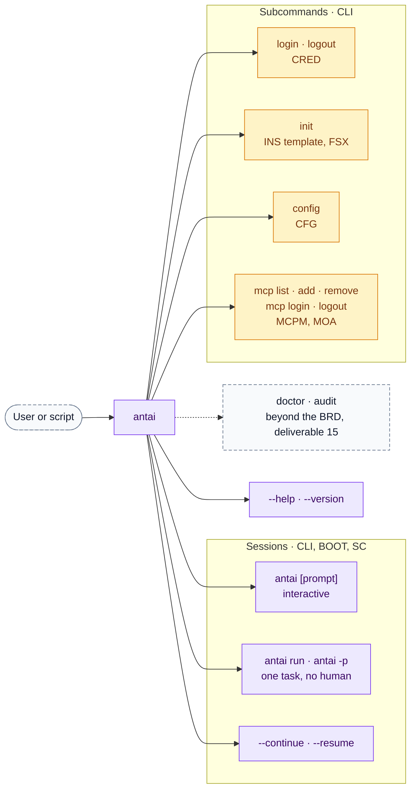
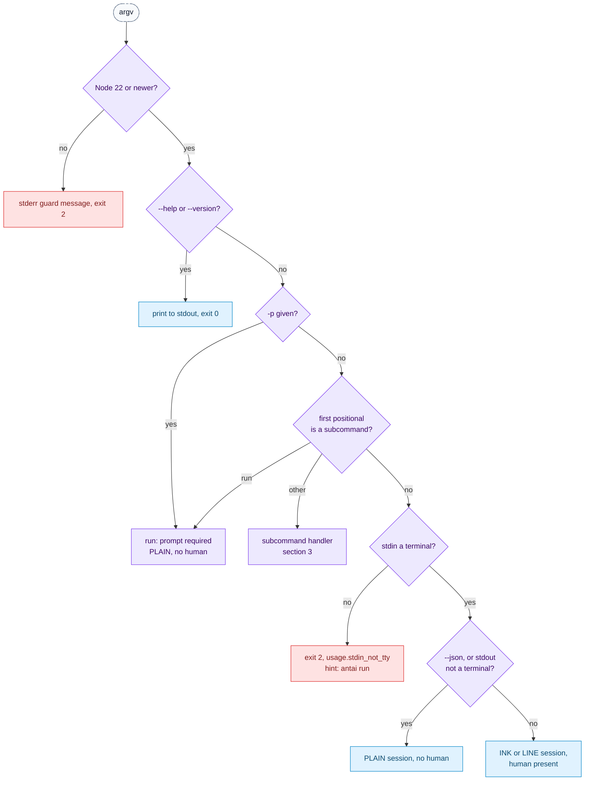
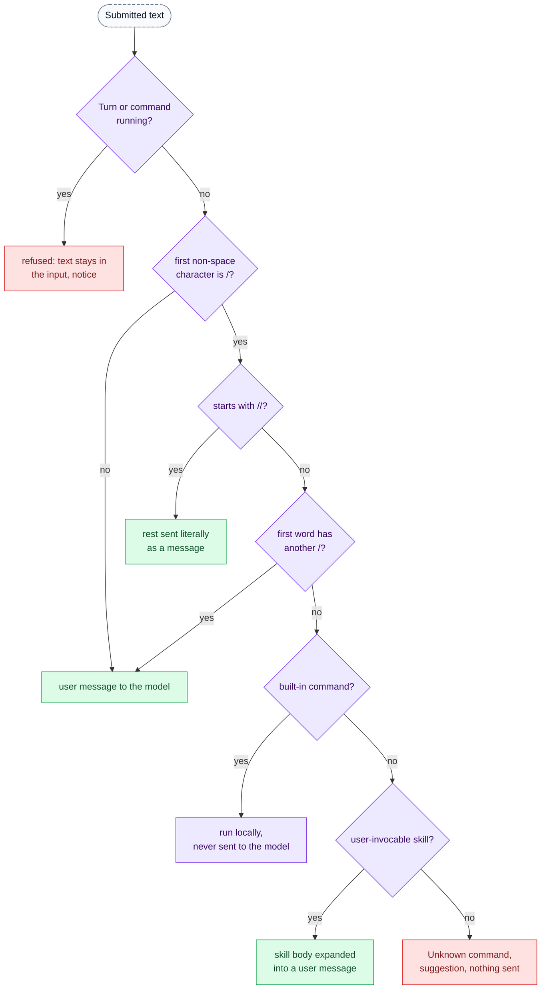
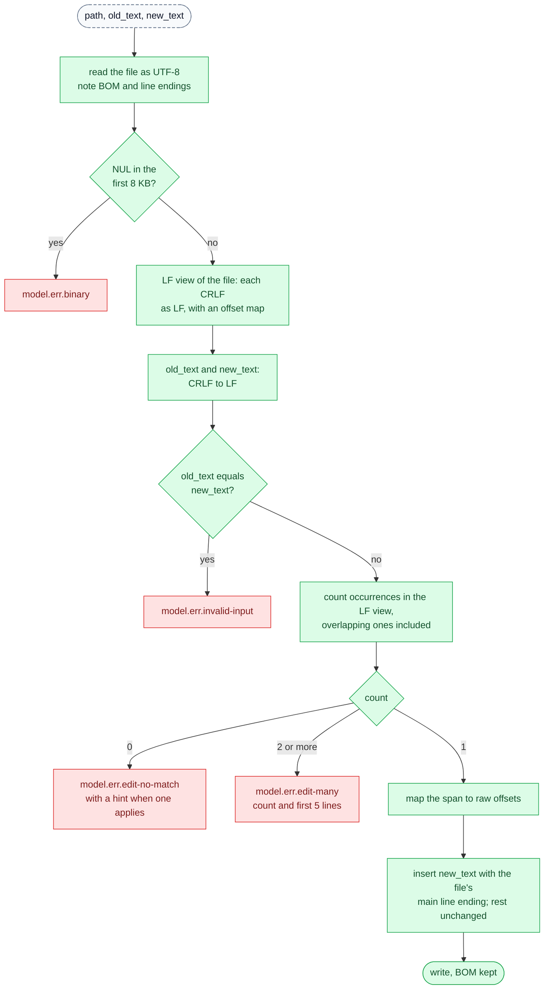
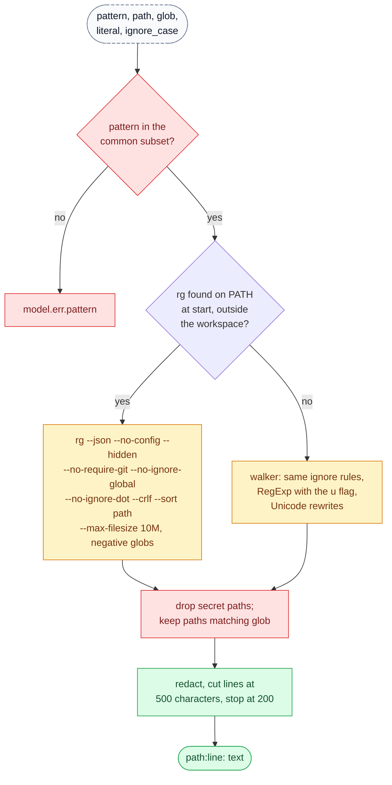

# antai — CLI, Slash Commands & Tool Schemas — Params & Responses

| | |
|---|---|
| **Product** | antai (brand) / `antai` (command) |
| **Document** | Deliverable 12, CLI, Slash Commands & Tool Schemas — Params & Responses for the v1 MVP |
| **Status** | Draft for review |
| **Version** | 0.1 |
| **Date** | 12 October 2026 |
| **Author** | Daksh Nagpal |
| **Based on** | BRD_1 v0.4, HLD.png, deliverables 00, 01, 02, 03, 04, 06, 07, 08, 09, 10, 11, 13, 14, 15 and 16 |
| **How to use** | Reference design, not a fixed rail. Where the technology needs something different or extra, the implementation may change it; the change is then made in every deliverable it touches, so the set keeps agreeing. |

## Contents

1. Purpose, scope and notation (REF-1a, REF-1b)
2. Invocation and global flags (REF-2)
3. Subcommands
4. Environment variables
5. Slash commands (REF-3)
6. Built-in tools (REF-4, REF-5)
7. MCP tools
8. Configuration keys
9. Output formats
10. Design decisions
11. Open questions
12. Traceability
13. Sources

---

## 1. Purpose, scope and notation

### 1.1 Purpose

antai has no HTTP API. Its "endpoints" are the command line (subcommands, flags, environment variables), the slash commands typed in a session, and the tools the model calls. This document fixes each of them exactly: parameters, defaults, behaviour, output, errors and exit codes. A developer implements `CLI`, `SLASH`, `BT` and `MA` from it, and the user reference (DLV-DOC-03) and the `--help` and `/help` texts are generated from it (NFR-USE-03).

### 1.2 Scope

| In this document | Elsewhere (referenced, not repeated) |
|---|---|
| Every invocation form, global flag, subcommand and its arguments, output and exit codes | Exit-code meanings and precedence, NDJSON event contract, error model: deliverable 11, sections 5, 11, 12 |
| Every environment variable antai reads, sets or removes | Child environment construction: deliverable 07, section 7.3 |
| Every slash command, the `/` menu data and input parsing | Screens, pickers and keys: deliverable 13 |
| Every built-in tool: input schema, output layout, caps, tier, modes, errors | `AntaiTool` interface and result envelope: deliverable 11, section 6. Tier rules and classifier: deliverable 02, sections 3 to 5. Model-facing wording and descriptions: deliverable 08, sections 7 and 8 |
| MCP tool naming, schema pass-through, result conversion, tier default | MCP client lifecycle, findings, OAuth: deliverable 10, section 6; deliverable 02, sections 8 and 9 |
| The user-facing list of configuration keys | File schemas, merge strategies, write rules: deliverable 04, section 5 and deliverable 11, section 10 |

### 1.3 Notation

| Convention | Meaning |
|---|---|
| `<name>` | Required argument |
| `[name]`, `[--flag]` | Optional argument or flag |
| `a\|b` | One of the listed literal values |
| `…` | The argument may repeat; positional words are joined with single spaces |
| Type `string(1..4096)` | A string of 1 to 4,096 characters; `integer(1..100)` an integer in that closed range |
| Default `—` | No default: absent means "not set" |
| `$ ` in examples | A shell prompt; `you › ` is antai's prompt (BRD 4.2) |
| Tier names | `Safe`, `Normal`, `Dangerous`, `Hard floor` (BRD 5.5); "denied" means refused before any dialog |
| Error codes | The `<category>.<snake_case>` codes of deliverable 11, section 11.2 (`tool.edit_no_match`), which owns them. Codes marked † are added by this document, in the same format, for that table |
| Model-facing message IDs | `model.deny.*`, `model.err.*`, `model.result.*`, `model.trunc.*`, `model.int.*` of deliverable 08, section 8, which owns the wording. IDs marked † are added by this document for deliverable 08's catalogue |
| SD references | Flows in deliverable 03 (for example SD-13a) |
| Components | IDs of deliverable 01, section 5.9 (`CLI`, `SLASH`, `BT`, `MA`, …); deliverable 01, section 1.3 places each under its HLD.png box. `CLI` is not drawn in HLD.png: a command-line tool needs flags, stdin and exit codes before any box is wired |

Paths in tool examples use `/` and are relative to the workspace root, the git root of the folder where antai starts, or that folder when there is no repository (BRD 5.4).

### 1.4 Additions beyond BRD v0.4

These go beyond BRD v0.4. The design uses them as stated; the BRD can adopt them later. The text marks them "(beyond the BRD, ref)".

| Ref | Item | BRD baseline | Section |
|---|---|---|---|
| REF-P1 | `antai "<prompt>"` starts an interactive session whose first message is the prompt | FR-CLI-01 defines only `antai` without arguments | 2.1 |
| REF-P2 | Short flag `-h` for `--help`; `--profile none` | FR-CLI-04 lists long flags and `-p` | 2.3 |
| REF-P3 | The `ANTAI_*` variable list: `ANTAI_MODEL`, `ANTAI_MODE` (`research`, `manual` only), `ANTAI_EFFORT`, `ANTAI_MAX_STEPS`, `ANTAI_NO_HISTORY`, `ANTAI_DEBUG`, plus the BRD's `ANTAI_GIT_BASH_PATH` | FR-CFG-01 names the layer, not the variables | 4.2 |
| REF-P4 | `antai run` takes its mode from `--mode` or `ANTAI_MODE` only, default `research`; config and profile `mode` do not apply to `run` | D19 "one-shot runs default to research" | 3.2 |
| REF-P5 | `antai run` needs a prompt argument even when stdin is piped; `--continue` and `--resume` are refused with `run`; built-in slash commands are refused in `run` | FR-CLI-02, FR-CLI-03 do not say | 3.2 |
| REF-P6 | `--json` on `antai config` and `antai mcp list` prints one JSON document; other subcommands refuse `--json` | FR-UI-06 defines `--json` for sessions | 3.1, 9.4 |
| REF-P7 | Requirement IDs `FR-SLC-03` to `FR-SLC-19` for the rows of BRD 5.11 | BRD 5.11 rows have no IDs (register CR-13) | 5.2 |
| REF-P8 | `/mcp <name>`, `/mcp login\|reconnect\|accept <name>`, `/effort` and `/resume` without an argument, `/history delete <number>` | BRD 5.11 gives the command names only | 5.3 |
| REF-P9 | `find_files` cap of 200 paths; search line text cut at 500 characters; shared ignore, hidden-file and regular-expression rules for the three listing tools | FR-TOOL-05 says "Results capped" | 6 |
| REF-P10 | Writes and edits are applied only if the file is still in the state the approval dialog showed | Not specified | 6.5, 6.6 |
| Used from other deliverables | Redact, then cap; IC-P1 to IC-P6 (deliverable 11); CR-13 (deliverable 00); EXT-D11, EXT-D14, the global `profile` default and `mcp.disabledServers` (deliverable 10); SEC-D9, SEC-D19 (deliverable 02; SEC-D19 is now in BRD v0.4, FR-CFG-05); P3, P6 (deliverable 04; now in BRD v0.4, FR-CFG-01 and FR-CFG-04); the small-window caps and the 20 % head, 80 % tail split (deliverable 08, sections 9.5 and 8.4); OBS-P1 to OBS-P5 (deliverable 15); the `--color` flags and `ui.*` keys (deliverable 13) | | |

### 1.5 REF-1a Command map: the command line



### 1.6 REF-1b Command map: inside a session

```mermaid
flowchart LR
    IN(["Typed input"])
    SL{{"SLASH<br/>input starting with /"}}
    subgraph CMD["Built-in commands · SLASH"]
        direction TB
        C1["/help /usage /exit /config"]
        C2["/model /effort /mode /profile"]
        C3["/skills /instructions /mcp /trust"]
        C4["/history /resume /clear /compact"]
    end
    SK["/skill-name<br/>SKR"]
    SC["SC turn"]
    LLM(["Model provider"])
    POL{{"POL<br/>tier × mode"}}
    subgraph TL["Tools · TREG, BT, MA"]
        direction TB
        T1["read_file · list_directory<br/>find_files · search_files"]
        T2["write_file · edit_file"]
        T3["shell"]
        T4["load_skill"]
        T5["mcp__server__tool"]
    end
    IN --> SL
    SL --> CMD
    SL --> SK
    SK --> SC
    IN -- "plain message" --> SC
    SC --> LLM
    LLM -- "tool call" --> POL
    POL --> TL
    classDef ui fill:#e0f2fe,stroke:#0284c7,color:#0c4a6e
    classDef orch fill:#ede9fe,stroke:#7c3aed,color:#3b0764
    classDef core fill:#dcfce7,stroke:#16a34a,color:#14532d
    classDef safety fill:#fee2e2,stroke:#dc2626,color:#7f1d1d
    classDef ext fill:#f8fafc,stroke:#64748b,color:#0f172a,stroke-dasharray:5 3
    class SL,C1,C2,C3,C4,SK,SC orch
    class T1,T2,T3,T4,T5 core
    class POL safety
    class IN,LLM ext
```



Slash commands come only from typed input; text in tool output or files that looks like a command is never executed (FR-SLC-02, AC-10).

In HLD.png terms (deliverable 01, section 1.3), `SLASH` and `SC` sit in Session, `POL` in Safety Guard and the tools in Tool Service. `POL` returns a decision and the agent loop then runs the approved call, so the policy stays a function without side effects that table tests can cover.

---

## 2. Invocation and global flags

### 2.1 Invocation forms

| Form | What happens | Renderer, human present (deliverable 01, section 4.3) | Session `kind` | BRD | Flows |
|---|---|---|---|---|---|
| `antai` | Interactive session in the current folder | `INK` (`LINE` in P1 to P4), yes | `interactive` | FR-CLI-01 | SD-1a, SD-1b |
| `antai "<prompt>"` | Interactive session; the prompt is sent as the first message (beyond the BRD, REF-P1) | As above | `interactive` | FR-CLI-01 | SD-1a, SD-5a |
| `antai --continue`, `antai --resume <id>` | Resume a session, optionally with a first prompt | As above | as stored | FR-HIS-04 | SD-17a, SD-17b |
| `antai run <prompt…>`, `antai -p <prompt…>` | One task, no prompts, then exit with a code from deliverable 11, section 12 | `PLAIN`, no | `run` | FR-CLI-02 | SD-13a, SD-13b |
| `<cmd> \| antai run <prompt…>` | As above; stdin becomes a delimited untrusted-data block (section 3.2) | `PLAIN`, no | `run` | FR-CLI-03 | SD-13a |
| `antai run … --json` | As above; stdout carries NDJSON (deliverable 11, section 5) | `PLAIN` NDJSON, no | `run` | FR-UI-06 | SD-13b |
| `antai --json [prompt]` | Interactive session whose output is NDJSON; prompts are read from the terminal one line each; every approval is denied; slash-command output goes to stderr; ends at `/exit` or end of input (REF-D28) | `PLAIN` NDJSON, no | `interactive` | FR-UI-06 | SD-13b |
| `antai` with stdout not a terminal | Plain-text session as above | `PLAIN` text, no | `interactive` | FR-UI-06 | — |
| `antai` with stdin not a terminal | Refused: exit 2, `usage.stdin_not_tty`, hint to use `antai run` | none | — | FR-UI-06 | — |
| `antai <subcommand> …` | Section 3 | `CLI` prints directly | none | FR-CLI-05, 06 | Section 3 |
| `antai --help`, `antai --version` | Print and exit 0 | `CLI` | none | FR-CLI-04 | — |

The launcher checks the Node.js version before anything else: below 22 it prints "antai needs Node.js 22 or newer. You have <version>. Install Node 24 or 26 from nodejs.org." to stderr and exits with 2 (deliverable 16, section 3.8).

#### REF-2 Invocation dispatch



Subcommand names are `run`, `login`, `logout`, `init`, `config` and `mcp`, plus `doctor` and `audit`, which deliverable 15 adds beyond the BRD (OBS-P3, OBS-P4). A first positional word equal to one of them selects the subcommand. To send such a word as an interactive first prompt, put `--` before it: `antai -- config`. After `-p`, no word is treated as a subcommand: `antai -p config` sends "config" as the task.

### 2.2 Parsing rules

| Rule | Detail | Why |
|---|---|---|
| Parser | `node:util` `parseArgs` with `strict: true` and `allowPositionals: true`, plus antai's own subcommand dispatch (deliverable 01, section 7) | No dependency; fast start |
| Long values | `--model groq:openai/gpt-oss-20b` and `--model=groq:openai/gpt-oss-20b` are equivalent | Both forms are common in scripts |
| Placement | Flags may appear before or after the subcommand and the prompt words: `git diff \| antai run "review" --json` (BRD 4.11) | Matches the BRD examples |
| `--` | Ends flag parsing; everything after it is positional. In `antai mcp add` it separates the server command (section 3.8) | Prompts and commands that start with `-` |
| Unknown flag | Exit 2, `usage.unknown_flag`, with the nearest valid flag as a suggestion ("Unknown flag --modle. Did you mean --model?") | NFR-USE-02 |
| A single-value flag given twice | Exit 2, `usage.flag_conflict` † | Two values for `--mode` in one command line is a mistake; guessing which one wins is worse for a safety setting |
| Invalid value | Exit 2, `usage.invalid_value` naming the flag and the valid values (`--mode skip`, `--effort max`, a malformed `--model`) | FR-CFG-02 applies to files; the command line fails fast because the user is present to fix it |
| Flag not valid for the subcommand | Exit 2, `usage.unknown_flag`: "--mode does not apply to antai mcp list" | A silently ignored flag misleads |
| Prompt words | Positional words after `run`, `-p` or the interactive form are joined with single spaces: `antai run fix the tests` sends "fix the tests" | Unquoted prompts work; scripts should still quote |
| `--help` and `--version` | Win over every other flag and are valid with any other argument; `--help` wins over `--version` | Help must stay reachable whatever else is on the line |

### 2.3 Global flags

"Env" and "Config" name the lower layers that set the same value (section 2.4). "Valid with" lists where the flag is accepted; elsewhere it is a usage error.

| Flag | Short | Value | Default | Env | Config | Valid with | Conflicts | BRD |
|---|---|---|---|---|---|---|---|---|
| `--continue` | — | — | off | — | — | `antai` | `--resume`, `run` (REF-P5) | FR-CLI-04, FR-HIS-04 |
| `--resume <id>` | — | Session ID, or a unique prefix of at least 8 characters (`2026-10-12_1432`) | — | — | — | `antai` | `--continue`, `run` | FR-CLI-04, FR-HIS-04 |
| `--model <ref>` | — | `provider:model`, an alias, or a provider name with a default model (deliverable 09, section 2.3) | Resolved `model` | `ANTAI_MODEL` | `model` | `antai`, `run`, `config` | — | FR-CLI-04, FR-MOD-03 |
| `--profile <name>` | — | Profile name, or `none` (no profile: pin, resume and auto-match are skipped) (REF-P2) | Resume, pin, auto-match, global default (deliverable 10, EXT-4) | — | `profile` | `antai`, `run`, `config` | — | FR-CLI-04, FR-PRF-03 |
| `--mode <mode>` | — | `research\|manual\|auto` | `antai`: resolved `mode` (`manual`); `run`: `research` (REF-P4) | `ANTAI_MODE` | `mode` (interactive only) | `antai`, `run`, `config` | `--dangerously-skip-permissions` | FR-CLI-04, FR-MODE-01, FR-CFG-05 |
| `--effort <level>` | — | `provider-default\|none\|low\|medium\|high` | Resolved `effort` | `ANTAI_EFFORT` | `effort` | `antai`, `run`, `config` | — | FR-CLI-04, FR-MOD-06 |
| `--json` | — | — | off | — | — | `antai`, `run`, `config`, `mcp list` (REF-P6) | — | FR-CLI-04, FR-UI-06 |
| `--no-history` | — | — | off | `ANTAI_NO_HISTORY` | `history.enabled: false` | `antai`, `run` | — | FR-CLI-04, FR-HIS-10 |
| `--dangerously-skip-permissions` | — | — | off | none, ever | none, ever | `antai`, `run` | `--mode` | FR-CLI-04, FR-MODE-02 |
| `--debug` | — | — | off | `ANTAI_DEBUG` | — | everything | — | FR-CLI-04, FR-ERR-03 |
| `--version` | — | — | — | — | — | everything | — | FR-CLI-04 |
| `--help` | `-h` | — | — | — | — | everything; with a subcommand prints its help | — | FR-CLI-04, NFR-USE-03 |
| `-p` | — | Alias of the `run` subcommand | — | — | — | top level | any other subcommand | FR-CLI-02 |
| `--debug-content` | — | Beyond the BRD (deliverable 15, OBS-P2): the debug log also records redacted prompts and model text for this run | off | — | — | `antai`, `run`; implies `--debug` | — | FR-ERR-03 |
| `--color`, `--no-color` | — | Beyond the BRD (deliverable 13); colour decision of section 9.5 | auto | `NO_COLOR`, `FORCE_COLOR` | `ui.*` (deliverable 13) | everything | each other | FR-UI-07 |

Flag effects in detail:

| Flag | Effect | Notes |
|---|---|---|
| `--continue` | Resumes the newest `interactive` session of the current project (matched by `gitRoot`, else `cwd`); `run` sessions are skipped. Nothing to continue: a new session starts with "No earlier session for this project; starting a new one." (SD-D21) | FR-HIS-01, 03, 04 |
| `--resume <id>` | Resumes that session. Not found: exit 2 `usage.session_not_found`. Prefix matches several: exit 2 `usage.session_ambiguous` † listing up to 5 IDs. Another project: exit 2 `usage.session_other_project` with its path. Held by another process: continues in a copy (FR-HIS-11). Written by a newer antai: exit 2 `storage.session_newer_format` | FR-HIS-04, 11 |
| Restore on resume | Model, effort, profile and mode are restored from the session; flags given now win. `auto` is restored only when `--mode auto` is given again; skip never (FR-HIS-04, FR-MODE-02) | SD-17b |
| `--model` | Invalid reference: exit 2 (`model.invalid_reference`); a model known not to call tools: exit 2 (`model.tools_unsupported`); no key for its provider: interactive sessions prompt (SD-2a), `run` exits 2 (`provider.key_missing`) naming the variable | FR-MOD-04, 05 |
| `--profile` | Unknown or invalid name: interactive sessions start without a profile and show the error; `run` exits 2 (`usage.profile_not_found`) (deliverable 10, EXT-D14) | FR-PRF-01, 03 |
| `--mode` | Sets the starting mode. Never `skip`: `--mode skip` is `usage.invalid_value` naming `--dangerously-skip-permissions` | FR-MODE-02 |
| `--json` | Selects `PLAIN` with NDJSON on stdout; the human-present flag is false, so every approval-needing call is denied (deliverable 01, section 4.3) | Section 9 |
| `--no-history` | No session file, index entry or title call; the audit log is still written (FR-HIS-13); with `--continue` or `--resume` the old file is read but nothing is appended | FR-HIS-10, AC-31, AC-34 |
| `--dangerously-skip-permissions` | Mode `skip` for this process: everything except the hard floor and secret paths runs without asking; a red banner shows for the whole session; never restored on resume; no environment variable or config key can set it | FR-MODE-02, AC-08 |
| `--debug` | Writes the redacted debug log to `~/.antai/logs/` and prints its path on exit (deliverable 15) | FR-ERR-03 |

### 2.4 Precedence

Values resolve in this order, highest first (FR-CFG-01; deliverable 11, IC-4):

| Rank | Layer | Example | Restrictions |
|---|---|---|---|
| 1 | Command-line flags | `--mode research` | — |
| 2 | `ANTAI_*` environment variables (section 4.2) | `ANTAI_MODEL=fast` | Only the listed variables; `ANTAI_MODE` cannot set `auto` (deliverable 02, SEC-D19) |
| 3 | Active profile defaults | `mode: manual` in `PROFILE.md` | A project profile's `mode` and `model` apply only in trusted folders, `mode` only `research` or `manual` (FR-PRF-02); no profile sets `auto` (FR-CFG-05) |
| 4 | Project config `<root>/.antai/config.json` | `"maxSteps": 40` | Filtered first: trust-gated keys only if trusted, global-only keys dropped, `auto` never (section 8.1) |
| 5 | Global config `~/.antai/config.json` | `"model": "google:gemini-3.8-flash"` | — |
| 6 | Built-in defaults | `maxSteps` 25 | — |

Safety and privacy keys never loosen across layers: list keys such as `shell.block` and `tools.disabled` are combined from every layer, and `history.enabled: false` in any layer wins (FR-CFG-01; deliverable 11, section 10.2). `antai config` shows the winning layer of each value (section 3.5).

---

## 3. Subcommands

### 3.1 Overview

| Subcommand | Purpose | Needs a terminal | `--json` | Exit codes (deliverable 11, section 12.3) | Owner | Priority | Flows |
|---|---|---|---|---|---|---|---|
| `run` | One task, non-interactive | No | NDJSON | 0, 1, 2, 3, 4, 5, 129, 130, 143 | `CLI`, `BOOT`, `SC`, `PLAIN` | Must (FR-CLI-02) | SD-13a, SD-13b |
| `login <provider>` | Store an API key | Yes | Refused | 0, 1, 2, 130 | `CLI`, `CRED` | Should (FR-CLI-05) | SD-2b |
| `logout <provider>` | Remove a stored API key | No | Refused | 0, 1, 2 | `CLI`, `CRED` | Should | SD-2b |
| `config` | Print the resolved configuration and the source of each value | No | One document | 0, 1, 2 | `CLI`, `CFG` | Should (FR-CFG-03) | — |
| `init` | Create a starter `AGENT.md` | No (asks only in a home-folder workspace) | Refused | 0, 1, 2 | `CLI`, `FSX` | Could (FR-CLI-06) | — |
| `mcp list` | Connect to each server once and print its state | No | One document | 0, 1, 2 | `CLI`, `MCPM` | Should | SD-19a, SD-20, SD-21c |
| `mcp add` | Add a server to the global or project MCP file | No (asks only about literal tokens) | Refused | 0, 1, 2 | `CLI`, `FSX`, `TRUST` | Should (FR-MCP-08) | — |
| `mcp remove` | Remove a server and its stored tokens | No | Refused | 0, 1, 2 | `CLI`, `FSX`, `CRED` | Should (FR-MCP-08) | — |
| `mcp login <name>` | OAuth browser login for a remote server | Yes | Refused | 0, 1, 2, 3, 130 | `CLI`, `MCPM`, `MOA`, `OCB` | Must (FR-MCP-11) | SD-21a, SD-21b |
| `mcp logout <name>` | Delete a server's OAuth tokens | No | Refused | 0, 1, 2 | `CLI`, `CRED` | Must (FR-MCP-11) | SD-21d |
| `doctor`, `audit` | Added by deliverable 15, beyond the BRD (OBS-P3, OBS-P4, OBS-P5); syntax, flags and exit codes are defined there | — | — | — | `CLI` | — | — |

Every subcommand accepts `--help` and `--debug`, writes its messages to stderr and its result to stdout, exits 1 on an internal error with a crash report (FR-ERR-04), and never starts a model session. Subcommands that change a file or a credential write an audit record with `sessionId: null` (deliverable 04, section 5.13). A failed write of `credentials.json` or an MCP file is reported with its cause and exits 1.

### 3.2 `antai run`

| Item | Specification |
|---|---|
| Synopsis | `antai run [flags] [--] <prompt…>` or `antai -p [flags] [--] <prompt…>` |
| Arguments | `<prompt…>`: the task, required, 1 to 100,000 characters after joining. Missing or blank: exit 2, `usage.prompt_missing` †, even when stdin is piped, because the instruction must come from the user and piped text is only data (beyond the BRD, REF-P5) |
| Flags | `--model`, `--profile`, `--mode`, `--effort`, `--json`, `--no-history`, `--dangerously-skip-permissions`, `--debug`, `--debug-content` (beyond the BRD, OBS-P2). Refused: `--continue`, `--resume` (REF-P5) |
| Mode | `--mode`, else `ANTAI_MODE`, else `research`. Config `mode` and a profile's `mode` do not apply (beyond the BRD, REF-P4): nobody is present to approve, and a global `mode: auto` must not make every script run Normal commands unasked (D19, FR-CLI-02) |
| Renderer | `PLAIN`, human present false: every call that needs approval is denied with `model.deny.no-human` and reported (deliverable 11, section 5) |
| Trust | Never asked. A stored "trusted" decision with a matching hash applies; otherwise the folder is untrusted and one stderr notice says so (deliverable 02, SEC-4) |
| Workspace is the home folder or a drive root | Warning on stderr; continues in `research` or `manual`; exits 2 (`usage.home_workspace` †) in `auto` or skip (deliverable 02, SEC-D9) |
| API key | Missing: exit 2, `provider.key_missing`, naming the variable and `antai login <provider>`; never a prompt (FR-MOD-04, AC-01) |
| MCP | Waits until every enabled server is connected, failed or needs login, each bounded by its `startupTimeoutMs`, before the first step; a server that needs login is skipped with "run `antai mcp login <name>`" on stderr (deliverable 10, EXT-D23; FR-MCP-11) |
| Slash input | A prompt that starts with `/<skill-name>` expands that user-invocable skill (deliverable 10, EXT-D11). A built-in command (`antai run "/usage"`) or an unknown command exits 2 (`usage.unknown_command` †). Path-like first words and `//` follow section 5.1 |
| Session | `kind: run`, skipped by `--continue`; title is the trimmed prompt, no model call (deliverable 03, SD-D11); audit records always (FR-HIS-13) |
| Output | Text mode: section 9.2. `--json`: NDJSON, deliverable 11, section 5 |
| Exit codes | 0 done; 1 internal error; 2 usage or config error; 3 provider error; 4 step cap; 5 an approvable call was denied (IC-P2); 129, 130, 143 signals (IC-P1); precedence in deliverable 11, section 12.2 |

**Piped stdin** (FR-CLI-03; deliverable 08, section 6.2):

| Rule | Value |
|---|---|
| When read | Only when stdin is not a terminal |
| First-byte wait | If no byte and no end of input arrive within 10 seconds, antai continues without piped input and prints "No input on stdin after 10 s; continuing without it. Use </dev/null to skip the wait." This stops a CI runner's open, idle stdin from hanging the job (REF-D12) |
| Cap | 100 KB (102,400 bytes), cut at a UTF-8 character boundary; the rest is not read and stdin is closed. Notice on stderr and the marker `model.trunc.piped-input` inside the block. On a small effective window the cap is lower (deliverable 08, section 9.5) |
| Binary | A NUL byte in the first 8 KB: the block says `[binary input not included]` |
| Encoding | UTF-8; a leading BOM is removed; invalid sequences become U+FFFD |
| Redaction | After the `.env` scan, before the text enters the prompt (deliverable 02, section 6.3) |
| Framing | A delimited block with a per-process random token, data first, the user's prompt last (deliverable 08, section 6.2; deliverable 02, SEC-D25) |
| Stored | The user message keeps the redacted, capped block and the task as two text parts |

Examples:

```text
$ antai run "summarise the changes in the last 5 commits"
$ git diff | antai run "review this diff for bugs" --json > review.ndjson; echo $?
$ antai run --mode auto "update the copyright year in all LICENSE files"
$ antai -p "/commit-message"
```

The third example lets Normal commands run unasked; the documentation warns against `--mode auto` on untrusted input such as a stranger's diff (FR-CLI-02).

### 3.3 `antai login`

| Item | Specification |
|---|---|
| Synopsis | `antai login <provider>` |
| Arguments | `<provider>`: a built-in provider (`groq`, `google`, `openai`, `anthropic`), a preset (`openrouter`, `together`, `fireworks`, `deepseek`, `mistral`, `xai`), or a custom provider defined in global config. A provider defined only in a project file is refused, because a repository must not choose where a stored key is sent (deliverable 09, section 7.4) |
| Keyless providers | `ollama`, `lmstudio` and a custom provider without `apiKeyEnv`: prints "<provider> needs no API key." and exits 0 |
| Terminal | stdin and stdout must be terminals. Otherwise exit 2, `usage.tty_required`, with "Set GROQ_API_KEY instead; it takes precedence over stored keys." (deliverable 03, SD-D14) |
| Prompt | `Paste your GROQ_API_KEY:` with masked echo; the key page URL is shown when known (deliverable 09, section 7.2). A key whose prefix does not match the provider asks "This does not look like a Groq key, which starts with gsk_. Save anyway?" (default No). Empty input, Esc or Ctrl+C cancels: exit 130 |
| Storage | `providers.<name>.apiKey` and `savedAt` in `~/.antai/credentials.json`, `0600`, written under its lock; an existing key is replaced; the value is registered with `RED` at once (deliverable 04, section 5.5). No network call checks the key (deliverable 03, SD-D13) |
| Output (stdout) | `Saved the groq key to ~/.antai/credentials.json (readable only by you).` When the provider's variable is also set: `GROQ_API_KEY is set in your environment and takes precedence over the saved key.` |
| Audit | `credential` record, `action: key-saved`, `via: cli`, never a value |
| Errors | Unknown provider: exit 2, `model.unknown_provider` listing valid names. Write failure: exit 1 with the cause (`storage.credentials_write`) |

```text
$ antai login groq
  Get a free key at https://console.groq.com/keys
  Paste your GROQ_API_KEY: ••••••••••••••••
  Saved the groq key to ~/.antai/credentials.json (readable only by you).
  GROQ_API_KEY is set in your environment and takes precedence over the saved key.
```

The Groq key page is the BRD's (BRD 4.1); the other providers' pages live in `providers.json` and are checked in P0 (deliverable 09, section 7.2).

### 3.4 `antai logout`

| Item | Specification |
|---|---|
| Synopsis | `antai logout <provider>` |
| Arguments | `<provider>`: any provider name that `login` accepts, or any name with a stored key |
| Terminal | Not needed: removing a key cannot leak one (REF-D10). Only `login` needs a terminal (deliverable 11, section 12.3) |
| Behaviour | Removes `providers.<name>` from `credentials.json` under its lock. Environment variables are untouched |
| Output | `Removed the saved groq key.`, plus the environment note of `login` when the variable is set. Nothing stored: `No saved key for groq.` (exit 0) |
| Audit | `credential` record, `action: key-removed`, `via: cli` |
| Errors | Unknown provider with nothing stored: exit 2, `model.unknown_provider`. Write failure: exit 1 |

### 3.5 `antai config`

| Item | Specification |
|---|---|
| Synopsis | `antai config [--json] [--model <ref>] [--profile <name>] [--mode <mode>] [--effort <level>] [--no-history]` |
| Purpose | Print the resolved configuration for the current folder and the source of every value (FR-CFG-03). The session flags let a user preview their effect; they change nothing on disk |
| Behaviour | Resolves exactly as a session start would (section 2.4): global and project files, stored trust decision (never asks; no decision means untrusted), profile selection, `ANTAI_*` variables and the given flags. Starts no MCP server, provider or model call; makes no network request |
| Never printed | Key values, OAuth tokens, header values, URL user information and values under secret-named keys; they appear as `[hidden]` (deliverable 02, section 6.3 and SEC-D17) |
| Output sections (text) | `Workspace` (root, trust state, files read); `Settings` (one line per key: key, value, source); `Providers` (each usable provider: key source `env GROQ_API_KEY`, `saved 2026-10-12`, `missing` or `not needed`; base URL when not the package default); `Profile` (active profile and how it was chosen); `Ignored` (trust-gated project keys ignored, invalid values with the value used instead, unknown keys) |
| Source labels | `default`, `global ~/.antai/config.json`, `project .antai/config.json`, `profile <name> (<file>)`, `env ANTAI_MODEL`, `flag --model` |
| Exit codes | 0 printed (also when files have problems: they are listed under `Ignored`); 2 bad arguments; 1 internal error |

```text
$ antai config --mode research
Workspace  /Users/me/shop-api (trusted, .antai/config.json read)
Settings
  model                 groq:openai/gpt-oss-120b      default
  mode                  research                      flag --mode
  effort                medium                        profile node-dev (~/.antai/profiles/node-dev/PROFILE.md)
  maxSteps              40                            project .antai/config.json
  shell.allow           npm test, npm run lint        global ~/.antai/config.json
  history.enabled       true                          default
  …
Providers
  groq                  key from env GROQ_API_KEY
  google                key saved 2026-10-12
Profile    node-dev (auto-matched: package.json)
Ignored
  .antai/config.json    mode "auto": a project file cannot set auto
```

`--json` prints one document (section 9.4).

### 3.6 `antai init`

| Item | Specification |
|---|---|
| Synopsis | `antai init` |
| Behaviour | Creates `<root>/AGENT.md` with exclusive create (`wx`), so it never overwrites (FR-CLI-06). If any recognised instruction file (`AGENT.md`, `AGENTS.md`, `CLAUDE.md`, any letter case) already exists in the root, writes nothing and names that file, because a new `AGENT.md` would shadow it (deliverable 10, section 3.7). Creates no other file or folder |
| Template | `# <folder name>` then three sections with one guidance line each: `## Project overview`, `## Commands` (build, test, lint), `## Conventions`. The exact text is starter content (DLV-SW-10) |
| Home folder or drive root | Asks to confirm (default No) in a terminal; without a terminal exits 2 (`usage.home_workspace` †), with the hint that global instructions belong in `~/.antai/AGENT.md` |
| Output | `Created AGENT.md in /Users/me/shop-api. Describe the project there; antai reads it at the start of every session in this folder.` or `AGENTS.md already exists in /Users/me/shop-api; nothing was written.` |
| Audit | `config-file` record, `action: init`, `file` |
| Exit codes | 0 created or already present; 2 bad arguments or declined home-folder confirmation without a terminal; 1 write failure or internal error |

### 3.7 `antai mcp list`

| Item | Specification |
|---|---|
| Synopsis | `antai mcp list [--json]` |
| Behaviour | Connects every enabled server from `~/.antai/mcp.json` and, in a trusted workspace, from `.mcp.json` and `.antai/mcp.json`, in parallel, each bounded by its `startupTimeoutMs`; lists its tools; then closes it (deliverable 10, section 6.5). Refreshes expired OAuth tokens as at start; never opens a browser and never asks for trust |
| Columns (text) | Name, transport, status with symbol (deliverable 13, UI-23 states), tool count with hidden count (`mcp.tools.deny`), source file; a second line gives the next step when there is one (`run: antai mcp login linear`, `fix the entry`, `/trust`) |
| Statuses | `connected`, `needs login`, `failed: <reason>`, `disabled`, `skipped: <reason>`, `not trusted` (deliverable 10, section 6.8) |
| Exit codes | 0 always when the list was printed, including failed servers; 2 bad arguments; 1 internal error |

```text
$ antai mcp list
  github       http    ✓ connected      34 tools (3 hidden)   ~/.antai/mcp.json
  filesystem   stdio   ✓ connected      14 tools              .antai/mcp.json
  postgres     stdio   ✗ failed: command not found: uvx       .antai/mcp.json
  linear       http    ⚠ needs login                          ~/.antai/mcp.json
               run: antai mcp login linear
```

When stdout is not a terminal, the symbols are replaced by their ASCII fallbacks (deliverable 13). `--json` prints one document (section 9.4).

### 3.8 `antai mcp add`

| Item | Specification |
|---|---|
| Synopsis (stdio) | `antai mcp add <name> [--project] [--env KEY=VALUE]… -- <command> [args…]` |
| Synopsis (HTTP) | `antai mcp add <name> [--project] --url <url> [--header "Name: value"]…` |
| `<name>` | 1 to 32 characters, first a letter or digit, then letters, digits, `_` and `-`, never `__` (deliverable 10, EXT-D19, section 6.9) |
| `--project` | Write `<root>/.antai/mcp.json` (creating `.antai/`), never `.mcp.json`. Without it: `~/.antai/mcp.json` |
| `--env KEY=VALUE` | Repeatable; stdio only. `KEY` matches `[A-Za-z_][A-Za-z0-9_]*`; `VALUE` may contain `${VAR}` or `${VAR:-default}` |
| `--header "Name: value"` | Repeatable; HTTP only. Split at the first `:`; the name is an HTTP token; the value may contain `${VAR}`. `Content-Type`, `Accept`, `Host` and `Mcp-*` are refused (deliverable 10, EXT-D27) |
| `--url <url>` | `https://`, or `http://` to a loopback host only (FR-MCP-01; deliverable 10, XM-7); no `${…}` |
| `-- <command> [args…]` | Everything after `--`; no `${…}` in the command or arguments (deliverable 10, XM-31: pass values through `--env`) |
| Validation | Exactly one of `--url` and `--`; `--env` only with `--`; `--header` only with `--url`. Any failure: exit 2 (`usage.invalid_value`) naming the rule |
| Existing name | In the target file: exit 2 (`usage.server_exists` †). In another file: allowed, with "This overrides github in ~/.antai/mcp.json." or "github in .antai/mcp.json overrides this entry in this workspace." |
| Literal tokens | A `--header` or `--env` value with no `${` whose name looks secret (`Authorization`, `*_TOKEN`, `*_KEY`, `*_SECRET`, `*_PASSWORD`) or that matches a known credential format gets warning XM-29 with the `${VAR}` alternative (FR-MCP-08). In a terminal antai then asks "Store the literal value anyway?" (default No; No writes nothing and exits 0). Without a terminal the entry is written with the warning on stderr |
| Write | Comment-preserving JSONC edit, atomic replace, file `0600`; the global file's previous version is kept as `mcp.json.bak` (deliverable 04, section 5.4) |
| Trust | With `--project` in a trusted workspace, the stored trust hash is updated only if nothing else changed since the user trusted the folder (deliverable 10, EXT-D28); otherwise the next start asks again |
| Connects? | No. Prints `Added stdio server "db" to .antai/mcp.json. Check it with: antai mcp list` |
| Audit | `config-file` record, `action: mcp-add`, `file`, `server` |
| Exit codes | 0 written (or declined); 2 invalid arguments or existing name; 1 write failure or internal error |

```text
$ antai mcp add db --project --env 'DATABASE_URL=${DATABASE_URL}' -- npx -y @example/postgres-mcp@1.4.2
$ antai mcp add github --url https://mcp.example.com/github/ --header 'Authorization: Bearer ${GITHUB_TOKEN}'
```

Single quotes keep the shell from expanding `${…}`, so the file stores the reference, not the token.

### 3.9 `antai mcp remove`

| Item | Specification |
|---|---|
| Synopsis | `antai mcp remove <name> [--project]` |
| Behaviour | Removes the entry from the global file, or from `.antai/mcp.json` with `--project`, with the same edit and backup rules as `add`. Then deletes the server's OAuth token set (keyed by its canonical URL), its client registration when no other configured server uses that issuer, and its drift baseline when no other server shares its identity (deliverable 04, sections 5.5 and 5.14) |
| Not in the target file | Present only in `.mcp.json`: exit 2 with "antai does not edit .mcp.json; remove the entry there." Present in the other antai file: exit 2, `usage.unknown_server`, with the hint to add or drop `--project`. Nowhere: exit 2, `usage.unknown_server` |
| Output | `Removed "linear" from ~/.antai/mcp.json and deleted its saved login.` |
| Audit | `config-file` record (`action: mcp-remove`); `credential` record when tokens were deleted |
| Exit codes | 0 removed; 2 unknown name; 1 write failure or internal error |

### 3.10 `antai mcp login`

| Item | Specification |
|---|---|
| Synopsis | `antai mcp login <name>` |
| Who | A human at a terminal (`usage.tty_required` otherwise), for an HTTP server from the global file or a trusted project (`oauth.not_trusted`, exit 2, for an untrusted project server), without a configured `Authorization` header (deliverable 03, SD-D16). A stdio server or a server with that header: exit 2 (`usage.invalid_value`) explaining that it takes its credentials from its configuration |
| Flow | Deliverable 03, SD-21a and SD-21b: discovery, client registration or `oauth.clientId`, loopback listener, browser, callback checks, token exchange. Repeating the command replaces an existing login (FR-MCP-11) |
| Screen | Prints the authorization-server host and the authorization URL, opens the browser when it can, and waits up to 5 minutes with a countdown; Esc or Ctrl+C cancels. Over SSH the URL is printed with the explanation that browser login needs a browser on the same computer (FR-MCP-11; deliverable 13, UI-24) |
| After the callback | Stores the tokens (`0600`), connects once to list the tools, closes, and prints `linear: logged in. 12 tools available.` |
| Audit | `credential` record, `action: oauth-login`, `server`, `issuer`, `via: cli` |
| Exit codes | 0 logged in; 2 unknown server (`usage.unknown_server`), not trusted, no client ID (`oauth.client_id_required`), no terminal; 3 authorization or MCP server failure (`oauth.no_metadata`, `oauth.callback_rejected`, `oauth.timeout`, `mcp.start_failed`; IC-P4); 130 cancelled (`oauth.cancelled`) |

### 3.11 `antai mcp logout`

| Item | Specification |
|---|---|
| Synopsis | `antai mcp logout <name>` |
| Behaviour | Deletes the token set stored for that server's canonical URL; keeps the client registration (only `remove` deletes it). The server shows `needs login` at the next start |
| Output | `Deleted the saved login for "linear".` or `No saved login for "linear".` |
| Audit | `credential` record, `action: oauth-logout` |
| Exit codes | 0 deleted or nothing stored; 2 unknown server; 1 write failure or internal error |

### 3.12 `--version` and `--help`

| Item | `--version` | `--help`, `-h` |
|---|---|---|
| Output | One line on stdout: `antai 1.0.0` (the package version, nothing else, so scripts can compare it) | Help text on stdout, wrapped to the terminal width (80 columns when not a terminal) |
| Content | — | Usage line, then examples first (most readers look for one), commands, flags with defaults, environment variables, exit codes, and where the reference lives. `antai <subcommand> --help` shows that subcommand's synopsis, arguments, flags, examples and exit codes |
| Source | `package.json` version compiled into the bundle | The same command registry that builds `/help` (deliverable 13, UI-28), and a test checks that every flag, subcommand and slash command appears (NFR-USE-03, DLV-DOC-03) |
| Exit code | 0 | 0 |

---

## 4. Environment variables

### 4.1 Rules

- antai reads only the variables listed in this section. Configuration keys have no automatic `ANTAI_*` mapping, so an inherited variable cannot set an arbitrary safety key (deliverable 11, IC-D17).
- An empty value counts as unset. An invalid value produces a warning naming the variable and the valid values; the value is ignored and the next layer applies (FR-CFG-02). `ANTAI_MODE=auto` is refused the same way (deliverable 02, SEC-D19).
- No variable can enable `--dangerously-skip-permissions`, set `auto`, mark a folder trusted, or move `~/.antai` (deliverable 04, section 2.1).
- `ANTAI_*` variables are removed from every child environment (section 4.5).

### 4.2 `ANTAI_*` variables (beyond the BRD, REF-P3)

| Variable | Sets | Values | Same as | Notes |
|---|---|---|---|---|
| `ANTAI_MODEL` | Starting model | `provider:model`, alias or provider name | `--model`, `model` | Resolved as in deliverable 09, section 2.3 |
| `ANTAI_MODE` | Starting mode | `research`, `manual` | `--mode`, `mode` | `auto` refused (FR-CFG-05, SEC-D19); also applies to `antai run` (REF-P4) |
| `ANTAI_EFFORT` | Reasoning effort | `provider-default`, `none`, `low`, `medium`, `high` | `--effort`, `effort` | FR-MOD-06 |
| `ANTAI_MAX_STEPS` | Step cap | integer 1 to 100; larger values are clamped to 100 | `maxSteps` | FR-AGT-02 |
| `ANTAI_NO_HISTORY` | No session file for this process | `1` or `true` | `--no-history`, `history.enabled: false` | The audit log is still written (FR-HIS-13) |
| `ANTAI_DEBUG` | Debug log | `1` or `true`, or a comma list of categories (`provider`, `mcp`, `oauth`, `tool`, `history`, `config`, `ui`, `session`, `safety`, `process`, `perf`) | `--debug` | Beyond the BRD (deliverable 15, OBS-P1); categories from deliverable 15, section 3.2 (OBS-D4) |
| `ANTAI_GIT_BASH_PATH` | Windows: path to Git Bash `bash.exe` | Absolute path | `shell.gitBashPath` | BRD FR-SH-11. An invalid path gives a warning and auto-detection (AC-24); ignored on macOS and Linux |

Why these and no more: each mirrors a launch flag or the BRD's Git Bash override, so CI jobs can set them once per pipeline. Provider base URLs have no variable or flag in v1; they come from global config or a trusted project (FR-MOD-07 allows these sources; deliverable 09, section 3.4).

### 4.3 Provider key variables

Read in the order of FR-MOD-04: the variable, then `credentials.json`, then (interactive only) a prompt. The value is passed to the provider factory and never copied into `process.env` (deliverable 09, section 7.3).

| Provider | Variable | Key needed |
|---|---|---|
| `groq` | `GROQ_API_KEY` | Yes |
| `google` | `GOOGLE_GENERATIVE_AI_API_KEY` (`GEMINI_API_KEY` is not read: the BRD names one variable; deliverable 09, section 7.2) | Yes |
| `openai` | `OPENAI_API_KEY` | Yes |
| `anthropic` | `ANTHROPIC_API_KEY` | Yes |
| `openrouter`, `together`, `fireworks`, `deepseek`, `mistral`, `xai` | `OPENROUTER_API_KEY`, `TOGETHER_API_KEY`, `FIREWORKS_API_KEY`, `DEEPSEEK_API_KEY`, `MISTRAL_API_KEY`, `XAI_API_KEY` (FR-MOD-08) | Yes |
| `lmstudio`, `ollama` | — (`OLLAMA_HOST` is not read, deliverable 09, section 3.3) | No |
| Custom `providers.<name>` | The name in `apiKeyEnv` | When `apiKeyEnv` is set |

### 4.4 Other variables antai reads

| Variable | Read by | Effect |
|---|---|---|
| `NO_COLOR` | `INK`, `LINE`, `PLAIN` | Present and not empty: no ANSI colour. antai applies it itself, because `supports-color` 11 and chalk 6 do not check it |
| `FORCE_COLOR` | Same | Forces colour, also when stdout is not a terminal; order of the colour decision in section 9.5 |
| `TERM` | Node's colour detection | `TERM=dumb` means no colour |
| `HOME` (POSIX), `USERPROFILE` (Windows) | `PLAT` through `os.homedir()` | Location of `~/.antai`; on Windows `HOME` is ignored (deliverable 04, section 2.1) |
| `PATH`, `PATHEXT` (Windows) | `GBL`, `SRCH`, `MCPM` | Finding `bash.exe`, `rg` and stdio MCP commands; entries inside the workspace and WSL's `System32\bash.exe` are skipped (FR-SH-11; deliverable 07, RT-D7) |
| `INK_SCREEN_READER` | Ink | `true` turns on Ink's screen-reader output; deliverable 13 owns antai's accessibility settings |
| Secret-named variables (`*_KEY`, `*_TOKEN`, `*_SECRET`, `*_PASSWORD`, `*_PASS`, `*_PWD`, `*_CREDENTIALS`, `DATABASE_URL`) | `RED` | Their values are masked in all output (FR-SEC-03 b) |
| `${VAR}` names in MCP files | `MCPM` | Substituted into `env` and `headers` values at start (FR-MCP-03) |
| `RIPGREP_CONFIG_PATH` | — | Neutralised: `rg` always runs with `--no-config` (section 6.8) |

### 4.5 Variables antai sets or removes in child processes

Applies to `shell` commands and stdio MCP servers (deliverable 07, section 7.3; deliverable 02, section 6.6).

| Variable | In the child | Why |
|---|---|---|
| `PAGER=cat`, `GIT_PAGER=cat`, `GIT_TERMINAL_PROMPT=0` | Set | Nothing waits for input (FR-SH-06) |
| `ANTAI_*` | Removed | antai's own settings are not command input |
| Keys from `credentials.json`, OAuth tokens | Never present | They are never in `process.env`, so no child inherits them |
| Provider key variables the user exported | Kept; printed values are masked | The user's own environment (deliverable 01, section 10.6) |
| An MCP entry's `env` values | Added for that server only, after substitution, registered with `RED` | FR-MCP-03 |

### 4.6 What project files can reference

| Project setting | May reference | May not reference | Ref |
|---|---|---|---|
| `${VAR}` in `env` and `headers` of a project MCP entry (trusted workspace only) | Any variable in the user's environment | Provider key variables (section 4.3, including custom `apiKeyEnv` names) and `ANTAI_*`: the server is skipped with finding XM-10 | Deliverable 10, EXT-D17 |
| `${VAR}` in `command`, `args` or `url` | Nothing | Any reference: the entry is skipped (XM-31) | Deliverable 10, EXT-D16 |
| `providers.<name>.apiKeyEnv` (trusted workspace only) | Any variable name; the trust prompt names the variable and the URL it is sent to | — | Deliverable 09, section 7.6 |
| Environment for antai itself | Nothing: no project file sets variables, and `.env` files are never loaded into antai's environment or config | — | Deliverable 02, section 7.1 |

---

## 5. Slash commands

### 5.1 Input parsing (FR-SLC-02)

`SLASH` (`src/session/commands/`) decides what typed text is. Only text the user typed reaches it; tool output, files and model text never do (FR-MODE-03).

#### REF-3 Slash input parsing



| Rule | Detail |
|---|---|
| Command word | The first word: from `/` to the first whitespace. Matched case-insensitively (`/Help` runs `/help`), because skill names are lowercase and nothing gains from case-sensitive commands |
| Arguments | The rest of the first line, trimmed, split on whitespace. A command given arguments it does not take answers "/clear takes no arguments." and does nothing |
| Several lines | Only the first line is parsed as a command; for a skill, everything after the name (including later lines) is the task |
| `//` | `//help me` sends `/help me` to the model as a normal message |
| Path-like | `/etc/hosts what is this?` is a message, because the first word contains a second `/` |
| Unknown | "Unknown command /modle. Did you mean /model?": the nearest built-in or skill within edit distance 2; nothing is sent to the model or stored |
| While busy | Enter is refused during a turn or a waiting command; the text stays in the input (deliverable 01, HLD-D18). Esc cancels a waiting command (deliverable 07, section 3.3) |
| `antai --json` sessions | Commands work; their output goes to stderr as text, because NDJSON has no slot for it (deliverable 11, section 5.7) |
| `antai run` | Section 3.2 |

### 5.2 Summary

IDs `FR-SLC-03` to `FR-SLC-19` are added so each BRD 5.11 row can be traced (beyond the BRD, REF-P7, register CR-13).

| Command | Proposed ID | Arguments | Priority | Owner | Flows |
|---|---|---|---|---|---|
| `/help` | FR-SLC-03 | `[command]` | Must | `SLASH` | — |
| `/model` | FR-SLC-04 | `[id]` | Must | `SLASH`, `REG`, `CRED` | SD-14a |
| `/effort` | FR-SLC-05 | `[level]` | Must | `SLASH`, `CAT` | SD-14b |
| `/mode` | FR-SLC-06 | `[research\|manual\|auto]` | Must | `SLASH`, `SC` | SD-14b |
| `/profile` | FR-SLC-07 | `[name\|none]` | Must | `SLASH`, `PRF` | SD-14b |
| `/skills` | FR-SLC-08 | — | Must | `SLASH`, `SKR` | SD-4 |
| `/<skill-name>` | FR-SLC-09 | `[task]` | Must | `SLASH`, `SKR` | SD-14c |
| `/mcp` | FR-SLC-10 | `[name]`, `login\|reconnect\|accept <name>` | Must | `SLASH`, `MCPM`, `MOA` | SD-19b, SD-21a, SD-21b |
| `/history` | FR-SLC-11 | `[--all]`, `delete <id\|number>` | Must | `SLASH`, `HS` | SD-18b |
| `/resume` | FR-SLC-12 | `<id\|number>` | Must | `SLASH`, `SC`, `HS` | SD-17a, SD-17b |
| `/clear` | FR-SLC-13 | — | Must | `SC`, `HS` | SD-14b |
| `/usage` | FR-SLC-14 | — | Must | `USG` | SD-5b |
| `/exit` | FR-SLC-15 | — | Must | `SC`, `LIFE` | SD-23a |
| `/instructions` | FR-SLC-16 | — | Should | `INS` | SD-4 |
| `/compact` | FR-SLC-17 | — | Should | `PR` | SD-15b |
| `/trust` | FR-SLC-18 | — | Should | `TRUST` | SD-3 |
| `/config` | FR-SLC-19 | — | Could | `CFG` | — |

Output of every built-in command is a `command-result` event (deliverable 11, section 4.1) or, for pickers and prompts, an interaction request; deliverable 13 draws them. "Setting event" below means an `event` record of kind `setting` (`setting`, `from`, `to`, `by: user`) written to the audit log first and then to the session file (deliverable 04, section 5.9).

### 5.3 Commands

#### `/help`

| Item | Specification |
|---|---|
| Arguments | `[command]`: a built-in or skill name, with or without `/` |
| Behaviour | Without an argument: every built-in command with its argument hint, user-invocable skills, and the keyboard shortcuts (FR-UI-05; deliverable 13, UI-28). With an argument: that command's syntax, arguments and one example, or the skill's description and source |
| State, records | None |
| Errors | Unknown name: the "Unknown command" line of section 5.1 |

#### `/model`

| Item | Specification |
|---|---|
| Arguments | `[id]`: `provider:model`, an alias, or a provider with a default model |
| Behaviour | Without an argument: a picker in the order of deliverable 09, section 4.4 (current, default, aliases, models of providers usable now, configured models; `<preset>:` free text). With one: the checks of deliverable 09, section 11.1 in order (resolve; key or key prompt; effective effort; context size warning; data-use notice). The switch applies from the next turn; the conversation is kept (FR-MOD-05) |
| Output | `model → google:gemini-3.8-flash (applies from your next message)`, plus any effort, context or data-use lines |
| State, records | Session model; setting event `model` |
| Errors | `model.invalid_reference` or `model.tools_unsupported`: message, model unchanged. Key prompt cancelled: model unchanged |

#### `/effort`

| Item | Specification |
|---|---|
| Arguments | `[level]`: `provider-default`, `none`, `low`, `medium`, `high` |
| Behaviour | Without an argument: a picker of the five levels showing the current and the effective level (REF-P8; deliverable 13, UI-22). With one: sets it from the next turn; when the model ignores or coerces it, one notice (deliverable 09, MP-D11) and the status bar shows `effort: none → medium` |
| State, records | Session effort; setting event `effort` |
| Errors | Other values: "Unknown effort level "max". Use provider-default, none, low, medium or high." |

#### `/mode`

| Item | Specification |
|---|---|
| Arguments | `[research\|manual\|auto]` |
| Behaviour | Without an argument: the current mode as the focused row of a picker (BRD 5.11). With one: sets it from the next turn. A session launched with `--dangerously-skip-permissions` can leave skip with `/mode`, which only tightens; the red banner stays for the whole session, and nothing can re-enter skip (FR-MODE-02; deliverable 06, UML-D20) |
| Output | `mode → research (read-only: no writes, no state-changing commands)` (BRD 4.7) |
| State, records | Session mode; setting event `mode` |
| Errors | `skip` or any other value: "Unknown mode "skip". Use research, manual or auto. --dangerously-skip-permissions works only as a launch flag." (AC-08) |

#### `/profile`

| Item | Specification |
|---|---|
| Arguments | `[name\|none]` |
| Behaviour | Without an argument: the active profile, how it was chosen, defaults applied and ignored with reasons, every available profile with description, source and `match`, clashes and invalid profiles (deliverable 10, section 4.5). `<name>`: re-reads that `PROFILE.md` and applies it from the next turn; its model and effort apply; its mode applies only if not looser than the current mode (FR-PRF-03); project profile limits of deliverable 10, section 4.2. `none`: removes the profile's instructions and skill subset; mode, model and effort stay (FR-PRF-04) |
| Output | `profile → node-dev (adds Node.js instructions; default mode manual)` (BRD 4.7), with a line for each default not applied |
| State, records | Session profile (and model or effort when the profile sets them); setting events for each change |
| Errors | Unknown name: message with the available names. Invalid profile: its reason (deliverable 10, section 7.4) |

#### `/skills`

| Item | Specification |
|---|---|
| Behaviour | Lists every skill: name, description, source folder; marks `overrides <source>`, `shadowed for /<name>`, `model only` (`user-invocable: false`), `slash only` (`disable-model-invocation: true`), untrusted clashes; then skipped skills with reasons; and the catalogue's token estimate (FR-SKL-06; deliverable 10, section 5.3; deliverable 13, UI-20) |
| State, records | None |

#### `/mcp`

| Item | Specification |
|---|---|
| Arguments | none, `<name>`, `login <name>`, `reconnect <name>`, `accept <name>` (REF-P8; the Ink UI offers the same actions as picker rows, deliverable 13, UI-24) |
| Behaviour | No argument: every server with transport, status and tool counts (deliverable 10, section 6.8). `<name>`: details (source file, overrides, protocol version, tools with exposed names and tiers, token estimate, stderr tail, OAuth state without tokens, drift diff). `login`: as `antai mcp login` inside the session (human present, trust rules of section 3.10); tools join from the next turn. `reconnect`: closes and reconnects one server. `accept`: replaces the drift baseline of that server (deliverable 04, section 5.14; SD-D18) |
| State, records | Server state; `login` writes a `credential` audit record; `accept` updates `mcp-fingerprints.json` |
| Errors | Unknown server: message with the configured names. Login errors: the `oauth.*` texts of deliverable 11, section 11.2; the server stays `needs login` |

#### `/history`

| Item | Specification |
|---|---|
| Arguments | none, `--all`, or `delete <id\|number>` |
| Behaviour | Lists the current project's sessions newest first: number, title, last activity, turns, tokens; `run` sessions marked; `--all` adds the project path (FR-HIS-05). Opens in under 200 ms with 1,000 sessions (NFR-PERF-03) and reconciles the index (FR-HIS-08, SD-18b). Numbers refer to the last list shown and are what `/resume <number>` uses. `delete`: deletes one session file and its index entry; refused for the current session and for one held by a live process (FR-HIS-12; deliverable 04, section 8.3). No confirmation: the user typed the ID or number from the list just shown |
| Output | Table ending with `/resume <number> to open one` (BRD 4.9); for `delete`: `Deleted "Fix failing auth test" (2026-10-12_1432_a1b2c3). Its audit records are kept.` |
| State, records | `delete`: `history-delete` audit record |
| Errors | Unknown ID or number; current session; held by another process |

#### `/resume`

| Item | Specification |
|---|---|
| Arguments | `<id\|number>`: a session ID, a unique prefix of at least 8 characters, or a number from the last `/history` list. Without an argument it shows `/history` (REF-P8) |
| Behaviour | Ends the current session (`end` event, reason `resume`; deliverable 06, section 7.1), then resumes the chosen one as `--resume` does: messages, model, effort and profile restored; mode restored unless it was `auto` or skip, which fall back to the configured default (FR-HIS-04). Another project: refused with its path. Held by another process: continues in a copy (FR-HIS-11) |
| Output | The `Resuming "<title>" (<date>, <n> turns)` line and the notices of deliverable 13, UI-25 |
| State, records | New active session; `resume` and `repair` events in it (deliverable 04, section 5.9) |
| Errors | `usage.session_not_found`, `usage.session_other_project`, `storage.session_newer_format` texts; the current session continues |

#### `/clear`

| Item | Specification |
|---|---|
| Behaviour | Ends the current session (`end` event, reason `clear`) and starts a new one; its file appears with the first prompt. Mode, model, effort and profile carry over; the "don't ask again this session" list is emptied (AC-05). Nothing is deleted (FR-HIS-06) |
| Output | `New session. The previous one is in /history.` |

#### `/usage`

| Item | Specification |
|---|---|
| Behaviour | Tokens for the last turn and the session: input (and cache reads), output (and reasoning), total, model calls; context share of the last request; the last rate-limit snapshot with reset times; title and `/compact` calls included (deliverable 13, UI-27; deliverable 15) |
| State, records | None |

#### `/exit`

| Item | Specification |
|---|---|
| Behaviour | Ends the session (`end` event, reason `exit`) and runs the shutdown of deliverable 07, section 10.3; exit code 0. Ctrl+C twice within 2 s does the same (FR-UI-05) |

#### `/instructions`

| Item | Specification |
|---|---|
| Behaviour | Lists in load order: position, path, recognised name, status (`loaded`, `cut`, `skipped: <reason>`), size in bytes and estimated tokens, then the total (FR-INS-04; deliverable 10, section 3.7) |

#### `/compact`

| Item | Specification |
|---|---|
| Behaviour | Summarises the older conversation with the session model, keeps a recent tail verbatim, and continues in the same session (FR-AGT-06; deliverable 08, section 10.4; SD-15b). Esc cancels and writes nothing |
| Output | `Compacted: 41.2k → 6.8k tokens.` |
| State, records | Summary `message` record with a `compaction` marker and a `compaction` event (deliverable 04, sections 5.8, 5.9) |
| Errors | Provider errors as for a turn; a summary that fails or is not shorter: "Could not compact; the conversation is unchanged." |

#### `/trust`

| Item | Specification |
|---|---|
| Behaviour | Shows the folder's trust state (`trusted`, `untrusted`, `not needed`), when and how it was decided, and the trust-gated items; then asks the trust prompt again (No selected). The answer is stored at once and takes effect at the next start (deliverable 03, SD-D12). Esc changes nothing |
| State, records | `trusted.json`; `trust` audit event |
| Errors | "Nothing here needs trust." when the folder has no trust-gated settings |

#### `/config`

| Item | Specification |
|---|---|
| Behaviour | The text view of `antai config` (section 3.5) for the running session, including values changed by slash commands, with source `session` |

### 5.4 `/<skill-name>` invocation

| Rule | Detail | Ref |
|---|---|---|
| Which skills | Every user-invocable skill, including skills outside the active profile's subset and `disable-model-invocation: true` skills | FR-SKL-04, FR-SKL-05 |
| Not invocable | `user-invocable: false`: "Unknown command" with the hint that the skill is model-only | Deliverable 10, section 5.5 |
| Name clash | A built-in command wins; `/skills` marks the skill `shadowed for /<name>`; the model can still load it | FR-SKL-04 |
| Expansion | `SLASH` reads `SKILL.md` fresh, redacts it, caps the body at 20 KB, and builds one user message with the body, folder, file list and task (deliverable 08, section 5.5) | EXT-D9 |
| Task | The text after the name; empty gives `Task: follow the skill.` | Deliverable 08, section 5.5 |
| History | The session keeps the expanded message; the card shows `skill <name> (invoked)` | SD-14c, BRD 4.6 |
| `run` | `antai run "/<name> <task>"` expands the same way | EXT-D11 |

### 5.5 The `/` menu and completion (FR-SLC-01)

Deliverable 13, UI-29 draws the menu; this is its data contract.

| Item | Specification |
|---|---|
| Opens | When `/` is the first character of an empty input |
| Entries | Built-in commands first (name, argument hint, one-line description), then user-invocable skills (name, `skill`, description); skills with `user-invocable: false` are never listed |
| Filter | Case-insensitive; prefix matches first, then other substring matches; each group alphabetical |
| Tab | Completes the focused entry; Enter runs it when it takes no argument, otherwise inserts `/<name> ` |
| Closes | Esc, or when the input stops looking like a command (`//`, a second `/` in the first word) |
| Argument completion | Tab after the command word completes from: `/model` aliases and catalogue IDs; `/mode` modes; `/effort` levels; `/profile` profile names and `none`; `/mcp` server names and the words `login`, `reconnect`, `accept`; `/resume` and `/history delete` numbers of the last list; `/help` command names |
| Before skills load | The menu shows `loading skills…` as its last row (SD-D2) |

---

## 6. Built-in tools

### 6.1 Conventions for every tool

| Topic | Rule | Ref |
|---|---|---|
| Interface | Each tool implements `AntaiTool` (deliverable 11, section 6.1); `TREG` wraps `execute` | Deliverable 11 |
| Schema | Zod is the source; the JSON Schema below is what the provider receives. `additionalProperties: false`; parameter names are `snake_case` (deliverable 08, section 7.1). Parameter names and descriptions follow deliverable 08's proposals, which this document pins; `search_files` adds `ignore_case` | Deliverable 08, 7.2 |
| Descriptions | Tool and parameter descriptions are deliverable 08's text (at most 50 words per tool, 12 per parameter, no dynamic values); the strings in the schemas below are drafts kept consistent with it | Deliverable 08, 7.1 |
| Invalid input | Input that fails the schema is refused by `POL` before any dialog; the model receives `model.err.invalid-input` (`tool.invalid_input`) naming the field | Deliverable 11, section 7.1 |
| Result | The model receives one text: a header line, the body, and a marker when cut. The card and records get the `ToolResult` envelope (`status`, `output`, `truncated`, `omittedChars`, `redactions`, `exitCode`, `durationMs`, `errorCode`, `resultSummary`) | Deliverable 11, section 6.2 |
| Redaction and caps | Output is redacted first, then capped. Each tool's cap is below; when the effective window is 16,000 tokens or less, deliverable 08's small-window caps apply instead (beyond the BRD, deliverable 08, section 9.5) | FR-SH-08, FR-SEC-03 |
| Failures | A tool fails by throwing a `tool`-category `AntaiError`; the model gets the `model.err.*` text as a tool error and the turn continues | FR-AGT-07 |
| Denials | Refused calls reach the model as `execution-denied` with a `model.deny.*` text | Deliverable 08, 8.2 |
| Text encoding | Files are read as UTF-8; a leading BOM is not shown and is kept on write; invalid sequences read as U+FFFD. Line numbers are 1-based | — |

### 6.2 Summary

| Tool | BRD | Parameters | Tier (deliverable 02) | Hidden in | Side-effect lock | Time limit (deliverable 07, 6.3) | Default cap | Audit record |
|---|---|---|---|---|---|---|---|---|
| `read_file` | FR-TOOL-01 | `path`, `start_line`, `end_line` | Safe | — | No (read pool of 4) | 15 s | 2,000 lines or 50 KB | none |
| `write_file` | FR-TOOL-02 | `path`, `content` | Normal; protected path Dangerous | `research` | Yes | 15 s | — | `file-write` |
| `edit_file` | FR-TOOL-03 | `path`, `old_text`, `new_text` | Normal; protected path Dangerous | `research` | Yes | 15 s | — | `file-write` |
| `list_directory` | FR-TOOL-04 | `path`, `include_ignored` | Safe | — | No | 30 s | 500 entries | none |
| `find_files` | FR-TOOL-05 | `pattern`, `path` | Safe | — | No | 30 s | 200 paths (REF-P9) | none |
| `search_files` | FR-TOOL-06 | `pattern`, `path`, `glob`, `literal`, `ignore_case` | Safe | — | No | 30 s | 200 matches | none |
| `shell` | FR-TOOL-07 | `command` | From `CLS` | — (Safe commands run in `research`) | Yes | 120 s; 30 s dev servers; `shell.timeouts` | 30,000 characters | `command` |
| `load_skill` | FR-TOOL-08 | `name` | Safe | Removed when no skill is model-invocable | No | 5 s | Body 20 KB | none |

Common to every tier: secret paths are refused in every mode (FR-TOOL-09); file-tool reads under `~/.antai/sessions`, `audit` and `logs` are Normal (deliverable 04, P5); an audit writer that has failed denies every call that needs an audit record (deliverable 02, section 11.4). The tier × mode matrix is BRD 5.5 and deliverable 02, section 3.4. `tools.disabled` removes a tool from the set (FR-TOOL-10); `shell` is absent on Windows without Git Bash (FR-SH-11).

### 6.3 Path parameters

| Rule | Detail | Ref |
|---|---|---|
| Base | A relative `path` resolves against the workspace root, the same folder commands run in, not the folder where antai started | FR-SH-06; deliverable 08, section 4.1 |
| Absolute paths | Accepted; they must still be inside an allowed root: the workspace, skill folders and `workspace.extraReadPaths` for reads, the workspace for writes | FR-TOOL-09 |
| Home | A leading `~/` (or `~\` on Windows) is expanded to the home folder; `~user` and `$HOME` are not expanded | — |
| Windows forms | `C:\x`, `C:/x`, `/c/x` and `\\server\share\x` are accepted and normalised to one form before any check; device paths, reserved names, drive-relative `C:x`, alternate data streams and trailing dots or spaces are handled as deliverable 02, section 5.7 says | FR-SH-13, NFR-COMP-03 |
| Symbolic links | Resolved with `realpath` before the root and secret checks; a write to a link writes its resolved target, and the dialog shows both paths; if the resolution differs at execution time the call fails with `tool.path_changed` | Deliverable 02, section 5.3 |
| Paths in results | Inside the workspace: relative with `/`. Outside it (skill folders, extra read paths): absolute in the shell's form, `/c/Users/...` on Windows | Deliverable 08, section 4.2 |
| Length | 1 to 4,096 characters; NUL and other control characters are refused (`tool.invalid_input`) | — |

### 6.4 Listing rules shared by `list_directory`, `find_files` and `search_files`

One rule set for the three tools and for both search back ends (ripgrep and the built-in walker), so results do not depend on whether `rg` is installed (BRD 7.2).

| Rule | Detail |
|---|---|
| Ignore files | `.gitignore` files are honoured whether or not the folder is a git repository, together with `.git/info/exclude`. Not honoured: git's global `core.excludesFile`, `.ignore` and `.rgignore` files. `rg` flags: `--no-require-git`, `--no-ignore-global`, `--no-ignore-dot` |
| Hidden files | Names starting with `.` are included (`--hidden`), because `.github/`, `.eslintrc` and `.env.example` matter in projects |
| `.git` | The `.git` folder is never listed, found or searched (`--glob '!.git'`); files in it can still be read by path |
| Secret files | `find_files` and `search_files` drop every path on the secret list (FR-SEC-01) after resolving it, whether or not `.gitignore` lists it; `search_files` never opens a file named `.env` or `.env.*`, including the `.env.example` family (passed to `rg` as negative globs, so the content is never read); those files stay readable with `read_file`. `list_directory` may show that a secret file exists (deliverable 02, section 3.5) |
| Symbolic links | Not followed into folders. A linked file is reported when its target is inside an allowed root |
| Binary files | A file with a NUL byte is skipped by `search_files` (ripgrep's default) |
| Large files | `search_files` skips files over 10 MB (`--max-filesize 10M`), in both back ends |
| Order | Results are sorted by path (`rg --sort path`; the walker sorts each folder's entries the same way), so the same tree gives the same result on every OS and back end |
| Time | 30 s; on expiry the results so far are returned with a "stopped after 30 s" note (deliverable 07, section 6.3) |

### 6.5 `read_file`

```json
{
  "name": "read_file",
  "description": "Read a text file. Returns numbered lines (number, tab, text). Long files are cut and the result says where; use start_line and end_line to read a part. Binary and secret files are refused.",
  "inputSchema": {
    "type": "object",
    "properties": {
      "path": { "type": "string", "minLength": 1, "maxLength": 4096, "description": "Path relative to the workspace root, or absolute." },
      "start_line": { "type": "integer", "minimum": 1, "description": "First line to read. Default 1." },
      "end_line": { "type": "integer", "minimum": 1, "description": "Last line to read, inclusive. Default: as many as fit." }
    },
    "required": ["path"],
    "additionalProperties": false
  }
}
```

| Item | Specification |
|---|---|
| Behaviour | Streams the file and returns lines `start_line` to `end_line`, never reading the whole file into memory. `end_line` past the end is clamped. `end_line` below `start_line` is invalid input. `start_line` past the end: `model.err.range` (`tool.invalid_input`) |
| Binary | A NUL byte in the first 8 KB: `model.err.binary` (`tool.binary_file`) (FR-TOOL-01) |
| Cap | At most 2,000 lines and 50 KB (51,200 bytes) of file text per call, whichever comes first; a single line longer than the byte cap is cut at a character boundary. Small window: 200 lines or 6,000 characters (deliverable 08, section 9.5). The head is kept; `model.trunc.read` gives the next `start_line` |
| Output | Header `model.result.read` (`{path} · lines {a}-{b} of {n}`), then one line per file line: the number, a tab, the text without its line ending. An empty file gives `{path} · 0 lines` |
| Metadata | `path`, `startLine`, `endLine`, `totalLines`, `truncated` |
| Card | `read  src/auth/token.ts  lines 1-120` |
| Errors | `model.err.not-found` (`tool.file_not_found`); `model.err.is-directory` (`tool.not_a_file` †); `model.err.binary`; `model.err.range`; time limit: `model.err.timeout` † (`tool.timeout`) |
| Denials | `model.deny.secret-path`; `model.deny.outside-workspace`; Normal-tier reads under `~/.antai/sessions`, `audit`, `logs` follow the matrix |
| Flows | SD-6 |

Example call and result (the model sees the text after `→`):

```text
read_file {"path": "src/auth/token.ts", "start_line": 40, "end_line": 44}
→ src/auth/token.ts · lines 40-44 of 120
  40	export function isValid(token: Token): boolean {
  41	  const now = clock.now();
  42	  if (now < token.expiresAt) {
  43	    return true;
  44	  }
```

### 6.6 `write_file`

```json
{
  "name": "write_file",
  "description": "Create a file, or replace a whole file with new content. Creates missing folders. For a small change to an existing file use edit_file.",
  "inputSchema": {
    "type": "object",
    "properties": {
      "path": { "type": "string", "minLength": 1, "maxLength": 4096, "description": "Path relative to the workspace root, or absolute." },
      "content": { "type": "string", "maxLength": 1048576, "description": "The complete new file content." }
    },
    "required": ["path", "content"],
    "additionalProperties": false
  }
}
```

| Item | Specification |
|---|---|
| Behaviour | Creates missing parent folders inside the workspace and writes `content` exactly as given: UTF-8, no BOM added, line endings unchanged. An existing file is replaced and keeps its permission bits on macOS and Linux. Empty content creates an empty file |
| Write method | Atomic replace through `FSX`, final component opened with `O_NOFOLLOW` where available (deliverable 04, section 6.2) |
| Approval preview | New file: first 200 lines and the total line count; existing file: a diff (FR-UI-04) |
| State check | When a dialog was shown, the file must still be in the state the dialog showed (absent, or the same size, modification time and SHA-256): otherwise `model.err.file-changed` † (`tool.file_changed` †) and nothing is written (beyond the BRD, REF-P10) |
| Output | `model.result.write`: `Wrote src/x.ts (1,203 bytes, new file)` or `(… bytes, replaced)` |
| Metadata | `path`, `bytes`, `created`, `lines` |
| Card | `write  src/x.ts  new · 42 lines` |
| Errors | `model.err.is-directory` (`tool.not_a_file` †); `model.err.write-failed` with the OS code (`tool.execution_failed`: a parent that is a file, disk full, permission denied); `model.err.path-changed` (`tool.path_changed`); `model.err.file-changed` † |
| Denials | `model.deny.secret-path`; `model.deny.write-outside`; research mode: not offered (calls to it get `model.err.unknown-tool`); Normal or Dangerous per the matrix |
| Audit | `file-write` (`tool`, `path`, `bytes`, `created`) after the write (deliverable 04, section 5.9) |
| Flows | SD-7a, SD-7b |

```text
write_file {"path": "docs/usage.md", "content": "# Usage\n\nRun `npm start`.\n"}
→ Wrote docs/usage.md (27 bytes, new file)
```

### 6.7 `edit_file`

```json
{
  "name": "edit_file",
  "description": "Replace one exact piece of text in an existing file. old_text must match exactly once (line-ending differences are ignored); include enough surrounding lines to make it unique. Do not include line numbers from read_file. Read the file first.",
  "inputSchema": {
    "type": "object",
    "properties": {
      "path": { "type": "string", "minLength": 1, "maxLength": 4096, "description": "Path relative to the workspace root, or absolute." },
      "old_text": { "type": "string", "minLength": 1, "maxLength": 102400, "description": "Exact text to replace, copied from the file." },
      "new_text": { "type": "string", "maxLength": 1048576, "description": "Replacement text. Empty deletes old_text." }
    },
    "required": ["path", "old_text", "new_text"],
    "additionalProperties": false
  }
}
```

No `replace_all` parameter: FR-TOOL-03 says the call fails when the span matches more than once, and a model that needs several changes makes several calls, each shown and approved.

#### REF-4 `edit_file` matching



| Matching rule | Detail | Why |
|---|---|---|
| Exact | Characters, spaces, tabs, trailing whitespace, letter case and Unicode normalisation form are significant | FR-TOOL-03: an exact span; any fuzzy rule risks editing the wrong place |
| Line endings | The file is matched through an LF view in which every CRLF counts as LF; `old_text` and `new_text` have CRLF turned into LF before matching. A lone CR is an ordinary character | FR-TOOL-03; models and Windows files disagree on line endings |
| Uniqueness | Occurrences are counted at every start position, overlapping ones included, so "exactly once" holds even for repetitive text | FR-TOOL-03 |
| Replacement | Only the matched span changes. Line breaks inside `new_text` are written as the file's main line ending: CRLF when the file has more CRLF than lone-LF breaks, otherwise LF. Bytes outside the span, mixed endings included, stay as they were; a BOM stays | FR-TOOL-03: "the file keeps its original line endings" |
| Hints on no match | Added to `model.err.edit-no-match` when they apply: a match exists if runs of spaces and tabs are ignored (line given); `old_text` lines start with read_file's `number<tab>` prefix | Small models make these two mistakes most |
| Empty file or empty `old_text` | Empty `old_text` is invalid input; to fill a file use `write_file` | — |
| State check | As for `write_file`: when a dialog was shown, the file must be unchanged since then (REF-P10) | The user approved a diff of specific content |

| Item | Specification |
|---|---|
| Approval preview | Unified diff with 3 lines of context, computed on the bytes that will be written (FR-UI-04, FR-TOOL-03) |
| Output | `model.result.edit`: `Edited src/auth/token.ts (1 replacement)` |
| Metadata | `path`, `line` (first line of the change), `linesRemoved`, `linesAdded`, `bytes` |
| Card | `edit  src/auth/token.ts  -1 +1` |
| Errors | `model.err.not-found`; `model.err.is-directory` (`tool.not_a_file` †); `model.err.binary`; `model.err.edit-no-match` (`tool.edit_no_match`); `model.err.edit-many` (`tool.edit_ambiguous`); `model.err.write-failed`; `model.err.path-changed`; `model.err.file-changed` † |
| Denials, audit, flows | As `write_file` |

```text
edit_file {"path": "src/auth/token.ts", "old_text": "  if (now < token.expiresAt) {", "new_text": "  if (now <= token.expiresAt) {"}
→ Edited src/auth/token.ts (1 replacement)
```

### 6.8 `list_directory`

```json
{
  "name": "list_directory",
  "description": "List the entries of a folder; folder names end with /. Skips files ignored by .gitignore unless include_ignored is true. Long lists are cut with a count of what was left out.",
  "inputSchema": {
    "type": "object",
    "properties": {
      "path": { "type": "string", "minLength": 1, "maxLength": 4096, "default": ".", "description": "Folder to list. Default: the workspace root." },
      "include_ignored": { "type": "boolean", "default": false, "description": "Also list entries ignored by .gitignore." }
    },
    "additionalProperties": false
  }
}
```

| Item | Specification |
|---|---|
| Behaviour | One level only (use `find_files` for deeper searches). Entries sorted case-insensitively by name, ties by byte order; folders end with `/`, symbolic links end with `@` and are not followed. Hidden entries are listed; `.git` is not; ignored entries only with `include_ignored` (section 6.4) |
| Cap | 500 entries (FR-TOOL-04); small window 100. `model.trunc.list` gives the number left out. When ignored entries were skipped, a last line says how many († `model.trunc.ignored`) |
| Output | Header `{path}/ · {n} entries` († `model.result.list`), then one entry per line |
| Metadata | `path`, `entries`, `omitted`, `ignoredSkipped` |
| Card | `list  src/  42 entries` |
| Errors | `model.err.not-found`; `model.err.not-directory` (`tool.not_a_directory` †) |
| Denials | `model.deny.secret-path` (a secret folder such as `~/.ssh`); `model.deny.outside-workspace` |
| Flows | SD-6, AC-02 |

```text
list_directory {"path": "src"}
→ src/ · 5 entries
  auth/
  index.ts
  server.ts
  types.ts
  util/
```

### 6.9 `find_files`

```json
{
  "name": "find_files",
  "description": "Find files whose path matches a glob pattern such as src/**/*.test.ts. Skips ignored and secret files. Long result lists are cut.",
  "inputSchema": {
    "type": "object",
    "properties": {
      "pattern": { "type": "string", "minLength": 1, "maxLength": 1000, "description": "Glob; without a slash it matches file names at any depth." },
      "path": { "type": "string", "minLength": 1, "maxLength": 4096, "default": ".", "description": "Folder to search in. Default: the workspace root." }
    },
    "required": ["pattern"],
    "additionalProperties": false
  }
}
```

Glob rules (the `.gitignore` glob style that ripgrep's `--glob` also uses):

| Syntax | Meaning | Example |
|---|---|---|
| No `/` in the pattern | Matches the file name at any depth below `path` | `*.ts`, `package.json` |
| A `/` in the pattern | Matches the path relative to `path`, from its start | `src/*.ts` (one level), `docs/**/*.md` |
| `*` | Any characters except `/`, including a leading `.` | `*.config.*` |
| `?` | One character except `/` | `v?.json` |
| `**` | As a whole segment: any number of folders, zero included | `src/**/*.test.ts`, `**/fixtures/**` |
| `[abc]`, `[a-z]`, `[!a]` | One character from, or not from, the class | `[A-Z]*.md` |
| `{a,b}` | Alternatives, no empty ones, not nested | `*.{ts,tsx}` |
| `\` | Escapes the next character | `\[draft\].md` |
| Not allowed | A leading `/` (use `path`), `..` segments, NUL: `model.err.pattern` (`tool.invalid_pattern` †) | — |
| Letter case | Case-insensitive on macOS and Windows, case-sensitive on Linux, like the file systems' defaults | — |

| Item | Specification |
|---|---|
| Behaviour | Lists the files under `path` that the rules of section 6.4 allow (`rg --files` with those flags, or the walker), then keeps the paths that match `pattern` with antai's own glob matcher. antai never passes the model's pattern to `rg --glob`, because a positive `--glob` overrides `.gitignore` (checked with ripgrep 14.1.1). Files only, not folders |
| Cap | 200 paths (beyond the BRD, REF-P9): about 2,500 tokens, which still fits a free-plan request; small window 100. `model.trunc.find` gives the number left out |
| Output | Header `{n} files match {pattern}` († `model.result.find`), then one workspace-relative path per line, sorted. No match: `No files match {pattern} under {path}.` († `model.result.find-none`); for a pattern with `/` but no `**`, it adds that `**/` searches subfolders |
| Metadata | `pattern`, `path`, `matches`, `omitted`, `backend` (`rg` or `walker`) |
| Card | `find  src/**/*.test.ts  12 files` |
| Errors | `model.err.pattern`; `model.err.not-found`; `model.err.not-directory` † |
| Flows | SD-6, AC-02 |

```text
find_files {"pattern": "src/**/*.test.ts"}
→ 3 files match src/**/*.test.ts
  src/auth/token.test.ts
  src/server.test.ts
  src/util/clock.test.ts
```

### 6.10 `search_files`

```json
{
  "name": "search_files",
  "description": "Search file contents for a regular expression or plain text. Returns path:line: matching line. Skips ignored and secret files. Long result lists are cut; narrow the pattern, path or glob.",
  "inputSchema": {
    "type": "object",
    "properties": {
      "pattern": { "type": "string", "minLength": 1, "maxLength": 1000, "description": "Regular expression, or plain text when literal is true." },
      "path": { "type": "string", "minLength": 1, "maxLength": 4096, "default": ".", "description": "File or folder to search. Default: the workspace root." },
      "glob": { "type": "string", "minLength": 1, "maxLength": 1000, "description": "Only search files matching this glob, as in find_files." },
      "literal": { "type": "boolean", "default": false, "description": "Treat pattern as plain text." },
      "ignore_case": { "type": "boolean", "default": false, "description": "Match letters in any case." }
    },
    "required": ["pattern"],
    "additionalProperties": false
  }
}
```

**Regular-expression dialect.** ripgrep's default engine is Rust's `regex` crate, which has no look-around or backreferences; the built-in walker uses JavaScript `RegExp` with the `u` flag, which has them but lacks Rust's POSIX classes and `\A`, `\z` anchors. antai therefore accepts only the common subset and checks every pattern with its own validator before either engine runs, so a pattern behaves the same with and without `rg`:

| Allowed | Refused with `model.err.pattern` (`tool.invalid_pattern` †) |
|---|---|
| Literal characters and escapes `\.` `\(` `\\` `\t` | Backreferences `\1`, `\k<name>` |
| `.` (any character except a line break) | Look-around `(?=` `(?!` `(?<=` `(?<!` |
| Classes `[a-z]`, `[^0-9]`, `\d \D \w \W \s \S` | POSIX classes `[[:alpha:]]` |
| Unicode classes `\p{L}`, `\P{Lu}` (general categories and scripts) | Inline flags `(?i)`, `(?s:…)`: use `ignore_case` |
| Anchors `^` `$` (line start and end), `\b` `\B` | `\A`, `\z`, `\Z`, `\G` |
| Groups `( )`, `(?: )`; alternation `\|` | Named groups `(?P<n>…)`, `(?<n>…)` |
| Quantifiers `* + ? {n} {n,} {n,m}` and lazy forms `*? +? ?? {n,m}?` | A quantified group that contains a quantifier, or that can match empty (`(a+)+`, `(a*)*`), which can stall a backtracking engine (deliverable 02, SEC-D16) |
| — | `\n` or `\r` in the pattern: matching is per line |

Semantics both back ends share: matching is line by line; `^` and `$` match at line boundaries and a CRLF line ending is not part of the line (`rg --crlf`); `ignore_case` is Unicode case folding (`-i`, flag `i`); `literal` searches for the exact text (`-F`, an escaped pattern). In the walker, `\d`, `\w`, `\W`, `\b` and `\B` are rewritten to their Unicode definitions (`\p{Nd}`; letters, marks, digits and connector punctuation; look-around for `\b`), because ripgrep uses Unicode definitions and JavaScript uses ASCII ones even with `u`. A shared test corpus runs every allowed construct through both back ends and requires identical results (deliverable 14).

#### REF-5 `search_files` back ends



| Item | Specification |
|---|---|
| `rg` lookup | Once per process, from `PATH`, by absolute path, never from inside the workspace and never bundled (deliverable 01, HLD-D15; deliverable 07, RT-D7). Spawned through `PSV` with an argument array: the pattern always follows `--regexp`, the path follows `--`, so a pattern or path starting with `-` is never read as a flag. Negative globs: `!.git`, `!.env`, `!.env.*` and each basename entry of the secret list (`!*.pem`, `!*.key`); home-anchored secret folders are dropped by the path filter. `rg`'s own config file is ignored (`--no-config`) |
| `rg` output | JSON lines (`begin`, `match` with `path.text`, `line_number`, `lines.text`, `end`, `summary`; checked with ripgrep 14.1.1). Exit status 1 means no match. Exit status 2 with matches (an unreadable file) keeps the matches and adds a note |
| `glob` | Applied by antai to result paths with the find_files rules, never passed to `rg`, for the same reason as in section 6.9 |
| Line text | Leading and trailing whitespace kept; cut at 500 characters with `…` (REF-P9) |
| Cap | 200 matches (FR-TOOL-06); small window 50 matches or 5,000 characters. On the cap antai stops reading and ends `rg`; `model.trunc.search` says more matches exist (the total is not counted, which would cost a second full search) |
| Output | Header `{k} matches for {pattern}` († `model.result.search`), then `path:line: text` lines. No match: `No matches for {pattern} under {path}.` († `model.result.search-none`) |
| Metadata | `pattern`, `matches`, `files`, `truncated`, `backend` |
| Card | `grep  "expiresAt" in src/  4 matches` (BRD 4.2) |
| Errors | `model.err.pattern`; `model.err.not-found` |
| Flows | SD-6 |

```text
search_files {"pattern": "expiresAt", "path": "src", "literal": true}
→ 4 matches for expiresAt
  src/auth/token.ts:12:  expiresAt: number;
  src/auth/token.ts:42:  if (now < token.expiresAt) {
  src/auth/token.test.ts:8:    const t = { expiresAt: 100 };
  src/auth/refresh.ts:30:  return { ...token, expiresAt: now + ttl };
```

### 6.11 `shell`

```json
{
  "name": "shell",
  "description": "Run a bash command in the workspace root and return its exit code and output (stdout and stderr together). No terminal input; a time limit applies; background jobs are refused. Use the file tools to read and search files. Commands that change things may need the user's approval.",
  "inputSchema": {
    "type": "object",
    "properties": {
      "command": { "type": "string", "minLength": 1, "maxLength": 10000, "description": "The bash command to run." }
    },
    "required": ["command"],
    "additionalProperties": false
  }
}
```

No other parameters: a model-written description would reach the card next to a classifier summary, and a working folder or time limit chosen by the model would bypass the user's settings (deliverable 08, section 7.1 rule 7). The 10,000-character limit matches the classifier's fail-closed bound (deliverable 02, section 4.1); a longer command is invalid input instead of a Dangerous dialog nobody can read.

| Item | Specification |
|---|---|
| Runs as | `bash -c <command>` (system bash on macOS and Linux, Git Bash on Windows), non-login and non-interactive, in the workspace root, with stdin closed and the environment of section 4.5 (FR-SH-06; deliverable 01, `SR`) |
| Classification | `CLS` per deliverable 02, section 4; tiers and dialogs per the matrix; the dialog summary comes from the classifier (FR-SH-03) |
| Time limit | 120 s; 30 s for dev-server commands; `shell.timeouts` patterns override (FR-SH-07). On expiry the process tree is killed and the output so far is returned, status `timed-out` |
| Refused before running | Detaching commands (`model.deny.detached`), hard floor (`model.deny.hard-floor`), secret paths (`model.deny.secret-path`), `shell.block` (`model.deny.user-block`) |
| `sudo` | `sudo -v` on the real terminal, then the command captured with `sudo -n`, then `sudo -k` (FR-SH-09; deliverable 02, SEC-D28). Windows: `model.err.sudo-windows`. Without a human: `model.err.sudo-unattended` |
| Output | First line `model.result.shell` (`exit {code} · {seconds} s`; `stopped by signal …`; `timed out after {n} s …`), then stdout and stderr in arrival order, redacted, then capped at 30,000 characters keeping head and tail; empty output gives `(no output)`. ANSI escape sequences are kept in v1 (deliverable 07, section 7.3) |
| Head and tail | 20 % head, 80 % tail, because errors, test summaries and exit messages print last (deliverable 08, section 8.4); middle replaced by `model.trunc.middle`. Small window: 5,000 characters |
| Status | A non-zero exit code is `ok`, not an error (deliverable 11, section 4.1) |
| Metadata | `exitCode`, `signal`, `durationMs`, `timedOut`, `interrupted`, `outputChars`, `truncated`, `tier`, `ruleId` |
| Card | `shell  npm test -- auth  ✓ 2.1s` (BRD 4.2); timed out: `⏱ stopped at 30s timeout, output kept` (BRD 4.5) |
| Errors | `model.err.sudo-*`; spawn failure `model.err.internal` (`tool.execution_failed`) |
| Audit | `approval` for every decision except a plain Safe run; `command` when it ran (`input`, `tier`, `exitCode`, `signal`, `durationMs`, `timedOut`, `interrupted`, `outputChars`) |
| Flows | SD-8, SD-9, SD-10a, SD-10b, SD-11, SD-12b |

```text
shell {"command": "npm test -- auth"}
→ exit 1 · 2.1 s
  > shop-api@1.0.0 test
  > vitest run auth
   FAIL  src/auth/token.test.ts > accepts a token in its expiry second
  …
```

### 6.12 `load_skill`

```json
{
  "name": "load_skill",
  "description": "Load the full instructions of a skill from the skills list. Call it when the request matches a skill's description, before starting the task.",
  "inputSchema": {
    "type": "object",
    "properties": {
      "name": { "type": "string", "enum": ["commit-message", "explain-error", "repo-tour"], "description": "Skill name from the skills list." }
    },
    "required": ["name"],
    "additionalProperties": false
  }
}
```

| Item | Specification |
|---|---|
| `name` enum | The model-invocable skills of the session catalogue, sorted, rebuilt per turn, so a profile switch updates it (deliverable 10, EXT-D8). The enum above is an example. With no such skill the tool is not offered |
| Behaviour | Reads `SKILL.md` at each call (realpath and size checks), strips the frontmatter, redacts, caps the body at 20 KB, lists up to 100 extra files relative to the skill folder (hidden entries and `node_modules` skipped) (deliverable 10, section 5.4) |
| Output | The `<skill …>` block of deliverable 08, section 5.6: frame line, body, `Folder:` absolute in the shell's form, `Files (read with read_file):`; `model.trunc.skill` when cut |
| Metadata | Deliverable 10's fields: `name`, `source`, `folder`, `files`, `filesOmitted`, `truncated` |
| Tier | Safe in every mode, including `research`; no dialog, no audit record (deliverable 10, EXT-D10) |
| Card | `skill  repo-tour  ✓ loaded` (BRD 4.6) |
| Errors | `model.err.unknown-skill` (`tool.skill_not_found`, lists loadable names); `model.err.skill-user-only` (same code); a file that vanished or became invalid: `model.err.unknown-skill` with the reason, and `/skills` shows it |
| Flows | SD-6; deliverable 10, EXT-5 |

### 6.13 Model-facing messages and error codes

Text is deliverable 08's (section 8). This table ties each to its code and tools; † marks additions made by this document.

| Message ID | Code | Tools | Kind |
|---|---|---|---|
| `model.deny.hard-floor` | — (`approval`, `by: policy`) | `shell` | Denial |
| `model.deny.secret-path` | — | file tools, `shell` | Denial |
| `model.deny.secret-arg` | — | MCP tools | Denial |
| `model.deny.outside-workspace`, `model.deny.write-outside` | — | file tools | Denial |
| `model.deny.user-block`, `model.deny.detached` | — | `shell` | Denial |
| `model.deny.research-mode`, `model.deny.no-human`, `model.deny.user-declined`, `model.deny.audit-unavailable` | — | all approvable calls | Denial |
| `model.err.invalid-input` | `tool.invalid_input` | all | Refused before the dialog |
| `model.err.unknown-tool` | — | — (a call to a tool outside the set) | Refused |
| `model.err.not-found` | `tool.file_not_found` | file tools | Error |
| `model.err.is-directory` | `tool.not_a_file` † | `read_file`, `write_file`, `edit_file` | Error |
| `model.err.not-directory` | `tool.not_a_directory` † | `list_directory`, `find_files` | Error |
| `model.err.binary` | `tool.binary_file` | `read_file`, `edit_file` | Error |
| `model.err.range` | `tool.invalid_input` | `read_file` | Error |
| `model.err.edit-no-match`, `model.err.edit-many` | `tool.edit_no_match`, `tool.edit_ambiguous` | `edit_file` | Error |
| `model.err.write-failed` | `tool.execution_failed` | `write_file`, `edit_file` | Error |
| `model.err.path-changed` | `tool.path_changed` | `write_file`, `edit_file` | Error |
| `model.err.file-changed` † | `tool.file_changed` † | `write_file`, `edit_file` | Error: "Error: {path} changed after the user approved the change. Nothing was written. Read it again." |
| `model.err.timeout` † | `tool.timeout` | `read_file`, `write_file`, `edit_file`, `load_skill` | Error: "Error: {tool} did not finish within {seconds} s. Nothing was changed." (writes: the outcome is unknown; deliverable 07, section 6.3) |
| `model.err.pattern` | `tool.invalid_pattern` † | `find_files`, `search_files` | Error |
| `model.err.unknown-skill`, `model.err.skill-user-only` | `tool.skill_not_found` | `load_skill` | Error |
| `model.err.sudo-windows`, `model.err.sudo-failed`, `model.err.sudo-asked-again`, `model.err.sudo-unattended` | `tool.sudo_unsupported`, `tool.sudo_failed` | `shell` | Error |
| `model.err.mcp-unavailable`, `model.err.mcp-error`, `model.err.mcp-timeout` | `mcp.disconnected`, `mcp.call_failed`, `mcp.call_timeout` | MCP tools | Error |
| `model.err.internal` | `tool.execution_failed` | all | Error |
| `model.int.*` | `interrupted.by_user` | all | Synthetic result (deliverable 08, section 8.5) |
| Step cap reached on a pending call | `limit.step_cap` | all | "Not run: the step limit for this turn was reached." (deliverable 07, RT-D3; wording for deliverable 08 †) |

---

## 7. MCP tools

`MA` (`src/tools/mcp/`) wraps each tool of a connected server as an `AntaiTool` (deliverable 11, section 6.4). Flows: SD-19a, SD-20, SD-22.

### 7.1 Naming

The exposed name is `mcp__<server>__<tool>` (FR-MCP-05). Rules from deliverable 10, section 6.9 (EXT-8):

| Step | Rule |
|---|---|
| Characters | Every character outside `A-Z a-z 0-9 _ -` becomes `_` |
| Server part | Runs of `_` collapse to one, so the server part never contains `__` and the first `__` after `mcp__<server>` always separates server from tool. After sanitising, 1 to 32 characters, else the server is skipped (XM-8) |
| Length | At most 64 characters. A longer name keeps `mcp__<server>__`, cuts the tool part and appends `_` and 8 hex characters of SHA-256 over the original `server/tool` (XM-25) |
| Clashes | Two tools of one server with the same sanitised name: the second gets the hash suffix. Two servers with the same sanitised prefix: the one from the higher-precedence file wins, the other is skipped |
| Stability | The hash uses the original names, so the same tool has the same exposed name in every session, and `mcp.tools.allow` and `deny` patterns keep working |
| Display | Cards, dialogs, `/mcp` and the audit log show the original names (`github · list_pull_requests`, BRD 4.8); only the model sees the exposed name |

| Server, tool | Exposed name |
|---|---|
| `github`, `list_pull_requests` | `mcp__github__list_pull_requests` |
| `my.server`, `get-item` | `mcp__my_server__get-item` |
| `atlassian`, `getConfluencePageInlineCommentsWithRepliesAndReactions` (70 characters with the prefix) | `mcp__atlassian__getConfluencePageInlineCommentsWithRepl_1a2b3c4d` (64; hash illustrative) |

### 7.2 Definition sent to the model

| Part | Rule | Ref |
|---|---|---|
| Description | The server's text, prefixed `[MCP server <name>] `, invisible and control characters removed, cut at 2,000 characters at a word boundary with `…`, redacted before each request | Deliverable 08, section 7.4; deliverable 10, EXT-D24 |
| Input schema | The server's `inputSchema` passed as given; antai does not rewrite it. A provider that rejects a schema fails that request, and the error names the tool when the provider does | Deliverable 10, section 6.9 |
| Arguments | Parsed as a JSON object and otherwise passed through; the server validates them. Before each call every string value at any depth is checked against the secret-path list (plain paths, `~` forms, Windows forms, `file://` URIs); a match denies the call with `model.deny.secret-arg` | FR-MCP-07; deliverable 02, section 8.8 |
| Annotations, server `instructions` | Never sent as text; `POL` reads the annotations | Deliverable 10, EXT-D24 |
| Order | Built-in tools first, then MCP tools sorted by exposed name | Deliverable 08, section 7.4 |
| Availability | Tools of a server that connects during a turn join from the next turn; `mcp.tools.deny` and `mcp.disabledServers` remove tools from every request | FR-MCP-04, FR-MCP-06 |

### 7.3 Result conversion

| MCP content | What the model receives (deliverable 08, section 6.4) |
|---|---|
| Any result | First line `MCP server "{server}", tool {tool}:` (`model.result.mcp`) |
| Text items | The text; items separated by a blank line |
| `structuredContent` without text | Its JSON as text |
| Embedded text resource | `[resource <uri>]`, then the text |
| Image, audio, binary resource | `[image omitted: image/png, 34 KB]` and the same shape for the others; v1 has no image input (BRD 2.2) |
| Resource link | `[resource: <uri>]` |
| `isError: true` | Tool error `model.err.mcp-error` with the server's text (`mcp.call_failed`) |

The whole text is then redacted and capped like `shell` output: 30,000 characters with head and tail kept (small window 5,000) (FR-MCP-07).

### 7.4 Tier and approval

| Check, in order (deliverable 02, SEC-2c) | Result |
|---|---|
| Name matches `mcp.tools.deny` | Never offered to the model |
| A string argument names a secret path | Denied (`model.deny.secret-arg`) |
| `destructiveHint: true` | Dangerous, even when `mcp.tools.allow` matches (SEC-D21) |
| Name matches `mcp.tools.allow` (global config, or a trusted project; bound to the server's identity, SEC-D20), and the tool's definition and annotations are unchanged since accepted | Safe |
| `readOnlyHint: true`, the server has `trustReadOnlyHints: true`, and the tool's definition and annotations are unchanged since accepted | Safe |
| Otherwise | Normal (FR-MCP-06, D16) |

Patterns in `mcp.tools.allow` and `mcp.tools.deny` match the exposed name; `*` matches any run of characters (`mcp__github__*`, `mcp__*__delete_*`); `deny` beats `allow`; a pattern that matches no tool of a connected server is reported in `/mcp` (XM-26). The dialog shows server, tool and arguments (FR-UI-04). "Yes, don't ask again this session" is never offered for MCP calls (D27). In `research` mode MCP tools stay in the set, so Safe ones run and the rest are denied (deliverable 07, section 4.6).

### 7.5 Limits, errors and records

| Item | Specification |
|---|---|
| Time limit | The server's `toolTimeoutMs` (default 120,000); on expiry the request is aborted and the model gets `model.err.mcp-timeout` (`mcp.call_timeout`, XM-30); the server is not killed for one slow call |
| Not connected | `model.err.mcp-unavailable` (`mcp.disconnected`) |
| Step-up in `run` | A 403 `insufficient_scope` becomes a tool error (`oauth.insufficient_scope`); interactively a confirmation comes first (SD-D17) |
| Interrupted | Esc aborts the call; the model gets `model.int.mcp` |
| Lock | Every MCP call takes the side-effect lock, also a Safe one (deliverable 07, section 6.2) |
| Audit | `approval` record with arguments redacted and cut at 1,000 characters; `mcp-call` record (`server`, `tool`, `isError`, `durationMs`, `outputChars`) |
| Card | `mcp  github · list_pull_requests  ✓ 0.8s` |

```text
mcp__github__list_pull_requests {"owner": "geekyants", "repo": "shop-api", "state": "open"}
→ MCP server "github", tool list_pull_requests:
  [{"number": 42, "title": "Accept tokens on their expiry second", "author": "daksh"}]
```

---

## 8. Configuration keys

### 8.1 How to read the table

The files are `~/.antai/config.json` (global) and `<root>/.antai/config.json` (project), both JSONC (deliverable 04, sections 5.1 to 5.3). This is the user-facing key list; deliverable 11, section 10 owns the merge code and the `ConfigKeyMeta` table generated from it, and DLV-SW-09 generates the JSON Schema.

| Project rule | Meaning |
|---|---|
| any | The project value applies, trusted or not |
| tighten | Applies even untrusted, because it only adds restrictions |
| trusted | Ignored with a notice (`config.ignored_untrusted`) unless the folder is trusted; part of the trust hash |
| global only | Never read from a project file |

| Merge | Meaning |
|---|---|
| replace | The highest layer that sets the key wins |
| merge | Objects merge key by key |
| union | Lists combine across layers, duplicates removed; a higher layer cannot shorten them |
| all-true | `false` in any layer wins |

Invalid values fall back to the default with a message naming the file, key and expected value; safety keys fail closed: an invalid `mode` becomes `research`, an invalid list entry drops only that entry; unknown keys warn (FR-CFG-02). A top-level `$schema` key is allowed and ignored.

### 8.2 Keys

| Key | Type and range | Default | Project | Merge | Flag, env | BRD | Detail |
|---|---|---|---|---|---|---|---|
| `model` | `provider:model`, alias or provider name | `groq:openai/gpt-oss-120b` | trusted | replace | `--model`, `ANTAI_MODEL` | FR-MOD-02, 03 | Deliverable 09, 2.3 |
| `models.<alias>` | `provider:model` string; alias names have no colon | `fast` → `groq:openai/gpt-oss-20b`, `smart` → `groq:openai/gpt-oss-120b` | trusted | merge | — | FR-MOD-03 | Deliverable 09, 4.4 |
| `models.<provider:model>.contextWindow` | integer ≥ 1,000 | Catalogue, else 32,000 | any | merge | — | FR-AGT-05 | Deliverable 09, 4.5 |
| `models.<provider:model>.maxOutputTokens` | integer, at most the catalogue maximum | Catalogue default, else 4,096 | any | merge | — | — | Deliverable 09, 4.2 |
| `models.<provider:model>.toolCalling` | boolean | Catalogue, else unknown | any | merge | — | FR-MOD-05 | Deliverable 09, 4.5 |
| `models.<provider:model>.reasoning` | boolean | Catalogue, else unknown | any | merge | — | FR-MOD-06 | Deliverable 09, 4.5 |
| `providers.<name>.type` | `"openai-compatible"` | — | trusted | merge | — | FR-MOD-08 | Deliverable 09, 3.2 |
| `providers.<name>.baseURL` | `http` or `https` URL | Package or preset default | trusted | merge | — | FR-MOD-07, 08 | Deliverable 09, 3.4 |
| `providers.<name>.apiKeyEnv` | Variable name `[A-Za-z_][A-Za-z0-9_]*` | Preset's variable | trusted | merge | — | FR-MOD-08 | Deliverable 09, 7.6 |
| `providers.ollama.numCtx` | integer ≥ 2,048 | 32,768 | any | merge | — | FR-MOD-07 | Deliverable 09, 3.3 |
| `profile` | Profile name | none | trusted (project pin); in global config, a default below auto-match | replace | `--profile` | FR-PRF-03 | Deliverable 10, 4.3 |
| `mode` | `research`, `manual`, `auto` | `manual`; `run` ignores it (REF-P4) | trusted, `research` or `manual` only | replace | `--mode`, `ANTAI_MODE` | FR-MODE-01, FR-CFG-05 | Deliverable 02, 3.3 |
| `effort` | `provider-default`, `none`, `low`, `medium`, `high` | `provider-default` | any | replace | `--effort`, `ANTAI_EFFORT` | FR-MOD-06 | Deliverable 09, 6 |
| `maxSteps` | integer 1 to 100 (larger clamped) | 25 | any | replace | `ANTAI_MAX_STEPS` | FR-AGT-02 | Deliverable 07, 3.5 |
| `context.pruneAt` | number, more than 0 and at most 1 | 0.75 | any | replace | — | FR-AGT-05 | Deliverable 08, 10 |
| `context.maxInstructionBytes` | integer 1,024 to 102,400 | 20,480 | any | replace | — | FR-AGT-03 | Deliverable 10, 3.3 |
| `shell.timeoutMs` | integer 1,000 to 3,600,000 | 120,000 | any | replace | — | FR-SH-07 | Deliverable 07, 6.3 |
| `shell.timeouts` | map of command pattern to integer ms (same range) | `{}`; dev-server patterns are built-in rules at 30,000 | any | merge | — | FR-SH-07 | Deliverable 02, 4.2 |
| `shell.allow` | list of command patterns | `[]` | trusted | union | — | FR-SH-05 | Deliverable 02, 4.6 |
| `shell.dangerous` | list of command patterns | `[]` | tighten | union | — | FR-SH-05 | Deliverable 02, 4.6 |
| `shell.block` | list of command patterns | `[]` | tighten | union | — | FR-SH-05 | Deliverable 02, 4.6 |
| `shell.gitBashPath` | absolute path to `bash.exe`; `""` means auto-detect | `""` | global only (FR-CFG-01) | replace | `ANTAI_GIT_BASH_PATH` | FR-SH-11 | Deliverable 01, `GBL` |
| `tools.disabled` | list of built-in tool names; unknown names are dropped with a warning | `[]` | any | union | — | FR-TOOL-10 | Section 6.2 |
| `mcp.tools.allow` | list of `mcp__…` patterns | `[]` | trusted (FR-CFG-04) | union | — | FR-MCP-06 | Section 7.4 |
| `mcp.tools.deny` | list of `mcp__…` patterns | `[]` | any | union | — | FR-MCP-06 | Section 7.4 |
| `mcp.disabledServers` | list of server names | `[]` | global only | union | — | FR-MCP-04 | Deliverable 10, 6.3; lets a user switch off a trusted project's server without editing the shared file |
| `secrets.paths` | list of paths or globs | `[]` | tighten | union | — | FR-SEC-01, FR-TOOL-09 | Deliverable 02, 5.5 |
| `secrets.patterns` | list of regular expressions, each at most 200 characters, statically checked | `[]` | tighten | union | — | FR-SEC-03 | Deliverable 02, 6.2 |
| `history.enabled` | boolean | `true` | any | all-true | `--no-history`, `ANTAI_NO_HISTORY` | FR-HIS-10 | Deliverable 04, 8.3 |
| `history.retentionDays` | integer ≥ 0; `0` keeps forever | 30 | global only (FR-CFG-01) | replace | — | FR-HIS-09 | Deliverable 04, 8.1 |
| `audit.retentionDays` | `0` (keep forever) or integer ≥ 1 | 90 | global only (FR-CFG-01) | replace | — | FR-HIS-13 | Deliverable 04, 8.1 |
| `workspace.extraReadPaths` | list of absolute paths; entries under `~/.antai` dropped | `[]` | global only (FR-CFG-01) | union | — | FR-TOOL-09 | Deliverable 02, 5.6 |
| `retry.maxAttempts` | integer 1 to 10 | 5 | any | replace | — | FR-ERR-02 | Deliverable 09, 9.1 |
| `retry.maxWaitMs` | integer 0 to 600,000 | 120,000 | any | replace | — | FR-ERR-02 | Deliverable 09, 9.1 |
| `privacy.dataUseNotice` | boolean | `true` | global only | replace | — | NFR-PRIV-03 | Deliverable 09, 12.2 |
| `ui.color`, `ui.symbols`, `ui.screenReader`, `ui.reducedMotion` | Beyond the BRD, defined in deliverable 13 | — | global only | replace | `--color`, `--no-color` | FR-UI-07 | Deliverable 13 |

### 8.3 Value limits for list entries

| Value | Limit | On violation |
|---|---|---|
| Command pattern (`shell.allow`, `dangerous`, `block`, keys of `shell.timeouts`) | 1 to 500 characters after trimming; whole words from the start of each parsed command, `*` matches one word (FR-SH-05) | Entry dropped with a message |
| Path or glob (`secrets.paths`, `workspace.extraReadPaths`) | 1 to 4,096 characters | Entry dropped |
| `secrets.patterns` entry | At most 200 characters; no back-references, nested quantifiers or quantified groups that can match empty (deliverable 02, SEC-D16) | Entry dropped with a warning |
| Entries per list in one file | 500 | Extra entries dropped with one warning |

### 8.4 Other user-written files

| File | Fields | Owner |
|---|---|---|
| `mcp.json`, `.mcp.json` | `type`, `command`, `args`, `env`, `url`, `headers`, `enabled`, `startupTimeoutMs`, `toolTimeoutMs`, `trustReadOnlyHints`, `oauth.clientId`, `oauth.callbackPort` | Deliverable 10, section 6.1; deliverable 04, section 5.4 |
| `PROFILE.md` frontmatter | `name`, `description`, `match`, `mode`, `model`, `effort`, `skills` | Deliverable 10, section 4.1 |
| `SKILL.md` frontmatter | `name`, `description`, `license`, `compatibility`, `metadata`, `allowed-tools` (ignored), `disable-model-invocation`, `user-invocable` | Deliverable 10, section 5.1 |

---

## 9. Output formats

### 9.1 Streams

| Invocation | stdout | stderr |
|---|---|---|
| `antai` at a terminal | The Ink screen (deliverable 13) | Nothing during the session; the crash-report path after a crash |
| `antai run` (text) | Assistant text only (section 9.2) | Denials, notices, errors with next steps, retry countdown lines, the step-cap message, skipped MCP servers, the untrusted-folder note |
| `antai run --json`, `antai --json` | NDJSON only (deliverable 11, section 5) | The same lines as text mode: every error and notice is also printed as text (deliverable 11, section 5.1) |
| Subcommands | The result: lists, tables, the `config` view, JSON documents (section 9.4) | Warnings, errors, prompts for keys and confirmations |
| `--help`, `--version` | The text | — |

Rule: stdout carries what a script would capture; everything for a person goes to stderr. A redirected stdout therefore never contains prompts, progress or colour codes.

### 9.2 Plain-text output of `run`

| Rule | Detail |
|---|---|
| What is printed | The assistant's text blocks, in order, as they are released after redaction hold-back (deliverable 11, section 5.7). Reasoning, tool calls and tool output are not printed |
| Layout | Markdown as written by the model, unrendered; a blank line between text blocks; the output ends with a newline |
| Denials | One stderr line each: `antai: denied: shell "npm test" (approval required in a non-interactive run)` (deliverable 13, section 11.1 draws every stderr line) |
| Interrupted | Partial text stays on stdout; stderr says `interrupted`; exit 130 |
| Step cap | stderr: `antai: stopped after 25 steps (step cap). Raise maxSteps in ~/.antai/config.json.`; exit 4 |
| Colour | None on stdout unless `FORCE_COLOR` is set; stderr lines follow stderr's own terminal status |

### 9.3 `--json`

The NDJSON stream is deliverable 11's public contract (section 5): one JSON object per line on stdout, `schemaVersion` on every line, the types `text`, `tool-call`, `tool-result`, `approval`, `usage`, `error`, `notice` (beyond the BRD, IC-P6) and `done`, which is always last and carries the exit code. Scripts match on `code`, `rule` and `status`, never on message text. An old schema major will not need a flag in v1; when a `2.0` stream ships, the previous major stays available behind a `--json-schema <major>` flag for one major release (REF-D29).

### 9.4 JSON documents of `antai config` and `antai mcp list` (beyond the BRD, REF-P6)

Each prints one pretty-printed JSON document on stdout and exits as in section 3. They follow deliverable 11's stability rules (section 5.6) with their own `schemaVersion`, and their JSON Schemas ship beside `events.v1.schema.json`. Usage errors print nothing on stdout.

```json
{
  "schemaVersion": "1.0",
  "workspace": { "root": "/Users/me/shop-api", "trust": "trusted", "files": ["~/.antai/config.json", ".antai/config.json"] },
  "values": [
    { "key": "model", "value": "groq:openai/gpt-oss-120b", "source": "default", "file": null },
    { "key": "mode", "value": "research", "source": "flag", "file": null },
    { "key": "maxSteps", "value": 40, "source": "project", "file": ".antai/config.json" }
  ],
  "providers": [
    { "provider": "groq", "key": "env", "variable": "GROQ_API_KEY", "savedAt": null, "baseURL": null }
  ],
  "profile": { "name": "node-dev", "source": "auto", "file": "~/.antai/profiles/node-dev/PROFILE.md" },
  "issues": [
    { "code": "config.project_auto_ignored", "file": ".antai/config.json", "key": "mode", "message": "A project file cannot set auto; manual is used." }
  ]
}
```

| `antai config` field | Meaning |
|---|---|
| `values[].source` | `default`, `global`, `project`, `profile`, `env`, `flag` (deliverable 11, `ResolvedValue`) |
| `values[].value` | The resolved value; secret-bearing values are the string `"[hidden]"` |
| `providers[].key` | `env`, `file`, `missing`, `not-needed`; never the key |
| `issues[]` | Every `ConfigIssue` of deliverable 11, section 10.4 with its rendered message |

```json
{
  "schemaVersion": "1.0",
  "servers": [
    { "name": "github", "transport": "http", "source": "~/.antai/mcp.json", "status": "connected", "tools": 34, "hidden": 3, "protocolVersion": "2026-07-28", "detail": null, "next": null },
    { "name": "linear", "transport": "http", "source": "~/.antai/mcp.json", "status": "needs-login", "tools": null, "hidden": null, "protocolVersion": null, "detail": null, "next": "antai mcp login linear" }
  ]
}
```

| `antai mcp list` field | Values |
|---|---|
| `status` | `connected`, `needs-login`, `failed`, `disabled`, `skipped`, `not-trusted` |
| `detail` | `null`, or `{ "code": "mcp.start_failed", "message": "command not found: uvx" }` with the finding ID where one applies |

### 9.5 Colour

One decision at start, in this order: the `--color` or `--no-color` flag (deliverable 13, beyond the BRD), then the `ui.color` key, then `NO_COLOR` when present and not empty, then `FORCE_COLOR`, then the stream's own colour support (`hasColors()`). antai sets chalk's level itself, because `supports-color` 11 ignores `NO_COLOR`. Without colour, the dangerous-command dialog keeps its ▲ marker, heading and No default (FR-UI-07). NDJSON and JSON documents never contain colour codes.

---

## 10. Design decisions

| ID | Decision | Reason | Alternative rejected |
|---|---|---|---|
| REF-D1 | `antai "<prompt>"` starts an interactive session with the prompt as its first message (beyond the BRD, REF-P1) | A person at a terminal expects to continue the conversation; `run` stays the one explicit non-interactive form | Treat it as an alias of `run` |
| REF-D2 | `-p` is a boolean alias of the `run` subcommand; prompt words come from the positionals and are joined with spaces | Same shape as `antai run`; `antai -p config` can send a word that is also a subcommand name | `-p <prompt>` taking a value |
| REF-D3 | `run` needs a prompt argument even with piped stdin (REF-P5) | The instruction must come from the user; piped text is untrusted data (NFR-SEC-02; deliverable 08, section 6.2) | Use stdin as the whole task |
| REF-D4 | `run` takes its mode from `--mode` or `ANTAI_MODE` only, default `research` (REF-P4) | Nobody can approve in `run` (D19); a global `mode: auto` must not reach unattended scripts | Apply config and profile `mode` to `run` |
| REF-D5 | `--continue` and `--resume` are refused with `run` | `run` sessions are their own `kind`; appending unattended turns to an interactive session would mix kinds and locks | Let `run` continue the last session |
| REF-D6 | A single-value flag given twice, `--mode` with `--dangerously-skip-permissions`, and session flags on non-session subcommands are usage errors (exit 2); `antai config` accepts session flags as a preview | A conflicting or ignored safety flag is a mistake the user can fix at once; guessing is worse | Last value wins; silently ignore |
| REF-D7 | Short forms: only the BRD's `-p` and `-h` | Every short flag is permanent public surface (deliverable 11, section 14); more can be added in a minor release | `-c`, `-r`, `-m` for common flags |
| REF-D8 | `--json` for sessions, `antai config` and `antai mcp list` (one JSON document each); other subcommands refuse it (REF-P6) | Scripts need the two read-only views; for the others the exit code is the result | JSON output for every subcommand |
| REF-D9 | Seven `ANTAI_*` variables that mirror flags or the BRD's Git Bash override; none for skip, `auto`, profile, trust, home location or base URLs (REF-P3) | CI convenience without a planted environment loosening safety (deliverable 02, SEC-D19; deliverable 11, IC-D17) | A mechanical mapping of every config key |
| REF-D10 | `antai logout` works without a terminal | Removing a stored key cannot leak one; scripts can clean up | The same terminal rule as `login` |
| REF-D11 | `antai mcp add` refuses at once what start-up would skip: `${…}` in command, arguments or URL, protocol headers, plain HTTP to remote hosts; a literal token asks first in a terminal | Errors surface when the user types the command, not at the next start | Write the entry and let start-up skip it |
| REF-D12 | Piped stdin: wait at most 10 s for the first byte, then continue without it | An open, idle stdin in CI must not hang a job | Wait for end of input forever |
| REF-D13 | Tool parameters as deliverable 08 proposes (`snake_case`), plus `ignore_case` for `search_files`; no `replace_all`, and no time limit, working folder or description for `shell` | Fewer, plainer parameters for small models; nothing model-written reaches dialogs; the user's settings bound commands | Richer parameter sets: a description, time limit and working folder for `shell`; `replace_all` for `edit_file` |
| REF-D14 | Relative tool paths resolve against the workspace root | Commands run there (FR-SH-06), so one base for tools and commands | Resolve against the folder where antai started |
| REF-D15 | Writes through a symbolic link write its resolved target, shown in the dialog; a different resolution at execution fails with `tool.path_changed` | Editing a linked file is normal; the re-check closes the swap race | Refuse every write through a link |
| REF-D16 | `write_file` and `edit_file` apply only if the file is unchanged since the dialog showed it (REF-P10) | The user approved a diff of specific content | Re-match at execution and write whatever results |
| REF-D17 | `edit_file` matches through an LF view with an offset map, counts overlapping occurrences, and writes new line breaks in the file's main line ending | Meets FR-TOOL-03 exactly: line endings ignored for matching, the rest of the file byte-identical | Convert the whole file to LF and back |
| REF-D18 | One listing rule set for `list_directory`, `find_files` and `search_files` and both back ends: hidden files included, `.git` excluded, `.gitignore` honoured without a repository, global excludes and `.ignore` files not, sorted by path | Results must not depend on whether `rg` is installed (BRD 7.2) | ripgrep's defaults, which the walker cannot match cheaply |
| REF-D19 | `.gitignore`-style globs (a slash-less pattern matches names at any depth); the model's pattern is matched by antai, never passed to `rg --glob` | A positive `--glob` overrides `.gitignore` (checked with ripgrep 14.1.1), which would break FR-TOOL-05 | Pass the pattern to `rg`; whole-path matching only |
| REF-D20 | Regular expressions limited to the subset both engines share, checked by antai; the walker rewrites `\d \w \b` to Unicode; matching per line with `--crlf` | One dialect, no engine-dependent results, no catastrophic backtracking in the walker | Accept ripgrep's dialect and fail only in the walker; use PCRE2 |
| REF-D21 | `search_files` never opens `.env` or `.env.*` files, templates included, through negative globs; the secret post-filter stays authoritative | A positive glob for the templates switches `rg` to whitelist mode (checked); secret contents are never read | Positive globs for `.env.example` and friends |
| REF-D22 | Caps: `find_files` 200 paths, `search_files` line text 500 characters, no total match count after the cap (REF-P9) | Fits a free-plan request; counting would need a second full search | 500 paths; a counted total |
| REF-D23 | Slash command words match case-insensitively; a command given arguments it does not take does nothing and says so | Typing `/Help` should work; silent argument dropping hides typos | Case-sensitive commands; ignoring extra words |
| REF-D24 | Proposed IDs `FR-SLC-03` to `FR-SLC-19` for BRD 5.11 rows (REF-P7, CR-13) | Each command becomes traceable to tests | Trace by row text |
| REF-D25 | `/mcp login\|reconnect\|accept <name>` typed forms beside the picker actions (REF-P8) | The line renderer and scripted tests can reach every action | Picker actions only |
| REF-D26 | `/resume` restores like a launch without flags (`auto` and skip not carried); `/mode` can leave skip but nothing re-enters it | FR-HIS-04 and FR-MODE-02 read strictly; leaving skip only tightens | Carry the launching process's skip into the resumed session |
| REF-D27 | `--resume` accepts a unique prefix of at least 8 characters | Session IDs start with a readable date and time | Full ID only |
| REF-D28 | Interactive `antai --json` reads prompts one line at a time, denies every approval, and prints slash-command output on stderr | Keeps deliverables 01 and 11's form usable and unambiguous | Refuse `--json` without `run` |
| REF-D29 | A future schema major is reachable through `--json-schema <major>`; not implemented in v1 | Reserves the name without adding v1 surface | A separate command per schema version |

---

## 11. Open questions

No answer is expected soon. Each row's default is what this document uses; nothing here waits on an answer.

| ID | Question | Options | Default assumed | Owner |
|---|---|---|---|---|
| Q12-1 | [USER] Should `antai "<prompt>"` start an interactive session with that first message, or be an alias of `antai run`? | Interactive; alias of `run`; refuse | Interactive (REF-D1) | Daksh |
| Q12-2 | [USER] Keep interactive `antai --json` (line input, every approval denied), or allow `--json` only with `run`? | Keep; `run` only | Keep, as deliverables 01 and 11 define it | Daksh |
| Q12-3 | [USER] Should `antai run` ignore `mode` from config and profiles (default `research` unless `--mode` or `ANTAI_MODE`)? | Ignore; apply | Ignore (REF-D4) | Daksh |
| Q12-4 | [USER] Approve the seven `ANTAI_*` variables of section 4.2 as public surface? | These; fewer; a mechanical mapping | These | Daksh |
| Q12-5 | [USER] Add short flags beyond `-p` and `-h` (for example `-c` for `--continue`, `-m` for `--model`)? | None in v1; add | None in v1 | Daksh |
| Q12-6 | Is 10 s the right first-byte wait for piped stdin, and do GitLab runners leave stdin open and idle? | 10 s; shorter; detect `CI` | 10 s; checked on the CI runners in P1 | Deliverables 14 and 16 |
| Q12-7 | [USER] Add `replace_all` to `edit_file` for renames inside one file? | No; yes, with the count in the dialog | No (FR-TOOL-03 as written) | Daksh |
| Q12-8 | [USER] May the model ask for a longer `shell` time limit (up to a configured maximum)? | No; yes, capped | No: `shell.timeouts` patterns only | Daksh |
| Q12-9 | Deliverable 11 to list the codes marked † (`usage.prompt_missing`, `usage.flag_conflict`, `usage.unknown_command`, `usage.session_ambiguous`, `usage.server_exists`, `usage.home_workspace`, `tool.not_a_file`, `tool.not_a_directory`, `tool.invalid_pattern`, `tool.file_changed`) and exit 1 for storage failures in subcommands; deliverable 08 to list the † message IDs | Adopt; merge into existing codes | Adopt | Deliverables 11 and 08 |
| Q12-10 | Do the `antai config` and `antai mcp list` JSON documents get schema files and versioning in deliverable 11 (`config-output.v1`, `mcp-list.v1`)? | Yes; keep them informal | Yes | Deliverable 11 |
| Q12-11 | [USER] Should `/history delete` ask for confirmation? | No; yes | No: the ID or number comes from the list just shown | Daksh |
| Q12-12 | Which libraries give the walker the same glob (braces, `**`, case rules) and `.gitignore` semantics as ripgrep's? (to be confirmed in the P0 spike) | Choose and test in P1 | Choose in P1; the shared corpus of section 6.10 decides | P1 |
| Q12-13 | ripgrep applies ignore files from folders above the searched path, possibly above the workspace root; `--no-ignore-parent` would also drop the root's own `.gitignore` for a subfolder search (checked). Should the walker read ignore files above the root too? | Root and below only; also above | Root and below; the difference is accepted and documented | P1 |
| Q12-14 | [USER] Accept that `search_files` never searches `.env.example`, `.env.sample` and `.env.template` (still readable with `read_file`)? | Accept; search them in a second pass | Accept (REF-D21) | Daksh |
| Q12-15 | What is the oldest ripgrep that supports every flag used (`--json`, `--no-config`, `--no-require-git`, `--no-ignore-global`, `--no-ignore-dot`, `--crlf`, `--sort path`, `--max-filesize`)? All exist in 14.1.1; older versions are to be confirmed in the P0 spike | Pin a minimum; probe flags | Use the walker when `rg --version` is below the minimum found in the P0 spike | P0 spike |
| Q12-16 | Deliverable 08 says caps the user sets explicitly win, but v1 has no cap keys (deliverable 07: constants). Add keys such as `tools.caps.*`? | Constants; keys | Constants in v1 | Deliverables 07 and 08 |

Settled here for other deliverables: one regular-expression dialect for `rg` and the walker (REF-D20, section 6.10, for deliverable 01) and the reserved `--json-schema <major>` flag (REF-D29, for deliverable 11). Used as other deliverables state them: provider key variables the user exported stay in child environments (deliverable 01); `run` sessions take the trimmed prompt as title (deliverable 03); no `ANTAI_HOME` (deliverable 04); `end` reason `resume` (deliverable 06); ANSI sequences kept (deliverable 07); small-window caps (deliverable 08); `GEMINI_API_KEY` not read (deliverable 09); global `profile` as a default, `mcp.disabledServers` and MCP schemas passed as given (deliverable 10); `--color` flags and `ui.*` keys (deliverable 13).

---

## 12. Traceability

| Requirement | Sections |
|---|---|
| FR-CLI-01 | 2.1, 2.2 (REF-2) |
| FR-CLI-02 | 2.1, 3.2, 9.2 |
| FR-CLI-03 | 3.2 |
| FR-CLI-04 | 2.3 |
| FR-CLI-05 | 3.1, 3.3 to 3.11 |
| FR-CLI-06 | 3.6 |
| (FR-CLI-07) | Not in BRD v0.4, which ends at FR-CLI-06 |
| FR-TOOL-01 | 6.5 |
| FR-TOOL-02 | 6.6 |
| FR-TOOL-03 | 6.7 (REF-4) |
| FR-TOOL-04 | 6.4, 6.8 |
| FR-TOOL-05 | 6.4, 6.9 |
| FR-TOOL-06 | 6.4, 6.10 (REF-5) |
| FR-TOOL-07 | 6.11 |
| FR-TOOL-08 | 6.12 |
| FR-TOOL-09 | 6.2, 6.3, 6.4, 7.2 |
| FR-TOOL-10 | 6.2, 8.2 |
| FR-TOOL-11 | 6.2, 6.6, 6.7 |
| FR-SH-01, 02, 05, 12 | 6.11 (rules in deliverable 02, section 4), 8.2, 8.3 |
| FR-SH-03, 04 | 6.11, 7.4 |
| FR-SH-06 | 4.5, 6.3, 6.11 |
| FR-SH-07, 08 | 6.11, 8.2 |
| FR-SH-09 | 6.11 |
| FR-SH-10 | 6.11, 7.5 |
| FR-SH-11 | 4.2, 4.4, 6.2, 8.2 |
| FR-SH-13 | 6.3 |
| FR-SH-14 | Not in v1 (Won't) |
| FR-MODE-01..04 | 2.3, 5.3 (`/mode`), 6.2, 7.4 |
| BRD 5.11 rows, proposed FR-SLC-03..19 | 5.2, 5.3 |
| FR-SLC-01 | 5.5 |
| FR-SLC-02 | 5.1 (REF-3), 3.2 |
| FR-SKL-03, 04, 05, 06 | 5.3 (`/skills`), 5.4, 6.12 |
| FR-INS-04, FR-AGT-06 | 5.3 |
| FR-PRF-03, 04 | 2.3, 5.3 |
| FR-HIS-04, 05, 06, 10, 12 | 2.3, 5.3 |
| FR-CFG-01 | 2.4, 4.1, 8 |
| FR-CFG-02 | 2.2, 4.1, 8.1, 8.3 |
| FR-CFG-03 | 3.5, 9.4 |
| FR-CFG-04 | 3.2, 4.6, 8.2 |
| FR-CFG-05 | 2.3, 4.2, 8.2 |
| FR-MOD-03, 04, 05, 06, 07, 08 | 2.3, 3.3, 4.3, 5.3, 8.2 |
| FR-MCP-03 | 3.8, 4.6 |
| FR-MCP-05 | 7.1 |
| FR-MCP-06 | 7.4, 8.2 |
| FR-MCP-07 | 7.2, 7.3 |
| FR-MCP-08 | 3.8, 3.9 |
| FR-MCP-11 | 3.10, 3.11, 5.3 (`/mcp`) |
| FR-SEC-01, 03 | 4.4, 6.4, 7.2 |
| FR-UI-06 | 2.1, 9.1, 9.3 |
| FR-UI-07 | 4.4, 9.5 |
| FR-ERR-03 | 2.3, 4.2 |
| NFR-USE-03 | 3.12, 5.3 (`/help`) |
| NFR-SEC-02 | 3.2, 4.6, 5.1 |
| AC-01 | 3.2, 3.3 |
| AC-02 | 6.8, 6.9 |
| AC-03, AC-28 | 6.3, 6.4, 7.2 |
| AC-05, AC-06, AC-07 | 6.6, 6.7, 6.11 |
| AC-08 | 2.3, 5.3 (`/mode`) |
| AC-09 | 6.2 |
| AC-12, AC-13 | 5.4, 6.12 |
| AC-16 | 3.7, 7.1 |
| AC-20 | 3.2, 9.3 |
| AC-23, AC-24 | 4.2, 6.2 |
| AC-26 | 3.10 |
| Regular-expression dialect (deliverable 01), NDJSON schema majors (deliverable 11) | 6.10, 9.3 |

---

## 13. Sources

External facts in this document (ripgrep 14.1.1 flags and behaviour, regular-expression engine differences, colour variables, package versions) were checked on 13 October 2026 and are stated where they are used; the P0 spike re-checks the ones the design depends on.
