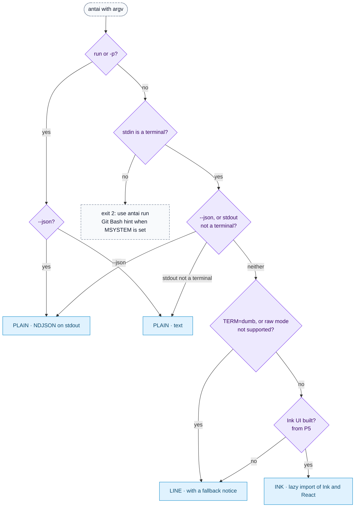
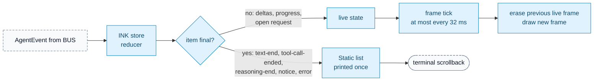
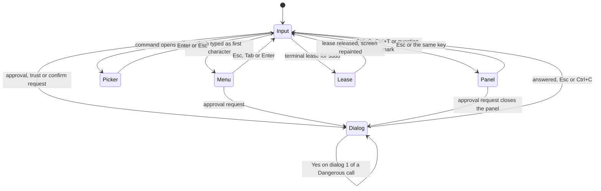
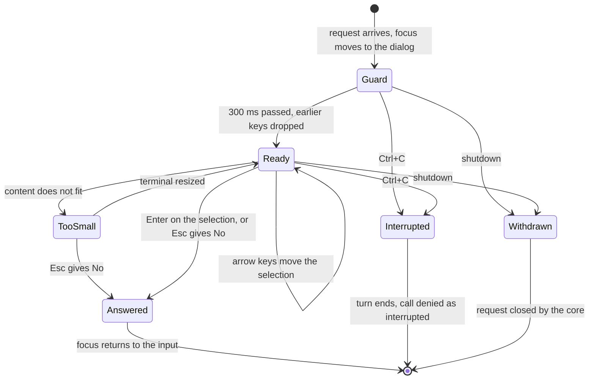
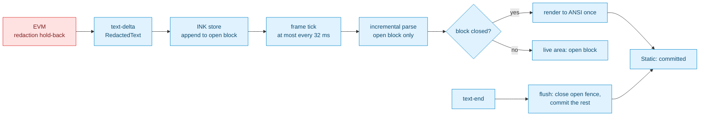
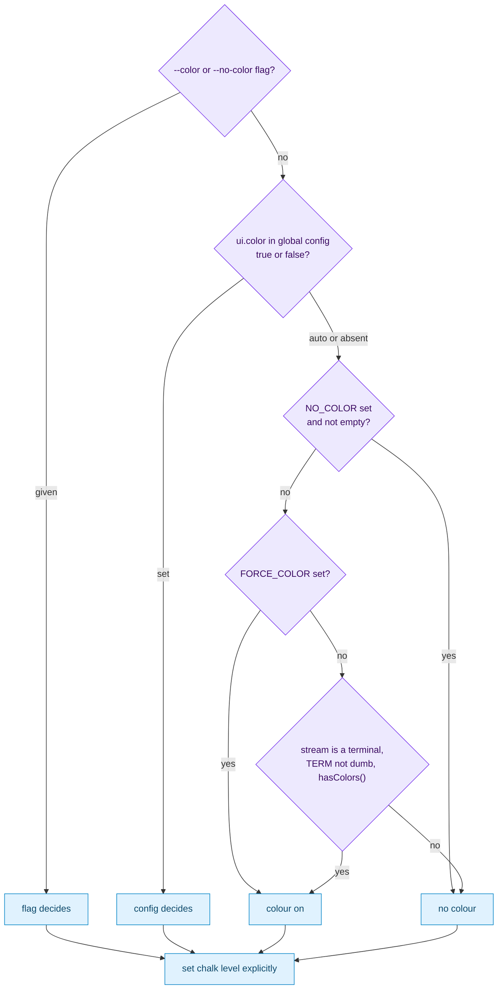

# antai — Terminal UI & Interaction Design

| | |
|---|---|
| **Product** | antai (brand) / `antai` (command) |
| **Document** | Deliverable 13, Terminal UI & Interaction Design for the v1 MVP |
| **Status** | Draft for review |
| **Version** | 0.1 |
| **Date** | 12 October 2026 |
| **Author** | Daksh Nagpal |
| **Based on** | BRD_1 v0.4, ARCHITECTURE_1 v0.1, DELIVERABLES_1 v0.2, deliverables 01, 02, 03, 07, 09, 10 and 11, research notes B, E and F |

## Contents

1. Purpose, scope and UX principles
2. Renderer selection (UI-1)
3. Screen layout of the Ink UI (UI-2 to UI-5)
4. Wireframes (UI-6 to UI-34)
5. Status bar (UI-35)
6. Keybindings (UI-36)
7. Dialog interaction rules (UI-37)
8. Streaming and Markdown rendering (UI-38, UI-39)
9. Colours and symbols (UI-40)
10. Terminal compatibility
11. Plain and line renderers (UI-41, UI-42)
12. Accessibility
13. UI copy guidelines
14. Design decisions
15. Open questions
16. Traceability
17. Sources

---

## 1. Purpose, scope and UX principles

### 1.1 Purpose

This deliverable is the terminal equivalent of UI/UX wireframes. It fixes what the user sees and which keys do what in every interactive state of antai v1: the screens drawn by the Ink renderer `INK`, the interim line-mode renderer `LINE`, and the text output of the plain renderer `PLAIN`. A developer builds `src/ui/ink/`, `src/ui/line/` and `src/ui/plain/` from it; a tester writes the phase P5 UI tests (scripted dialog, card and status-bar tests on three OSes, BRD 10) and the manual walkthrough of BRD section 4 from it; a reviewer checks the wording against BRD section 4.

Renderers only draw `AgentEvent`s and answer interaction requests; they hold view state and no business logic (NFR-MNT-01, deliverable 01, section 5.1). Every screen below is therefore described by the events and requests of deliverable 11, section 4 that produce it.

### 1.2 Scope

| In this document | Elsewhere |
|---|---|
| Renderer choice as the user experiences it; screen regions; wireframes; status bar; keys per context; dialog rules; streaming and Markdown display; colours, symbols and fallbacks; terminal differences; plain and line output format; accessibility; UI copy rules | — |
| Event, command and interaction-request types; NDJSON (`--json`) contract; exit codes; message catalogue structure | deliverable 11, sections 4, 5, 12 and 13 |
| The order of messages behind each screen | deliverable 03 (SD IDs cited per wireframe) |
| Signal handling, cancellation tree, start-up budget | deliverable 07, sections 8 and 10 |
| Why each safety rule exists (tiers, approvals, trust, redaction) | deliverable 02 |
| Retry numbers and quota detection | deliverable 09, sections 8 and 9 |
| Content of `/instructions`, `/profile`, `/skills`, `/mcp` findings | deliverable 10, sections 3.7, 4.5, 6.8 and 7 |
| Every flag, slash command argument and tool schema | deliverable 12 |

### 1.3 Components and contracts used

| ID | Name (deliverable 01) | Role on screen |
|---|---|---|
| `INK` | Ink UI | Interactive renderer from P5: streaming Markdown, tool cards, dialogs, status bar, `/` menu, transcript, terminal lease through `suspendTerminal()` |
| `LINE` | Line-mode renderer | Interim interactive renderer for P1 to P4, test driver, and fallback when Ink cannot run (section 2) |
| `PLAIN` | Plain and JSON renderer | `antai run`, pipes and `--json`; answers every interaction request with `no-human` |
| `BUS` | Event boundary | Carries `AgentEvent`, `UserCommand` and interaction requests (deliverable 11, section 4) |
| `SC`, `SLASH`, `APR`, `USG` | Session controller, slash-command router, approval coordinator, usage meter | Sources of status, command results, dialogs and usage figures |
| `MSG` | Message catalogue | Every user-facing string (deliverable 11, section 13) |

Event names in this document are those of deliverable 11's `AgentEvent` union: `session-started`, `status`, `turn-started`, `text-delta`, `text-end`, `reasoning-delta`, `reasoning-end`, `tool-call-started`, `approval-decided`, `tool-progress`, `tool-call-ended`, `usage`, `retry-scheduled`, `notice`, `error`, `turn-ended`, `mcp-status`, `mcp-drift`, `command-result` and `session-ended`. Interaction requests are `approval`, `trust`, `secret`, `confirm`, `choice`, `terminal-lease` and `login`.

### 1.4 Items pending BRD review used here

| Ref | What this document assumes | Sections |
|---|---|---|
| A-S7 | Type-ahead guard: keys buffered before a dialog opens, or arriving in its first 300 ms, are discarded | 7.2 |
| SEC-D26 (deliverable 02, 3.10) | Control characters, ANSI sequences and bidirectional controls in commands, paths, diffs and MCP arguments are shown as visible escapes | 7.6, 8.6 |
| HLD-D18, Q01-19 | One turn at a time; Enter during a turn keeps the text and shows a notice | 6.2, UI-9 |
| Q01-6 | `LINE` is an automatic fallback, with a notice, when Ink cannot run | 2.2 |
| A-C14, CR-02, CR-15 | Models shown as `groq:openai/gpt-oss-120b`, `groq:openai/gpt-oss-20b`, `google:gemini-3.8-flash` (BRD 4.7 still shows `gemini-3.5-flash` and `llama-3.3-70b-versatile`) | UI-21 |
| CR-03, Q9 | Install command shown as `npm install -g @geekyants/antai` | UI-6 |
| IC-P1 (deliverable 11) | Signal exits 129, 130, 143 | 11.1 |
| New here | `--no-color` and `--color` flags and `ui.*` global config keys (`ui.color`, `ui.symbols`, `ui.screenReader`, `ui.reducedMotion`); not in FR-CLI-04 (Q13-1) | 9.2, 12 |
| New here | Optional `resultSummary` on `tool-call-ended` and `limit` on `retry-scheduled`, proposed additions to deliverable 11 (Q13-2, Q13-3) | 4.3, UI-26 |

### 1.5 UX principles

| # | Principle | What it means in antai | Requirement |
|---|---|---|---|
| P1 | **Terminal-native** | The terminal's own scrollback is the transcript. No alternate screen, no mouse, plain copyable text. Finished output is printed once and never redrawn | FR-UI-01, NFR-PERF-02 |
| P2 | **Keyboard-only** | Every action has a key; the key hint for the current context is always on screen; `?` and `/help` list all keys | FR-UI-05, NFR-USE-03 |
| P3 | **Safe defaults visible** | The default option carries the `›` marker and an "(Enter)" or "(default)" label. Dialog 2, the trust prompt and every destructive confirmation default to No | FR-SH-03, FR-SH-04, FR-CFG-04 |
| P4 | **Nothing important only in colour** | Tier words (`Normal`, `Dangerous`), symbols with ASCII fallbacks and headings carry the meaning; colour repeats it | FR-UI-07 |
| P5 | **Predictable focus** | Exactly one focus owner at a time: input, `/` menu, picker, panel, dialog or terminal lease. A dialog always takes focus and returns it to the input with the draft intact | FR-UI-05, A-S7 |
| P6 | **Fast to first output** | First frame with the status bar inside the start-up budget (deliverable 07, RT-8); a spinner within one frame of Enter; text drawn as it streams | NFR-PERF-01, NFR-PERF-02 |
| P7 | **Plain output when not a terminal** | No cursor movement and no ANSI codes on stdout when it is not a TTY; scripts get text or NDJSON | FR-UI-06 |
| P8 | **Same bytes everywhere** | An expanded tool card shows exactly the redacted, capped text the model received | FR-UI-03, FR-HIS-07 |
| P9 | **Quiet by default, detail on demand** | One line per tool call; input, output and reasoning behind Ctrl+O and Ctrl+T | FR-UI-03 |
| P10 | **Every message says what happened and what to do next** | Two-part messages from `MSG`, one line each | NFR-USE-02, FR-ERR-01 |
| P11 | **You can only approve what you can see** | A dialog whose content does not fit the terminal cannot be answered Yes until it does | FR-SH-03, FR-UI-04 |

---

## 2. Renderer selection

### 2.1 What each renderer shows

`BOOT` picks one renderer per process (deliverable 01, section 4.3). The user-visible differences:

| | `INK` | `LINE` | `PLAIN` text | `PLAIN` `--json` |
|---|---|---|---|---|
| When | Interactive, stdin and stdout are terminals, from P5 | Interactive in P1 to P4; fallback when Ink cannot run (2.2) | `antai run` without `--json`; stdout not a terminal | `--json` with `run` or interactive `antai` |
| Human present | Yes | Yes | No | No |
| Assistant text | Streamed, Markdown rendered | Streamed, Markdown source as written | Streamed to stdout, Markdown source | Whole blocks as `text` lines |
| Reasoning | Live one-line indicator, collapsed afterwards (8.4) | One line `(thinking…)` | Not shown | Not emitted (deliverable 11, 5.5) |
| Tool calls | One-line cards; Ctrl+O expands; Ctrl+T transcript | One line per call, one per result | Not shown; denials on stderr | `tool-call`, `approval`, `tool-result` lines |
| Dialogs | Arrow-key dialogs; dialog 2 red | Numbered prompts; dialog 2 needs `yes` typed | Never; denied as "approval required in a non-interactive run" | Same, as `approval` lines with `denied` |
| Status | Status bar, always visible | Status line after each turn and on change | None | None |
| Colour | By policy (9.2) | Basic SGR only, by policy | stderr only, when stderr is a terminal | Never |
| Errors | One line plus next step in the transcript | Same, as text | stderr | `error` line plus stderr |

### 2.2 UI-1 Renderer selection



Notes:

- **Raw mode.** Ink needs raw mode for single keys; `useStdin().isRawModeSupported` tells whether it is available (research F 3.2). Without it, and with `TERM=dumb` (Emacs shell buffers, some CI consoles), cursor movement is not reliable, so `BOOT` falls back to `LINE` with one notice: `Rich UI unavailable in this terminal (no raw mode); using line mode.` (Q01-6 default).
- **Git Bash mintty.** In mintty without pseudo-console support, `node` may not see a terminal (research F 3.2; unverified for Node 22 on Git for Windows 2.54 and later). antai then exits with code 2 (FR-UI-06). When `MSYSTEM` is set on Windows, the message adds the likely cause: `Git Bash's window did not give antai a terminal. Run antai in Windows Terminal, or start it with winpty antai.` (Q13-11).
- **Interactive `antai` with stdout redirected** (`antai > log.txt`) uses `PLAIN` with no human present (deliverable 01, section 4.3): typed lines are read as prompts, approvals are denied, nothing is drawn. Whether this case should exit 2 instead is Q13-10.
- `INK` is imported only after this decision, so `PLAIN` and `LINE` never pay for Ink and React (deliverable 07, RT-D16).

---

## 3. Screen layout of the Ink UI

### 3.1 UI-2 Screen regions

Lines starting with `──` are annotations, not output.

```text
── transcript: Ink <Static>, written once, then kept by the scrollback ──
you › why is the auth test failing?
 ▸ shell   npm test -- auth                                      ! 2.1s exit 1
 The expiry check in src/auth/token.ts:42 uses `<` instead of `<=`, so a …
── live area: redrawn each frame; never taller than the terminal minus 4 rows ──
 ▸ read    src/auth/token.ts                                                 ⠙
 ⠙ working · 6s · esc to interrupt
── input: a dim rule, then 1 to 8 lines; longer input scrolls inside ──
─────────────────────────────────────────────────────────────────────────────
you › ▍
── banner (skip-permissions only), then the status bar: always the last lines ──
groq · openai/gpt-oss-120b · manual · effort: default · profile: none
~/shop-api · 2.1k tokens · 2% ctx                       esc interrupt · ctrl+o
```

| Region | Contents | Drawn as | Height |
|---|---|---|---|
| Transcript | User prompts, finished text blocks, finished tool cards, collapsed reasoning lines, notices, errors, command results, turn usage lines | Ink `<Static>`: each item printed once, then owned by the terminal | Unbounded (scrollback) |
| Live area | The open (unfinished) Markdown block, running and waiting tool cards, the working line, an open dialog, picker, `/` menu or panel | Redrawn each frame | At most terminal rows − 4; panels take that whole height |
| Input | Prompt `you › `, the draft, paste chips (6.4) | Redrawn on key | 1 to 8 lines, then scrolls inside |
| Banner | `--dangerously-skip-permissions` warning (UI-32) | Redrawn | 1 line, only in skip mode |
| Status bar | Section 5 | Redrawn on `status`, `usage`, `mcp-status`, `retry-scheduled` | 1 to 3 lines (wraps at separators) |

The banner and status bar sit below the input because the user's eyes are on the input; the transcript scrolls away, these lines do not.

### 3.2 UI-3 Static and live output



Rules:

1. **Commit as soon as final.** Text is committed in pieces: each completed Markdown block (paragraph, list, closed code fence, table) moves to `<Static>` when the parser closes it; only the open block stays live (section 8). A tool card is committed at `tool-call-ended`. This keeps re-render cost flat over a 100-turn session (NFR-PERF-02, NFR-PERF-04).
2. **Live height cap.** Ink can only erase lines that are still on screen, so a live frame taller than the terminal leaves duplicated lines behind (known Ink behaviour, to be checked on Ink 8 in P0, Q13-7). The live area is capped at rows − 4. An open code block longer than the cap is committed line by line; a long dialog preview scrolls inside the dialog.
3. **Coalescing.** Deltas update the store at once; the screen is redrawn at most every 32 ms (about 30 frames a second), so a burst of 50 deltas costs one frame. The constant is proposed and measured against NFR-PERF-02 in DLV-VER-08.
4. **No re-render of history.** Resizing, changing colour mode or opening the transcript never redraws committed lines.

### 3.3 Resize and narrow terminals

The UI reads the size from Ink's `useWindowSize()` (Ink 8 types stdout as a generic stream, research B 11) and lays out the live area, input and status bar again on every change, debounced by 100 ms. Committed lines are not re-wrapped; some terminals reflow them and some do not. If a width shrink leaves stray characters from the old live frame, Ctrl+L redraws the screen (6.1).

| Width (columns) | Layout |
|---|---|
| 100 and more | Status bar on one line when it fits; diffs with old and new line numbers; tables as boxes |
| 80 to 99 | Status bar wraps at field separators (section 5); card input summaries truncated with `…` |
| 60 to 79 | Diffs with one line-number column; tables wider than the screen become records (8.3); picker detail columns dropped |
| 40 to 59 | Cards on two lines (label and input, then status); status bar up to three lines |
| Under 40, or under 12 rows | **Too small** (UI-5): the live area shows one line; dialogs cannot be answered Yes |

#### UI-4 Status bar at three widths

```text
── 112 columns ──
groq · openai/gpt-oss-120b · manual · effort: default · profile: none · ~/shop-api · 2.1k tokens · 2% ctx  /help
── 80 columns ──
groq · openai/gpt-oss-120b · manual · effort: default · profile: none
~/shop-api · 2.1k tokens · 2% ctx                                   /help
── 48 columns ──
groq · openai/gpt-oss-120b · manual
effort: default · profile: none
shop-api · 2.1k tokens · 2% ctx
```

#### UI-5 Terminal too small

```text
 Terminal too small for antai (need 40×12, have 34×9). Enlarge it.
 ▲ Approval waiting: enlarge the terminal to review it. Esc answers No.
```

The second line appears only while a dialog is open. In this state Enter does nothing, Esc answers No and Ctrl+C interrupts the turn; Yes becomes available again once the whole dialog fits (P11, UI-D10).

### 3.4 Long output

| Content | Collapsed | Expanded or full |
|---|---|---|
| Tool output | Never shown in the card line | Ctrl+O panel: the capped text the model saw (at most 30,000 characters, head and tail with the omission marker, FR-SH-08), scrollable |
| Diff in an approval dialog | — | Up to the dialog's height; PgUp and PgDn scroll; the header says "lines 1–24 of 310" |
| New file in an approval dialog | — | First 200 lines and the total line count (FR-UI-04) |
| Assistant text | Streamed into the transcript | Scrollback; no cap |
| `/history`, `/skills`, `/mcp` lists | First screenful | Pickers scroll; `/history --all` pages |

### 3.5 Scrollback and the transcript view

Normal reading uses the terminal's scrollback (mouse wheel, Shift+PgUp, tmux copy mode). The Ctrl+T transcript (UI-33) is a panel in the live area, sized to the terminal minus the status bar, that lists the whole session as cards and text and lets Enter expand any card (FR-UI-03). It renders only the visible window of lines, so opening it costs the same in turn 1 and turn 100. It is not drawn on the alternate screen (UI-D1, Q13-16); after it closes, the next output fills the space it used.

---

## 4. Wireframes

### 4.1 Conventions

- Width 80 columns unless a heading says otherwise. Only the part of the screen that matters is drawn; `…` on its own line means lines left out.
- Lines starting with `──` are annotations. `▍` is the text cursor, `⠙` one spinner frame, `›` the focused option.
- Colour is named in the notes with the semantic tokens of section 9 (`danger`, `warning`, `success`, `accent`, `muted`, `diff-add`, `diff-del`, `redacted`). Everything that colour says is also said by a word or a symbol.
- Text in the wireframes is the intended wording. Strings come from `MSG` (deliverable 11, section 13); dialog summaries and denial reasons come from rule data in `RULES` (deliverable 02, 4.2) and are examples here.
- Each wireframe names the flow in deliverable 03 that produces it and the BRD scenario it realises.

### 4.2 Start-up

#### UI-6 First run and key entry (BRD 4.1, SD-1a, SD-2a)

```text
$ npm install -g @geekyants/antai
$ antai

  Welcome to antai.
  No API key found for Groq (the default provider).
  Get a free key at https://console.groq.com/keys

  Paste your GROQ_API_KEY: ••••••••••••••••▍
  Enter saves · Esc cancels

  Saved to ~/.antai/credentials.json (readable only by you).

╭─ antai ──────────────────────────────────────────────────────────────────╮
│ Ready. Type a request, or / for commands. ? shows keyboard shortcuts.    │
╰──────────────────────────────────────────────────────────────────────────╯
─────────────────────────────────────────────────────────────────────────────
you › ▍
groq · openai/gpt-oss-120b · manual · effort: default · profile: none
~/shop-api · 0 tokens                                                  /help
```

| State | Shown | Keys |
|---|---|---|
| Key entry (`secret` request) | One `•` per character; a pasted key (bracketed paste) arrives whole. The value is a `Secret`, never echoed, logged or sent as an event (deliverable 11, section 3) | Enter saves. Esc, Ctrl+C or Enter on empty input cancel: `No key saved. Set GROQ_API_KEY, or run antai login groq, then start antai again.` and exit 2 (SD-D13) |
| Saved | One confirmation line. A failed write shows `Could not save the key to ~/.antai/credentials.json (<cause>). Using it for this session only.` (`STORAGE_CREDENTIALS_WRITE`) | — |
| Key already in the environment | No prompt; the Ready box is the first output (AC-01) | — |
| Ready | The Ready box once per start, then the input and the status bar (FR-UI-02) | `?` lists shortcuts; `/` opens the menu |

The key is not checked over the network here (SD-D13); a wrong key surfaces on the first turn as UI-30. `/model` to a provider without a key shows the same prompt inline (SD-14a); there, Esc keeps the old model.

#### UI-7 Start-up notices and the home-folder confirmation (BRD 4.1, SD-1a, deliverable 10 7.2)

```text
╭─ antai ──────────────────────────────────────────────────────────────────╮
│ Ready. Type a request, or / for commands. ? shows keyboard shortcuts.    │
╰──────────────────────────────────────────────────────────────────────────╯
 ⚠ Shell commands are off: install Git for Windows
   (https://git-scm.com/download/win) or set ANTAI_GIT_BASH_PATH.
 ⚠ ~/.antai/config.json: shell.timeoutMs must be a whole number of
   milliseconds. Using 120000.
 ⚠ 2 skills skipped, 1 MCP server failed: see /skills, /mcp
   Project settings not trusted: its MCP servers and allowlist are ignored.
   Change this with /trust.

── home folder or drive root as workspace (FR-TOOL-09), before the Ready box ──
  The workspace is your home folder (/Users/daksh). antai can read and
  change files anywhere under it, except secret files.
  Start here anyway?
  › No    exit, then cd into a project folder            (Enter)
    Yes   use the home folder as the workspace
```

- Notices are `notice` events (`level: 'warning'` with `⚠` in `warning`, `level: 'info'` in `muted` without a symbol). Each has a "what" and a "next" part from `MSG` (NFR-USE-02).
- Findings from instruction files, profiles, skills and MCP collapse into one summary line (deliverable 10, 7.2); the details live in `/instructions`, `/profile`, `/skills` and `/mcp`.
- The Google data-use notice (deliverable 09, 12.2) appears once per session on the first use of that provider, in the same style.
- The home-folder confirmation is a `confirm` request (`purpose: 'home-workspace'`, initial No). No or Esc exits with code 0 and no session (SD-1a).

#### UI-8 Trust prompt (BRD 4.10, SD-3)

```text
$ cd ~/Downloads/someone-elses-repo && antai

  This folder contains antai project settings that need trust:
    • MCP server "db": npx -y @example/postgres-mcp   (.antai/mcp.json)
      uses DATABASE_URL
    • MCP server "docs": https://mcp.example.com/mcp  (.mcp.json)
    • shell allowlist: make test, make lint           (.antai/config.json)
  Also loaded either way: instructions (AGENTS.md), 2 skills, 1 profile

  Trust this folder?
  › No    instructions, profiles and skills only          (Enter)
    Yes   also start these servers and use these settings
  ↑↓ choose · Enter confirm · Esc: No for this start only
```

| Item kind (`TrustItem`) | Line |
|---|---|
| `mcp-server` | `MCP server "<name>": <command or URL>   (<file>)`, then `uses <VAR>, <VAR>` when it references variables (FR-MCP-03) |
| `shell-allow` | `shell allowlist: <entry>, <entry>` |
| `mode`, `model` | `project mode: manual`, `project model: groq:openai/gpt-oss-20b` |
| `provider` | `provider "my-gateway": https://llm.example.com/v1` |
| `profile-pin`, `profile-defaults` | `profile pin: node-dev`; `profile "api-dev" sets mode research, model …` |

- The prompt runs before the key lookup and before the Ready box (SD-D1). The item list is long when a repository defines many servers; it scrolls with PgUp and PgDn, and the dialog cannot be answered Yes until it fits or has been scrolled to the end (P11).
- When `changed` is true, the first line reads `The antai settings in this folder changed since you last answered (for example after a git pull):`.
- No and Yes are stored with the settings hash (SD-D12). Esc is "cancelled": untrusted for this start, not stored, asked again next start (deliverable 11, 4.3).
- `antai run` never shows this prompt; it prints `antai: project settings not trusted; run antai in this folder to review them.` on stderr.
- Commands and URLs are shown with control characters escaped (7.6), because they come from an untrusted repository.

### 4.3 Chat and tool cards

#### UI-9 Everyday chat while the answer streams (BRD 4.2, SD-5a, SD-6, SD-10a)

```text
you › why is the auth test failing?

 ∴ thought for 3s
 ▸ shell   npm test -- auth                                      ! 2.1s exit 1
 ▸ read    src/auth/token.ts                                                 ✓
 ▸ grep    "expiresAt" in src/                                     ✓ 4 matches

 The expiry check in src/auth/token.ts:42 uses `<` instead of `<=`, so a
 token that expires in the current second is rej▍
 ⠙ working · 9s · esc to interrupt
─────────────────────────────────────────────────────────────────────────────
you › also check the refresh flow▍
groq · openai/gpt-oss-120b · manual · effort: default · profile: none
~/shop-api · 1.9k tokens · 1% ctx                     esc interrupt · ctrl+o
```

| State | Shown | Keys |
|---|---|---|
| Turn started (`turn-started`) | The prompt is committed as `you › …`; the working line appears within one frame | Esc or Ctrl+C interrupts (UI-31) |
| Reasoning (`reasoning-delta`) | Live line `∴ thinking · 3s` plus the latest reasoning line, `muted`, cut to the width; at `reasoning-end` it collapses to `∴ thought for 3s` (8.4) | Ctrl+T shows the full reasoning |
| Text (`text-delta`) | Completed Markdown blocks are committed; the open block streams in the live area | — |
| Typing during the turn | The input stays editable. Enter keeps the text and shows the notice `antai is still working. Your message stays here; press Enter when it finishes, or Esc to stop.` (`session.turnRunning`, HLD-D18) | All editing keys work |
| Turn ended | Working line removed; usage line committed (UI-10) | Focus stays in the input |

`npm test -- auth` ran without a dialog because `npm test` is on the user's allowlist (BRD 4.2). The card shows `! 2.1s exit 1`, not `✓`: the command ran, but a non-zero exit code is not shown as success (UI-D18).

#### UI-10 The same turn when it has ended

```text
you › why is the auth test failing?

 ∴ thought for 3s
 ▸ shell   npm test -- auth                                      ! 2.1s exit 1
 ▸ read    src/auth/token.ts                                                 ✓
 ▸ grep    "expiresAt" in src/                                     ✓ 4 matches

 The expiry check in src/auth/token.ts:42 uses `<` instead of `<=`, so a
 token that expires in the current second is rejected. Want me to fix it?

 1.9k in · 210 out · 4.8s
```

The usage line is the turn's `usage` event (`scope: 'turn'`): input and output tokens as in BRD 4.2, plus the turn's wall time. Reasoning tokens are counted in "out" and broken down in `/usage` (UI-27).

#### UI-11 Tool cards, collapsed

```text
 ▸ read    src/auth/token.ts                                                 ✓
 ▸ read    src/auth/token.ts:30-60                                           ✓
 ▸ list    src/                                                   ✓ 42 entries
 ▸ find    src/**/*.test.ts                                         ✓ 12 files
 ▸ grep    "expiresAt" in src/                                     ✓ 4 matches
 ▸ write   docs/notes.md (new, 24 lines)                                     ✓
 ▸ edit    src/auth/token.ts  +1 −1                                          ✓
 ▸ shell   npm test -- auth                                              ⠙ 14s
 ▸ shell   npm test -- auth                                      ✓ 2.1s exit 0
 ▸ shell   npm run lint                                          ! 3.4s exit 1
 ▸ shell   npm run dev                   ⏱ stopped at 30s timeout, output kept
 ▸ mcp     github · list_pull_requests                                  ✓ 1.2s
 ▸ skill   repo-tour                                                  ✓ loaded
 ▸ read    .env                          ✗ denied: secret files are off limits
 ▸ shell   rm -rf ./build                                    ✗ declined by you
 ▸ shell   npm install                                ◼ interrupted after 3.0s
 ▸ edit    src/app.ts                       ✗ error: text to replace not found
 ▸ shell   git push                                     … waiting for approval
```

A card is `▸`, a label, the input summary and a status block aligned to the right edge (FR-UI-03: tool, short input, status, duration).

| Part | Source | Rule |
|---|---|---|
| Label | `toolName` | `read_file` → `read`, `write_file` → `write`, `edit_file` → `edit`, `list_directory` → `list`, `find_files` → `find`, `search_files` → `grep` (BRD 4.2 wording), `shell` → `shell`, `load_skill` → `skill`, `mcp__<server>__<tool>` → `mcp` with `<server> · <tool>` as input |
| Input summary | `tool-call-started.summary`, built by the tool and redacted | Cut with `…` in the middle for paths and at the end for commands; the full input is in the expanded card |
| Running | `tool-progress` | Spinner from the start; elapsed seconds from 1 s (FR-UI-08); shell output is not streamed into the card (SD-D23) |
| Waiting | Open `approval` request | `… waiting for approval`; the dialog opens below the card |
| Ended | `tool-call-ended.status` | `ok` → `✓` (`success`); shell with `exitCode` not 0 → `! exit N` (`warning`); `timed-out` → `⏱ stopped at Ns timeout, output kept` (`warning`, BRD 4.5); `interrupted` → `◼ interrupted after Ns` (`muted`); `error` → `✗ error: <what>` (`danger`); `denied` → `✗ denied: <reason>` or `✗ declined by you` (`danger`, BRD 4.5) |
| Duration | `durationMs` | Shown from 1 s, as `2.1s`, `1m 04s`; never for denied calls |
| Result note | Proposed `resultSummary` on `tool-call-ended` (Q13-2) | `4 matches`, `42 entries`, `12 files`, `loaded`; without the field the card shows status and duration only |

Cards open at `tool-call-started`, not at `tool-input-start` (Q06-3 default; deliverable 11 has no earlier event). Several calls of one step appear in call order; side-effecting calls run one after another (HLD-D17), so at most one shell card spins at a time.

#### UI-12 Expanded card (Ctrl+O)

```text
 ▾ shell   npm test -- auth                                      ✓ 2.1s exit 0
   ┌ input ───────────────────────────────────────────────────────────────┐
   │ command   npm test -- auth                                           │
   │ decision  Safe, ran without asking                                   │
   └──────────────────────────────────────────────────────────────────────┘
   output · what the model received · 1,204 characters · not cut
   > shop-api@1.4.0 test
   > vitest run auth
    ✓ src/auth/token.test.ts (12 tests) 41ms
    Test Files  1 passed (1)
         Tests  12 passed (12)
   lines 1–5 of 5 · PgUp PgDn scroll · ctrl+o close
```

- Ctrl+O toggles an expanded view of the latest card, finished or running, as a panel in the live area (FR-UI-03). The card line in the transcript does not change; the panel closes with Ctrl+O or Esc, or when a dialog opens.
- Input is the redacted input object, one field per line. "decision" comes from `approval-decided` (`approved by you, dialog 1`; `approved: on this session's don't-ask list`; `approved by mode auto`); when there is no such event the call was Safe.
- Output is `tool-call-ended.output`: the exact bytes the model received (FR-UI-03, FR-HIS-07). A cut output shows the omission marker and the note `cut to 30,000 characters (start and end kept)`. SGR colour codes in command output are removed for display and other control characters shown as escapes (UI-D26). Under 80 columns long lines wrap.
- For an edit the panel shows the applied diff; for MCP calls the arguments as indented JSON; for `load_skill` the skill path and file list.

### 4.4 Approvals

Every dialog opens directly under its card, takes focus, and follows section 7 (type-ahead guard, defaults, Esc, Ctrl+C). Dialog text other than the quoted command, path, diff or arguments comes from the classifier or the tool kind, never from the model (FR-SH-03, FR-SH-04).

#### UI-13 Dialog 1: edit with diff (BRD 4.3, SD-7a, SD-7b)

```text
you › yes, fix it

 ▸ edit    src/auth/token.ts  +1 −1                   Normal · waiting for you
   ┌ src/auth/token.ts · 1 line changed ──────────────────────────────────┐
   │ 41    if (!token) return false;                                      │
   │ 42 -  if (now < token.expiresAt) {                                   │
   │ 42 +  if (now <= token.expiresAt) {                                  │
   │ 43      return true;                                                 │
   └──────────────────────────────────────────────────────────────────────┘
   Apply this edit?                                                     Normal
   › Yes   (Enter)
     No    (Esc)
   ↑↓ choose · Enter confirm · Esc No · Ctrl+C stop the turn

── after Enter ──
 ▸ edit    src/auth/token.ts  +1 −1                                          ✓
 ▸ shell   npm test -- auth                                      ✓ 1.8s exit 0
 Fixed. The boundary case now passes.
```

- Preview `diff` (deliverable 11, `ApprovalPreview`): unified diff with up to three context lines, `-` lines in `diff-del`, `+` lines in `diff-add`; the `-` and `+` markers stay without colour. Long diffs scroll with PgUp and PgDn; the box header then says `lines 1–24 of 310`. A cut preview (`truncated: true`) says so in the footer.
- Writes and edits never offer "Yes, don't ask again this session" (SD-D7).
- After the answer the dialog disappears and only the card remains; No turns the card into `✗ declined by you` and the model is told (AC-05).
- An edit of a protected path (FR-TOOL-11) is Dangerous: dialog 1 shows `Dangerous`, then dialog 2 (UI-17) with the heading `▲ DANGEROUS FILE CHANGE`.

#### UI-14 Dialog 1: Normal shell command with the session option (BRD 4.3, D27, SD-7c)

```text
 ▸ shell   npm run build                              Normal · waiting for you
   Run this command?                                                    Normal
   $ npm run build
   Runs a script from package.json. Changes files; can be undone.
   › Yes                                 (Enter)
     Yes, don't ask again this session   (this exact command only)
     No                                  (Esc)
   ↑↓ choose · Enter confirm · Esc No · Ctrl+C stop the turn
```

- The command is shown in full after `$ `, wrapped, never cut silently; over the dialog's height it scrolls (deliverable 02, 3.10). The summary line is the matched rule's `summary` (FR-SH-03).
- The second option appears only when `options` contains `yes-session`: Normal-tier shell commands (D27, SD-D7). Choosing it adds the exact command text to the session's list; later identical calls run without a dialog and their expanded card says `approved: on this session's don't-ask list`. The list is not restored on resume (Q03-6).
- The option label states its scope in brackets, because "this session" alone was ambiguous in review: it covers this exact text only, not `npm run build -- --watch`.

#### UI-15 Dialog 1: new file (FR-UI-04)

```text
 ▸ write   docs/auth.md (new, 312 lines)              Normal · waiting for you
   ┌ docs/auth.md · new file · lines 1–5 of 312 ──────────────────────────┐
   │   1  # Authentication                                                │
   │   2                                                                  │
   │   3  Tokens are issued by the /login route and expire after 15       │
   │   4  minutes. The expiry check accepts a token during its last       │
   │   5  second, so clients may retry once without logging in again.     │
   └ PgUp PgDn scroll · the preview shows at most 200 lines ──────────────┘
   Write this new file?                                                 Normal
   › Yes   (Enter)
     No    (Esc)
```

Preview `new-file`: the first 200 lines (`head`) and `totalLines`. When the file is longer, the footer reads `showing 200 of 312 lines; the rest is not previewed`. Overwriting an existing file uses UI-13 with the title `Overwrite docs/auth.md?`.

#### UI-16 Dialog 1: MCP tool call (BRD 4.8, SD-22)

```text
you › list my open pull requests on shop-api
 ▸ mcp     github · list_pull_requests                Normal · waiting for you
   Allow this MCP tool call?                                            Normal
   server   github
   tool     list_pull_requests   (mcp__github__list_pull_requests)
   input    { "owner": "geekyants", "repo": "shop-api", "state": "open" }
   antai cannot see what an MCP server does with a call.
   › Yes   (Enter)
     No    (Esc)
```

Preview `mcp`: server, tool and the redacted arguments as JSON, indented and wrapped when longer than one line (FR-UI-04). A tool with `destructiveHint: true` is Dangerous and continues with dialog 2 under the heading `▲ DANGEROUS ACTION` (FR-MCP-06). The fixed line about MCP servers reminds the user that approval is the only control (deliverable 02).

#### UI-17 Dangerous command: dialog 1, then the red dialog 2 (BRD 4.4, SD-8)

```text
 ▸ shell   sudo rm -rf ./build                     Dangerous · waiting for you
   Run this command?                                                 Dangerous
   $ sudo rm -rf ./build
   Deletes files recursively with administrator rights.
   › Yes   (Enter)
     No    (Esc)

── after Enter on Yes: dialog 1 shrinks to one line and dialog 2 opens ──
   Run this command? Yes
   ┃ ▲ DANGEROUS COMMAND                                             Dangerous
   ┃ $ sudo rm -rf ./build
   ┃ Deletes files recursively with administrator rights.
   ┃ Do you want to perform this action?
   ┃ › No    (default; Enter cancels)
   ┃   Yes   (press ↓, then Enter)
   ↑↓ choose · Enter confirm · Esc No · Ctrl+C stop the turn
```

| Rule | Design | Requirement |
|---|---|---|
| Two dialogs in `manual` | Dialog 1 as usual (no session option); Yes opens dialog 2; No in dialog 1 ends it without dialog 2 | FR-SH-02, AC-06 |
| One dialog in `auto` | Only dialog 2 appears | AC-07 |
| Red | Heading, bar and border in `danger`; the bar `┃` on every line is a shape cue that survives `NO_COLOR` | FR-SH-04, FR-UI-07 |
| Reason | The matched rule's `reason`, never model text | FR-SH-04 |
| Default No | Enter alone cancels. Reaching Yes needs ↓ (or ↑), then Enter. The type-ahead guard runs again when dialog 2 opens | FR-SH-04, A-S7 |
| Heading | `▲ DANGEROUS COMMAND` for shell (BRD wording), `▲ DANGEROUS FILE CHANGE` for protected-path writes, `▲ DANGEROUS ACTION` for MCP tools | FR-TOOL-11, FR-MCP-06 |
| Skip mode | No dialog; the expanded card says `approved by mode skip-permissions`; the hard floor is still denied | FR-MODE-02, AC-08 |

#### UI-18 `sudo` hand-off (SD-11)

```text
   Run this command? Yes · DANGEROUS COMMAND: Yes
   antai is handing the terminal to sudo. Type your password into sudo;
   antai does not see it. Keys now go to sudo.
[sudo] password for daksh:
 ▸ shell   sudo rm -rf ./build                                   ✓ 0.4s exit 0
```

- `SR` asks for a `terminal-lease`. `INK` commits the two explanation lines, then calls `useApp().suspendTerminal()`: Ink stops drawing, raw mode, bracketed paste and the kitty keyboard protocol are turned off and the cursor is shown (research F 3.3). `sudo -v` prompts on the real terminal. When the lease ends, Ink repaints the live area and the status bar.
- While the lease is active every key, including Esc and Ctrl+C, goes to `sudo` (FR-UI-05).
- Failures appear on the card: `✗ error: sudo did not confirm your password; the command did not run`; `✗ error: sudo still asked for a password (credential caching is off). Run the command yourself.` (FR-SH-09); on Windows `✗ error: sudo is not supported on Windows in v1` (SD-D15).

### 4.5 Denials, secrets and timeouts

#### UI-19 Secret denial, timeout and a redacted value (BRD 4.5, SD-9, SD-10a, SD-10b)

```text
you › show me what's in .env

 ▸ read    .env                          ✗ denied: secret files are off limits

 I can't read .env files. I can help you check which variables your code
 expects, or create a .env.example with placeholder values.

you › start the dev server and tell me if it boots

 ▸ shell   npm run dev                   ⏱ stopped at 30s timeout, output kept
 It boots and connects to the database. The DATABASE_URL it printed was
 [REDACTED:DATABASE_URL].
```

- An automatic denial opens no dialog: the card turns red with the rule's fixed reason (`approval-decided` with `by: 'policy'`, then `tool-call-ended` with `denied`). Other reasons read `✗ denied: reads a secret file (never allowed)`, `✗ denied: research mode is read-only`, `✗ denied: commands that keep running in the background are not supported`, `✗ denied: outside the workspace`.
- Masks keep their literal text `[REDACTED:NAME]` and are drawn in the `redacted` style (amber, underlined) so the user can tell a mask from model prose; without colour the brackets carry it. Nothing on screen is ever unmasked (NFR-SEC-05).
- A timed-out command is never shown as `✓` (FR-SH-07); its expanded card shows the partial output ending with `[timed out after 30 s]`.

### 4.6 Slash commands

Slash commands run only at the idle prompt (deliverable 07, section 3.3). Their output is a `command-result` event committed to the transcript; pickers are `choice` requests and, unlike approval dialogs, accept typing to filter.

#### UI-20 `/skills` and `/<skill-name>` (BRD 4.6, SD-14c)

```text
you › /skills
 Skills · catalogue about 180 tokens per request
   repo-tour        Give a guided tour of this repository        built-in
   commit-message   Write a commit message for staged changes    ~/.antai/skills
   explain-error    Explain an error message and suggest a fix   built-in
   api-docs         Update API docs after route changes          .antai/skills
                    overrides ~/.antai/skills
   help             Team help-desk playbook                      .claude/skills
                    shadowed for /help: the built-in command wins
 Skipped
   deploy           .agents/skills/deploy/SKILL.md: the name must use
                    lowercase letters, digits and hyphens, like its folder
 Run one with /<name> [task]. Skills also load when a request matches them.

you › give me a tour of this repo
 ▸ skill   repo-tour                                                  ✓ loaded
 …
you › /commit-message
 ▸ skill   commit-message                                          ✓ (invoked)
 ▸ shell   git diff --staged                                     ✓ 0.1s exit 0
 feat(auth): accept tokens on their exact expiry second
```

- Columns: name, description (cut to fit), source folder, then a second line for `overrides <source>`, `shadowed for /<name>`, or, in an untrusted folder, `project copy ignored: folder not trusted` (FR-SKL-02, FR-SKL-06, deliverable 10, 2.4).
- `▸ skill … ✓ loaded` is the `load_skill` tool card. `▸ skill … ✓ (invoked)` is drawn by `INK` when a turn starts with `source: 'skill'`: no tool runs, the body is added to the user message (FR-SKL-04). The transcript shows what the user typed; the expanded body is in Ctrl+T.

#### UI-21 `/model` picker (BRD 4.7, SD-14a, deliverable 09 6.4)

```text
you › /model
 Choose a model                               ↑↓ move · Enter pick · Esc cancel
 › groq:openai/gpt-oss-120b         current · default
   groq:openai/gpt-oss-20b          alias fast
   google:gemini-3.8-flash          free tier may use prompts for training
   ollama:qwen3:14b                 local
   openrouter:▍                     type a model ID after the colon

── after Enter on google:gemini-3.8-flash ──
 model → google:gemini-3.8-flash (applies from your next message)
 Google: on the free tier, prompts and responses may be used to improve
 Google products and read by human reviewers; the paid tier is not. …
```

- Order: current, default, aliases, catalogue models of providers usable now, models with config metadata; deprecated entries marked `deprecated`; preset providers offer free text after `<preset>:` (deliverable 09, section 6.4). Typing filters the list.
- A provider without a key opens the key entry of UI-6 inline; Esc there keeps the old model. A model known not to call tools is refused: `groq:<model> cannot call tools, which antai needs. Pick another model.` (FR-MOD-05).
- `/model <id>` skips the picker and prints the same result line. The status bar changes at once; the request copy changes from the next turn (SD-14a).

#### UI-22 `/effort`, `/mode` and `/profile` (BRD 4.7, SD-14b)

```text
you › /effort none
 effort → none
 groq:openai/gpt-oss-120b does not support effort none; using medium.

you › /mode
 Permission mode                                ↑↓ move · Enter pick · Esc keep
   research   read-only: no writes, no state-changing commands
 › manual     asks before changes; asks twice before dangerous commands
   auto       runs changes without asking; asks once, in red, when dangerous

you › /mode research
 mode → research (read-only: no writes, no state-changing commands)

you › /mode skip
 Unknown mode "skip". Use research, manual or auto.
 --dangerously-skip-permissions works only as a launch flag.

you › /profile node-dev
 profile → node-dev (adds Node.js instructions; default mode manual)

you › /profile ops
 profile → ops (adds ops instructions). Its mode auto was not applied: a
 profile switch never loosens the mode. Use /mode auto if you want it.
```

- `/effort <level>` without support shows the one-line notice of deliverable 09 (MP-D11); the status bar then shows `effort: none → medium`. `/effort` with no argument opens a picker of the five levels.
- `/mode` with no argument shows the current mode as the focused row of a picker (BRD 5.11). The descriptions repeat the mode table of BRD 5.5 in plain words. `auto` in the status bar is drawn in `warning`.
- `/profile` with no argument shows what deliverable 10, section 4.5 lists: the active profile, how it was chosen, defaults applied and ignored with reasons, every available profile with description, source and `match`, clashes and invalid profiles. An auto-matched profile appears in the status bar as `profile: node-dev (auto)` (FR-PRF-05, AC-14).

#### UI-23 `/mcp` server list (BRD 4.8, SD-19a, SD-19b, SD-20, deliverable 10 6.8)

```text
you › /mcp
 MCP servers                                ↑↓ move · Enter details · Esc close
 › github       http    ✓ connected · 34 tools (3 hidden)
   filesystem   stdio   ✓ connected · 14 tools
   postgres     stdio   ✗ failed: command not found: uvx
   linear       http    ⚠ needs login · Enter to log in
   docs         http    ✓ connected · 12 tools · ⚠ 2 tools changed
   jira         http    … connecting
   db           stdio   – not trusted · /trust
   legacy       sse     – skipped: transport sse is not supported

$ antai mcp list
  github       http    ✓ connected   34 tools
  filesystem   stdio   ✓ connected   14 tools
  postgres     stdio   ✗ failed: command not found: uvx
  linear       http    ⚠ needs login   run: antai mcp login linear
```

| Status (deliverable 10, 6.8) | Symbol and token | Next step shown |
|---|---|---|
| `connecting` | `…` `muted` | Tools arrive from the next turn |
| `connected · N tools (M hidden)` | `✓` `success` | — |
| `needs login` | `⚠` `warning` | Enter to log in; `antai mcp login <name>` |
| `failed: <reason>` | `✗` `danger` | Reason and fix; Reconnect in the details |
| `disabled` | `–` `muted` | `enabled: false in <file>` |
| `skipped: <reason>` | `–` `muted` | Fix the entry |
| `not trusted` | `–` `muted` | `/trust` |
| Drift (`mcp-drift`) | `⚠ N tools changed` after the status | Review and accept in the details |

The list is built from the latest `mcp-status` event per server, so it is correct while servers are still connecting (FR-MCP-04). `antai mcp list` prints the same states as plain text (BRD 4.8), with ASCII fallbacks when stdout is not a terminal.

#### UI-24 Server details, drift and login (FR-MCP-09, FR-MCP-11, SD-21a, SD-21b)

```text
 docs · http · .mcp.json · protocol 2025-11-25
   status    connected · 12 tools
   ⚠ 2 tools changed since you last accepted them
     changed   search_docs: description and input schema
     added     delete_page   Dangerous (destructiveHint)
   tools     about 2.3k tokens per request
   › Accept changes   Reconnect   Close

 linear · http · ~/.antai/mcp.json
   Opening your browser at the linear login page.
   Waiting for you to finish there · 4:52 left · Esc cancels
   If no browser opened, open this address on this computer:
   https://auth.example.com/authorize?response_type=code&client_id=…
 ✓ linear: logged in. Its tools are available from your next message.
```

- Details show what deliverable 10, section 6.8 lists: source file and what it overrides, transport, protocol version, tools with exposed names and tiers, token estimate, stderr tail for stdio servers, OAuth state (logged in, expiry time, never a token) and the drift diff. Actions are rows of a `choice` request.
- The login wait is a `login` request: a countdown to `expiresAt` (5 minutes), the authorization URL printed for copy, and Esc to cancel (server stays `needs login`). Over SSH, where the loopback callback cannot work, the text says `Browser login needs a browser on this computer. Log in from a local terminal.` (FR-MCP-11).
- A 403 step-up asks first with a `confirm` request (initial No): `linear needs more access for create_issue. Log in again to grant it?` (SD-D17).

#### UI-25 `/history` and resume (BRD 4.9, SD-17a, SD-17b, SD-18b)

```text
$ antai --continue
╭─ antai ──────────────────────────────────────────────────────────────────╮
│ Resuming "Fix failing auth test" (today 14:32, 6 turns)                  │
╰──────────────────────────────────────────────────────────────────────────╯
 ⚠ The session was in auto mode; it resumes in manual. Start with
   --mode auto to use auto again.
 ⚠ The last session ended before this action was reported to the model:
   shell npm run migrate (result not recorded). Check it before re-running.

you › /history
     title                          when                turns    tokens
 › 1 Fix failing auth test          today 14:32 (open)      6     15.4k
   2 Add rate limiting to /login    yesterday 09:10        11     42.0k
   3 Review this diff for bugs      10 Oct 17:45 · run      1      3.1k
 Enter or /resume <number> opens one · Esc closes · /history --all
```

- `--continue` and `--resume` replace the Ready text with the `Resuming …` line (BRD 4.9); `/resume` mid-session ends the current session and prints the same box.
- Notices on resume: auto not restored (FR-HIS-04), skip-permissions never restored, a copy made because another process holds the session (`Another antai process has this session open. Continuing in a copy.`, FR-HIS-11), a session of another project (`That session belongs to ~/work/billing. Start antai there to resume it.`), and actions that ran but whose results the model never saw (SD-17b).
- `/history` is a picker with numbers so that `/resume <number>` works without it. `run` sessions are marked `run`; `--all` adds a project column. `--continue` with nothing to continue starts a new session with `No earlier session for this project; starting a new one.` (SD-D21).

### 4.7 Limits, errors, interrupts and exit

#### UI-26 Retry countdown and out of quota (BRD 4.12, SD-16a, SD-16b, SD-16c, deliverable 09 8.7)

```text
── live area while waiting, 90 columns ──
 ⏱ groq · rate limit (tokens per minute) · retrying in 23s · attempt 2/5 · Esc to stop
── other reasons ──
 ⏱ groq · cannot reach the API · retrying in 4s · attempt 2/5 · Esc to stop
 ⏱ groq · server error · retrying in 8s · attempt 3/5 · Esc to stop
 ⏱ groq · per-minute token budget used · sending in 41s · Esc to stop
 ⏱ waiting for groq · no data for 20s · check your network · Esc to stop
── final: daily quota, or a wait longer than 60 s ──
 ✗ groq: rate limit reached (requests per day). Retry in 2h 14m.
   Switch model with /model, or set another provider in ~/.antai/config.json.
── final: request larger than the plan allows ──
 ✗ groq: this request needs about 9.1k tokens; the plan allows 8k per minute.
   Use /compact, or /model to switch.
```

- The countdown counts down to `retry-scheduled.at`, an absolute time, so every renderer shows the same value (SD-16a). It updates once a second (every 5 s with reduced motion). The attempt number and maximum come from the event; deliverable 09 sets 5 attempts, back-off 2 s doubling to at most 10 s, and treats any server wait over 60 s as final with the reset time shown.
- The limit name ("tokens per minute") needs the proposed `limit` field on `retry-scheduled` (Q13-3); without it the line reads `groq · rate limit · retrying in 23s …`.
- The stall line is a `notice` after 20 s without stream data (deliverable 07, section 9.2).
- Esc during a wait cancels it and ends the turn as interrupted (UI-31). The user's message is already saved, so the user resends it after the reset (BRD 4.12).
- The status bar shows `⏱ retry 23s` while waiting and `groq quota until 16:55` after a daily-quota error (section 5).

#### UI-27 `/usage`

```text
you › /usage
 Usage                                     last turn     this session
   input tokens                                1,902           14,210
     read from cache                           1,024            9,216
   output tokens                                 210            1,190
     reasoning                                    96              402
   total                                       2,112           15,400
   model calls                                     3               21
   context, last request          1,902 tokens · 1% of the model's window
 groq limits from the last response (14:33:05)
   tokens this minute           5,880 of 8,000 left · resets in 41s
   requests today                 987 of 1,000 left · resets in 9h 12m
 Session totals include the title call and /compact.
```

Figures come from `USG` (turn and session `Usage`, last-step input over the context window, the last `RateLimitSnapshot`). Values in the wireframe are examples. Unknown counts show `—`. A provider that sends no limit headers shows `No limit data from google.` (deliverable 09, 8.6). No cost is shown (Q13-12).

#### UI-28 `/help`

```text
you › /help
 Commands
   /help                 commands and keys       /usage          tokens used
   /model [id]           pick or set the model   /mcp            MCP servers
   /effort <level>       reasoning effort        /history        past sessions
   /mode [mode]          permission mode         /resume <n|id>  open a session
   /profile [name|none]  profile                 /clear          new session
   /skills               list skills             /compact        summarise
   /<skill> [task]       run a skill             /instructions   instruction files
   /trust                folder trust            /config         settings
   /exit                 quit
 Keys
   Enter send · Shift+Enter or \ then Enter new line · Esc stop the turn
   Ctrl+C clear or stop, twice to exit · ↑↓ earlier prompts · Tab complete
   Ctrl+O expand the last tool card · Ctrl+T transcript · ? all shortcuts
```

`/help` and `antai --help` are generated from the same command and key registry, so neither can miss an entry (NFR-USE-03). `?` on an empty input shows the full key table of section 6 as a panel.

#### UI-29 The `/` command menu (FR-SLC-01, FR-SLC-02)

```text
 › /model             pick or set the model
   /mcp               MCP servers, status and login
   /mode              show or set the permission mode
   /commit-message    skill · write a commit message for staged changes
 4 of 21 · Tab complete · ↑↓ move · Enter run · Esc close
─────────────────────────────────────────────────────────────────────────────
you › /m▍
```

- Typing `/` as the first character opens the menu above the input; each key filters it (prefix matches first, then other matches). Built-in commands come first, then user-invocable skills marked `skill`. Skills with `user-invocable: false` are not listed (FR-SKL-05).
- Tab completes the focused entry. Enter runs it when it needs no argument; otherwise it inserts `/effort ` and waits. Esc closes the menu and keeps the text.
- The menu closes as soon as the input stops looking like a command: a second `/` in the first word (`/etc/hosts`) or a leading `//` (FR-SLC-02). Until the skill catalogue has loaded (SD-D2) the menu shows `loading skills…` as its last row.
- Enter on an unknown command shows `Unknown command /modle. Did you mean /model?` and sends nothing to the model.

#### UI-30 Error and warning lines (FR-ERR-01, NFR-USE-02, SD-16c, SD-23b)

```text
 ✗ groq: API key rejected (from GROQ_API_KEY). Check the key, or run
   antai login groq to store another one.
 ✗ groq: cannot reach the API. Check your network, then send again.
 ✗ groq: context window full, even after leaving out older tool output.
   Run /compact to summarise, or /clear to start a new session.
 ■ Stopped after 25 steps (the step cap). Send a message to continue, or
   raise maxSteps in ~/.antai/config.json.
 ⚠ docs: 2 tools changed since you last accepted them. See /mcp.
 Unknown command /modle. Did you mean /model?

── internal error: the UI is unmounted and the terminal restored first ──
antai stopped after an internal error. Report saved to
~/.antai/logs/crash-20261012T143305-4242.json
```

- An `error` event becomes `✗ <what>` in `danger` and, on the next line, the `next` part indented. The session continues; only the turn ends (FR-ERR-01, NFR-REL-02).
- `■` marks a stop that is not an error (step cap, `turn-ended` with `step-cap`, FR-AGT-02, AC-33).
- An internal error prints after Ink has unmounted, as plain text, with no stack trace (FR-ERR-04, AC-34).

#### UI-31 Interrupted turn (FR-AGT-04, SD-12a, SD-12b, SD-12c, AC-32)

```text
you › refactor the token module and run the tests

 ▸ edit    src/auth/token.ts  +14 −9                                         ✓
 ▸ shell   npm install                                ◼ interrupted after 3.0s
 I'll install the missing dependency first, then rerun the te
 ◼ Interrupted (Esc). The partial answer is saved. A stopped command may
   have done part of its work; ask antai to check before running it again.

you › ▍
```

- Esc, or the first Ctrl+C, during a turn sends `interrupt`. The open text block is committed as it stands (`text-end` with `partial: true`), running cards end as `◼ interrupted`, and the turn ends with this line. The first Ctrl+C also shows `Press Ctrl+C again to exit` in the status bar hint for 2 s.
- Ctrl+C while a dialog is open ends the turn the same way; that card shows `✗ declined (turn stopped)`. Esc in a dialog answers No and the turn continues (SD-D8).
- Esc while `/compact`, a `/model` key prompt or an OAuth wait runs cancels only that command (deliverable 07, section 8.3).

#### UI-32 Skip-permissions banner (FR-MODE-02, AC-08)

```text
─────────────────────────────────────────────────────────────────────────────
you › ▍
▲ PERMISSIONS OFF (--dangerously-skip-permissions). Actions run without
  asking; the hard floor still applies. Restart without the flag to end it.
groq · openai/gpt-oss-120b · SKIP · effort: default · profile: none
~/shop-api · 0 tokens                                                  /help
```

The banner is part of the bottom block, so it stays visible for the whole session however much output scrolls (FR-MODE-02). It is drawn in `danger` with bold text; the `▲`, the capitals and `SKIP` keep it distinct without colour. Resuming never restores the mode, so a resumed session has no banner unless the flag is given again.

#### UI-33 Transcript view (Ctrl+T)

```text
 Transcript · turn 1 of 2 · ↑↓ move · Enter expand · PgUp PgDn · Esc close
 you › why is the auth test failing?
   ∴ thought for 3s
 › ▸ shell   npm test -- auth                                  ! 2.1s exit 1
   ▸ read    src/auth/token.ts                                             ✓
   ▸ grep    "expiresAt" in src/                                 ✓ 4 matches
   The expiry check in src/auth/token.ts:42 uses `<` instead of `<=`, so a…
 you › yes, fix it
   ▸ edit    src/auth/token.ts  +1 −1                                      ✓
 …
```

↑ and ↓ move between items (prompt, reasoning line, card, text block); Enter expands the focused item in place with the content of UI-12, the full reasoning or the injected skill body; Esc or Ctrl+T closes. The view reads from the renderer's own item list, which holds the same redacted, capped text as the history file (FR-UI-03); it does not re-read the session file.

#### UI-34 Exit summary (SD-23a)

```text
you › /exit
 Session saved: "Fix failing auth test" · 6 turns · 15.4k tokens · 12m
 Continue later with antai --continue, or antai --resume 2026-10-12_1432_a1b2c3
$ ▍
```

- `/exit`, Ctrl+C twice within 2 s, or Ctrl+D twice on an empty input print this summary from `session-ended` after Ink has stopped, so it stays in the scrollback with the cursor on a fresh shell line. Exit code 0.
- With `--no-history` or `history.enabled: false` the first line reads `History is off, so this session was not saved. Its decisions are in the audit log.`
- When the session made no turns, nothing is printed.

---

## 5. Status bar

### 5.1 Fields

The status bar is drawn from the last `status` snapshot (deliverable 11, `StatusSnapshot`), the last `usage` event, the latest `mcp-status` per server and any pending `retry-scheduled` (FR-UI-02).

| # | Field | Source | Format and states | Requirement |
|---|---|---|---|---|
| 1 | Provider | `status.provider`, `status.baseUrl` | `groq`; a non-local endpoint adds its host: `my-gateway @ llm.example.com` | FR-UI-02, FR-MOD-07 |
| 2 | Model | `status.model` without the provider prefix | `openai/gpt-oss-120b`; middle-cut with `…` only below 40 columns | FR-UI-02 |
| 3 | Mode | `status.mode` | `research` in `accent`, `manual` plain, `auto` in `warning`, `SKIP` in `danger` with the banner (UI-32) | FR-UI-02, FR-MODE-02 |
| 4 | Effort | `status.effort`, `status.effortSupported`, effective level from `REG` | `effort: default` for `provider-default`; `effort: none → medium` when the provider maps the level (deliverable 09, MP-D11); `effort: low (not supported)` when ignored | FR-MOD-06 |
| 5 | Profile | `status.profile` | `profile: none`, `profile: node-dev`, `profile: node-dev (auto)` | FR-PRF-05, AC-14 |
| 6 | Workspace | `status.workspace.display`, `status.trust` | `~/shop-api`; `~/shop-api (untrusted)` when trust-gated settings are ignored | FR-UI-02, FR-CFG-04 |
| 7 | Tokens | Session total and `context.share` from `usage` | `15.4k tokens · 12% ctx`; the share is last-step input over the window (review X6). From 60 % in `warning`; at or above `context.pruneAt` (default 75 %) in `danger` with ` · /compact` | FR-UI-02, FR-AGT-05 |
| 8 | MCP | `mcp-status` per enabled server | Hidden without servers; `mcp …` while any connects; `mcp 3/4` connected of enabled; `⚠` in `warning` when any needs login, failed or has drift | FR-MCP-04 |
| 9 | Limits | `retry-scheduled`, `usage.rateLimit`, quota errors | Hidden normally; `⏱ retry 23s` during a wait; `groq quota until 16:55` after a daily quota; `limit low` when under 25 % of the per-minute tokens remain on a guarded plan (proposed threshold) | FR-ERR-02, deliverable 09 8.7 |
| 10 | Flags | `status.historyEnabled`, `status.shellAvailable` | `no history`; `shell off` | FR-HIS-10, FR-SH-11 |
| — | Hint (right edge) | Focus context (section 6) | `/help` idle; `esc interrupt · ctrl+o` in a turn; `↑↓ choose · enter · esc no` in a dialog; `Press Ctrl+C again to exit` for 2 s after the first Ctrl+C | NFR-USE-03 |

### 5.2 Order and wrapping

Fields keep the BRD 4.1 order (provider, model, mode, effort, profile, workspace, tokens) followed by MCP, limits and flags, separated by ` · `, with the hint aligned right. When the line does not fit, fields wrap at a separator onto a second and then a third line; a field is never split. Under pressure, the hint is dropped first, then the workspace is shortened to its last folder name. Provider, model, mode, effort, profile and tokens are never dropped (BRD 4.7: "The status bar always shows provider, model, mode, effort, profile and tokens"). Wrapping rather than dropping answers the review note on FR-UI-02 (seven fields and a path do not fit 80 columns) without hiding any required field (UI-D4).

### 5.3 UI-35 Status bar states

```text
── idle, defaults ──
groq · openai/gpt-oss-120b · manual · effort: default · profile: none
~/shop-api · 0 tokens                                                  /help
── auto mode, mapped effort, auto-matched profile, context filling, MCP warning ──
groq · openai/gpt-oss-120b · auto · effort: none → medium
profile: node-dev (auto) · ~/shop-api · 41.2k tokens · 64% ctx · mcp 3/4 ⚠
── waiting for a per-minute limit ──
groq · openai/gpt-oss-120b · manual · effort: default · profile: none
~/shop-api · 9.8k tokens · 7% ctx · ⏱ retry 23s                     esc stop
── after a daily-quota error ──
groq · openai/gpt-oss-120b · manual · effort: default · profile: none
~/shop-api · 12.0k tokens · 9% ctx · groq quota until 16:55           /model
── custom endpoint, untrusted folder, history off, Windows without Git Bash ──
my-gateway @ llm.example.com · qwen3-coder · manual · effort: default
profile: none · ~/shop-api (untrusted) · 0 tokens · no history · shell off
── first Ctrl+C at the idle prompt ──
groq · openai/gpt-oss-120b · manual · effort: default · profile: none
~/shop-api · 2.1k tokens · 2% ctx                 Press Ctrl+C again to exit
```

### 5.4 Update rules

- `status` replaces the whole snapshot (deliverable 11, IC-D2), so a late-mounted Ink UI is right at once.
- Tokens and the context share update on every `usage` event with `scope: 'step'`, so they move during a long turn, not only at its end.
- The retry countdown re-renders once a second from the absolute `at` time; nothing else in the bar animates.
- In screen-reader mode the bar is not redrawn on every change; changes of mode, model, effort, profile and MCP state are announced as one line each (section 12).

---

## 6. Keybindings

### 6.1 Keys per context

"Turn running" covers streaming, running tools and retry waits. "Panel" is the Ctrl+O expanded card, the Ctrl+T transcript or the `?` shortcut list. During a terminal lease every key goes to the command that owns the terminal, so that column is omitted (FR-UI-05).

| Key | Input, idle | Turn running | Dialog | Picker or `/` menu | Panel |
|---|---|---|---|---|---|
| Enter | Send; run a slash command | Refused: text kept, notice (HLD-D18) | Confirm the focused option | Pick; in the menu, run or insert | Transcript: expand or collapse the focused item |
| Shift+Enter | New line (terminals that report it, 6.3) | New line | Ignored | Ignored | Ignored |
| `\` then Enter | New line (all terminals) | New line | — | — | — |
| Esc | Nothing (closes the `?` panel) | Interrupt the turn (FR-AGT-04) | Answer No (SD-D8) | Cancel; nothing changes | Close |
| Ctrl+C, first | Clear the input (the text goes to prompt history) and arm exit for 2 s | Interrupt the turn; arm exit | Interrupt the turn (call denied, interrupted); arm exit | Cancel; arm exit | Close; arm exit; interrupt if a turn runs |
| Ctrl+C, second within 2 s | Exit (UI-34) | Exit | Exit | Exit | Exit |
| Ctrl+D | Empty input: arm exit like Ctrl+C, second press exits; otherwise delete the character under the cursor | Same | Ignored | Ignored | Ignored |
| ↑ / ↓ | Move between lines; on the first or last line, browse earlier prompts | Same | Move the selection | Move the selection | Move or scroll |
| ← / →, Home / End, Ctrl+A / Ctrl+E | Move the cursor | Same | Ignored | Move in the filter text | — |
| Backspace, Delete, Ctrl+U, Ctrl+K, Ctrl+W | Delete back, forward, to line start, to line end, previous word | Same | Ignored | Edit the filter text | — |
| Tab | Complete a slash command or its argument | Same | Ignored | Complete the focused entry | — |
| PgUp / PgDn | — | — | Scroll the preview | Page the list | Page |
| Ctrl+O | Expand or collapse the latest card | Same (running card shows live elapsed time) | Ignored | — | Close (when it is the Ctrl+O panel) |
| Ctrl+T | Open the transcript | Same | Ignored | — | Close (when it is the transcript) |
| Ctrl+L | Redraw the screen (scrollback kept) | Same | Same | Same | Same |
| `?` | On an empty input: open the shortcut list; otherwise a character | Same | Ignored | A character | Close (when it is the list) |

Ctrl+D is an addition to FR-UI-05 that follows the shell convention for "end of input". It arms exit instead of exiting at once, so a stray press loses nothing (UI-D13, Q13-5). Ctrl+Z does nothing: raw mode turns off the terminal's suspend key, and v1 does not emulate it. There are no Alt or Option bindings, because macOS terminals send different characters for Option unless "Option as Meta" is set.

### 6.2 UI-36 Focus contexts



Rules:

- One context owns the keys at a time; the hint at the right of the status bar always names the keys of that context.
- A dialog pre-empts the `/` menu and any panel, so an approval is never hidden behind other UI. Pickers only exist at the idle prompt and approvals only during a turn, so they never meet.
- When a dialog closes, focus returns to the input with the draft, cursor position and paste chips unchanged. Keys pressed while the dialog was open never reach the input.

### 6.3 Multi-line input and prompt history

- **Shift+Enter** is a separate key only when the terminal speaks the kitty keyboard protocol. antai renders with `kittyKeyboard: { mode: 'auto' }`; Ink asks the terminal and enables the protocol if it answers within 200 ms (research F 3.3). Elsewhere Shift+Enter arrives as Enter and sends the message. Because of this, the empty input shows the placeholder `Ask antai · / for commands · \ then Enter for a new line` until the first prompt of the session.
- **`\` then Enter**: when the character before the cursor at the end of a line is `\`, Enter removes it and inserts a new line (FR-UI-05). To send a message that ends with a backslash, type a space after it.
- **Prompt history**: ↑ on the first line (↓ on the last) steps through this session's prompts, newest first, with the unsent draft kept as the newest entry. A resumed session includes the prompts of the session it resumed. There is no cross-session prompt file in v1 (deliverable 04 defines none; Q13-13).

### 6.4 Paste

- Bracketed paste is enabled through Ink's `usePaste` while the input has focus; pasted text arrives as one string, keeps its new lines, and never sends (research F 3.3).
- A paste longer than 10 lines or 1,000 characters is shown as a chip `[pasted 120 lines]` in the input, so the input box stays small; the full text is sent on Enter and visible in the transcript. Backspace after a chip removes it.
- In terminals without bracketed paste (legacy conhost, unverified), an input chunk that contains several characters and a carriage return is treated as a paste, not as typing followed by Enter (heuristic; P0 checks it, Q13-6).
- In a dialog, pasted text and any multi-character chunk are ignored (deliverable 02, 3.10).

### 6.5 Windows differences

| Topic | Windows Terminal | Legacy console (conhost) | VS Code terminal | Git Bash (mintty) |
|---|---|---|---|---|
| Runs Ink | Yes | Best effort (BRD review E3) | Yes | Only with a terminal; else exit 2 with a hint (2.2) |
| Shift+Enter | Only if it answers the kitty query (unverified); `\`+Enter always works | `\`+Enter | Unverified; `\`+Enter | Unverified; `\`+Enter |
| Ctrl+C | Key event in raw mode (`exitOnCtrlC: false`) | Same | Same | Same |
| Ctrl+Break | SIGBREAK: shutdown (deliverable 07, 8.2) | Same | Same | — |
| Closing the window | SIGHUP: shutdown; Windows ends Node about 10 s later | Same | Unverified (Q01-4) | Unverified |
| Symbols | Unicode; grapheme widths (research F 3.2) | ASCII fallbacks by default (9.3) | Unicode | Unicode |
| Bracketed paste | Expected (unverified) | Heuristic (6.4) | Expected | Expected |
| `sudo` | Not supported in v1 (SD-D15) | Same | Same | Same |

Esc latency, kitty support and paste behaviour on each Windows terminal are P0 spike items (research F 3.5).

---

## 7. Dialog interaction rules

### 7.1 Focus defaults

| Request (deliverable 11, 4.3) | Initial focus | Enter alone | Esc | Ctrl+C |
|---|---|---|---|---|
| `approval`, dialog 1 | Yes | Approves | No, turn continues | Interrupts the turn |
| `approval`, dialog 2 (red) | No | Cancels | No, turn continues | Interrupts the turn |
| `trust` | No | No, stored | Untrusted for this start, not stored | Same as Esc, then exit armed |
| `secret` | The input | Saves (empty: cancels) | Cancels | Cancels |
| `confirm` (home workspace, OAuth step-up) | No | No | No | No, exit armed |
| `choice` (pickers) | The current value | Picks | Nothing changes | Nothing changes, exit armed |
| `login` | — | — | Cancels the login | Cancels the login, exit armed |

Every destructive or trust-widening choice defaults to No (P3). Dialog 1 defaults to Yes because the BRD makes Enter approve a Normal action (FR-SH-03); the guard in 7.2 is what keeps that default safe.

### 7.2 Type-ahead guard

A user who is typing when a dialog appears must not approve it with keys meant for the input (A-S7, deliverable 02, 3.10):

1. Keys read before the dialog was mounted are dropped, not delivered to the dialog or the input.
2. For `discardTypeAheadMs` (300 ms) after the dialog appears, every key except Ctrl+C is ignored. The options are drawn in `muted` during that time and change to normal text when the dialog is ready, so the pause is visible.
3. The guard runs again when dialog 2 opens after dialog 1.
4. Pasted text and multi-character input chunks never answer a dialog.
5. The same component draws trust and confirm requests, so the guard covers them too.

### 7.3 UI-37 Dialog lifecycle



### 7.4 Several requests, sizes and timing

- **One at a time.** When a step has several approval requests, they open one after another under their own cards, each with its own guard and audit record; the header shows `1 of 3` (SD-7a, deliverable 11, 4.6).
- **You can only approve what you can see.** Yes is disabled (drawn `muted`, skipped by the arrow keys) until the whole command, the whole MCP argument list or the whole trust list has been on screen, either because it fits or because the user scrolled to its end. Diffs and new-file previews do not need to be scrolled to the end; their header and footer state how much is not shown (FR-UI-04). In the too-small state (UI-5) only No is available (UI-D10).
- **No timeouts.** A dialog waits until it is answered, interrupted or withdrawn at shutdown; antai never answers for the user. It does not ring the terminal bell when a dialog opens (Q13-14).

### 7.5 What a dialog may contain

| Part | Source | Rule |
|---|---|---|
| Title (`Run this command?`, `Apply this edit?`, `Write this new file?`, `Allow this MCP tool call?`) | Tool kind, from `MSG` | Fixed wording |
| Tier word | `ApprovalRequest.tier` | Always shown, right-aligned |
| Command, path, diff, arguments | `ApprovalRequest.preview` (redacted) | Shown exactly, escaped as 7.6 |
| Summary (dialog 1), reason (dialog 2) | Rule data in `RULES` | Never model text (FR-SH-03, FR-SH-04) |
| Options | `ApprovalRequest.options`, `initial` | Labels from `MSG`; order: dialog 1 `yes`, `yes-session`, `no`; dialog 2 `no`, `yes` |

### 7.6 Visible escapes

Commands, paths, diffs, MCP arguments and trust items can come from an untrusted repository or the model, so before drawing, `INK` replaces: ESC with `\x1b`, carriage return with `\r`, other C0 and C1 control characters with `\xNN`, Unicode bidirectional controls (U+202A to U+202E, U+2066 to U+2069) with `<U+202E>` style markers, and tabs with spaces. The escapes are drawn in `warning` so they stand out (SEC-D26). A command cannot hide its tail behind `\r` or a right-to-left override.

### 7.7 Screen-reader announcement

In screen-reader mode (section 12) a dialog is rendered as linear text with Ink's `aria-role`, `aria-state` and `aria-label` props (research F 3.4), and announced once when it becomes ready:

- Dialog 1: `Approval needed. Run this command? npm run build. Tier Normal. Runs a script from package.json. Options: Yes, selected. Yes, don't ask again this session. No.`
- Dialog 2: `Warning: dangerous command. sudo rm -rf ./build. Deletes files recursively with administrator rights. Do you want to perform this action? Options: No, selected. Yes.`

Moving the selection announces the newly focused option only.

---

## 8. Streaming and Markdown rendering

### 8.1 UI-38 From delta to screen



- Redaction happens before the renderer: `EVM` holds back only text that could still become a secret, at most 8 KB, and flushes at `text-end` (deliverable 07, RT-D4). The renderer never sees unredacted text and adds no delay of its own beyond the frame tick.
- Per frame, only the open block is parsed again; closed blocks are rendered once and committed (3.2). The cost per frame therefore depends on the size of the open block, not the length of the answer (NFR-PERF-02).
- `text-end` with `partial: true` (interrupt) closes an open code fence and commits the block as it stands, followed by the interrupted line (UI-31).

### 8.2 Markdown renderer

There is no Markdown-for-Ink package that declares Ink 8 support; the simplest candidate is `markdansi` 0.3.5, which turns Markdown into an ANSI string rendered inside `<Text>` (research B 11). The P0 spike confirms that it can render one block at a time and handles the elements below; the fallback is antai's own renderer on `marked` (deliverable 01, section 7). Either way the renderer is called per closed block, never on the whole answer.

Before rendering, model text is escaped as in 7.6, so the only escape sequences on screen are those the renderer adds. Whether Ink 8 keeps the renderer's SGR sequences inside `<Text>` while stripping other control characters (research F 3.3) is checked in the same spike (Q13-8).

### 8.3 Elements

| Element | Rendering | Without colour |
|---|---|---|
| Paragraph | Wrapped at width − 2; words not split; a path or URL longer than a line breaks at `/` or anywhere | Same |
| Heading | Bold, no `#` marks, a blank line before | `#` marks kept |
| Emphasis, strong | Italic, bold (italic falls back to plain where unsupported) | `*` and `**` kept |
| Inline code | `code` token, backticks removed | Backticks kept |
| Code block | A `muted` line with the language name, then the lines as written, indented two spaces, no gutter or border so copied code stays clean; no syntax highlighting in v1 | Same |
| List | `•` bullets or numbers, hanging indent | `*` bullets |
| Table | Box table when it fits the width; otherwise one record per row (`Column: value` lines) | Box with ASCII characters, or records |
| Block quote | `│` bar in `muted` | `>` kept |
| Link | Link text, then the URL in brackets; terminal hyperlinks (OSC 8) are not used in v1 | Same |
| Image | `[image: alt text] (URL)` | Same |
| HTML | Shown as text | Same |
| Horizontal rule | A `muted` line of `─` | `---` |

#### UI-39 Markdown at 80 and at 50 columns

```text
── 80 columns ──
 Two changes fix it:

 1. Accept the boundary second in isValid:

      ts
      if (now <= token.expiresAt) {
        return true;
      }

 2. Add a test for a token that expires now.

 ┌────────────────────────┬──────────────┬───────────────────────────┐
 │ File                   │ Change       │ Why                       │
 ├────────────────────────┼──────────────┼───────────────────────────┤
 │ src/auth/token.ts      │ < becomes <= │ accepts the expiry second │
 │ src/auth/token.test.ts │ new test     │ covers the boundary       │
 └────────────────────────┴──────────────┴───────────────────────────┘
── the same table at 50 columns ──
 File: src/auth/token.ts
 Change: < becomes <=
 Why: accepts the expiry second

 File: src/auth/token.test.ts
 Change: new test
 Why: covers the boundary
```

A table is committed only when it is complete (the next block starts or the text ends), because column widths depend on every row.

### 8.4 Reasoning

- While `reasoning-delta` events arrive, the live area shows `∴ thinking · 4s` followed by the latest reasoning line in `muted`, cut to the width. Nothing else of the reasoning is drawn, so a long chain of thought does not push the answer off screen.
- At `reasoning-end` one line, `∴ thought for 4s`, is committed. The full text is available in the Ctrl+T transcript (deliverable 07, section 5.3: "dimmed and collapsible").
- Reasoning text is redacted like answer text and never appears in `PLAIN` output (deliverable 11, 5.5).

### 8.5 Spinner, elapsed time and the working line

| Situation | Live line | Shown from |
|---|---|---|
| Turn running, model streaming or between steps | `⠙ working · 9s · esc to interrupt` | `turn-started`, within one frame |
| A tool running | The card's own spinner and, from 1 s, its elapsed time (FR-UI-08) | `tool-progress` |
| Waiting for an approval | No spinner; the card says `waiting for you` | Dialog open |
| Retry or budget wait | Countdown line (UI-26) | `retry-scheduled` |
| No stream data for 20 s | Stall notice (UI-26) | `notice` |

Spinner frames are `⠋⠙⠹⠸⠼⠴⠦⠧⠇⠏`, one every 80 ms through Ink's `useAnimation` (research B 11); the ASCII set is `- \ | /`. With reduced motion there is no spinner and times update every 5 s (12.2). Elapsed time counts from the start of the turn or the tool, not from the last retry.

### 8.6 Wrapping and width

Widths are measured with Ink's `string-width` (Ink 8 depends on `string-width ^8.3.0`, research F 3.2). Wide characters (CJK, emoji) in model text count as two columns. Windows Terminal measures grapheme clusters, the legacy console does not (research F 3.2), so emoji in model text can misalign a line there; antai's own UI never uses emoji. Control characters are escaped before measuring (7.6).

---

## 9. Colours and symbols

### 9.1 Semantic palette

antai uses only the 16 basic ANSI colours, by name, so the user's terminal theme decides the actual shade, light and dark themes both work, and high-contrast themes apply unchanged (UI-D5). Background colours are never set; inverse video marks the focused row.

| Token | Used for | Colour | Attribute |
|---|---|---|---|
| `danger` | Dialog 2, `✗` cards and lines, skip banner, `SKIP`, context at or above `pruneAt` | red | bold for headings |
| `warning` | `⚠` notices, `!` non-zero exit, `⏱` timeouts and waits, `auto` mode, context from 60 %, visible escapes | yellow | — |
| `success` | `✓` | green | — |
| `accent` | Focus marker `›`, slash commands named in text, `research` mode | cyan | — |
| `muted` | Reasoning, hints, secondary columns, the 300 ms guard, `◼` interrupted | — | dim |
| `user` | `you ›` prompt | — | bold |
| `code` | Inline code | magenta | — |
| `diff-add`, `diff-del` | Diff lines | green, red | — |
| `redacted` | `[REDACTED:NAME]` | yellow | underline |
| `focus` | The focused option or list row | — | inverse |

### 9.2 UI-40 Colour decision



- `supports-color` 11 and the copy inside chalk 6, which Ink 8 uses, do not read `NO_COLOR`; Node's own `getColorDepth()` does, but lets `FORCE_COLOR` win (research F 3.1). antai therefore decides once, in this order (research F 3.5), and sets chalk's level itself; it never relies on library detection.
- no-color.org says per-instance flags and user configuration override `NO_COLOR`, which is why the flag and the global config come first. `ui.color` is global-only, like other display settings, so a cloned repository cannot change it.
- The decision is made per stream: stdout for `INK` and `LINE`, stderr for `PLAIN`'s human lines. `PLAIN` never styles stdout.
- "No colour" removes colours only; bold, dim, underline and inverse stay, because they are not colour and they carry focus. `TERM=dumb` selects `LINE` (2.2), which then uses no escape sequences at all.
- `--color`, `--no-color` and `ui.color` are not in FR-CLI-04 or BRD 5.8 (pending BRD review, Q13-1).

### 9.3 Symbols and ASCII fallbacks

| Symbol | Meaning | ASCII |
|---|---|---|
| `›` | Focused option, user prompt | `>` |
| `▸` / `▾` | Tool card / expanded card | `*` / `v` |
| `✓` | Done | `ok` |
| `!` | Done with a non-zero exit code | `!` |
| `✗` | Denied, declined or error | `x` |
| `⚠` | Warning | `!` |
| `⏱` | Timed out, waiting for a retry | none; the text starts with `timed out` or `retry` |
| `◼` / `■` | Interrupted / stopped at the step cap | `#` |
| `▲` | Dangerous | `!!` |
| `┃` | Dialog 2 bar | `\|` |
| `∴` | Reasoning | `~` |
| `…` | Cut text, connecting | `...` |
| `→` | Change (`effort: none → medium`) | `->` |
| `•` | List bullet, masked key character | `*` |
| `·` | Field separator | `\|` |
| `−` | Minus in `+1 −1` | `-` |
| `⠋⠙⠹…` | Spinner | `- \ \| /` |
| `─│┌┐└┘╭╮╰╯├┤┬┴┼` | Boxes and rules | `-`, `\|`, `+` |

`ui.symbols` (`auto`, `unicode`, `ascii`; pending BRD review, Q13-1) chooses the set. `auto` picks ASCII when the locale is not UTF-8 on macOS and Linux (`LC_ALL`, `LC_CTYPE`, `LANG`), when `TERM=linux` (the Linux text console), and on Windows when neither `WT_SESSION` nor `TERM_PROGRAM=vscode` is set, which suggests the legacy console. These variables are well known but not checked in the research notes (Q13-15). `▲`, `…`, `•` and `·` have "ambiguous" East Asian width in Unicode (not checked in the research notes) and render two columns wide in some East Asian terminal settings; users with such settings choose `ascii`.

### 9.4 Never colour alone

| Signal | Non-colour carriers |
|---|---|
| Dangerous (dialog 2) | `▲`, the capitalised heading `DANGEROUS COMMAND`, the `┃` bar on every line, the word `Dangerous`, No selected by default (FR-UI-07) |
| Skip-permissions | Banner text, `▲`, capitals, `SKIP` in the status bar |
| Denied or failed card | `✗` and the words `denied`, `declined` or `error` |
| Non-zero exit, timeout | `!` and `exit N`; `⏱` and `stopped at Ns timeout` |
| Diff | `-` and `+` markers |
| Focus | `›` marker plus inverse video |
| Mode | The mode name itself |
| Context nearly full | The percentage and ` · /compact` |
| Redacted value | The literal `[REDACTED:NAME]` |

---

## 10. Terminal compatibility

### 10.1 Terminals

| Terminal | Status in v1 | Keys | Display | Notes |
|---|---|---|---|---|
| macOS Terminal.app | Tested (BRD 3.2) | `\`+Enter for new lines unless it answers the kitty query (unverified) | Unicode, 16 colours | Whether Ctrl+O and Ctrl+T reach the app in raw mode is a P0 check (Q13-9) |
| iTerm2 | Tested | Kitty protocol support unverified | Unicode | — |
| GNOME Terminal and other VTE terminals | Tested | Kitty protocol unverified | Unicode | — |
| kitty, WezTerm, Ghostty | Not in the test matrix | Kitty protocol expected (kitty defines it; others unverified) | Unicode | Shift+Enter works where the protocol answers |
| Windows Terminal 1.22+ | Tested | 6.5 | Grapheme-cluster widths (research F 3.2) | Recommended Windows terminal |
| Legacy console (conhost) | Best effort | `\`+Enter | ASCII symbols by default | Paste heuristic (6.4) |
| VS Code integrated terminal | Tested | VS Code may keep some Ctrl keys for itself (unverified, Q13-9) | Unicode | Git for Windows does not alias `node` to `winpty` there (research F 3.2) |
| Git Bash (mintty) | Best effort | — | — | May not provide a terminal to Node; exit 2 with a hint (2.2, Q13-11) |
| tmux, GNU screen | Supported | Esc can arrive late because tmux waits to see whether Esc starts a key sequence (`escape-time`; default not checked in the notes); the docs suggest a small value. Shift+Enter needs tmux's extended keys (unverified); `\`+Enter always works | Unicode | Bracketed paste passes through |
| SSH sessions | Supported | Same as the local terminal | Same | MCP OAuth login needs a local browser (UI-24) |
| `TERM=dumb` (Emacs shell, some IDE consoles) | `LINE` | Line input | No escape sequences | 2.2 |
| No terminal (CI, pipes) | `PLAIN` | — | — | Section 11 |

### 10.2 Ink settings

| Setting | Value | Why |
|---|---|---|
| `exitOnCtrlC` | `false` | Raw mode turns Ctrl+C into a key; antai implements once and twice itself (research F 3.3, SD-12c) |
| `kittyKeyboard` | `{ mode: 'auto' }` | Real Shift+Enter, Esc distinct from Ctrl+[ where supported (research F 3.3) |
| `alternateScreen` | `false` | 10.5 |
| Screen-reader flag | From `INK_SCREEN_READER` or `ui.screenReader` | Section 12 |
| Size | `useWindowSize()` | Ink 8 types stdout as a generic stream (research B 11) |
| Paste | `usePaste` while the input has focus | 6.4 |
| Console output | The AI SDK console logger off (deliverable 09, MP-D11); child processes always have piped stdio | Nothing may write to the terminal behind Ink's back |

### 10.3 Handing the terminal to `sudo`

`useApp().suspendTerminal(callback)` (Ink 7.1 and later) stops Ink's output and input, turns raw mode, bracketed paste and the kitty protocol off, shows the cursor, and re-applies everything and repaints when the callback returns; it throws if already suspended and only works in interactive TTY mode (research F 3.3). `INK` resolves the lease inside the callback and returns only when `SR` releases it (deliverable 11, 4.4). Before suspending, the two explanation lines of UI-18 are committed so they stay above sudo's prompt. Whether Ctrl+C then reaches `sudo` as SIGINT is Q07-9.

### 10.4 Bracketed paste and Unicode

Bracketed paste and width rules are in 6.4 and 8.6. Both are spike items for Windows (research F 3.5): kitty reply, emoji width in conhost, and Esc latency.

### 10.5 No alternate screen

antai draws in the normal screen buffer for the whole session (UI-D1): the conversation must stay in the scrollback after exit; Ink's alternate screen has no scrollback and discards output written at teardown (research F 3.3), which would lose the exit summary (UI-34); users copy text with the terminal's own selection; and tmux copy mode and terminal search keep working. The cost is that resizing cannot re-wrap committed output (3.3) and the transcript view is a panel rather than a full screen (3.5).

---

## 11. Plain and line renderers

### 11.1 `PLAIN` text output (`antai run` without `--json`)

| Stream | Content | Format |
|---|---|---|
| stdout | Assistant text only, written as it streams | Markdown source exactly as the model wrote it (redacted); a blank line between text blocks of different steps; a final newline. No colour, no symbols, no tool lines, no reasoning |
| stderr | Human lines | One line each, prefixed `antai: `; the next step on its own line prefixed `antai:   ` |
| Exit code | Outcome | Deliverable 11, section 12: 0, 1, 2, 3, 4, 5, and 129, 130, 143 for signals (pending BRD review, IC-P1) |

stderr lines, mapped from events as deliverable 11, section 5.7 lists:

| Event | stderr line |
|---|---|
| Denial (`approval-decided`, `denied`) | `antai: denied: shell "npm test" (approval required in a non-interactive run)` |
| `retry-scheduled` | `antai: retry: groq rate limit (tokens per minute), retrying in 23s (attempt 2/5)` |
| `notice` (warning) | `antai: warning: <what>` then the next step |
| `mcp-status` failed or needs login | `antai: mcp: linear needs login; run antai mcp login linear` |
| `mcp-drift` | `antai: mcp: docs: 2 tools changed since you last accepted them; review in /mcp` |
| `error` | `antai: error: <what>` then the next step (`nextRun` variant, deliverable 11, IC-D18) |
| `turn-ended` with `step-cap` | `antai: stopped after 25 steps (step cap). Raise maxSteps in ~/.antai/config.json.` |

Tool calls and results are not printed in text mode (deliverable 11, section 5.7). Whether to print them to stderr when stderr is a terminal is Q13-4.

#### UI-41 `antai run` in text mode

```text
$ git diff | antai run "review this diff for bugs" > review.md
antai: project settings not trusted; run antai in this folder to review them.
antai: denied: shell "npm test" (approval required in a non-interactive run)
$ echo $?
5
$ cat review.md
The diff changes the expiry check to `<=`, which accepts a token during its
last second. That matches the commit message. I could not run the tests.

$ antai run "summarise the changes in the last 5 commits"
antai: error: groq: rate limit reached (requests per day). Retry in 2h 14m.
antai:   Switch model with --model, or set another provider in ~/.antai/config.json.
$ echo $?
3

$ antai run "hi"            # no key anywhere
antai: error: no API key for groq.
antai:   Set GROQ_API_KEY, or run antai login groq.
$ echo $?
2

$ git diff | antai          # interactive antai with a pipe
antai: error: input is not a terminal.
antai:   Use antai run "<prompt>" for scripts and pipes.
$ echo $?
2
```

### 11.2 `--json`

`--json` is specified by deliverable 11, section 5 and is not repeated here. From the user's side: stdout carries only NDJSON lines, every line has `schemaVersion`, `done` is always last and carries the exit code; the human lines of 11.1 still go to stderr (deliverable 11, IC-D9).

### 11.3 `LINE` renderer

`LINE` is the interactive renderer of phases P1 to P4, the driver of scripted interactive tests (approvals are tested through it in P2, Q01-18), and the fallback of 2.2. It uses `node:readline`, prints only whole lines, and never moves the cursor.

| Element | `LINE` format |
|---|---|
| Prompt | `you › ` (ASCII `you> `); `\` then Enter continues on a new line; ↑ and ↓ recall earlier prompts (readline history); Tab completes slash commands |
| Assistant text | Streamed as Markdown source |
| Reasoning | `(thinking…)` once per reasoning block |
| Tool call | A start line `▸ shell   npm test -- auth` and, when it ends, an indented result line `  ✓ 2.1s exit 0` |
| Dialog 1 | Title with the tier in brackets, the preview, numbered options; `Choose 1-3 [1]:`; Enter alone takes the default |
| Dialog 2 | `▲ DANGEROUS COMMAND [Dangerous]`, the reason, then `Type yes to run it; anything else cancels [no]:`. Typing the word is the line-mode equivalent of "move the selection, then Enter" (FR-SH-04, UI-D11) |
| Type-ahead | Lines already buffered when a dialog opens, and lines arriving in its first 300 ms, are discarded |
| Pickers | Numbered lists; `Choose 1-5, or Enter to keep:` |
| Key entry | Echo off; Enter saves; empty input cancels |
| Status | `[groq · openai/gpt-oss-120b · manual · effort: default · profile: none · 3.4k tokens]` after each turn and after each change |
| Interrupt | With raw mode, Esc during a turn interrupts; without it, Ctrl+C (SIGINT) interrupts. Ctrl+C twice within 2 s exits |
| Terminal lease | The reader pauses while `sudo -v` owns the terminal |
| Colour | Basic SGR by the policy of 9.2; none with `TERM=dumb` |

#### UI-42 A `LINE` session with both dialogs

```text
you › clean the build folder
▸ shell   rm -rf ./build
Run this command? [Dangerous]
  $ rm -rf ./build
  Deletes a folder and everything in it.
  1) Yes
  2) No
Choose 1-2 [1]: 1
▲ DANGEROUS COMMAND [Dangerous]
  $ rm -rf ./build
  Deletes files recursively; this cannot be undone.
  Do you want to perform this action?
Type yes to run it; anything else cancels [no]:
  ✗ declined by you
I left ./build in place. Tell me if you want me to remove only its contents.
[groq · openai/gpt-oss-120b · manual · effort: default · profile: none · 3.4k tokens]
you ›
```

---

## 12. Accessibility

### 12.1 Screen-reader mode

Screen-reader mode is on when `INK_SCREEN_READER=true` (Ink's own default, research F 3.4) or `ui.screenReader: true` (pending BRD review, Q13-1). Ink then renders accessible output; antai changes its own components as follows:

| Element | Normal | Screen-reader mode |
|---|---|---|
| Working line, spinners | Animated | `Working.` once at the start, `Done in 4.8 seconds.` at the end |
| Tool card | One aligned line | A sentence: `Shell command npm test -- auth finished in 2.1 seconds with exit code 1.` |
| Dialogs | Boxes, bars, markers | Linear text with roles and labels; the announcement of 7.7 |
| Status bar | Redrawn on change | Not redrawn; each change announced once (`Mode is now research.`) |
| Retry countdown | Ticks every second | Announced when scheduled (`Retrying in 23 seconds, attempt 2 of 5.`) |
| Symbols and boxes | Unicode | Words (`warning:`, `denied:`) and no box drawing |
| Markdown | Styled | Headings prefixed `Heading:`, tables as records, code as `Code, ts:` … `End of code.` |
| Reasoning | Live line | Not announced; available in the transcript |

The P5 walkthrough includes one pass with VoiceOver on macOS; how well Ink's screen-reader output works with Windows screen readers is unverified and checked in P5.

### 12.2 Reduced motion

`ui.reducedMotion: true` (pending BRD review, Q13-1), or screen-reader mode, replaces spinners with a static `…` and updates elapsed times and countdowns every 5 s instead of every second. The 300 ms dialog guard still applies; it is a pause, not an animation.

### 12.3 Colour and contrast

Only the 16 named colours are used and never as backgrounds, so high-contrast terminal themes work unchanged (9.1). `dim` is used only for secondary information, never for a decision, an error or a dialog option that can be chosen. Every colour signal has a non-colour carrier (9.4). `NO_COLOR` and `ui.color: false` give a monochrome UI that keeps bold, underline and inverse.

### 12.4 Keyboard-only use

Every function is reachable from the keyboard (section 6); there is no mouse input (Ink 8 drops mouse reports, research B 11). Focus is always visible (`›` plus inverse). No answer is timed: dialogs wait (7.4), and the 2-second window applies only to the second Ctrl+C, while `/exit` needs no timing at all.

### 12.5 Clear wording

Messages follow section 13: plain words, one idea per line, the cause and the next step (NFR-USE-02). Dialogs explain tiers in words ("Changes files; can be undone", "Deletes files recursively") rather than relying on the tier name. NFR-USE-01 (first useful answer within 3 minutes) is supported by the first-run screen asking only for a key and by the `?` placeholder hint.

---

## 13. UI copy guidelines

### 13.1 Rules

The catalogue rules of deliverable 11, section 13.2 apply. On top of them, for screens:

| Rule | Detail |
|---|---|
| Tone | Calm and factual; "you" for the user, "antai" for the program; no apologies, no "Oops", no exclamation marks, no blame |
| Length | `what` fits one line at 80 columns; `next` one more line; dialog summaries one line |
| Shape | `<subject>: <what happened>.` then the next step. The subject is the provider, server, file or command involved (`groq:`, `linear:`, `~/.antai/config.json:`) |
| Commands | Written exactly as the user types them: `/compact`, `antai login groq`, `--mode auto`; in `accent` on screen |
| Numbers | `1.9k tokens`, `2h 14m`, `23s`, clock times as local `16:55`; thousands separators in tables |
| Words | "declined" when the user said No; "denied" when a rule or the mode said no; "stopped" for Esc and Ctrl+C; "the step cap", not "max steps"; "this exact command", not "this command" |
| Users do not see internals | No error codes (`PROVIDER_QUOTA_DAILY`), no `ECONNREFUSED`, no stack traces, no "turn", no "tool-call" on screen; the debug log has them |
| Dialog titles | Questions in sentence case: `Run this command?`, `Apply this edit?`, `Write this new file?`, `Overwrite <path>?`, `Allow this MCP tool call?`, `Trust this folder?` |
| Options | `Yes`, `Yes, don't ask again this session`, `No`; key hints in brackets after the option |
| Sources of text | Summaries and reasons come from `RULES`; model-facing denial text is deliverable 08's; neither is written in `MSG` |

### 13.2 Examples by message key

Keys follow deliverable 11's naming: the camelCase form of the error code (`PROVIDER_QUOTA_DAILY` → `provider.quotaDaily`) or `<area>.<subject>` for UI strings.

| Key | `what` | `next` (interactive) | `nextRun` |
|---|---|---|---|
| `provider.quotaDaily` | `{provider}: rate limit reached ({limit}). Retry in {retryIn}.` | `Switch model with /model, or set another provider in ~/.antai/config.json.` | `Switch model with --model, or set another provider in ~/.antai/config.json.` |
| `provider.auth` | `{provider}: API key rejected (from {source}).` | `Check the key, or run antai login {provider} to store another one.` | `Check {envVar}.` |
| `provider.network` | `{provider}: cannot reach the API.` | `Check your network, then send again.` | `Check your network, then run again.` |
| `provider.contextFull` | `{provider}: context window full, even after leaving out older tool output.` | `Run /compact to summarise, or /clear to start a new session.` | `Shorten the prompt or the piped input.` |
| `provider.requestTooLarge` | `{provider}: this request needs about {tokens} tokens; the plan allows {limit} per minute.` | `Use /compact, or /model to switch.` | `Use a smaller input, or --model to switch.` |
| `limit.stepCap` | `Stopped after {steps} steps (the step cap).` | `Send a message to continue, or raise maxSteps in ~/.antai/config.json.` | `Raise maxSteps in ~/.antai/config.json.` |
| `config.apiKeyMissing` | `No API key for {provider}.` | `Paste one now, or set {envVar}.` | `Set {envVar}, or run antai login {provider}.` |
| `config.gitBashMissing` | `Shell commands are off.` | `Install Git for Windows (https://git-scm.com/download/win) or set ANTAI_GIT_BASH_PATH.` | Same |
| `usage.stdinNotTty` | `Input is not a terminal.` | — | `Use antai run "<prompt>" for scripts and pipes.` |
| `oauth.needsLogin` | `{server}: needs login.` | `Choose Login in /mcp, or run antai mcp login {server}.` | `Run antai mcp login {server} in a terminal.` |
| `mcp.startFailed` | `{server}: failed to start: {cause}.` | `Fix the entry in {file}, then choose Reconnect in /mcp.` | `Fix the entry in {file}.` |
| `session.turnRunning` (notice) | `antai is still working.` | `Your message stays here; press Enter when it finishes, or Esc to stop.` | — |
| `slash.unknownCommand` (notice) | `Unknown command {command}.` | `Did you mean {suggestion}? /help lists every command.` | — |
| `ui.exit.pressAgain` (ui) | `Press Ctrl+C again to exit` | — | — |
| `ui.dialog.yesSession` (ui) | `Yes, don't ask again this session` | — | — |

Deliverable 07's notice placeholders `turn-running` and `unknown-command` map to `session.turnRunning` and `slash.unknownCommand`.

---

## 14. Design decisions

| ID | Decision | Reason | Alternative rejected |
|---|---|---|---|
| UI-D1 | No alternate screen; the terminal scrollback is the transcript | Output must survive exit and stay copyable and searchable; Ink's alternate screen has no scrollback and drops teardown output (research F 3.3) | Full-screen alternate-screen UI |
| UI-D2 | Commit every finished block and card to Ink `<Static>` at once; the live area holds only unfinished items and is capped at rows − 4 | Flat render cost over long sessions (NFR-PERF-02, 04); Ink cannot erase lines that scrolled off | Keep the whole turn live until it ends |
| UI-D3 | Ctrl+O expanded card and Ctrl+T transcript are panels in the live area; the transcript draws only its visible window | Works without the alternate screen; costs the same at turn 1 and turn 100 | Re-rendering committed history; a full-screen transcript |
| UI-D4 | The status bar wraps at field separators; only the hint and the workspace path shorten | BRD 4.7 requires six fields always; the review showed they do not fit 80 columns on one line | A truncation order that drops required fields |
| UI-D5 | Only the 16 named ANSI colours, through semantic tokens, never as backgrounds | The user's theme decides shades; light, dark and high-contrast themes work | A truecolor theme |
| UI-D6 | One colour decision per stream: flag, global config, `NO_COLOR`, `FORCE_COLOR`, terminal detection; chalk's level set explicitly | `supports-color` 11 and chalk 6 ignore `NO_COLOR` (research F 3.1) | Library auto-detection |
| UI-D7 | Dialog 2 stays distinct without colour: `▲`, capitalised heading, `┃` bar on every line, tier word, No default | FR-UI-07; the bar is a shape cue that survives `NO_COLOR` and colour blindness | Colour plus heading only |
| UI-D8 | No letter or number shortcuts in approval dialogs; arrows, Enter and Esc only | A typed `y` or `1` meant for the input must never approve; matches FR-SH-03 "Enter approves" | `y`/`n` or number shortcuts |
| UI-D9 | For 300 ms after any dialog opens (dialog 2, trust and confirm too) every key except Ctrl+C is ignored, with the options drawn `muted`; pastes and multi-key chunks never answer | A-S7; the visible pause tells the user why the first key did nothing; Ctrl+C must always work | Guarding Enter only |
| UI-D10 | Yes stays disabled until the whole command, MCP argument list or trust list has been on screen; in a too-small terminal only No is possible | "You can only approve what you can see" (P11, deliverable 02 3.10) | Allow Yes on partly visible content |
| UI-D11 | In `LINE`, dialog 2 needs the word `yes` typed | Line-mode equivalent of "move the selection, then Enter" (FR-SH-04) | Choosing a number |
| UI-D12 | Enter during a turn keeps the text and shows a notice; no queue | HLD-D18; answers Q01-19 for the screen | Queue the prompt for after the turn |
| UI-D13 | Ctrl+D on an empty input arms exit like Ctrl+C; a second press exits | Shell users expect Ctrl+D to end input; arming avoids losing a session to a stray key | Exit at once; ignore Ctrl+D |
| UI-D14 | `?` on an empty input opens the shortcut list | Keys are discoverable without leaving the input (NFR-USE-03) | `/help` only |
| UI-D15 | Reasoning shows as one live line and is committed as `∴ thought for Ns`; the full text is in Ctrl+T | Keeps the answer on screen; deliverable 07 5.3 asks for collapsible reasoning | Streaming all reasoning text |
| UI-D16 | Tool cards open at `tool-call-started` only | Deliverable 11 has no earlier event; answers Q06-3 | A "preparing" card at `tool-input-start` |
| UI-D17 | Markdown rendered per closed block and committed once; wide tables become records; no syntax highlighting in v1 | NFR-PERF-02; narrow terminals; one fewer dependency and less start-up cost | Re-rendering the whole answer; highlighting |
| UI-D18 | A shell command with a non-zero exit code shows `! exit N` in `warning`, not `✓` | A failing test run is not a success; the BRD 4.2 mock shows `✓` for this case | `✓` for every completed command |
| UI-D19 | Card durations from 1 s; spinner from the start | FR-UI-08 ("long-running"); quick reads stay quiet as in BRD 4.2 | Durations on every card |
| UI-D20 | ASCII symbols chosen automatically for limited terminals, overridable with `ui.symbols` | Legacy console and non-UTF-8 locales mangle box drawing | Unicode everywhere |
| UI-D21 | `TERM=dumb` or no raw mode falls back to `LINE` with a notice | Q01-6 default; antai stays usable in Emacs shells and odd consoles | Exit with an error |
| UI-D22 | `run` text mode: stdout holds only the assistant's Markdown source; human lines go to stderr with an `antai:` prefix; no tool lines | Output can be redirected to a file unchanged; aligned with deliverable 11, 5.7 | Progress lines on stdout |
| UI-D23 | Pastes over 10 lines or 1,000 characters show as a chip in the input | The input stays small and the live-area cap holds | The whole paste in the input box |
| UI-D24 | `/model`, `/mode`, `/effort`, `/profile`, `/history` and `/mcp` open pickers when called without arguments | Keyboard-only selection; `/resume <number>` still works without the picker | Text listings only |
| UI-D25 | An exit summary with the resume command is printed after Ink stops | The user learns how to come back; the line stays in scrollback | Silent exit |
| UI-D26 | Command output in expanded cards loses SGR colour codes and shows other control characters as escapes; dialogs escape everything (7.6) | Output from untrusted programs cannot repaint or hide parts of the screen (SEC-D26) | Passing ANSI through |
| UI-D27 | The retry countdown runs from the event's absolute `at` with deliverable 09's wording | Every renderer shows the same value; no renderer-side timers drift | Relative delays counted in the renderer |
| UI-D28 | Dialog 2 heading by kind: `DANGEROUS COMMAND`, `DANGEROUS FILE CHANGE`, `DANGEROUS ACTION` | Protected-path writes and destructive MCP tools are not commands; BRD wording kept for shell | One heading for all |
| UI-D29 | Screen redrawn at most every 32 ms; deltas coalesced in the store | A burst of deltas costs one frame (NFR-PERF-02) | One render per delta |
| UI-D30 | Banner and status bar below the input | Always visible where the user looks; the transcript scrolls above | A header line at the top |

---

## 15. Open questions

| ID | Question | Options | Default assumed | Owner |
|---|---|---|---|---|
| Q13-1 | [USER] Add `--color` and `--no-color` flags and global-only `ui.color`, `ui.symbols`, `ui.screenReader`, `ui.reducedMotion` keys? They are not in FR-CLI-04 or BRD 5.8 | Add all; environment variables only (`NO_COLOR`, `INK_SCREEN_READER`); flags only | Add all (pending BRD review) | Daksh, deliverable 12 |
| Q13-2 | Add an optional `resultSummary` (for example "4 matches", "42 entries") to `tool-call-ended`, as BRD 4.2 shows? | Add, built by each tool; renderer parses output; no summary | Add | Deliverable 11 |
| Q13-3 | Add an optional `limit` (for example "tokens per minute") to `retry-scheduled`, so the countdown can name the limit as deliverable 09, 8.7 shows? | Add; generic wording | Add | Deliverables 09 and 11 |
| Q13-4 | [USER] In `run` text mode, print one line per tool call to stderr when stderr is a terminal? | Yes; no | No (aligned with deliverable 11, 5.7) | Daksh |
| Q13-5 | [USER] Ctrl+D on an empty input: arm exit, exit at once, or nothing? | Arm; exit; nothing | Arm exit, second press exits | Daksh |
| Q13-6 | Do Windows Terminal, conhost, VS Code and mintty deliver bracketed paste, answer the kitty query and pass Esc without delay; does the paste heuristic of 6.4 hold? | Measure each | As written in 6.5, unverified | P0 spike |
| Q13-7 | Does Ink 8 leave stray lines when a live frame exceeds the terminal height or after a width shrink, and does the rows − 4 cap prevent it? | Measure | Cap as written; Ctrl+L as recovery | P0 spike |
| Q13-8 | Can `markdansi` render one block at a time inside `<Text>` on Ink 8 with the elements of 8.3, and does Ink keep its SGR codes? | `markdansi`; own renderer on `marked` | `markdansi` if the spike passes | P0 spike |
| Q13-9 | Do macOS Terminal, iTerm2, VS Code and Windows Terminal pass Ctrl+O, Ctrl+T and Ctrl+L to the program in raw mode? | Keep the keys; add alternatives | Keep the BRD keys; document terminal settings where needed | P0 spike |
| Q13-10 | [USER] Interactive `antai` with stdout redirected and stdin a terminal: `PLAIN` reading prompts (deliverable 01, 4.3), or exit 2 with a hint to use `antai run`? | `PLAIN`; exit 2 | `PLAIN`, as deliverable 01 | Daksh |
| Q13-11 | How does antai recognise Git Bash mintty when Node gets no terminal, and does Node 22 or later see a terminal there on Git for Windows 2.54 and later? | `MSYSTEM`; pipe names; both | `MSYSTEM` hint only | P0 spike |
| Q13-12 | [USER] Show an estimated cost in `/usage`? | Yes, from catalogue prices; no | No (no price data; BRD asks for tokens) | Daksh |
| Q13-13 | [USER] Keep ↑ prompt history across sessions? It needs a new redacted file under `~/.antai` | Per session; cross-session file | Per session only | Daksh, deliverable 04 |
| Q13-14 | [USER] Ring the terminal bell when an approval dialog opens, so a user in another window notices? | Bell; no bell; config | No bell in v1 | Daksh |
| Q13-15 | Which checks reliably choose ASCII symbols (`WT_SESSION`, `TERM_PROGRAM`, locale variables, `TERM=linux`), and which symbols misalign in conhost and in East Asian ambiguous-width settings? | Measure | 9.3 as written | P0 spike |
| Q13-16 | Should Ctrl+T show the transcript full-screen on the alternate screen while Ink is suspended? | Panel; alternate screen | Panel (UI-D3) | P5 |

Questions from earlier deliverables answered here: Q01-6 (`LINE` fallback, 2.2), Q01-19 (no queue, UI-D12), Q06-3 (cards at `tool-call-started`, UI-D16). Used unchanged: Q01-4 (Windows console close), Q07-9 (Ctrl+C reaching `sudo`), Q03-6 (session list not restored), Q01-18 (approvals tested through `LINE`).

---

## 16. Traceability

### 16.1 Requirements

| Requirement | Sections and UI IDs |
|---|---|
| FR-UI-01 | 2, 3 (UI-2, UI-3), 4, 8 (UI-38) |
| FR-UI-02 | 5 (UI-35), UI-4 |
| FR-UI-03 | 4.3 (UI-11, UI-12), 3.4, UI-33 |
| FR-UI-04 | 4.4 (UI-13 to UI-17), 7.4, 7.5 |
| FR-UI-05 | 6, 7.1, UI-18, UI-31 |
| FR-UI-06 | 2 (UI-1), 11 (UI-41) |
| FR-UI-07 | 9 (UI-40), 9.4, UI-17 |
| FR-UI-08 | 8.5, UI-11 |
| FR-SLC-01, FR-SLC-02 | UI-29, UI-30 |
| FR-SH-03, FR-SH-04 | UI-14, UI-17, 7, 11.3 (UI-42) |
| FR-SH-07, FR-SH-09, FR-SH-11 | UI-11, UI-19; UI-18, 10.3; UI-7, 5.1 |
| FR-MODE-01, FR-MODE-02 | UI-22, UI-32, 5.1 |
| FR-PRF-03, FR-PRF-05 | UI-22, 5.1 |
| FR-MOD-04 to FR-MOD-07 | UI-6, UI-21, UI-22, 5.1 |
| FR-MCP-04, FR-MCP-06, FR-MCP-09, FR-MCP-11 | UI-16, UI-23, UI-24 |
| FR-HIS-04, FR-HIS-05, FR-HIS-10 | UI-25, UI-34, 5.1 |
| FR-SKL-04 to FR-SKL-06 | UI-20, UI-29 |
| FR-CFG-02, FR-CFG-04 | UI-7, UI-8 |
| FR-TOOL-09, FR-TOOL-11 | UI-7, UI-13, UI-17 |
| FR-AGT-02, FR-AGT-04, FR-AGT-05 | UI-30, UI-31, 5.1 |
| FR-ERR-01, FR-ERR-02, FR-ERR-04 | UI-26, UI-30, 13 |
| FR-CLI-02, FR-CLI-03 | 11.1 (UI-41) |
| NFR-USE-01 | UI-6, 6.3, 12.5 |
| NFR-USE-02 | 13, UI-30 |
| NFR-USE-03 | 6, UI-28 |
| NFR-PERF-01, NFR-PERF-02, NFR-PERF-04 | 2.2, UI-6; 3.2, 8.1; 3.2 |
| NFR-SEC-05 | UI-19, 8.1 |
| NFR-MNT-01 | 1.1, 1.3 |
| D8, D27, D29, D30 | UI-17; UI-14; UI-24; UI-25 |
| A-S7, SEC-D26, Q01-6 | 7.2; 7.6; 2.2 |

FR-UI-09 is not defined in BRD v0.4 (FR-UI-01 to FR-UI-08 exist).

### 16.2 Acceptance criteria

| AC | UI IDs |
|---|---|
| AC-01 | UI-6, UI-41 |
| AC-05 | UI-13, UI-14, UI-15 |
| AC-06, AC-07 | UI-17, UI-42 |
| AC-08 | UI-32, UI-22 |
| AC-14 | UI-22, UI-35 |
| AC-16 | UI-23 |
| AC-19 | UI-8 |
| AC-20 | 11.2, UI-41 |
| AC-21 | UI-26 |
| AC-23 | UI-7 |
| AC-26 | UI-24 |
| AC-32 | UI-31 |
| AC-33, AC-34 | UI-30 |

### 16.3 BRD section 4 scenarios

| Scenario | UI IDs |
|---|---|
| 4.1 First run and setup | UI-6, UI-7 |
| 4.2 Everyday chat | UI-9, UI-10, UI-11, UI-12 |
| 4.3 Approving a change | UI-13, UI-14, UI-15 |
| 4.4 A dangerous command | UI-17, UI-18 |
| 4.5 Secrets stay secret | UI-19 |
| 4.6 Skills | UI-20 |
| 4.7 Switching model, effort, mode and profile | UI-21, UI-22, UI-35 |
| 4.8 MCP servers | UI-16, UI-23, UI-24 |
| 4.9 History and resume | UI-25, UI-34 |
| 4.10 Trusting a project folder | UI-8 |
| 4.11 Scripts and CI | UI-41, 11.2 |
| 4.12 Out of quota | UI-26, UI-35 |

---

## 17. Sources

- Research F, section 3 (checked 12 October 2026): colour detection in Node, `supports-color` 11 and chalk 6; Ink 8 `useInput`, kitty keyboard protocol, `usePaste`, `exitOnCtrlC`, `suspendTerminal()`, `alternateScreen`, screen-reader mode; Windows Terminal 1.22 text measurement; Git Bash mintty and `winpty`; GitHub CLI accessibility precedent.
  - https://no-color.org/
  - https://unpkg.com/supports-color@11.0.0/index.js and https://unpkg.com/chalk@6.0.1/source/vendor/supports-color/index.js
  - https://github.com/nodejs/node/blob/v24.x/lib/internal/tty.js and `doc/api/tty.md`
  - https://github.com/vadimdemedes/ink/releases/tag/v8.0.0, https://github.com/vadimdemedes/ink/releases/tag/v7.1.0, https://unpkg.com/ink@8.0.0/readme.md
  - https://devblogs.microsoft.com/commandline/windows-terminal-preview-1-22-release
  - https://github.com/git-for-windows/build-extra/blob/main/ReleaseNotes.md and https://github.com/git-for-windows/build-extra/pull/664
  - https://github.blog/changelog/2025-05-01-improved-accessibility-features-in-github-cli
- Research B, section 11: Ink 8 release facts, companion libraries untested on Ink 8, Markdown options and `markdansi` 0.3.5 (npm registry; https://github.com/vadimdemedes/ink/releases).
- Research E, sections 4.3 and 6.3: Codex "Working (0s • esc to interrupt)", Gemini CLI "Press Ctrl+C again to exit", Claude Code error style and stall notice (sources listed in research E).
