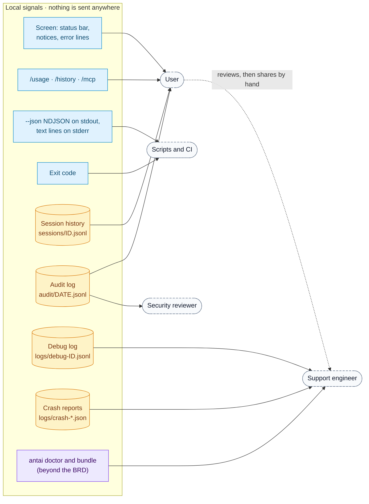
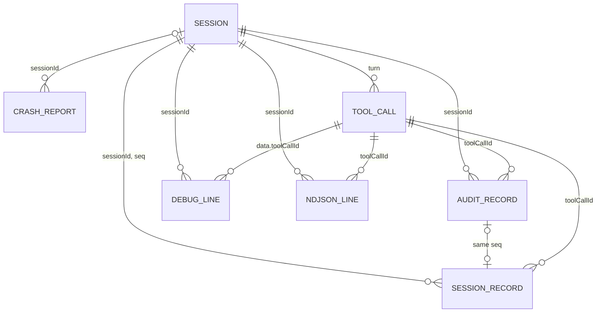
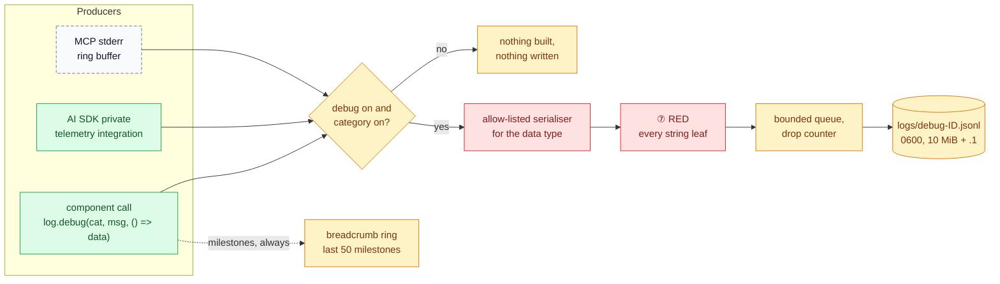
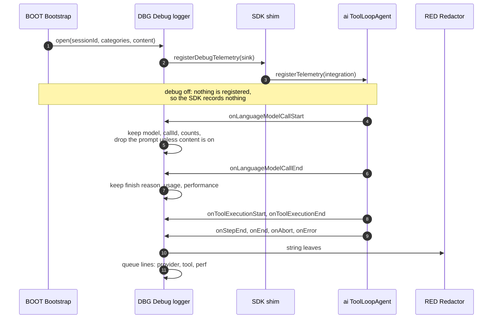
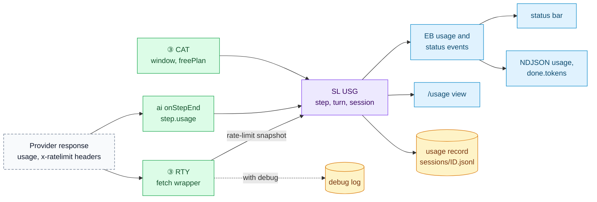
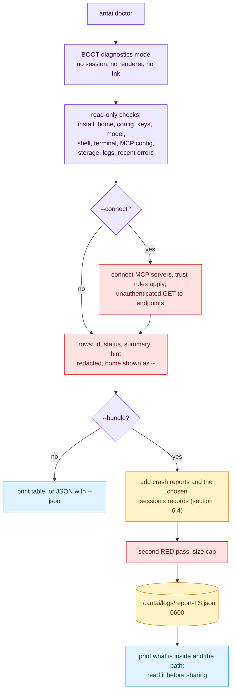
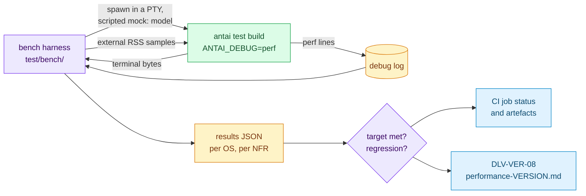

# antai — Observability: Logging, Audit, Usage & Diagnostics

| | |
|---|---|
| **Product** | antai (brand) / `antai` (command) |
| **Document** | Deliverable 15, Observability: Logging, Audit, Usage & Diagnostics for the v1 MVP |
| **Status** | Draft for review |
| **Version** | 0.1 |
| **Date** | 12 October 2026 |
| **Author** | Daksh Nagpal |
| **Based on** | BRD_1 v0.4, HLD.png, deliverables 00, 01, 02, 03, 04, 05, 06, 07, 08, 09, 10, 11, 13, 14 and 16 |
| **How to use** | Reference design, not a fixed rail. Where the technology needs something different or extra, the implementation may change it; the change is then made in every deliverable it touches, so the set keeps agreeing. |

## Contents

1. Purpose, scope and principles
2. Signal map (OBS-1, OBS-2)
3. Debug logging (OBS-3, OBS-4)
4. Audit trail
5. Usage, rate limits and cost (OBS-5)
6. Errors, crash reports and diagnostics (OBS-6)
7. Performance measurement (OBS-7)
8. Observability for scripts and CI
9. Privacy review
10. Implementation map
11. Design decisions
12. Open questions
13. Traceability
14. Sources

---

## 1. Purpose, scope and principles

### 1.1 Purpose

A web project's "Observability — APM" deliverable describes metrics, traces and dashboards collected on a server. antai has no server and no telemetry (BRD 2.2, NFR-PRIV-01): it is one local Node.js process, and nothing it records ever leaves the machine. Observability for antai therefore means **what people can see locally**: what the user sees on screen and in `/usage`, what a script reads from `--json` and the exit code, what a security reviewer reads in the audit log, and what a support engineer can learn from a bug report that the user chooses to prepare and share.

This document defines the debug log, the use of the audit trail, usage and rate-limit display, error reporting, crash reports, a diagnostics command and bug-report bundle, performance measurement, and a privacy review of every signal. It adds no component: the work belongs to `DBG`, `USG`, `AUD`, `LIFE`, `ERR`, `MSG`, `CLI` and `BOOT` (deliverable 01, section 5.9).

### 1.2 Scope

| In this document | Elsewhere |
|---|---|
| Which signals exist, who reads them, how they correlate | — |
| Debug log: switches, categories, per-component content, never-logged list, file handling, AI SDK integration, cost, reading | Debug line envelope and file rules: deliverable 04, sections 5.15, 6, 8 (referenced, not repeated) |
| Audit trail: purpose, coverage, reading tools, integrity limits | Audit record fields: deliverable 04, sections 5.9 and 5.13; tamper limits: deliverable 02, section 11.3 |
| Usage counters, `/usage` content, status-bar data, rate-limit display, cost policy | `usage` record: deliverable 04, section 5.10; `Usage` and `RateLimitSnapshot` types: deliverable 11, section 3; screens: deliverable 13 |
| Error reporting to the user, crash report content, `antai doctor` and its bundle | Error codes and exit codes: deliverable 11, sections 11 and 12; error taxonomy and retry numbers: deliverables 07 (section 9) and 09 (sections 8 to 10) |
| How NFR-PERF-01 to 04 are measured; the performance report (DLV-VER-08) | Start-up budget: deliverable 07, section 10; CI pipeline: deliverable 16; test plan: deliverable 14 |
| Signals for scripts and CI | NDJSON contract: deliverable 11, section 5 |

### 1.3 Who reads what

| Reader | Has | Wants | Main signals |
|---|---|---|---|
| **User** | The terminal and `~/.antai` | To know what antai is doing, what it costs in tokens, why something failed, what it did earlier | Status bar, notices, error lines, `/usage`, `/history`, `/mcp`, the audit log |
| **Scripts and CI** | stdout, stderr, the exit code, the CI job's home folder | A stable, machine-readable outcome | `--json` NDJSON, exit codes, stderr lines, optional log artefacts |
| **Support engineer** | Only what the user sends | Enough facts to reproduce or explain a fault without seeing the user's code or conversation | Bug-report bundle (beyond the BRD, OBS-P5), crash reports, debug log, `antai doctor` output |
| **Security reviewer** | The audit log, the design documents, test reports | Proof that every risky action was decided and recorded | Audit log, `antai audit` (beyond the BRD, OBS-P3), DLV-VER-03 secret-scan results |
| **Contributor** | A development checkout | Timings and internal decisions while building antai | Debug log with all categories, `perf` lines, the benchmark harness |

### 1.4 Principles

| # | Principle | Why | BRD |
|---|---|---|---|
| OP1 | **Local only.** No telemetry, analytics, update check, crash upload or log upload. No code path in antai can send a log, report or counter anywhere | NFR-PRIV-01 is absolute, and a dependency or a later change could add a network call without anyone noticing, so "no telemetry" must be designed in and tested | NFR-PRIV-01, 02, BRD 1.4, 2.2 |
| OP2 | **Detail is opt-in.** Always written: the audit log, session history (unless turned off), usage records, crash reports. The debug log only on request. Prompt and model text in the debug log only on a second, explicit request per run | The always-on records are the ones the BRD requires; everything else costs disk and privacy | FR-ERR-03, FR-HIS-13 |
| OP3 | **Redacted by construction.** Every sink accepts only `RedactedText` and `RedactedObject` (deliverable 11, CP5). Log data passes an allow-listed serialiser per type, then `RED` | A new field never reaches a log by accident (deliverable 01, section 10.7) | NFR-SEC-05, FR-SEC-03 |
| OP4 | **Useful when shared.** A support engineer can diagnose most faults from versions, platform facts, error codes, rule IDs, timings and state transitions, without conversation text. The user reviews any file before sharing it | The user decides what leaves the machine, by hand | NFR-PRIV-01 |
| OP5 | **Bounded.** Every file has a size cap and a retention period; every in-memory buffer has a bound | NFR-PERF-04; disks fill silently | FR-ERR-03, FR-HIS-09, 13 |
| OP6 | **Free when off.** With debug off, no telemetry integration is registered, no log data is built, and only a fixed-size breadcrumb ring is kept | The NFR-PERF targets apply to the default configuration | NFR-PERF-01, 02 |
| OP7 | **One vocabulary.** The same `sessionId`, `turn`, `seq`, `toolCallId`, error code and rule ID appear on every surface, so records join without guessing | Support works from fragments | — |
| OP8 | **Observing never changes behaviour.** A failing debug write stops debug logging with one notice; it never fails a turn. The audit log is the exception, because it is a safety record (deliverable 04, P7) | A diagnostic aid must not become a fault source | FR-HIS-13 |

### 1.5 Additions beyond BRD v0.4

These go beyond BRD v0.4. The design uses them as stated; the BRD can adopt them later. The BRD names `--debug`, crash reports, `/usage` and the audit log, but no environment switch, no content opt-in, no audit viewer and no diagnostics command. The text marks them "(beyond the BRD, OBS-Pn)".

| Ref | Proposal | BRD baseline | Section |
|---|---|---|---|
| OBS-P1 | `ANTAI_DEBUG` environment variable: `1` turns the debug log on; a comma list of categories turns on only those | Only the `--debug` flag (FR-CLI-04, FR-ERR-03) | 3.1 |
| OBS-P2 | `--debug-content` flag: the debug log also records redacted prompts, model text and reasoning, for that run only | "Detailed, redacted log" (FR-ERR-03); deliverable 01 says prompts are "not recorded unless asked" without saying how | 3.6 |
| OBS-P3 | `antai audit`: a read-only viewer for the audit log | None; the BRD says the log exists, not how it is read (FR-HIS-13) | 4.4 |
| OBS-P4 | `antai doctor`: read-only diagnostics with `--json` and an opt-in `--connect` | None (FR-CLI-05 lists the subcommands) | 6.3 |
| OBS-P5 | `antai doctor --bundle`: a local, redacted bug-report file that the user reviews before sharing; never uploaded | None | 6.4 |

Additions from other documents used here unchanged: deliverable 04 P3 (retention keys from global config only, now in BRD v0.4, FR-CFG-01), P7 (audit write failure denies side effects), P9 (`audit.retentionDays: 0` keeps forever); deliverable 07 RT-D13 (an internal error inside a turn ends only that turn); deliverable 11 IC-P1 to IC-P3 (exit codes 129, 130, 143 and their precedence), IC-P6 (an eighth NDJSON type, `notice`); the AI SDK v7 nested usage fields; SDK `maxRetries: 0` plus antai's own retry wrapper (`RTY`).

---

## 2. Signal map

### 2.1 OBS-1 Signals and their readers



The dashed edge is the only way anything reaches a support engineer: the user opens a file, reads it and sends it through a channel of their choice.

### 2.2 Signal inventory

| Signal | Produced by | Where | When | Content | Main reader | Retention | Defined in |
|---|---|---|---|---|---|---|---|
| Status bar | `INK` from `status` and `usage` events | Screen | Always (interactive) | Provider, model, mode, effort, profile, workspace, session tokens, context share (FR-UI-02) | User | Screen only | 5.4; deliverable 13 |
| Notices and error lines | `MSG` text through `BUS` | Screen; stderr in `PLAIN` | When something happens | What happened and what to do next (NFR-USE-02) | User | Screen only | 6.1; deliverable 11, section 13 |
| `/usage` | `USG`, `RTY` snapshot | Screen | On request | Tokens per turn, session and day; context; rate limits | User | Screen only | 5.3 |
| `/history`, `/mcp` | `HS`, `MCPM` | Screen | On request | Sessions with turns and tokens; MCP state, stderr tail, OAuth state | User | Screen only | Deliverables 04 and 10 |
| `--json` NDJSON | `PLAIN` | stdout | `--json` runs | The seven BRD line types plus `notice`, `done` last | Scripts and CI | Caller's | 8; deliverable 11, section 5 |
| stderr text | `PLAIN`, `CLI` | stderr | Non-interactive runs | Errors, notices, retries, debug log path | CI logs | Caller's | 8.3 |
| Exit code | `LIFE` | Process | Exit | 0 to 5, 129, 130, 143 | Scripts and CI | — | 8.1; deliverable 11, section 12 |
| Session history | `HS` | `~/.antai/sessions/` | Unless `--no-history` | Conversation, events, usage, title (redacted) | User (resume, `/history`) | 30 days | Deliverable 04, sections 5.7 to 5.12 |
| Audit log | `AUD` | `~/.antai/audit/` | Always | Decisions, commands, writes, settings, credentials actions; no conversation text | User, security reviewer | 90 days | 4; deliverable 04, section 5.13 |
| Debug log | `DBG` | `~/.antai/logs/` | `--debug` or `ANTAI_DEBUG` | Allow-listed metadata, timings, decisions; content only with `--debug-content` | Support engineer, contributor | 7 days | 3 |
| Crash reports | `DBG` via `LIFE` | `~/.antai/logs/` | Internal error | Versions, platform, stack, breadcrumbs; no conversation text | Support engineer | 7 days | 6.2 |
| Doctor report, bundle | `CLI` with `BOOT` diagnostics | Screen, stdout, `~/.antai/logs/` | On request (beyond the BRD) | Check rows; bundle adds crash reports and chosen logs | Support engineer | Screen; bundle 7 days | 6.3, 6.4 |

### 2.3 OBS-2 Correlation keys

Every signal carries the same identifiers, so a support engineer can follow one tool call from the screen to the audit log, the session file and the debug log.



| Key | Format | Present in |
|---|---|---|
| `sessionId` | `YYYY-MM-DD_HHMM_<6 hex>` (deliverable 04, DS-D2); exists from start, also with `--no-history` and in `run` | Session records (file name), audit records, debug lines, crash reports, NDJSON lines, `done` |
| `seq` | Session record number, reserved before the audit write (DS-D14) | Session records; audit `seq` (null without a session file) |
| `turn` | User messages so far | Session records, audit records of events, NDJSON lines, debug `data.turn` |
| `toolCallId` | Provider's opaque ID | `approval`, `command`, `file-write`, `mcp-call` events; tool messages; NDJSON `tool-call`, `approval`, `tool-result`; debug `data.toolCallId` |
| Error code | `<category>.<snake_case>`, e.g. `provider.quota_daily` (deliverable 11, section 11.2) | NDJSON `error.code`, audit `error` event `code`, debug lines, crash reports for `AntaiError`s |
| Rule ID | From `RULES`, e.g. `D-rm-recursive` (deliverable 02) | Audit `approval.rule`, NDJSON `approval.rule`, debug `safety` lines |
| Process start | `pid` and start time | Debug `debug-start` line, crash report file name |

Debug lines keep deliverable 04's envelope (`v`, `ts`, `level`, `cat`, `sessionId`, `msg`, `data`) and carry the other keys inside `data` under the fixed names above, so the envelope does not change.

---

## 3. Debug logging

### 3.1 Turning it on

| Switch | Effect | Categories | Content (3.6) | Status |
|---|---|---|---|---|
| `--debug` | Debug log for this process: interactive, `run`, and subcommands | All | No | BRD (FR-CLI-04, FR-ERR-03) |
| `ANTAI_DEBUG=1` (also `true`) | Same as `--debug`; convenient for subcommands, wrappers and CI jobs | All | No | Beyond the BRD, OBS-P1 |
| `ANTAI_DEBUG=mcp,oauth` | Debug log with only the listed categories (section 3.2). With `--debug` as well, the list still narrows. An unknown name gives one notice and is ignored | Listed | No | Beyond the BRD, OBS-P1 |
| `ANTAI_DEBUG=0`, empty or unset | Off, unless `--debug` is given | — | — | — |
| `--debug-content` | Implies `--debug`; adds redacted prompts, instructions and model text | As above | Yes | Beyond the BRD, OBS-P2 |

Rules:

- **No config key, no slash command.** A debug log that a config file switches on stays on silently, fills the disk and keeps metadata for 7 days; a cloned repository could switch it on. To debug a running conversation, the user exits and runs `antai --continue --debug`, which resumes the same session with logging on. A mid-session `/debug` would miss the start-up timings and early decisions that most faults need.
- **Visible.** When the log is on, antai shows one notice at start with the file path (stderr in `PLAIN`, so stdout stays NDJSON). With `--debug-content` the notice is a warning and says that prompts are being written.
- **Not inherited by commands.** `SR` removes `ANTAI_*` variables from child environments (deliverable 07, section 7.3), so `ANTAI_DEBUG` never reaches a shell command.
- **The environment cannot switch on content.** `--debug-content` is a flag only, typed per run. An environment variable can be planted (a `direnv` `.envrc`, a parent process) and persists across runs; a metadata-only log is a harmless result of that, a prompt log is not.

### 3.2 Levels and categories

Every line has a level, used for reading and filtering. When a category is on, all its levels are written: v1 has no level threshold, because the log is opt-in, capped (3.8) and short-lived.

| Level | Used for |
|---|---|
| `error` | An operation failed: a caught exception, a failed write, a failed connect, a contained internal error |
| `warn` | Degraded or unexpected: a retry, a fallback, a skipped sweep, dropped log lines, an unknown stream part, a slow `.env` scan |
| `info` | State transitions: process start, session start and end, turn start and end, model switch, MCP connected |
| `debug` | Detail: per-call timings, per-step usage, classifier timings, lock waits |

Deliverable 04 (section 5.15) fixed seven categories and left the final list here. This document keeps them and adds four (`session`, `safety`, `process`, `perf`); the change is additive (deliverable 04, section 10.1).

| Category | Components | Typical lines |
|---|---|---|
| `config` | `CFG`, `TRUST`, `PRF`, `INS`, `SKR` | Files read, validation findings, value sources, trust lookup, instruction files and skills found or skipped |
| `session` | `SC`, `SLASH`, `USG`, `APR` | Turn start and end, slash commands, setting changes, step counts, approval round trips, per-step usage, pruning |
| `provider` | `REG`, `RTY`, `CAT`, `AG`, `EVM` | Model calls, response metadata, rate-limit snapshots, retry and budget decisions, SDK warnings, stream part counts |
| `tool` | `TREG`, `BT`, `SRCH` | Tool call start and end, durations, status, output size, search backend |
| `safety` | `POL`, `CLS`, `PG`, `RED`, `AUD` health | Decisions with tier and rule ID, classifier timings and parse failures, path verdicts, redaction counts, `.env` scan summary |
| `process` | `PSV`, `SR`, `GBL` | Spawns, exits, timeouts, tree kills, survivors, Git Bash detection |
| `mcp` | `MCPM`, `MA` | Connect steps, protocol version, tool counts, drift summary, calls, stderr lines, close |
| `oauth` | `MOA`, `OCB` | Discovery, registration, callback checks, token exchange and refresh outcomes |
| `history` | `HS`, `AUD`, `RET`, `FSX` | Appends, lock waits, index updates, reconciliation, recovery, retention counts, rename retries |
| `ui` | `INK`, `LINE`, `PLAIN`, `BOOT` renderer choice | Renderer and why, terminal facts, resize, frame timings, back-pressure waits, interaction requests opened and closed |
| `perf` | `BOOT`, `LIFE`, `SC`, `INK` | Start-up marks, per-turn timing summary, event-loop delay, memory (section 7.2) |

### 3.3 OBS-3 From a call site to the file



| Step | Rule | Why |
|---|---|---|
| Guard | `log.enabled(cat)` is one boolean lookup. Call sites pass `data` as a function, which runs only when the category is on | OP6: no objects are built when logging is off |
| Serialise | Each logged type has a registered serialiser that names the fields it copies (deliverable 11, section 15.8). An unregistered type is logged as `{ "type": "<name>" }` only. Error causes use `ERR`'s allow-list: status code, provider error type, request ID (deliverable 11, section 11.4) | A field added to a type later does not reach the log until someone adds it to the serialiser and a reviewer sees it |
| Redact | `RED` runs over every string leaf, giving a `RedactedObject` (DS-D9). Then the home folder prefix (`/Users/me`, `C:\Users\me`, `/c/Users/me`) becomes `~` | A secret in an error message or path is masked; the user's account name is not in a shared log |
| Queue | Lines go into an in-memory queue of at most 2,000 lines or 2 MiB. When full, the oldest `debug`-level lines are dropped first and counted; a `warn` line `dropped` with the count is written when space returns | A slow disk never grows memory without bound (NFR-PERF-04) |
| Write | One file handle opened with `O_APPEND`; one write per line, in order (deliverable 04, F15). The caller never awaits it | Logging never adds latency to a turn |
| Fail | `ENOSPC`, `EACCES` and similar stop debug logging for the process with one notice (deliverable 04, section 6.10) | OP8 |
| Crash | The crash path writes queued lines with synchronous writes, best effort, inside the 3 s crash watchdog (deliverable 07, section 9.4), before writing the crash report | The last lines before a crash are the most useful ones |

The **breadcrumb ring** is the only thing kept when debug is off: the last 50 milestones as `{ ts, cat, msg, code, turn }` from a fixed list of message names (process start, renderer chosen, session start, turn start and end, model call start and end, tool start and end with the tool name, MCP state change, retry scheduled, approval decided, error shown). It holds no data fields and no text, costs a fixed few kilobytes, and goes into crash reports (section 6.2).

### 3.4 What each component logs

Fields are the allow-list. Anything not listed is not logged. All strings pass `RED`.

| Category | Logged | Not logged (even with debug on) |
|---|---|---|
| `config` | Each file read: path (with `~`), bytes, parse time, result. Validation findings: code, file, key. Value sources: key name and layer. Values only for `mode`, `model`, `effort`, `profile`, `maxSteps`, `history.enabled`, retention days, `context.pruneAt`. Trust: decision, whether the hash matched, `hashVersion`. Instruction files: path, bytes, capped or not. Skills and profiles: name, source, skipped with reason | Other config values; `${VAR}` values; header values; the trust snapshot |
| `session` | Turn start and end: `turn`, source, step budget, steps used, end reason, wall time. Slash command name; arguments only for `/model`, `/mode`, `/effort`, `/profile`. `setting` changes: from and to. Per-step usage (`Usage` fields). Context: last input, window, share, prune and stop actions. Approval round trip: request count, dialogs, wait time, decision category | User input text; slash-command arguments of skills; answers to secret-entry requests |
| `provider` | Per model call: provider, model, step, estimated input tokens, `maxOutputTokens`, message count, tool count, request bytes. Response: status, provider request ID, response ID, finish reason, usage, `responseTimeMs`, `timeToFirstOutputMs`, `outputTokensPerSecond` (section 3.9). Rate-limit snapshot as parsed. `RTY`: class, attempt, wait, reason, pre-flight guard decision. SDK warnings: type and feature. Stream part counts per type; unknown part types | Request and response bodies; all headers (the `fetch` wrapper strips `Authorization`, `x-api-key`, `x-goog-api-key` and similar before anything reaches `DBG`, deliverable 09, section 7.3); prompts and model text unless `--debug-content` |
| `tool` | Call start and end: `toolCallId`, tool name, source (built-in or `mcp`), the input summary that the audit log stores (redacted, capped at 2,000 characters), duration, status, exit code, output characters, truncated or not. Search: backend (`rg` or walker), files scanned, matches, time | Tool output text, ever (the session file holds the same bytes the model saw, FR-HIS-07); file contents |
| `safety` | Decision: tool, tier, rule ID, status, dialogs, `by`. Classifier: parse time, segment count, parse failure class. Path guard: workspace-relative path, verdict, reason code. Redaction per output: mask counts by detector (known value, name pattern, format, URL password), hold-back events with held length. `.env` scan: files checked, values loaded (count), time. Audit writer health | Masked values; `.env` file names outside the workspace; the approval signing secret |
| `process` | Spawn: kind, program path (with `~`), pid, process group, timeout. Exit: code, signal, duration, timed out. Tree kill: method, survivors, `Lost` cases. Git Bash: candidates tried, chosen path, bash version. Child environment: count of variables removed | Child environment values; command output |
| `mcp` | Connect: server name, transport, protocol version, duration, tool count, state changes. Drift: tool names added, removed, changed. Calls: server, tool, `toolCallId`, duration, `isError`, output characters. stderr lines from the 200-line ring buffer (deliverable 10), redacted. Close and kill | URLs with query strings; header values; `${VAR}` values; tool results |
| `oauth` | Protected-resource metadata URL and authorization-server issuer (origin and path only); registration: dynamic or configured; redirect port; callback received; `state` and `iss` checks passed or failed; token exchange and refresh: HTTP status and outcome; expiry time | Authorization codes, PKCE verifiers, `state` values, tokens, client secrets, query strings of authorization URLs |
| `history` | Appends: record type, `seq`, bytes. Lock waits and holder pid. Index update written or skipped and time. Reconciliation counts. Recovery: dropped lines and bytes. Retention: counts per kind. Atomic replace retries by error code. Quarantine and `.corrupt` moves | Record contents |
| `ui` | Renderer chosen and the reason; stdin and stdout TTY, raw mode, colour level, columns and rows, `TERM` and `TERM_PROGRAM` values, kitty keyboard detected; resizes; per-turn frame time p95; `PLAIN` drain waits; interaction requests: kind, open time, answer category | Text typed into prompts or dialogs; secret-entry answers |
| `perf` | Section 7.2 | — |

### 3.5 Never logged

| Item | Why it cannot appear | Checked by |
|---|---|---|
| Secret values: API keys, OAuth tokens, codes, verifiers, `state`, client secrets, `${VAR}` values, `.env` contents, the approval secret | Not in any serialiser; `Secret` prints `[secret]` (deliverable 11, section 3); `RED` as backstop | DLV-VER-03 seeded scan of debug logs (AC-22) |
| Answers to secret-entry requests | Never serialised; the interaction answer type has no serialiser | Unit test on the `ui` serialisers |
| Environment variable values | Only names and counts are logged; values of `TERM` and `TERM_PROGRAM` are the two exceptions | Serialiser review |
| Raw tool output (unredacted or uncapped) | It exists nowhere (deliverable 04, section 7.2); capped, redacted output is in the session file, not the debug log | Same-bytes test (deliverable 04, section 7.3) |
| HTTP bodies and headers | The `fetch` wrapper hands `DBG` only status, request ID and parsed rate-limit numbers | Secret scan with seeded keys in request headers |
| Prompts, instructions, model text, reasoning | Only with `--debug-content` | Scan of a `--debug` log for seeded prompt markers |
| Workspace file contents | No serialiser takes file contents | — |

### 3.6 Content opt-in: `--debug-content`

Most faults are diagnosed from metadata. Some are not: a model that ignores an instruction, a pruning step that dropped the wrong part, a provider that rejects a request shape. Those need the exact request. The instructions and the pruned copy sent to the model are stored nowhere else (deliverable 04, section 7.2), so the debug log is the only place they can be seen (beyond the BRD, OBS-P2).

| With `--debug-content` | Detail |
|---|---|
| Instructions | Full text once per turn, with a hash; later calls in the turn log the hash only, unless it changed |
| Request copy | Per model call, the messages added since the previous call, as `PR` prepared them (after pruning and provider stripping), plus tool names and the byte size of each tool schema |
| Model output | Per step: final text blocks, reasoning blocks and tool-call inputs. Not deltas |
| Line cap | 4 MiB per line (deliverable 04 line cap); longer content is cut with a marker |
| Still excluded | HTTP bodies and headers, secret values, secret-entry answers |

All of it is the redacted text the model received, so it holds nothing that the session file, or the provider, did not already receive. The flag is refused in config and environment (section 3.1). The start-up warning names the file and suggests deleting it after use.

### 3.7 Redaction layers

1. **Structure.** Allow-listed serialisers decide which fields exist (3.3, 3.4).
2. **Type.** `DBG` accepts only `RedactedText` and `RedactedObject`, which only `RED` creates (deliverable 04, section 7.3; deliverable 11, CP5).
3. **Values.** `RED` masks known values and formats in every string leaf (FR-SEC-03).
4. **Transport.** The provider and MCP `fetch` wrappers strip credential headers before anything is handed to `DBG` (deliverable 02, section 6).
5. **Wrappers.** `Secret` and `AntaiError.toJSON()` print nothing sensitive if passed by mistake (deliverable 11, sections 3 and 11.4).
6. **Paths.** The home folder prefix becomes `~`.
7. **Test.** The secret-scan suite (DLV-VER-03) runs once with `--debug-content`, the worst case, and scans the debug log and crash reports along with every other sink (AC-22).

### 3.8 File format, rotation and retention

File names, envelope, caps and retention are deliverable 04's (sections 2.2, 3.2, 5.15, 8.1): `logs/debug-<session-id>.jsonl` (subcommands: `debug-cli-<YYYYMMDDTHHMMSSZ>-<pid>.jsonl`), `0600` in a `0700` folder, rotated once at 10 MiB to `.1.jsonl`, deleted by `RET` at start when older than 7 days.

This document adds three conventions:

| Convention | Rule |
|---|---|
| Header line | The first line a process writes to a file is `msg: "debug-start"` (`info`, `cat: perf`) with: antai version, `ai` version, Node version, OS, OS release, architecture, pid, flags given (names; values only for `--mode`, `--model`, `--effort`, `--profile`, `--json`), categories on, content opt-in, renderer, rule-data version, catalogue version, time-zone offset, config files loaded (paths with `~`, layer) |
| Session changes | `/clear` and `/resume` change the session ID. The old file ends with `msg: "continued"` naming the new file; the new file's header names the old one. A resumed session appends to its existing file if it is still there |
| End line | A normal exit writes `msg: "debug-end"` with lines written, lines dropped and write errors. A file without it ended in a crash or kill |

Example lines (session ID shortened):

```jsonl
{"v":1,"ts":"2026-10-12T14:32:03.402Z","level":"info","cat":"perf","sessionId":"2026-10-12_1432_a1b2c3","msg":"debug-start","data":{"antaiVersion":"1.0.0","sdkVersion":"7.0.137","node":"24.11.0","os":"darwin","arch":"arm64","pid":4242,"categories":"all","content":false,"renderer":"ink"}}
{"v":1,"ts":"2026-10-12T14:32:09.118Z","level":"debug","cat":"provider","sessionId":"2026-10-12_1432_a1b2c3","msg":"model-call-end","data":{"turn":1,"step":1,"provider":"groq","model":"groq:openai/gpt-oss-120b","status":200,"finishReason":"tool-calls","input":4120,"output":96,"cacheRead":3072,"responseTimeMs":1840,"timeToFirstOutputMs":412}}
{"v":1,"ts":"2026-10-12T14:32:09.120Z","level":"warn","cat":"provider","sessionId":"2026-10-12_1432_a1b2c3","msg":"retry","data":{"turn":2,"attempt":1,"maxAttempts":5,"reason":"rate-limit-minute","waitMs":23000,"code":"provider.rate_limited"}}
{"v":1,"ts":"2026-10-12T14:32:11.950Z","level":"info","cat":"safety","sessionId":"2026-10-12_1432_a1b2c3","msg":"decision","data":{"turn":1,"toolCallId":"call_1","tool":"edit_file","tier":"normal","rule":"file-write","status":"user-approval","dialogs":1}}
```

Field names inside `data` follow deliverable 11's names (`Usage`, `RetryReason`, error codes); the SDK's performance field names are to be confirmed in the P0 spike.

### 3.9 OBS-4 AI SDK integration

The debug log receives the AI SDK's own view of each call through a private telemetry integration, registered only while debug logging is on (deliverable 01, HLD-D27). `registerTelemetry` is wrapped by the `SDK` shim as `registerDebugTelemetry(sink)` (deliverable 11, section 8.7).



| Hook (AI SDK v7) | Kept | Dropped |
|---|---|---|
| `onStart`, `onStepStart` | Step number, call ID | Settings objects |
| `onLanguageModelCallStart` | Model, `callId`, tool count, message count | The standardised prompt and call options, unless `--debug-content` |
| `onLanguageModelCallEnd` | `callId`, `finishReason`, `usage`, `responseId`, `performance` (`responseTimeMs`, `timeToFirstOutputMs`, `outputTokensPerSecond`) | `content` (model output) unless `--debug-content`; `providerMetadata` |
| `onToolExecutionStart`, `onToolExecutionEnd` | Tool name, `toolCallId`, duration, success or error class | Arguments and results (antai logs its own redacted summary from `TREG`) |
| `onStepEnd`, `onEnd` | Finish reason, usage | Response messages |
| `onAbort`, `onError` | Error class and `AntaiError` code through `toAntaiError` and `ERR`'s allow-list | Error bodies |

Facts and limits:

- With no integration registered the SDK records nothing; not registering one is the SDK's own way to turn telemetry off. antai registers none when debug is off, so the SDK adds no work to a normal run.
- The integration is registered once per process and stays for the process lifetime. Agents set no `telemetry` option (deliverable 07, section 4.1), so the SDK's defaults apply and the integration's allow-list is what keeps prompts out. Whether `recordInputs: false` also removes the prompt from the events an integration receives is to be confirmed in the P0 spike; the design relies on the allow-list, and if the spike confirms it, `AG` also sets it as a second layer when content is off.
- The usage counted for `/usage` comes from `onStepEnd` through `USG` (deliverable 07, section 5.4), never from the debug integration, so usage works with debug off.
- The `ai:telemetry` tracing channel is not used.
- `@ai-sdk/devtools` is never a dependency and never shipped: it writes full prompts to `.devtools/` in the working directory.

### 3.10 No OpenTelemetry in v1

`@ai-sdk/otel` is not used (deliverable 01, section 7): an OTLP exporter is a network destination that NFR-PRIV-01 does not allow, it adds `@opentelemetry/api` to the bundle and start-up path, and its spans record inputs and outputs by default. The design keeps two paths open for a later version without changing components:

| Path | What it needs | Requirement change |
|---|---|---|
| Offline conversion | A separate tool reads `debug-*.jsonl` and writes OTLP JSON. The debug lines already carry `ts`, `callId`, `toolCallId`, durations and usage, enough to rebuild call and tool spans | None: antai is unchanged |
| Opt-in exporter | `SDK` also registers `@ai-sdk/otel` when a global-only key names an endpoint; project config can never set it (a cloned repository must not be able to name a destination for antai's data); inputs and outputs off by default; a loopback-only endpoint at first | NFR-PRIV-01 must allow a user-named destination; a BRD decision |

Because `registerTelemetry` is already isolated in `src/sdk/` and `DBG`, either path touches only those two modules.

### 3.11 Performance cost of logging

| | Debug off (default) | Debug on |
|---|---|---|
| SDK telemetry | Nothing registered | One integration; per-call objects built by the SDK |
| Call sites | One boolean check; no `data` built | Serialise, redact, queue |
| Text deltas | No per-delta line, ever | No per-delta line, ever; the `ui` category logs a per-turn frame summary |
| Memory | Breadcrumb ring, a few KB | Queue up to 2 MiB |
| Event-loop sampling | Off | `monitorEventLoopDelay()` histogram, read per turn (deliverable 07, section 2.3) |
| Disk | Crash reports only | Up to 20 MiB per session, 7 days |
| Performance targets | NFR-PERF-01 to 04 apply | Not covered by the targets; the benchmark (section 7) reports the overhead of `ANTAI_DEBUG=perf` and of full `--debug` for information |

The design target for full `--debug` is under 5 % extra wall time per turn outside model and tool time, measured in the benchmark job; it is a goal, not a requirement.

### 3.12 Reading the log

The path is printed at start and listed by `antai doctor`. The file is JSON Lines, so standard tools work:

```sh
# warnings and errors only
jq -c 'select(.level=="warn" or .level=="error")' ~/.antai/logs/debug-<id>.jsonl
# one category, compact
jq -c 'select(.cat=="mcp") | [.ts, .msg, .data]' ~/.antai/logs/debug-<id>.jsonl
# everything about one tool call
jq -c 'select(.data.toolCallId=="call_1")' ~/.antai/logs/debug-<id>.jsonl
# start-up breakdown
jq 'select(.msg=="startup") | .data' ~/.antai/logs/debug-<id>.jsonl
```

The user guide (DLV-DOC-02) carries these recipes, with PowerShell equivalents for Windows users without `jq`.

---

## 4. Audit trail

### 4.1 Purpose

G2 asks for risky actions that are "visible, approved and auditable", measured as "every write and shell command appears in the session audit trail". D26 and FR-HIS-13 make the audit log a separate file that is always written, also with `--no-history` and for one-shot `run`, and that no setting, flag or project config can turn off. It answers one question without the conversation: **what did antai do on this machine, when, in which folder, and who decided?** The user asks it after the fact ("did antai change this file?"); a security reviewer asks it about a team's use of `auto` or `--dangerously-skip-permissions`; a CI job keeps it as a compliance artefact.

Record fields, file layout and write order are deliverable 04's (sections 5.9, 5.13, 6.6). This section covers what the records are for and how they are read.

### 4.2 What is audited

| Kind | Written when | Question it answers | Mainly for |
|---|---|---|---|
| `session-start` | Every session, before any prompt | Which folder, mode, model and profile; was history on; was it `skip` | Reviewer |
| `approval` | Every decision except a Safe call that simply runs | Who allowed or refused this call, under which tier and rule | Reviewer, user |
| `command` | A shell command ended, any tier | What ran, exit code, duration, timed out or interrupted | User, reviewer |
| `file-write` | `write_file` or `edit_file` changed a file | Which file changed, how large, new or existing | User |
| `mcp-call` | An MCP tool call returned | Which server and tool, error or not | Reviewer |
| `setting` | Mode, model, effort or profile changed | When the session became `auto`, and by whom (user, flag, profile, resume) | Reviewer |
| `trust` | Trust answered or changed | When a repository's settings were allowed | Reviewer |
| `credential` | Key saved or removed, OAuth login, logout, failed refresh | When access was granted or revoked (never a value) | Reviewer |
| `config-file` | `antai mcp add`, `antai mcp remove`, `antai init` | Which config file antai itself changed | Reviewer |
| `mcp-drift` | A server's tool definitions changed | Whether a server changed under the user | Reviewer |
| `interrupted`, `repair`, `resume`, `recovery`, `end` | Session lifecycle events | Whether a turn was cut off, a crash repaired, a session forked | Support, user |
| `error`, `retry`, `context`, `compaction` | Errors shown, retries scheduled, pruning, `/compact` | What went wrong and when | Support |
| `history-delete`, `retention` | `/history delete`, a sweep | What antai deleted | User, reviewer |

The `approval` record of an action is written before the action runs, and its `command`, `file-write` or `mcp-call` record when it ends (deliverable 04, section 6.6). `toolCallId` links the two (OBS-2).

### 4.3 What is not audited

| Not recorded | Why | Where to look instead |
|---|---|---|
| Safe calls that simply run: `read_file`, `list_directory`, `find_files`, `search_files`, `load_skill` inside the workspace | FR-HIS-13 lists decisions, commands, writes and setting changes; a read inside the workspace is not a decision. Safe shell commands are recorded (`command`), and reads outside the workspace are Normal, so they get an `approval` record | Session history (tool-call messages); debug log `safety` and `tool` lines |
| Command output, written file contents, MCP results | "No conversation text" (FR-HIS-13); output is in the session file | Session history; `git diff` for file contents |
| Prompts and model text | FR-HIS-13 | Session history |
| Effects antai cannot see: what a command's children did, what a remote MCP server did, the user's own shell | Outside antai's process | The remote system's own logs |
| Read-only antai actions (`/usage`, `antai audit`, `antai doctor`) | They change nothing | — |
| Token usage | Not an action; usage is in session files | `/usage`, session `usage` records |

Safe in-workspace reads are not audited (OBS-D13): auditing them would add a record to most tool calls and make the log harder to read for the actions that matter.

### 4.4 Reading the audit log

**With standard tools.** The files are JSON Lines in `~/.antai/audit/<YYYY-MM-DD>.jsonl` (UTC days). The user guide (DLV-DOC-02) documents recipes such as:

```sh
# every denial today
jq -c 'select(.kind=="approval" and .decision=="denied")' ~/.antai/audit/$(date -u +%F).jsonl
# commands of one session, as a table
jq -r 'select(.sessionId=="2026-10-12_1432_a1b2c3" and .kind=="command") | [.ts, .exitCode, .input] | @tsv' ~/.antai/audit/*.jsonl
# sessions started in skip mode, and switches to auto
jq -c 'select((.kind=="session-start" and .mode=="skip") or (.kind=="setting" and .to=="auto"))' ~/.antai/audit/*.jsonl
# files antai wrote in the last 90 days, most frequent first
cat ~/.antai/audit/*.jsonl | jq -r 'select(.kind=="file-write") | .path' | sort | uniq -c | sort -rn
```

**With `antai audit`** (beyond the BRD, OBS-P3; Should, from P4). A read-only viewer, so that a user without `jq`, or on Windows, can answer the same questions.

| Option | Meaning | Default |
|---|---|---|
| `--since <date or duration>`, `--until <…>` | Time window (`2026-10-01`, `2h`, `7d`) | Last 24 hours |
| `--session <id>` | One session | All |
| `--project` | Sessions whose `session-start` `projectKey` matches the current workspace | All projects |
| `--kind <k>[,<k>…]` | Record kinds | Decisions and effects: `approval`, `command`, `file-write`, `mcp-call`, `setting`, `trust`, `credential`, `config-file` |
| `--denied` | Only `approval` records with `decision: denied` | — |
| `--json` | Matching records printed unchanged, one per line | Table |
| `--limit <n>` | Most recent n records | 200 |

| Rule | Detail |
|---|---|
| Read-only | Opens day files read-only, takes no lock, writes nothing, writes no audit record about itself |
| Tolerant | Skips a torn last line and unparseable lines, and reports how many it skipped (NFR-REL-01) |
| Fast | Chooses files by name from the date window before reading; streams line by line. 90 days is about 15 MB (deliverable 04, section 12) |
| Display | Table columns: local time, session (last 6 characters), kind, tool and input summary cut to the terminal width, tier, decision and `by`, exit code. Text passes `RED` again with the current known values before printing; `--json` prints the stored, already redacted records |
| Independent | Works with an invalid config, no API key and no TTY; imports no Ink and no provider package |
| Exit codes | 0 when it ran (also with no matches), 2 for bad arguments, 1 for an internal error (deliverable 11, section 12.3) |
| Module | `src/cli/` formatting over a tolerant reader added to `AUD` (`src/infra/audit/`); no new component |

A `/audit` slash command for the current session is not proposed: the transcript (Ctrl+T, FR-UI-03) already shows every tool card and decision of the session.

### 4.5 Integrity and limits

| Property | v1 behaviour | Reference |
|---|---|---|
| Always written | Audit record before session record; if the audit file cannot be written, calls that need a record are denied (beyond the BRD, deliverable 04 P7) | DS-D14, SEC-D27 |
| Protected from the model | Writes under `~/.antai/**` are protected-path writes, Dangerous in every mode; reads are Normal when the workspace is the home folder | FR-TOOL-11, deliverable 04 P5 |
| Not tamper-evident | Plain JSONL that the user, or any process with the user's rights, can edit or delete. No hash chain in v1; with no remote copy it would add little | Deliverable 02, section 11.3, SEC-D27, RR-11 |
| Concurrent processes | One shared file per UTC day; each record one `O_APPEND` write of at most 8 KB; no lock | DS-D13 |
| Crashes | A torn last line is skipped by readers. The crash path writes no audit record (deliverable 07, section 9.4), so the last action before a crash may have its `approval` record but no `command` record; resume shows the user that turn's records | NFR-REL-01, deliverable 04 section 6.8 |
| Clock | Day files and retention follow the system clock in UTC; a wrong clock files records under the wrong day | Deliverable 04, section 8.2 |
| Retention | 90 days (`audit.retentionDays`), `0` keeps forever, read from global config only. Deleting a session never deletes its audit records | FR-CFG-01; deliverable 04 P9 |
| Coverage | Interactive, `run`, `--no-history` and `history.enabled: false` alike | AC-31, AC-34 |
| What it proves | What antai decided and did, as recorded by antai on the user's machine. It is a record for the user, not evidence against the user | Deliverable 02, section 11.3 |

---

## 5. Usage, rate limits and cost

### 5.1 OBS-5 Where the numbers come from



`USG` is the only reader of the SDK usage object (deliverable 11, section 8.6). Provider-reported usage is the source of truth; local token estimates exist only for the budget guard and pruning (deliverable 09, section 4.6) and are never shown as usage.

| Counter (`Usage`, deliverable 11) | SDK source (v7 nested usage fields) | Meaning for the user |
|---|---|---|
| `input` | `inputTokens` | Tokens sent, including cached ones |
| `cacheRead` | `inputTokenDetails.cacheReadTokens` | Part of `input` served from the provider's prompt cache. Groq does not count cached tokens toward its limits (deliverable 09, section 8.1) |
| `cacheWrite` | `inputTokenDetails.cacheWriteTokens` | Part of `input` written to the cache (Anthropic, OpenAI) |
| `output` | `outputTokens` | Tokens generated, including reasoning |
| `reasoning` | `outputTokenDetails.reasoningTokens` | Part of `output` spent on reasoning; for gpt-oss it counts against `maxOutputTokens` |
| `total` | `totalTokens` | Provider's total; when null, `input + output` |

A field the provider does not report is `null` and shown as "—"; a sum that includes a turn with a missing value is marked partial. Ollama and some OpenAI-compatible endpoints report less (deliverable 09, section 5).

### 5.2 Granularity

| Scope | How it is formed | Where it appears |
|---|---|---|
| Step | `step.usage` in `onStepEnd` | `usage` event (`scope: 'step'`) for the status bar; debug `provider` line per call |
| Turn | `USG` sums the steps of every stream call in the turn; `result.usage` is compared, a mismatch logged (deliverable 07, section 5.4). An interrupted turn holds its completed steps only | `usage` record (deliverable 04, section 5.10), `usage` event (`scope: 'turn'`), NDJSON `usage` line, `turn-end.usage` |
| Session | Running total, including the title call and `/compact` calls | `usage.sessionTotal`, `index.json` `tokens`, `/history`, `session-ended.summary`, NDJSON `done.tokens` |
| Day | Computed when `/usage` opens: the `usage` records with a `ts` since local midnight, from sessions whose `lastActivityAt` is today. Sessions with `--no-history` and other machines are not included, because that would need a per-turn usage record in the audit log | `/usage` only, labelled as an estimate |

Requests that fail before generation (a 413, a 429, a network error) report no usage and are not counted, although a provider may count them. Attempts that `RTY` retried before the first content part are counted only when the provider reported usage for them.

### 5.3 `/usage`

`/usage` (BRD 5.11, Must: "tokens for this turn and this session") returns a `command-result` event (deliverable 11, section 4.1); deliverable 13 draws it. The content:

| Block | Shows | Source |
|---|---|---|
| This turn | Input (of which cached), output (of which reasoning), cache write, total, steps, model calls, wall time. When idle, the last completed turn | `USG` |
| This session | The same totals, turns, model calls; one row per `provider:model` when the model changed in the session; background calls (title, `/compact`) on their own row | `USG` |
| Context | Last step's input tokens, the window and where it came from (catalogue, config, default), the share, prunes and compactions this session | `USG`, `CAT` |
| Rate limits | Per `provider:model` used this session: requests remaining of the limit and reset, tokens remaining of the limit and reset, each with its window (per minute or per day, from the provider profile in `providers.json`, deliverable 09 section 8.3), and when it was observed. Providers without headers: "this provider sends no rate-limit information" | `RTY` snapshot |
| Today | Tokens on this machine since local midnight, and the part that counts toward the provider's limits (for Groq, `input − cacheRead + output`); compared with the daily token limit when one is known (section 5.6) | Session `usage` records |
| Note | "Counts come from the provider. antai shows no prices." | Fixed text |

`/usage` reads only memory and, for "Today", session files; it makes no network call. In `run` there are no slash commands; scripts read the NDJSON `usage` lines and `done.tokens` (section 8).

### 5.4 Status bar

FR-UI-02 asks for token usage "with the share of the context window when known". Deliverable 13 draws the segment (for example `2.1k tokens · 2% ctx`); the data is:

| Item | Value | Updated |
|---|---|---|
| Tokens | Session total (`total`, or `input + output`) | After each step |
| Context share | Last step's `inputTokens` ÷ the effective window E (the context window, or the plan's per-minute token limit when smaller, deliverable 08, 9.1), not the summed usage, which would overstate it | After each step |
| Share hidden | When the window is the 32,000-token fallback for an unknown model (FR-AGT-05): the window is assumed, not known. The unknown-model notice already names the config key to set (deliverable 09, section 4.5) | — |
| Rate-limit warning | Shown only when low: tokens remaining this minute below 20 % of the limit, or requests remaining in a per-day window below 10 % | After each response |
| Retry countdown | During a scheduled retry or budget wait, the countdown line of deliverable 09, section 8.7 | Each second |

The two thresholds keep the bar quiet in normal use and visible before a limit is hit; deliverable 13 draws the warning.

### 5.5 Rate-limit state

`RTY` keeps one snapshot per `provider:model` from every response, error responses included (deliverable 09, section 8.3), stores reset times as absolute times, and saves the snapshot in each turn's `usage.rateLimit`. Display rules:

- A snapshot older than its reset time is shown as "reset since 14:35" and is ignored by the budget guard (deliverable 09, section 8.4).
- The window label comes from the provider profile: Groq's `-requests` headers are per day and its `-tokens` headers per minute; OpenAI's are both per minute.
- `/usage` needs the limits as well as the remaining values. Deliverable 11's `RateLimitSnapshot` therefore carries `limitRequests` and `limitTokens` beside the remaining values and resets, an additive change made for this document (OBS-D21; deliverable 11, CP7).

### 5.6 Free-plan budget

The default is Groq's free plan: 30 requests per minute, 1,000 per day, 8,000 tokens per minute, 200,000 per day for `openai/gpt-oss-120b` (deliverable 09, section 8.1). What antai can show:

| Budget | Known from | Shown in |
|---|---|---|
| Tokens this minute | `x-ratelimit-remaining-tokens` and `-limit-tokens` (authoritative) | `/usage`; status-bar warning; countdown while the guard waits |
| Requests today | `x-ratelimit-remaining-requests` and `-limit-requests`, per day on Groq (authoritative) | `/usage`; status-bar warning |
| Tokens today | No header. Local estimate: `input − cacheRead + output` from today's usage records, against the catalogue's `freePlan.tpd`, shown only when the observed `x-ratelimit-limit-tokens` equals the catalogue's free-plan per-minute limit (so a paid plan is not compared with free numbers) | `/usage` "Today", marked as an estimate |
| Google free tier | No headers and no published limits (deliverable 09, section 8.6) | `/usage` says so |

When a limit is reached, the user sees the one-line messages of deliverable 09, section 8.7 (per-minute countdown, daily quota with its reset time, request too large for the plan).

### 5.7 Cost

v1 shows **no cost estimate**. The model catalogue has no price fields (deliverable 09, section 4.1); the default plan costs nothing; preset and custom endpoints have unknown prices; and prices change more often than antai releases, so a figure would often be wrong. Tokens by type, including cached and reasoning tokens, are what a user needs to compare against a provider's price page. A later version could add `pricing` with `checkedOn` and `source` to `models.json`, maintained by the catalogue process (deliverable 09, section 4.7), and show a local estimate at list price, labelled as an estimate with the date the prices were checked.

---

## 6. Errors, crash reports and diagnostics

### 6.1 Error reporting to the user

| Rule | Detail | Reference |
|---|---|---|
| Two parts | Every error and warning has "what happened" and "what to do next" from `MSG`; a test fails on an entry without both | NFR-USE-02, deliverable 11 section 13 |
| Name the thing | Provider, file, key, server or command, then cause, then next step | FR-ERR-01 |
| One text everywhere | `formatError` builds one `ErrorPayload`; screen, stderr and NDJSON `error` carry the same text; `run` gets the flag form of the next step (`--model` instead of `/model`) | Deliverable 11, section 11.3 |
| No internals on screen | No error codes, provider bodies, raw Node error codes or stack traces on screen. Codes appear in NDJSON, the audit `error` record and the debug log; `antai doctor` lists recent ones | Deliverable 11, section 13.2 |
| Details have a home | When the screen text cannot say enough (`provider.unknown`), it points to `--debug`; the debug `provider` line then holds status, provider error type and request ID | Deliverable 09, section 10.1 |
| Recorded | Every error shown is an `error` event in the session and the audit log (category, code, provider, catalogue text) | Deliverable 04, section 5.9 |
| Degrade, not fail | A failing MCP server, invalid skill or unwritable history becomes a notice; the session continues | NFR-REL-02 |

Where each class of error is visible (classes from deliverable 11, section 11.1):

| Category | Screen | `run` | Audit `error` | Debug log | Crash report |
|---|---|---|---|---|---|
| `usage`, `config` | Message with file and key; start continues with defaults where it can | stderr, NDJSON `error`, exit 2 | When a session exists | `config` lines with findings | — |
| `provider`, `limit` | One line and next step; session continues | stderr, NDJSON `error` with `retryable`, `retryAt`; exit 3 or 4 | Yes, plus `retry` records | Status, request ID, class, attempts, waits | — |
| `tool` | Tool card status; the model gets a tool error | NDJSON `tool-result` status `error` | `command` or `mcp-call` record | `tool` line with code | — |
| `mcp`, `oauth` | `/mcp` state and a notice | stderr notice; server skipped | When shown as an error | `mcp`, `oauth` lines | — |
| `storage` | One notice, degraded mode | stderr notice | Yes, when the audit itself works | `history` lines | — |
| `internal` | Short message with the report path, no stack | stderr; exit 1 | Contained errors only | Error line with stack, redacted | Yes |
| `interrupted` | Interrupted marker | Exit 130, 143 or 129 | `interrupted` record | `session` line | — |

### 6.2 Crash reports

Written by `DBG` for `LIFE` on an uncaught exception or unhandled rejection (the process exits 1), and by `SC` for an internal error contained inside a turn (the turn ends, the session continues; deliverable 07, RT-D13). They exist without `--debug` (FR-ERR-03, FR-ERR-04). The flow is deliverable 03, SD-23b; the file rules are deliverable 04, section 5.15 (`logs/crash-<YYYYMMDDTHHMMSSZ>-<pid>.json`, write-once, `0600`, at most 64 KB, 7 days).

| Field | Content | Why |
|---|---|---|
| `v`, `ts`, `antaiVersion`, `node`, `os`, `arch`, `sessionId` | As in deliverable 04 | Identify the build and platform |
| `osRelease`, `renderer`, `uptimeMs` | `os.release()`, `ink`, `line` or `plain`, time since start | Platform and UI faults; start-up versus later |
| `phase` | `startup`, `turn`, `idle` or `shutdown` (deliverable 04 shows `turn`; this document fixes the set) | Where the failure happened |
| `origin` | `uncaught-exception`, `unhandled-rejection`, `contained`, `renderer` (deliverable 07, section 9.4) | Whether antai exited |
| `error` | `name`, `message`, `stack`, redacted; for an `AntaiError` also `code` and `category`; `cause` chain as names and codes only | The fault itself. An `AntaiError`'s message is its code only (deliverable 11, section 11.1) |
| `memory` | `rss`, `heapUsed` in MB | Out-of-memory and leak faults |
| `breadcrumbs` | The last 50 milestones from the ring (section 3.3): time, category, message name, code, turn | What antai was doing just before, without any content |
| `debugLog` | Path of the active debug log, when on | Where the details are |

Not in a crash report: conversation text, tool output, environment variables, config values, the working folder path. Stack frames point into `dist/`, which stays readable as long as release builds are not minified (deliverable 16 does not minify by default). Every string passes `RED`, and the home folder prefix becomes `~`. If the report would exceed 64 KB, breadcrumbs are cut to the last 20 first, then stack frames beyond 50.

Contained crash reports are limited to five per session; later ones only increase a counter in the `error` record and the debug log, so a fault that repeats every turn cannot fill the disk.

The message (`MSG`, two parts): "antai stopped after an internal error. Report saved to `~/.antai/logs/crash-20261012T151044Z-4242.json`." and "Run `antai doctor --bundle` to prepare a report you can review and share." (until the bundle ships in P6: "Send that file with a short description of what you were doing."). If the report cannot be written, the message has no path (deliverable 04, section 6.10).

```json
{"v":1,"ts":"2026-10-12T15:10:44.512Z","antaiVersion":"1.0.0","node":"24.11.0","os":"darwin","osRelease":"25.5.0","arch":"arm64","sessionId":"2026-10-12_1432_a1b2c3","phase":"turn","origin":"contained","renderer":"ink","uptimeMs":1843201,"memory":{"rssMb":212,"heapUsedMb":96},"error":{"name":"TypeError","message":"Cannot read properties of undefined (reading 'toolCallId')","stack":"TypeError: …\n    at mapPart (~/.npm-global/lib/node_modules/@geekyants/antai/dist/cli.js:…)"},"breadcrumbs":[{"ts":"2026-10-12T15:10:43.900Z","cat":"provider","msg":"model-call-start","turn":7},{"ts":"2026-10-12T15:10:44.505Z","cat":"provider","msg":"unknown-part","turn":7}],"debugLog":null}
```

### 6.3 OBS-6 `antai doctor`

A read-only diagnostics command (beyond the BRD, OBS-P4; Should). Its contract: inspect, never repair, because a support step must not change the state it is meant to describe; every check returns a redacted row; the same rows back the human output and `--json`, so a person and a script see the same facts.



| Check | Reports | Never |
|---|---|---|
| `install` | antai version, install path, Node version against `engines`, OS, release, architecture; a note when the Node line is near end of life | — |
| `home` | `~/.antai` exists and is owned by the current user; modes `0700`/`0600` on POSIX, the ACL on Windows (read with `icacls` by absolute path, deliverable 04 section 11); free space on its volume; size and file count of `sessions/`, `audit/`, `logs/`; quarantined and `.corrupt` files; stale locks and temp files | Repair anything |
| `config` | Each config and MCP file found, parse result, findings by code, unknown keys, which keys each layer sets (names), trust state of the current workspace (trusted, untrusted, changed since) | Values outside the allow-list of section 3.4 |
| `credentials` | Per provider: where the key comes from (variable name, credentials file, none) and the prefix check (deliverable 09, MP-D17). Per OAuth server: logged in or not, access-token expiry, refresh token present | A key, a token, a key's length |
| `model` | Resolved default model, catalogue status and lifecycle warnings, context window and its source, `maxOutputTokens`, effective effort | — |
| `shell` | bash path and version (the bash antai would use, run with `--version` by absolute path through `PSV`); on Windows the Git Bash detection steps and the result; `rg` found on `PATH` or not (path only) | Run `rg` or any other program found on `PATH` |
| `terminal` | stdin and stdout TTY, raw mode available, colour level, whether `NO_COLOR` or `FORCE_COLOR` is set, size, `TERM`, `TERM_PROGRAM` | Other environment values |
| `mcp` | Per server: source file, transport, enabled, trust-gated, OAuth state, pending drift. With `--connect`: connect result, protocol version, tool count, time | Start a server without `--connect` |
| `network` (`--connect` only) | For the provider endpoint in use and each remote MCP URL: name resolution, TLS, one unauthenticated `GET` of the base URL, status and time. Any HTTP status means reachable | Send a key or token; contact anything else |
| `storage` | `index.json` readable, session count, audit folder writable (permission check, no test record), retention values and their source | Write a record |
| `logs` | Debug logs present with sizes; crash reports of the last 7 days with time, origin, error name and code | — |
| `errors` | The last 10 `error` records in the audit log: time, category, code, provider | Message text beyond the catalogue text |
| `versions` | Rule-data version, catalogue version and `checkedOn`, `ai` and provider package versions | — |

| Rule | Detail |
|---|---|
| Output | A table of `ok`, `warn`, `fail`, `skip` with a summary and a hint per row (words, not only colours, FR-UI-07). `--json` prints one JSON document `{ "doctorVersion": 1, "generatedAt", "antaiVersion", "checks": [ { "id", "status", "summary", "detail", "hint" } ] }`, versioned independently of NDJSON |
| Exit code | 0 whenever the report was produced, also with failed checks (like `antai mcp list`, deliverable 11 section 12.3); 2 for bad arguments; 1 for an internal error. Scripts read the statuses from `--json` |
| Robust | Runs with an invalid config, a corrupt credentials file, no key and no TTY. Imports no Ink and no provider package; `--connect` uses Node's `fetch` directly |
| Programs | Only the bash antai would use (`--version`) and, on Windows, `icacls` from `System32`, both by absolute path through `PSV`. With `--connect`, stdio MCP servers start exactly as at a normal start, trust rules included |
| Writes | None, except the bundle file with `--bundle` |
| Module | `src/bootstrap/diagnostics/` (new, not in deliverable 01): part of `BOOT`, which may import every folder (deliverable 01, section 8.2); `CLI` dispatches to it |

A `/doctor` slash command could show the same rows inside a session later; it is not proposed for v1.

### 6.4 Bug-report bundle

`antai doctor --bundle [<path>]` (beyond the BRD, OBS-P5) writes one local JSON file that the user reviews and then shares by hand. antai never uploads, emails, opens a browser or files an issue: NFR-PRIV-01 forbids any upload, so sharing is always the user's own act.

| Section | Default | With an option | Never |
|---|---|---|---|
| `meta` | Bundle version, created time, antai version | — | — |
| `doctor` | All check rows (section 6.3) | `--connect` results | — |
| `environment` | Section 6.5 | — | — |
| `crashReports` | Crash reports of the last 7 days, at most 5 | — | — |
| `recentErrors` | The last 20 audit `error` records | — | — |
| `session` | — | `--session <id>`: that session's index entry without its title, its audit records, its `usage` records, and its debug log (the last 2 MiB) when present | — |
| `conversation` | — | `--session <id> --include-conversation`: that session's `message` records as stored (already redacted). In a terminal antai asks for confirmation first | Any other session |
| Excluded always | — | — | `credentials.json`, `trusted.json` snapshots, config values outside the allow-list, environment values, `.env` anything, workspace files, git remotes and history, MCP tool definitions |

Steps: collect; run `RED` again over every string with the current known values and formats (defence in depth: records were redacted with the values known when they were written); replace the home prefix with `~` and the workspace root with `<workspace>`; cap the file at 5 MiB, cutting the debug log first; write it with mode `0600` to `~/.antai/logs/report-<YYYYMMDDTHHMMSSZ>.json` or to the given path, never overwriting an existing file; print a summary of the sections, record counts and size, the path, and: "Read this file before you share it. It contains command lines and file paths from the audit log" (and "and conversation text" when included).

Why one JSON file: it opens in any editor for review, needs no archive library (no native dependencies, NFR-COMP-04) and keeps every part redacted text. The default location is `~/.antai/logs/`, because antai writes outside `~/.antai` only through approved tool calls, `antai init` and `antai mcp add --project` (deliverable 01, section 12, rule 6); the user can pass a path when they want it elsewhere. Retention is the logs folder's 7 days. Deliverable 04 lists the file as F20 in its inventory. Users send bundles to the GitLab project's issues, as the user guide (DLV-DOC-02) says; vulnerabilities go through `SECURITY.md` (DLV-DOC-08).

### 6.5 Environment information for bug reports

| Field | Example | Source | In doctor | In crash report | In debug header |
|---|---|---|---|---|---|
| antai version | `1.0.0` | Package | Yes | Yes | Yes |
| `ai` and provider package versions | `7.0.137`, `@ai-sdk/groq 4.0.59` | Bundle metadata | Yes | `ai` only | Yes |
| Node version | `24.11.0` | `process.versions` | Yes | Yes | Yes |
| OS, release, architecture | `darwin 25.5.0 arm64` | `os` | Yes | Yes | Yes |
| Shell | `/bin/bash 3.2.57`; Git Bash path on Windows | `GBL`, `ENV` | Yes | — | Yes |
| Terminal | TTY, colour level, size, `TERM_PROGRAM` | `PLAT`, renderer | Yes | Renderer only | Yes |
| Renderer | `ink`, `line`, `plain` | `BOOT` | — | Yes | Yes |
| Provider and model | `groq:openai/gpt-oss-120b`, catalogue status | `REG`, `CAT` | Yes | — | Yes |
| Mode, effort, profile | `manual`, `provider-default`, profile name | `SC` snapshot | Yes | — | Yes |
| MCP servers | Name, transport, state, protocol, tool count | `MCPM` | Yes | — | `mcp` lines |
| Config layers | Files loaded, keys set per layer (names) | `CFG` | Yes | — | Yes |
| Rule-data and catalogue versions | Version constants | `RULES`, `CAT` | Yes | — | Yes |
| History, debug, content flags | `historyEnabled`, debug categories | `SC`, `DBG` | Yes | — | Yes |
| Never | Keys, tokens, environment values, config values outside the allow-list, workspace path and name, conversation text | — | — | — | — |

MCP server URLs and commands are left out by default: they can name internal hosts. Server names are local labels and help support; the user sees them in the bundle before sharing.

---

## 7. Performance measurement

### 7.1 Targets and how each is measured

BRD 9 says NFR-PERF-01 to 04 "are measured by a benchmark job in CI"; DLV-VER-08 reports them at P6. Official numbers are taken **outside** the process, through a pseudo-terminal, because that is what the user experiences (it includes Node's own start and the terminal write). Internal `perf` lines (7.2) explain the number; they do not replace it.

| NFR | Target | Metric | Official measurement | Breakdown | Fixture |
|---|---|---|---|---|---|
| NFR-PERF-01 | Median under 1 s, 10 warm starts, on the CI reference machines and a 4-core, 8 GB, SSD laptop | Wall time from spawning `antai` to the first frame that shows the input prompt with input enabled | Harness spawns the installed bundle in a PTY, waits for the prompt text; one discarded run, then 10; median, p90, minimum, maximum | `startup` line (7.2) against the step budget of deliverable 07, RT-7 (section 10.1) | Key in the environment (no first run), no MCP servers, a workspace that needs no trust prompt, 1,000 stored sessions (to show history size does not affect start) |
| NFR-PERF-02 | p95 under 50 ms from receiving a token to drawing it, last turn of a 100-turn reference session | For each text delta of turn 100: time from `EVM` receiving the `text-delta` part to `INK` finishing the terminal write of the frame that contains it | Internal timestamps on one clock, reported as `renderLatencyMs` (p50, p95, maximum) in `turn-perf`; cross-checked by the harness from the mock model's emit times and the PTY's byte arrival times | Event-loop delay p99 per turn; `EVM` hold-back events | 100-turn reference session (NFR-PERF-04); the mock model streams 300 deltas at 20 ms intervals in each answer |
| NFR-PERF-03 | `/history` opens in under 200 ms with 1,000 sessions | From Enter on `/history` to the frame that shows the list | Harness, PTY-side | `history-open` line: index read, folder listing, reconciliation, render | 1,000 generated sessions with deliverable 04's sizes and a valid index; a missing-index variant is reported without a target |
| NFR-PERF-04 | RSS under 300 MB in the 100-turn reference session | Maximum resident memory over the session | The larger of: `process.memoryUsage.rss()` after every turn (`turn-perf`), and the harness's external sample every second (`ps -o rss=` on macOS and Linux, the process working set on Windows) | `heapUsed` per turn | Each turn reads a 2,000-line file and runs one command printing 30,000 characters, as NFR-PERF-04 states |

The benchmarks run the test build, which differs from the release bundle only by the `mock:` provider compiled in (deliverable 07, RT-D17); the model is scripted so that provider latency is not measured.

### 7.2 Built-in timing

`perf` lines are written when the `perf` category is on. The benchmark uses `ANTAI_DEBUG=perf` (OBS-P1), so other categories add no overhead to the measurement.

| Line | When | Fields (ms unless stated) |
|---|---|---|
| `startup` | Once, when the prompt is usable | Marks from process start (`performance.timeOrigin`): `entry`, `argv`, `config`, `trust`, `profiles`, `credentials`, `gitBash`, `inkLoaded`, `firstFrame`, `promptReady`; renderer |
| `background` | As each background task ends (deliverable 07, section 2.2) | `envScan` (and files checked), `instructions`, `mcp.<server>`, `retention`, `preloadAgent`, `preloadParser`, `preloadTokenizer` |
| `turn-perf` | Turn end | `turn`; `submitToFirstText` (submit to first text drawn); per model call `responseTimeMs`, `timeToFirstOutputMs`, `outputTokensPerSecond`; `tools` total; `approvalWait`; `policy` total; `classifier` p95; `redact` total; `renderLatencyMs` p50, p95, max (`INK` only); `eventLoopDelayMs` p50, p99; `rssMb`, `heapUsedMb` |
| `history-open` | `/history` | `index`, `listing`, `reconcile`, `render`, session count |
| `shutdown` | Exit | Duration of each step of deliverable 07, section 10.3 |

Rules: `performance.mark()` calls are made whether or not logging is on (a few microseconds each) and cleared with `performance.clearMarks()` after the `startup` line, so the timeline buffer does not grow. The event-loop histogram (`monitorEventLoopDelay()`) runs only with debug on (deliverable 07, section 2.3). `INK` learns that a frame has been written by timing the write in a wrapped stdout stream, cross-checked from the PTY side; whether Ink 8 offers a render callback instead is to be confirmed in the P0 spike.

Component budgets with no BRD target, proposed here so that a regression is visible before it reaches a user-facing number; the P0 spike confirms or replaces them:

| Measurement | Proposed budget | Why it matters |
|---|---|---|
| Classifier per command, warm (p95 over the 300-command table) | 5 ms | Runs before every `shell` call |
| Bash parser WASM load | 150 ms, after the first frame | Must not move into the start-up path (deliverable 07, RT-D15) |
| Redaction of a 30,000-character output | 10 ms | Runs on every tool output |
| antai's share of first-token latency (submit to request sent) | 50 ms | The part of "time to first token" that antai controls |
| `.env` scan of a 10,000-file workspace | Reported, no budget | Tool output waits for it (deliverable 01, HLD-D21) |
| MCP connect to a local stdio fixture server | Reported, no budget | Background, but `run` waits for it |

### 7.3 OBS-7 Benchmark harness



The harness lives in `test/bench/` (deliverable 16 lists the folder) and uses the dev-only pseudo-terminal package that deliverable 14 chooses for its nightly smoke set. Deliverable 14 owns the test cases; this document owns the metrics and the report.

### 7.4 Performance report (DLV-VER-08)

`docs/reports/performance-<version>.md`, owner tech lead, due at P6; the launch-time baseline comes from the P0 spike (DLV-PLN-02 question 11).

| Section | Content |
|---|---|
| Build | antai version and commit, Node versions, `ai` version |
| Machines | Per OS: CPU, cores, RAM, disk type, OS version; the 4-core, 8 GB, SSD laptop of NFR-PERF-01; whether each is a CI runner |
| Method | Harness version, fixtures, warm-up and repetitions, categories on, BRD exclusions (MCP servers, first run, `npx` download) |
| Results | Per NFR and machine: median, p95, maximum, target, pass or fail |
| Breakdown | Start-up steps against deliverable 07's budget; component budgets of 7.2 |
| Debug overhead | `ANTAI_DEBUG=perf` and full `--debug` compared with logging off (information only) |
| Trend | Change against the previous report and the P0 baseline |
| Deviations | Each miss with cause, owner and decision; a missed target blocks the P6 exit, which requires every NFR to pass (deliverable 00, section 4) |

### 7.5 Benchmarks in CI

| When | What | Gate |
|---|---|---|
| Every merge request | Deterministic checks only: entry-chunk size budget and lazy-chunk boundaries (Ink, providers, MCP, parser and tokenizer out of the entry chunk, deliverable 07 RT-D15), bundle size | Fails the merge request (deliverable 16 owns the job) |
| Nightly on the main branch | Full harness on the macOS, Linux and Windows runners; results JSON kept as artefacts | A metric more than 10 % worse than the last accepted gate baseline opens a severity 3 defect, a missed target severity 2 (deliverable 14, QA-D28); no merge is blocked |
| Each release candidate | Full harness on the three OSes | A missed NFR-PERF target fails the candidate |
| P6, once | The stated laptop and one stated machine per OS, by hand with the same harness | Recorded in DLV-VER-08 |

Shared CI runners are noisy, so timing results there show trends; the report's numbers come from stated machines.

---

## 8. Observability for scripts and CI

### 8.1 Exit codes

The codes and their precedence are deliverable 11, section 12. What a CI job should do with each:

| Code | Meaning | Suggested handling |
|---|---|---|
| 0 | Done, no approvable call denied | Continue |
| 1 | Internal error; a crash report path is on stderr | Fail; keep `~/.antai/logs/` as an artefact (8.4) |
| 2 | Usage or config error (bad flag, missing key, invalid model) | Fail; fix the job definition |
| 3 | Provider error | Read the NDJSON `error` line: when `retryable` is true or `retryAt` is set, retry the job later; otherwise fail |
| 4 | Step cap reached | Fail or raise `maxSteps`; split the task |
| 5 | Finished, at least one approvable call denied (deliverable 11, IC-P2) | Inspect the `approval` lines; either accept (allowed exit code) or change the mode or allowlist |
| 129, 130, 143 | Ended by SIGHUP, SIGINT or SIGTERM (beyond the BRD, deliverable 11, IC-P1) | Treat as cancelled |

### 8.2 NDJSON as a monitoring feed

| Need | Read |
|---|---|
| Did the task finish? | `done.outcome`, `done.exitCode` (always the last line) |
| Was anything blocked? | `approval` lines with `decision: "denied"` and their `by` and `rule`; `done.denials` |
| What ran, and did it work? | `tool-call` and `tool-result` pairs: `status`, `exitCode`, `durationMs` |
| How many tokens? | `usage` per turn; `done.tokens` |
| Quota or outage? | `error.code` (for example `provider.quota_daily`), `retryable`, `retryAt`, `provider` |
| How long? | `done.durationMs` |

```sh
# fail the step if any action was denied, printing what and why
jq -r 'select(.type=="approval" and .decision=="denied") | "\(.tool) \(.tier) \(.rule): \(.reason)"' antai.ndjson
# tokens of the run, for a job metric
jq -r 'select(.type=="done") | .tokens.total' antai.ndjson
# when to try again after a quota error
jq -r 'select(.type=="error" and .retryable==false and .retryAt!=null) | .retryAt' antai.ndjson
```

NDJSON 1.0 carries notices, MCP failures and drift as `notice` lines (deliverable 11, IC-P6). Not in NDJSON 1.0: scheduled retries and rate-limit snapshots. Retries go to stderr as text (deliverable 11, section 5.7). For monitoring, a 1.1 minor version should add a `retry` type carrying `attempt`, `at` and `reason`, and an optional `rateLimit` object on `usage`; both are additive under deliverable 11, section 5.6.

### 8.3 stderr conventions

| Rule | Detail |
|---|---|
| Separation | With `--json`, stdout holds only NDJSON; every human-readable line goes to stderr (FR-UI-06, deliverable 11 IC-D9). Without `--json` in a pipe, the answer text goes to stdout and the rest to stderr |
| One line per event | An error is one line plus its next step; a notice, a scheduled retry ("retrying in 23s (attempt 2/5)"), an MCP failure, a drift warning, the debug log path and the crash report path are one line each |
| Prefix and level word | Each line starts with `antai: `; errors, warnings and retries then carry a level word (`error:`, `warning:`, `retry:`), so `grep '^antai: error:'` works in CI logs. Deliverable 13, section 11.1 draws the lines. This is a style rule, not part of the public contract (deliverable 11, section 5.1) |
| Plain | No colour when stderr is not a terminal (FR-UI-07); no spinners, no carriage-return updates; a countdown is one line per scheduled retry (deliverable 09, section 8.7) |
| Safe | Text passes `RED`; never a stack trace, provider body or NDJSON |

### 8.4 CI recipe

A GitLab job that keeps the evidence when something goes wrong (the `allow_failure: exit_codes` keyword is GitLab's; confirm it on the git.geekyants.com version):

```yaml
antai-review:
  variables:
    ANTAI_DEBUG: "provider,mcp,tool,safety"   # beyond the BRD (OBS-P1)
  script:
    - antai doctor --json > antai-doctor.json   # beyond the BRD (OBS-P4)
    - git diff origin/main... | antai run "review this diff for bugs" --json > antai.ndjson
  after_script:
    - mkdir -p antai-evidence && cp -r ~/.antai/logs ~/.antai/audit antai-evidence/ || true
  allow_failure:
    exit_codes: [5]                           # finished with a denied action
  artifacts:
    when: always
    expire_in: 7 days
    paths: [antai.ndjson, antai-doctor.json, antai-evidence/]
```

The evidence is copied out after the run rather than placing `HOME` inside the workspace, because a `~/.antai` inside the workspace would put the audit and session files within reach of Safe-tier reads. Artefacts are visible to project members: the files are redacted but hold command lines and paths. `--debug-content` should not be used in CI except to chase one fault, and never on a public pipeline.

---

## 9. Privacy review

### 9.1 Per signal

Data classes are deliverable 05's: `CNV` conversation (prompts, model text, tool output), `MET` metadata and counters (usage, durations, exit codes, tool names, paths, decisions, audit records, debug lines).

| Signal | Data | Location | Leaves the machine | Retention | User controls |
|---|---|---|---|---|---|
| Screen, `/usage`, `/history`, `/mcp`, doctor output | `MET`; `CNV` in the transcript | Terminal | No | Screen only | — |
| `--json` NDJSON, stderr | `CNV` (final text, redacted tool output and inputs) and `MET` | The caller's stdout and stderr | Only where the caller sends it | The caller's | Choice of `--json`; where output is redirected |
| Session history (with usage and titles) | `CNV`, `MET` | `~/.antai/sessions/` | No | 30 days after last activity | `--no-history`, `history.enabled: false`, `history.retentionDays` (global), `/history delete`, deleting files |
| Audit log | `MET`: commands, paths, decisions, settings, credential actions (no values) | `~/.antai/audit/` | No | 90 days | `audit.retentionDays` (global only, `0` keeps forever); deleting files. Cannot be turned off (FR-HIS-13) |
| Debug log | `MET`; `CNV` only with `--debug-content` | `~/.antai/logs/` | No | 7 days | Off by default; categories; per-run content flag; deleting files |
| Crash reports | `MET`, stack trace, breadcrumbs; no `CNV` | `~/.antai/logs/` | No | 7 days | Deleting files. Always written on an internal error (FR-ERR-04) |
| Breadcrumb ring, MCP stderr ring | `MET`; server stderr (redacted) | Memory (stderr also in the debug log when on) | No | Process lifetime | — |
| Bug-report bundle | `MET`; `CNV` only with `--include-conversation` | `~/.antai/logs/` or the path given | Only when the user sends it | 7 days in `logs/` | Every optional part needs a flag; the summary and the review step |
| Rate-limit snapshots | `MET` | Memory; `usage` records | No | As history | As history |
| Provider-side logs | Whatever the provider keeps of requests | The provider | Already sent as model input | Provider's terms | Provider choice (deliverable 09, section 12; NFR-PRIV-03) |

### 9.2 NFR-PRIV mapping

| Requirement | How observability meets it |
|---|---|
| NFR-PRIV-01 (data only to provider, MCP servers, OAuth servers; no telemetry) | No signal has a network sink. No telemetry integration other than the local debug sink; no `@ai-sdk/otel`, no devtools. `antai doctor --connect` contacts only configured endpoints and sends no data. The bundle is a local file |
| NFR-PRIV-02 (everything under `~/.antai`) | Logs, crash reports, audit files and bundles are under `~/.antai`; a bundle goes elsewhere only to a path the user types |
| NFR-PRIV-03 (provider terms) | Not affected: no signal adds data sent to providers. The debug log never records provider responses' bodies |
| NFR-SEC-05 (no secrets in any output) | Section 3.7; every observability output is in the secret-scan suite (9.3) |

### 9.3 Tests

| Test | Proves | Reference |
|---|---|---|
| Network-deny run with `--debug --debug-content`, then `antai doctor`, `antai audit` and `antai doctor --bundle` | No connection except the provider and MCP fixtures; doctor without `--connect` makes none | DLV-VER-01 network test |
| Seeded-secret scan including the content-mode debug log, a forced crash report, `antai doctor --json`, `antai audit` output and a bundle with conversation | No secret in any observability output | DLV-VER-03, AC-22 |
| Default bundle | No `message` records, no environment values, home shown as `~`, workspace as `<workspace>` | Section 6.4 |
| Debug off | No telemetry integration registered; no file in `logs/` except a crash report after a forced error | FR-ERR-03, OP6 |
| Serialiser coverage | Every type passed to the logger has a registered serialiser; an unregistered type logs its name only | OP3 |
| Retention | Debug logs, crash reports and bundles older than 7 days are deleted at start | FR-ERR-03 |
| File location | All observability files appear under the test home's `.antai/` | DLV-VER-01, NFR-PRIV-02 |

---

## 10. Implementation map

No new component. New module: `src/bootstrap/diagnostics/` (part of `BOOT`).

Module paths are deliverable 01's (section 8.1), which maps them to the boxes of HLD.png (deliverable 01, section 1.3). Most of the work sits in HLD.png's folders: the debug log, audit log and retention sweep in `infra/` beside `infra/history`, because they are disk adapters like it; usage in `session/`; the retry wrapper in `providers/`; diagnostics in `bootstrap/`, because `antai doctor` is a start-up that reads what the Boot Service reads but builds no session. Three of the folders used here are not drawn in HLD.png (deliverable 01, section 1.3 also covers `rules/`): `cli/` (arguments and subcommands such as `antai audit`, which run without a session), `sdk/` (the one place that imports new AI SDK APIs, so an SDK change touches one folder) and `shared/` (error and message texts every box uses).

| Component | Work defined here | Module | Phase |
|---|---|---|---|
| `DBG` | Logger core (guard, serialiser registry, `RED`, queue, writer, rotation), categories, `debug-start` and `debug-end`, breadcrumb ring, crash report fields, bundle writer | `src/infra/log/` | P1: crash reports, breadcrumbs, and the logger core as a developer aid. P4: debug log accepted (FR-ERR-03), content mode |
| `SDK` | `registerDebugTelemetry(sink)` | `src/sdk/` | P1 |
| `USG` | Step, turn, session and day totals; context share rule; rate-limit snapshot with limits | `src/session/usage/` | P1; `/usage` P3; "Today" P4 |
| `RTY` | Snapshot with `limitRequests` and `limitTokens`; debug `provider` lines | `src/providers/retry/` | P1 |
| `AUD` | Tolerant reader for `antai audit` and doctor | `src/infra/audit/` | Writer P2; reader P4 |
| `CLI` | `antai audit`; dispatch of `antai doctor`; stderr level words (with `PLAIN`) | `src/cli/` | P4 |
| `CFG` | Read `ANTAI_DEBUG` (`process.env` reads are allowed in `src/config/`, deliverable 11 section 15.4) | `src/config/` | P1 |
| `BOOT` | `performance.mark` calls; renderer facts; diagnostics mode for `antai doctor` | `src/bootstrap/`, `src/bootstrap/diagnostics/` | Marks P1; doctor P4; bundle P6 |
| `LIFE` | Crash path order: restore terminal, kill children, flush the debug queue, write the crash report, print the path | `src/bootstrap/lifecycle.ts` | P1 |
| `ERR`, `MSG` | Allow-listed cause serialiser; texts for debug notices, crash messages, doctor hints | `src/shared/errors/`, `src/shared/messages/` | P1 onwards |
| `INK` | Render-latency stamps, status-bar data rules | `src/ui/ink/` | P5 |
| `PLAIN` | stderr conventions | `src/ui/plain/` | P1 |
| `RET` | 7-day sweep also covers `report-*.json` | `src/infra/retention/` | P4 |
| Harness | `test/bench/` | Test code | P6; baseline in P0 |

The register places FR-ERR-03 in P4 (deliverable 00, section 9.1) and deliverable 01 ships the debug log with `DBG` in P4. Building the logger core in P1 changes no acceptance step: it gives developers logs while P1 to P3 are built, and FR-ERR-03 is still accepted at P4.

---

## 11. Design decisions

| ID | Decision | Reason | Alternative rejected |
|---|---|---|---|
| OBS-D1 | Every signal is local; antai has no telemetry, analytics, update check or upload, and no code path that sends a log or report | NFR-PRIV-01 forbids any upload; a dependency or a later change could add one unnoticed, so this promise needs a design that cannot break it and a test that proves it | An opt-in crash or feedback upload |
| OBS-D2 | The debug log is switched on only by `--debug` or `ANTAI_DEBUG` (beyond the BRD, OBS-P1); no config key, no `/debug` | A log never stays on by accident; `antai --continue --debug` resumes a session with logging | `debug: true` in config; a `/debug` command |
| OBS-D3 | All levels are written when a category is on; no level threshold | The file is opt-in, capped and kept 7 days; filtering happens when reading | An `ANTAI_LOG_LEVEL` threshold |
| OBS-D4 | Eleven categories: deliverable 04's seven plus `session`, `safety`, `process`, `perf` | Each maps to one group of components, so `ANTAI_DEBUG=mcp,oauth` isolates one area | Deliverable 04's seven only |
| OBS-D5 | Allow-listed serialiser per type; unregistered types logged by name; every string through `RED`; home prefix shown as `~` | A new field cannot leak by default; shared logs do not name the user's account | Logging whole objects and redacting the text |
| OBS-D6 | Prompts, instructions and model text only with the per-run `--debug-content` flag (beyond the BRD, OBS-P2); never from environment or config; tool output never in the debug log | The most sensitive content needs a deliberate act each time; tool output is already in the session file | Content with every `--debug`; an environment switch |
| OBS-D7 | A private telemetry integration registered only while debug is on; agents set no `telemetry` option; no `@ai-sdk/otel`, no devtools | HLD-D27; with no integration the SDK records nothing | An OpenTelemetry exporter, even to localhost |
| OBS-D8 | One `O_APPEND` handle per debug file; queued writes never awaited; queue of 2,000 lines or 2 MiB that drops the oldest `debug` lines first; best-effort synchronous flush on crash | No latency added to turns; bounded memory; the last lines before a crash survive | Synchronous logging; an unbounded queue |
| OBS-D9 | A breadcrumb ring of the last 50 milestones, always kept, written into crash reports | Context for crashes without `--debug`, at a fixed cost of a few kilobytes | Crash reports with a stack trace only |
| OBS-D10 | Crash reports add origin, `AntaiError` code, memory, renderer and breadcrumbs, leave out the working folder, and are limited to five contained reports per session | Diagnosable reports that cannot fill the disk in a loop | Deliverable 04's minimal field set |
| OBS-D11 | Error codes are not shown on screen; they are in NDJSON, the audit log, the debug log and `antai doctor` | Screen text stays plain (deliverable 11, section 13.2) while support still gets codes | An error code or reference on every error line |
| OBS-D12 | `antai audit`, a read-only viewer (beyond the BRD, OBS-P3); no `/audit` | Users without `jq`, including on Windows, can answer audit questions; the transcript already covers the current session | `jq` recipes only; a slash command |
| OBS-D13 | Safe reads inside the workspace are not audited | FR-HIS-13's scope; keeps the log readable for the actions that matter | An audit record for every tool call |
| OBS-D14 | `antai doctor` is read-only, runs no program found on `PATH`, and uses the network only with `--connect`, unauthenticated (beyond the BRD, OBS-P4) | A support step must not change the state it describes; NFR-PRIV-01 allows network use only towards configured endpoints, so only when asked | A doctor that repairs; reachability checks by default |
| OBS-D15 | `antai doctor` exits 0 whenever it produced a report | Matches `antai mcp list`; statuses are in `--json` | Non-zero exit on a failed check |
| OBS-D16 | The bug-report bundle is one local JSON file in `~/.antai/logs/`, redacted again at creation, with conversation only on an explicit flag and confirmation; never uploaded (beyond the BRD, OBS-P5) | The user reviews and shares by hand; no archive library; respects deliverable 01, section 12, rule 6 | A zip in the working folder; upload to a support service |
| OBS-D17 | No cost estimate in v1 | No prices in the catalogue; the default plan is free; stale prices mislead | A list-price estimate from catalogue prices |
| OBS-D18 | Daily usage is computed on demand from session `usage` records; for Groq, counted as `input − cacheRead + output`; compared with the daily limit only when the observed per-minute limit equals the catalogue's free plan | No new stored data; a paid plan is never compared with free-plan numbers | Usage records in the audit log; a separate usage file |
| OBS-D19 | The context share is hidden when the window is the 32,000-token fallback | FR-UI-02 says "when known" | Showing a share against an assumed window |
| OBS-D20 | Rate-limit state appears in the status bar only when low: under 20 % of tokens per minute or 10 % of daily requests | A quiet bar in normal use, a warning before a hard stop | Always showing remaining limits |
| OBS-D21 | `RateLimitSnapshot` gains optional `limitRequests` and `limitTokens` | `/usage` must show "remaining of limit" | Taking limits from the catalogue, which may not match the user's plan |
| OBS-D22 | Official NFR-PERF numbers are measured outside the process through a PTY harness on the test build with the `mock:` provider; `perf` lines give the breakdown | The user's experience includes Node start and terminal output; no test hooks in the release bundle (deliverable 07, RT-D17) | Internal timers only |
| OBS-D23 | Full benchmarks nightly and per release candidate on three OSes; per merge request only deterministic size checks | Shared runners are noisy; size budgets are stable and catch most start-up regressions | Timing gates on every merge request |
| OBS-D24 | NDJSON 1.0 has the seven BRD types plus `notice` (deliverable 11, IC-P6); `retry` and `usage.rateLimit` are recommended for 1.1 | Additive later without breaking scripts; CI monitoring benefits | Adding them to 1.0 |
| OBS-D25 | stderr lines start with `antai: `, then a level word for errors, warnings and retries (`error:`, `warning:`, `retry:`), and carry no colour or animation when not a terminal | CI logs become greppable; not a contract | Free-form stderr text |
| OBS-D26 | The logger core and crash reports ship in P1; FR-ERR-03 is still accepted in P4 | Developers need logs from the first phase; the acceptance plan is unchanged | Building the logger only in P4 |

---

## 12. Open questions

No answer is expected soon. Each row's default is what this document uses; nothing here waits on an answer.

| ID | Question | Options | Default assumed | Owner |
|---|---|---|---|---|
| Q15-1 | [USER] Add `ANTAI_DEBUG` with an optional category list (OBS-P1)? | Add; `--debug` only | Add | Daksh |
| Q15-2 | [USER] Add `--debug-content` for prompts and model text in the debug log (OBS-P2)? | Flag only; environment variable as well; never log content | Flag only | Daksh |
| Q15-3 | [USER] Add `antai audit` (OBS-P3)? | Subcommand; `/audit` slash command; documented `jq` recipes only | Subcommand (Should, P4) plus recipes | Daksh |
| Q15-4 | [USER] Add `antai doctor` and its `--bundle` (OBS-P4, OBS-P5)? | Both; doctor only; neither | Both, Should: doctor in P4, bundle in P6 | Daksh |
| Q15-5 | [USER] Where do users send bug reports and bundles? | Issues in the GitLab project; an internal support channel; a public tracker if antai is published publicly | GitLab project issues, named in DLV-DOC-02; vulnerabilities through `SECURITY.md` (DLV-DOC-08) | Daksh |
| Q15-6 | Does `recordInputs: false` in `telemetry` remove the prompt from the events a registered integration receives in `ai@7.0.137` (to be confirmed in the P0 spike)? | Yes: `AG` sets it when content is off; no: allow-list only | Allow-list only | P0 spike |
| Q15-7 | What are the exact field names of the telemetry events (`LanguageModelCallEndEvent.performance` and the others) in `ai@7.0.137`? | As written in section 3.9; different | As written in section 3.9 | P0 spike |
| Q15-8 | [USER] Show a cost estimate in a later version? | Never; catalogue prices in v1.1; user-supplied prices in config | Revisit after v1 | Daksh |
| Q15-9 | Add optional `limitRequests` and `limitTokens` to `RateLimitSnapshot`? | Add; read limits from the catalogue | Add (additive) | Deliverable 11 |
| Q15-10 | How does `INK` learn that the frame containing a delta has been written, for NFR-PERF-02 (Ink 8 API to be confirmed in the P0 spike)? | Ink render callback; wrapped stdout timing the write; PTY-side timing only | Wrapped stdout, cross-checked from the PTY | P0 spike, deliverable 14 |
| Q15-11 | Are the CI runners stable enough for official NFR-PERF-01 and 02 numbers? | CI numbers official; stated machines; manual runs only | CI for trends, stated machines for the report | DevOps, tech lead |
| Q15-12 | [USER] Should `/usage` "Today" include `--no-history` sessions, which needs a per-turn usage record in the audit log? | No; yes | No | Daksh |
| Q15-13 | [USER] Should Safe reads inside the workspace be audited? | No; yes | No (OBS-D13) | Daksh |
| Q15-14 | Status-bar thresholds for rate-limit warnings? | 20 % tokens per minute and 10 % daily requests; other values; always shown | 20 % and 10 % | Deliverable 13 |
| Q15-15 | Adopt level words at the start of stderr lines? | Adopt; free text | Adopt | Deliverable 12 |
| Q15-16 | Component budgets: classifier p95 5 ms, parser WASM load 150 ms, redaction of 30,000 characters 10 ms, antai's share of first-token latency 50 ms? | These; values from P0 measurements | These until P0 measures | P0 spike |

Defaults from earlier deliverables that this document uses as decided: a dev-only pseudo-terminal package for interactive smoke tests (deliverable 14); concurrent single-write audit appends without a lock (deliverable 04, DS-D13); contained internal errors (deliverable 07, RT-D13); NDJSON 1.0 with the seven BRD types plus `notice` (deliverable 11, IC-P6); CI runners on macOS, Linux and Windows (deliverable 00, section 4).

---

## 13. Traceability

| Requirement | Sections |
|---|---|
| G2, D26, FR-HIS-13, FR-SH-10 | 2.2, 4, 9.1 |
| FR-CLI-02, FR-CLI-04 (`--debug`, `--json`) | 3.1, 8 |
| FR-CLI-05 (subcommands; `antai audit`, `antai doctor` beyond the BRD) | 4.4, 6.3, 6.4 |
| FR-ERR-01 | 6.1 |
| FR-ERR-02 | 5.5, 6.1, 8.1 |
| FR-ERR-03 | 3, 9.3, 10 |
| FR-ERR-04 | 3.3, 6.2 |
| FR-UI-02 | 5.4 |
| FR-UI-06, AC-20 | 8 |
| FR-UI-07 | 6.3, 8.3 |
| BRD 5.11 `/usage` | 5.3 |
| FR-HIS-05, FR-HIS-09, FR-HIS-10 | 2.2, 4.5, 5.2, 9.1 |
| FR-AGT-05 | 5.4 |
| FR-MOD-02, CR-01 | 5.6 |
| FR-MCP-04, FR-MCP-09, FR-MCP-11 | 3.4, 6.3 |
| FR-SEC-03, NFR-SEC-05, AC-22 | 3.5, 3.7, 6.4, 9.3 |
| NFR-SEC-04 | 3.9 |
| NFR-PERF-01 to 04 | 3.11, 7 |
| NFR-PRIV-01 to 03 | 1.4, 3.10, 6.4, 9 |
| NFR-REL-01, NFR-REL-02 | 4.4, 4.5, 6.1 |
| NFR-USE-02 | 6.1, 6.2 |
| AC-21 | 5.6, 8.1 |
| AC-31, AC-34 | 4.5, 6.2 |
| DLV-VER-01, DLV-VER-03 | 9.3 |
| DLV-VER-08, DLV-PLN-02 | 7.4, 7.5 |
| DLV-DOC-02 | 3.12, 4.4 |
| HLD-D27, deliverable 01 section 10.7 | 3.3, 3.9, 3.10 |
| HLD.png (module placement) | 10 |
| Deliverable 04 P3, P7, P9; DS-D13, DS-D14, DS-D24 | 3.8, 4.5 |
| Deliverable 07 RT-D13, RT-D17 | 6.2, 7.1 |
| Deliverable 11 IC-P1, IC-P6 | 8.1, 8.2 |

---

## 14. Sources

External facts in this document (package versions, provider limits, API names) were checked on 12 October 2026 and are stated where they are used; the P0 spike re-checks the ones the design depends on.
