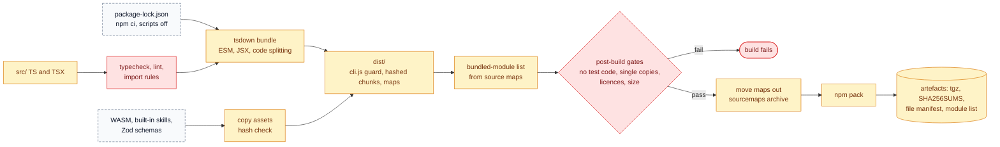

# antai — Build, CI/CD & Distribution

| | |
|---|---|
| **Product** | antai (brand) / `antai` (command) |
| **Document** | Deliverable 16, Build, CI/CD & Distribution for the v1 MVP |
| **Status** | Draft for review |
| **Version** | 0.1 |
| **Date** | 12 October 2026 |
| **Author** | Daksh Nagpal |
| **Based on** | BRD_1 v0.4, HLD.png, deliverables 00 (register), 01 (HLD), 02 (security), 04 (data and storage), 07 (agent runtime), 09 (model providers), 10 (extensibility), 11 (interface contracts), 14 (QA) and 15 (observability) |
| **How to use** | Reference design, not a fixed rail. Where the technology needs something different or extra, the implementation may change it; the change is then made in every deliverable it touches, so the set keeps agreeing. |

## Contents

1. Purpose, scope and principles
2. Repository layout
3. Build (BLD-1)
4. Dependency policy (not yet written)
5. CI pipeline (BLD-2a, BLD-2b, BLD-4) (not yet written)
6. Testing in CI (not yet written)
7. Versioning and release flow (BLD-3) (not yet written)
8. Distribution (not yet written)
9. Supply chain (not yet written)
10. Developer environment (not yet written)
11. Ownership and runbook pointers (not yet written)
12. Design decisions (not yet written)
13. Open questions (not yet written)
14. Traceability (not yet written)
15. Sources (not yet written)

Sections 4 to 15 are not yet written; references to them in sections 1 to 3 name where that content will go.

---

## 1. Purpose, scope and principles

### 1.1 Purpose

This document says how antai's source becomes the package a user installs, and how every change is checked on the way. It covers the repository layout, the build, the dependency rules, the GitLab CI pipeline and its runners, versioning, the release flow, the npm package, the supply-chain controls and the developer set-up.

It is the input for three ADRs that DLV-PLN-04 requires: the build tool, bundling and dependency pinning, and the CI and release topology. The CI and release topology works for both answers to BRD Q1 (public or internal), as the register's P0 exit check demands; the internal answer, the register's default, is the base plan.

### 1.2 Scope and related deliverables

| In this document | Detailed in |
|---|---|
| Repository layout, build, bundling, package contents, dependency policy, CI stages, runners, OS × Node matrix, secrets in CI, versioning, release flow, registries, publishing, install and upgrade, SBOM, audit, licences, developer set-up, ownership | here |
| Module map and import rules that CI enforces | deliverable 01, section 8 |
| Entry-chunk contents, lazy loading, start-up budget | deliverable 07, section 10 (RT-7, RT-D15) |
| Test layers, test cases, Ink test harness, acceptance scenario plan, entry and exit criteria | deliverable 14 |
| Benchmark method, debug log, crash reports | deliverable 15 |
| Exit codes and the message catalogue | deliverable 11 |
| Supply chain as a threat actor (ACT-10) | deliverable 02, section 2.2 |
| On-disk format versions, which matter for upgrade and downgrade | deliverable 04, section 10 |

### 1.3 Principles

| # | Principle | What it means here | Why |
|---|---|---|---|
| P1 | Reproducible builds | The same commit, lock file and pinned toolchain produce the same files in `dist/`. Output holds no build date, host name or absolute path. The tag pipeline rebuilds and compares (section 3.12). | A second build (a reviewer, or the public mirror that adds provenance) can prove the published bytes come from the tagged source |
| P2 | Exact pins | Every version in `package.json` is exact. `package-lock.json` is committed. CI installs with `npm ci`. CI images and tools are pinned by version, and images also by digest. | `ai` ships about 1.3 patch releases a day; consumers never receive the lock file |
| P3 | No install scripts | No dependency needs `preinstall`, `install` or `postinstall`. CI installs with scripts off. The published package has none. | npm 12 blocks dependency install scripts by default; the 2025 npm worm spread through them |
| P4 | No native dependencies | Runtime code is JavaScript and WASM only. Native binaries are allowed only in development tools. | NFR-COMP-04; one package for every OS and CPU in NFR-COMP-01 |
| P5 | Same artefact tested and released | The tarball is built once, on Linux, in the tag pipeline. Every install test on every OS installs that file. The publish step uploads that file, and its integrity is checked after publishing. | No gap between what was tested and what users get (DLV-REL-01) |
| P6 | Least-privilege CI | Merge-request pipelines hold no secrets. Provider keys reach only jobs on protected refs: scheduled runs, the post-merge eval on `develop` (16-P3) and release candidates. Publish credentials reach only the protected release job. | A compromised test or dependency in a merge request cannot reach publish rights or paid keys |
| P7 | Checked, not trusted | Import rules, path joins, single package copies, size, licences and the absence of test code are checked by CI, not left to review. | Rules that are not checked decay (HLD-D11) |

### 1.4 Additions beyond BRD v0.4

These go beyond BRD v0.4. The design uses them as stated; the BRD can adopt them later.

| Ref | What this document uses | BRD v0.4 text |
|---|---|---|
| CR-03 | Package `@geekyants/antai`, command `antai`; install line `npm install -g @geekyants/antai` | 4.1, NFR-COMP-04, NFR-USE-01 and D21 say `antai` |
| CR-05 | The build tool is named in an ADR (this document proposes `tsdown`) | 7.1 says "e.g. `tsup`", which is unmaintained |
| CR-07 | Test on Node 22, 24 and 26; no dependency that needs install scripts | 3.2 recommends 24 only |
| CR-11 | Three-OS CI on every merge request from P2 | Section 10 has Linux and macOS CI from P1 and Windows CI from P2, but does not say every merge request |
| CR-14 | Two register questions join the BRD list: Groq free plan as default (Q9) and package name (Q10); BRD Q4 already covers the macOS runner (Q8). This document does not wait on them: it uses `@geekyants/antai` and its own macOS runner on git.geekyants.com | Not yet in 12.4 |
| 16-P1 | NFR-SEC-04: drop "(or ship `npm-shrinkwrap.json`)". npm 12 no longer honours shrinkwrap, so bundling is the only way to fix transitive versions | NFR-SEC-04 offers both |
| 16-P2 | D21 "Publish with 2FA and provenance": provenance is possible only from GitHub Actions or GitLab.com, for a public repository. From git.geekyants.com, publishing uses staged publishing with a 2FA approval and has no provenance | D21 requires provenance |
| 16-P3 | DLV-SW-08 "every change re-runs the eval suite": the eval runs after merge on `develop`, because provider keys are not available to merge-request pipelines (principle P6) | Register, not BRD |
| 16-P4 | Phase increments are versioned `1.0.0-p<N>.<n>` alongside the gate tags `p1` to `p5` (DLV-SW-01) | Register names tags only |
| 16-P5 | The package `files` list is `["dist", "THIRD_PARTY_NOTICES"]` (deliverable 01, section 6.2 now lists the same), because bundled code must carry its licence notices | Deliverable 01, section 6.2 |

---

## 2. Repository layout

### 2.1 Top level

The design documents live in `docs/Deliverables/` (deliverables 00 to 16). `src/` follows deliverable 01, section 8.1 without change: its folders are the boxes of HLD.png, plus `cli/`, `rules/`, `sdk/` and `shared/`, which deliverable 01, section 1.3 explains. New here are `ci/`, `build/`, `scripts/` and `.githooks/`.

```
.gitlab-ci.yml               VER-09 pipeline entry; includes ci/*.yml
.gitattributes               LF for every text file, *.wasm binary (Windows checkouts keep fixtures byte-identical)
.editorconfig                UTF-8, LF, 2 spaces, final newline
.npmrc                       install policy for contributors and CI (section 4.2)
.node-version                exact Node version for development and the release build
.changeset/                  pending changesets and config.json (section 7.2)
.githooks/                   pre-commit and commit-msg hooks, enabled by `npm run hooks` (section 10.4)
.github/workflows/           only if a public GitHub mirror is set up for a public release (section 5.4)
ci/                          CI job files per OS, versions.yml (pinned images and Node versions),
                             allowed_signers (tag signing keys), audit-exceptions.json, quarantine.json
build/                       size-budget.json, licence-policy.json, single-instance.json,
                             asset-hashes.json (expected SHA-256 of WASM assets)
scripts/                     Node scripts behind npm scripts: check-dist, bundled-modules, sbom,
                             notices, package-manifest, release-notes, symbolicate, install-hooks
src/                         SW-02 to SW-10; module map in deliverable 01, section 8.1
test/                        VER-01 to VER-05; mirrors src/, plus fixtures/, support/ (test entry
                             and `mock:` provider), injection/, interop/, smoke/, bench/ (VER-08 harness)
evals/                       VER-06 tasks, graders and fixture repositories
docs/                        Deliverables/ (this design set), adr/, guide/, project/, reports/
BRD_1.md, HLD.png            requirements and the hand-drawn source architecture
package.json                 manifest; runtime libraries listed as exact devDependencies (section 4.1)
package-lock.json            lockfileVersion 3, committed
tsconfig.json                strict, noEmit, `jsx: react-jsx`
tsdown.config.ts             release and test build definitions
eslint.config.js             typescript-eslint, import restrictions, path-join rule
.dependency-cruiser.cjs      folder import rules of deliverable 01, section 8.2
commitlint.config.js         Conventional Commits rules
renovate.json                only if Renovate runs on git.geekyants.com
README.md, CHANGELOG.md, CONTRIBUTING.md, SECURITY.md, LICENSE, THIRD_PARTY_NOTICES
dist/, dist-test/            build output, git-ignored
```

### 2.2 Generated and committed files

| File | Generated by | Committed | Why |
|---|---|---|---|
| `package-lock.json` | `npm install` | Yes | Fixes the tree for CI and the bundle (P2) |
| `CHANGELOG.md` | `changeset version` in the Version merge request | Yes | Reviewed with the release (DOC-09) |
| `THIRD_PARTY_NOTICES` | `npm run notices` from the bundled-module list (section 9.6) | Yes; CI fails if it is out of date | A dependency change shows its licence change in the same merge-request diff |
| JSON Schemas (DLV-SW-09) | `npm run schemas` from the Zod definitions (HLD-D13) | No; built into `dist/schemas/` | One source; the reference docs are generated from the same run |
| `dist/`, `dist-test/` | `npm run build`, `npm run build:test` | No | Built in CI from the tag |
| SBOM, `SHA256SUMS`, file manifest, source-map archive | Tag pipeline | No; attached to the GitLab release | Release evidence (DLV-REL-02) |

---

## 3. Build

### 3.1 Toolchain

Versions are the latest checked on 12 October 2026. Each is pinned exactly in `package.json`; "to be confirmed in the P0 spike" means the spike fixes the version.

| Tool | Version | Role | Why this one | Fallback |
|---|---|---|---|---|
| Node.js | Release build on Node 24 (exact patch in `.node-version`); tests on 22, 24, 26 | Runtime and build host | `ai` and Ink require 22 or newer; `tsdown` needs 22.18 or newer, `vitest` 22.12 or newer | — |
| npm | 12.x, exact in `ci/versions.yml` | Install, pack, publish | Same behaviour users get: install scripts blocked, shrinkwrap ignored | npm 11.x for local work only |
| TypeScript | 6.0.x (the AI SDK pins 6.0.3) | Type check only (`tsc --noEmit`) | Strict mode (NFR-MNT-04). TypeScript 7.0.2 exposes only unstable APIs and may break `typescript-eslint` | Stay on 6.0.x until a spike passes on 7 |
| `tsdown` | 0.23.1 | Bundler | Section 3.2 | esbuild, then Rolldown directly |
| `vitest` | 5.0.4 | Test runner | ESM and TypeScript native | 4.1.x (maintained, used by the AI SDK) |
| ESLint, `typescript-eslint`, dependency-cruiser | To be confirmed in the P0 spike | Lint and import rules (deliverable 01, section 8.3) | Already chosen in deliverable 01 | ESLint only |
| Prettier | To be confirmed in the P0 spike | Formatting (NFR-MNT-04) | Pure JavaScript, no native binary | — |
| Changesets, commitlint | To be confirmed in the P0 spike | Versions, changelog, commit format (section 7) | Version bumps and changelog entries are files reviewed in the merge request; commit messages keep one format | semantic-release |
| `@cyclonedx/cyclonedx-npm` | To be confirmed in the P0 spike | SBOM, CycloneDX 1.6 | Writes CycloneDX 1.6, the format DLV-REL-02 requires | `npm sbom` |

### 3.2 Bundler choice

**Choice: `tsdown` 0.23.1, pinned exactly.** BRD 7.1 names `tsup`, but its README now says it is not maintained and points to `tsdown` (CR-05).

Reasons:

- It is the maintained successor of `tsup` and an official Rolldown project, and the AI SDK, antai's largest dependency, builds with it.
- It outputs ESM by default and reads `target` from `engines.node`.
- It controls bundling per package (`deps: { alwaysBundle | neverBundle | onlyBundle }`), which is what HLD-D12 needs.
- It handles TSX, code splitting for dynamic `import()`, and source maps.

Risks: it is pre-1.0, so options change between minors (0.22 removed the `tsup`-compatible options in 0.23). The exact pin and the dist checks in section 3.11 contain this. P0 confirms four things on a spike branch: the hashbang banner on `dist/cli.js`, lazy chunks for Ink with `yoga-layout`'s WASM, copying the bash grammar WASM, and source maps that list `node_modules` sources (section 3.7 depends on it).

**Fallback: esbuild directly** (ESM output, `splitting`, JSX; to be confirmed in the P0 spike), then Rolldown directly. Switch if `tsdown` fails a P0 item or a minor update breaks the dist checks twice in one phase. The bundler is called only from `tsdown.config.ts` and `npm run build`, so a switch touches no source file.

### 3.3 TypeScript, JSX and module format

| Setting | Value | Why |
|---|---|---|
| `package.json` `type` | `module` | `ai`, `@ai-sdk/*` and Ink are ESM only |
| `compilerOptions.strict` | `true` | NFR-MNT-04 |
| `module`, `moduleResolution` | `NodeNext` | Type checking matches Node's ESM rules, including file extensions in relative imports |
| `jsx` | `react-jsx` | Ink 8 with React 19.3; no `React` import needed |
| `.tsx` files | Only under `src/ui/ink/` | Ink and React stay out of every other folder (deliverable 01, section 8.2) |
| `noEmit` | `true` | `tsc` only checks; `tsdown` emits |
| Bundle target | Node 22 (from `engines`) | Lowest supported runtime |

### 3.4 Bundling strategy

**Every runtime library is bundled into `dist/`** (HLD-D12, NFR-SEC-04). The published manifest has no `dependencies`, so `npm install -g` fetches one tarball and resolves nothing else. Consumers therefore get exactly the versions CI tested, and npm 12's install-script rules cannot affect them.

Chunks follow deliverable 07, RT-D15. Each lazy chunk is reached only by a dynamic `import()` in the module named.

| Chunk | Contents | Loaded | Imported from |
|---|---|---|---|
| `cli.js` (entry) | Node version guard, then `import()` of `main` (section 3.8) | Start | — |
| `main` | `CLI`, `BOOT`, `LIFE`, `CFG`, `TRUST`, `CRED`, `PRF`, `REG` (resolve half), `SC`, `BUS`, `LINE`, `PLAIN`, `RED` core, `PLAT`, `MSG`, `ERR`, Zod schemas, model catalogue data (deliverable 09, section 4) | Start | `cli.js` |
| `ink` | Ink 8, React 19.3, `react-reconciler`, `yoga-layout`, the Markdown renderer, `src/ui/ink/` | TTY sessions, step 8 of RT-7 | `BOOT` |
| `agent` | `ai`, `src/agent/`, `RTY`, `TREG`, `BT`, `POL`, `PG` | Preloaded after the first frame | `SC` |
| one chunk per provider | `@ai-sdk/groq`, `google`, `openai`, `anthropic`, `openai-compatible`, the Ollama provider | Preload of the selected provider; others on `/model` | `REG` |
| `mcp` | `@ai-sdk/mcp`, `MCPM`, `MA`, `MOA`, `OCB` | First MCP connect | `SC` |
| `parser` | `web-tree-sitter` and `CLS` | Preloaded when `shell` is registered | `POL` |
| `tokenizer` | `gpt-tokenizer` with `o200k_harmony` (2.4 MB rank data) | Preloaded for gpt-oss models only | `CAT` (the token estimator `PR` and `RTY` call) |

Rules:

- Chunk files are named `<name>-<content hash>.js` and sit flat in `dist/`, next to `cli.js`, so `import.meta.url` gives the same folder in every chunk and asset paths resolve from it.
- React, Ink, Zod, `@ai-sdk/provider` and `@ai-sdk/provider-utils` must exist once in the bundle. A post-build check counts versions per package (section 3.7) against `build/single-instance.json`. Pins are aligned so `ai` and every `@ai-sdk/*` package resolve to one `@ai-sdk/provider` version; if no released set aligns, `overrides` in `package.json` force the newer patch, which works for antai because the bundle is built from antai's own tree. The mock-model suite is the check.
- `ai@7.0.137` depends on `@ai-sdk/gateway`. antai never passes a string model ID, so it never calls the gateway; the network test (DLV-VER-01, NFR-PRIV-01) proves no request goes there.
- ripgrep is never bundled or downloaded; `SRCH` uses `rg` from `PATH` only (HLD-D15).
- No minification by default. Readable function names keep crash reports useful and keep `dist/` reviewable. P0 measures start-up with and without it, and the release switches only if NFR-PERF-01 needs it.

### 3.5 Assets

| Asset | Source | In the package | Located at run time by |
|---|---|---|---|
| `web-tree-sitter` runtime WASM and the `tree-sitter-bash` grammar WASM | Pinned npm packages; whether the grammar package ships a prebuilt `.wasm` is to be confirmed in the P0 spike | `dist/assets/tree-sitter/` | `new URL('./assets/tree-sitter/…', import.meta.url)` in the `parser` chunk |
| Built-in skills `repo-tour`, `commit-message`, `explain-error` | `src/context/skills/` (deliverable 10, section 5.7) | `dist/skills/<name>/SKILL.md` and any files in the skill folder | `SKR`, relative to `cli.js` |
| JSON Schemas (config, MCP files, frontmatter, session and audit records, `--json` events, the `antai config` and `antai mcp list` documents) | Generated from Zod (DLV-SW-09) | `dist/schemas/` | Not read by antai; published so editors and AC-20 validators use the schema of the installed version (content owned by deliverable 11) |
| Model catalogue and provider profiles | `src/providers/catalog/models.json`, `providers.json` | Inside the `main` chunk (JSON import) | Imported |
| Safety rules (DLV-SW-07) | `src/rules/*.ts` | Inside `main` and `parser` | Imported |

The build copies each WASM file and compares its SHA-256 with `build/asset-hashes.json`. A changed hash fails the build until a reviewer updates the file in the same merge request as the package update, so a grammar cannot change unnoticed. Assets are not inlined as base64: that would add about a third to their size and load them with the chunk even when unused.

### 3.6 Release build and test build

Deliverable 07 (RT-D17) puts the `mock:` provider in a test build only. Two build definitions in `tsdown.config.ts` share everything except the entry:

| | Release build | Test build |
|---|---|---|
| Entry | `src/cli/main.ts` | `test/support/test-cli.ts`, which calls the same composition root and registers the `mock:` provider from `test/support/` |
| Output | `dist/` | `dist-test/` (never packed) |
| Used by | Package, smoke tests, benchmarks | `LINE`-driven scenario tests (deliverable 07, section 12) |

Three checks keep test code out of the release:

1. dependency-cruiser forbids any `src/` module from importing `test/` or `ai/test`.
2. `scripts/check-dist.mjs` fails if `dist/` contains `ai/test`, `MockLanguageModel`, the test build's marker constant, any `test/` source path, or any file not on the allow-list of section 3.9.
3. The smoke test (section 8.5) runs the installed package against a local fake OpenAI-compatible server configured as a custom provider (FR-MOD-08). The release bundle needs no test hook to be tested end to end.

### 3.7 Source maps and the bundled-module list

Every build writes source maps. They are **not** shipped in the package: they would roughly double its size, and stack traces in crash reports already carry readable function names because the bundle is not minified. The tag pipeline packs them into `antai-<version>-sourcemaps.tgz`, attached to the GitLab release. `npm run symbolicate -- <crash report>` maps a crash report from a user (deliverable 04, section 5.15, which records `antaiVersion`) back to source lines.

The `sources` arrays of the maps list every original file in the bundle, including `node_modules/<package>/…` paths. `scripts/bundled-modules.mjs` turns them into the **bundled-module list**: each package name and version that is actually shipped, read from that package's own `package.json`. This list, not `dependencies`, is the source of truth for what antai ships. It drives:

- the single-instance check (section 3.4);
- the licence check and `THIRD_PARTY_NOTICES` (section 9.6);
- the SBOM component filter (section 9.1);
- the audit split between shipped and tooling packages (section 9.2);
- the merge-request report of packages that entered or left the bundle (section 4.4).

Using the maps keeps this independent of the bundler (the P0 spike confirms that `tsdown` writes `node_modules` paths, section 3.2).

### 3.8 Entry file and `bin`

`dist/cli.js` is a small file with no static imports:

1. Hashbang `#!/usr/bin/env node`.
2. Read `process.versions.node`. Below 22: print "antai needs Node.js 22 or newer. You have <version>. Install Node 24 or 26 from nodejs.org." to stderr and exit with code 2 (usage or config error, FR-UI-06).
3. `await import('./main-<hash>.js')`.

Why: ESM static imports are evaluated before the importing module's body runs, so a guard placed in the main module would come too late on an old Node. `engines` alone does not stop an install; npm only warns unless `engine-strict` is set. The guard's message is a literal because the message catalogue (`MSG`) is in `main`; the catalogue test (NFR-USE-02) includes it through a named export.

npm creates the platform launchers from `bin` at install time: a symlink on macOS and Linux, and `antai.cmd`, `antai.ps1` and a shell script on Windows, so the command works in cmd, PowerShell and Git Bash.

**Upgrade while running.** A session that is running when the user upgrades still has old chunk names in memory. Its next lazy `import()` finds the file gone, because names carry content hashes, and fails cleanly rather than mixing two versions. `BOOT` catches that failure and shows a catalogue message: "antai was updated while this session was running. Restart antai; `antai --continue` resumes this session." Preloading after the first frame (RT-D15) makes this rare.

### 3.9 Published package manifest

| Field | Value | Why |
|---|---|---|
| `name` | `@geekyants/antai` | CR-03 (beyond the BRD, section 1.4) |
| `version` | Set by Changesets (section 7) | — |
| `type` | `module` | Section 3.3 |
| `bin` | `{ "antai": "dist/cli.js" }` | Command stays `antai` |
| `files` | `["dist", "THIRD_PARTY_NOTICES"]` | Allow-list (16-P5). npm adds `package.json`, `README.md` and `LICENSE` itself. Source maps are moved out of `dist/` before packing (section 3.7), and `check-dist` fails if a `.map` file remains |
| `exports` | `{ "./package.json": "./package.json" }` | antai has no programmatic API in v1; deep imports of internals fail instead of becoming a de facto API |
| `engines` | `{ "node": ">=22" }` | BRD 3.2; stays `>=22` unless P0 finds a runtime API that needs a later 22.x minor |
| `dependencies` | none | Everything is bundled (section 3.4) |
| `devDependencies` | Every runtime library and tool, exact versions | Section 4.1 |
| `scripts` | Development scripts only; no `preinstall`, `install`, `postinstall` or `prepare` | P3. `prepublishOnly` runs `scripts/refuse-local-publish.mjs`, which fails unless the release job's marker is set, so a publish from a laptop folder is refused |
| `repository` | git.geekyants.com project; the public mirror URL if provenance is used (section 8.4) | Provenance requires an exact match with the signing repository |
| `license` | `UNLICENSED` for the internal release; `MIT` or `Apache-2.0` if a public release picks one (BRD Q2) | npm convention for proprietary packages |
| `publishConfig` | Not set; the release job passes registry and `--access` explicitly | npm 12's publish library no longer infers public access for scoped packages; explicit flags in one place are easier to review |

### 3.10 Size budget

Initial targets, written to `build/size-budget.json` and recalibrated from the P0 measurement. The `size` job reads `npm pack --dry-run --json` and fails when a value is exceeded. Raising a budget is a reviewed change to that file, with the reason in the merge request.

| Measure | Initial budget | Why it matters |
|---|---|---|
| Tarball (gzip) | 6 MB | `npx` download time, registry storage |
| Unpacked size | 20 MB | Global install size; the tokenizer data alone is 2.4 MB (deliverable 01, section 6.2) |
| `cli.js` plus `main` chunk | 1.5 MB | 150 ms for Node start and entry evaluation (RT-7, step 1) |
| `ink` chunk | 2 MB | 200 ms (RT-7, step 8) |
| Files in the package | 150 | Install time on Windows, where antivirus scans each file |

### 3.11 BLD-1 Build pipeline

Colours: amber build and infrastructure, red checks that gate, purple orchestration, dashed grey external.



### 3.12 Reproducibility

| Input | How it is fixed |
|---|---|
| Source | The tagged commit |
| Dependencies | `npm ci` from the committed lock file; `npm audit signatures` checks registry signatures |
| Toolchain | Node and npm exact versions from `ci/versions.yml`; Linux image pinned by digest; `tsdown` and TypeScript exact |
| Output content | No timestamps, host names or absolute paths; the version string comes from `package.json` at build time; chunk names are content hashes |

The tag pipeline builds twice in separate jobs and compares the file manifest (`scripts/package-manifest.mjs`: path, size and SHA-256 of every file in the unpacked tarball). The manifest is compared instead of the `.tgz`, because gzip output may differ between zlib versions even when the files are equal. A mismatch fails the release.
